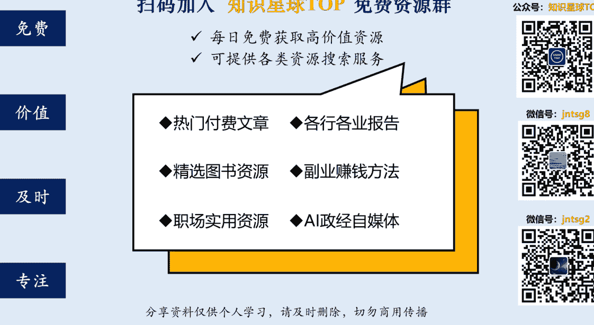

# 必然被加码的禁酒令

发布时间：2025年6月17日

新一轮八项规定属于中央层面出台的政策，除非遭遇国际形势巨变，否则可能延短期内有所调整，可以参考上一轮经济周期......只有遭遇新冠疫情这类全球冲击时，需要医护人员带头冲击时，才能延缓三明的推进。

或者说，正是因为2020年新冠疫情的冲击，迫中央暂停执行自2013年开始执行的八项规定，才会允许公务人员带头消费刺激和恢复低迷的经济，更多文章加载：pep458。随着中央提出了新的A1+经济，就会要收回之前的一系列旧旧政策，所以以往妄图国家层面会收回和调整政策。

而在地方层面，基于人性的角度，面对中央层面的压力，各地方政府对禁酒令都会出现不同的加码。对于上进心，适度加码就是自身晋升的阶梯；对于没有上进心，过度加码就可以对抗中央的政策；还有一小撮野心，可以借中央加码打压政治对手。

在各力量都有加码的诉求，最终的执行力度就一定会超越中央原本的诉求。

微信号:jntsg8 微信号:jntsg22
免费进资料群

## 中共中央、国务院印发《党政机关厉行节约反浪费条例》

来源：中国政府网国务院公报2013年第34号

第二一条 党政机关应当严格执行国内公务接待标准，实行接待支出总额控制制度。接待单位应当严格按照标准安排接待对象的住宿用房，协助安排用餐的按标准收取食费，不得在接待费中列支应当由接待对象承担的费用，不得以举办会议、培训等名义列支、转移、隐匿经费开。

## 中共中央、国务院印发《党政机关厉行节约反浪费条例》更多章加：peg458

来源：中国政府网/新华社发布时间：2025年05月18日

第二十三条 政机关应当严格执行国内公务接待标准，实行接待支出总额控制制度。接待单位应当严格按照标准安排接待对象的住宿用房，协助安排用餐、车辆的按照标准收取伙费、交通费。工作不得提供高档菜肴，不得提供香烟、……上酒。

## 6月18日补充更新：

### 人民网评：禁止违规吃喝，不是吃喝都违规
来源：人民网发布时间：2025年06月17日02:47

各地纵深推进违规吃喝专项整改，剑指权力寻租、公款滥用等危害，是正风气的必然选择。但在执行链条中，个别地方“层层加码”，把“禁止违规吃喝”简单等等同于“禁止吃喝”，也是懒主义的变种，让商人失去了烟火气，黯淡。

