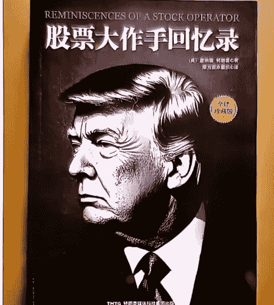

# 全球开启国有化浪潮，谁收益？

微信公众号：jntsg2
发布时间：2025年8月27日

免费进资料群

资本与政治力量扶持代理人上权的宝座，是为了让代理人推行他们的政策。

最近特朗普持股英特尔并不是特朗普喜欢国有化，而是支持特朗普的国际集团喜欢“国有化”。

2017年特朗普刚上台，中国政府成立了互联网投资基金CIIF，对国内所有的新生产力平台注册获取黄金股权，一些国资在跟华为挑起科技战，特朗普为华为由头国资入股成为了一家国企。之后隐密被特朗普挑起对抖音、阿里、腾讯的调查，也是为了获取这些平台公司的股权。

强制取得股权并不是为了打压这些企业，是因为政策的制定者知道新政策有利于哪些行业，他们要赶在政策前IPO之前入股，形成严密的利益绑定。反之，当政策的制定者推出政策U转之后，美国也对平台反垄断之下的中国平台公司突然变得毫无兴趣。

微信jntsg2，资料分享群

站在美国的逻辑角度看问题，特朗普要英特尔的股权，是因为特朗普要通过财政政策来支持英特尔，那么逻辑上英特尔就需要为这笔财政支持给美国政府股权。

特朗普要TikTok的股权，是因为特朗普要入住TikTok把其变成自己的宣大喇叭，那TikTok就需要向特朗普要通过出让股权的方式缴纳名额。

可以非常确定的是，哪些行业被特朗普要国有化，意味着哪些行业会在未来的四年里长红。

如其特朗普要国有化TikTok平台，那在中国，受益的标就是平台公司腾讯、阿里；如其特朗普要“国有化”发币，那在中国，受益的标就是数字货币大饼和二饼；如其特朗普要国有化英特尔，那在中国，受益的标就会是半导体寒武纪中；未来，特朗普若是国有化洛希德·马丁的股份，那在中国，受益的标就会是军工股……

加微信jntsg2，进资料分享群

不要怀疑，掌握全球最大内幕交易的特朗普是最懂炒股的。

## 延伸阅读

> Trump says government will make deals like Intel stake ‘all day long'

特朗普宣称政府将“整天”进行类似英特尔股份的交易 微信pep458
来源：CNBC 2025年8月25日

特朗普周一（8月25日）夸耀政府在英特尔的新股份并表示他决心做类似类似的交易。

微信jntsg2，资料分享群

在Truth Social 上发帖“我会整天为我们的国家达成这样的交易。”(I will make deals like that for our Country all day long.)

白宫周五（8月22日）宣布，将收购这家芯片制造巨头约10%的股份，这标志着美国联邦政府进一步介入私营企业。这笔股份价值约88亿美元，其中一部分将来自于《芯片与科学法案》（CHIPS Act）相关的拨款，其余部分将来自于制造安全芯片相关的项目相关的政府的单独拨款。

特朗普曾于2月初签署了一项行政命令，启动主权财富基金（sovereign wealth fund，是由国家政府设立和管理的、以实现国家长期经济利益为目标的专业化投资机构）。

--------------------------------------------------------------------------------
寒武纪，凭什么

来源：中国新闻周刊 2025年8月27日

8月27日，寒武股价一度涨超10%，盘中触及1464.98元/股，超越贵州茅台，成为当前A股股价最高的股票。虽然其股价后续回落，但“闪现”的“新股王”仍令市场一度沸腾。

--- END ---

# 加微信jntsg2，进资料分享群

# 知识星球TOP
付费资源分享群

添加微信
免费入群
微信: jntsg2

| 序号 | 公号/星球/社群 | 原价 | 领域 |
|---|---|---|---|
| 1 | 生业有木 | 2765/年 | 副业、搞钱 |
| 2 | 怂众从吃瓜群 | 365/年 | 时政，历史 |
| 3 | 记忆承载/碧树西风 | 365元/年 | 成长，搞钱 |
| 4 | 欧洲金靴 | 328元/年 | 时政，历史 |
| 5 | 卢克文青会 | 699/年 | 时政，社会 |
| 6 | 体制内主任 | 599/年 | 体制；职场 |
| 7 | 后外人的视界 | 669/年 | 金融，时政 |
| 8 | 灏泽异谈 | 4166/年 | 财富，成长 |
| 9 | 守夜人总令 | 599/年 | 时政、经济 |
| 10 | 江宁府 | 365/篇 | 时政、国际 |
| 11 | 政堂/顾子明 | 568/年 | 时政、经济 |
| 12 | 唐书院 | 1399/篇 | 金融、财富 |
| 13 | 大树乡谈 | 199/年 | 时政、成长 |
| 14 | 水库欧大 | 10000远 | 房产、经济 |
| 15 | 洪灏的宏观策略 | 4376/年 | 经济、搞钱 |
| 16 | 金政通鉴/北海道南山 | 4576/年 | 股票、行研 |
| 17 | 猫豹的世界 | 299/年 | 时政、社会 |
| 18 | 飞浅云 | 3600/年 | 股市、经济 |
| 19 | 米联债见闻 | 599/年 | 经济、金融 |
| 20 | 鉴茶财经院 | 330/年 | 房产、股票 |
| 21 | 赢在八小时之外 | 365元/年 | 成长、职场 |
| ... | | | 更多资源，不再列举 |
