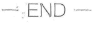

# 易会满与他的股市

发布时间：2025年9月8日

中国股市的本质就是搞钱，来给新上台的利益集团的产业进行募资，也是因为募资的结果导向，所以允许一部分资本集团的先行参与者能够挣到钱。

中国体制决定的每十年一次大换届，都会让一个新的利益集团集体上位，而这个利益集团为了抓紧这十年极速扩张，就很有必要用到资本市场这个最大的杠杆来募资。

同样是根据体制，十年的周期，分两个阶段：前五年的大换届，是幻想期；后五年的小换届，是现实期。对应每一轮的新兴产业来看，前五年是复苏、繁荣和波峰，后五年是萧条、衰退和谷底。

以上一个十年周期的“五年”梦想期为例，开始于 2014 年的阿里 IPO，终止于 2020 年的蚂蚁 IPO。

可以说上一个经济周期是马云的时代，他就是上一个时代的最佳锚定，他说房价如炬，在那一轮的经济周期之未兑。

易会满，在经过一系列复杂的博弈后，接替了监管，成为上一轮经济周期的守门人。轰烈烈的科创就出来了，力推易会满上台的江苏势力进行了海量的融资，迅速做大，成为了中国创新科技的先锋，也让浙江成为一股不可忽视的政治力量。

易会满能够上台，当然是他背后江苏新军的支持。作为那一轮十年周期中最快最上台的团体，自然可以看着梦期通过证券发行权迅速做大自己。同时，大的经济基础反作用于上层建筑后，会在增量下滑的后五年实现蚕占其他大佬的蛋糕。增量时候还能忍，存在时候不能忍，易会满和他批准通过的蚂蚁自然也会成为众对我狙击的首要目标。

如今，蒋立超了，卸任已久的易会满官宣落马，标志着对上一轮的融资清算大幕在徐徐拉开，也标志着新一轮的经济周期的融资浪即将到来。

延伸阅读

## 阿里今晚在纽交所挂牌上市 美股迎来历史上最大IPO
来源：中国广播 2014年09月19日

此刻是美国当地时间9月19号凌晨5点半，刚刚刚完50岁生日的马云，正在等待着3多个小时后即刻将在美国纽交所敲响的钟声。这一刻，马云等了15年。这是中央台前南方特记者记录下的：阿里上市前夜。

## 蚂蚁集团暂缓上市 保护投资者利益的坚定决心
来源：经济日报客户端 2020年11月03日

顶着全球最强、本年度全球最大IPO之名的蚂蚁集团，被暂缓上市了。

此前，蚂蚁集团经过各方批准，按相关程序走到在，正在静候上市。近期，有关方面经过一步的解释，发现了某些问题。本着发现问题，解决问题，一切从维护金融消费者权益、保护广大投资者利益的角度出发，监管决定让蚂蚁集团暂缓上市。

## 重磅！易会满任中国证监会主席
来源：央视新闻客户端 2019年1月26日

2019年1月26日，任命易会满同志为中国证监会委员会党委书记，中国证监会主席。

## 科创板正式开市！中国资本市场迎来历史时刻
来源：人民网 2019年7月22日

2019年7月22日，科创板正式开市！中国资本市场迎来了一个全新的板块。截至上午9时31分，科创板首批上市的25家公司全线上涨。

回顾过去8个月，“科创板”从首次提出到开市交易，以令人惊叹的创新速度印证了中国的创新力度！

## 深度视野优质集团（链接优质社群，助你成功）

全部包含以下内容：限时年费188/年 加微信cuk255

- ① 吃瓜群众倍帝含文加时群对话（原价 365 元/年）
- ② 子明私享会（内部）优质文章（原价 568 元/年）
- ③ 政事室（子明优）付费内加送额外子明群聊
- ④ 米联锦获【作者米榛】原价 599 元/年）
- ⑤ 欧洲金雀会员专属文章（原价 328 元/年）
- ⑥ 钨瓦内部文档（原价 400 元/年）
- ⑦ 卢克文会专属文章（原价 699 元/年）
- ⑧ 鉴茶财经星球（原价 3310 元/年）
- ⑨ 猫哥的视界星球（原价 299 元/年）
- ⑩ 财新周【独家新闻】原价 1498 元/年
- ⑪ 杨世在金圈（原价 2200 元/年）
- ⑫ 森淼财经星球（原价 1600 元/年）
- ⑬ 激源异读付费文章（持续更新）
- ⑭ 司马林解读谋选全套音频和全套书籍无损减（原价 2.3 万）
- ⑮ 虚虎三部曲[国梦、帝国战争、不被理解的 MAO](原价 599 元）
- ⑯ 克星球文章（原价 268 元/年）
- ⑰ 额外再送：卢锐新源付费专栏、三村丰老王、三花九术文集
