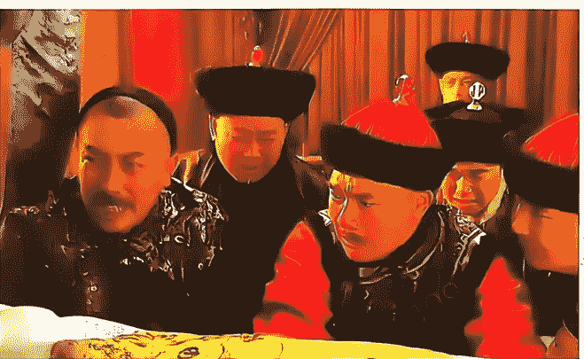

# 康熙帝的储君之谜

发布专栏：知几共话

本同根生，相煎何太急？

我们在9月10日发布的《非卖品的交易》，朋友们谈到了战争的残酷性——的确，战争是降低国家内部不稳定因素的最高效率：

> 看透了战争的本质，才会从心里面反思。大部分的战争本质上都是让底层底层而去送葬，现在裴癸斯利安都好了。

子明

因为帝国坏恶都上前线了。

加微信top28688，进资料分享群

战争就是降低人口效率最高的方式。

元朝统一之后，要让投降的宋军去击日本；明朝统一之后，要让投降的元军去击东北，都是消耗帝国的不稳定因素。

古代的皇帝自然也觉得这个道理，然而，历史上却有很多皇子被送往一线参与战争，这又是出于怎样的考量？成为帝国的接班人，又该具备哪些条件呢？

今天，我们就一起来聊聊那些曾身处疆与宫闽的“帝国接班人”。

战争如此残酷，康熙让大将军王去边疆的时候，究竟是怎么想的？

注释：此处“大将军王”康熙皇帝第十子胤徽。康熙五十七年（1718年），准噶叛乱并进攻西藏，胤徽被视为“大将军王”御准边界。胤徽为“四爷”雍正的同母弟，却是“八爷党”重要成员。部分史学家认为，他才是康熙满意的接班人。

微信top28688，进资资料群

那时战争的主帅通常不在最前线，基本没什么危险。

有人是去送死的，也有人是去抢军的。

拿城功能可能不重要，重要的是你别在京城就行。既然康熙已经决定传给四爷，那就不得老十四寿出北京吗？

正常来说，大将军王是更为优先的储君人。

> 历史的真相大概是，康熙的身体迅速恶化，导致无法在临死之前把老十四接回来，鉴于当时的复杂情况，得不临时换成了老四。

原来是这样，我认为是亲王权的逻辑，控制权力中心。

编者注：亲王制度是五代至宋初的一种政治制度，如果某位亲王一旦都当行政首长，则该亲王被认为是储君。但是部分学者认为这种制度是宋太宗赵匡胤通过政治手段加强了皇权的权威性。

大清前期还是草原部落，按照草原部落的历史，西北用兵的才是肯定的接班人，而且随时可以把皇权夺回来。

这也是为了什么老四上台，他的合法性一直都有些问题（注①），看一看古元的历史，就会觉得康熙是想把老十四作为储君的。

合法性的确存在问题，老四上去以后把老十四和康熙的书信往来都烧了。

大将军王手握国之重器，枪杆子里。

康熙身体迅速恶化，让老十四回来的风险就大了。

草原部落的逻辑我们汉人还是难以理解，按照扶苏之后，他们就不敢再储君长期驻。

微信top28688，进资料分享群

编者：秦始长子，由于劝谏激怒皇帝而被派往边疆。后皇临终前将帝位传扶始，但李斯等人篡改遗诏，赐死扶始。扶始的问题，她妈和大舅大概率都是问题的，皇帝对他不放心。

编者注：秦始因李信失败，以及后末楚君（原秦相），国内内部存戒备，其母及舅父。

> 自汉代以来，储君在外确实常见，除非有极大矛盾，比如唐宗在灵武接班。

编者注：唐宗优李太还是太子，参与了马嵬变，杀了杨贵妃，迫使父王李隆产生矛盾，后李隆基扬扬，是原王朝思路考虑。但当时还属于部落的状态，需要按照草原部落决策。

加微信top28688，进资料群

按照辽金逻辑，大将军王随时可以夺回自己的位，大概输了，应该是忽必带看败阿里哥。

但实在在这个负面案例中，我们也能看到贵族还是支持大将军王（注二）。不是雍正这一次，清前期的几次权力交接都不正常——薛丰被夷（注三）；皇太极崩逝，多尔哲摄政，长子，最终推出顺治妥协（注四）。康熙是什么原因从老十四变成了老四，我们不知道了。为了推进改革，康熙最后选择了老四。

如果选择了老十四，大清就要依赖贵族，改革很难推进。确实，康熙和雍正都是希望依赖军事集团，想要更多获得官僚支持。

从地缘政治上看，西北用兵，几乎就是爸爸，所以以往游牧民族看，大将军才是储君。

同样的从地缘政治看，宋朝之后江南地区的经济发展，使得谁掌握朝局，八爷才是储君。十四爷和八爷，一个握着枪杆，一个握着钱袋。

微信top2868，进资料群

但是八爷爷出身不太行吧？

八爷类类似于太子准备的磨刀石，所以十四才是很多人认为是储君。历史的时候就是这样，很多事情看似违背常理，回头看却有奇迹。电视剧里有一处设计也很巧妙，满台宫控制明确后，九门提督跳出来身份。看历史的有趣之处，就是总能在现实中找到应对……

注①：关于雍正皇帝的合法性一直存在诸多疑虑。其中《清世实录》有相关记载：在康熙二年，晋封镇国公胤徽为质子，皇帝信赴甘肃遥远大将军，印了一道密令给他：“抵达后，将将军王所有奏折、朱批谕奕之全部收缴后送还。”

十二月二十日，胤信行凉州，“闻大将军王的小福君都于十二月初五经过凉城去了”的消息，即于翌日密奏，详细述胤徽家属可能经过的路线以便正派出拦截可能带走的信息其它材料。

回京后，胤徽被禁于景山。随着雍正皇帝的日益稳固，胤徽的境况也加严酷。雍正四年（1726年），雍正查福国山贝子，令回京，禁于景山寿皇殿内。

注②：259年蒙古哥汗去世后，阿里哥试图控制漠北自立国，忽必随即叛称帝与之对峙。之所以说是“带着汉族武装”，是因为忽必在治汉地时拉拓并用了一批强大的汉人军阀，这些人在蒙古战争中崛起，拥有私人武装，控制着大量的土地和人口，在忽必与阿里哥的战争中，他们成为了绝对主力。当时草原上的贵族军事将门由于家族恩怨、利益往来支持阿里哥，这包括蒙古中央喀鲁贵族、锦萨国（金汗国）的术赤家族、祭台汗国的祭台家族、览阔台汗国的阔台家族。

注③：“贵赛焕烧猪皮”指的是1626年的宁远之战中，贵赛焕死红衣大汗死了后金首领尔哈，他的突然死亡使得权力继承被扰乱，皇太极继承，势力最大的大才却未继位。

注④：清德八年(1643年)清太宗皇极在盛京崩逝，由于其生前未确定接班人，所以权力出现真空期。皇子豪格和皇嫡子争帝位，分别受到两黄旗和两白旗的支持。

多尔哲采取了“打压”策略，他利用豪格一时的谦辞和两黄旗“立尊皇子”的底线，坚决绝了豪格。
