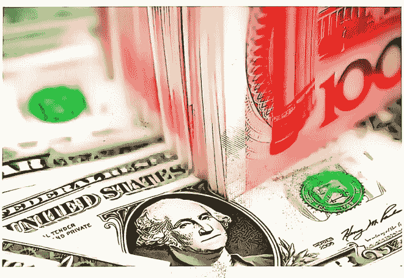

# 圈内生态和你死我活的勾兑

发布专栏：知几共话

圈子内部，是互利互惠的拉扯，圈子之间，是你死我活的勾兑。

微信进资料群

2025年10月7日，俄罗斯石油贸易商已经开始要求印度炼油厂用人民币支付。

最近，作为印度最大炼油商的印度石油公司，已经用人民币支付了两到三批俄罗斯石油货运。

微信进top28688，进阶资料分享

人民币逐渐成为部分国家的国际结算货币，这是我国国力提升的综合体现，还是圈子争的必然反应？想要吸引盟友需要注意哪些方面呢？国际谈判中大家究竟更看重“里子”还是“面子”呢？

# 01
新循环与新圈子

10月9日 9:35

俄罗斯开始向印度炼油商要求用人民币支付了，这也算是人民币国际化的重要一步。

沙特石油-中国制造-美元结算的老石油循环，逐步走向俄罗斯石油-印度制造-人民币结算的新油循环。

澳大利亚铁矿也用人民币结算了，距离我们实现亚洲循环，欧亚一体化的目标又近了一点。

微信微信208688，进资料分享群

澳大利亚这个事，对方同意了吗？

按我们的惯例，既然放出来了，牛吹出去了，基本上就是要办的。

也是，巴西铁矿直通港口，是我们修的基建。

铁矿石块，真的是恍如隔世，还记得没多久之前的新闻，还是澳大利亚和巴西捧物资，中国人捏着鼻子也得买，这才过了几年，攻守之势异。

货币升西落，那黄金还会继续涨的。

不是东升西落，是新时代的开启，有一批去玩Dota2了，还有一批Dota的老玩家，不用老的浩平台，开始用16平台来玩Dota1。

加微信208668，资料分享群

其实换位考虑下，如果你是东眼中日薄西山的老美，而基建、能源、多轻重制造业、服务业、金融科技，都已经经历或处于劣势，你会怎么干？不抱团抢抢高端芯片+AI赛道，还能怎么搞？

美国的问题不是日薄西山，而是巨大的泡沫很大程度上被阶段性刺破的风险，虽然展现有一定的相似，但行为逻辑是完全不同的。

化泡沫麻烦，泡沫也怕疼？

泡沫吞力还得罪人，把泡沫吹得更垮一笔大家还能感谢你。

泡沫其实很难的。像拜登那样，让中俄债做资产转移来解决泡沫，这是非常聪明的一招，然而被普京为政治选择单一原因毁灭了。

我要，中国买债，然后给他们10%关税待遇，大家都欢喜。不过东大能把世界工业体系都卷崩。加微信top28668，进资料分享群

逆全球化开启，大家都会逐步进入以邻为险阶段，在美国让老大大位置之前，是两个圈子的比拼，你得展现出自己圈子的优势，小弟才会加入。如果结果加入你的圈子只会被卷死，没有汤喝，人家是不会会的。而现在对外拼的就是构建圈子的能力。

> 说白了，就跟最近pips和孤城搞的这个平台一样。

子明

需要远程养殖技术，需要中吹，这个要从汉诸找案例，支持各种异域人士在长安买房定居。

K签签也是这个目的，总理6月份开始在印尼和南美都谈供应链出海。方向是对的，就是现在还没有整体构建圈子和循环的规划。

主要是东大生生产力太强，老美占了高端就吐出低端，东大是占了高端端吐不出来低端。

微信top28688，资料分享群

# 你不吐低端，别人怎么可能跟你？

子明：最近几个Dota1的主题，就是利益分配没搞明白？对的，得吐一部分，还要培育自己市场。如果不吐低端，否则大家生产，形成不了循环。现在的政策没有培育，也没有规划，哪些转移哪些保护。可以说目前只有方向，没有规划。

# 02
印巴模式“双赢”范例

日本：没有达成一个让双方老大都满意的面子形式，从而可能危及谈判者利益集团的生命位置，是这份谈判未如愿的主要原因，是这样理解吗？

- 子明：嗯。差不多可以这样理解。特朗普过分高估了我们这边的控制力，我们这边面子上能让步的空间其实也不大。

我们是里子面子都要，所以谈崩了。

拿TT交易来说，我们官媒能说什么，都是被限制的。要考虑懂王的面子。

随着我国国力的增强，人民币国际化迈出了关键一步。

紧跟着我们也要开始规划“圈子”之争，构建良性循环的内部阵营，把朋友做得多多的。而无论在内部还是外部，面对对手的时候，都免不了要进行谈判和争夺，而国家之间的谈判，从来不单单是利益的权衡，更是你死我活的斗争。

— END —

加微信top28688，进资料分享群

# 知识星球TOP
添加微信 资源分享群免费入群
