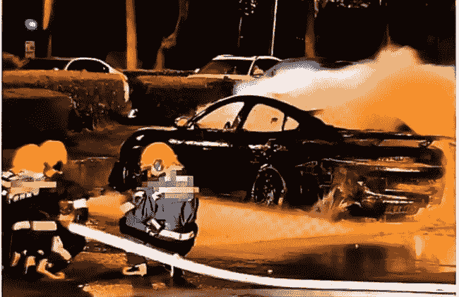

# 小米汽车再爆事故

发布专栏：知几共话

当“速度”碾压“安全”，雷军的“造车梦”正在变成小米和普通大众的噩梦。

2025年10月13日凌晨3时许，四川成都天府大道发生一起交通事故，一辆小米SU7在与绿化带碰撞后起火燃烧，路边救群众试图打开车门救援，但是未能成功。

就在几天前，10月9日凌晨，还是一辆小米SU7，在福建潭码头坠海，车主不幸离世。

加微信top28688，进资料群

接二连三的事故，将小米汽车的安全问题推至风口浪尖，小米汽车的安全技术真的过关了吗？这个以营销企业的企业的逻辑，又能否经受生命代价考验？

10月13日 10:05

小米最近的安全事故有点多啊，前些刚有一个坠海的，今天晨又凌晨就又一个烧了，车门还打不开，雷总心里估计已经愁坏了。

是上火了，感觉最近上面还是有点扶持的意思，可接二连三的事，上面也放不了心了。

不过这个时间点也还行，最近雷军的意见不是很好，趁着舆论还在，车主还能闹一闹，不像之前宁波高速上燃烧的特斯拉，就那么静悄悄地消失了，也没有人讨论。

> 雷总的气真是很有意思，中办刚了个WPS软件

> 备注：10月12日，商务部附件首次改为WPS格式，而雷军是金山软件的实际控制人。

微信top28688，进资料分享群

政治上疯狂拉他，但质量上总有点小问题，要是烧得的是特斯拉、雷总要累死了。

说到这个WPS，雷总也是真的有点丢脸，就都砍定了，能把广告删彻底，优化搞好点吗？

做手机和做车，思维是不一样的。做手机，尤其是做软件要大干快上，质量参差不齐，多迭代几次好了了；做车，每一次迭代背后都是用人命在填……

至于“安全第一”这种废话雷总也会说，不会真正彻底贯彻在企业文化和管理体系里。

小米的车加速摆尾确实有问题，并不是孤例了，因为这个事已经发生很多多次了。

这是造的车本身的刹车能力和马力不匹配，飞起来就刹不住了。

加微信top28688，进资料分享群

说实话，小米的产品现在就给我一种n360的味道，只不过周鸿祎掉面子没雷总好，形象上也吃亏。

小米本质就是个广告公司，手机就是当年氪特洛中国团队负责，汽车就是北汽团队负责。

本质上，就是把辛苦生产交给富士康的n模式，但小米的利润太低了，控控又不够。

汽车不是很了，但是小米手机工程工程师的工资是行业最低，本质上还是雷大善人太黑心。

雷军就是被推上台的吉祥物。

抄作业不需要太优秀和独立的创意的才。

我在面试过程中面了几十个小米出来的，不管是产品、研发还是测试，n一个都没看到，后来我就跟HR说，n看小米的底了，除非特别早期的。

微信top26888，资料分享群

他就是出来站台的，被车企挟挟了，不得不造。

现在看小米就是阿迪达斯，主打设计。

我还是阿迪王。

怎么小米的风向一下变成这样的了，都实在黑小米。

> 你的后台越硬，自然也就越招黑。

不是传统油车，还是新能源车，都应该将“驾驶安全”放在第一位，毕竟研发汽车和研发软件不同，每次汽车的迭代代可能可能都伴随着生命的代价。SU7的安全隐患“暴雷”不仅让小米产品的质量问题上问号，也将被扶持的雷军架在了火上。

— END —

加微信top28688，资料分享群

# 知识TOP

添加微信
免费群

微信:top28688

| 序号 | 公号/星球/社群 | 原价 | 领域 |
|---|---|---|---|
| 1 | 生财有木 | 2765/年 | 副业，搞钱 |
| 2 | 众宗吃瓜 | 365/年 | 时政，历史 |
| 3 | 记忆巷/裁树风 | 365/年 | 成长 |
| 4 | 欧洲金轨 | 328/年 | 时政，历史 |
| 5 | 卢克青云 | 699/年 | 时政，社会 |
| 6 | 体制内主任 | 599/年 | 体制，职场 |
| 7 | 局外人的视角 | 669/年 | 金融，时政 |
| 8 | 澎异异 | 4166/年 | 财富，成长 |
| 9 | 宁夜人总司令 | 599/年 | 时政，经济 |
| 10 | 江宁知府 | 365/年 | 时政，国际 |
| 11 | 政事堂/顾子明 | 568/年 | 时政，经济 |
| 12 | 唐书院 | 1399/年 | 金融，财富 |
| 13 | 大树乡村谈 | 199/年 | 时政，成长 |
| 14 | 水库联大 | 10000元 | 房产，经济 |
| 15 | 洪灏宏观策略 | 4376/年 | 经济，搞钱 |
| 16 | 金全通鉴/北海南山 | 4576/年 | 股票，行研 |
| 17 | 猫哥的世界 | 299/年 | 时政，社会 |
| 18 | 飞浪龙 | 3600/年 | 股市，经济 |
| 19 | 米联诸见闻 | 599/年 | 经济，金融 |
| 20 | 茶茶财经院 | 330/年 | 房产，股票 |
| 21 | 赢在八小时之外 | 365/年 | 成长，职场 |

...... 更多资源，不再列举
+ 图书、报告、课程等同类高价值资源
