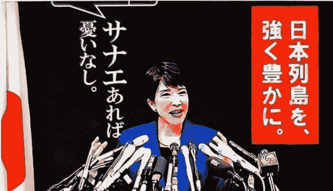

# 高市早苗当选后的对华态度

发布专栏：知几共和

权宜烟雾，还是日本右转前的最后一丝缓冲？

2025年10月21日，在日本参议院首相指名选举第二轮投票中，自民党总裁高市早苗获得125票，在投票中胜出，当选日本第104任首相，也是日本历史上首位女首相。日本自民党和维新会联合政权正式成立。

微信top28688，进阶资料分享

高市早苗当选日本首相后，其对华强硬的表态愈发缓解，这种状态会维持吗？她执政期间日本的对华常态又会怎样的呢？

11月21日 13:01

高市早苗当选之路一路三折的。最后等于是拉了一个小党派圈彻底成功了。右翼大联盟。

亚明

大阪Yakuza摸子。

备注：Yakuza中译为雅库，为日本黑帮组织。

高市早苗上台后对华会有什么策略？我看她最近释放了不少友好的信号。梅洛尼亚和米莱也是右翼上台，但上台反而不倒了。

维新会是极右翼，钓鱼型找事儿响，好消息是竹岛也会找事儿。

亚明

微信top28688，进资料共享

注解：竹岛和独岛是同一群屿的日/韩不同称，目前由韩国实际控制，但日本也主张对其拥有主权。

我记得维新会是那个搞大阪府的。自民党怕自己的选民被右翼煽动走了吗？

备注：大阪府都是维新会一个持续多年的政治提议和构想，核心内容是将日本国家的行政中心功能从东京京都部分或全部迁移到大阪。维新会的前身为“大阪维新会”。

> 我觉得迟早。

这么看来，中日韩是不能利用懂王期期间搞自贸协定定了，这个窗口又白白浪费了。

等王下去了我们或许也还有机会，到时候亚洲也说了也是算的，现在已经是战略相持阶段中后期了，贸易战他们赢不了了，这一点现在就连我们人的敌人也不复怀疑了。

加微信顶208688，资料分享群

高市早苗释放的友好信号可能只是暂时的烟雾弹，当选之前的“强硬”作风或许才是执政时期的常态。我们需要警惕我们的邻居，也需要抓住宝贵的机会拉拢朋友。

## 2025年10月28日 补充更新

10月27日 13:23

子明

> 看似联合执政，后者更强调“修宪”、美日关系“对等”、美日之间“相互防卫”的理念，这使得日同盟可能变得越来越松散，不可靠和无效。

来源: 央视新闻客户端

这不是睁睁眼说话吗？高市和特朗普的基本底出奇的一致，美日同盟会更加稳固，而不是松散。

最近日本在清理中国人，各种移民被拉高限制。

加微信top28688，进资料分享

著者8月26日凌晨，日本出入境在留管理局厅发布公告，经营管理签证原本只需要500万美元的注册资本，未来将直接涨到3000万美元（约人民币140万元），并且需要雇佣员工，并须持有学历或三年以上经营经验。

日本官方明确指出，此次政策调整是为了打击“偏离制度初衷”的申请行为，尤其是中国人通过航空公司、虚假雇佣等手段获取签证的情况。显示，过去几年经营管理签证持有者中超过一半是中国人，但部分公司存在无实际经营、无税务记录等问题。

## 知识星球TOP资源分享

添加微信
免费登录
微信：top28688

| 序号 | 公寓/简历/社群 | 原价 | 备注 |
|---|---|---|---|
| 1 | 生态有术 | 2765/年 | 业、线 |
| 2 | 恐恐云屯 | 365/年 | 时、历史 |
| 3 | 记忆执载/树枫风 | 365/年 | 成长、历史 |
| 4 | 欧洲潮流 | 328/年 | 时、历史 |
| 5 | 虎友文轩会 | 699/年 | 时、社会 |
| 6 | 体制内主任 | 599/年 | 时、财经 |
| 7 | 海外人的主权 | 4166/年 | 签证、财经 |
| 8 | 蓝得语 | 599/年 | 时、财经 |
| 9 | 江宁语总府 | 365/万 | 时、国际 |
| 10 | 政事堂/顾明子 | 568/年 | 时、经济 |
| 11 | 萨颂 | 1399/年 | 金融、财富 |
| 12 | 吴莉语读 | 199/年 | 时、成长 |
| 13 | 暴龙大叔 | 10000/年 | 房产、经济 |
| 14 | 洪澜的宏观策略 | 4376/年 | 时、财经 |
| 15 | 签证通/北海南 | 4576/年 | 股票、财经 |
| 16 | 锦语的梦想 | 3600/年 | 时、经济 |
| 17 | 飞沃云 | 599/年 | 时、财经 |
| 18 | 美国联语班 | 330/年 | 房产、策划 |
| 19 | 墨莱语班 | 365/年 | 时、财经 |
| 20 | 高在小小时之外 | | |

更多资源、报告、课程等各类高价值资源

* 免费群 每天分享资源
* VIP群 每天分享所有资源（日均20+），75/年
赠送创业资源，市场原价万

加微信top28688，进资源资料分享
