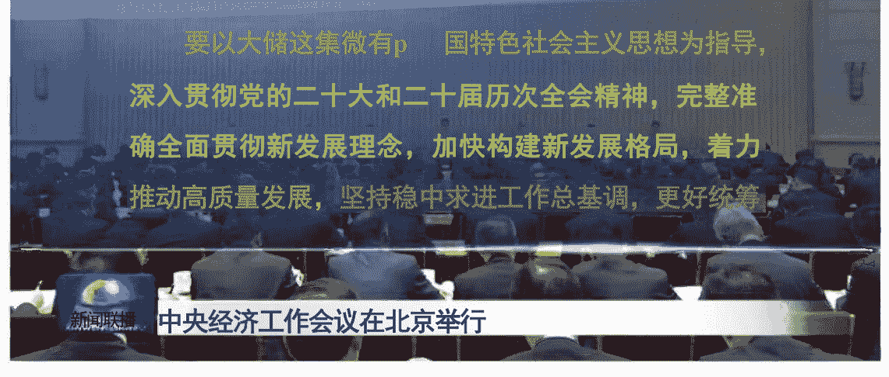

# 2025中央经济工作会议解读

原文 顾子明 子明解读 2025年12月11日22:26 辽宁

决定2026年中国经济的中央经济工作会议，在今日落落帷幕。

相较于之前历次会议，多有被动应对，本次会议作为十五五规划的开篇之年，极为罕见的出现了一切以我为中心的态度，并相较于之前数十年，出现了巨大的理念变化。

今天，政事堂跟随读者们，从今年的经济工作会议中，展望2026，以及我们的未来，进入正文：

我们在24年12月制定25工作时的大背景，对内，直到926政治局会议国内长期低迷的才显著回升，态势并不稳固；对外，是在特朗普刚刚赢得大选，随时可能发动贸易战，需要积极备战。

因此，25年的经济工作思路，是饱和式的“逆周期”应对，财政政策与货币政策双码加码到极致，不惜代价不顾后果，要保护好经济向好的趋势，要为赢跟特朗普的贸易战储备好弹药。

而我们25年12月制定26工作的时候，随着特朗普已经被我们打回了南半球，思路也得以从“战时经济”，转变为“长期竞争”，考虑的是一个新的五年计划周期乃至更久的时间内，逐步缩小中美之间的各项差距以实现追赶。

因此，26年的主要思路转变为“逆周期”与“跨周期”同时进行，既要“逆周期”的强制刺激力度，保持经济的高速增长，拉近与美国的体量差，又要以“跨周期”的供给侧改革建立起一批能在未来跟美国正面对抗的一流企业与人才储备，以期实现最终的赶超。

这使得中国经济政策的底层逻辑出现了根本性的改变，经济增长引擎从数十年来高密度的固定资产投资，逐步转向至高质量的人力资本投资。

# 我们将从明年开始，见证全要素生产率Q (TFP) 为核心的质量驱动型经济，逐步占据中国产业发展政策的主导位置。

对此，政事堂创造一个词，“产业达尔文主义”。

之前在分析12月政治局会议中，已经聊过了宏观，接下来，我们从八个方面，来看未来我们将会出现的变化，以及伴随的投资机会：

要以特色社会主义思想为指导，深入贯彻党的二十大和二十届历次全会精神，完整、准确全面贯彻新发展理念，加快构建新发展格局，着力推动高质量发展，坚持稳中求进工作基调，更好统筹。

中央经济工作会议北京举行

## 一、提振内需：

1.1 投资主体转变：改变“政府投资有效带动社会投资”的思想，对25年的经济动机的地方政府专项债和“两重两新”进行“优化”，26年的内需刺激，将主要通过对企业松绑来释放消费潜力和投资。

推测：25年主线的两重两新以及基建会迅速退潮，消费零售领域将涌现购补补贴潮，企业补贴将会接棒国补。

1.2 消费来源转变：改变25年针对弱势群体补贴与发钱，提升中低收入人群消费力的“消费端”思路，改为“生产端”思路，制定实施城乡增收计划，转为提升以工资为代表的各项劳动所得，多劳多得，能者多得。

推测：以25年Labubu为代表的少年与女性消费针对老年人保健品消费可能退潮，26年男性消费将重新崛起，酒类有望值得关注。

1.3 买商品向买服务转变：改变25年以国补为代表的消费电子与新能源汽车等生产端的产品，清理消费领域不合理限制措施，医疗、教育、文娱等服务业的壁垒将降低。

推测：前些年被击打的部分行业，改革后，可能迎来第二春。

## 二、科技发展

2.1 地域主体转变：25年国家支持所有地方赛跑发展科技，26年向京津冀、长三角、大湾区，国家级资源将不再撒“胡椒面”，而是向着三大高地极化配置，对于科技行业投资者和从业者来说，不在这地区布局，拿不到国家级补贴和政策。

推测：北京、长三角、大湾区将在AI发展上一骑绝坐，各类含科（AI）量资产将会反弹。

2.2 监管逐步进入：25年AI的发展是鼓励大干快上，26年转变为完善人工智能治理，国家将针对野蛮生长过程中出现的数据滥用、伦理风险或无效内卷进行清理。

推测：头部合规企业受益，草莽创业者的合规成本激增。

2.3 金融科技复苏：26年重提创新科技。

## 三、改革与立法（超预期）

3.1 全国统一市场：从引引到“条例”，通常指国务院法规，具有强制力，意味着地方保护主义行为面临制裁。

推测：发达地区的商品与服务将迅速抢占市场，落后地区会被逐步清退。

3.2 反内卷制度化：首次写入章，政府可能会修改加强垄断，通过行政手段淘汰低效产能。

推测：发达地区的龙头企业的利润将变好，有利于其发展。

3.3 民营配套：对民营经济保护，进入新发展阶段，有利于合法经营的大中型企业。

3.4 启动新轮国企改革：从25年的深化，到26年的制定和实施方案，标志着国企也要重组。

推测：国企重组会加速，可能出现一波。

## 四、对外开放

4.1 单边开放向制度开放转型：从25年的免签、鼓励旅游等活动，转向知识产权、补贴等领域进行改革，适应国际规则。

推测：跨境数据流动“白名单”、认证体系可能会出台。

4.2 有序扩大：有序扩大自由贸易试验范围。

推测：利好海南、浦东。

4.3 双边贸易协定：预计会签署中国与阿拉伯自贸协定（DEPA）、CPTPP等。

推测：利好数字经济。

## 五、对内发展（低预期）

5.1 重点发展几个城市群，深化跨区域合作，建立统一市场。

5.2 重点发展东部沿海：东部沿海的省份将承担新质力和高质量发展的领头羊任务，化债与乡村振兴。

预计：利好东南沿海。

## 六、双碳与排污（超预期）

6.1 推进重点行业节能降碳，借助双碳对行业进行供给侧改革。

6.2 加快新型能源体系建设，扩大绿电应用，升到了“能源强国”的顶层设计高度，为人提供可持续能源。

6.3 从碳市场建设，升级为全国碳排放交易市场，预计用于碳关税博弈。

推测：配合之前的反内卷，本次预期的大重启，对双碳与清洁能源相关行业利好。（欧洲人集体访华）。

## 七、民生领域（超预期）

思路出现重大转变，重新将人口视为红利和值得投资的领域，扩大对新生人口、灵活就业、高等教育等群体的支持。

7.1 刺激人口：倡导积极生育，努力稳定人口规模。

7.2 扩大就业：将灵活就业、新就业纳入保险范畴。

7.3 扩大教育：增加普通高中学位供给和优质高校本科招生。

## 八、风险与房地产（低预期）

2026年之后，房地产行业将正式告别“高杠杆、高周转、高负债”的旧模式，进入以“政府收储、租金并举、品质竞争”为特征的新周期。

8.1 深化住房公金制度改革：预计会推动灵活就业、新就业缴纳住房公金。

8.2 有序推动“好房子”建设：一批在容积率、层高、设计准则上大突破的房屋将出炉。

8.3 城中村和旧房改造被取消：旧红利消失。

8.4 鼓励收购存量商品房重点用于保障性住房：有年轻人的地方才会收储。

除了央行的再贴贷款，2026年地方专项债将部分允许收购存量房，政府倾向于以保甚至更低的价格收购，会导致部分房屋确认亏损以回笼救命的现金流，导致行业加速洗牌，一大批房企将破产。

收购后的房源将主要转化为保障性租赁住房和人才公寓。一二线城市的租赁市场中，国有房源的占比将显著提升，政府对租金的调控能力增强。保障性租赁REITs将爆发，地方政府通过将收储的资产打包上市回笼资金。
