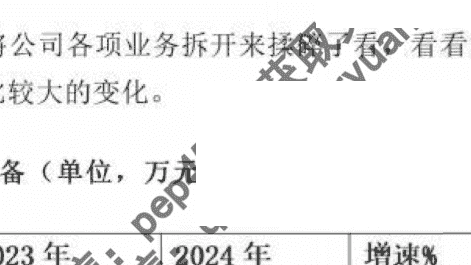
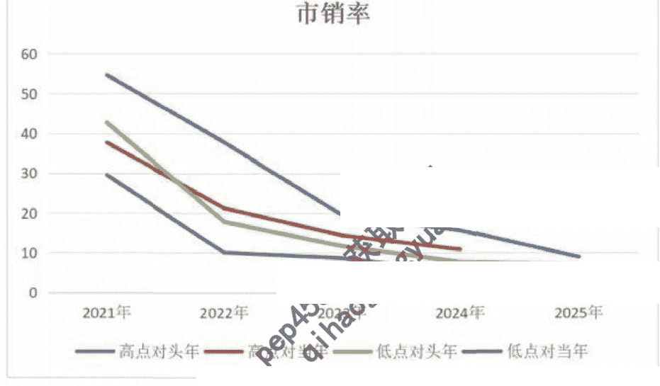
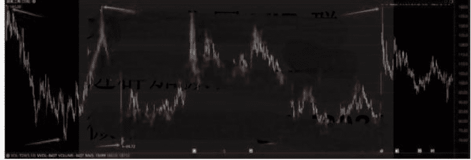

# 2024年年报分析：2025：这只芯片设备龙头还会增长吗？

2024年3月，我们团队研究了一家公司，推出分析报告《公司分析（九）：美国封锁+国产替代=高端制造突围+高成长=大牛清晰可见（科创板）。现在部分读者要求，对该公司2024年经营情况进行分析。有需要者不要看看，有需要者可以直接跳过。

先看看看的的文章中，我们对公司2024年业绩的简单预判。内容如下：

但有一点清楚，公司账上有87631.2万合同负债，而设备生产是要较长周期的。设备要生产完了才能给下游客户，这个周期不是一天两天，不然不会在合同负债。

看公司的存货构成：

| 存货构成 | 金额（万元） |
| --- | --- |
| 原材料 | 166454.85 |
| 在产品 | 57582.48 |
| 库存备 | 50062 |
| 发出商品 | 118426.37 |

第一，原材料166454.85万元。根据2023年的数据，直接材料占所生产设备成本的92.7%，假设以后的比率与2023年相同，以此推断，这些原材料如果能生产设备，倒置生产成本为193888.78万元；2023年产品的毛利率为51.99%，假设未来产品毛利率2023年一样，以此推断，这些设备可以实现销售收入137347.59万元；

第二，在产品，也就是在生产过程中的半成品。由于不知道进度如何，因此以一半进度进估。57582.48万的半成品，假设半完成，变为59735.96万元卖出去后可销售收入124423.6万元；更多加诸：pep458

第三，库存50062万元，应该是按成本，销售后应该是104273.78万元。这部分如果有旧的的产品，则为成为成品的；但是公司计划，因为我们废品的可能性不大，应该是生产完毕，尚未售出的商品。

第四，发出商品。金额为118426.3万。这部分应当是按成本计价，按2023年底的毛利率，它可实现销售收入24669.43万。

此四项加一起，未来可实现销售收入849014.39万。

从第4项来看，仅后3项，小计为47536.8万。这个大致可以推推出公司2024年最低销售收入，不少于47.54亿。

因为第4项是发出商品，所有权还没有转移，公司和客户之间双方对方还没有最终确认。但此部分2024年确认收入为24669.6万左右。

第3项是库存，生产了，但没有发生。公司是按订单生产，因此此一部分发了货，对对方确认，那部分将形成收入104273.7万左右。

第三，在59735.9万，2024年应该能够生产出来，发出完成交货，卖出去后可实现销售收入12423.6万左右。

此三项47536.8万左右。

上面的文字源自《公司分析（九）：美因封钢铁国产时代=高端制造突围+增长=大牛首席清晰可见。

我们在去年的文中提到公司2024年预计销售收入不会低于47.54亿而且我们只是发出商品+库存成品三部分，并没有计算原材料生产产品在运营下共同形成销售收入的那一部分。然后2024年，公司主营业务收入超过54亿，每次超高速增长。

下面我们分析这家公司2024年的经营情况。我们还是采用将公的各项业务各个维度来看，开展了详细的深度研究，这样还可以看到公司的业务与以前相比有较大的变化。有两项收入超高速增长，一项中高速增长，还有一项几乎无常增长；其中一项收入超高速增长，毛利低速增长。如果看到每家公司年报上的文字，光看管理讨论与分析，就会觉得每家公司都是辛苦第二，这也好，那也做好，几乎没有做得差的。如果把公司开来看，细看，算细账，就会发现很多公司的介绍的文字材料不符实。

全文为8个部分：公司基本情况、公司业务、业务环节对净利润的影响、影响公司2024年业绩全因因素及其排序、子公司情况、2025年公司还能增长、公司未来的长期增长有哪些保障、公司市场定位分析。

特别说明：因为内容较，强烈建议大家用电脑版微信阅读。

(声明：本文为公司研究，只为追踪公司发展、开拓视野、引导思路，并非实时，亦有风险，入市需谨慎。本文不构成任何投资建议或意见，我们无力为大家的投资负责，请大家注意投资风险)

## 一、公司基本情况（单位：万元）

| | 2023年 | 2024年 | 增速 | 增量 |
|---|---|---|---|---|
| 收入 | 388834.27 | 561774.04 | 44.48 | 172939.77 |
| 股东净利润 | 91052.2 | 115318.81 | 26.65 | 24266.61 |
| 扣持净利润 | 86767.97 | 110884.6 | 27.79 | 24116.7 |
| 经营性流量净额 | -42696.37 | 121614.3 | -384.84 | 164310.67 |
| 净资产收益率 | 15.19 | 16.65 | | 1.46 |
| 总资产 | 975379.77 | 1212845.24 | 24.35 | 237465.47 |
| 净资产 | 645826.57 | 766536.5 | 18.69 | 120736.94 |
| 非经常性损益 | 428.23 | 443.14 | | 149.91 |

因为一开始看到增长，因如此这些数据看得很仔细。公司是68802，上海超高速增长，两年本倍。2023年收入28.73亿元，2024年56.18亿元，两年的增速都很高，2024年增速更快。股东净利润和扣净利润中高速增长，前者增量24266.6万元，后者增量24116.7万元。注意的是这里的增速、增量实际上是低了。原因在于公司股权激励，将部分利润作为股份费用，2023年为15516.7万元，2024年为29065.15万元，这两年的股东净利润减少了。如果不是股权激励，股东净利润加上股份支付，2023年为106638.95万元，则增速为35.48%，为高速增长。一个很好的现象是经营性流量净额，以前下游客户的欠款都收回了。经营性流量净额为12.16亿，高于股东净利润，与去年相比，增加了16.43亿，大幅改善。我们在文中专门分析了公司应账款有多大，现在回过来看，我们的判断是对的。净资产收益率提升到16.65%，提高了1.46个点，公司的盈利能力继续提升。公司的利润增速高于净资产增长，且净资产收益率超过15%，是一个好现象。总资产高速增长，净资产增速增长，公司处于快速扩张中。非经常性损益有所增长，占净利润的比例为3.85%，表明主业在公司经营中的地位进一步突出。

## 二、公司各项业务

这一部分，我们将公司各项业务拆开来看，看到到底经营如何，还有较大的变化。

### 1. 半导体清洗设备（单位，万）

| 清洗设备 | 2023年 | 2024年 | 增值 | 增量 |
| --- | --- | --- | --- | --- |
| 收入 | 26145.76 | 40571.26 | 55.18 | 14426.54 |
| 成本 | 13809.70 | 21839.49 | 58.20 | 80337.79 |
| 毛利 | 12336.02 | 18732.77 | 51.81 | 63927.75 |
| 毛利率% | 47.20 | 46.16 | | -1.03 |

先说明一下，公司主业的成本构成，其中2023年数据跟去年报告中的数据有差异。原因在于政策调整，将运输费用用销售费用部分调整到企业生产中来了。这2023年主业的成本就增加了5037.40万元。公司的产品是半导体设备，都是机器设备，还比较贵，由于运输费用，这就减少了2023年的毛利。但公司2023年主营业务各部分的业务数据是在2023年年中公布的，并没有公布2023年三项主业务各部分的运输费用到底是多少。此，我们这里只能用平均计算，即按各部分的收入，平摊费用，这和实际支出可能有小出入，并不影响总量。简单地说，打个比方，某公司2023年ABC类业务产品费用了10000万，我们从各自的比例比较，计算业务A：

A产品费用540万，B类产品费用330万，C类产品费用130万。这里的540万、330万和130万是真实发生的，这两者的点是肯定的，一个是总量。这种可能出现错误，但影响整体的数据和结论。2024年清洗设备收入超增长，2023年是高速增长，增量5.36亿元；2024年是高速增长，增量14.43亿。毛利方面，2023年是高速增长，增量26766.73万；2024年是高速增长，增量63927.75万。成本增速低于3.02百分点，带动毛利率下降1.03个点，负面影响毛利163.58万元。毛利率46.17%，不错。清洗设备是业务的绝对主力。

### 2. 其他半导体设备（单位，万元）

| 其他半导体设备 | 2023年 | 2024年 | 增速% | 增量 |
|---|---|---|---|---|
| 收入 | 94018.01 | 113729.57 | 20.97 | 19711.56 |
| 成本 | 39136.12 | 42658.67 | 18.20 | 3522.55 |
| 毛利 | 54881.89 | 67470.9 | 22.94 | 12589.01 |
| 毛利率 | 58.37 | 59.33 | | 0.95 |

收入中高速增长（2023年超增长），增量4.22亿元：2023年毛利翻了一番，增速2977.07；2024年毛利高速增长，增量12589.01万元。成本增速低于2.77百分点，带动毛利提升至0.95百分点，正面影响毛利1082.62万元。毛利达到59.33%，是一个非常标准的数据。其他的半导体设备，销售的主要包括电镀等。预计未来会向更多类型扩展。此处，清洗设备和其他半导体设备共同带来毛利增长7651.75万元。

### 3. 先进湿封装设备（单位，万元）

| 湿封装设备 | 2023年 | 2024年 | 增增长% | 增量 |
| --- | --- | --- | --- | --- |
| 收入 | 16004.42 | 24574.64 | 53.55 | 8570.22 |
| 成本 | 9517.70 | 17493.59 | 83.80 | 7975.89 |
| 毛利 | 6486.72 | 7081.05 | 9.16 | 594.33 |
| 毛利率 | 40.53 | 28.81 | | -11.72 |

该业务，增收不增利。2023年略有增长，2024年高速增长，收入增量近8600万元；但毛利个位数增长，增量仅594.34万元（2023年毛利增速增长，增量1680.34万元）。主要原因就是成本增速高于收入增长30.25百分点，带动毛利率下滑11.72百分点，负面影响毛利2879.26万元。毛利率下滑到28.81%，这个数据取得得比较差。依据公司2023年和2024年的数据，成本如此大的波动，有可能成本结算的原因导致的。没有做过会计的来说，这点可能很难理解。此处，上述三项主业务共同带来77111.08万元。

### 4. 主业务（单位，万元）

| 主业务 | 2023年 | 2024年 | 增长% | 增量 |
| --- | --- | --- | --- | --- |
| 收入 | 371458.16 | 544005.47 | 46.45 | 172547.31 |
| 成本 | 186695.51 | 282131.75 | 51.12 | 95436.24 |
| 毛利 | 184762.65 | 261873.72 | 41.74 | 77111.07 |
| 毛利率 | 50.74 | 48.14 | | -1.60 |

主业务收入超高速增长，2023年为9549万元，2024年为172547万元。毛利高速增长，2023年为5742.13万元，2024年为77111.07万元。和前面相加的差异源于计算，成本增速高于收入增速6.67百分点，带动毛利率下滑1.60百分点，负面影响毛利8713.67万元。总体的毛利率为48.14%，还好。控制力变弱，导致毛利增速低于收入增速。

### 5. 其他业务（非主业务，万元）

| 其他业务 | 2023年 | 2024年 | 增速 | 增量 |
|---|---|---|---|---|
| 收入 | 17376.12 | 17768.56 | 2.26 | 392.44 |
| 成本 | 5021.82 | 5135.17 | 2.26 | 113.35 |
| 毛利 | 12354.3 | 12633.39 | 2.26 | 279.09 |
| 毛利率 | 71.10 | 71.10 | | 0.00 |

公司的非主业务，收入和毛利从2023年的超增长为2024年的增长。收入增长400万，毛利增长279.09万元。没有变化。

### 6. 全部业务（单位，万元）

| 全部业务 | 2023年 | 2024年 | 增速 | 增量 |
|---|---|---|---|---|
| 收入 | 388834.27 | 561774.04 | 44.48 | 172939.77 |
| 成本 | 191717.33 | 287266.92 | 49.84 | 95549.59 |
| 毛利 | 197116.94 | 274507.12 | 39.26 | 77390.18 |
| 毛利率 | 50.69 | 48.86 | | -1.83 |

收入和毛利均超增长。收入增长17.29亿元，毛利增长77390.18万元。成本高于收入增速5.36百分点，带动毛利率下降1.83百分点，负面影响毛利10280.48万元。业务扩张，先进湿封装设备毛利率的大幅变动源于成本结算因素。

## 三、各财务环节对净利润的影响

### 1. 费用（单位，万元）

| 2023年 | 2024年 | 增量 | 影响毛利 |
|---|---|---|---|
| 税金及附加 | 484.42 | 989.37 | 504.95 | -504.95 |
| 销售费用 | 27731.63 | 42222.66 | 14491.03 | -14491.03 |
| 管理费用 | 19994.3 | 29959.69 | 9965.33 | -9965.33 |
| 财务费用 | -2545.42 | -2676.35 | -130.93 | 130.93 |
| 研发费用 | 61532.46 | 72895.31 | 11362.85 | -11362.85 |
| 小计 | | | |

除了税金及附加、财务费用，其他影响都大。5个环节合计减少营业利润36193.23万元。通过这5个环节，公司同比增加营业利润41196.93万元。而2023年这个数据是16185.57万元。

需要注意的是，公司的研发投入，除了费用的研发投入，还有一部分是资本化的研发投入。2023年资本化研发投入为4303.42万元，2024年为10952.20万元。

### 2. 利得和损失（单位：万元）

| | 2023年 | 2024年 | 增量 | 影响毛利 |
|---|---|---|---|---|
| 其他收益 | 1550.76 | 1922.37 | 371.61 | 371.61 |
| 投资收益 | 9225.65 | 3244.69 | -5980.96 | -5980.96 |
| 公允价值变动收益 | 821.07 | 2404.53 | 1583.46 | 1583.46 |
| 信用减值损失 | -4638.12 | -6432.34 | -1785.78 | -1785.78 |
| 资产减值损失 | -488.62 | -2271.78 | -1783.16 | -1783.16 |
| 处置收益 | 0.14 | 0.07 | -0.07 | -0.07 |
| 小计 | | | |

除了处置收益和其他收益，其余4个环节都不小。投资收益差异较大，2023年长期收益为3941.26万元，2024年为1069.66万元，差2871.60万元。交易取得的投资收益，2023年为2653.47万元，2024年为716.05万元，差1947.42万元。还有一项定期大额存款，2023年为2599.86万元，2024年为1358.52万元，差1241.34万元。6项合计差3659.36万元。6个环节合计营业利润同比增加3602.17万元，2023年的这个数据为24714.80万元。

### 3. 营业外支出、所得税费用等（单位，万元）

| | 2023年 | 2024年 | 增量 | 影响毛利 |
|---|---|---|---|---|
| 营业收入 | 9.76 | 118.45 | 108.69 | 108.69 |
| 营业支出 | 18.72 | 44.17 | 25.45 | -25.45 |
| 所得税费用 | 5329.28 | 14748.03 | 9418.75 | -9418.75 |
| 少数股东损益 | | 0.06 | 0.06 | -0.06 |
| 小计 | 854 | | | -9335.57 |

影响主要是所得税费用。4个环节共计股东净利润9335.57万元。通过这4个环节，公司股东利润增加24266.60万元。2023年底，这个数据为24203.50万元。

## 四、影响公司2024年业绩的因素排序

影响2024年业绩的因素共19个，其中正面影响因素9个，负面影响因素10个。每个因素的影响如下（单位，万元）：

| 排序 | 正面因素 | 影响幅度 | 负面因素 | 影响幅度 | 合计 |
|---|---|---|---|---|---|
| 1 | 清洗设备 | 63927.75 | 销售费用 | -14491.03 | |
| 2 | 其他半导体设备 | 12589.01 | 研发费用 | -11362.85 | |
| 3 | 公允价值变动收益 | | 管理费用 | -9965.33 | |
| 4 | 其他因素 | 371.61 | 所得税费用 | -9418.75 | |
| 5 | 湿法封装设备 | 594.33 | 投资收益 | -5980.96 | |
| 6 | 其他业务 | 279.09 | 信用减值损失 | -1785.78 | |
| 7 | 财务费用 | 130.93 | 资产减值损失 | -1783.16 | |
| 8 | 营业收入 | 108.69 | 金检补助 | -504.95 | |
| 9 | 资产处置收益 | 0.07 | 营业支出 | -25.45 | |
| 10 | | | 少数股东损益 | -0.06 | |
| | | 7958.44 | | | -55318.32 24266.62 |

经过这样剥开了揉碎的全面计算，我们对盛威上海2024年的经营有一个总体上比较深入的判断。

公司3项主营业务和1项非主营业务，收入方面，有两项高速增长，就是清洗设备和湿法封装设备，一项增长，即其他半导体设备。一项几乎没有增长就是其他业务（非主营业务）。

毛利方面，清洗设备毛利高速增长，增长6.39，2023年这个数据是2.68。其他半导体设备毛利高速增长，增量1.26，2023年这个数据是2.90。其他焊接法封装业务超高速增长，毛利低增长，增量600万，2023年这个数据是近1700万；其他业务毛利小幅增长，增长约280万，2023年，这个数据是4200万元（估计可能是为了防止美国制裁，2023年一次性更换过去设备的零部件件）。总体上，一项业务毛利超高速增长，一项高速增长，两项低增长。

全部业务带来的毛利增长7.74（2023年，这个数据是6.17）。然后费用增长3.62，毛利和损失损耗增长7600万，所得税损耗增长9300万，最终全股东净利润增长2.43。又是一中高速增长。

公司的增长，主要是依靠业务高速扩张所致；但是成本控制方面有所缺失，导致毛利率在总体上有所下滑。其中焊接法封装业务毛利率的大幅度变化，可能跟结转成本有关。另外，股权激励也...

## 五、子公司情况（单位：万）

| 投资 | 2023年 净利润 | 2024年 收入 | 2024年 净利润 |
| --- | --- | --- | --- |
| 清芯科技 | 8254.07 | 354977.26 | -8788.47 |
| 盛美无锡公司 | 831.58 | -25.67 | | |
| 盛纬上海 | 7442.93 | -13298.66 | 109528.88 | 23131.78 |
| ACM Research 韩国 | 38895.61 | -502.27 | | |
| ACM RESEARCH (CA) | 29127.71 | 969.29 | | |
| 盛美北京 | | -1518.14 | | |
| 小计 | | -6121.4 | | 1433.31 |

去年重点关注的盛美上海，今年大幅盈利。另外清芯科技计有可能是一次性计提了了个堡。我们可以关注下2025年中报或年底底它的业绩。2024年，其他子公司的业绩情况公司没有公布。

## 六、2025年能够否增长

这部分，我们主要根据现有的财务数据和业务情况等，研究2025年业务能够增长，还有未来会如何？

### 1. 合同负债（单位，万）

| 合同负债 | 增速% | 收入 | 比例 |
|---|---|---|---||
| 2018 年 | 6825.86 | | 55026.91 | |
| 2019 年 | 6802.21 | -0.35 | 75673.3 | 9.02 |
| 2020 年 | 8601.78 | 26.46 | 100747.18 | 6.75 |
| 2021 年 | 36430.41 | 323.52 | 162086.91 | 5.31 |
| 2022 年 | 82206.33 | 125.65 | 287304.55 | 12.68 |
| 2023 年 | 87631.2 | 6.60 | 388834.27 | 21.14 |
| 2024 年 | 110595.45 | 26.21 | 561774.04 | 15.60 |

我们注意两点，增速和比例。

比例，即当年合同负债数量占第二年收入的比例，中间差1年。最高是2022年的合同负债数量占2023年收入的比例，为21.14%，2023年底的合同负债数量占2024年收入的15.60%。2024年底的合同负债占2025年收入的数据，暂时还没出来。

合同负债增速快的是2021年和2022年，2023年只有6.60%，2024年底为26.61%，这个速度还不错。

如果按30%估，公司在手订单大致为36.87亿元。

### 2. 存货（单位，万）

| 存货 | 收入 | 占比 |
|---|---|--|
| 2018 年 | 26415.99 | 55026.91 | 48.01 |
| 2019 年 | 30727.41 | 75673.3 | 40.61 |
| 2020 年 | 61486.94 | 100747.18 | 61.03 |
| 2021 年 | 144333.32 | 162086.91 | 89.05 |
| 2022 年 | 268979.15 | 287304.55 | 93.62 |
| 2023 年 | 392525.7 | 388834.27 | 100.95 |
| 2024 年 | 423220.07 | 561774.04 | 75.34 |

2022年底，存货26.90亿，2023年为39.25亿，2024年为42.32亿，这个增长并不多。我们可以细看存货的构成：

(1) 原材料（单位，万）

| 原材料 | | |
|---|---|---|
| 2021 年 | 57934.41 | |
| 2022 年 | 113952.63 | |
| 2023 年 | 166454.85 | |
| 2024 年 | 161154.02 | |

2024年底原材料数据和2023年相比，下降了5300.83万元。根据成本数据，可以测这部分原材料能够生产多少的成品。结果是174333.64万元。

(2) 在产品（单位，万）

| 在产品 | | |
|---|---|---|
| 2021 年 | 22651.54 | |
| 2022 年 | 44785.15 | |
| 2023 年 | 57852.48 | |
| 2024 年 | 57842.46 | |

数据增长不大。依然如此，假设在产品完成了一半，还没有完成。比如57842.46的产品，可以生产60114.80万元的成品。这个估算可能会有入，主要是50%还是70%的比例，影响比较大了。

(3) 库存商品（单位，万）

| 库存商品 | | |
|---|---|---|
| 2021 年 | 0 | | |
| 2022 年 | 12571.8 | | |
| 2023 年 | 50062 | | |
| 2024 年 | 22950.34 | | |

这是多少。但要注意的是公司提了916.8元的存货跌价准备，可能会出现一些变量。

(4) 发出商品（单位，万）

| 发出商品 | | | |
|---|---|---|
| 2021 年 | 63747.38 | | |
| 2022 年 | 96499.78 | | |
| 2023 年 | 118426.37 | | |
| 2024 年 | 181036.05 | | |

发出商品增长较多，与2023年底相比，增长了52.87%。

(5）2025年收入推算

去年我们研究了固定资产和在工程，主要是厂房和机器等等。他们的扩张保障了公司生产的扩张，就是有了它们，公司才能扩大。如果大家记得，就可以看看去年的文章，这里不再重复。这一部分，我们要推算公司2025年的收入。第一项，发出商品经过下游客户验收合格，全部认为收入。这一项可以确认的收入为37430.23万元。第二项，库存商品，全部发出经过下游客户验收合格，全部认为收入；其计提的跌价准备，这一项可以确认收入为5418.06万元。第三项，在产品，全部生产完毕且发出，经过下游客户验收合格，全部认为收入。这一项可以确认收入为12430.03万元。计提的存货跌价准备冲回。第四项，原材料，全部生产为产成品，且出发后经过下游商家通过，全部认为收入。这一项收入360471.59万元。计提的存货跌价准备无影响。

前三项，一共产生55048.3万销售收入。而公司2024年全年销售收入为561774.04万元，且第四项360471.59万元，故可以推断，公司2025年仍然是一个中高速增长的。最少也是中高速增长。

(6)2025年为什么中高速增长？

去年依据出发商品、库存商品和产品生产的最小规模为47.54亿，结果是56.18亿（由于有第一项原材料为商品送货到下游客户经过一段时间的试生产之后验收合格）。今年依据这三项推算的最小收入为55亿；依据在产品、库存商品和出发商品三项推算的结果，大致不会有疑问。但是，由于判断的2024年16.12亿的原材料中，有多少可以生产为产成品，送到下游商家，且认为收入？可以肯定地全部认为收入可能。要解决这个问题，我们可以看看公司的手中订单和原材料之间的数学关系。

第一，公司合同负债后续就是订单，2024年合同负债为110595.4万，假设设备订单已支付30%的定货预款，则在订单366851.50万元。

2024年库存原材料面价为161154.02万元，存货跌价准备为2736.02万元。依据成本等因素，倒推的16.2亿原材料可以生产出收入为360471.59万元的成品，如果加上跌价准备准备，可以生产出366218.89万元的成品，跟推算出来的订单366851.50万元是接近的。由于这些原材料在2025年转化为成品。

第二，这些原材料转化为成品后，有多少在2025年认为收入，较大的不确定。这个太不好判断，最后主观判断，根据公司产品的验收周期来。公司的订单释放周期为6个月左右，到2025年8月之后，这些原材料全部成品。验收周期为12到18个月，也就是2025年底，这些原材料生产出来的。

## 七、公司未来的长期增长

### 1. 专利（单位）

| 专利 | 申请数量 | 获得数量 | 累计申请 | 累计获得 |
| --- | --- | --- | --- | --- |
| 发明专利 | 53 | 49 | 776 | 342 |
| 2021 年实用新型 | 0 | 0 | 3 | 3 |
| 外观设计专利 | 0 | 0 | 3 | 2 |
| 发明专利 | 92 | 42 | 888 | 384 |
| 2022 年实用新型 | 0 | 0 | 3 | 3 |
| 外观设计专利 | 0 | 0 | 3 | 2 |
| 发明专利 | 164 | 47 | 1107 | 433 |
| 2023 年实用新型 | 0 | 0 | 3 | 1 |
| 外观设计专利 | 0 | 0 | 3 | 1 |
| 发明专利 | 11 | 38 | 1520 | 468 |
| 2024 年实用新型 | | | | |
| 外观设计专利 | | | | |

注意获得和累计数量：2021年是49，2022年是42，2023年是47，2024年是38。

### 2. 公司的新品和项目

第一，新的产品下段文字主要来自公司2024年报：
- 等离子化学沉积PECVD设备：首台设备验证TEOS和SIN工艺。
- 道涂胶显影设备Ultra Lith：这两个新系列将使公司全球可服务市场规模增加。
- 新型ALD炉：属于新技术，已进入工艺认证。

第二，结合2024年报中有关核心业务的表述，有下列产品相比具有潜力：
- 片槽式组合清洗设备：国内无竞争对手，国际上无此类产品，但目前公司同类产品的占有率高。
- 互连电镀：国际竞争对手，国内无竞争对手，公司国内市场占有率高，替代空间大。

第三，根据公司研发项目，判断哪些属于产品类型：
- 先进封装设备及基础材料制造：完成工艺验证后进入量产，且产量达标，产出超过市场。
- 片槽式炉设备：2024年推出了两款ALD炉，属于新产品，已进入工艺认证阶段，研发调试，完成产品平台化，推进成熟工艺节点验证。
- TraceI胶层显影系统：非常重要的产品，市场比较大。
- Kraf Tr设备：还没有进行客户认证。
- PECVD设备：已经验证过，首台在2024年三季度向某客户集成电路交付，验证TEOS和SIN工艺，市场空间巨大。
- SFP无应用拉动潜力：主要在批量订单中，新产品意味着巨大的空间。

第四，总起来，公司有两个重要产品未来市场空间巨大：
- 等离子体化学气沉积PECVD设备：2024年三季度向某客户集成电路交付首台设备，进行相关工艺认证。
- 道涂胶显影设备Ultra Lith：这两个新系列将公司全球可服务市场规模增加。

公司还有许多ALD设备进入并部分完成高端工艺认证。其中可替代国际产品市场空间的铜质互连电镀设备，公司独有市场占有率低的单片式组合清洗设备。这些产品保障了公司未来的市场。

这部分的最后，我们关注公司领导人在业绩会上讲的部分内容：

护管系列设备方面，王宙在业绩会上表示，盛美上海2025年护管设备的营收增长将进一步加速，为公司未来增长提供新的动力（注：我们团队恰刚判断，这意味着半导体设备增速将持续）。

随着胶封装对……（此处不完整）

| | 2021年 | 2022年 | 2023年 | 2024年 | 2025年 |
|---|---|---|---|---|---|---|
| 市销率 | 高点对头 | 54.61 | 37.627 | 19.542 | 15.757 | 8.926 |
| 高点对当年 | 37.715 | 21.228 | 14.469 | 10.933 | | |
| 低点对头 | 42.681 | 17.847 | 11.739 | 7.709 | 7.029 |
| 低点对当年 | 29.477 | 10.068 | 8.675 | 5.324 | | |

道理和用法跟上面的一样。图如下：

## 4. 公司股价技术估值

公司股价明显呈现箱型震荡。高处在140元左右，低在70元左右。
下图是不复权的图。很显然，公司股价是在等大势或自身基本面变动引发股价的大变化。

鉴于2025年最低90元，如果按20%估计股东净利润增长的话，则90元处的市销率只有28.534倍，因此90元的价格距离很难向下破位。也即公司股价是在等大势或公司业绩的大变化，从而完成向上突破。

## 5. PEG顶底判断法。

成长PEG小于1为低估，越小越低估；高于1为高估，越高越是高估。PEG=市盈率/净利润增速，用扣非净利润增速可能更好。这里的人计算都有自己的习惯，因此我们只说出这些，同时按市盈率的高低跌落，给出的题目让大家来做辅助判断。同时要注意A股优质成长的PEG往往都比较高，主要是好的股票涨幅比较稀缺，因此此定位容易产生溢价。

## 6. 特别说明。

此文仅为选择投资标的公司，只是公司分析，不是推荐，更不是荐股。好的标还需要选择合适的时机买入。何时买入，请各位根据自己的操作经验，选择买入时机。建议分批买入。当然在一个周期下跌即将完毕的阶段最好，或者根据881321半导体设备指数的顶底级别决定买卖，小底买，大底大买，这种操作比较容易盈利。

(再次声明：本文仅为开拓视野、引导思路，并非推荐，亦非荐股，股市有风险，入市需谨慎。本文不构成任何投资建议或意见，我们无力为大家的投资负责，请大家注意投资风险)

# 免费 价值 及时 专注

# 扫码加入 知识星球TOP 免费资源群

- 每日免费获取价值资源
- 可提供各类资源搜索服务

| 热门付费文章 | 各行行业报告 |
|---|---|
| 精选图书资源 | 副业赚钱方法 |
| 职场实用资源 | AI政经自媒体 |

公众号: 知识星球TOP 微信信号: jntsg8 微信信号: jntsg2

分享资料仅供个人学习，请及时删除，切勿商用传播
