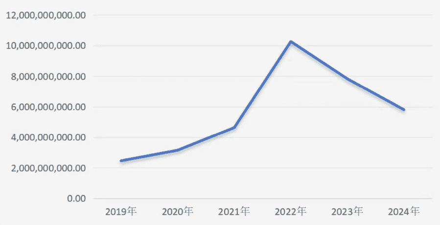

# CXO龙二追踪分析：减肥唤醒的蓝筹力量

原创 anmin0001 安安Anmin0001深度分析 2025年08月23日 07:01 付费 湖北

我们在2023年10月发布的《第二家 CXO龙头，三季报后一段时间基本面将提供良好的历史性底部（主板）》中，深度分析了这家CXO行业龙二公司，并结合公司的大额订单分析，预计后面临业绩大幅滑坡。虽然当时公司收入很高，但是这次新冠疫情带来的意外之财，真正的挑战是在后面。

当时我们的主要分析依据是2022年报和2023年半年报中的大额订单。从大额订单开始，2024年仍无法完全复现疫情订单增加的影响。大额订单增长了2023年的收入，导致我们业绩落地，也就没滑坡。当初判断是“之后的三季、年报和年初的一季、半年报，公司的业绩并不太好，可能有风险，创新并不低，这个要看市场，这会给大家提供一个不错的介入机会”。

接下来的走势证明了，失去了新冠订单的加持，公司不复新冠那两年撑着钱的轻松，这让公司股价在2024年8月26日就是半年报公布前几天见大底。“之后的三季报、年报和年初的一季、半年报，公司的业绩并不太好的，判断如此。

但是在蓝筹期之前未彻底彻底，绑定了热门减肥药ADC、核苷酸基药物等业务（因为有ADC业务，因此自然就有单抗或双抗业务，今年创新最热门的就是向海外企进行ADC授权转让），加之行业业务，或许在去年和今年来了第一次强势反弹。近期接近调整，股价已经了一倍。关注价值，且一旦调整结束，或许是不错的入场时机。当然，我们团队只做基本面，一般不二市场。

现在应该要求读者，同时结合2024年报和2025年一季报，再次审视诸公司，既看业绩，也看公司的成色，后公司背后，看看真实的实力到底如何，是否除了新冠疫情的影响，重新修正。有读者的可以看到。

本文分为8个部分：公司的基本情况、公司业务分析、财务环节对公司利润的影响、影响公司业绩的因素及其重要子公司情况、减肥药与药物的潜力、公司在其他方面的潜力、公司到底的市场定位。

因为图表较多，建议用电脑微信阅读。

微信intsg2，资料分享群

(声明：本文为公司基本面研究，只为开拓视野、引导思想，并非是非，亦非推荐股。股市有风险，入市需谨慎。本文不构成投资建议或意见，我们无力为大家的投资负责，请大家注意投资风险)

## 一、公司的基本情况（单位：万元）

| | 2023年 | 2024年 | 增幅 | 增量 |
| --- | --- | --- | --- | --- |
| 营收 | 782519.03 | 580465.73 | -25.82% | -202053.30 |
| 股东净利润 | 226881.04 | 94895.00 | -58.17% | -131986.04 |
| 扣非净利润 | 210414.41 | 84953.72 | -59.63% | -125460.69 |
| 经营现金净额 | 354972.84 | 125433.70 | -64.66% | -229539.14 |
| 加权平均净资产收益率 | 13.66% | 5.56% | | -8.10% |
| 总资产 | 1976715.85 | 1928855.77 | -2.42% | -47860.10 |
| 净资产 | 1747971.63 | 1684538.52 | -3.63% | -64333.11 |
| 非经常性损益 | 14666.63 | 9941.28 | -39.63% | -6525.35 |

2024年，凯莱英的营业收入为580.47万，同比减少202.05万，降幅25.82%，原因就在新冠疫情下最后的订单已经没有了。股东净利润和扣非净利润都是超高速下滑。符合预判。

回顾过去的营业收入状况：

# 2019到2024年营收

加微信jntg2，进资料分享群

2019年，24.60；2020年，31.50；2021年，46.39；2022年，102.55；2023年，78.25。公司的营收峰出现在2022年，首次突破100亿，2023年下滑，也是历史第二高。由于新冠疫情，营收峰出现在什么时候？那么新冠之后，正常。这是2024年和2025年第一季度的基本情况（单位：万元）：

| | 2024第一季度 | 2025第一季度 | 增速 | 增量 |
| --- | --- | --- | --- | --- |
| 营收 | 139980.83 | 154121.55 | 10.10% | 14140.72 |
| 股东净利润 | 28197.03 | 32660.78 | 15.83% | 4463.75 |
| 扣非净利润 | 25397.42 | 30511.28 | 20.14% | 5113.86 |
| 经营现金净额 | 49066.65 | 44934.19 | -8.42% | -4132.46 |
| 加权平均资产收益率 | 1.60% | 1.92% | | 0.32% |
| 总资产 | 198412.32 | 194471.65 | -1.99% | -3940.67 |
| 净资产 | 175789.80 | 171997.70 | -2.27% | -3792.19 |
| 非经常性损益 | 2799.60 | 2149.5 | -23.22% | -650.1 |

作为对比，这是2021年至2025年第一季的基本情况（单位：万元）：

| | 2021第一季度 | 2022第一季度 | 2023第一季度 | 2024第一季度 | 2025第一季度 |
| --- | --- | --- | --- | --- | --- |
| 营收 | 77718.93 | 206170.89 | 224903.45 | 139980.83 | 154121.55 |
| 股东净利润 | 15433.05 | 49939.81 | 63034.6 | 28197.03 | 32660.78 |
| 扣非净利润 | 12944.24 | 48639.05 | 61763.79 | 25397.42 | 30511.28 |
| 经营现金净额 | 10065.91 | 20460.71 | 130352.53 | 49066.65 | 44934.19 |
| 加权平均资产收益率 | 2.14% | 3.88% | 3.95% | 1.60% | 1.92% |
| 总资产 | 728484.32 | 163986.31 | 185467.00 | 198412.32 | 194471.65 |
| 净资产 | 615636.23 | 135417.79 | 163285.46 | 175789.80 | 171997.70 |
| 非经常性损益 | 2488.81 | 1300.76 | 12780.81 | 2799.60 | 2149.5 |

#微信intsg2，进资料分享群

如果我们直接平滑2022年和2023年增长的高峰数据，就以一次的数据计算本年的复合增速，收入增长1.98倍，复合增速为18.67%；股东利润2.12倍，复合增速为20.61%；扣非利润增长2.36倍，复合增速为23.91%。这个增长还是可以的。只是2025年第一季度这三个方面的增长比复合增速要低一些，但是都是两位数的增长，其中扣非利润增速为20.14%，跟复合增速比较接近；股东净利润增速比复合增速4.78个百分点，也不是低了。

2025年第一季度的营收恢复增长了10.1%，且股东净利润与扣非利润增幅都强于收入增速，增长质量非常健康，显示出不错的复苏势头。

考虑到龙头业绩的良好表现，因此，从经营角度来看，CXO业务的转折较为明显。股价低点出现在2024年8月26日，去年半年报公布前几天。今年4月日，是第二个低点。半年报出来之前有点波动，总共经历了75个交易，从58.8亿到125.5亿，涨了一倍。

为此，我们需要深入研究公司表现的因素。

## 二、公司业务分析

先看业务。之前科普过什么是“CDMO”，“大分子CDMO”和“小CDMO”等概念，感兴趣的此处看，小分子的优势是广泛、研发快速、制备。

### 1. 临床阶段CDMO（单位：万元）

| 临床阶段CDMO | 2023年 | 2024年 | 增速 | 增量 |
| --- | --- | --- | --- | --- |
| 营收 | 150709.83 | 176677.91 | 17.23% | 25968.08 |
| 成本 | 89309.88 | 107028.02 | 19.84% | 17718.14 |
| 毛利 | 61399.95 | 69649.89 | 13.44% | 8249.94 |
| 毛利率 | 40.74% | 39.42% | | -1.32% |

临床阶段CDMO业务是公司的核心业务之一，2024年收入中增长，增量2.6亿元；成本增速高于收入增速2.61个百分点，拉动毛利率下降1.32个百分点，负影响毛利2329.59万。毛利增速，增量8249.94万元。毛利39.42%，不错。

营收中增长，毛利率小幅下降，在很多人看来是比较好的表现，但实际公司这项的表现比你想的还要好得多。

| 临床阶段CDMO | 2018年 | 2019年 | 2020年 | 2021年 | 2022年 | 2023年 | 2024年 |
| --- | --- | --- | --- | --- | --- | --- | --- |
| 营收 | 58603.73 | 100150.27 | 122559.22 | 172365.11 | 166632.54 | 150709.83 | 176677.91 |
| 总占比 | 31.94% | 39.77% | 37.15% | 26.25% | 19.26% | 30.44% | 39.42% |
| 成本 | | 63619.16 | 102101.17 | 97838.69 | 89309.88 | 107028.02 |
| 毛利 | | 61640.06 | 70235.34 | 68793.85 | 61399.95 | 69649.89 |
| 毛利率 | | 49.21% | 40.75% | 41.28% | 40.74% | 39.42% |
| 项目（个） | | 185 | 189 | 290 | 355 | 386 | 456 |
| 临床3期 | | 39 | 42 | 55 | 62 | 69 | 73 |

从这个表中，我们可以看出一些信息。第一，临床项目从2019年的39个增加到73个，接近翻倍，且每年增长。

### 2. 商业阶段CDMO（单位：万元）

| 商业阶段CDMO | 2023年 | 2024年 | 增速 | 增量 |
| --- | --- | --- | --- | --- |
| 营收 | 511248.07 | 280394.94 | -45.15% | -230853.1 |
| 成本 | 204136.79 | 130895.39 | -35.88% | -73241.4 |
| 毛利 | 307111.28 | 149499.55 | -51.32% | -157611.73 |
| 毛利率 | 60.07% | 53.32% | | -6.75% |

商业阶段CDMO业务是公司最赚钱的业务，也是受疫情影响最大的一块。2024年收入大下降23.09亿，收入降多，成本降少，差9.27个百分点，带动毛利率下滑6.75个百分点，负面影响毛利18936.19万。毛利超高速下降，减少157611.73万。

| 商业阶段CDMO | 2018年 | 2019年 | 2020年 | 2021年 | 2022年 | 2023年 | 2024年 |
| --- | --- | --- | --- | --- | --- | --- | --- |
| 营收 | 104447.21 | 122281.04 | 165783.10 | 251494.68 | 758680.72 | 511248.07 | 280394.94 |
| 总占比 | 56.92% | 49.71% | 52.63% | 54.22% | 65.33% | 48.31% | 53.32% |
| 毛利 | | 71448.38 | 90716.51 | 131814.22 | 372583.95 | 307111.28 | 149499.55 |
| 毛利率 | 46.35% | 41.55% | 42.78% | 50.54% | 60.07% | 53.32% |

第一，商业阶段CDMO业务从2018年的10.44亿增长到2024年的28.04亿。

第二，商业阶段CDMO数量从2018年的27个增加到2024年的48个，除了2022年和2023年的特殊情况下，其他业务稳步增长，这也证明了临床阶段项目数量能够带来商业阶段CDMO业务数量的稳步增长。2023年报中，预计2024年验证批阶段（PPQ）有28个，2024年报中，预计2025年验证批阶段（PPQ）有12个，这个需要特别留意一下。

### 新兴服务（单位：万元）

| 新兴服务 | 2023年 | 2024年 | 增速 | 增量 |
| --- | --- | --- | --- | --- |
| 收入 | 119933.34 | 122637.35 | 2.25% | 2704.01 |
| 成本 | 88172.66 | 96067.04 | 8.95% | 7894.38 |
| 毛利 | 31760.68 | 26570.31 | -16.34% | -5190.37 |
| 毛利率 | | 26.48% | 21.67% | -4.82% |

前面我们讨论的临床和商业化CDMO其实是公司的核心业务，也是小分子业务。这里的新兴业务就是化学大分子CDMO、制剂CDMO、临床CRO、生物分子CDMO、技术输出和合成生物技术等，就是小分子业务以外的其他业务。

新兴服务2024年收入增加2401万，增长2.25%，增速高于收入增长6.7百分点，带动毛利率下降4.82点，负面影响毛利5906.44万。毛利增速缓慢，减少了5190.37万。

| 新兴服务 | 2021 年 | 2022 年 | 2023 年 | 2024 年 |
|---|---|---|---|---|
| 营收 | 39753.51 | 99591.98 | 119933.34 | 122637.35 |
| 占总营收比重 | 8.57% | 9.71% | | 21.13% |
| 成本 | 24019.50 | 66047.74 | 88172.66 | 96067.04 |
| 毛利 | 15734.01 | 33544.24 | 31760.68 | 26570.31 |
| 毛利率 | 39.58% | 33.68% | 26.48% | 21.67% |
| 项目（个） | 327 | 476 | 665 | 644 |

收入增加了208.49%，年复合增长45.57%，这个速度很不错。毛利增长了68.87%，年复合增长19.08%，表明公司可能采取的是降价拿价项目的策略。毛利从39.58%下降到21.67%，且连续每年下降，除了竞争激烈之外，多半与公司的策略有关。

这是公司更改口径后的新兴服务数据统计。最后的项目数量只有2021年明确说明，后继阶段是根据公司陈述提及的各项新兴服务的数量加总，可能不准确，但相差不会大。这些项目和小分子业务一样，有临床和商业化阶段，有一种药品上市赚钱的机会。

几年时间，把一个4亿营收的业务做到12亿，占营收比重持续增长，公司的新兴服务其实是不错的。

先看一个新兴服务的总表：

加微信jntsg2，进资料分享群

### 化学大分子CDMO 制剂CDMO 临床CRO 合成生物学大分子CDMO 技术服务对内对外

| | 化学大分子CDMO | 制剂CDMO | 临床CRO | 合成生物学大分子CDMO | 技术服务对内对外 |
| --- | --- | --- | --- | --- | --- |
| 2021年 | 收入（亿元） | 1.56 | 0.88 | | | |
| | 项目（个） | 23 | 超过40 | 超过150 | | |
| | 验证批阶段（PPQ） | | | | | |
| | 在手订单（个） | | | | | |
| 2022年 | 收入（亿元） | 3.73 | 2.29 | 2.64 | 约0.2亿 | 1.01 |
| | 项目（个） | | 超过100 | 260 | | 48 |
| | 验证批阶段（PPQ） | | | | | |
| | 在手订单（个） | | | | | |
| 2023年 | 收入（亿元） | 4.06 | 2.71 | 2.44 | 1.33 | |
| | 项目（个） | 80 | 147 | | 增长38.13% | 内部68个，外部19个 |
| | 验证批阶段（PPQ） | | | | | |
| | 在手订单（个） | | | | | 近38个 |
| 2024年 | 收入（亿元） | 4.6 | | | 增长33.22% | 1.52 |
| | 项目（个） | | 227 | | 197 | 大于20个 |
| | 验证批阶段（PPQ） | | 超过10个 | | | |
| | 在手订单（个） | | 增长130% | 增长30% | 近60个 |

第一，化学大分子项目。从表中可以看出，收入从2021年的1.56亿增长到2024年的4.6亿，每年增长。项目从23个增加到227个，且每年增长。2024年在手订单增长130%以上。如下：

| 化学大分子CDMO | 2021年 | 2022年 | 2023年 | 2024年 |
| --- | --- | --- | --- |
| 收入（亿元） | 1.56 | 3.73 | 4.06 | 4.6 |
| 项目（个） | 23 | 68 | 80 | 227 |
| 验证批阶段（PPQ） | | | | 超过10个 |
| 在手订单（个） | | | | 增长130% |

第二，制剂CDMO项目。收入从2021年的1.24亿增长到2023年的2.71亿，2024年没有。项目数量从2021年的40多个增长到2024年的近200个，每年增长。

| 制剂CDMO | 2021年 | 2022年 | 2023年 | 2024年 |
| --- | --- | --- | --- | --- |
| 收入（亿元） | 1.24 | 2.29 | 2.71 | |
| 项目（个） | 超过40 | 超过100 | 148 | 近200 |
| 验证批阶段（PPQ） | | | | |
| 在手订单（个） | | | | 增长30% |

第三，临床CRO项目。收入不太稳定。项目从2021年的150多个增加到2023年的347个，2024年下滑到197个。

加微信jnts2，进资料分享群

| | 2021年 | 2022年 | 2023年 | 2024年 |
| --- | --- | --- | --- | --- |
| 收入（亿元） | 0.88 | 2.64 | 2.44 | |
| 项目（个） | 超过150 | 260 | 347 | 197 |
| 验证阶段（PPQ） | | | | |
| 在手订单（个） | | | | |

第四，合成生物才起步，但2023年和2024年都高速增长。

第五，生物大分子业务，也才起步不久。收入从1.01亿增长到1.52亿，项目数量和在手订单这一块，公司披露并没有统一的标准。但从数据来看，总体是向上的。

表中大部分的内部细分可能是大致情况。由于不是单独列出来的业务，所以公司的描述并不详细。我们找了多年年报，根据一些零散的数据做出总表和分表，未必完全准确，但表的数据都是有的。诸多新兴服务中，做得最好的是化学大分子业务。营收和占比都是最高的，处于验证阶段的项目超过10个，在手订单增长超过130%，公司官方预计化学大分子业务2025年的营收可达到9至10亿。原因清楚，就是减肥类GLP-1多肽项目，后面我们会仔细分析。如果这种经营能保持下去，化学大分子有望独立出来，与其他业务并存。

除此之外，对所有新兴业务而言，好消息是随着产能利用率的提升，下半年的毛利率已显示好的趋势，并且新兴业务的验证阶段（PPQ）项目也有13个。注意这里的项目和前提提到的“预计2025年验证阶段项目(PPQ）有12个”不重合。也就是说小业务PPQ阶段项目有12个，新兴服务是另外的13个。

### 4. 其他业务

加微信jtsg2，资料分享群

| 其他业务 | 2023年 | 2024年 | 增速 | 增量 |
| --- | --- | --- | --- | --- |
| 收入 | 627.78 | 755.53 | 20.35% | 127.75 |
| 成本 | 560.7 | 592.55 | 5.68% | 31.85 |
| 毛利 | 67.08 | 162.98 | 142.96% | 95.9 |
| 毛利率 | 10.69% | 21.57% | | 10.89% |

其他业务只占总营收13%，意义有限，大家看着就好。此业务毛利率相比去年提升了10.89%，正面影响毛利82.25万元。

### 5. 全部业务

| 全部业务 | 2023年 | 2024年 | 增速 | 增量 |
| --- | --- | --- | --- |
| 收入 | 782519.03 | 580465.73 | -25.82% | -202053.3 |
| 成本 | 382180.03 | 334583 | -12.45% | -47593.03 |
| 毛利 | 400339 | 245882.73 | -38.58% | -154456.27 |
| 毛利率 | 51.16% | 42.36% | | -8.80% |

收入下降20.21亿，成本虽降但比收入降幅13.37%，带动毛利率下降8.8%，负面影响毛利5.1亿。毛利率下降的原因清楚，就是失去了订单后生产利用率不够，加上竞争激烈。总之，从这些数据来说，2024年业务确实经历了一个调整，回归真实的增长趋势。虽然可以排除订单，但也面临增长缓慢、不得不下降的问题。这是2024年第一季度和2025年第一季度的全部业务对比：

| 全部业务 | 2024第一季度 | 2025第一季度 | 增速 | 增量 |
| --- | --- | --- | --- | --- |
| 收入 | 139980.83 | 154121.55 | 10.10% | 14140.72 |
| 成本 | 70959.94 | 88562.92 | 12.02% | 9502.98 |
| 毛利 | 60920.89 | 65558.63 | 7.61% | 4637.74 |
| 毛利率 | 43.52% | 42.54% | | -0.98% |

微信jtsg，进资料分享群

2025一季度的全部业务营收增长了10.1%，增长14140.72万元；毛利增长4637.74万元；成本增速高于收入增速1.92百分点，带动毛利率下降了0.98百分点，有负面影响。有人认为这个表现不算惊艳，但是对2024年有些偏差。不能这么看，首先是毛利增长了，而且超过4600万。对于2024全年的毛利增速是多少？前面说是-15.45亿。2024年第一季度的毛利是多少？

| 全部业务 | 2023一季度 | 2024一季度 | 增速 | 增量 |
| --- | --- | --- | --- | --- |
| 收入 | 224903.45 | 139980.83 | -37.76% | -84922.62 |
| 成本 | 110639.37 | 70959.94 | -31.87% | -36979.43 |
| 毛利 | 108864.08 | 60920.89 | -44.04% | -47943.19 |
| 毛利率 | 48.00% | 43.52% | | -4.88% |

一样是暴跌，下降44.04%。所以这就是2025一季度的价值，止住暴跌，开始回升。而且这是全部业务总和，不是简单的减肥药业务。截至发布一报时，公司还没有减肥药产品上市，在减肥药市场的表现也只是流言相传，实际上还没开发完。放量只会在上市之后。

在对董的询问中，对公司利用率的回答如下：

有关小型业务中，天津三厂的API产能均处于高位，东北地区产能去年下半年也处于更高的利用率，数字化二厂受减肥药业务波动影响，其他产能回到正常水平。化学分子业务去年下半年多个重要项目落地，产能能按序推进，今年建设持续增加，利用率进一步提升。生物大分子今年产能利用率，新建赛化产能今年下半年投入并进入瓶颈。今年资本集中在新业务领域，化学大分子、生物大分子业务板块和分子类型制剂，小分子能够新增资本开支。

# 三、各财务环节对公司利润的影响

## 1. 费用的影响（单位：万元）

加微信ints2，进资料分享群

| 2023年 | 2024年 | 增量 | 影响 |
| --- | --- | --- | --- |
| 税金及附加 | 7445.24 | 11274.42 | 3829.18 | -3829.18 |
| 销售费用 | 19642.41 | 24339.1 | 4696.69 | -4696.69 |
| 管理费用 | 78847.23 | 82521.62 | 3674.39 | -3674.39 |
| 财务费用 | -14840.24 | -13075.05 | 1834.8 | -1834.8 |
| 研发费用 | 70786.36 | 61449.03 | -9337.33 | 9337.33 |
| 小计 | | | 15371.87 |

上表是2023年和2024年的主要费用情况。影响为正，说明公司在费用方面还有控制。最大影响是财务费用，减少了18234.8万元，主要是利息收入21040.11万元，支出仅950.53万元，另外收益13191.52万元，而损失仍有1519万元。研发费用相比去年减少了9337.33万元，其中检测费用减少了8239.47万元，这个和研发性质有关。同时薪酬减少了4108.85万元，直接原因是裁员了193名人员，以及由于因素带来的。

| 研发费用（万元） | 2023年 | 2024年 | 差额 |
| --- | --- | --- | --- |
| 职工薪酬 | 40596.83 | 36487.98 | -4108.86 |
| 物料消耗 | 7807.23 | 11231.53 | 3514.3 |
| 检测费 | 17784.47 | 9545 | -8239.46 |
| 折旧摊销费 | 2390.36 | 2421.57 | 31.21 |
| 能源费 | 1140.97 | 968.27 | -172.71 |
| 其他 | 1066.5 | 704.69 | -361.81 |
| 合计 | 70786.36 | 61449.03 | -9337.33 |

检测费和职工薪酬是降幅最大的两块，都是公司业务下滑期的常见表现。

另外在营收下降的同时，销售费用却上升了。有时候就是这样，越是生意不好做，销售费用越多的。公司在2024年举办连带参加，总共跑了38场国际展会，26场国内展会，比2023年的30场国际、26场国内多。

| 销售费用 | 2023年 | 2024年 | 差额 |
| --- | --- | --- | --- |
| 职工薪酬 | 12650.13 | 14994.92 | 2344.79 |
| 广告宣传费 | 2459.98 | 3168.27 | 708.29 |
| 差旅费 | 1587.21 | 1452.61 | -134.6 |
| 办公费 | 1173.08 | 1327.43 | 154.35 |
| 运输费 | 1202.67 | 980.41 | -222.26 |
| 聘费用 | 453.56 | 967.18 | 513.62 |
| 招待费 | 419.83 | 543.74 | 123.91 |
| 折旧摊销费 | 456.35 | 470.42 | 14.07 |
| 租赁费 | 107.28 | 159.36 | 52.08 |
| 合计 | 19642.41 | 24339.1 | 4696.7 |

职工薪酬增加了2344.79，因为员工从2023年的73人增加到2024年的84人。广告宣传费上涨了708.29。差旅费减少了134.6。总结一下，2024年由于税收附加、销售费用、财务费用、研发费用这五项的影响加起来，所以弥补了去年减少的利润，营业利润下降39084.4万元。

| 2024第一季度 | 2025第一季度 | 增量 | 影响 |
| --- | --- | --- | --- |
| 税金及附加 | 4102.67 | 1222.83 | -2879.84 | 2879.84 |
| 销售费用 | 4462.17 | 4415.42 | -46.75 | 46.75 |
| 管理费用 | 17260.49 | 18368.64 | | -1108.15 |
| 研发费用 | 16944.24 | 13787.67 | -3156.57 | 3156.57 |
| 财务费用 | -7830.82 | -4493.96 | 3336.86 | -3336.86 |
| 小计 | | | | 1638.15 |

税金及附加产生了2879.84万元正面影响，因为出口退税产生的附加减少。业务费用产生了3336.86万元的负面影响，是汇率波动导致的收益减少。研发费用进一步下降，估计是检测费用和薪酬下降的影响。

### 2. 利得和损失金额（单位：万元）

| 2023年 | 2024年 | 增量 | 影响 |
| --- | --- | --- | --- |
| 其他收益 | 5928.61 | 3928.86 | -1999.75 | -1999.75 |
| 投资收益 | 13759.54 | 8256.2 | -5503.34 | -5503.34 |
| 公允价值变动收益 | 1730.59 | 3957.27 | 2226.68 | 2226.68 |
| 信用减值损失 | -724.31 | -612.05 | 112.26 | 112.26 |
| 资产减值损失 | -2071.76 | -7044.07 | -4972.31 | -4972.31 |
| 资产处置收益 | -1.44 | 7.2 | 8.64 | 8.64 |
| 小计 | | | | -10127.82 |

影响小的信用减值和资产处置收益，其他影响都不小。

追踪影响最大的投资收益，2023年的投资收益高达13759.54万元，是处置了一批交易性金融资产，达到10720.84万元，2024年有5866.89万元，相差4893.95万元。另外2023年处置长期股权投资的收益高达3255.63万元。2024年股权法则的长期股权投资为2486.01万元。

| 2024年 | 2023年 | 变动比例 |
| --- | --- | --- |
| 研发人员数量（人） | 4653 | 4752 | -2.08% |
| 研发人员占比 | 48.49% | 48.55% | -0.06% |
| 研发人员结构 | | | |
| 博士 | 274 | 261 | 4.98% |
| 硕士 | 1539 | 1516 | 1.52% |
| 本科 | 2690 | 2785 | -3.41% |
| 专科及以下 | 150 | 190 | -21.05% |
| 研发人员年龄构成 | | | |
| 30岁以下 | 2592 | 3009 | -13.86% |
| 30~40岁 | 1845 | 1563 | 18.04% |
| 40岁以上 | 216 | 180 | 20.00% |

如果研发人员确实减少了，但是是什么人？专科及以下员工，本科员工，而且30岁以下数量反而上升了。做科研者在科技企业工作的读者都知道，真要成果，硕士都未必用，专科本科就别谈了。专科员工在研发岗位里，一定有相当一批的是“岗位的劳动密集工作”，许多不高学历的人都会自嘲“科研民工”，更何况专科员工就愁了。

再追踪资产减值损失，影响最大的存货贬值损失和合同履行减值损失，2023年是1081.14万，2024年是4706.35万，相差3625.21万元。2024年还有笔无形资产减值损失1783万。主要是这两个因素的影响。

其他收益相比1999.75年减少，主要是政府补助减少2003.97万元。
公允价值变动收益相差2226.68万，主要是交易性金融资产交易多出收益1238.02万，其他交易性金融工具相差968.67万。
这6个环节一环减少营业利润10127.82万元。通过这6环节，2024年公司的营业利润同比减少149212.22万元。

下面是公司2024年和2025年第一季度的情况:

| | 2024一季度 | 2025一季度 | 增量 | 影响 |
|---|---|---|---|---||
| 其他收益 | 1704.45 | 1772.57 | 68.12 | |
| 投资收益 | 907.11 | 1027.52 | 120.41 | 120.41 |
| 公允价值变动收益 | 722.35 | 1027.25 | 304.9 | 304.9 |
| 信用减值损失 | 152.81 | 627.99 | 475.18 | 475.18 |
| 资产减值损失 | | -849.57 | -849.57 | -849.57 |
| 资产处置收益 | | | | 119.04 |
| 小计 | | | | |

### 3. 营业外收支、所得税费用和少数股东权益

以下是公司2023年和2024年的情况:

| | 2023年 | 2024年 | 增量 | 影响 |
|---|---|---|---|---||
| 营业外收入 | 13.2 | 76.66 | 63.46 | 63.46 |
| 营业支出 | 1379.45 | 705.53 | -673.92 | 673.92 |
| 所得税费用 | 30631.03 | 13662.55 | -19968.48 | 16968.48 |
| 少数股东损益 | -1799.1 | -1319.39 | 479.71 | -479.71 |
| 小计 | | | | 17226.15 |

影响最大的因素是所得税费用。收入和营业利润扩大后，所得税也会相应下降。
这四个环节增加了股东净利润17226.15万元。至此，公司的股东净利润同比下降131986.07万元。

下面是公司2024年和2025年一季的表现：

| 2024年一季度 | 2025年一季度 | 增量 | 影响 |
| ------|---|---|---|
| 营业外收入 | 28.89 | 0.04 | -28.85 | -28.85 |
| 营业外支出 | 31.39 | 138.72 | 107.33 | -107.33 |
| 所得税费用 | 1513.45 | 3267.99 | 1754.54 | -1754.54 |
| 少数股东损益 | -244.11 | -203.66 | 40.45 | -40.45 |
| 小计 | | | | -1931.17 |

2024年报形成鲜明对比的是，是2025年第一季度的所得税费用增大，这是销售收入上涨和净利润增加导致的。

## 四、影响公司业绩的因素及其排序

2024年影响公司业绩的因素共有19个，其中10个正面影响因素，9个负面影响因素。影响大小排序如下：

| 排序 | 正面影响 | 影响金额 | 负面影响 | 影响金额 | 合计 |
| --- | --- | --- | --- | --- | --- |
| 1 | 财务费用 | 18234.8 | 商业阶段CDMO | | -15761.73 |
| 2 | 所得税费用 | 16968.48 | 投资收益 | | -5503.34 |
| 3 | 研发费用 | 9337.33 | 新服务 | | -5190.37 |
| 4 | 临床阶段CDMO | 8249.4 | 资产减值损失 | | -4972.31 |
| 5 | 公允价值变动收益 | 2226.68 | 销售费用 | | -4696.69 |
| 6 | 营业支出 | 673.92 | 税金及补助 | | -3829.18 |
| 7 | 信用风险损失 | 112.26 | 管理费用 | | -3674.39 |
| 8 | 其他业务 | 95.9 | 其他收益 | | -1999.75 |
| 9 | 营业外收入 | 63.46 | 少数股东损益 | | -479.71 |
| 10 | 资产处置 | 55971.41 | 8.64 | | -187957.47 |
| 小计 | | | | | -131986.06 |

至此，我们可以全面复结一下2024年的经营情况。新冠的退坡对公司影响非常大，低价导致新兴业务增长但盈利减少。在2024年营收占比高达73.98%，临床阶段CDMO，在2024年总营收占比48.3%，对公司毛利的负面影响。在此情况下，临床阶段CDMO和其他业务的正向影响，难以抵御。新兴业务减少5200万，它和商业化CDMO共计减少利润2828万。临床阶段及其他业务增加利润8300万，全部业务减少利润1545万。费用增加营业利润154万，至此，全部业务和环节共同减少股东净利润220万。我们给2025年一季度了一个简单的影响因素排行表：

| 排序 | 正向影响 | 影响额 | 负面影响 | 影响额 | 合计 |
| --- | --- | --- | --- | --- | --- |
| 1 | 全部业务 | 4637.74 | 财务费用 | | |
| 2 | 研发费用 | 3156.57 | 所得税费用 | -1754.54 |
| 3 | 税金及补助 | 2879.84 | 管理费用 | -1968.15 |
| 4 | 信用减值损失 | 475.18 | 资产减值损失 | -849.57 |
| 5 | 公允价值变动收益 | 304.9 | 营业支出 | -673.92 |
| 6 | 投资收益 | 120.41 | 营业收入 | -28.85 |
| 7 | 其他收益 | 68.12 | 少数股东损益 | -40.45 |
| 8 | 销售费用 | 46.75 | 营业外支出 | -107.33 |
| 小计 | 1689.5 | | -7225.75 | 4463.76 |

因为一季报显示，没有单项业务收支，产生了正面影响和负面影响因素，股东净利润增加4466万元。

## 五、重要子公司情况

公司公布了两家主要子公司情况。分别是吉林嘉莱医药有限公司，2024年净利润是1428.08万，2023年净利润是1782.67万。天津凯莱医药有限公司，2024年净利润是2751.99万。

## 六、减肥药及其潜力

我们曾在《减肥与减肥药赛道》中聊过个人的经历以及市场未来的展望。这里可以再挖掘一下。最近在谈论减肥时，了解到近期互联网上火了一个红网，叫减肥。所谓的减肥，就是坐在镜头前吃饭。这个减肥，身高1.64m，体重差不多四百斤，肚子大得跟三个篮球一样。我这辈子没见过这么胖的中国人，除了胖，当然患上了糖尿病。这种减肥的行为，说明了两点：

第一，现在的胖不是吃山珍海味，而是吃日常饮食，米面粮油每天吃出来的。也就是说，由于现代人养成太好，胖的成本到了一个史无前例的低点。

第二，正常的肚子正是亚洲人胖的基本特征，术语上叫“向心型肥胖”，通俗就是“先胖肚子”。为什么我们在欧美街随处可见胖，在亚洲明显少呢？以前普遍认为他们骨架大、吃得好。事实上，欧人的胖是相对均匀的，所以欧美胖并不是肚子大，他们肚子粗，腿粗，臀股大，脂肪对身体危险危险危害比较均衡。相比之下，以中国人代表的亚洲人，脂肪优先向腹部堆积，积聚在，使得胖对亚洲人的极大。所以一个亚洲人如果长像欧美胖子的体型，可能直接累死。与胖伴随的2型糖尿病、高血压、心血管等问题都难以健康。

另外，对肥胖者而言，青年人有时间减肥，但由于减肥的需求，因为为了恋爱结婚；三十四岁以后过的胖者虽然需要迫迫，但工作家庭的压力让他们没有精力减肥，再加上胖者一般多缺乏呼吸的营养，这导致中国肥胖者的数量不少。胖成本来说历史低点，对亚洲人伤害巨大，以及肥胖人群越来越适合延续缓慢的减肥方式，诸多因素共同催生了市场对减肥药物的期待。

### 2. 国内肥胖药物相关信息及现状

下面是2024年和2025年A股市场出现减肥药物的部分消息：

2024年3月，华东药品报告提交的HD1005注射液临床申请已获得批准，截至2025年1月，已开展临床2期试验，适用于2型糖尿病、超重或肥胖人群的体重管理。

2024年5月，来峰获得国家药品监督管理局批准，用以改善2型糖尿病患者的血糖控制；它是替戈鲁尔肽注射。

2024年6月，诺德诺克的司美鲁肽在中国上市，是全球首个也是目前用于长期体重管理的胰高素GLP-1受体激动剂（GLP-1）制剂。

2024年10月，博瑞医药的BGM0504注射液的II期试验取得积极效果；适用于2型糖尿病、超重或肥胖人群。博瑞药物上市后，股价在2024年7月最高达到72.5元，随后下跌，最低到17.39元。2023年7月，开始上涨到47.8元，随后横盘，最高到23元，最低到18元。

2025年6月，信达生物的创新药物玛仕度肽上市，这是全球首个上市的GCG/GLP-1双靶点药物，适用于肥胖或超重者的长期控制。注意，信达生物是凯莱的战略伙伴。凯莱在研发业务，提升原料生产效率、稳定性和放大。玛仕度肽上市，减肥药物市场突破千亿规模，该药物成为国产化的关键。

### 3. 减肥药的逻辑

如果我们把当前的减肥药比作一道菜，那么GLP-1就像盐一样重要。为了提高竞争力，产生综合效应，要求产品具有多种功能。比如GLP-1的一个副作用是降低食欲的同时引起恶心吐。。，一方面降低引起恶心的反应，一方面增强脂肪代谢、改善肠胃敏感性。

玛仕度肽则是另一种思路。GLP-1就不解释了，抑制食欲，GCG即高血糖，是体内的升糖激素。有人认为低血糖是错，因为饥饿、运动、跑步等引发血糖。此外，GCG作为升糖原理是促进糖分解、促进脂肪分解，所以有助于优化血糖指标，减轻肝脏内细胞。

这是一段引文：

根据《新英医学杂志》最新发表的III临床研究，玛仕度肽（Mazdutide）在中国超肥肥胖人群中展现突破性疗效。研究显示，使用玛仕度肽48周，患者体重减轻达15%，肝脏脂肪含量低80%，腰围、颈围显著减少，并改善多项心血管及代谢指标。代谢指标全面改善：腰围减少10cm，收缩压下降9.9mmHg，甘油三下降1.5%，脂肪肝几乎消失。

中国人一胖就有脂肪，因此，中度脂肪肝患者，如果用减肥药，那相当概率就要用玛仕度肽。在我们面前提到的那颗网红，据网友说我私下用了司美格鲁控制体重，但效果并不明显。我们今天所了解到的某些信息来看，减肥得先要做手术，而来的只是减肥药，可能就能用双靶药物有效。要是肯尔泊，减重更猛，要是用玛仕度肽，减得的同时还能优化内脏代谢。那个巨大的肚子，内脏脂肪就不用了。再强调，亚洲人容易出现向心型肥，就是脂肪住内脏。而米来授权信达生物在国内研发玛仕度肽，可以说很有针对性的。

另外，在2026年GLP-1药物到期，全都是抑制饮食这类，那一定会会出现价格。如果你就单单了，除了抑制这类已经用了其他药物，到时候就会便宜上了，就得去卷价格。目前的药物和资本市场对GLP-1专利的看法是“需要快速下一种新型减肥药来获取竞争优势”，而新型减肥药的一个明确路径就是单靶药物。刚好，玛仕度肽作为全球首个GCG/GLP-1双靶点药物，有两保险，可以完美符合药物对于市场竞争，这类科学型肥胖的特质特征。前景和想象力是可以的。

并且目前公布的凯仕多肽的主要适应症是减重脂，有消息未来还会有降糖的适应症认可。也就是以后的凯仕多肽可能。

把这种错误归于运气、巧合、投资理念之类的行，我们觉得，最直接的原因就是一点，我们习惯于无视那些摆在明面上，但还没有什么动静的好利，觉得那是八字没撒的事。就像大家赏花都只赏舒放的花，没人赏花骨架。

但投资不一样，我们的投的就是花骨架的时候。真开了花，谁都知道往上凑了。

我们来看一下公司公布的各类信息：

## 1. 专利数量

以下是公司的专利数量公布，并不全，大家参考就好（单位，项）

| 年份 | 申请专利 | 授权专利 |
| --- | --- | --- |
| 2020年 | 279 | 159 |
| 2021年 | | |
| 2022年 | | |
| 2023年 | | 383 |
| 2024年 | | 487 |

## 2. 在手订单

| 在手订单(亿美元) | 说明 | 营收(亿万人民币) |
| --- | --- | --- |
| 2020年 | 4.52 | 31.5 |
| 2021年 | 18.98 | 46.39 |
| 2022年 | 11.5 | 含 2023 年已执行的订单 | 102.55 |
| 2023年 | 8.74 | 不含 2023 年已确认的营收 | 78.25 |
| 2024年 | 10.52 | 不含 2024 年已确认的营收 | 58.05 |

加微信jnts2，进资料分享群

在订单数据源于订单历年，更早的数据公司没有公布。从公司的正常发展规律来看，在之前的订单数据不会比2020年更早。而2020年的订单金额是根据公司2021年的订单数据和增长率计算出来的。

在当年的订单和第二年的收益是否存在固定的比例关系，但虽然两者成比例，而2024年的订单规模大概已经是公司历史新高了。只是前两位主要是新冠带来的大订单，所以2024年的第三个订单显得尤为珍贵。放弃公司2024年底的订单中包含部分数据在第二年，就是2025年。

还有，依据订单和上一部分的信息可以判断，信生生的第一个商业化转型项目预计年内就能供货，因此半年业绩和明年都会向好。凯莱英语“公司化学大分子项目收入纳入考核”的原因，正就是如此。

## 3. 公司正在参与的药物

| 靶点 | 方向 | 代表或类似药物 |
| --- | --- | --- |
| 2021 年 KRAS | 肿瘤(非小细胞肺、直肠癌等) | 索妥拉西、阿达格拉西 |
| KRAS | 肿瘤(非小细胞肺、直肠癌等) | 索妥拉西、阿达格拉西 |
| 2022 年 JAK | 自身免疫性疾病(风湿关节炎、强直性柱炎、肾疮等)、皮肤(白癜等)、血源性疾病(真性红细胞增多、骨髓纤维化) | 华法妥、鸟帕普尼 |
| TYK2 | 自身免疫疾病(肾疮等)、皮肤(特性性炎) | 罕见替代药物、其他药物在中 |
| GLP-1 | 糖尿病 | 司美格 |
| KRAS | 肿瘤(非小细胞肺、直肠癌等) | 索妥拉西、阿达格拉西 |
| JAK | 自身免疫性疾病(风湿关节炎、强直性柱炎、肾疮等)、皮肤(白癜等)、血源性疾病(真性红细胞增多、骨髓纤维化) | 华法妥、鸟帕普尼 |
| 2023 年 TYK2 | 自身免疫疾病(肾疮等)、皮肤(特性性炎) | 罕见替代药物、其他药物在中 |
| EGFR/Her3 | 肿瘤(非小细胞肺、直肠、食道等) | 尚未完全上市的药物，有产品在临床验证或等待审批 |
| BTK | 肿瘤(记忆性淋巴细胞、套细胞淋瘤) | 阿卡替尼、尼西妥替尼 |
| CDK/4 | 肿瘤(尤其乳腺癌) | 哌柏西利、阿西利 |

内容来自公司历年报，整理后的。

加微信intjsg2，进资料分享群

这并不是参与大药靶点的清单，因为公司不会公布研发进度，甚至未曾每年公布靶点，所以只能作为参考。比前面提到的GLP-靶点，网传公司是2020年的项目，但在2023年官方公开了，2024年提交的上市申请，2025年才上市。

有的读者可能不理解，这些药物没上市，市场并不妙，现在知道它们有啥用？

话是这么说，但GLP-1的玛仕度上市前也不像这样吗？就静静藏在公司报年的一句话里，甚至都还没提到它是减肥药；我们多次在免费文章里提到了凯莱的减肥药项目、减肥药市场潮惊人，但当时市场没关注。

药物研发时间很长，可能好年前就提了，后面没声音了，有些人发现过了，很多人却发现，前期的机会都被忽视了。当然，这是医药研发，市场上有很多机会，一定要关注。什么时候介入，自己决定。等消息传来，市场做出反应，那时候才知道上车了？抄底，这些时自己了解一下。

## 4. ADC项目

公司没有披露ADC药物的研发，但在2024年春季调研信息中，公司明确指出：多肽、ADC和核酸业务呈现快速增长。其中今年最热的就是ADC。

2025年2月之前，公司真正拥有了海外产能。Sandwich Site在2024年下半年已经开始运营，产能利用率还不高，2024年亏损。从2024年8月初正式运营后已接研发和生产订单，多个项目正在推进中，欧美客户访问及审计增多，展现浓厚兴趣并持续增加能力。2026到2027年实现收支平衡。中心除了提供了研产产能，还提供了海外经营，为后续商业化投入打下基础，具有战略意义。

## 5. 欧洲研发基地

凯莱药在英国有个波士顿中心，除了研发，还要和美国本土药企对接，负责生产。也就是它的海外基本没有产能。

我们在2024年2月发表一些预判，凯莱全球化的第一步。2024年，公司在欧洲迈出了第二步。2024年收购了辉瑞英国Sandwich Site的化学药物生产车间及研发实验室，并带有辉瑞公司的专业技术和管理团队。Sandwich Site可以直接处理小分子药物CDMO全方位综合平台，拥有领先的药物通路设计和高通量试验、工程科学、成熟的工艺及分析能力，正在规划肽、核酸、酶技术等新领域。

2025年2月，Sandwich Site具备低温生物化生产能力，并且显示凯莱将自己的连续反应、合成生物技术和酶催化技术引入。

## 公司的市场定位

### 1. 公司上市以来每年高低点的市盈率（单位：倍）

| 市盈率 | 高点对比年 | 高点对当年 | 低点对比年 | 低点对当年 |
| --- | --- | --- | --- | --- |
| 2016 年 | 86.046 | 65.556 | 21.476 | 16.362 |
| 2017 年 | 68.477 | 51.355 | 47.113 | 35.397 |
| 2018 年 | 63.525 | 50.567 | 33.118 | 26.272 |
| 2019 年 | 78.784 | 60.914 | 34.207 | 26.354 |
| 2020 年 | 126.129 | 101.232 | 51.855 | 41.520 |
| 2021 年 | 178.991 | 130.994 | 76.386 | 55.818 |
| 2022 年 | 103.813 | 33.683 | 43.151 | 13.974 |
| 2023 年 | 19.557 | 28.132 | 12.768 | 18.265 |
| 2024 年 | 18.926 | 44.338 | 9.991 | 23.076 |
| 2025 年 | 49.057 | | 23.211 | |

这里的市盈率是每年最高点的价格、最低点的价格，考虑了分红和扩张。2025年目前的高低点没有预估，趋势上整体处于历史低位。

### 2. 公司上市以来每年高低点的净率（单位：倍）

| 市净率 | 高点对比年 | 高点对当年 | 低点对比年 | 低点对当年 |
| --- | --- | --- | --- | --- |
| 2016 年 | 14.993 | 9.444 | 3.742 | 2.357 |
| 2017 年 | 9.865 | 8.518 | 6.787 | 5.871 |
| 2018 年 | 10.537 | 8.627 | 5.493 | 4.482 |
| 2019 年 | 13.440 | 11.078 | 5.836 | 4.793 |
| 2020 年 | 22.938 | 12.194 | 9.431 | 5.001 |
| 2021 年 | 21.561 | 11.108 | 9.201 | 4.733 |
| 2022 年 | 8.803 | 7.107 | 3.659 | 2.948 |
| 2023 年 | 4.126 | 3.651 | 2.694 | 2.371 |
| 2024 年 | 2.457 | 2.498 | 1.297 | 1.300 |
| 2025 年 | 2.764 | | 1.308 | |

这是公司上市以来的净率表，选取计算规则与市盈率类似。

### 3. 公司上市以来每年高低点的销售率（单位：倍）

| 销售率 | 高点对比年 | 高点对当年 | 低点对比年 | 低点对当年 |
| --- | --- | --- | --- | --- |
| 2016 年 | 15.906 | 15.019 | 3.970 | 3.748 |
| 2017 年 | 15.688 | 12.317 | 10.793 | 8.489 |
| 2018 年 | 15.235 | 11.803 | 7.943 | 6.132 |
| 2019 年 | 18.390 | 13.715 | 7.985 | 5.933 |
| 2020 年 | 28.398 | 23.208 | 11.675 | 9.519 |
| 2021 年 | 41.035 | 30.195 | 17.512 | 12.866 |
| 2022 年 | 23.929 | 10.844 | 9.946 | 4.499 |
| 2023 年 | 6.296 | 8.157 | 4.111 | 5.296 |
| 2024 年 | 5.487 | 7.248 | 2.897 | 3.772 |
| 2025 年 | 8.020 | | | 3.795 |

(声明): 本文只是公司研究，只为开拓视野、引导思路，并非推荐，亦非推荐股。股市有风险，入市需谨慎。本文不构成投资建议或意见，我们无力为大家的投资风险负责，请大家注意投资风险。

## 知识星球TOP

付费资源分享群免费入群

微信: jntsg2

| 序号 | 公号/星球/社群 | 原价 | 领域 |
| --- | --- | --- | --- |
| 1 | 生才有木 | 2765/年 | 副业，搞钱 |
| 2 | DeV宗众吃瓜群 | 365/年 | 时政，历史 |
| 3 | 记忆承载/雯树西风 | 365元/年 | 成长，搞钱 |
| 4 | 欧洲金 | 328/年 | 时政，社会 |
| 5 | 卢克文青 | 699/年 | 体制内 |
| 6 | 体制主任 | 599/年 | 体制；职 |
| 7 | 外局人的视角 | 669/年 | 金融，时政 |
| 8 | 灏泽异谈 | 4166/年 | 财富，成长 |
| 9 | 守夜人总 | 599/年 | 时政，经济 |
| 10 | 江宁织府 | 365/篇 | 时政，国际 |
| 11 | 政堂/顾子明 | 568/年 | 时政，经济 |
| 12 | 唐书院 | 1399/篇 | 金融，财富 |
| 13 | 大树乡谈 | 199/年 | 时政，成长 |
| 14 | 水库欧大 | 10000远 | 房产，经济 |
| 15 | 洪灏的宏观策略 | 4376/年 | 经济，搞钱 |
| 16 | 金政通鉴/北海道南山 | 4576/年 | 股票，行研 |
| 17 | 猫豹的世界 | 299/年 | 时政，社会 |
| 18 | 飞浅 | 3600/年 | 股市，经济 |
| 19 | 美联储见闻 | 599/年 | 经济，金融 |
| 20 | 鉴茶财财经院 | 330/年 | 房产，股票 |
