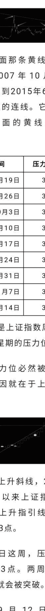

# 大盘下跌？寻找低位还是反弹机会？

上周，大盘在5月13日后持续低迷，连续五天走低。虽然周内有小反弹，收盘指数从6214点跌至5718点，显示出市场压力并未被完全释放。

但是，由于指数已经处于低位，下周是否会有压力释放呢？那么，下周是否有反弹机会？大盘是否还会继续下跌？

## 一、从上周幅度寻找上方的压力

### 1. 上涨幅度

我们发现，从K线来看，上周的涨幅度有限，应该从K线来看，我们需要寻找上方的压力：

上周大盘的K线，跌幅非常明显。指数从6214点跌至5718点，跌幅为496点（跌幅7.98%），如图所示：

上周大盘的反弹幅度，指数从5718点反弹至5726点，涨幅为108点（涨幅1.89%）。

## 二、从跌幅度寻找下方的支撑

从跌幅度来看，上周的跌幅很大。我们需要从跌幅中寻找下方的支撑：

上周，指数从6214点跌至5718点，跌幅为496点（跌幅7.98%），如图所示：

5月20日，指数从6214点跌至5798点，跌幅为416点（跌幅6.69%）。

5月21日，指数从5798点跌至5743点，跌幅为55点（跌幅为0.95%）。

5月22日，指数从5743点跌至5718点，跌幅为25点（跌幅为0.43%）。

5月23日，指数从5718点反弹至5763点，涨幅为45点（涨幅为0.79%）。

综上所述，从跌幅度来看，我们可以找到大盘在下方的支撑位。

## 四、各标题后面会有压力

### 1.创业指数

### 2. 上证50以下的压力线和上面的压力线

| 时间 | 压力1 | 压力2 |
| --- | --- | --- |
| 9月19日 | 2987.7 | 3883.0 |
| 9月26日 | 2987.1 | 3882.6 |
| 10月3日 | 2985.6 | 3881.0 |
| 10月10日 | 2985.0 | 3880.1 |
| 10月17日 | 2985.3 | 3879.1 |
| 10月24日 | 2984.7 | 3878.1 |
| 11月3日 | 2984.1 | 3877.7 |
| 11月7日 | 2985.3 | 3876.6 |
| 11月14日 | 2982.9 | 3875.2 |
| 11月21日 | 2982.4 | 3874.2 |
| 11月28日 | 2981.8 | 3873.3 |
| 12月5日 | 2981.2 | 3872.3 |
| 12月12日 | | 3871.3 |
| 12月19日 | | 3870.3 |
| 12月26日 | | 3869.4 |
| 1月2日 | | 3868.5 |
| 1月9日 | | 3867.4 |
| 1月16日 | | 3866.5 |
| 1月23日 | | 3865.5 |
| 1月30日 | | 3864.5 |
| 2月6日 | | 3863.6 |
| 2月13日 | | 3862.6 |
| 2月27日 | | 3861.6 |
| 3月6日 | | 3860.6 |
| 3月13日 | | 3859.7 |
| 3月20日 | | 3858.7 |
| 3月27日 | | 3857.8 |
| 4月3日 | | 3856.8 |
| 4月10日 | | 3855.8 |
| 4月17日 | | 3854.7 |
| 4月24日 | | 3853.9 |

下面的压力1，上面的是压力2；

### 3. 深300，000300

| 时间 | 压力值 |
| --- | --- |
| 9月19日 | 5944.34 |
| 9月26日 | 5943.99 |
| 10月3日 | 5944.55 |
| 10月10日 | 5944.51 |
| 10月17日 | 5944.57 |
| 10月24日 | 5944.62 |
| 10月31日 | 5944.68 |
| 11月7日 | 5944.74 |
| 11月14日 | 5944.80 |
| 11月21日 | 5944.85 |
| 11月28日 | 5944.91 |
| 12月5日 | 5944.97 |
| 12月12日 | 5945.03 |
| 12月19日 | 5945.08 |
| 12月26日 | 5945.14 |
| 1月2日 | 5945.20 |
| 1月9日 | 5945.25 |
| 1月16日 | 5945.31 |
| 1月23日 | 5945.37 |
| 1月30日 | 5945.43 |
| 2月6日 | 5945.48 |
| 2月13日 | 5945.54 |
| 2月27日 | 5945.60 |
| 3月6日 | 5945.65 |
| 3月13日 | 5945.71 |
| 3月20日 | 5945.77 |
| 3月27日 | 5945.83 |
| 4月3日 | 5945.89 |
| 4月10日 | 5945.94 |
| 4月17日 | 5946.00 |
| 4月24日 | 5946.06 |

### 4. 中100300

| 时间 | 压力值 |
| --- | --- |
| 9月19日 | 10223.85 |
| 9月26日 | 10220.31 |
| 10月3日 | 10216.76 |
| 10月10日 | 10213.22 |
| 10月17日 | 10209.68 |
| 10月24日 | 10206.13 |
| 10月31日 | 10202.59 |
| 11月7日 | 10199.05 |
| 11月14日 | 10195.50 |
| 11月21日 | 10191.96 |
| 11月28日 | 10188.41 |
| 12月5日 | 10184.87 |
| 12月12日 | 10181.33 |
| 12月19日 | 10177.78 |
| 12月26日 | 10174.24 |
| 1月2日 | 10170.70 |
| 1月9日 | 10167.15 |
| 1月16日 | 10163.61 |
| 1月23日 | 10160.06 |
| 1月30日 | 10156.52 |
| 2月6日 | 10152.98 |
| 2月13日 | 10149.43 |
| 2月27日 | 10145.88 |
| 3月6日 | 10142.35 |
| 3月13日 | 10138.80 |
| 3月20日 | 10135.26 |
| 3月27日 | 10131.72 |
| 4月3日 | 10128.17 |
| 4月10日 | 10124.63 |
| 4月17日 | 10121.08 |
| 4月24日 | 10117.55 |

### 5.深度趋势。注意，趋势为均线线的延续。
