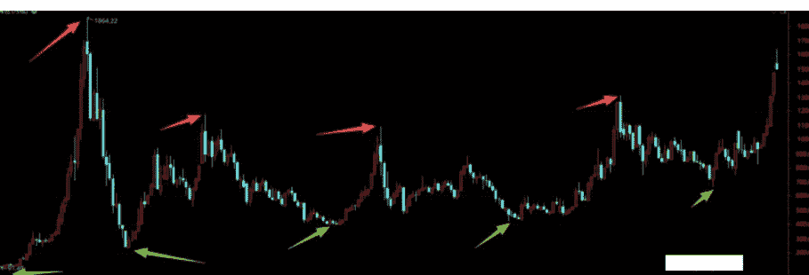
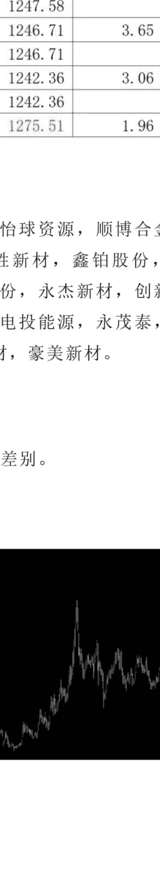

# 用趋势的眼光，回归主流，选择做投资机兼其事

原创 anmin0001 安民Anmin0001 深度分析 2025年10月19日 07:00 福建

## 一、用趋势的眼光

一说人生，选择大于努力。

在牛市，更是如此。因为有的指数涨了两三倍，有的指数只涨了百分之二三十。

故而，时间来到2025年10月下旬，我们用这篇文章告诉读者，在后面的行情中，仍然要特别注意，是否可以做短线和中线投资选择的时候。

为此，强调三点：

第一，要用看大趋势的眼光。

什么是用看大趋势的眼光，如果大家不清楚，可以看我们团队以前的文章，特别是2024年1月1日的对话文章和2月1日的文章。那两篇文章，都不非常宏观，第一篇是纯宏，纯粹的宏观性质性的，第二篇是纯宏观的技术。

那两篇文章，我们都认为未来是大牛市。

当然，现在关于大牛市的观点，大家也听得比较多，相信的人也很多。比十年一遇的大牛市，2005年到2007年是大牛市，2013年到2015年是大牛市，现在也是大牛市，这是多年一遇的牛市运。现在这个观点，并不稀奇，人人都都会。难的是2024年1月1日和2月1日大牛市，而且是改变投资者命运的大牛市。

所以，本文论证的基础，就是大牛市，然后它的基础在2024年1月1日和2月1日的文中，包括后面有很多宏观的文章，文中都提了。但是去年前两个月的文章，那个我们打得很靠。这也是我们本文立场结论的基础。

我们的粉丝中，有人会不会把别人的观点转过来，希望我们能够析一下，哪个哪个网上的大名，后面有大大的风险，牛市即将结束等等，等我们微信

28688 资料分享群

望如所听我们的观点。注意，除非有必要，我们团队一般不会回复。

原因很清楚，我们的观点在以前的很多篇讲义的文章中很清楚了，而且是连贯的，如果不清楚，或者忘记了，那么就去“安民分析”栏目中把文章看完。我们的观点在哪里很清楚。

至于别人怎么做，那是别人的自由，我们不一定有精力去做这个析工作。我们团队应该自由地表达自己的观点，我们不可能规定别人只能说什么样的观点。

因此，别人怎么做我们管不管。我们只是比较质地讲自己的观点，您相信信的观点，都是您的。最多几句话，这里有没有大级别的高点，也不是大级别的顶部。当然，小级别的。

然后3040点以来，指数上行的周期，已经运行了27周，本周是第28周。离顶部的周期还有距离，暂时还没回到顶部。因为如果到顶部近了，我们不会讲中线投资的观点。那时最多讲短线，到时会讲中线，只会讲中顶部，讲要遥遥。

就是我们看大趋势，一定用经验眼光来看。哪怕讲短线，也一定在大趋势之中讲短线。

第二，周期，关于结束周期的再次循环。

我们以前讲到过，我们不喜欢研究周期股。但是今年行情有点特殊。我们前面研究过一只锂电材料，就属于周期的。我们没有复了490.55%，前期复复也是这个涨幅。这个效果不错。

我们后面还选择锂电上型的周期股中线和短线，我们的文章是8月2日讲出来的，那个板块短线的领涨期，就是龙头股，8月7日到现在已经翻倍了。最低到最高，涨了106.88%。我们做短线，开始的资金没有进去那么多，靠后来的加，总收益超过70%。

而它那个板块的资源股，目前板块已经处于底部领先位，我们来估计还有长时间空间的。那个板块周期最高涨45.82%。

这两个例子说明，周期如果选择得好，个股也好，板块也好，都会结果。如此，本轮，我们的风格也要改变。

加微信28688，资料分享群

就是我们可以把这块成熟的经验，现在的子板块中，第三点，从八字真言回到过去的八字，叫做“行业、底部、头部”。然后今年操作周期股，让我们团队到了另外字，我们的八字真言变成了“行业、顶部、头部”。也是我们的投资，要要做主流，围绕主流转，一定会有错的投资。今年的主流是什么呢？硬科技包括AI、半导体。还有呢是有色的，之前提到的行业和行业四。还有呢我们要讲的是有色的一个分支，在本轮牛，后面可能挖到矿。我们可以看到金属历史上的K线。它经历了四轮牛，现在是第五轮。

| 时间 | 低点 | 时间 | 高点 | 涨幅(%) | 跌幅 |
| :--- | :--- | :--- | :--- | :--- | :--- |
| 牛一 | 2005年7月 | 91.49 | 2007年7月 | 1864.22 | 20.38 |
| 牛二 | 2008年11月 | 229.44 | 2007年10月 | 1864.22 | -87.69 |
| 牛三 | 2008年11月 | 229.44 | 2010年11月 | 1175.95 | 5.13 |
| 四 | 2014年1月 | 394.76 | 2015年6月 | 1090.76 | 2.76 | -66.43 |
| 三 | 2014年1月 | 394.76 | 2015年6月 | 1090.76 | -61.35 |
| 四 | 2018年10月 | 421.54 | 2021年9月 | 1316.69 | 3.12 |
| 四 | 2024年2月 | 662.83 | 2021年9月 | 1316.69 | -49.66 |
| 五 | 2024年2月 | 662.83 | 目前 | 1639.63 | |

需要说明一点，牛市从左向右，由低点到高点，用涨幅表示。牛市从右向左，由高点到低点，用跌幅系数。强调一下，本轮牛市结束，这个板块的个股一定要抛。因为跌幅可能不会小。还有本轮牛市的涨幅是现在为止的涨幅，不是最大涨幅。因为牛市还没有结束。

加微信28688进资料群

就是说，今年有色是大牛，这波牛市有色是大牛。

(免责声明：本文仅为开拓视野、引导思路，并非推荐时，亦非荐股，股市有风险，入市需谨慎。本文不构成任何投资建议或意见，我们为大家的所有投资负责，请大家注意投资风险)

## 二、有色中有个块还有不错的短线和中线机会

我们直接上子块周K线走势图：

1. 880326铝

这个子块有两个指数，第一个是880326，如下：

| 时间 | 低点 | 时间 | 高点 | 涨幅(信) | 跌幅 |
| :--- | :--- | :--- | :--- | :--- | :--- |
| 牛一 | 2005年7月 | 132.96 | 2007年10月 | 3174.11 | 23.87 |
| 一 | 2008年10月 | 344.71 | 2007年10月 | 3174.11 | -89.14 |
| 牛二 | 2008年10月 | 344.71 | 2009年8月 | 1247.58 | 3.62 |
| 二 | 2013年6月 | 342.03 | 2009年8月 | 1247.58 | -72.58 |
| 三二 | 2013年6月 | 342.03 | 2015年6月 | 1246.71 | |
| 三 | 2020年4月 | 405.6 | 2015年6月 | 1246.71 | -67.47 |
| 四 | 2020年4月 | 405.6 | 2021年9月 | 1242.36 | 3.06 |
| 四 | 2022年4月 | 651.01 | 2021年9月 | 1242.36 | -47.60 |
| 牛五 | 2022年4月 | 651.01 | 目前 | 1275.51 | 1.96 |

这个板块有3个股，底部如下：

2. 881073铝的另一个指数，该指数和上指数个股重合，但周K线有些差别。

就不贴它的数据。

3. 880326铝周K图支撑，我们要给出880326，第一个铝周K图后面各个位，指数在下面是压力，在上面是支撑。这是一个大级别的颈线，是月K线和周K线。

| 时间 | 压力与支撑 |
| :--- | :--- |
| 10月17日 | 1248.244 |
| 10月24日 | 1248.241 |
| 10月31日 | 1248.238 |
| 11月7日 | 1248.235 |
| 11月14日 | 1248.233 |
| 11月21日 | 1248.230 |
| 11月28日 | 1248.227 |
| 12月5日 | 1248.224 |
| 12月12日 | 1248.221 |
| 12月19日 | 1248.218 |
| 12月26日 | 1248.215 |
| 1月2日 | 1248.212 |
| 1月9日 | 1248.209 |
| 1月16日 | 1248.206 |
| 1月23日 | 1248.204 |
| 1月30日 | 1248.201 |
| 2月6日 | 1248.198 |
| 2月13日 | 1248.195 |

也即稍放宽点，基本上上站1260点，就跌破了。最后补充一个观点，对于铜，铜铝属于补涨，因为它涨势落后。为什么，可以看到铜指数的月K线图，880325。结论是，铜早已经跃出了底部，铝在2009年后的几个高点附近折腰。

## 三、为什么看好铝

- 这波牛市，有色金属是大牛。上看黄金881076、白银881077、铜880325、铝880327的周K图和月K线条就知道。还有稀土永磁880535。不给画图了，大家自己去翻。有色是大牛。

- 铝铜可替换。这波牛市的硬逻辑是AI，而AI硬件里，电路的线路就是铜。在电路中，铝铜可以相互替换，只是通电时铝线的性能差异。铜的电阻率为0.017Ω·mm²/m，铝为0.028Ω·mm²/m，铝的电阻约为1.64倍。

- 在中互卡脖子的背景下，铝的地位显出来，其实就是铝的。中美互卡脖子，大打的。整个产业链上的东西，其中大家知道的是光刻机、光刻胶、半导体制造环节（如纳米刻，美国让刻）。

## (7) 机器人和人形机器人

工业机器人中经常用到铝材，人形机器人中，要求不是那么高的，估计到时一样会用到。

注意，新能源产业和新兴行业的高增长对有色金属形成“刚性需求”，成为此齿轮牛的核心支撑。

## (8) 大飞机和无人机

C919全身材料，机结构总重的65%为铝，按空重量约42.5吨计算，单铝材用量约27.6吨。主要为锂铝合金和传统铝合金。

无人机中，消费级无人机占比30%，大致为1.5到3公斤；工业级无人机占比提高到50%到70%，大致为3到6公斤，为主是航空级铝合金。

## (9) 无人船、无人机、巡杀无人机

这方面增加铝材的需求。

特别强调的是，军工产业中，铝材的应用在增加，特别是自动化武器，如机器人巡杀无人机，整机重量约35-47公斤，采用航空级铝合金+碳纤维复合结构，铝材占用量40%~60%，每只用量18到20公斤。无人船对耐蚀性要求更高，通常用5或7系铝合金，如5083、7075，船体结构铝材占比可60%~80%。以10级无人机为例，铝材用量6~8吨，主要用于船体框架、甲板及动力系统外。

## (10) 传统行业

比房地产，铝材用于门窗、幕墙，每平方米建筑面积需铝约2公斤。比基建，铝合金管道用于供水、燃气传输，每公里管道所需铝约50吨。再制造。铝制品用于家具，比如冰箱和空调等；机械设备如机床中会用到。再如交通行业，除了汽车，很多交通工具都会用到铝材。这些大家都知道，我们不多赘。

我们这一部分讲的前6个部分都是新能源行业的应用，而且是讲逻辑，干货，并没有深挖细节。我们只做这里齿轮牛，由于目前在逻辑里好，不用太过于往外挖，挖得太深了，后面就会容易得不到，看到这里也好，那那里也到了市顶部却找不着，那就就大家了。

本部分的后，铝实际上已经不是应用在新能源领域了，而是用了许多自动化产品系列之中。这些新兴行业对铝的需求，未来一定是高增长。一旦新能源高增长+新兴行业高增长，对铝的需求就会是高增长。现有的机构预判铝在新能源行业的需求复合增速是18%，并没有考虑到在那些新兴行业的增速。

## 5. 约束、降增和美国放水至美元走

### (1) 乌克兰战争造成产能

乌克兰是全球重要的铝矿出口国，占全球出口量的5%，俄罗斯是全球最大的铝出口国，占全球出口量的15%。战争导致乌克兰铝矿产量中断，现在常常会受到影响；俄罗斯铝出口受到西方限制，全球供应减少约200万吨/2022年我们分析通过欧洲工业化，当欧洲电解铝产能减少了100万吨，现在大致减少约50万吨，俄罗斯减少了30万吨。

欧洲主要受到电力紧张和天然气价格影响，导致的电解铝产量开始终止。对于每生产吨电解铝减少13000到15000千元。

### (2) 环保碳达峰

中国则是受限于环保的因素，主要是保证好天气，少污染。当然，更制于碳达峰。为了碳达峰，也为了了环保，中国电铝的年生产目标最大为4500万吨。

2024年中国电铝产能4462万吨，运行4361万吨，生产4346万吨，消费4518万吨。消费量已经达标了。目前产能只差多少？运行只能差139万吨。

2025年上半年实际运行产为4350万吨，空间很有限。所以，4500万吨电解铝红线政策未来会持续在那里。

2024年全球电解铝需求大于供9万吨，全球产量3600万吨，消费3630万吨，略大于。

### (3) 技术革新带来增效

未来最大的变化来自于新能源和新兴行业，新能源行业增速接近18%，新兴行业别汽车、大飞机、机器人和人形机器人，这些未来都会增长。未来最大的变化来自于新能源和新兴行业，新能源行业增速接近18%，新兴行业别汽车、大飞机、机器人和人形机器人，这些未来都会增长。

未来最大的变化来自于新能源和新兴行业，新能源行业增速接近18%，新兴行业别汽车、大飞机、机器人和人形机器人，这些未来都会增长。

目前国内占比已经超过25%，特别是光伏和风电，用于生产电解铝推动成本下降。

### (4) 美元放水

美国过37万亿的债，而美国从美储选择降息，放水，美储行为即将崩溃。比如马斯克效率工作了几个月，号称节省了2000亿，最后特朗普跟关征税，估计2025年全年达到2000亿，2026年将达到2500亿，最后增加了3000亿，最后了特朗普的预算，美国财政赤字高达18000亿。所以，美国财政制不住，根源，就是从上到下系统性的腐败。美国只会快增长，全球都看清楚了，一些西方国家和清醒的人只会离开美国，导致美元长期上行，最终走向弱。与此同时，美储抛回的行为将终止，这表明货币政策再次宽松。货币政策宽松，资源必然走牛，有色。

## 四、操作注意事项

第一，前期的2009年8月以来的高位，现在趋势线（或支撑线）附近，根据趋势线，它站稳不容易。按照技术要求，一两没有，最好站稳了再操作比较稳健。这里的位置和资源很大差异。第二，即使站稳了，也不要费性太大，不要重仓。

第三，大项一定要坐。这一点特别强调。上轮熊市，铝是2022年4月底部，原因就于乌克兰战争，由于2022年2月开战，俄罗斯和欧洲都受到重大影响，西方胜利，导致全球电解铝出口减少到100万吨后，欧洲电价上涨了，电解铝被拖后到2022年5月才可见底。所以，一旦行情见顶，如果不的话，一套就会很多，有色指数88324是2022年5日见底的。这表明，铝市调整幅度很大，投资者再多的，也不满铝市的大坑。我们要特别提醒各位。

第四，选股。简单来说，三条。一是盈率尽量，可以用扣经常性损的股东净利来算；二是业绩要好；三是形态要好，最好刚站稳突破；或者业绩但距离远远及。

本文仅为开拓视野、引导思路参考，并非针对，亦非荐股，股市有风险，入市需谨慎。本文不构成任何投资建议或意见，我们无力为大家的投资负责，请大家注意风险。

知识星球TOP

添加微信免费群微信:top28688

| 序号 | 公号/星球/社群 | 原价 | 领域 |
| :--- | :--- | :--- | :--- |
| 1 | 生财有木 | 2765/年 | 副业, 钱线 |
| 2 | 怂宗吃瓜群 | 365/年 | 时政, 历史 |
| 3 | 记忆Legacy/毅树西风 | 365/年 | 成长 |
| 4 | 欧洲金轨 | 328/年 | 时政, 历史 |
| 5 | 卢克文青云会 | 699/年 | 时政, 社会 |
| 6 | 体制内主任 | 599/年 | 制制;职场 |
| 7 | 局外人的视界 | 669/年 | 金融, 时政 |
| 8 | 泽沛异迁 | 4166/年 | 财富, 成长 |
| 9 | 宁夜人总司令 | 599/年 | 时政, 经济 |
| 10 | 江宁知府 | 365/年 | 时政, 国际 |
| 11 | 政事堂/顾子明 | 568/年 | 时政, 经济 |
| 12 | 唐书院 | 1399/年 | 金融, 财富 |
| 13 | 大树乡谈 | 199/年 | 时政, 成长 |
| 14 | 水库欧大 | 10000/年 | 房产, 经济 |
| 15 | 洪灏宏观策略 | 4376/年 | 经济, 钱线 |
| 16 | 金政通鉴/北海南山 | 4576/年 | 股票, 行研 |
| 17 | 猫哥的世界 | 299/年 | 时政, 社会 |
| 18 | 飞涨龙 | 3600/年 | 股市, 经济 |
| 19 | 米联诸见闻 | 599/年 | 经济, 金融 |
| 20 | 茶茶财经经费 | 330/年 | 房产, 股票 |
| 21 | 赢在八小时之外 | 365/年 | 成长, 职场 |
