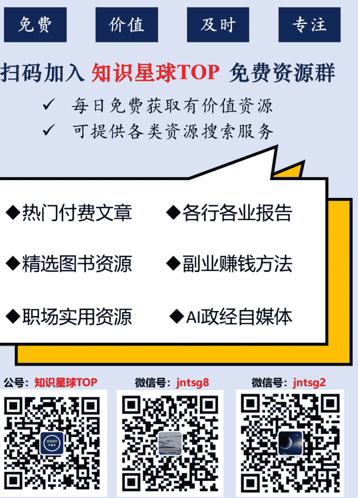

# 推荐！能改变你的命运，让你智商提升30个百分点的文章

原创 陈她是我是 屠龙有术

## 前言

学习党报党刊，本文推荐的党报党刊文章，能让你提高智商30个百分点，从此进入智者行列，不会再被忽忘，你未来决策更加准确，成功概率提高。

本文原文：陈旭

微信公众号：屠龙有术 (ID: tulongys)

陈旭私微信：chenxusirs or chenxusirs

本公众号的宗旨：通过日常生活和工作中发生的各种事情，引导人们发现社会各种事件背后的真相和规律。认识规律，总结规律，使用规律，利用规律，最终上升官发财之之路。

公开的信息其实都是阉版的，全版是不允许发表的。

很多面对普通人和社会底层的网站报纸杂志，都是为了悠悠猴子。

如果你去去看猴子喜欢的报纸网站，你就会变成猴子，傻得冒猴。

其实，要看全版的，没有划过的信息，只需要看中央的网站，报纸和杂志上，一下，知道了。

## 党中央的报纸网站是给各级领导的，你去看中央的报纸网站，你就会像各级领导一样有神才，天生英才，所向无敌。

所以，根本不需要焦虑崩溃，也不需要去看违法的信息，我们只需要看中央的网站和杂志的信息，就知道一切真相。

因为党中央的网站报纸和杂志，都是给各级领导的，不能用假话欺骗各级领导。

很多人说，互联网时代，信息爆炸丰富，想要什么，都可以知道。

陈旭要告诉你，这种说法是错误的。

由于，互联网时代虽然免费信息如瀚海，但是面对海量的免费信息面前，你并不知道一个信息是最重要的。

人脑是有限的。

当面对海量信息，不知道哪条信息最重要，不知道各种信息的优先和权重的时候……

虽然你可以随手得到各种信息，但你不知道它们是否有价值，你不知道它们各自的重要性和价值所在……

客观上就等于，你能有效使用的信息量为零。

本文一段说了，党中央的各种网站，报纸，杂志，价值是非常高的……

其中有一篇文章，价值更高，能在几秒钟之间，打通人的奇经八脉，让人的智慧提升几个段位……

## 信息是有价价值的......

但是，告诉你，什么信息对你有价值，这个行为是有价值的。现在，陈旭告诉你一个要要信息，这个重要信息是（看过的此文的人，就不要购买了）……

以下付费内容是一个标题，和一个链接地址。

这个标题是网上公开发表的内容。刊登在中国共产党的官方网站上。

付费内容，就是这篇文章的标题，链接和文章内容。

低收入者请勿购买，以免给您造成经济损失......

......

......

网站：宣讲家网

主管单位：中共北京市委宣传部

文章标题：《三十年前我们为什么要选择改革开放》

文章作者：原中央党校国际战略研究所副所长，陈天勇

链接地址：http://www.71.cn/2013/1212/50426.shtml

陈旭评论：可以百度文章名称，或者复制上述链接到地址栏，打开。

把《三十年前我们为什么要选择改革开放》这篇文章真的看完，认真真看三遍，然后思考2次......

重新规划你的人生，价值，世界观。

重新考虑你的一切策略，你的智商就会提高30个百分点。你将进入智者行列。

## 由于，智力 = 金钱 = 权力

进入智者行列，意味着你将在未来，才会有正确性更高的策略，带给你更多的金钱和权力。

最后，陈旭要说：祝你好运！希望你这30元，花有所值。

分享资料仅供个人学习，请及时删除，切勿商用传播
