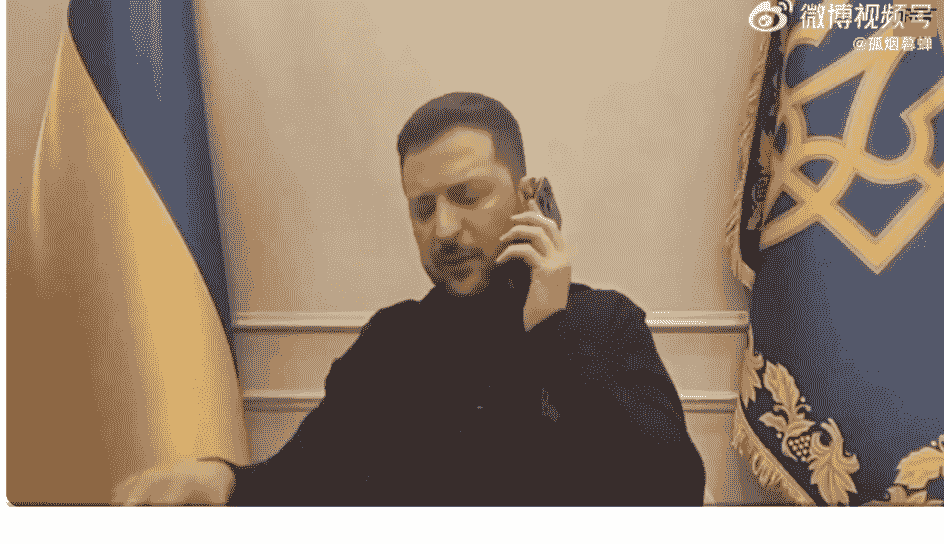

今晚闲聊。

前不久，懂王在普京这里吃了个大亏，很丢脸，不仅证明了他对普京是战略被动，也让欧洲进一步独立自主。

懂王最丢脸的就是这么给普京面子，普京却一点面子都不给懂王。

## 知识星球TOP 资源分享群

让更多人获取高价价值信息

| 付费文章 | 付费社群 |
| :--- | :--- |
| 付费课程 | 副业&搞钱 |
| 财经&股市 | 行业报告 |
| 时政 · 历史 · 职场 · 体制 · 自媒体 | 学习 · 军事 · 软件 · 影音 · 社会学 |

公众号：知识星球TOP

添加微信免费进群
微信信号：jntsg8
微信信号：jntsg2

普京玩川普一把。今天俄美元首通话比先约约定时间晚了1个多小时，而且普京故意向俄罗斯民众炫耀他对川普的傲慢：与川普通话前普普参加俄罗斯一个电视直播节目，甚至主持人重提醒‘佩斯科洛夫催促，川普还在等电话’，普京说‘那是他的事’。

简单通过川
via 武内 树

司机甚至发视频讽刺懂王。

@孤烟暮舞
在跟记者交谈，泽连斯基突然接到马克龙来的电话
泽连斯基接起来说：“不好意思，伊曼纽尔……我在和记者交流。我能过几分钟再给你你吗，15到20分钟？谢谢你，伊曼纽尔。” 孤烟暮舞的微博视频

普京就是这样故意放懂王鸭子的，在公开会议的时候让懂王等我开会后再再打电话，司机有样学样讽刺懂王被普京搞心态。

然后是英法德，之前懂王对欧洲那可是气势汹汹，英法德一时也有点怕懂王，结果懂王的不败金身在普京这里被破了后，英法德也哄堂大笑，不仅对懂王抱有之前那么高的期望，而且还决定逼宫懂王。

## 格隆汇·电报

新闻更快的财经资讯

2025-03-21 06:37 星期五

## 欧洲军事大国制定5-10年计划以取代美国在北约的地位

格隆汇3月21日|据英国金融时报，欧洲几大军事大国正在制定计划，从美国手中承接更大的欧洲防御责任。计划包括向特朗普政府提出的未来5至10年内计划移交欧洲防御责任，以避免美国单方面退出北约带来的混乱，特朗普多次威胁要削弱或退出北约引发了这种担忧。四名欧洲官员表示，英国、法国、德国和北欧等国参与了与非正式组织进行的讨论。他们的目的是提出一项计划，将财政和军事责任转移给欧洲各国政府，并在6月北约在匈牙举行年度领导人峰会之前交给美国。

研究·电报·路演·行情·社区
长按二维码识别，下载格隆汇APP

## 隆汇 全球视野·下注中国

——英法德北欧提出一项计划，将财政和军事责任转移给欧洲各国政府，并在今年6月北约在匈牙举行年度领导人峰会之前提交给美国。

之前懂王威胁美国要退出北约，欧洲表示，我好怕好怕美国你你别走啊。

## 抱大腿

现在的懂王威胁美国要退出北约，欧洲表示，一言为定双喜临门

普京公开给懂王难堪，引发了欧乌一系列的连锁反应，普京只会觉得好笑，懂王是真的会郁闷。

本来，安抚欧乌就需要俄美齐心才能安抚好，才能既不逼欧洲独立自主又不逼欧洲倒向中国。

结果目前只有懂王在认真安抚找补，普京已经上头不听劝了。

欧洲这边会加大两个趋势：
- 一个是军事独立自主的趋势。
- 一个是缓和对华关系的趋势。

法国马上派人来见我们了，中法的交流。

然后是中东。

## 万理PKT 图 微博网页

17小时后 来自微博恢复了对加沙的进攻，一下就宰杀了上百平民，同时也炸死了哈马斯。

本周，以以色列对加沙的进攻进入阶段，原因还是那个：应该进入谈判第二阶段，但美国无力组织谈判第二阶段，没有美国的强力组织，以以色列法就加沙的最终治理压力哈马斯，于是以色列延长第一阶段停火，双方继续进行人换囚，但哈马斯坚决要求“按协议办事”，美国私接触也不行，就要求“久久停火”进行第二阶段谈判。于是以色列在中国的默许下炸加沙，施压哈马斯延长第一阶段停火……逻辑就是：用开火的方法，追逼延长协议。也是够可怜的。

本质是川总对加沙头脑空空，除了房地产没有其他宏伟蓝图，所以也不知道怎么组织第二阶段谈判，没有目标，没有手段，没有路线图。

## 其实懂王计划不是准备的。

## 他们准备迁从200万的沙沙人。

一开始是找中东穆斯林国家接，要沙特特接收部分。

结果沙特和埃及的大哥死活不干，其他穆斯林国家说要这样不如资助哈马斯反抗。

## 懂王没办法，就想找非洲，甚至叙利亚。

——多名知情人士16日告诉美国哥伦比亚广播公司，美国政府和以色列政府已就强制迁移加沙地巴勒斯坦民众一接触苏丹、索马里两国政府。不仅如此，美以还有意拉叙利亚现政权参与相关计划。

叙利亚可能会接受，换取军援和粮食，但内塔不会接受。因为叙利亚就在以色列头上，离太远了，加沙人民搬家去叙利亚，一样复仇以以色列更打。所以可能很一部分人搬家去叙利亚，其他大部分人都会搬家去非洲。

远离以色列的地方，非洲很可能。

但非洲也不是傻子，加沙人民是烫手芋，哈马斯已经证明了他们武力充沛万人战士。历史上，约旦接收过加沙难民，结果难民造反差点把约旦王室给掀翻。这些非洲国家真憋不住。

## 懂王威胁美国要退出北约，欧洲表示，一言为定双喜临门。

## 普京公开给懂王难堪，引发了欧乌一系列的连锁反应，懂王搞心态。

## 懂王威胁美国要退出北约，非洲国家真憋不住。

所以，美国就算会很多利益给非洲国家，但非洲国家知道，命更重要。

拿了懂王的钱，被哈马斯造反全家，就是没命了。

所以谈判卡住了。

—索马驻美国大使达希尔·甘桑否认两国政府就强加沙人事宜。他说，“传播此类未经核实的信息恐‘伊斯兰国’等极端组织招兵，进而导致地区局势恶化。”

然后内塔等不及了。之前懂王已经分析到本质了。那就是懂王是置换长期风险，换取下对中国的战略优势。内塔的利益，就被懂王置换了。因为现在的伊朗，是历史上最虚弱的时候，国内强硬派群龙，都被切断，内外危机已经是国运危机。

内塔知道，眼前是以彻底解决伊核的历史机遇，错过了可能永远错过了。伊朗现在的危机，比我们深多的。之所以我们觉得现在好受，非是懂王一心力量搞我们，而不是去帮内塔棘解伊核。懂王换如长期风险，也扛不住反噬。上面写的，就是反噬。内塔也是反噬。本来加沙难民安置问题，让懂王头大了，就让停火协议。

内塔还是炸了，因为内塔就是要懂王压力，急不可及帮懂王早点解决内核。拖这些时间，伊朗亲美派副总统也要变凉，而且不信懂王的和平承诺，依然在搞销，内塔心里急，促王硬解伊朗。两名以色列官员和一名美国官员称，预计以色列高级代表将于下周访问白宫进行战略磋商。特朗普曾给了伊朗两个月的时间来达成一项核协议，如果无法达成，将对伊朗进行军事打击。其中一名以色列官员说，他们希望就联合行动方案达成一致。这将是特朗普上任以来美以战略小组的首次会议。

厉害了。欧洲打算在6月份逼宫懂王。内塔在3月末就准备逼宫懂王。懂王置换出来的长期风险，已经开始反噬。懂王没办法，中国这边没搞定，懂王就不答应内塔硬解伊朗。懂王最多继续制裁，而内塔要的那种炸弹直接摧毁所有伊朗设施，懂王是不可能的。因为懂王知道，中伊通过气了，只要懂王敢在伊朗钻弹，第二天就会发动台海战争。

所以懂王下周很大，要面对内塔催命。问题来了，懂王的重头戏，对中国做的如何？懂王出了各种示好。不是给我们的示好，是给中国亲美派示好。懂王说，只要中国妥协，4月懂王访华，6月我们访美，还可以在615这个特殊的日子互相生日快乐。懂王真的是太营销了，615真的实现，那的确是载入人类史册的一幕。然后懂王还表示，关税问题暂缓，中美进行磋商。

懂王对内部亲美派好如此多，无非是有求于他们。求他们在八王议大会上逼我们让步。北载河开启了安保工作。一般，北载河一年只开启一次安保，那就是夏天的7月8月9月开避暑大会。但这次，上半年就开启了。两会结束后就开启。朋友问了，我们怎么还去贵州云南，不是要开八王议大会吗？因为北载河的安保是持续到4月份。

一般北载开三天，长一点就五天。安保截止时间是4月份的话，我们完全有时间按照计划出访。一般两会后都会安排地方访问，访问几天后回去开会，直到4月份。所以完全时间，时间很宽松。最好只开几天，延长一天都是大事。历史上会议最长的一次，是1962年，教员将原定两三天的会议，几次延长后，开了一个月。

——1962年7月25日至8月24日召开北载河工作会议，原定议题是讨论农村、粮食、商业和国家支援农业等问题，重点是讨论《关于进一步巩固人民公社集体经济、发展农业生产的决定(草案)》、《农村人民公社条例修正草案》、《关于商业工作问题的决定》等文件。在8月6日的大会上，毛泽东关于阶级、形势、矛盾问题的讲话。随后又在每次中心组上多次插话，继续阐发6日讲话的观点。这样，北载河工作会议重点转讨论阶级斗争。为什么教员这么做？因为1962年1月，刘少奇逼教员。1962年年初，中共在京召开了长达27天的扩大工作会议，与者多达18人，也被称为“七人大会”。

“左比右好”、“一个手指和九个手指”、“有人有多胆”、“听风就起哄”此类思维被他深刻批评，教员坚决维护“红旗”。1962年1月，刘少奇通过大会发起了猛烈攻势，教员不得认错，彻底夺了经济权。1962年7月，教员通过小会发动反击，延长到30天，试图在高层发动文革，但未能成功。最终64年，教员通过群众成功发动文革。30天还是最长的会议。

——1960年7月5日至8月10日，毛泽东主持召开中央工作会议。7月5日开始，8月10日结束，一个月。主要讨论国际问题（中苏关系）和国内问题。会议一旦开长，一定会有大事。所以能4月份结束是最好的。三代开始，会议就不再开长，一般三天的样子。新时代后，分上下两场。上半场，老人参加，相当于大会议，谈经济。

然后老人回到地方，开启下场，老人登场了。所以下场比上半场更重要。之所以让老人参与上半场，不让老人参与下场，是规矩。一年，老人退休，光风光亮的姿态，老人权力被批判了。老人权力，九龙治水了。老人全力支持新班子，这次老人达成共识，尽可能放弃老政治。之前那些老人退休后，还在会议里留着，新时代后一律不再留。然后会议之前没那么仔细，老人和朝辈齐聚堂讨论，相当于扩大会。

老地尊别，中央对上位是下位者的姿态，老人对晚辈的关系。之前没改规矩的时候，老人参与会议，老人在门前吃瘪。老人的威信就被破坏了。那时候上海陈良宇，敢以地方身份说中央命令要听，凭什么听逆道的话。所以当年为了表态支持，之后作出了第二个改变。

上半场，中央开会，老人不参与。下场，老人开会，中央不参与。这样有利于新班子保持愿望，更有利于老人利用门下趁机搞老人。对有些人来说，八王议会很重要。因为今年有一个关键会，是四中全会。去年三中全会，他们没实现太子的野心，现在懂王上来了送助攻，他们又打算搞这一套了。四中全会是下半年10月开。惯例是8月开。一般管理是会议开完后全会。

而懂王邀请的中美访是4月是6月。按惯例8月开会议让我们对美妥协，懂王的黄花菜都凉了。所以他们要提前开会。今天刚打了一个对面的人。

涉嫌严重违纪违法，66岁证监会纪检察组原部长王民被查
澎湃新闻 2025-03-21 19:18

建行，纪委。这个人的buff是叠满了。所以马上这个会你懂。按我个人看法，提前开就不提前开。懂王现在这么热切的给亲美派助攻，我们就不要头铁在这个时候提前开会。开完就4月了，而懂王说4月想访华，我们顶住压力不接收访华都很难，更别说服他们接受破局了，所以最好就是不开，不给他们八王议的机会。不得不不得不开，就不延长，最多两三天，到点闭会，延长可能就长夜梦擂不住场子了。

最美剧本，就是顶住压力坚决不开。其次剧本，就是开会但不妥协。最差剧本，就是开会且妥协，然后4月份我们看到懂王笑吟吟的来家里做客了。

写到这里，也挺唏的。之前他们有些人，的确给了我们很多配合帮助。剪辑会议办，修改会议规范，不搞九龙治水，光退高风亮节，配合支持前期反腐。之前的会议还是一团和气，还是老人对新人的支持鼓励。时过境迁，我们和他们的蜜月不再。甚至连我们身边的人都变了。这次去昆明看枪杆子，左胜右臂都没有陪。

“等闲变却故人心，却道人心易变”

## 结语

到底是他们变了？还是我们变了？
还是我们和他们都变了？

不知道，也许有老天老爷才能知道答案。我们吃瓜群众知道的只有一件事：

“我们和他们，都回不去了……”

知识星球TOP 添加微信
付资源享享群 免费入群
