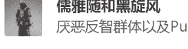

# 今天，聊聊学术性的话题。

这些思考是从一个知乎提问开始的。

为什么美国人宁愿被资本剥割也不愿意被权力剥割，到底是被哪个剖析面更痛苦？

- 关注问题
- 写回答
- 邀请回答
- 46评论
- 分享

# 有几条回答，引起了我的兴趣：

221人赞了该回答

我在知乎看到过关于中国财阀的电影，里头内外的男，财阀公子，韭狗，有钱就有钱，性格最恶劣，大家印象特别是那种坏人，会把签约的网红拉过来站起来站成一排，等他们跟别人打牌那种。

某天觉得自己变了气，需要发泄，在路上拦住一个女妹妹，打你一下，给你百万（相当于5000人民币）。小妹就愣了，没说话。那拿着小妹的头捶了捶，疼心疯狂连续钻痛，小妹连人带车都被打了，躺在地上。

然后掏出钱包，开始给多少钱，数了几次，不耐烦，就把钱全拿出来往小妹身上一撒，随脚入豪车，扬长而去。

本意是批判财阀的电影，评论风向歪了：

加微信intsg2，免费资料群

61 条评论

- 花远好物：我也想被打（2天前·安徽 回复）
- 落伍de小螃蟹：哥，能打我一顿嘛（2天前·山东 回复）
- 萧了一手：能来打我呀（2天前·广东 回复）
- 妖妖成仙：打我吧（2天前·安徽 回复）
- 俗途：打我呀（2天前·北京 回复）

大家都觉得，哎，这二人不错错，打人还给钱，挨打这还难，自己这种时候也能单就好了……

我也觉得，虽然也是作恶，但这坏儿子比被打得满血还要喊“是武举老爷”强吧？

编辑于 2022-10-02 01:09

加微信intsg2，免费进资料群

其中，主的一个回答让我感叹：

Kylo Ren：一个打你给钱，一个打了你还要说打得好。（10-01 · IP 顾地江苏 回复 126）

慎瀚随和犀风（作者）：金钱是流动的，用起来才有威力，权力是人无条件服从。开车撞了人，有人会提出花钱私了，有人直接一嗓子“我爸爸是李刚”就行了。（10-02 · IP 顾地江苏 回复 68）

## 是的，资本和权力是不同的。

霍宝宝：以斗争和和平对待和平，以妥协和和平对待和平。（261 人赞了这次回答）

各位主都很好，我就浅浅的总结了。

资本就是你一下，给你打一下的钱，甚至你可能通过谈判争取更多的钱。而你不想被打的时候，资本再拿多钱也不打你了。

权力就是，我现在就打你了，打完你还要找我打得好。你要是不满意，我还要把你家人拉出来打。最后我还是正义的，你是邪恶的。

编辑2022-10-03 01:29

# 货币用学学的话陈述

# 马克思认为，货币不等于资本。

# 货币在静止状态下，只是货币本身。

只有流通起来的货币，而且流通起来为了增值目的的货币，才叫资本。

加微信intsg2，免费进资料群

这个很好理解。

你有一万钱，这一万块不是资本，只是货币。

你拿这一万块去买一台手机，货币流通起来了，但买来的是自己使用为目的的商品，但这一万块依然不是资本。

你把一万块借给别人还你利息，或者你买来办公用的笔记本等生产工具，这一万块，才叫资本。

是的，货币成为资本，要满足两个条件：

1. 货币要流通起来
2. 流通的目的是增值而不是消费

这个基础知识点升级下，就能解释这2个问题：

1. 有一个经济学故事：李嘉诚掉了一块钱到下水道里，旁边保安帮他捡起来这一块，李嘉诚给了保安100块，众人不解。问：“你一分钟就能赚10万，你捡一块钱的时间成本，远远高于这一块钱，不是浪费吗？更别说你为了捡起这一块钱还给了保安一百块。”

李嘉诚回答：“这一块钱如果掉进下水道，就无法流通，等于永远从市场上消失了，而这一钱近乎永远存在，静止看是一块钱，但一次是一块钱，流通百万次就是百万的资本流水，所以我宁愿花时间去捡钱，还要给100块感谢保安。”

这个故事当然是假的，但完美解释了流通对于货币的重要性。货币如果不流通，就近乎死物。

# 2、我是个上班族家里钱钱，看我老板天天花钱请客吃饭，开豪车我家宅，我也心痒疼也跟着……

（注：此处存在大量重复及乱码，根据语义逻辑整理）

是的，资本和权力是不同的。

资本就是你一下，给你打一下的钱，甚至你可能通过谈判争取更多的钱。而你不想被打的时候，资本再拿多钱也不打你了。

权力就是，我现在就打你了，打完你还要找我打得好。你要是不满意，我还要把你家人拉出来打。最后我还是正义的，你是邪恶的。

# 货币用学学的话陈述

# 马克思认为，货币不等于资本。

# 货币在静止状态下，只是货币本身。

只有流通起来的货币，而且流通起来为了增值目的的货币，才叫资本。

### 权力是根，资本是叶。

资本当然遵循增值的本能，但权贵这里，叶不能指挥根的生长方向。

所以，权贵资本的首要任务，是维护权力，次要任务，才是增值资本。

一旦政治起动，权贵们就会舍弃增值的寻根的安全。

# 权力是根的。

你富，但不一定能贵。

而你贵，就一定能富。

### 权力是根，资本是叶。

资本当然遵循增值的本能，但权贵这里，叶不能指挥根的生长方向。

所以，权贵资本的首要任务，是维护权力，次要任务，才是增值资本。

一旦政治起动，权贵们就会舍弃增值的寻根的安全。

所以，在王子君看来，权贵资本就出现了和马克思古典资本主义不同的意志的表现。

