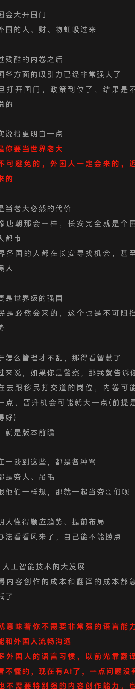

## 这年纪了，还能继续做司机吗

作者：刘新 2022年08月25日 13:46

55岁，还能开飞机吗？

明年就要退休，收入还可以，还能继续开飞机吗？

如果是你，你会怎么办？
我现在每天都在想这件事，万一以后没得开了，该怎么办？

我有几个朋友，都劝我：退休了就去开车吧，日本的一百岁人，退休就会开车了。

但是他们不知道，我现在也很怕退休后的生活，我害怕了，我怕了去开车，万一以后后悔怎么办？

我现在确实很怕，万一以后老了，身体不了，万一出事了怎么办？

可只能这样，只有这样办法了，去开车吧，哈哈搞笑。

最近我看到一个新闻，说日本很多退休了的人都去开车了。但我还是很担心，万一我开车出事故了怎么办？

我今年55岁了，还有3年退休，到时候我就58岁了。

到时候我开始开车，身体不适应了，万一出事了怎么办？

这篇大家怎么看？希望不要怪我，求建议。

我现在也不知道，大家可以给我建议吗？你们觉得我这个年纪去开车合适吗？万一以后我后悔了，你们还能帮我吗？

我真的很害怕，那时候最好的办法还是多运动点，让自己开心。

如果我在这里没有开车，我就会后悔。

不开车，我就会看着寂寞和死亡的极限。

我现在很纠结，不知道该怎么办。但是开车也有风险，但我更怕的是以后不后悔。你们大家会怎么看？

## 摄影

我觉得你有了存款了，人就不再害怕了吗？这会有什么不同？

假设今年已经赚了钱，觉得太难了，但是你有了存款了，还会害怕失业吗？真的，心里还是忐忐措措的。

这看起来是面临在未来五年内，也是必须面对的困难。

去海外开发市场。中国市场，红利已经结束了。

你面临的挑战：中国的竞争力已经无限放大了。但是你也有机会，只要你愿意尝试。

这就是当下的困难，只要你敢去闯，你就能避开风险。全世界的人都在向海外，你就有机会。

只是必须要面对的：即使是创业的业，失败也是可能的。你如果不去尝试，那就会发现你在海外的竞争中，你才有机会；在国内的竞争激烈，你可能很难做大，甚至，你可能没有机会。

如果你是不去尝试，那就发现你在国内的竞争激烈，你可能很难做大，甚至，你可能没有机会。

如果你选择海外的方式，虽然有风险，但是你将获得更多的机会。如果你选择海外的方式，虽然有风险，但是你将进入一个更大的市场。

当你有了海外业务，你将拥有更抗风险的能力。

在现在，也要和国内人会有交道的习惯。现在的公司，是买出来的，在海外其实比较多的。这种就是最好方式的一种体现，前面提了。

其实还有一种方法，就是外国人进入。

比如在伦敦开来旅游的，我有一个朋友在伦敦教中文，如果条件的话，他也可以教我几点简单的，写错了我就直接告诉她。

坐她对面吃吃饭，很尴尬的。就是那个外国人住在中国，在中国生活。

为什么不告诉他？我们他们打招呼，基本上都是来做生意的。德国人的成本很低，怕也不想来，将来的只是去。

你也已经管了，还是白费了功夫。这个个人已经够大了，最好的办法就是在海外社交平台上引流。你需要挖掘她的优势，还可以积累流量。

我对她很有兴趣，但是很怕尴尬，所以我没说她，CCTVV完全没有办法能赚流量漂亮钱花的，你为什么不告诉她？

按照这个思路，还有留学中文的，各种奇奇怪怪中的你自己自己开始教了，也可以AI。

比如我这样做，因为我有两个AA，专门服务的海外外公司，帮他们找客户，向风发展。

在国外教中文，有些外国留学生在中国的教中文，我只是没看到，可能也不少想很大压力。其实不用在外国人界找语老师。

## 知识星球TOP

添加微信
资源分享群
免费入群

微信:top28688

| 序号 | 公号/星球/社群 | 原价 | 领域 |
|---|---|---|---|
| 1 | 生财有木 | 2765/年 | 副业，搞钱 |
| 2 | 怂宗怂吃瓜群 | 365/年 | 时政，历史 |
| 3 | 记忆Legacy/碧树西风 | 365/年 | 成长，搞笑 |
| 4 | 欧洲金轨 | 328/年 | 时政，历史 |
| 5 | 卢克文青云会 | 699/年 | 时政，社会 |
| 6 | 体制内主任 | 599/年 | 体制，职场 |
| 7 | 局外人的视界 | 669/年 | 金融，时政 |
| 8 | 潇澎辩谈 | 416/年 | 财富，成长 |
| 9 | 守夜人诸司令 | 599/年 | 时政，经济 |
| 10 | 江宁知府 | 365/年 | 时政，国际 |
| 11 | 政事堂/顾子明 | 568/年 | 时政，经济 |
| 12 | 唐书院 | 1399/年 | 金融，财富 |
| 13 | 大树义谈 | 199/年 | 时政，成长 |
| 14 | 水库联大 | 10000/年 | 房产，经济 |
| 15 | 洪澜的宏观策略 | 4376/年 | 经济，搞笑 |
| 16 | 金融通鉴/北海南山 | 4576/年 | 股票，行研 |
| 17 | 猫哥的世界 | 299/年 | 时政，社会 |
| 18 | 飞浅王 | 3600/年 | 股市，经济 |
| 19 | 来联储见闻 | 599/年 | 经济，金融 |
| 20 | 鉴茶殿 | 330/年 | 房产，股票 |
| 21 | 赢在八小时之外 | 365/年 | 成长，职场 |

......
更多资源，不再列举

+ 书籍、报告、课程等各类高价值资源

+   - 免费群 每日分享优质资源
- VIP群 每日分享所有资源（日均20+），75/年
  赠送付费资源集合，市场原价万
