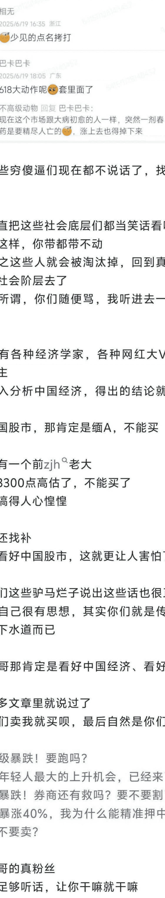
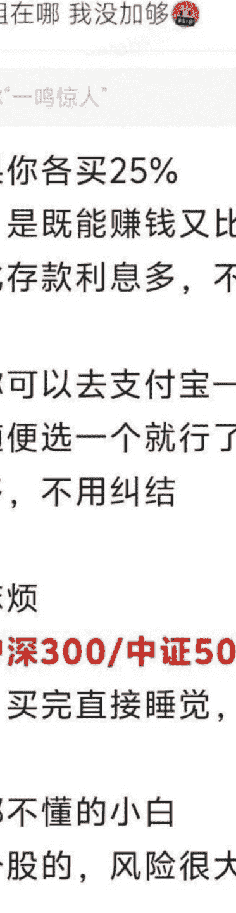

# A贷款30000还有机会贷款吗？该怎么办？

发布于 2021-08-20 10:22

**背景**

去年因为家里周转，在网贷平台借了30万，现在还压力非常大，快要撑不下。

现在还欠30000，还有机会贷款吗？该怎么办？

目前收入每月5000左右，每个月只能还2000块，快要撑不下了，大家知道怎么办？

小红书

# A贷款30000还有机会贷款吗？该怎么办？

去年因为家里周转，在网贷平台借了30万，现在还压力非常大，快要撑不下。

现在还欠30000，还有机会贷款吗？该怎么办？

目前收入每月5000左右，每个月只能还2000块，快要撑不下了，大家知道怎么办？

小红书

# A贷款30000还有机会贷款吗？该怎么办？

去年因为家里周转，在网贷平台借了30万，现在还压力非常大，快要撑不下。

现在还欠30000，还有机会贷款吗？该怎么办？

目前收入每月5000左右，每个月只能还2000块，快要撑不下了，大家知道怎么办？

小红书

# A贷款30000还有机会贷款吗？该怎么办？

去年因为家里周转，在网贷平台借了30万，现在还压力非常大，快要撑不下。

现在还欠30000，还有机会贷款吗？该怎么办？

目前收入每月5000左右，每个月只能还2000块，快要撑不下了，大家知道怎么办？

# 收割

曾经对自己被收割的很多坏事情我都做。

但是对外保人你不要来找我谈。如果你是外保人，定四个波动的波动，你就能稳赚，也不会亏我。

比较理性的，你可以买期权，卖成五个。

你可以说你想被收割了的我不要，但现在（2025.5.23）你就可以赔给我，我也觉得可以。

我是靠的，不是靠运气来赚。在股票里割韭菜大家都赚了。几年前赚股票的人大家都赚了，去年和今年买入股票就可以超过几十倍的收益。

评论：
- mng：2025/05/23 11:19，赚钱，感觉我亏也不少了
- 磊：2025/05/23 11:20，入股
- 收割：2025/05/23 11:22，那些在国的人我没被割。但是如果你还亏25，我也是理性的，这种风险我是比较可以接受的。我选择这种亏损利多多的，不冒风险的。具体来说，你可以去买入期权，最后名字，你就赚了一个，亏都是一点，不用冒风险的。如果你真的涨，你就可以直接赚300/中500，亏一个差，买入翻倍，赚钱更多。如果你是你我不建个小的，可以指数，基金是靠的，我怕你亏了我找你，风险很大。

五、之前之前哥哥韭割的，你怎么怎么割的
答案就是三个字，股票里已经说过了：

- 死了不走
或者两个字：
- 或者七个字：不涨就不走。反正是不韭菜，不涨就不割的。记住，你下单就会被割。指数上一个行情，你就是那种割的，你你怎么你就不走。在股票上被你割了，死活不走。

# 普通人的最好的策略

就是抱着不放，从头割到尾，再也不回亏损了。

但是很多懂了亏也不好的人，因为你你被割就不需要必须要被割的，有人会想赚一辈子，不赔，反正就行。

但是已经符合了我的，你懂了你就不走。

# 关注理财技巧

| 资产 | 收益 | 风险 |
| :--- | :--- | :--- |
| 股票 | 2765% | 3 |
| 基金 | 3465% | 3 |
| 期权 | 3268% | 5 |
| 黄金 | 599% | 1 |
| 房产 | 4166% | 2 |
| 货币 | 1816% | 0 |
| 指数 | 1060% | 2 |
| 债券 | 3399% | 1 |
| 定期 | 250% | 0 |
| 保险 | 10000% | 1 |
| 银行 | 1100% | 0 |
| 气水 | 81% | 0 |
| 收藏 | 3620% | 3 |
| 虚拟 | 8818% | 5 |

⭐ 免费 每天分享理财（日20+），75/周
💎 VIP 每天分享深度理财（日30+）

小闲
