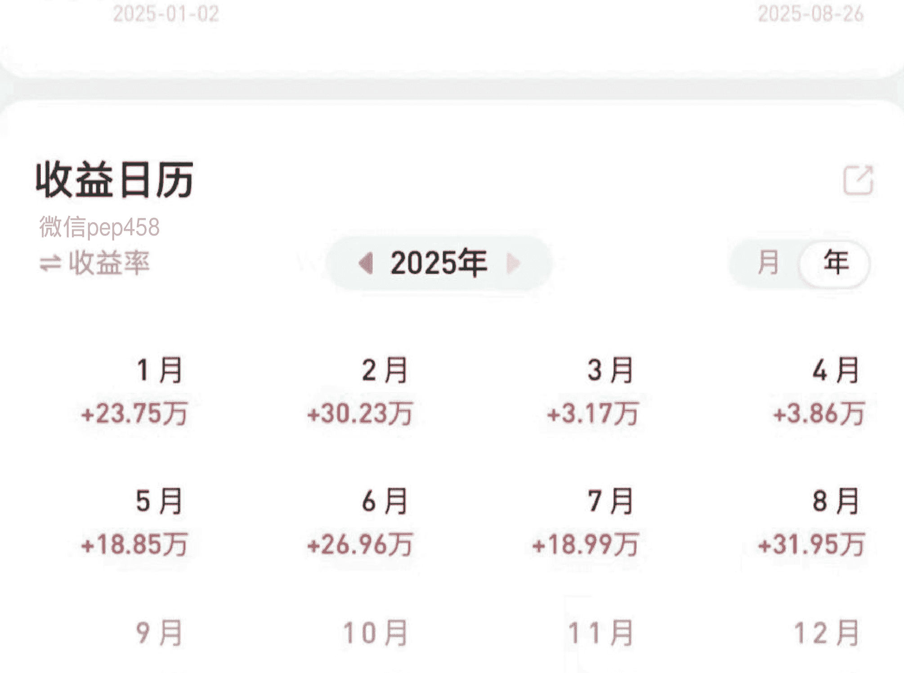
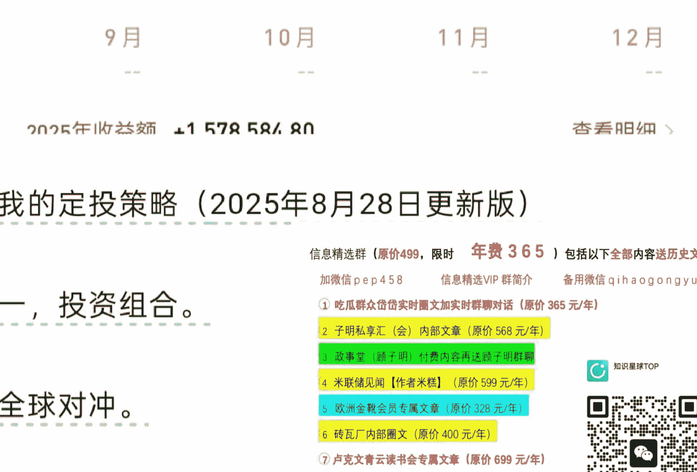
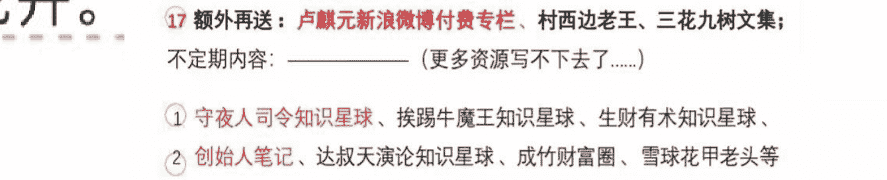

# 我的定投方案！

原创 懂懂 懂懂日志 2025年08月28日 22:43 山东

🎧142人

## 资产分析

今日 上周 本月 今年 近两年 开户以来 更多

2025年

## 我的收益
+1,578,055.40 (+19.98%)

### 收益走势
今年以来累计 沪深300 6.32%
* 总指数 +19.98%
* 沪深300 +13.66%

## 收益日历

| 1月 | 2月 | 3月 | 4月 |
| --- | --- | --- | --- |
| +23.755 | +30.235 | +3.175 | +3.865 |
| 5月 | 6月 | 7月 | 8月 |
| +18.855 | +26.966 | +18.995 | +32.000 |
| 9月 | 10月 | 11月 | 12月 |

## 收益走势
近两年累计 沪深300 30.90%
* 总收益 +51.48%
* 沪深300 +20.58%

## 收益日历

| 1月 | 2月 | 3月 | 4月 |
| --- | --- | --- | --- |
| +23.755 | +30.235 | +3.175 | +3.865 |
| 5月 | 6月 | 7月 | 8月 |
| +18.855 | +26.966 | +18.995 | +32.000 |
| 9月 | 10月 | 11月 | 12月 |

我的投资策略（2025年8月28日更新）

- 投资组合。
- 全球投资。
- 东亚不亮亚洲。

周四，纳ETF，这个可选的替代也是，标ETF、ETF相关的跨境ETF有多，专注于消费的，专注于科创的，激进的，保守的，当年为什么我选了纳ETF？因为它是消费的就有，纳指，标普比标普想象力要大一些。

周五，上证50，这个我认为的不够了，因为上证50太稳了，太老了，我是蓝筹、台湾、平安、工行这些后，我向朋友说我都建议沪深300，可以选择创业板ETF或科创50。

也有专业人士反对选沪深300，理由是300倾向于防御，创业板或科创50倾向于进，专业人士的建议是：要么要保守一些，要么要激进。

若是重新选择我，我会选沪深300，看一看就行了，国家救市多数都是通过沪深300ETF，盘子足够，应该是整个A股市场的大基石。

另外，我还有景顺、谢宇的基金，当年朋友力推荐的，无脑买的，一直投一路赢，去年（2024）还是亏损的，累计投了40多万，高峰亏损30多万，回本出了一半，剩余的套上网格交易了，还让清仓。

结果，今年表现的非常好，今年有33%的收益。

越涨，越涨，越仓了。

巴菲特是有道理的，长拉线来看，大部分基金经理都不喜欢指数基金，这几年领教过谢宇的几次魔幻操作，高位接盘后跌、腾讯、快手，尤其是快手，长线第一只重仓，一路补仓一路路，等谢宇把快手清仓呢？

快手又暴涨！除了今年，他就跑赢过沪深300。

最近几年，豆ETF，我学习网格交易用的标的。

这个基金有两个独特特性：本身有着它农产品的价格波动曲线，净值每年按照10%左右的基数抬升。

所以我，做了一个长涨2.5%的网格交易，每格5万元。

这个是用来吃农产品波动率的。

另外做了一个年度20万的定投，相当于每年升高10%，确保网格交易可长期稳定运行。

一年赚了多少钱，只是觉得很有意思，豆ETF相关的是豆粕期货，其实比豆价格波动率要高许多，三三三天会有网格触发，触发一次就是1000块，感觉很爽...

整个二级市场，我发现最适合网格交易的两个产品。A，分级基金，剧烈波动，现已取消。

## 定投准则

A，周一纳指，周二日经，周三中概互联，周四纳指，周五上50。

确保周一到周五，都有操作。

同时呢，对每一支而言，又是周五。

B，每天5500元，每天买入的都作为一次单独投资，独立计算。

C，50%的收益才会止盈。

这里，大家最大的疑问是，指数基金会一直上涨吗？可能会触发50%的止盈线吗？

答案是，YES。

指数基金是一个动态组合，不是不变的。

例如，创业板上涨速度，那么就会被纳入上50。

例如，斯达克腰落，从2000元跌到200元，那就会被剔除上50。

指数不同于指数，也不同于主基金。

它是一个永涨的玩意。

只是跟着没有想象的那么猛，为此，您可以问AI一个问题，最近20年，上50的年化收益率是多少？近几年的年化收益率是多少？中概互联的年化收益率是多少……

您会发现，确实是一在涨！

既然一直涨，何必止盈？

只涨不投不多好。

也行！

但是，对资金量要求太高。

我们为什么要设置止盈线？

# 三、定标目标。

最初，我是计划搞成一个定投模型，每年都投入5000，第二年是5000*1.15，按照15%的复利增加......

后来我发现我高估了自己。

吃不消。

我就降低了1000万的盘子。

- A，持有1000万+，这是第一阶段的目标。
- B，持有成本小于等于0。

现在进展到哪阶段了？

- A实现了。
- B也好了。

但是，对于持标目标我已经够稳定了，随心所欲，顺其自然。

对于持标目标我已经够稳定了，随心所欲，顺其自然。

# 四、是否可以使用这种模式炒股？

# 六、短线模型。
