# 产品及投资方案部

2025年4月9日

# 当“美国不再例外”遇上“东升西落”

中信证券财富管理（香港）
CITIC Securities Wealth Management (HK)

# 扫码加入 知识星球TOP免费资源群

公众号: 知识星球TOP

## 免费

- 每日免费获取高价值资源
- 可提供各类资源搜索服务

## 价值

微信信号: jntsg8

| 热门付费文章 | 各行各业报告 |
| 精选图书资源 | 副业赚钱方法 |
| 职场实用资源 | AI经济自媒体 |

## 及时

微信信号: jntsg2

## 专注

分享资料仅供个人学习，请及时删除，切勿商用传播

## 定期出版：年度/季度投资策略

产品及投资策略师 | 2025年1月8日 聚焦政策变化及政策发力主线
产品及投资策略师 | 2024年10月15日 四大核心资产重塑市场风格

中信证券 CITIC-SECURITIES
中信证券财富管理（专户）CITIC Securities Wealth Management (HSM)

中信证券 CITIC-SECURITIES
中信证券财富管理（专户）CITIC Securities Wealth Management (HSM)

产品及投资策略师 | 2024年7月9日 主动与分化无风风险敞开启
产品及投资策略师 | 2024年4月9日 从期待到落地

中信证券 CITIC-SECURITIES
中信证券财富管理（专户）CITIC Securities Wealth Management (HSM)
中信证券 CITIC-SECURITIES
中信证券财富管理（专户）CITIC Securities Wealth Management (HSM)

中信证券 CITIC SECURITIES

资料来源：中信证券财富管理（香港）

## 定期出版：每日环球市场动态

## 环球市场动态

2026年4月4日

### 市场概况

今日美股市场表现平稳，标普500指数收报4500.25点，跌幅0.05%；纳斯达克指数收报14000.50点，上涨0.12%；道琼工业指数收报34000.75点，下跌0.02%。受近期公布的通胀数据影响，市场对美联储货币政策保持谨慎态度。

| 指数 | 收盘价 | 涨跌额 | 涨跌幅 |
|---|---|---|---|
| 标普500 | 4500.25 | -2.25 | -0.05% |
| 纳斯达克 | 14000.50 | +16.8 | +0.12% |
| 道指 | 34000.75 | -6.8 | -0.02% |

### 欧洲市场

欧洲主要股市今日小幅震荡。富指50指数收报7200.50点，上涨0.10%；德国DAX指数收报15500.25点，下跌0.15%；法国CAC指数收报7500.75点，上涨0.25%。受欧元区经济增长预期影响，投资者情绪谨慎。

| 指数 | 收盘价 | 涨跌额 | 涨跌幅 |
|---|---|---|---|
| 富指50 | 7200.50 | +7.2 | +0.10% |
| DAX | 15500.25 | -23.25 | -0.15% |
| CAC | 7500.75 | +18.75 | +0.25% |

### 亚洲市场

亚洲股市今日表现不一。日经225指数收报27000.00点，上涨0.50%；上证指数收报3400.50点，下跌0.30%；恒生指数收报18000.00点，上涨1.20%。受地缘政治局势影响，市场波动加剧。

| 指数 | 收盘价 | 涨跌额 | 涨跌幅 |
|---|---|---|---|
| 日经225 | 27000.00 | +135 | +0.50% |
| 上证 | 3400.50 | -10.2 | -0.30% |
| 恒生 | 18000.00 | +216 | +1.20% |

### 汇率市场

主要货币汇率维持窄幅。美元指数收报105.50，美元对欧元汇率1.0850，美元对日元汇率110.50，美元对人民币汇率7.230。

| 货币对 | 汇率 | 涨跌幅 |
|---|---|---|
| 美/欧 | 1.0850 | -0.05% |
| 美/日 | 110.50 | +0.10% |
| 美/人民币 | 7.230 | -0.02% |

### 大宗商品

大宗商品震荡。布伦特原油收报85.50美元/桶，上涨1.2%；黄金收报1800美元/盎，下跌0.5%；铜收报9000美元/吨，上涨0.8%。

| 商品 | 价格 | 涨跌幅 |
|---|---|---|
| 布伦特油 | 85.50 | +1.2% |
| 黄金 | 1800 | -0.5% |
| 铜 | 9000 | +0.8% |

### 债券收益率

债市表现平稳。美10年债收益率收报1.85%，德国10年债收益率收报0.15%，日本10年债收益率收报0.05%。

| 债券类型 | 收益率 |
|---|---|
| 美10年债 | 1.85% |
| 德10年债 | 0.15% |
| 日10年债 | 0.05% |

### 重点行业

今日重点关注半导体、新能源及消费板块。半导体行业受AI推动，表现强劲；新能源板块受政策波动较大。

### 投资建议

当前市场波动较高，建议投资者保持审慎，增加防御性资产配置，密切关注宏观政策。

### 风险提示

本报告仅供参考，不构成任何投资建议。投资有风险，入市需谨慎。

资料来源：中信证券财富管理（香港）

# 定期出版：每周产品及投资策略 + 每月产品概览

每月客户境外现金管理及资产配置手册

资料来源：中信证券财富管理(香港)

# 定期出版：重点关注产品追踪（每周）

资料来源：中信证券财富管理（香港）

# 定期出版：结构性手册

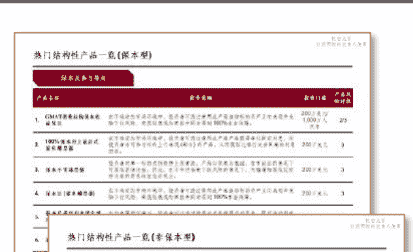

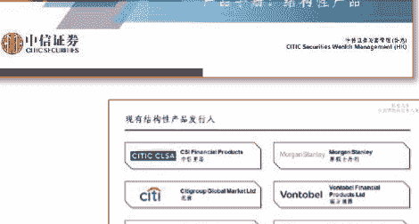
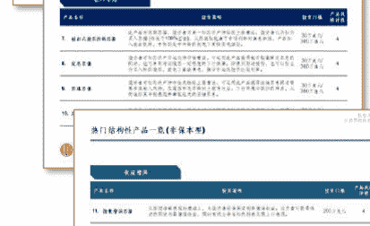

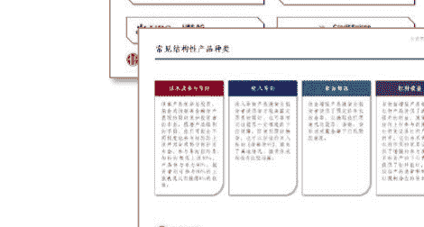
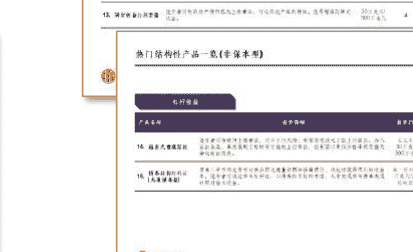

资料来源：中信证券财富管理（香港）

# 不定期版：深度点评

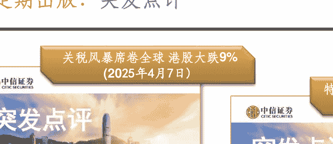

### 震后熊市触底

- 市场表现：2025年4月，受地缘政治及关税预期影响，恒生指数在4月7日跌近9%，创2020年以来单日跌幅，显示短期情绪极度受挫。
- 政策影响：市场对美国关税政策的担忧加剧了外资外流压力，港股作为离岸资产首当其冲。
- 未来展望：尽管短期波动剧烈，但基本面未发生根本性改变，若关税政策落地，市场有望迎来技术性反弹。
- 历史对比：参考2018年及2022年行情，港股在经历极端调整后，往往伴随着流动性利好反转，目前处于关键的“筑底期”。

### 特朗普胜出美国大选的未来影响

- 地缘政治：特朗普胜出意味着地缘政治更加不可预测，特别是美国贸易政策向保护主义倾斜，对全球供应链构成压力。
- 市场情绪：2024年11月6日大选后，美股出现剧烈波动，市场对减税政策与关税壁垒的博弈导致性分化。
- 投资建议：建议关注受政策影响较小的内需及防御属性的板块，警惕宏观环境的结构性变化。

### A股复市 港股跌水

- 流动性压力：2024年10月8日A股复市后，港股受外资回流压力影响持续走低，反映出全球风险偏好阶段的转移。
- 估值修复：此时港股估值已至历史极低分位，具有较高的配置边际，但短期内仍需宏观政策的明确信号。
- 操作策略：建议关注高股息、低估值及具备核心竞争力的蓝筹股，在震荡中寻找资产布局的机会。

### 恒生指数走势分析（示例）

| 指标 | 2024-10-01 | 2024-10-07 | 2024-10-08 |
|---|---|---|---|
| 恒生指数 | 18500 | 18200 | 17800 |
| 成指指数 | 19800 | 19500 | 19100 |
| 波动 | -1.2% | -1.5% | -2.1% |

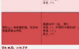

# 产品介绍：中信国运灵活（港股）

| 日期 | 净值 | 累计收益率 | 当日净值涨幅 |
|---|---|---|---|
| 2024-10-01 | 1.2540 | 5.21% | 0.15% |
| 2024-10-07 | 1.2312 | 3.05% | -1.82% |
| 2024-10-08 | 1.2055 | 0.82% | -2.09% |

# 产品介绍：中信国运稳健（港股）

资料来源：中信证券财富管理（香港）

## 微信公众号：债市聚焦 + 新债发行

# 市场动态 + 焦点板块及个股 + 每月港股新

## 焦点板块及个股：华润集团；石药集团；华润集团：2025年业绩下修

## 市场动态4月1日 | 关注因素对内地PMI的领先；环保点评

## 港股打新（2025年3月更新）

# 产品咨询部 | 中信证券财富管理
2025年4月01日 0937 | 中信证券财富管理
2025年4月01日 0913 | 中信证券财富管理

## 华润集团（1933.HK）23.2元；目标价：28.5元（下调）维持不变

华润集团企业预计持续增长，主要受2024年下半年利润下滑（下降2%至15亿元）拖累，大部分分红未达预期。近期，由于下季度净利润远低于预期，我们预计行业利润从2024年下半年下降3%至2025年增长20%，华润利润率持续上修，主要受需求增长及增长影响。鉴于所有公司业绩预期，我们将调整评级，并关注下个交易日。

2025年3月中国制造业PMI为50.5，升0.3；中国服务业PMI为50.8，升0.4。制造业在改善后回落，波动因素仍有。受需求端及供给波动影响，生产端需求出现小幅回升，企业复工进度获得支撑，技术性反弹可能持续。预计月内，制造业、建筑、房地产等行业数据将有支撑，整体PMI或将回升。受季节性影响，4月数据波动较大。

| 热门 | 焦点 |
|---|---|
| 2025年3月港股活跃，DeepSeek（9988.HK）推出新股及中概21只新股进行发行 | 华润集团上市中信医药等多个热门新股，成功募资高达24,000亿元，基准发行价（136.4 HKD）预期大涨，预计首日涨幅超6.4%。 |
| 除外，港股市场活跃，IPO成交额高达250亿，快速回升（2024年为“淡季”回归），导致港股新股市场活跃。 | 新港股发布，2月18日，内核医药生物原料粉将于今日上市，18%的跌幅远优于预期，建议底部筑底。 |

资料来源：中信证券财富管理（香港）

## 微信公众号：债市聚焦 + 新债发行

## 美联储1月按兵不动

## 2025年债市投资策略 —— 全球债券波动

2025年

## 2025债市守灵荒

## 美国债3月走势分析与前瞻

2025年

## 新世界发展为亚洲接力

2025年

## 流动性观察4月刊 | 全球波动对内需债市的影响
深度：在再平衡的环境下

## 新发债焦点 | 香港机场管理局

2025年

## 焦点复盘及后续展望 | 年化策略：美债2025年收益率回归

## 新发债焦点 | 恒指

## 三月会议前瞻：急于降息

2025年3月16日 08:30 | 中证证券财富管理
2025年3月21日 08:30 | 中证证券财富管理

自美通胀以来下行

2月24日，美债再次发行，随后在2月26日再次发行新的（债），为5年（到期）、6年（5年）或11年（10年）的美元债，其中4年和6年贴利收益债券用于资金募集和再融资。美国联储公开市场委员会（FOMC）于3月19日宣布维持货币政策，目标维持在4.25%-4.50%，利率一致，连续两次会议将维持基准不变。

资料来源：中证证券财富管理（报告）

## 微信公众号：用结构化产品分享【中证证券专栏】

通胀下降，机会来了：5年期SOFR挂钩型本金实现复利收益2024-06-07

利用股市政策转向：结构化票据作为结构性金融工具的优势2024-06-07

波浪策略：乘风破浪，捕获港股增长机会2024-06-07

不以波动为万，坚持锚定策略带来优质中股机会，本周有望出现增强趋势而上2024-06-10

## 安全与市场增长：结构化部分本金收益保证2024年10月24日 09:06 中国财富网

## 焦点关注及个股 | 震荡行情；石矿集团；的未来：美2025年股市短期将下

美国6月核心通胀为-0.17%低于预期（6月1日）

近期环境回暖是因为利率领先，美股在22日前景基本稳定

美近期数据显示，美国就业出现衰退迹象。2024年9月，美债收益率回落缓解了压力。失业率从4.2%下降至4.1%，蓝指同比增长4%，劳动力供给仍维持在2.7%以下，显示美国就业人口的通胀压力依然持续。与此同时，美国流动性持续减弱。美储可能的加息预期将影响政策转向

## 微信公号：基金文章+基金经理专访系列

中信证券财富管理首页

| 基金经理专访——康康睿香港访谈：为何可以选择海外债券基金？ | 2024年四季度基金投资简报——多元主题推优收益，全靠揭秘价值占比 |
| :--- | :--- |
| 访方：中信 2024年8月21日 | 2025年基金经理展望——在市场不确定性中构建稳健组合 |
| 访方：中信 2024年10月25日 | 对冲基金绩效报告:Series Accounting |
| 访方：中信 2025年01月25日 | 基金经理专访：英仕森集团访谈2025基金市场的富奥 |
| 访方：中信证券财富管理首页 | 2024年12月24日 05:07 中信证券 |

微聊活动4月8日直播：投资环境策略

焦点热谈及个美国的未来：美国2025年基金短期预测下...

宏观气候：石茂集团：

## 基金经理专访

### 环球市场把握机会面对不确定热点

为了长期收益，在对基金的投资过程中，费用是一个关键的因素，对基金经理的理解不仅指基金经理的精力，也直接关系到投资者的收益。然而对于对基金的投资者，可能在市场中盲目跟风基金，通过多维度分析投资视角尤为重要。为了让做好基金分析资产配置：中信证券财富管理

2024年，虽然震盛在内的主要发达国家进入降息周期，市场波动将决定收益产品。

中信证券
CITIC SECURITIES
来源：中信证券财富管理（香港）

---

---

# 微信公众号：特别文章推荐

- 财富规划101系列：香港打造全球家族办公室
- 2025年投资策略——聚焦政治博弈及政策助力两大主流
- 2025年全球市场展望 —— 一关于特朗普
- 爱富从信息披露新规将进一步削减BVI公司隐私性
- 2025年大宗商品展望——黄金依然是主流
- 如何与子女遭遇危机？萨巴特操作
- 港股策略：中长线组合调整
- 2025年海外展望——展望特朗普2.0对货币市场的影响
- 亚洲市场选择：香港上市个股行情抗跌及反ETF
- 财富规划101系列：高净值人士的专属工具之一私募基金(PPLI)

私人保险的含义是私人保险(Private Placement Insurance), PPLI，一种产品，包含保单、高净值人士提供灵活配置计划。2024年四季度，特朗普是否如预期市场放缓还是维持通胀数据，美联储宽松回购，导致美元及欧元年初表现。2025年1月23日，港交所推出首个抗跌及反ETF的产品，这涉及零佣金率，值得关注。资料：中信证券财富管理

## 2025年重大事件

- **一月**：8/1-11/1/2025 国际消费展(CES) 2025；13/1-14/1/2025 亚洲金融论坛；20/1-25/1/2025 特别届联合国第47任秘书；24/1-29/1/2025 达沃斯世界论坛(WEF) 2025；29/1/2025 美联储议息。
- **二月**：5/2-2/2025 联储基金系统会议；10/2-11/2/2025 法人机构智能转型会议；23/2/2025 德农-新振股权拍卖拟议延续；2/2025 人行发布2024年四季度货币政策执行报告。
- **三月**：4/3/2025 十四届全国会议；5/3/2025 十四届人大三次会议；6/3/2025 欧洲央行议息；19/3/2025 美联储议息；25/3-28/2025 领先通胀预测2025年会议；3/25/2025 国家财政部发布三季度财政政策报告；3/25/2025 日本央“春季”调整会议。
- **四月**：9/4/2025 美国对等特朗普生效；13/4/2025 日本大阪世博开幕；17/4/2025 欧洲央行议息；21/4-26/4/2025 IMF和世行春季会议。
- **五月**：7/5/2025 美联储议息；19/5-27/5/2025 世界卫生大会；28/5/2025 OPEC会议；5/2025 人行发布2025年首季度货币政策报告。
- **六月**：5/6/2025 欧洲央行议息；8/6-10/6/2025 亚洲电子展会；15/6-17/6/2025 G7领导人峰会；18/6/2025 美联储议息；24/6-26/6/2025 北极会议。
- **七月**：24/7/2025 欧洲央行议息；27/7/2025 日本参议院选举；30/7/2025 美联储议息。
- **八月**：8/2/2025 人行发布2025年上半年工作会议；8/25/2025 人行发布第二季度货币政策报告。
- **十月**：17/10-19/10/2025 美国华盛顿2025年IMF和世行年度会议；29/10/2025 美联储议息；26/10-11/1/2025 其它经济转型会议；10月至11初2025年大会。
- **十二月**：10/12/2025 美联储议息；12/25/2025 世行春季工作会议*

*时间可能会调整，以官方发布为准。来源：中信证券财富（香港）

---

## 资产配置 2025年第一季度市场回顾

| 资产 | 2015 | 2016 | 2017 | 2018 | 2019 | 2020 | 2021 | 2022 | 2023 | 2024 | 2025 YTD | 十年化 | 十年波动 |
| :--- | :--- | :--- | :--- | :--- | :--- | :--- | :--- | :--- | :--- | :--- | :--- | :--- | :--- |
| 中国海外 | 10.8 | 52.4 | 17.7 | 41.5 | 38.6 | 50.2 | 10.5 | 26.3 | 36.6 | 18.2 | 13.2 | 3.7 |
| 日本股票 | 9.9 | 17.1 | 37.8 | 0.9 | 31.5 | 21.0 | 26.7 | -20.8 | 2.7 | 3.0 | 16.1 | 9.2 |
| 美国债券 | 0.8 | 6.1 | 12.8 | 14.4 | 1.3 | -8.0 | -14.5 | -6.5 | 5.7 | 2.4 | 3.0 | 17.6 |
| 美国投资债 | 0.7 | 9.6 | 14.3 | 5.5 | 1.1 | 10.4 | 3.3 | 13.1 | 1.5 | 7.9 | 12.2 | 29.9 |
| 欧洲股票 | 6.5 | 2.4 | 7.5 | -10.3 | 6.4 | 7.1 | -1.5 | -16.3 | 2.7 | 5.1 | 0.0 | 8.7 |
| 香港债券 | -3.9 | 8.5 | 12.5 | 6.6 | 13.8 | 13.3 | 6.2 | -16.5 | 4.9 | 0.1 | 0.5 | 28.7 |
| 美国股票 | 5.1 | 10.0 | 6.4 | 14.2 | 12.7 | 5.9 | -2.5 | -23.1 | 10.4 | 19.0 | 0.2 | 6.2 |
| 黄金 | -10.9 | 0.2 | 6.2 | -14.3 | 13.5 | 5.2 | 4.5 | -19.7 | 10.0 | 2.1 | 0.0 | 5.9 |
| 中国市场债 | -35.0 | -14.6 | 15.2 | 2.3 | -27.5 | 34.7 | -21.5 | -26.3 | -12.0 | -4.3 | -0.3 | 4.8 |
| 大类资产 | 2.4 | 10.4 | 22.3 | 11.5 | 10.1 | 28.8 | 8.7 | 12.4 | 8.1 | 8.7 | 21.5 |
| 美国股票 | 1.8 | 10.2 | 21.8 | 6.3 | 18.8 | 9.9 | 11.2 | -11.3 | 11.5 | 8.5 | 4.1 | 26.9 |
| 日本债券 | 1.2 | 7.7 | 4.2 | -18.0 | 3.6 | 1.4 | -9.8 | -0.1 | -10.5 | 8.1 | 1.7 | 19.1 |

| 资产 | 2015 | 2016 | 2017 | 2018 | 2019 | 2020 | 2021 | 2022 | 2023 | 2024 | 2025 YTD | 十年化 | 十年波动 |
| :--- | :--- | :--- | :--- | :--- | :--- | :--- | :--- | :--- | :--- | :--- | :--- | :--- | :--- |
| MSCI ACWI全球指数 | 1.7 | | | | | | | | | | | | |
| MSCI WORLD国际资本 | 2.1 | | | | | | | | | | | | |
| MSCI 新兴市场 | 2.4 | | | | | | | | | | | | |
| 标普500 | 1.3 | | | | | | | | | | | | |
| 纳斯达克 | 10.4 | | | | | | | | | | | | |
| MSCI 欧洲 | 7.2 | | | | | | | | | | | | |
| MSCI 中国 | 5.2 | | | | | | | | | | | | |
| 英国富100 | 5.6 | | | | | | | | | | | | | |
| 法国CAC40 | 11.3 | | | | | | | | | | | | | |
| 德国DAX30 | 4.5 | | | | | | | | | | | | | |
| 日经225 | 1.4 | | | | | | | | | | | | | |
| 生指数 | 15.3 | | | | | | | | | | | | | |
| 澳洲AX200 | 3.9 | | | | | | | | | | | | | |
| 印度Nifty加权指数 | 0.2 | | | | | | | | | | | | | |
| 韩国KOSPI | 2.2 | | | | | | | | | | | | | |
| 东盟市场 | 4.9 | | | | | | | | | | | | | |
| MSCI 亚洲 | 8.0 | | | | | | | | | | | | | |
| 印度尼西亚CI | 7.8 | | | | | | | | | | | | | |
| 瑞士SET | 5.3 | | | | | | | | | | | | | |
| 马来西亚越南综 | | | | | | | | | | | | | | |
| 拉美市场 | 11.4 | | | | | | | | | | | | | |
| MSCI 美洲 | 8.3 | | | | | | | | | | | | | |
| 巴西 | 6.0 | | | | | | | | | | | | | |

| 资产 | 2015 | 2016 | 2017 | 2018 | 2019 | 2020 | 2021 | 2022 | 2023 | 2024 | 2025 YTD | 十年化 | 十年波动 |
| :--- | :--- | :--- | :--- | :--- | :--- | :--- | :--- | :--- | :--- | :--- | :--- | :--- | :--- |
| 股票 | 涨幅 | | | | | | | | | | | | |
| 债券 | 涨幅 | | | | | | | | | | | | |
| 货币 | 涨幅 | | | | | | | | | | | | |
| 美国国债 | 2.9% | | | | | | | | | | | | | |
| 英国债 | 2.0% | | | | | | | | | | | | | |
| 德国欧元 | 0.4% | | | | | | | | | | | | | |
| 日本元 | 2.7% | | | | | | | | | | | | | |
| 美国股市 | 0.8% | | | | | | | | | | | | | |
| 美股指数 | 2.3% | | | | | | | | | | | | | |
| 欧洲指数 | 1.0% | | | | | | | | | | | | |
| 德国指数 | 0.5% | | | | | | | | | | | | | |
| 新兴市场 | 0.3% | | | | | | | | | | | | | |
| 日本股市 | 0.5% | | | | | | | | | | | | | |
| 新兴市场 | 3.3% | | | | | | | | | | | | | |
| 中国内债 | 0.7% | | | | | | | | | | | | | |
| 中国外债 | 0.0% | | | | | | | | | | | | | | |
| 美元指数 | 3.9% | | | | | | | | | | | | | |
| 美元/欧元 | 4.5% | | | | | | | | | | | | | |
| 美元/日元 | 4.6% | | | | | | | | | | | | | |
| 英镑/美元 | 3.2% | | | | | | | | | | | | | |
| 英镑/欧元 | 2.5% | | | | | | | | | | | | | |
| 澳元/美元 | 1.0% | | | | | | | | | | | | | |
| 美元/人民币 | 0.6% | | | | | | | | | | | | | |
| 港股 | 0.2% | | | | | | | | | | | | | |
| 巴西股市 | 0.1% | | | | | | | | | | | | | |
| WTI得州原油 | 3.0% | | | | | | | | | | | | | |
| COMEX黄金 | 18.2% | | | | | | | | | | | | | |
| COMEX白银 | 18.4% | | | | | | | | | | | | | |

---

## 资产配置 2025年二季度投资主题：关税提高美国衰退风险

| 主线 | 观点/展望 | 投资机会 |
| :--- | :--- | :--- |
| (1) 关税提高美国衰退 | 美国关税极限施压明显，年中衰退概率关键落地与执行。美联储降息将较为被动，美元指数在市场“衰退”逻辑下弱运行。当前通胀将持续，“政策三部曲”进度在加快，半年或更为持续。 | 黄金、美国短期债、五年以下债券 |
| (2) 地缘政治压力“重新武装” | 美国与乌克兰谈判引发安全焦虑，短期内等待美国“衰退”进展，关税影响可能提前到来，国防支出。 | 欧股及军工板块 |
| (3) AI及政策引领 | DeepSeek驱动支持，长期提高经济增速。春季调仓活跃窗口，等待外部风险落地之后。 | A股、港股及核心板块 |

---

## 资产配置 美国对全球开启贸易战

2025年4月3日，美国总统特朗普签署了两项关于“对等关税”的行政命令，并宣布美国对贸易伙伴普遍加税10%的“最低关税”。对中国征的关税是在之前20%关税的基础上征收，这意义着中国的实际关税率为54%，该政策高于市场中性预期。

4月4日，中国宣布一系列反对制裁措施，自4月10日起，对美国的所有进口商品加征34%关税。4月8日白宫发言人，北京时间4月9日中午12:01宣布，美国对中国关税的累计税率将提高到104%。

4月9日，中国宣布对美国的进口商品加征关税从34%提高至84%，从4月10日起。随后，特朗普将许多国家的高额关税暂缓90天执行，唯独对华关税进一步上调至125%，即日生效。

4月3日展示的双边关税情况：

| 地区 | 对美关税 | 我方加关税 | 总额 |
| :--- | :--- | :--- | :--- |
| 中国大陆 | 67% | 34% | 33% |
| 巴西 | 39% | 20% | 19% |
| 韩国 | 90% | 46% | 44% |
| 中国台湾 | 64% | 32% | 32% |
| 德国 | 46% | 24% | 22% |
| 印度 | 52% | 26% | 25% |
| 俄罗斯 | 50% | 26% | 36% |
| 土耳其 | 72% | 36% | 31% |
| 日本 | 64% | 32% | 32% |
| 马来西亚 | 47% | 24% | 23% |
| 英国 | 97% | 48% | 0% |
| 加拿大 | 10% | 10% | 10% |
| 南非 | 60% | 30% | 30% |
| 墨西哥 | 74% | 37% | 37% |
| 新加坡 | 10% | 0% | 0% |
| 越南 | 33% | 17% | 17% |
| 埃及 | 34% | 17% | 17% |
| 智利 | 10% | 0% | 10% |
| 澳大利亚 | 10% | 0% | 0% |
| 巴基斯坦 | 58% | 29% | 29% |
| 沙特阿拉伯 | 10% | 0% | 0% |
| 阿联酋 | 88% | 44% | 44% |
| 哥伦比亚 | 10% | 10% | 10% |

注:MSCI数据为美元计，其他为当地货币计。来源:彭博、中信证券财富管理（香港）

## 资产配置 —— 美国对全球开启贸易战

特朗普（4月3日）展示的双边关税情况

| 地区/地区 | (美方认为) 对俄罗斯关税 | (美方认为) 对墨西哥和印度关税 | 地区/地区 | (美方认为) 对俄罗斯关税 | (美方认为) 对墨西哥和印度关税 |
| --- | --- | --- | --- | --- | --- |
| 阿联酋 | 10% | 0% | 塞舍尔 | 10% | 0% |
| 新西兰 | 20% | 10% | 内加亚 | 10% | 0% |
| 阿尔根廷 | 10% | 10% | 阿尔巴尼亚 | 10% | 0% |
| 哥伦比亚 | 12% | 10% | 土耳其 | 23% | 11% |
| 加拿大 | 10% | 0% | 马土 | 20% | 10% |
| 菲律宾 | 10% | 0% | 阿尔米尼亚 | 10% | 0% |
| 马拉沙加 | 93% | 47% | 亚美尼亚 | 10% | 0% |
| 秘鲁 | 88% | 44% | 马马群岛 | 10% | 0% |
| 梵杜基 | 55% | 28% | 哥斯内亚亚 | 10% | 0% |
| 哈萨堡 | 54% | 27% | 德国 | 82% | 41% |
| 澳大利亚 | 74% | 37% | 科威特 | 10% | 0% |
| 泰国 | 10% | 0% | 荷兰 | 10% | 0% |
| 萨哈哥 | 10% | 0% | 南非 | 10% | 0% |
| 厄尔瓦多 | 10% | 0% | 阿尔及利亚 | 10% | 0% |
| 印度 | 41% | 21% | 巴西 | 59% | 29% |
| 沙特 | 95% | 47% | 瑞士 | 30% | 30% |
| 尼日利亚 | 74% | 37% | 马耳岛 | 10% | 0% |
| 特立多索和达巴哥 | 10% | 2% | 马爪 | 10% | 0% |
| 洛纳纳 | 10% | 0% | 哈巴 | 10% | 0% |
| 土耳其 | 61% | 31% | 奥斯尼亚 | 99% | 49% |
| 塞尔维亚 | 63% | 32% | 马克拉斯 | 10% | 0% |
| 利比亚 | 22% | 11% | 卡塔达尔 | 10% | 0% |
| 亚美尼亚 | 10% | 0% | 乌克兰 | 80% | 40% |
| 肯尼亚 | 31% | 16% | 匈牙 | 43% | 32% |
| 巴哈马 | 10% | 10% | 冰岛 | 10% | 0% |
| 越南 | 33% | 17% | 青西尼 | 10% | 0% |
| 坦桑 | 10% | 0% | 立陶宛土 | 73% | 36% |
| 丹麦 | 10% | 0% | 塞内 | 76% | 38% |
| 伊拉克 | 78% | 39% | 海地 | 10% | 0% |
| 瓦内瑞拉 | 27% | 14% | 玻斯维尼亚哥内亚 | 75% | 35% |
| 安哥拉 | 42% | 21% | 塞内加尔 | 23% | 15% |
| 比利时 | 47% | 24% | 中国 | 65% | 32% |
| 格林诺亚 | 20% | 10% | 塞拉维埃比亚 | 10% | 0% |
| 巴哈马 | 10% | 10% | 加纳 | 17% | 7% |

资料来源：自介，中信证券整理（注：表中选取数据为官方观点）

## 资产配置 后续各国协进展和行业关税可能会有——

我们认为当前的关税政策更多是美方谈判技巧：

- 一是极限施压，给予子超预期压力和各国关税应对时间，确保10%的全面关税加征达成，同时还换取其他贸易出口退税；

| 国家地区 | 应对措施举措 |
| --- | --- |
| 中国大陆 | 聚焦对华采取激烈反击，捍卫自身利益。准备对美国产品加征33%关税并采取反制。 |
| 欧洲 | 准备对美国进口加征20%的关税，并寻求达成共识。 |
| 中国台湾 | 后续将密切交涉。 |
| 日本 | 考虑应对关税“不战”？ |
| 印度 | 在关税政策上积极通过外交斡旋与美国达成良好协议。由于美国贸易较少，受影响有限。 |
| 韩国 | 政策还不调整，持续面临美国关税对出口的负面影响，最高可达5%。 |
| 墨西哥 | 将对美国加征一个月的关税，以回应对墨制裁，可能得到解决。 |
| 巴西 | 已决定对美国采取限制措施。 |
| 加拿大 | 准备对美国征收关税，与哥伦比亚讨论关税问题。 |
| 菲律宾 | 积极寻求在未来谈判中获得更好。 |
| 意大利 | 不采取复制性关税，寻求与美国谈判。 |

来源：华新、联合财经、中信证券

## 资产配置 美国衰退概率取决于关税力度 ——

- 后续关键落地与执行的情况，以及是否有新增政策。
- 假设没有谈判削减的情况，结合此前施加的关税，这使得美国的实际关税率增加至20%。这将进一步推通胀，损害美国经济增长，持续的不确定性将进一步抑制信心，股市疲软的溢出效应以及来自贸易伙伴的报复措施将增加增长的阻力。
- 我们初估计（于4月3日公布的关税），美国的经济增长因此减慢0.7-1.0个百分点，对美国PCE指数的累计提振幅度高于1.6个百分点，尽管企业难以将上涨的成本转嫁给消费者，衰退风险显著。
- 我们预计中国月4日宣布的对美反制措施（34%关税）对美国商品额外构成约4.7%的拖累，对美国GDP构成约0.3个百分点的拖累。

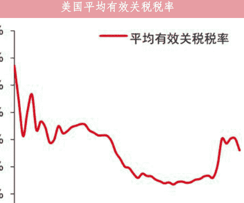

中信证券

## 资产配置 美联储降息或较为被动

我们认为当前“暂时性通胀+经济增长强弱+不确定性高”的组合应对显示年内2次降息，三者中任何一个朝着美联储预期的反向变化都会减少，导致市场预期的改变。

特朗普超预期的“对等关税”落实了“经济增长强弱”和“不确定性高”，美联储无法将通胀引向方向，鲍威尔依然坚持“暂时性通胀”，但依然相信3月FOMC会缓解。出于控制通胀预期的目的，鲍威尔发表了鹰派语，对市场来说无疑是雪上加霜，美联储没有类似于2019年8月对贸易政策的不确定性进行风险管理预防式降息的意图，这次美联储把通胀风险放在了经济增长压力前面。

## 市场预期美联储降息3次。

考虑到特朗普关税落地将在一季度后的美国通胀中显现，且市场通胀已经已经在这一季度明显上升，因此此轮美联储降息或较为被动，或会在就业等经济数据明显恶化后才重启降息。

美国的“硬数据”依然强势，只是“硬数据”有所有分化

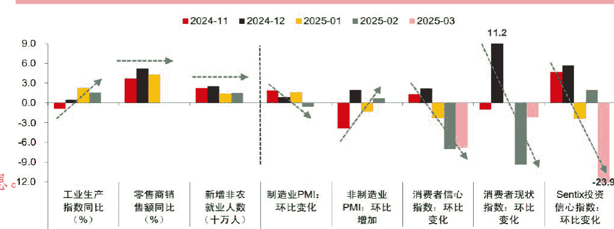

| 工业生产指数环比 (%) | 零售销售额环比 (%) | 新增非农就业人数(万人) | 制造业PMI:环比变化 | 非制造业PMI:环比变化 | 消费者信心指数:环比变化 | 消费者现状指数:环比变化 | Soft data | Sentix投资信心指数:环比变化 |
| --- | --- | --- | --- | --- | --- | --- | --- | --- |

数据来源:Wind, 中信证券

## 资产配置 美元指数在市场“衰退”交易逻辑下偏弱运行

关税压力下中国经常性账户韧性受到挑战，汇率面临基本面压力。但美元指数在市场“衰退”交易逻辑下偏弱运行，某种程度缓解了人民币的外部压力。

长期视角关注国内政策发力情况以及潜在的中美经贸调整需对人民币汇率的支撑。

- 中美利差反映当前均衡。从资金流动和投资需求来看，测算人民币汇率运行在7.4-7.6（中枢7.5）之间，两者反映隐含汇率可能有空间。
- 从汇率决定理论来看，我们测算比较后均衡模型（BEER）显示人民币汇率可能在7.3-7.4之间。长期以来中美利差和人民币汇率的相关性高达93%。

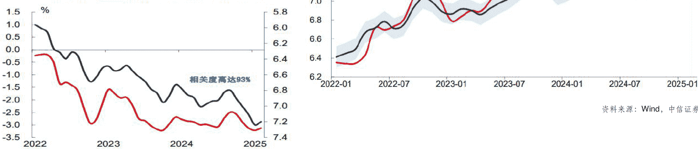

资料来源：Wind, 中信证券
注：中美利差为十年债收益率之间的差值资料来源：Wind, 中信证券

## 资产配置 当股市震荡将持续...

- 短期看，特朗普以极限施压策略换取利益，后续关注谈判进展。
- 自美国政府公布其“对等关税”政策后，主要罗素2000指数、纳斯达克指数以及纳斯达克100指数遭遇入市区间反复的可能依然巨大。
- 从美国维度，技术、原材料、医疗保健、可选消费及行业将受到较大影响。
- 鉴于贸易问题对美国宏观经济及企业基本面带来的确定性可能导致业绩进一步下调。
- 短期内我们判断防御属性必需消费，以及海外占比较高的医疗保健将继续跑离。

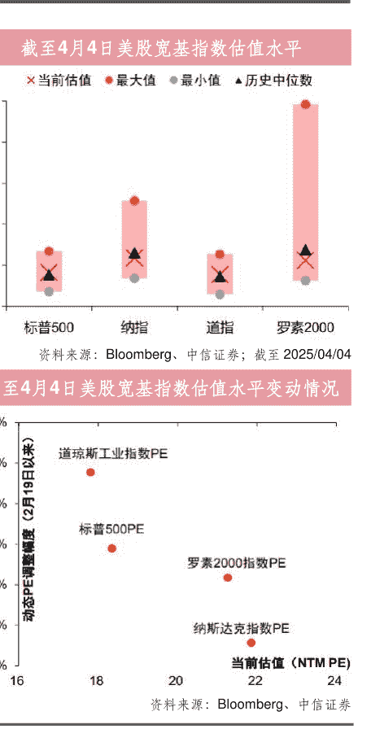

*

## 资产配置 特朗普的理想“政策三部曲”进度在加快

- 根据调查显示，特朗普的支持率已降至43%，这是其重返白宫以来的最低水平，如果叠加通胀压力，美国经济刺激与外交交缓的时点也可能提前。
- 我们对比了历届美国民调数据，发现选民对新总统的无条件支持通常维持至上任当年的5月，而围期间的准备通常在当年1-12月间。
- 为了在2026年中选举中保住参议两院，特朗普理想的政策三部曲是：加征关税—削减政府支出、国内大规模减税（财政法案）—持续抑制私部门投资。
- 在2026年中选举之前，特朗普的理想路径应是短期内让政策快速落地，随后冲击逐步收敛，并推出减税等正面政策，确保经济在二季度逐步回暖，年底前回归常态。特朗普政策的“理想三部曲”需要在16个月内完成

| 2025Q1 | 2025Q2 | 2025Q3 | 2025Q4 | 2026 |
| --- | --- | --- | --- | --- |
| 提引EEPA对加征关税 | | | 发起301或201等调查，调研与论证 | | |
| | | 取消最惠国待遇相关法律立法 | | |
| 财政政策 | | | 包括：削减政府支出、国内大规模减税2025年底前完成立法 | | 减税法生效 |
| 刺激投资 | | | 包括：持续抑制私部门投资 优化营商环境，试图打破美国对政府支出的长期依赖，推动私部门为增长的主导力量 | |

## 资产配置 下半年或更为持续上行的条件

中期维度，仍需警惕特朗普引发的全球贸易摩擦是否会升级，美国宏观基本面和美联储政策立场如何演变，以及今年来的财政X-date等问题或阶段性对美股造成的扰动。

待关税/贸易政策、美联储的应对立场和美国宏观基本面等问题明确，且估值也较被视为充分消化后，我们判断美股在下半年或具备更为持续上行的条件，前期振幅大且增速依旧高的科技领域迎来技术性反弹。

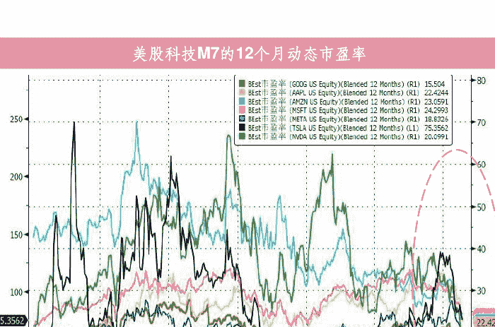

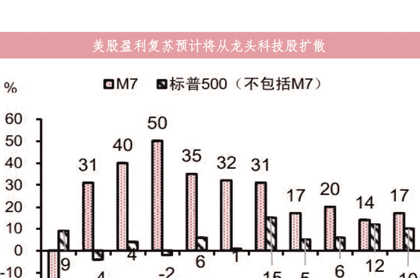

资料来源：Bloomberg
资料来源：FactSet、中信证券

27

## 资产配置 主题——美国国债走势弱，注意位

- 近期避险需求推动十年债收益率跌破4%，为去年10月以来最低位，大幅上涨30基点。
- 中美关税贸易端引发市场剧烈波动，目前市场不确定因素多，避险资产是选择。长期来看，关税带来的影响未知。
- 4月4日宣布对等关税后，美国经济正在走弱，未来数月可能放缓，或出现衰退，美国衰退风险上升。
- 建议在市场稳定后再重新配置，美国国债将持续波动。

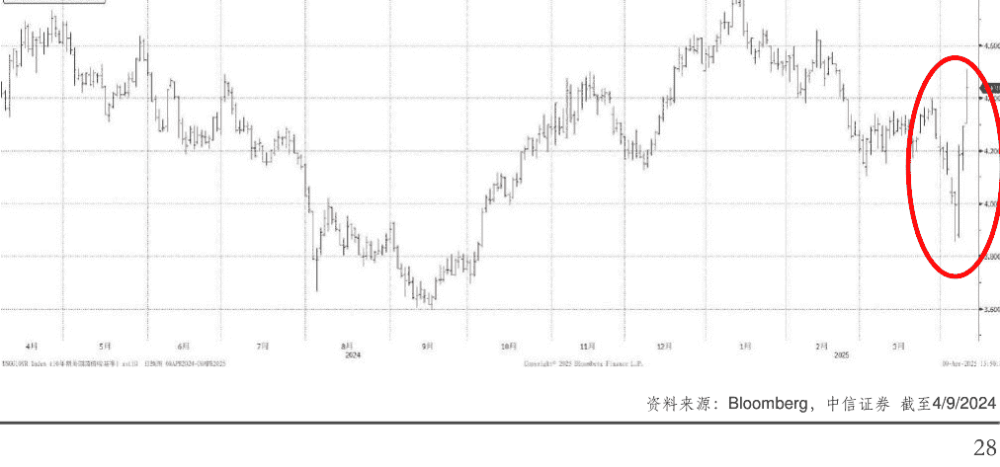

## 资产配置 黄金的后续扰动可能在先后低的节奏变化

- 4月4日，金价在“对等关税”宣布后冲高回落，我们认为主要是由于关税加剧了美国和全球经济衰退风险，引发资产的回撤。尽管流动性枯竭，全球央行以及避险资金等多力量仍为金价高位运行提供支撑，未来通胀压力，美联储若转向宽松将进一步打开金价向上空间。
- “对等关税”落地后美元指数亦出现逆转，不确定性消除、关税稳定后回调节奏。

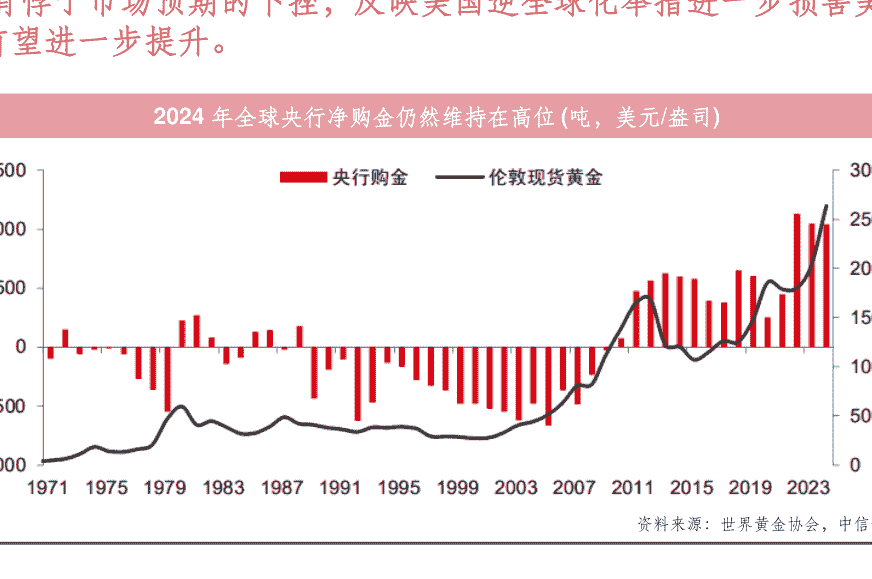

资料来源：世界黄金协会，中信证券

31

## 资产配置 2025年二季度投资主题：地缘政治下“重新武装”

| 主线二 | 观点/展望 | 投资机会 |
| --- | --- | --- |
| 地缘政治下“重新武装” | * 美国单方面与乌克兰谈判，引发欧洲国家普遍的安全焦虑，财政支出加速或提升增速 * 短期内等待“美国衰退”叙事的解释，在德国“不惜代价”的国防支出扩张和俄乌谈判有所进展的情况下看欧股军工板块 | 欧股及欧股军工板块 |

## 资产配置 主二

- 2025年3月28日，普京提出由联合国主导在乌克兰建立临时管理机制的方案，主张通过过多合作推动乌克兰重新选选举，然而与俄罗斯签署国际公认的和平协议遭遇白宫国家安全委员会反对。据《金融时报》披露，特朗普政府最新安全策略要求乌克兰将自然资源项目及相关基础设施投入的50%注入美洲基金，美国有权获得全部利润，并需优先偿还美国提供的千亿美元援助及4%的年息。
- 乌克兰冲突逐渐结束的趋势确定，但是过程仍将较为波折，谈判进程再次陷入较大分歧，通过军事行动增加谈判筹码的方式仍可能发生。
- 来看，俄罗斯与西方（包括乌克兰）在乌克兰加入北约问题、北约东扩问题上存在实质性的分歧，实现停火仍存在较大不确定性。

美国副总统万斯在莫尼黑安全会议上强烈抨击欧洲盟友，特朗普主张美国分别单方面与俄罗斯、乌克兰谈判，并将欧洲排除在外。由此引发欧洲国家普遍的安全焦虑以及大幅提高国防支出的计划。

资料来源：中信证券

## 资产配置 “重新武装”财政支出

- 目前欧洲成员的军费占GDP比例在2%左右，法国、德国等核心国家均不足2%，有提升空间。
- 欧美从资金流动和投资需求来看，测算欧洲东沿国家需要加强建设以应对俄乌冲突持续发酵的情绪深刻重塑。

| 国家 | 2023e | 2024e | 北约GDP2% | 北约GDP3% | 中期GDP5% |
| --- | --- | --- | --- | --- | --- |
| 希腊 | 397 | 516 | 5 | 1 | 7 |
| 英国 | 7622 | 8519 | 12 | 50 | 19 |
| 意大利 | 1680 | 2325 | 25 | 30 | 15 |
| 德国 | 2799 | 3040 | - | | |
| 西班牙 | 1411 | 1624 | 1 | 5 | 10 |
| 法国 | 4538 | 4834 | 26 | 103 | 58 |
| 波兰 | 5165 | 5940 | 8 | 12 | 224 |
| 捷麦 | 1238 | 1437 | 8 | 12 | 21 |
| 土耳其 | 6208 | 7308 | 5 | -4 | 80 |
| 瑞典 | 7097 | 8671 | 17 | 918 | 322 |
| 俄罗斯 | 7318 | 70860 | 95 | 174 | 138 |
| 希腊 | 6731 | 7684 | 48 | -20 | 7 |
| 以色列 | 4395 | 4890 | 42 | 1 | 24 |
| 比时 | 3386 | 3462 | 450 | 120 | 352 |
| 奥地利 | 1254 | 1421 | 0 | 14 | 13 |
| 挪威 | 2150 | 2300 | -16 | 5 | 23 |
| 比利时 | 7482 | 7865 | 17 | 18 | 19 |
| 丹麦 | 1142 | 1162 | 0 | 1 | 2 |
| 芬兰 | 16754 | 22131 | 231 | 63 | 349 |
| 匈牙利 | 5000 | 5500 | -10 | - | |
| 爱沙尼亚 | 8759 | 9000 | 0 | 9 | 14 |
| 罗马尼亚 | 2646 | 30975 | 162 | -102 | -241 |
| 洛伐克 | 4221 | 4637 | 15 | 58 | 44 |
| 塞尔维亚 | 5500 | 7140 | 80 | 70 | 14 |
| 白俄罗斯 | 2445 | 2841 | 27 | 14 | 15 |
| 立陶宛 | 914 | 949 | 4 | 5 | 21 |
| 斯洛尼亚 | 9848 | 10345 | 117 | 15 | 175 |
| 斯洛尼亚 | 9848 | 10345 | 117 | 15 | 175 |
| 乌克兰 | 76539 | 82107 | 676 | -53 | 1015 |

资料来源：LSEG Datream, 中信证券

## 资产配置 全额实施国防开支计划，欧盟经济增速预计0.6-1.4百分点

虽然欧盟在贸易领域遭遇滞缓，但并不意味着欧洲经济将雪上霜，欧洲经济能否有所起回取决于政策转变在多大程度上刺激内需。

- 若（按上限标准）欧盟每年增加1.5%GDP的国防支出，其经济增长1-3年将获得0.6%、1.0%和1.4%的提振；预计欧区实际GDP增速分别为：2025年0.9%、2026年1.5%和2027年1.5%。
- 特朗普政策不确定的情况下，欧央行需要延续“以我为主”的宽松宽松货币政策，为欧区经济增长提供确定性，我们预计欧央行2025年内会有两次25基点的下降。
- 我们预计10Y债利率将在“不惜一切代价”和经济刺激举措难以下降。
- 欧元在中短期或缺乏进一步的升值动力。
- 欧股相对吸引力有所提升，与欧本土经济关联度更高的资产机会大于风险。

在欧央行持续宽松的货币政策下 欧元兑美元所有修复

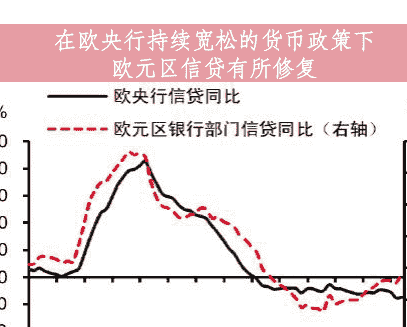

资料来源：Wind，中信证券

学术文献研究政府不同支持对应的财政政策差异

支出 | 收入 | 公共支出 | 政策调整

资料来源：LSEG, Outlook (2023) “Short-run multiplier effects of military expenditures in Eastern countries in 1999-2021”, 中信证券财富

## 资产配置 欧股的利好因素

- 与美股相比，欧股技术板块占比低（STOXX600占比为9%），不易受到DeepSeek事件的冲击，展望，欧股在AI领域的竞争较小。
- 欧央行降息将提振估值（我们预计2025年内会有两次25基点的下降，维持在2%），增大支撑，而欧股与美股相比明显便宜。
- 尽管德国扩大财政支出使10Y债利率短期上行，但利率上升是定价，“良性”预期对欧股估值造成压力。

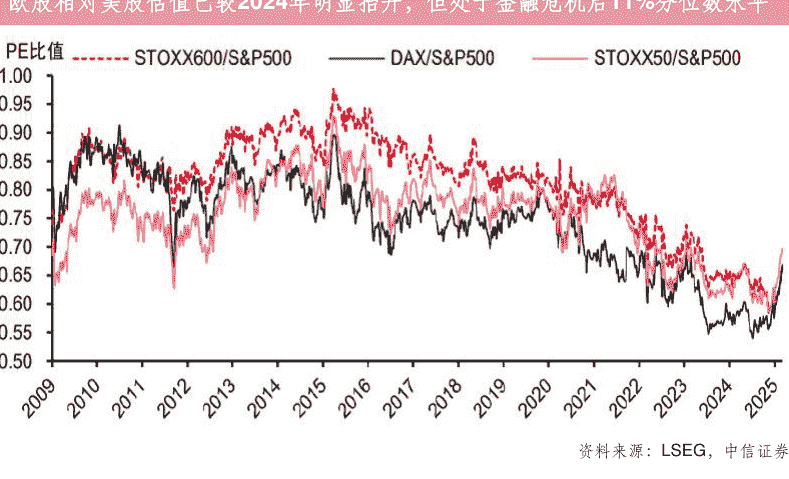

## 资产配置 等待美国“衰退”叙事 关注欧股军工板块与欧洲本土关联更高的股票

- 政策组合预计将刺激经济，整体有望增长。
- 我们预计汽车股受到特朗普政策影响波动较大，德国国防支出催化，同时关注欧洲本土关联更高的股票。
- 当前等待经济好转、主动资金流入及美国“衰退”叙事的演绎，欧股军工板块和汽车股受影响较大。

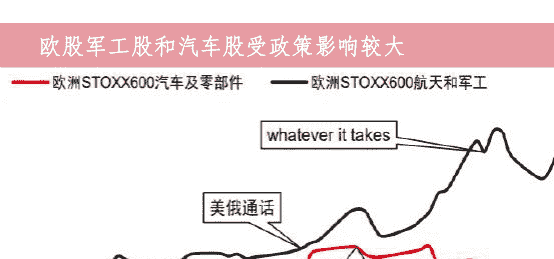

资料来源：LSEG、中信证券 注：24Q以后为LSEG预期

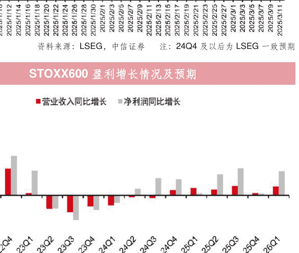

资料来源：LSEG、中信证券 注：24Q以后为LSEG预期

## 资产配置 2025年二季度主题：AI及政策引领中国资产价值重估

| 主线 | 观点/展望 | 投资机会 |
| :--- | :--- | :--- |
| AI及政策引领中国资产重估 | 关税影响中国政策发力点可能提前，DeepSeek出现AI资本开支，中期提高内地增速 | 窗口期，聚焦A股、港股的核心资产 |
| 美国衰退预期延长了中国资产 | 等外部风险落地之后，中国科技板块依然看好 | 股市及政策利好板块 |

资料来源：中信证券财富管理（香港）

## 资产配置 关税影响下中国政策发力点可能提前

- 考虑特朗普加大关税落地和收缩财政支出，美国在年中出现经济衰退的风险还在提高。
- 基于40%关税假设的极端假设，特朗普新增的54%关税对中国今年出口和GDP的年化增速分别为8.2和0.9百分点。
- 当前因关税加征出口隐忧，来自外部的关税风险可能使经济增速从二季度开始面临一定压力，年中中国经济走弱叠加关税压力加大，可能会出现2013年以来第四次总量型刺激：
  - 2015年出口增速下滑之后，政策出台PSL货币化+供给侧改革的组合拳，带来2016年之后经济的快速复苏；
  - 2018年受贸易摩擦等因素影响，国内出台“六稳六稳”，政策更加积极；
  - 2020年受全球疫情影响，海外开启货币模式，中国在增加财政赤字后又发行特别国债。
- 外部冲击加剧，国内政策对冲的时点或将提前、力度或将加码。

## 足够大的外部压力才能催生超预期的内在刺激带来向上叙事弹性

2013年以来出口面临压力的后阶段复查（虚线代表预测数据）

- 出口金额同比增速 (3MMA)
- PPI对比增速 (3MMA, 右轴)

- 2015.6：定向降准，PSL+货币化
- 2018Q2-Q3：贸易震动持续升级
- 2018.7：美国会提出更加积极的财政政策
- 2020H1：定向降准，适当提高财政赤字，发行特别国债
- 2014Q2：定向降准，一带一路主题发酵
- 2015.11：供给侧改革
- 2018.11：企业座会
- 2025：中美贸易摩擦预警：对出口带来较大压力，PPI底部缓慢修复
- 2014H2：油价半
- 2015A：油价下跌，产能过剩
- 2020：疫情突发冲击，油价首次为负，美联储开启宽松

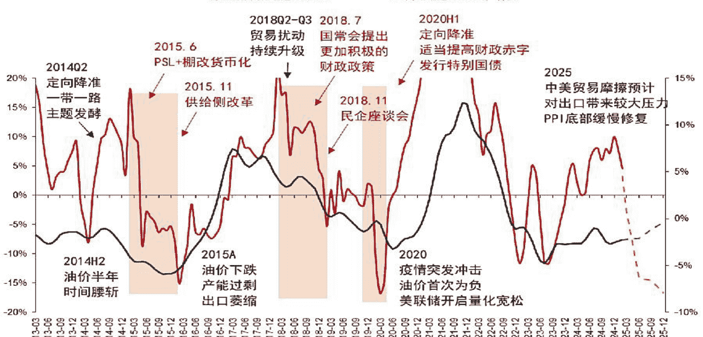

资料来源：Wind, 中信证券

## DeepSeek带动AI资本开支2025年内预计GDP下降0.06-0.15百分点

- DeepSeek带来的模型推动AI应用、云计算市场景气上行，国内厂商开支显著低于海外厂商。
- 中信证券研究，中性假设2025年内预计增速分别为44%，合计增量1498亿元，约占GDP的0.11百分点；乐观/悲观预期下，分别为62%，合计增量822亿元。

| 厂商 | 2021 | 2022 | 2023 | 2024E | 2025年内预测（中性） | 增量（亿元） |
| :--- | :--- | :--- | :--- | :--- | :--- | :--- |
| 阿里 | 442 | 484 | 239 | 708 | 56% | 400 |
| 腾讯 | 334 | 180 | 343 | 768 | 123% | 550 |
| 字节 | 81 | 600 | 850 | | | 50% | |
| 百度 | 106 | | 112 | 81 | | 9% | 9 |
| 美团 | 90 | 57 | 69 | 79 | 15% | 12 |
| 快手 | 78 | 46 | 49 | 70 | 20% | 14 |
| 中国移动 | 335 | 391 | 371 | | 17% | 2 |
| 中国电信 | 173 | 271 | 355 | 370 | 10% | 37 |
| 中国联通 | 75 | 124 | 89 | 141 | 160% | 19 |
| 合计 | 1579 | 2247 | 3438 | 4936 | 496% | 1498 |

资料来源：各公司财报、Wind、中信证券；注：三大厂商为算力相关

## 中长期AI提高经济增速1-2个百分点

- 本轮AI资本开支规模类似于2021-2022，成为传统经济周期的额外动力，逐步提升其他行业的效率。
- 目前学术界对AI生产力的估计存在差异，不过多数估计每年提升生产率1-2个百分点。长期来看，根据过去技术革命经验，AI有望通过提高要素生产率的方式提升增速，可能降低单位增长的就业岗位数量。
- 维度上，我们用AI渗透和AI弹性两个维度划分每个行业的受益程度，信息、教育、金融、制造和健康或是受益行业。

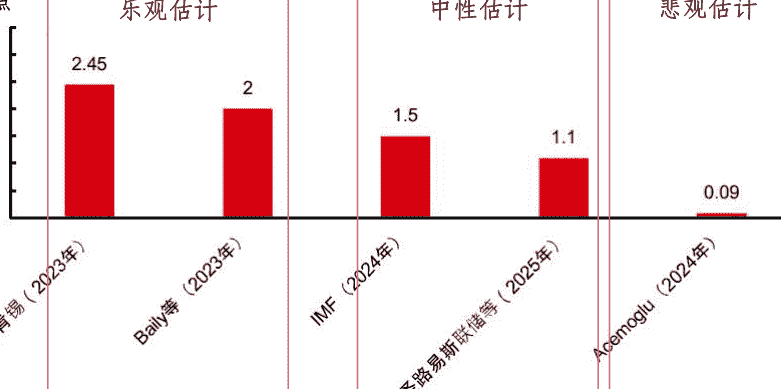

资料来源：Acemoglu, Bally, Brynjolfsson, Korinen, IMF, Blandin, Deming, 中信证券

## 美国衰退预期交易不会影响中国资产

2022年来美国衰退交易期间，中国资产回撤幅度更小，甚至大多数时候正收益。

- 2022年来“美国衰退交易”的区间：2022年1月、6月、12月；2024年4月、10-11月。
- 5次行情有4次产生了“东升西落”的叙事。此，我们认为仅为美国的衰退预期并影响中国资产的独立行情。

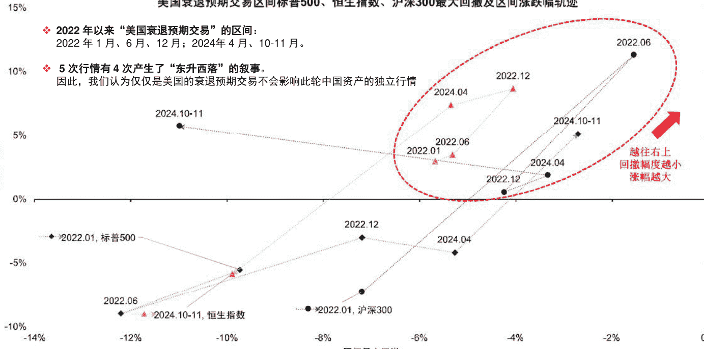

注：我们认为，NBER数据领先指标（农非就业指数、工业生产指数、实际消费支出、实际个人收入、批发与零售实际销售额）相对于过去3年最大回撤幅度显著放大，且标普500同步下跌，可能存在“衰退预期交易”的区间。
资料来源：中信证券调研

# 美国真实的衰退仍然产生负面影响

2002年以来NBER记录的两个衰退区间，标普500、MSCI中国、沪深300都出现了显著的回撤。

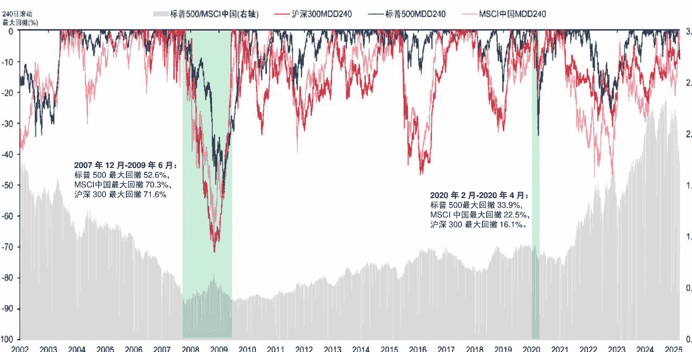

- 2007年12月-2009年6月：标普500回撤52.6%，MSCI中国回撤70.3%，沪深300回撤71.6%。
- 2020年2月-2020年4月：标普500回撤33.9%，MSCI中国回撤22.5%，沪深300回撤16.1%。

注：美国权威机构判定衰退的两个区间包括2007-2009年金融危机和2020年新冠疫情。资料来源：中信证券

# 美国衰退预期延长了中国资产春季窗口期 聚焦A股、港股的核心资产

- 衰退预期在一定程度上会对全球风险产生负面影响，然而衰退预期交易还需要较长的时间。
- 外部冲击加剧，国内政策对冲的时点或将提前、力度或将加码。通常情况下，中国政策周期同步上行的阶段，核心资产会有表现。

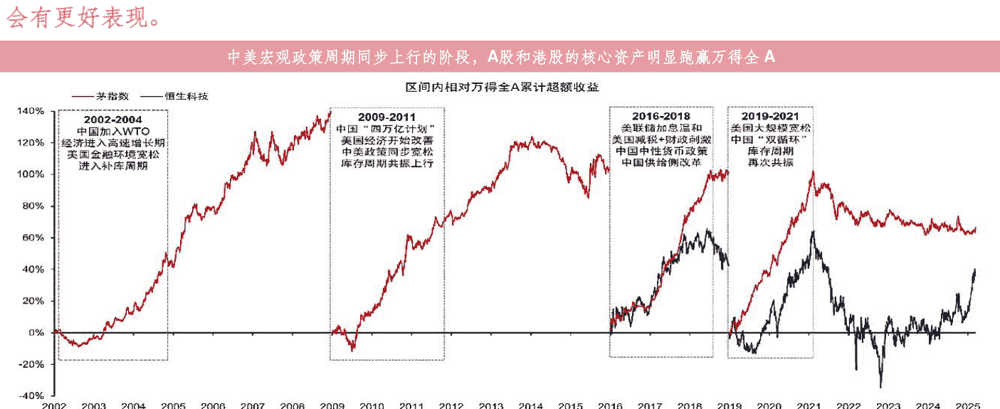

资料来源：Wind，中信证券。注：数据截至2025年3月

# 外部风险落地之后，中国科技板块仍然看好

- 关税事件持续发酵，最近趋势主要可能是投资者选择获利，后续需要盈利和产业趋势的持续兑现。
- 港股后续关注基础上修修带来的修复。

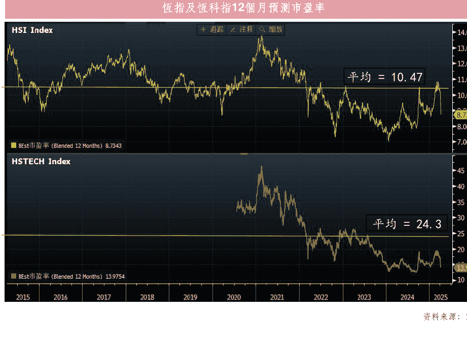

资料源：彭博

| 日期 | 类 | 事件 | 核心内容 |
| :--- | :--- | :--- | :--- |
| 2025年4月 | 债券 | 产品发布 | 预计发布硬件技术、AI头部等 |
| 2025年4月 | 股票 | 产品发布 | 关注AI领域的布局和财务报表 |
| 2025年4月 | 大宗商品 | 重要事件 | 关注量化方案 |
| 2025年5月 | | 产品发布 | 预计6月正式发布增强视觉理解能力，提升用户体验 |
| 2025年6月 | | 产品发布 | 拓宽聚焦AI硬件市场，关注AI跟踪 |
| 2025年7月 | | 重要事件 | 关注AI领域需求和用户活跃 |
| 2025年9月 | | 重要事件 | 实施费策略、交互、手势识别策略等 |
| 2025年Q4 | | 产品发布 | 预计第一季度将密集发布AI+硬件发展 |
| 2025年11月 | | 重要事件 | 关注安卓设备的营收增长
| 2025年Q4 | | 产品发布 | 关注最领先的AI芯片及应用
| 其他 | 政策支持 | | 智能脑升级 |

资料来源：行业数据、小米、Rokid、Meta、三星、苹果、Nvidia、AMD、中信证券

## 资产配置 2025年二季度类资产配置：债券>股票>大宗商品

美国关税级限实施，年中衰退概率明显提升，市场衰退交易逻辑下弱运行，当前美股下行压力将持续，特朗普的理想“政策三部曲”进度在加快，下半年或具备上行条件；欧洲国防支出或提振增速，短期等待美国经济衰退实施后继续看好欧股军工板块；关税影响中国政策发力时点可能提前，外部风险落地之后中国股市仍然偏强。

在美国关税政策变动及环球贸易波动下，短期美债为安全。信用利差五年期以上高质量A级债券抗跌能力较强。石油、香港地产受关税影响有限，风险管理稳定。内地地方经济将持续受益于中国利好政策。此外，中国对科技板块利好政策持续发力，持续看好中国科技行业。

增加财政支持提振欧洲经济；美国逆全球化损害美元信用，美元今年将先高后低；英国受累财政下行；日元可能会再次贬值。

来源：中信证券财富管理（香港）

# 股票

## 股票 2025年第一季度的建议投资组合涨18.8%

- 总结2025年第一季度，我们的建议投资组合涨18.8%，跑赢恒生指数3.5个百分点。组合中消费、互联网、汽车表现突异，其中阿里巴巴（9988 HK）期间升幅55.3%，比亚迪（1211 HK）涨47.3%，耐世特（1316 HK）持有期间涨幅31.3%。

## 2025年一季度建议投资组合表现突出的个股

| 公司 | GICS行业 | 收益率/卖出(港元) | 1Q2025组合 持有期间升幅 (%) | 同期 跑赢恒生指数 (%) |
|---|---|---|---|---|
| 阿里巴巴 (9988 HK) | 互联网 | 128 | 55.3% | 40.1% |
| 比亚迪 (1211 HK) | 汽车 | 392.8 | 47.3% | 32.1% |
| 耐世特 (1316 HK) | 汽车 | 4.36¹ | 31.3% | 16.1% |
| 腾讯控股 (700 HK) | 互联网 | 497 | 19.2% | 3.9% |

资料来源：彭博、中信证券财富管理（香港）注：2025年3月31日收市价¹耐世特（1316 HK）于2025年2月6日调

## 股票 后自由贸易的新世界

### 成熟市场

### 主要新兴亚洲市场

| 中国香港：等待外部风险落地之后科技板块仍然看好（请参考页28-46） | 中国A股：国内政策对外部周期冲击的时点或将提前（参考页28-46） |
| 日本：寻找“涨薪”和“加息”下投资线索 | 印度：经济增速周期性放缓，长期向上趋势不改 |
| 美国：当前下行压力或将持续（请参考页25-27） | 南韩：外部压力持续，等待复苏契机 |
| 欧洲：财政国防支出增速或提升经济增速 （请参考页31-36） | 中国台湾：出口前景面临关税严峻挑战 |
| 英国：美国的不确定性正影响英国市场 | 新加坡：经济增长压力，但防御属性突出 |
| 澳大利亚：降息周期推进等待澳股转折 | 印度尼尼西亚：风险与机会并存 |
| | | 泰国：经济活动持续减弱，股市缺乏亮点 |
| | | 马来西亚：估值偏高，聚焦防御板块 |
| | | 菲律宾：多个催化因素，但市场具有结构性问题 |
| | | 越南：关税出口巨大 |

资料来源：中信证券、中信直源、中信证券财富管理（香港） 超配 平配 低配

## 日本股票 寻找“涨薪”和“加息”下投资线索

> 特朗普关税仍存不确定性。短期而言，特朗普对锐对等关税推征不足以重建利好日股，日本企业有规模成熟的海外布局，10%关税对经济影响在可范围内。关税推征不足以建立对“特朗普宽松政策线”的全面信任，年内日本经济的增长将更加聚焦于国内增长的拉动，后续可能偏向结构性增长。展望2026年，美国全球增长持续增长或压制日本企业的利润增长，从而导致外资增速放缓，经济扩张动力减弱，预计2026年日本GDP增速将回落。

> 日元，虽然关税存在大量扰动，但我们认为日本央行整体坚持稳健，后续将缓慢宽松；日元过去作为交易货币的贬值压力逐渐被吸收大部分，日元未来仍有空间。

- 日元年初表现虽弱，估值不贵，但近期表现少有上行准备。在全球，聚焦企业盈利和股东回报提升。担心关税政策恢复后央行可能会重回加息进程，金融近期大跌存在反弹机制；本土经济将是本年度的重点，涨薪有望驱动，关注日本国内营收占比高的消费类企业；防御性配置关注需求前景稳定，受关税和地缘冲突影响较小的行业，例如电信、公用事业。另一方面，因特朗普政策企业暂停资本支出，短期自动化、IT等行业或在较大扰动，但具有长期增长前景。

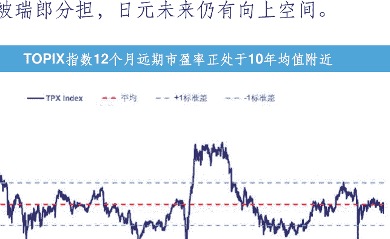

资料来源：博弈、中信证财管理（香港）

## 英国股票 美国的不确定性影响英国市场

- 英国市场一季表现突出，但短期来看上升动力正减缓，理由包括：
- 1) 英国大盘普遍拥有较高的国际敞口，富时100指数与美国相关性较高。美国当前经济的高度不确定性令市场回调风险加剧。
- 2) 走弱一定程度上影响了企业盈利预期，从历史看英国大盘与英镑呈负相关。
- 3) 本轮上涨能源板块贡献显著，基于我们对油价的有限预期，认为能持续推动上涨。

另一方面，英股价仍存在利好，相比于欧洲对美国关税冲击有限，也给了后续上升空间。相比于美股和欧股，经历了一轮上涨，MSCI英国指数过去12个月市盈率仅约60%，导致英国值值底部。

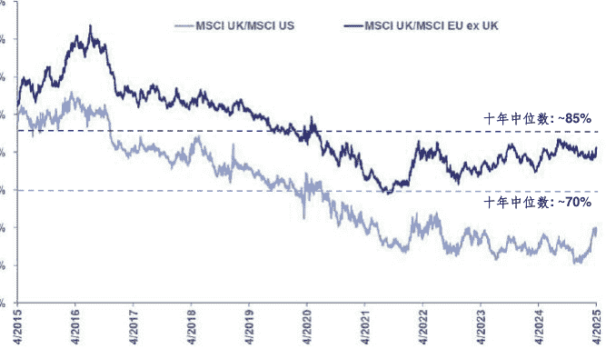

## 澳大利亚 降息周期推进澳股转折

- 澳大利亚市场近两个月表现佳，但有望存在潜在利好，理由包括：
- 1) 通胀减速良好，宽松周期已开启。
- 2) 我们预计增长将在2025/26年重新加速。
- 3) 消费者信心和支出处于早期复苏阶段。
- 4) 汇率在亚太地区具有吸引力。
- 5) 养老金基金的净值支撑。
- 6) 澳大利亚与全球贸易的相关性较低，关税冲击有限。

- 消费支出的回暖成为2025年增长的核心驱动力，预计经济增速达2.5%，2024年创纪录提高1.5个百分点。澳股估值相对偏高，下半年地缘政治冲突带来的明确机会。
- 基于对年度黄金、铜价格的观看，澳洲有色金属相关在回调后值得关注；金融板块整体受益于降息逐步推进，本土需求回暖需要时间，航空业利润或进一步改善。

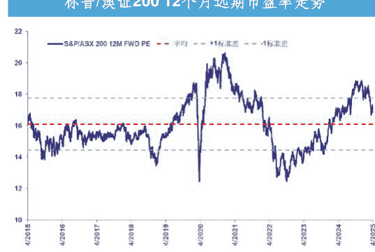

## 印度 增速周期性缓慢，长期向上趋势不改

- 经济基本面稳健。鉴于特朗普政府政策的不确定性增加，印度是全球受影响最小的国家之一，提供了较大的潜力。
- 内需导向和防御性行业受美国关税冲击最小。
- 经济增长进入周期性放缓期，2025年底结束。
- 印度股市回到合理的区域。Nifty指数12个月市盈率约为19倍，高于平均水平，其溢价幅度较低。

- 我们看好内需导向且稳定的电信和金融板块；避免受关税冲击的汽车、零部件和医药行业也会受到间接影响。

资料来源：IBES、MSCI、彭博、中信证券财富管理（香港）

## 韩国股票 压力持续，等待复苏信号

- 相对而言，年初至今韩国市场表现良好，是继A股和港股之后第三好的亚洲市场，政治局势逐渐清晰，尹锡悦上台标志着国内环境即将回暖。
- 展望2025年后，我们认为韩国经济仍面临挑战，GDP增速或下降至1.5%：
- 内部方面，消费者信任低迷，回暖需时间。
- 外部方面，韩国可能受到美国贸易政策显著的负面溢出效应。

- 股市方面，KOSPI指数0.8倍，整体估值仍低。如果未来12个月随着韩元弱导致出口复苏，以及“企业价值提升计划”能取得成功，韩国市场具有反弹机会。
- 国防和造船行业表现仍然强劲，某些行业后正反转，例如钢铁、零售和建筑，通常在牛市早期爆发阶段出现。我们仍然看到主要的大盘板块推动股价上升，预计这种情况将在2025年下半年随着出口复苏和政策不确定性完全消失。

资料来源：中信证券

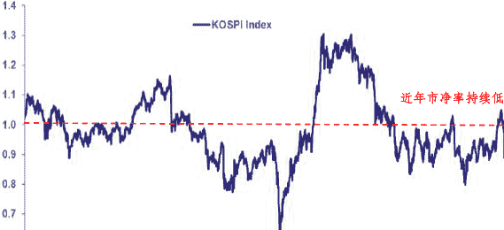

## 台湾股票 出口前景面临严峻挑战

- 台股一季度受到外部不确定性困扰，表现不佳。影响因素包括特朗普关税、市场对科技公司AI资本支出需求的担忧，以及可能的关税削减其在台电的CoWoS订单的传言。随着关税正式出台，台湾地区的出口增速将放缓。
- AI出口前景不确定性上升，从训练到推理的需求转移为关键。3月英伟达举办GTC大会，公布全新GPU产品线与市场预期，然而GB系统交付时间晚于预期，CPO产品线也缺乏迭代。DeepSeek模型引起终端投入减少，推理需求还未填补空缺构成短期风险。二季度需要密切关注4月美国Hyperscaler的最新支出情况以及5月“人工智能扩散出口框架”的更新。
- 台湾股市对盈利落地较为敏感。当前台湾市场隐含的企业增速仍较高，利增速下滑将对台板块有显著调整压力。特朗普推进关税后后续措施仍存在不确定性，对半导体而言，芯片和元件并不在关税范围内，设备并未存在阻力；美国工厂的建设存在阻力；电子供应链方面，苹果和PC供应商高度依赖中国和东南亚供应链，AI服务器面临巨大风险，销售可能影响。

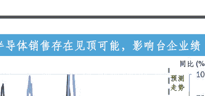
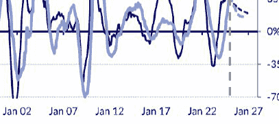

数据来源：MSCI、WTS、IBES、中信证券财富管理（香港）

## 东盟股票 分化加剧，内需是关键

- 外部压力持续，地缘冲突导致风险抬升，2025年东盟股票整体表现不佳。
- 泰国、马来西亚、越南对美国贸易可能遭受负面影响，菲律宾受关税冲击。
- 汇率相对稳定且内需需求充足。
- 东南亚国家面临困难，发展增速遭遇下滑。
- 东南亚国家在需求驱动上具有韧性，是长期选择。

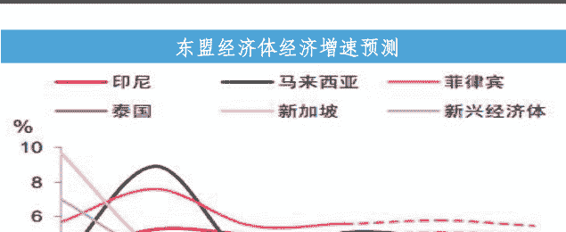

## 港股组合

| 公司 | 行业 | 目标价(港元) | 市盈率(倍) | 25E | 26E | 年增长 (%) |
|---|---|---|---|---|---|
| 腾讯控股 (700 HK) | 互联网 | 30,503 | 497.80 | 650.00 | 17.6 | 15.8 |
| 比亚迪 (1211 HK) | 汽车 | 4,394 | 378.40 | 500.00 | 19.6 | 16.1 |
| 中国移动 (941 HK) | 电讯 | 4,841 | 836.03 | 1030.00 | 11.6 | 11.1 |
| 阿里巴巴 (9988 HK*) | 互联网 | 20,782 | 123.50 | 165.00 | 12.8 | 10.9 |
| 东方设备 (1072 HK) | 电力设备 | 36 | 11.71* | 6.6 | 6.1 | |
| 安佳体育 (2020 HK) | 体育 | 1,121 | 835.20 | 125.00 | 16.6 | 14.7 |
| 海尔智家 (6690 HK) | 家电 | 653 | 223.90 | 97.00 | 9.7 | 8.8 |
| 领晨 (823 HK*) | REIT | 954 | 365.00 | 139.00 | 13.9 | 13.8 |

> 投资理由：腾讯提供了最领先的增长潜力。预计未来三年公司收入和调整后净利润的增长率将保持在1.0%到13%。趋势均衡，公司其社交核心枢纽的护城河、AI领域的领先演进，以及在Capex上、AI应用落地等方面领先，看好公司盈利能力持续提升的韧性。（中信证券－Einar Leong）

2025年第一季度表现强劲突破，预计净利润75亿至80亿元。对比去年，比亚迪在各市场及新车型销量均强劲增长，预计将进一步扩大市场份额。我们预测2025年公司能够突破500万辆汽车或600亿元人民币市值。（中信证券－李鸣）

公司实现业务收入10,408亿元，净利润384亿元。公司并计划在今年内实现收入增长6.75%。进一步加大派回，看好公司手机+AI模型能力、AI布局领先，我们预计收入有望增长，盈利能力不断提升，推动利润持续增长，AI业务有望兑现。（中信证券－李鸣）

3Q2FY业务持续增长，业绩持续好；阿里巴巴，公司坚持“AI+云一体化”领先，预计未来三年收入及其他业务的持续增长，我们对中长期投资持乐观。（中信证券－李鸣）

2024年净利润为2920亿元，同比减少7.7%。中信预测净利润为3100亿元，2025年增长12.2%。新业务持续回暖，我们看好公司在“新型基础设施”建设中承担重要地位。在订单执行方面，关注京东，是高速增长优质标的。（公司；中信证券－李鸣）

## 有色(铝):电铝需求维持稳定

- 参照上海有色网(SMM)、阿拉拉特(ALD)预测和相关公司公告，我们预测2025至远期，内地电铝新增产能规模344万吨，其中新增仅116万吨，2025-2026年内地电铝产量将达4405/4430万吨，增速预计为2.1%和0.6%，相比2023-2024年3.6%和3.9%的增长明显有望。

- 展望2025年，我们预计内电网投资将维持增长，新能源汽车销售持续增长，全球光伏新增装机稳步增长，上述因素有望抵消进口面积以及出口下滑的影响，我们预计2025年内地电铝消费量将达到4547万吨，同比增长1.1%，维持增长态势。此外，得益于金融及财政政策持续，中国房产市场有望回稳。同时，建筑领域仍存在住宅换新、基建投资等需求。

- 我们预测2025年基准情况下，中国电铝需求增长以及供需分别为1.1%和2.3%；若是建筑用铝下滑幅度为预期，降幅有望至5%-10%，则中国电铝需求增速将提升1.5%，供需缺口将扩大至21万至64万吨，铝销量对地产需求的弹性巨大，2025年铝消费或继续维持高位增长。

我们预计内地电铝供需缺口将逐步形成，2025年铝价在19,500-22,000人民币/吨区间运行。

## 中国电铝消费及增速预测

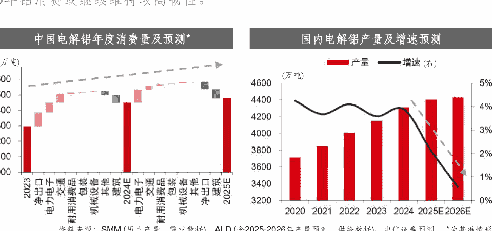

资料来源：SMM(历史数据，需求数据),ALD(2025-2026年产量预测，供给数据),中信证券预测 *为基准情形

## 有色(铜):供给扰动的故事将延续

对供给和关税的担忧在今年一季度提升铜价，铜价再度上行还需要需求改善的助力，但目前中美经济周期的走势还未观测到相应因素。

相比2024年第一季度铜价存在明显的供给、需求端以及宏观层面的三重支撑，2025年铜价对于供给的刺激作用有望降低。生产扰动方面，根据透社，第一量量子旗下Copper Panama最后听证会延期至明年举行，我们预计今年内生产有望复苏。加之刚果电力供应短缺难以缓解，以及海外铜矿资源谈判进入密集期，我们认为2025年供给扰动的故事将延续。

我们预计2025年全球精炼铜需平衡+6万吨，过剩幅度较2024年显著收窄，同时我们预计2026年将短缺28万吨。供给格局的改善对铜价的高位运行提供务实支撑，其中2025年上半年维度，我们看好“供给短缺现、旺季需求支撑、宏观信号推动以及COMEX短缺交易延续”四因素共振驱动的铜价强势运行。后期积极的宏观信号驱动下，2025年二季度铜价有机会再度站上10,000美元/吨。

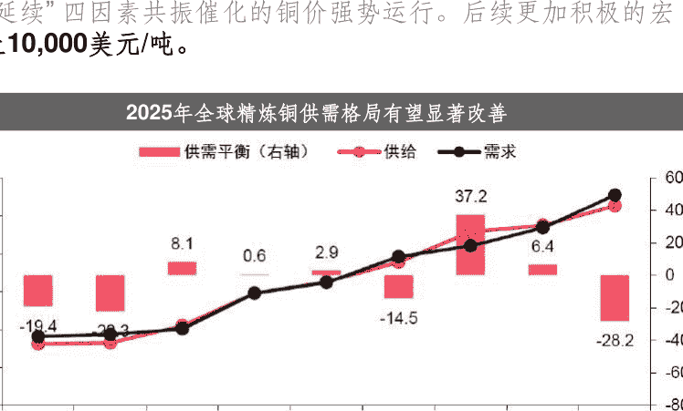

## 商品 原油：多利空因素共存

美国宣布加征关税，国际油价大幅下跌，布特油价在两个交易日内下跌10%，主要原因是国际市场担忧美国关税政策或引发经济下行，导致商品需求减少以及能源下降，能源价格承压。

从地缘冲突的角度来看，俄乌冲突逐渐结束的趋势虽为确定，但是过程较为复杂。从之前的判断进程来看，俄乌双方对峙较大，通过军事行动增加谈判筹码的方式或仍会发生，并能够阶段性小幅支撑油价表现。此外，从流动性的角度来看，当前美联储货币政策调整幅度相对有限。美国经济有小幅回落，但着陆韧性较高，发生短期风险事件的概率相对较低。

理论上来说，特朗普政府可能通过加强监管能源、结束俄乌冲突、缓解和OPEC+的关系通过压力压油价，但实际执行效果可能今年内油价影响相对可控。鉴于当前美国经济弱弱和不确定性加剧的趋势，OPEC+高级会议或难以落实上述的油原产量政策的风格和基调。此外，特朗普制裁俄罗斯、伊朗、委内瑞拉等国家或组织或引发市场对于地缘政治的恐慌对油价产生一定的抬头作用，整体来看，特朗普压低油价的政策年内对油价影响相对可控。

- 我们认为国际油价前期进入底部震荡区间，核心位于65-70美元/桶。后续扰动落地，年中下半年在通胀以及经济基本面等因素带动下逐渐震缓小回。

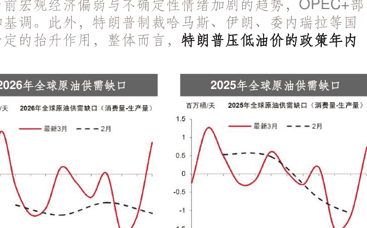 中信证券

## 农产品：预期持稳至下行

美国农业部（USDA）发布今年3月农产品2024/2025年供需预测与2月报告相比：

- 小麦：3月报告上调2024/2025年小麦产量、消费。产量方面，澳大利亚降水量增加，预计产量创高。2024/2025年库存环比增5万吨至26亿吨。

- 玉米：3月报告上调2024/2025年玉米产量、消费。产量方面，价格驱动种植增加，灌溉充足，印度环比增大。2024/2025年库存环比减17万吨至28亿吨。

- 大豆：3月报告上调2024/2025年大豆消费，产量持稳。大豆驱动种植积极提升，预计乌克兰产量创新高。2024/2025年库存环比减23万吨至21亿吨。需求角度来看，中国消费疲软，俄罗斯在黑海达成贸易协议，让2025年度大豆市场持平至下行。

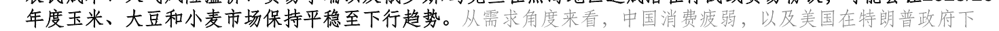

| 项目 | 2024/25 (2月预测) | 2024/25 (3月预测) | 预测变化 | 同比变化 | 2024/25 (2月预测) | 2024/25 (3月预测) | 预测变化 | 同比变化 | 2024/25 (2月预测) | 2024/25 (3月预测) | 预测变化 | 同比变化 |
| :--- | :--- | :--- | :--- | :--- | :--- | :--- | :--- | :--- | :--- | :--- | :--- | :--- |
| 期初库存 | 315.8 | 313.9 | -1.8 | -3.0% | 264.9 | 269.5 | -0.2 | -2.1% | 401.8 | 401.6 | -0.2 | -0.0% |
| 产量 | 1212.4 | 1214.7 | 2.1 | 1.7% | 793.7 | 792.3 | 3.4 | 0.8% | 112.9 | 122.5 | 0.6 | 11.2% |
| 进口 | 181.6 | 180.0 | -1.6 | -8.8% | 204.8 | 202.7 | -2.1 | -2.8% | 420.7 | 420.6 | 0.0 | 6.5% |
| 消费 | 775.0 | 774.9 | 1.2 | 0.9% | 154.8 | 153.5 | 1.3 | 1.5% | 179.4 | 179.3 | 0.1 | -0.5% |
| 出口 | 1237.6 | 1239.9 | 2.1 | 1.3% | 801.2 | 802.5 | 2.9 | 1.3% | 349.8 | 349.2 | 2.5 | 6.5% |
| 出口 | 182.3 | 183.6 | 1.8 | -3.7% | 208.9 | 208.7 | -0.2 | -5.9% | 181.8 | 181.9 | 0.0 | -2.3% |
| 期末库存 | 290.1 | 285.4 | -1.7 | -8.0% | 257.6 | 260.8 | 2.5 | -3.2% | 124.4 | 121.3 | -2.1 | -7.9% |
| 库比 | 24.35 | 23.36 | -0.13 | 32.0 | 32.04 | 0.1 | -1.5% | 30.61 | 29.97 | -0.94 | -0.4% |

资料来源：美国农业部、中信证券财富管理（香港）*2024数据来自农业部

## 商品总结

预计2025年价格强度由高到低依次为：

| 货币 | 预期区间 | 2025年价格 |
| :--- | :--- | :--- |
| 金 | 在2000-2500美元 | 2124美元/盎 |
| 铝 | 在19,500-22,000人民币运行 | 560人民币/吨 |
| 铜 | 仍有机会再次站上10,000美元 | 659美元/吨 |
| 原油 | 短期中枢位于65-70美元/桶 | 74美元/桶 |
| 小麦 | 保持平稳至下行趋势 | 537美分/英 |
| 大豆 | 保持平稳至下行趋势 | 1015美分/英 |
| 玉米 | 保持平稳至下行趋势 | 457美分/英 |

 资料来源：中信证券财富管理（香港）*截至31/3

## 对关税及行政政策表现

2025年1月，美元指数一度突破110关口，创2024年1月以来新高，主要受美国就业数据强劲和政策预期支撑。但随后回落至105水平，由于衰退担忧与降息预期升温，欧央今年3月起暂停25基点，表示其货币政策“有意义地减少限制性”。相比于欧央行的决议，欧元“重新武装欧洲”的方案和德国“不惜一切”的财政增长计划受到市场关注，我们认为两者对欧洲经济不容忽视的影响，可能在基建领域产生压力。

欧盟显示6,500亿欧元的体量大致对应成员国未来四年增加相当于GDP水平1.5%的国防支出，我们假设欧盟的财政乘数是Afonso & Leal (2019)测算的0.44，则增长计划若能落地可能在未来四年给欧盟GDP形成每年接近0.7%的提振。

拉格德表示增加国防和基建可以提振欧洲经济增长，但尚属于进行的工作、与欧行的货币政策不直接相关。欧债收益率和欧元会经历阶段性支撑，我们仍然预计欧央会在4月和6月各降25基点以维持存款便利2%。

我们预计欧元兑美元将走软，到2025年底为1.09。

 资料来源：LSEG Datastream、中信证券

## 美元：维持年线高低的看法

- 特朗普宣布‘对等关税’政策后，美元指数不涨反跌，美元和瑞元作为传统避险货币表现活跃。在不同国家和地区单独加关税等地，各经济体与美元的谈判存在不确定性，我们预计美元指数短期维持高波动。

- 美元的交易波动或仍由于美国与欧日等非美元在货币政策以及市场表现上的差异，单纯的贸易逆差紧至转为顺差并不能支撑美元走强，同时美元指数或也在‘衰退预期’发酵中单边下滑。‘对等关税’后增加市场对衰退的担忧，交易员提高对美储降息的预期，根据CME平台（Watch）显示，今年年底降息4次（每次25基点）。

- 美元的长期逻辑复杂，且存在多个矛盾：一是加关税引发汇率走弱，与美元货币政策矛盾；二是贸易顺差与美元储备地位之间矛盾；三是加关税背景下，美国通胀反复导致美元指数难以走强。

‘对等关税’落地美元指数出现下探，反映全球化进一步提升美元。根据预测，美元指数2025年年初将高后低。

| 货币 | 2025年一季度主要货币表现* | 2024年主要货币表现 |
| :--- | :--- | :--- |
| 日元 | | |
| 欧元 | | |
| 英镑 | | |
| 瑞郎 | | |
| 新加坡 | | |
| 新西兰 | | |
| 澳洲 | | |
| 在岸人民币 | | |
| 韩元 | | |
| 加元 | | |
| 美元指数 | | |

资料来源：彭博、中信证券财富管理（香港）“研报”2025/3/25

## 英镑：关税风险定价表现优异

3月26日英国政府发布的第一份财政声明，宣布削减支出48亿英镑。除了削减措施外，春季声明还公布了新的预算（OBR），这些符合预期。英镑在关税事件期间表现较好，但我们认为英镑仍面临再次下行的风险，由于通胀持续高位、英国政府偿债能力担忧，10年期金债收益率曾攀升4.8%，但之后回落。

我们预计英镑兑美元/英镑兑欧元于2025年顶部将为1.270/1.165。

 中信证券 资料来源：彭博报告2025/3/25

## 人民币：波动但大幅走稳

- 短期来看，关税压力下中国经常账户受到挑战，汇率面临基本面压力。美元指数在市场“衰退”交易下偏弱，一定程度缓解了人民币汇率的外部压力。

- 另外，中国汇率是有管理的浮动制度，央行认为汇率重要性，稳定汇率可能是央行当前的工作重心，人民币汇率7.35是关键因素。另外，DeepSeek等中国科技和中国元素出来，引发市场思考美国前景以及中国资产被视低估的可能性，叠加外资的多和流入，增强了人民币的信心。

- 内部政策引发的预期和央行维持汇率政策保持强度，长期视角关注国内政策变化以及潜在中美需对人民币汇率的稳健。

从另一个角度，我们选择了主流汇率理论进行探讨和分析，将不同理论的测算结果汇总在右面上。测算的主要要素是理解理论相关性好且高度的指标恰符合人民币汇率的走势，并观察到汇率是否显著偏离均衡运行。

| 人民币汇率均衡测算汇总 | 理论 | 均衡汇率测算结果 | 模型优化 |
| :--- | :--- | :--- |
| 相对购买平价理论 | 6.70-6.90 (6.60) | 考虑通胀变化是无法完全涵盖套利汇率走势 |
| 接受购买平价理论 | 3.99 至 4.40 | 调整了交易汇率、关键、非市场因素等 |
| 风险溢价调整 | 7.30-7.40 (7.32) | 考虑通胀和汇率相关性为65.3，均衡度中等43.1% |
| 利率平价理论 | 7.40-7.60 (7.50) | 中美利差和汇率相关性为93.2，均衡度较高65.5% |
| 行为均衡理论 | 7.30-7.40 (7.35) | 学界使用最多 |

人民币汇率7.35，日元。均衡。

# 债券

## 美债季度表现跑赢美股

- 愈愈烈的全球贸易战加剧美国经济成长减缓的风险，并影响投资者的投资组合。

- 受到特朗普一系列关税政策影响，今年三个月股票和债券都在剧烈震荡，但在这种背景下，有一件事变得愈加明显：即使美元作为避风港的地位发生变动，债券相比股票是一个更好的兜底。

- 美债一季度的表现优于股票，涨幅有望超过2%，标普500指数为下跌约5%。这是2020年3月疫情爆发以来股市首次在三个月的时间跨度内下跌，债券上涨。

| 日期 | 债券季度收益(%) | 标普500(%) |
|---|---|---|
| 2018.06 | 0.1 | 3.4 |
| 2018.09 | -0.6 | 7.7 |
| 2018.12 | 2.6 | -13.5 |
| 2019.03 | 2.1 | 13.7 |
| 2019.06 | 3.0 | 4.3 |
| 2019.09 | 1.7 | |
| 2019.12 | -0.6 | 9.1 |
| 2020.03 | 8.2 | -19.6 |
| 2020.06 | 0.5 | 20.5 |
| 2020.09 | 0.2 | 8.9 |
| 2020.12 | -0.8 | 12.2 |
| 2021.03 | -4.3 | 6.2 |
| 2021.06 | 1.8 | 8.6 |
| 2021.09 | -0.1 | |
| 2021.12 | 1.2 | 11.0 |
| 2022.03 | -0.5 | -4.6 |
| 2022.06 | -3.8 | -16.1 |
| 2022.09 | -4.4 | -4.9 |
| 2022.12 | 0.7 | 7.6 |
| 2023.03 | 3.0 | 7.5 |
| 2023.06 | -1.4 | 8.7 |
| 2023.09 | -3.3 | |
| 2023.12 | 5.7 | 11.7 |
| 2024.03 | 1.0 | 10.6 |
| 2024.06 | 0.1 | 4.3 |
| 2024.09 | 4.7 | 5.9 |
| 2024.12 | -3.1 | 2.4 |

资料来源：彭博 截图2024/03/31

## 美国国债收益率陡化

市场对美国经济衰退担忧增加，加之避险需求提升，推动美国国债收益率曲线陡化。当前美国国债收益率曲线相比1月份，前端收益率下降，长端收益率上涨，有明显陡化趋势。

## 美国国债收益率曲线对比

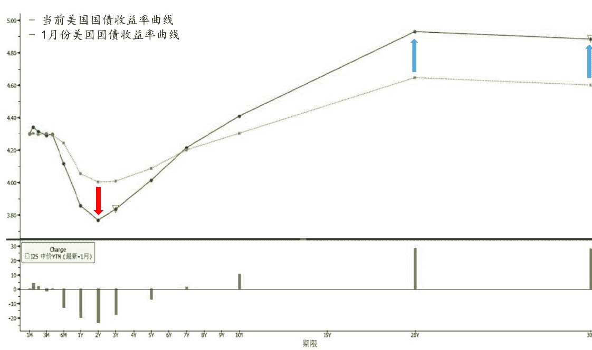

资料来源：拍摄截至4/9/2025

## 短长期信用波动性相对较低

- 短长期债券波动性较低，且恢复时间较短，能够达到平稳增长，有利于对冲市场波动带来的冲击。

| 债券近一周表现 | 短期 | 中期 | 长期 |
|---|---|---|---|
| 美国国债 | 0.21% | -0.55% | -2.19% |
| 全球投资级债券 | -0.23% | -1.39% | -2.08% |
| 全球高收益债券 | -2.14% | -3.31% | -3.15% |

## 1-3年期与7-10年期的总回报指数对比

- 1-3年期总回报指数
- 7-10年期回报指数

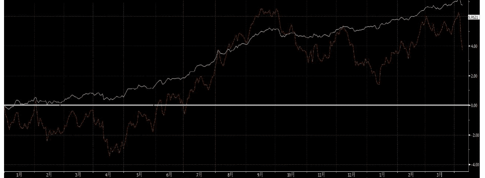

中信证券

资料来源：彭博截至4/9/2025

## 免责声明：

本文由中证财富管理（香港）撰写。中证财富管理（香港）是中证证券（香港）有限公司和中证期货（香港）有限公司的财富品牌。本文为一般性信息，仅供参考。本文不被视为对任何法律管辖区的任何投资产品、策略、计划或其他其他的建议或推荐，中证财富管理（香港）或其任何公司也不承诺参与此处披露的交易。例如例子是通用的、假设性的并且仅用于说明目的。

本文由投资者非专业人士的文稿编写。本文不构成任何保证，也不恰解释任何专业、投资或任何类型的建议或推荐。本文文件涉及投资/产品个人意见，或投资/产品专家对内容的理解，可能与中证财富管理（香港）的官方观点和利益（包括证券部门的展现）存在差异，可能不存在。

本文不包含投资决策的结论。您不应依赖未来投资证券的品质。此外，您应当根据法律、监管、税务、信贷和会计方面的咨询进行评估投资决策、意见和策略。基于这些信息和当前市场状况，如有更改，我们不负责通知。我们所提供的信息仅供参考，投资存在风险，投资价值和收益可能会随市场和税收波动，投资者可能无法收回所投资的金额。过去的业绩可能不是对未来的可靠指标。

任何人士在法律管辖区内购买或出售证券的遵循或引导方法，我们不认可为此发表的请求。

## 法律声明

香港：本资料由中证证券（香港）有限公司（下称“中证财富管理（香港）”），中央编号829，一家受证券及期货事务监察委员会监管的公司发表及发布。根据任何适当法律和法规，中证财富管理（香港）的任何关联公司或其个人可能在发布此处前使用了此处包含的信息，并且可能在所提及的任何证券中具有重大利，或在当前或将来可能产生业务关系，或可能已与其他方提供投资银行、资本市场。因此，投资者应当注意中证财富管理（香港）及其关联公司可能存在一项或多项冲突。

经中证证券（香港）有限公司书面许可，任何人不得对内容的复制、发送或复制本文件。中证证券（香港）有限公司2025年版权所有，并保留一切权利

## 扫码加入 知识星球TOP 免费资源群

公众号: 知识星球TOP

- 每日免费获取高价值资源
- 可提供各类资源服务

| ◆付费文章 | ◆各行各业报告 |
|---|---|
| ◆精选图书资源 | ◆副业赚钱方法 |
| ◆职场实用资源 | ◆AI政经自媒体 |

微信号: jntsg2

关注

分享资料仅供个人学习，请及时删除，切勿商用传播
