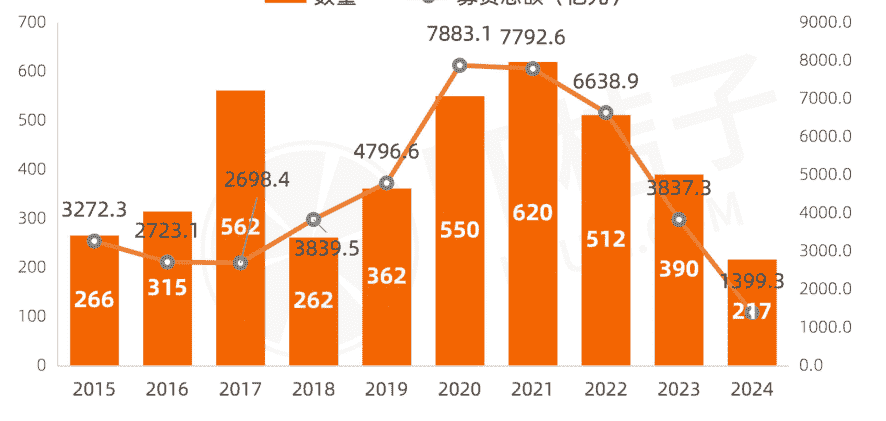
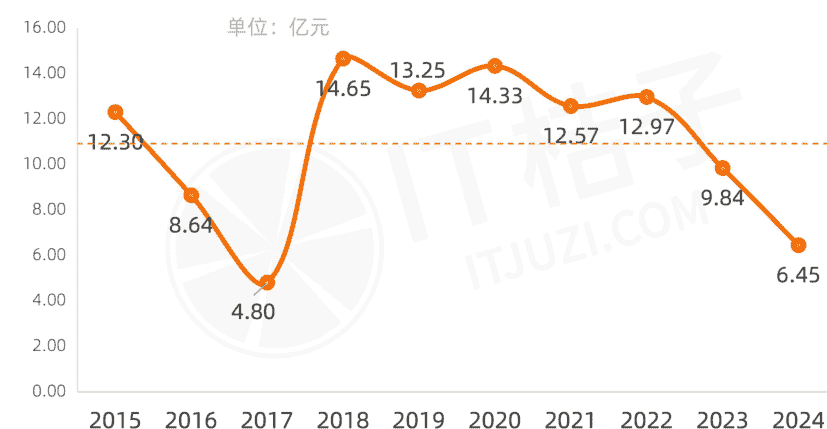
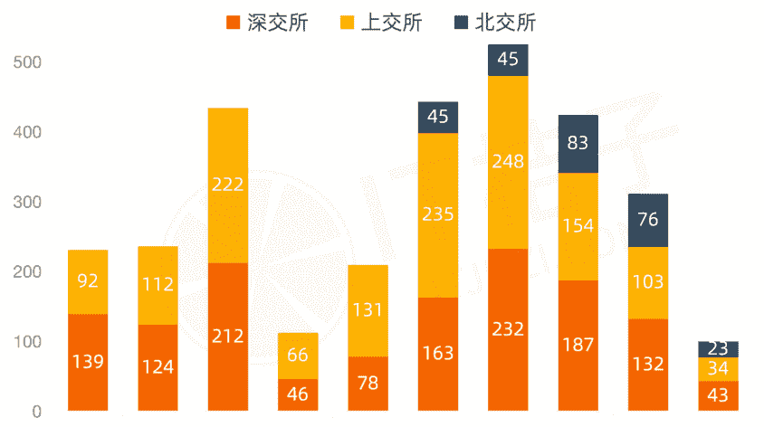
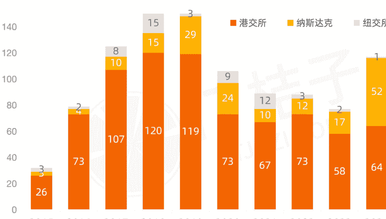
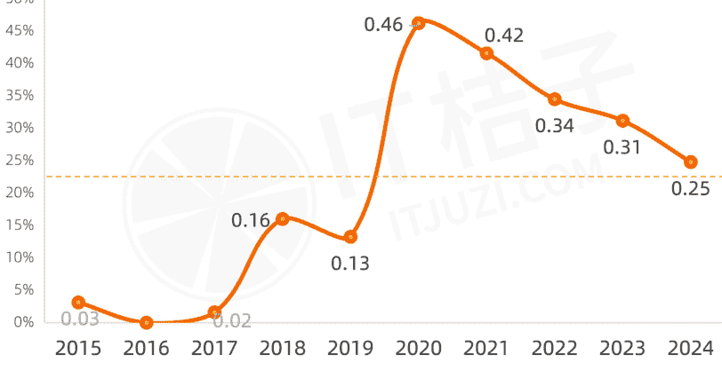
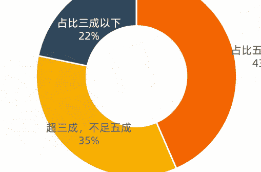
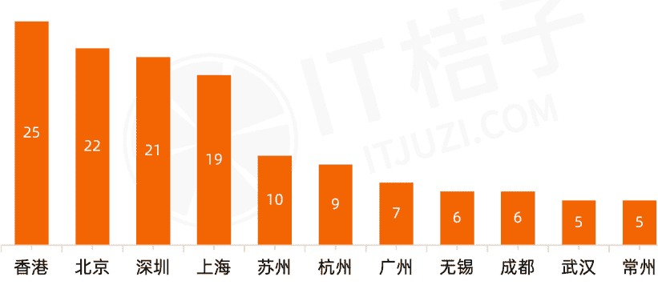
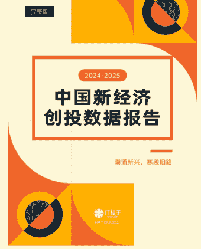

# 2024-2025 年

# 中国公司IPO上市
分析报告

A股冰冷，中国公司悄悄赴美上市

# 免费 价值 及时 专注

# 扫码加入 知识星球TOP 免费资源群

- 每日免费获取有价值资源
- 可提供各类资源搜索服务

| 热门付费文章 | 各行行业报告 |
| :--- | :--- |
| 精选图书资源 | 副业赚钱方法 |
| 职场实用资源 | AI经营自媒体 |

公众号：知识星球TOP 微信信号：jntsg8 微信信号：jntsg2

分享资料仅供个人学习，请及时删除，切勿商用传播

# 目录

# 01 IPO行情跌至近十年的谷底
# 02 A股上市遇冰点期，美股境外上市创新高
# 03 港股上市中的基石投资额平均占比超45%
# 04 国内上市公司有过半在IPO前得到风险投资
# 05 2024年中国新上市公司：制造业数量多
# 06 背后VC/PE机构：深创投、红杉中国居前两位
# 07 2024年中国上市公司退市分析

## 第一节 行跌至近十年的谷底

2015-2024历年中国公司IPO上市数量及募资金额

截止日期：2024年12月31日 数据来源：IT桔子 tjuzi.com

根据 IT桔子数据，从新上市公司的数量来看，2021年是最高点，达到了620家；2017年A股表现显著，上海和证券交易所的新股发行实现爆发增长，使得2017年成为近十年的次点。

从募资总额来看，2020、2021年两年达到了创纪录的700多亿元，之后下滑，到2024年新股IPO有217家，同比减少了44%；募资总额为1999亿元，同比减少了64%。

来说，2024年仍处于近十年的谷底。

我们不得不去探究这一剧烈的变化是如何构成的？

由于二级市场的发行上有着严苛的审核流程和制度、规则，偶然因素难以造成系统性的影响。

在此处，我们认为IPO压力下主要是政策性的原因所在，包括比较易见的覆盖面，从去年月“国九条”出台，监管机构加强了对发行行的准入审核，提高了现场的覆盖面，从来的5%提高到20%。对于市场上出现抢脸等行为，监管机构可能会将其列入黑名单，并严格监管曾拆分上市行为，使得一些相关企业不得不撤回申请。

### 近年来中国公司IPO上市平均资金金额

单位：亿元

截止日期：2024年12月31日 数据来源：IT桔子 Itjuzi.com

据IT桔子显示，2024年中国新IPO的平均募资金为64.5亿元，略高于2017年，是近十来的倒数第二——2017年A股“开闸放水”，新IPO上市数量首次爆发，尤其是创业板新股规模增大，导致IPO总量及平均募资金达到接近最近的历史最低。

2018-2022年，中国IPO平均募资金处于较低的状态，超过了10亿元，且募资金额跌落。

从募资金来看，2024年的这种下跌主要源于境内A股上市数量减少，尤其是大IPO案例的缺失，而境外的小规模IPO越来越多。比如2024年IPO募资100亿元以上的有26个，其中2021年仅有11家，2023年分别为16家。

就规模而言，2023年华虹半导体从港股回到A股募资212亿元，创造当年IPO最大记录；2024年芯源集团从A股回到港股募资306亿元，这两个都属于二次IPO，并非真正意义的首发IPO。再来看2023年半导体芯片集成上市募资超90亿元；而2024年募资88亿元（约57亿元）是新IPO，较之前很大。

接下来，我们将分别针对境外上市和境内上市做具体分析。

## 第二节 A股上市冰点期，美股境外上市创新高

近年来中国IPO所在交易所境内/境外分布

据IT桔子显示，近年来，中国IPO中选择在境内交易所（A股含港交所、上交所和北交所）为大多数，平均占比72%。2015年最高达到了87%，而在境外上市平均不到三成。2018年，境外上市达到了57%，首次超过了境内上市的43%；到2024年，境外上市比例高达54%，这是近十年来第二次“异常”。

不过，在2024年，中国公司赴美股的数量占比为24%，这是十年来最高的一次。这一年，中国公司赴美的热情在沉寂之后再次释放。

从内部结构来看，A股占比的趋势基本稳定，2018年一度超过了A股IPO总，在总体占比猛增至46%。这主要由于港交所允许同股上市、生物科技等新规实施的吸引力。我们进一步细分到交易所维度，来看近十年中国上市公司在各交易所的具体数量。

### 2015-2024历年中国公司境内上市分布

截止日期：2024年12月31日来源：IT桔子

2024年，由于监管审核政策转变、全球经济不确定导致股市市场不足，以及很多企业业绩稳定无法满足市场需求，回归作用下A股新股总量减少了近一半。

从具体数值来看，2024年上交所、深交所新增23家、43家，均较去年同期幅度均减少了67%；开始时间最短的北交所（2020年开）增加了23家，较去年同期幅度到了70%。

IT桔子显示，2022-2024年，深交所的新股数量均略微超过上交所；但在2017-2021年的这五年里，上交所的新股一直领先于深交所，尤其是2019年科创开启后，创业板吸引力下降，国内科技公司起A股IPO风潮，上海交易所成为为主选择。2024年，在科创板领先的国内企业数量14家，但减少了52家，是证监会加大了对企业科技性的要求的；科创板内A股的比重为14%，占比新股的41%。

不过，在更早之前，深圳证券交易所作为中国第一个交易所，拥有主板（中小主板与主板于2021年4月正式合并）、创业板板块，且在2014-2016年新股数量多于上交所。

总之，“风水轮流”，近十年来，A股上市的第一批交易所在上交所和深交所之间变换了几次。

### 2015-2024年中国公司境外上市发行量分布

截止日期：2024年12月31日 数据来源：IT桔子 @itjuzi.com

与A股新股数量逐渐下滑相对的是，2024年中国公司赴美、香港市场的热情高涨。

IT桔子数据显示，2024年在港交所上市的中国公司有64家，2023增加了6家。香港市场在2024年整体回，市场信心增强。另外，港交所推进其上市审查流程一系列改革措施为IPO活动注入了活力。

从图中可见，港交所近年来成为中国企业境外上市的首选，主要是其规则足够包容、自由、拥有国际资本、地缘化更优等优势。经过2018年港交所热潮后，近几年中国公司赴港上市整体下滑，但整体平稳，每年保持在70家左右。

美股方面，2024年中国公司成功上市数量再次创高，达到52家，比高峰期2019年的29家多。不过，这几年企业相对于纽交所，纳斯达克的财务要求低、规模限制小、成本低、周期短。另外，纳斯达克的定位聚焦创新科技，氛围牢固、监管相对宽松、市场流动性良好，吸引众多企业在纳斯达克。

## 第三节 港股上市中的基石投资额平均占比超过45%

基石制度起源于2005年，最初由香港交易所引入，初衷是借助基石投资者的优质声誉为国内企业释放积极信号，提高成功率。后来这项制度逐渐稳定，基石投资者需要购买一定比例，且上市后持续6个月以上。同时美股市场也逐渐接受了基石策略，不过具体规则与差异。

近十年来中国境外上市基石投资渗透率

截止日期：2024年12月31日 数据来源：IT桔子 Itjuzi.com

数据显示，2020年基石投资在整体占比显著走，达到了46%。基石投资者的作用增强了投资者对新股的信心。之后几年有所下降，到2024年下跌到25%，原因或是全球经济形势不稳定，投资者情绪较为谨慎，进一步降低了总体占比，基石投资者参与较少，不过该值仍高于平均水平。数据显示，2024年基石投资者中七成有国资背景，比2023增加了10个百分点，他们尤其偏好科技、生物科技与健康等领域。从2024的情况来看，基石投资者的类型更加多元化，不仅包括传统基金，还包括上市公司、地方国资/产业基金、产业资本，甚至个人等也在积极参与。

### 2024年港股IPO基石投资占募金额比例分布

截止日期：2024年12月31日 数据来源：IT桔子@Itjuzi.com

据IT桔子统计，从基石投资金额占IPO募金额来看，2024年有23家港交所上市的公司基石投资占IPO募金额的比例平均值为46%。

其中，基石投资占比达到五成以上的10家上市公司属于较为普遍的阈值，占比最多的有91%，华美天募资1.96亿元，而基石投资认购的金额达了300万美元；佑凯生物募资、基石投资额分别为6.66亿元、5.4亿元，后者高达91%。

基石投资占比在三成以下的有5家，其中最低的在10%左右，江苏南京的制药公司“盛丞生物”2024年IPO募资3.92亿元，基石投资南京新产业投资认购4500万元，仅占1%。还有8家处于30%~50%左右。

对于机构投资者而言，低的认购额和较少的参与可能说明对投资项目的信心不足，但过高的金额和占比是一造成投资资金紧张的原因，二是无法更多的公开市场和民间资金，因此，合理的必要的，而且给许多机构和个人投资者提供了参考价值。

另外，小马智行2024年11月美上市，IPO募资4.52亿元，其中基石轮资额为2.28亿美元，恰好了一半，基石投资为北方汽车、广汽集团、康德高集团。

### 附录：2024年获得基石投资的上市公司

| 公司名称 | 上市板块 | 上市日期 | 基石投资金额 | 基石方 |
| :--- | :--- | :--- | :--- | :--- |
| 美的集团 | 家电制造 | 港交 | 2024年9月 | 12.6亿 | UBS瑞信国际亚洲基金CPE |
| 地平线 | 自动驾驶 | 港交 | 2024年10月 | 2.2亿 | 阿里巴巴广汽集团香港基金 |
| 华州科技 | 食品饮料 | 港交 | 2024年10月 | 1.1亿 | Oaktree Capital ParamicanITlah |
| 高森 | 集成电路 | 港交 | 2024年12月 | 5亿美元 | 江苏吴江创东方联投资 |
| 晶泰科技 | AI+医疗 | 港交 | 2024年6月 | 3.37亿 | 上海国景季杰达红奥集团 |
| 如能 | 交通出行 | 港交 | 2024年6月 | 未披露 | 满湾汉工业小智行 |
| 老铺黄金 | 珠宝设计 | 港交 | 2024年6月 | 5600万 | 腾讯南方基金CPE |
| 三态 | 零售科技 | 港交 | 2024年11月 | 3.04亿 | DFI Development |
| 重塑能源 | 新能源 | 港交 | 2024年1月 | 3.24亿 | 九京创创股权中心 |
| 卡罗特 | 家电器 | 港交 | 2024年9月 | 4000万美元 | 经纬创本成本 |
| 优创智 | 自动驾驶 | 港交 | 2024年12月 | 5.402亿元 | 康盛孚地平线 |
| 声过科技 | 人工智能 | 港交 | 2024年7月 | 2.5亿 | 光邦投资江苏医药 |
| 连选数字 | 支付 | 港交 | 2024年3月 | 2332万美元 | 杭州联云医药高新 |
| 讯飞驰 | AI+医疗 | 港交 | 2024年12月 | 3557万美元 | 招商南智中信辑合众集团 |
| 九源基能 | 生物技术和制药 | 港交 | 2024年11月 | 3.52亿港币 | 和逸达生物健康阿里巴巴达泰睿/jointinternational |
| 小马智行 | 自动驾驶 | 纳斯达克 | 2024年11月 | 2.28亿美元 | 北京广广集团德高高尊 |
| 微基股份 | 跨境电商 | 港交 | 2024年10月 | 1.09亿人民币 | 乐畅物流赛穗时代 |
| 威盛生命 | 生物医药 | 港交 | 2024年5月 | 540万美元 | 南京产业投资 |
| 七智能 | 云服务 | 港交 | 2024年9月 | 1.83亿美元 | 嘉州秀奥金融 |
| 出门问 | AIGC | 港交 | 2024年4月 | 9500万美元 | 中关村发展集团围绕南京医药开发区 |
| 华策家中 | 生物医药 | 港交 | 2024年10月 | 2300万美元 | TPG泰嘉资本管理|太平洋保险|洋医药|黄薯 |
| 健康之路 | 医疗信息化 | 港交 | 2024年12月 | 1.03亿人民币 | 锡戈股权携行业投资基金 |
| 草速集团 | 美容护理 | 港交 | 2024年12月 | 2800万美元 | Water Life Wealth Limited|Vital Message[袁磊] Oaktree Capital 树资本成本|WT Management|太平洋保险|Morgan Stanley 普士基丹利惠|Green Better|Wind Sabre Fund SPC|Ghisallo|赛普哲jinfinity Global Master Fund |
| 顺丰速运 | 综合物流 | 港交 | 2024年11月 | 15.92亿港币 |

## 第四节 国内上市公司有超过半在 IPO 前得到风险投资

历年中国公司IPO前有多少多少在一级市场融资过

- 在一级市场融资退出 - 渗透率

截止日期：2024年12月31日  数据来源：IT桔子 © Tjuzi.com

## 2024年中国新上市所属行业及上市交易所

| 行业 | A股 | 港股 | 美股 |
| :--- | :--- | :--- | :--- |
| 先进制造 | 10 | 26 | |
| 传统制造 | 4 | | |
| 汽车交通 | 6 | 7 | |
| 医疗健康 | 5 | 9 | |
| 电商零售 | 3 | 6 | |
| 物流 | 3 | 4 | |
| 企业服务 | 7 | 7 | |
| 人工智能 | 1 | 6 | |
| 房地产 | 3 | 3 | |
| 金融 | 2 | 6 | |
| 教育 | 4 | | | |

截止日期：2024年12月31日 数据来源：IT桔子 © Itjuzi.com

> “A量”最高的行业是传统制造，2024年26家，超 80%的企业在A股上市的；在A上市的有46家，占比74%。

成功的行业上有62家先进制造企业中，2024年7家中国人工智能IPO就有6家在港交所上市的，仅“合信息”在A上市的。国内企业服务领域偏好在香港、美国市场，各有7家在香港、美国市场。

医疗健康行业2024年在港、A股上市的数量有9家、5家，汽车交通领域分布较为均衡，2024年港股、A股、美股的新上市企业分别有7家、6家、6家。

注意的是教育行业，2024年4家新上市的中国教育企业都是在美股纳斯达克上市的，包括职业教育课程科技、企业学习商务、在线家长网NetClass、K12在线教育纳米盒。这背后主要原因是A股方面的政策变化，对一些行业做出了限制。

### 5.2 地区分布：浙江、江苏企业偏好 A股，广东企业港/A股并重

## 2024年中国新上市TOP10

截止日期：2024年12月31日 数据来源：IT桔子 @Itjuzi.com

香港 北京 深圳 上海 苏州 杭州 广州 无锡 成都 武汉 常州

从城市来看，注册在香港的中国企业有25家新上市公司诞生，同比增长大增。值得注意的是，这是香港近五年来首次登陆年度中国IPO TOP1——香港企业IPO高峰出现在2019年，有64家，此后2020年、2022年、2023年，数量较少。

不同于大陆，注册在香港的企业有90%选择在交所上市，港股上市国际市场环境较为良好；2024年香港有6家企业在交所上市，有19家在美股纳斯达克上市。

北京在大城市中一路当先，2024年收获了22家新上市公司。深圳企业新增21家新上市公司。上海，以略微新增19家新上市公司。

整体来看，北上广超一线城市，企业、人才等资源集中，2024年新增上市公司数量处于第一梯队。第二梯队中，苏州、杭州等地新增IPO有10家、9家，领先于广州的7家。

可以发现，江苏省份同样在省会城市经费发展领先于省内城市的情况。

比起广东省内，仅深圳一城2024年的新上市公司就超过广东（深圳除外），远超广州的贡献，其作为区域特殊；而苏州，只是江苏省的地级市，贡献了2024年省内超1/3的新力量，连无锡、常州两地的上市公司数量都超过了省会城市南京。

## 2024年中国新上市公司的注册地分布

| 省份 | A股 | 港股 | 美股 |
| :--- | :--- | :--- | :--- |
| 广东 | 16 | 7 | |
| 江苏 | 16 | 6 | |
| 香港 | 6 | 19 | |
| 浙江 | | 17 | 5 |
| 北京 | 5 | 9 | 8 |
| 上海 | | 8 | 3 |
| 安徽 | 7 | 2 | |
| 四川 | 5 | 1 | 2 |
| 湖北 | 5 | | 16 |
| 福建 | 4 | 1 | 2 |
| 山东 | | 4 | |
| 河北 | 4 | | |
| 河南 | 2 | 1 | |
| 陕西 | 2 | 1 | |
| 天津 | 2 | | |
| 新疆 | 1 | | |
| 湖南 | 1 | | |
| 内蒙古 | 1 | | |
| 重庆 | 1 | | |
| 辽宁 | 1 | | |

截止日期：2024年12月31日 数据来源：IT桔子 ©ITjuzi.com

广东省一直是国内GDP一大省，经济实力强，江苏省也有后起之马，两个省份在2024年收获了40家、29家上市公司，在全国总量中占比18%、13%。

不过，从上市地点来看不同，2024年江苏IPO企业有一半在A股上市，而广东的新上市公司在A股和港股的比例较大，且2024年新上市公司对港股倾向更多。

此外，2024年新上市公司所在行业，先进制造和传统制造业占比47%，不足五成；可见江苏省依赖程度更高，广东则更为开放。2024年新IPO的国内企业中，注册的江苏位居五位，收获了22家，北京更偏好港和美股上市。总来说，2024年新上市公司在国内集中且分散，其中一半分布在华北、华中、华南等地区，可谓“遍地花”。

### 5.3 耗时分布：从成立到IPO耗时

截止日期：2024年12月31日 数据来源：IT桔子 @Itjuzi.com

注：从成立到首次上市（IPO）的时间为计数，公司注册前发行时间与实际运营时间不同，数据供参考。

根据IT桔子数据，2024年成功上市的国内企业，从成立到IPO3年内的占比46.5%，历时3~10年（不含）的占比27.44%，历时10~20年（不含）的占比46.9%，历时20年以上的占比20.9%。其中这些企业不少是创新企业，需要漫长的研发周期来证明技术壁垒；此外，2024年A股新股时长明显增加，从受理到上市的平均时长为784天。也有企业多次冲刺A股无果，转而寻求港股导致上市进程较长。

### 2024年中国IPO成立时间不足10年占比

截止日期：2024年12月31日 数据来源:IT桔子 Itjuzi.com

根据IT桔子数据显示，2024年新IPO的中国公司中，在港股上市的有37%成立时间不足10年，总体平均时长13.3年；在美股上市的有50%成立时间在10年以内，总体平均时长10.6年。在A股上市的有12%成立时间不足10年，总体平均时长16.8年。美股上市的中国公司整体更年轻，其中成立时间最短的是极氪（ZEEKR），2021年3月上市，是吉利控股集团旗下的智能汽车品牌，背靠巨头，聚焦智能汽车、新能源汽车业务。

2024年港交所IPO中存在一些花了不到3年就上市的特殊情况。根据IT桔子统计，徕、百乐集团、弘基集团、越秀科技等5家是注册非香港公司，系原本在香港境外注册，但需在香港申请登记，在此上市。除上述情况（指中国内地企业或其他境外主体在香港新设控股主体），最年轻的中国企业是盛旭生物（Sunho Biology, Inc.），2018年起业，总部位于浙江湖州安吉县，专注免疫疗法新药研发，曾获得捷锋医药、越秀产业投资基金的支持，最终在2024年来了，总计花了6年左右时间。

2024年A股新IPO中，最年轻的公司成立于2018年1月的中伦新材料，总部位于福建厦门市，主营业务是新能源材料、生物基可降解膜材料生产研发，从成立到顺利登陆交所上市花了半年。总的来说，2024年企业想要顺利上市是非常不容易，花费的时间也很长。

### 5.4 募资结构：A股大额募资下降，港美股以后额募资为主

### 2024年中国IPO个股募资金额区间分布

| 市场 | 不足5亿元 | 5-10亿元 | 10亿元以上 |
| :--- | :--- | :--- | :--- |
| A股 | 44% | 39% | 17% |
| 港股 | 70% | 20% | 9% |
| 美股 | 69% | 22% | 9% |

截止日期：2024年12月31日 数据来源：IT桔子@Itjuzi.com

2024年中国企业赴境外上市，港/美情况相似，小额募资占多数（70%），由于市场环境严峻，投资者往往处于观望状态。2024年A股新上市公司中，以中型为主，其中44%的资金额不足5亿元，39%少于10亿元，17%超过10亿元。2024年港交所新上市公司中，6家分别属于美的集团、顺丰快运、地平线、华润饮料，其中美的集团募资高达306.68亿元。2024年美股IPO中，一家在纽交易所上市。

### 2024年中国公司募资额TOP20

| 公司名称 | 行业 | 上市交易所 | 募资额 |
| :--- | :--- | :--- | :--- |
| 美的集团 | 家用电器 | 港所 | 306.68 亿 |
| 特斯 | 汽车制造 | 纳斯达克 | 8.8 亿 |
| 顺丰速运 | 物流 | 港所 | 56.61 亿 |
| 地平线 | 自动驾驶 | 港所 | 54.07 亿 |
| 花牛奶 | 食品饮料 | 港所 | 50.43 亿 |
| 国航 | 物流 | 深交所 | 30.39 亿元 |
| 小智助手 Pony.ai | 自动驾驶 | 纳斯达克 | 4.52 亿元 |
| 极氪 | 汽车制造 | 交所 | 4.41 亿元 |
| 永安股份 | 环保 | 上交所 | 24.33 亿元 |
| 艾普能源 | 新能源 | 上交所 | 22.26 亿 |
| 华百度 | 餐饮 | 港所 | 25.86 亿 |
| 达京数据 | 数据服务 | 上交所 | 16.52 亿元 |
| 诺信云星 | 智能装备 | 深交所 | 16.29 亿元 |
| 龙科技 | 3C | 上交所 | 15.6 亿元 |
| 华新泰 | 化工业 | 上交所 | 15.01 亿元 |
| 上海合积 | 集成电路 | 上交所 | 15 亿元 |
| 成都华芯 | 集成电路 | 上交所 | 15 亿元 |
| 永禄信息 | 新材料 | 上交所 | 13.85 亿元 |
| 合合信息 | AI, 大数据 | 上交所 | 13.8 亿元 |
| 中力股份 | 物流 | 上交所 | 12.4 亿元 |

IPO募资额排名前20名的中国公司中，有10家在上海交易所上市，5家在港交易所上市，2家在美股纳斯达克上市，还有2家在深圳交易所上市，1家在纽交易所上市。

不过，排在后五位的上市集团均为境外，港股为多，没有在A股交易所上市。其中，美的集团在港交所二次募资306.68亿港元，是年度最大IPO；路斯特、顺丰运、平线和华润饮料的IPO募资额分别为8.8亿美元、56.61亿港元、54.07亿港元、50.43亿元，共计11家上市公司IPO募资额超过20亿元。

行业分布，有2家无人驾驶上市企业，包括在美股上市的小智智能 Pony.ai，在港股上市的地线；扫描全能、全企业产品开发，提供文字识别、图像识别技术的大数据企业服务“合合信息”在A股上市，募资13.8亿元，还有路斯特、极氪两家新能源汽车领先于2024年在美股上市。值得注意的是，这5家上市前都是唯一的独角兽企业。

芯片/集成电路上市企业有上海合、成都华芯家，物流运营企业顺丰运达（二次），从A股到港股（募资15.6亿元）。另外，消费类上市企业3家，分别是饮用水品牌“华润”、智能手机品牌“龙虎”、消费饮品牌“百道”（募资25.8亿元）。

### 附录 2023-2024重复上市公司

| 公司名称 | 行业 | 新上市交易所 | 已上市交易所 | 上市时间 |
| :--- | :--- | :--- | :--- | :--- |
| 华通 | 新能源 | 港所 | 上交所 | 2023/1-12 |
| 陆金 | 金融 | 港所 | 深交所 | 2023/4-14 |
| 华虹半 | 半导体 | 上交所 | 港所 | 2023/8-15 |
| 顺丰运达 | 物流 | 港所 | 深交所 | 2024/11-27 |
| 美的集团 | 家电 | 港所 | 深交所 | 2024/9-17 |

终止日期：2024年12月31日 数据来源：IT桔子 ©Ijuzi.com

## 第六节 背后VC/PE机构：深创、红杉中国居前两位

据IT桔子数据显示，2024年IPO如此艰难的情况下，新上市公司合计IPO项目不足20家。从深创、高投、腾讯投资等头部机构，合计21家项目直后只有四家。从市场上来看，港交所上市公司有25家，占比近60%；A股上交所、深交所各有6家、4家，合计10家，占比24%；还有7家在美国纳斯达克上市。可见，头部VC/PE机构主要倾向于境外上市（占比七成以上），以港股为主。除了腾讯、广讯旗下CVC外，还有7家VC/PE机构，包括红杉、高盛、经纬投、ID资本和真基金、云基金；人民币投资机构有3家，包括深创投、中金资本和东方富。

深创过去九年内超过135家项目成功上市，投资成绩十分亮眼，其中最好的2022年24家被投上市公司；而2024年上市减少近一半，当年获新9个IPO公司主要在A股上市，包括龙科技、蓝成股份、中瑞股份、星旅科技、先锋精科、骏达；机器人企业越德科技、海外B2C公司百景股份3家在港所上市；赛驰福在纳斯达克上市。

红杉中国并列第一，9家被投项目实现IPO，其中A股100%在境外交易所上市，包括云同学、小马智行2家在股市上市，自动驾驶企业地线、AI药企泰康、重塑能源、人工智能公司出口向、连选宇宙等7家在港股上市，这与深创这样的人民币本土投资机构呈现非常大的差异。

### 2024年度中国IPO公司背后的投资机构TOP10名单

| 机构名称 | 年 IPO 项目数 | IPO 项目列表 |
| :--- | :--- | :--- |
| 深创投 | 9 | 龙瑞、中国股份、越酷科技、星辰科技、先精准、骏达、微基股份、百景股份、中驰芜 |
| 红杉中国 | 9 | 地平、昌泰科技、重塑能源、连选数、小智 Pony.ai、微基股份、出门问、暖曦出行、云学 |
| 经纬投资 | 8 | 合合信息、卡宁特、七牛智能、太美医疗科技、类生物、华夏中奥、闪点、云学 |
| 讯锡 | 8 | 磊科技、知行、老金准、多数学、太美医疗科技、暖曦出行、汽车城、云学 |
| 中金资本 | 7 | 京源、瑞昌、华正药四大都超过了30年。其中创业企业需要漫长的研发周期来证明技术壁垒；还有一些传统制造的公司。 |

月被私募基金资本收购后退市，距离其上市已经过去了 16 年。其中最年轻的上市公司图森未来，成立于 2015 年 9 月，并于 2021 年 4 月在纳斯达克上市，2024 年 1 月就退市了，上市时间短到不超过 3 年。

此外，西普精密、河骏数字、大滩合、观珠宝、泰莱业这 5 家第三板块挂牌公司到 2024 年倾牌，在其第三板块平均挂牌时长近 6 年，最短的仅有 2 年，最长的有 8 年。

从行业来看，2024 年退市公司涉及零售消费、企业服务、制造、物流、人工智能等多个行业。

（主要原因从三板块拟此在此考虑）

比如诸侯光电 2024 年 7 月 18 日到 8 月 14 日期间，连续 20 个交易日的每日股票收盘价均低于 1 元，触发了退市机制；且公司未能按照监管要求在六个月内内缴 95.5 亿元市值占用资金，最终华东光电被深圳证券交易所止市。

左科科技因造假错误被监管会调查，同时，左科科技的股价暴跌，从 300 元跌至 1 元，最在 2024 年 7 月 26 日被摘牌，被深交所决定终止市。博天寰因虚假记录营收收入和利润，导致 2017 年至 2021 年的年度报告存在虚假记录，被上交所决定终止市。

美股方面，百世集团从 2015 年以来持续亏损，2022 年和 2023 年分别亏报 15.03 亿元和 8.93 亿元；且百世集团的股价极低，不足 0.9 美元，不符合纽交所的上市标准，在 2024 年三季度顺利完成私有化退市。

拥有“自动驾驶第一股”的图森未来因环境变化，股价波动加大，选择自愿从纳斯达克退市以更好地进行业务转型；且公司有意将业务重心从美国转移至中国，计划通过退市后进行战略调整。

IT桔注意到，有 3 家中国零售消费企业在 2024 年退市，而都是从港交所退出，值得关注。

2024 年 11 月 14 日，中国女装第一股胶贝尔 2022 年从 A 股退市后，正式告别港所。

拉夏贝创立于1998年，实现“A+H”两地上市的，巅峰时期曾有LaChapelle、Puella、Candies等20多个品牌，直营门店数量近万家。然而，近来拉夏贝营收持续下滑、业绩亏损，早实在三年前的2021年1月申请破清算。

知名的母婴电商平台宝宝集团于2024年9月9日于香港交交易所上市，CFO 徐徐指控股公司在2018年上市过程中使用了“结构单”扩大了发行规模，并存在其他造假行为。自2023年5月2日起，宝宝的股票在交交易所停牌交易，停牌长达一年半之久。在此期间，尽管司积极争取复牌，但由于多种客观原因，未能在规定时间内完成所有复牌指导任务。

据悉，宝宝集团已推出C2M分养胶营养粉，未来将聚焦“AI+母婴”，包括联合阿里里推出AI解莉越单、AI预测增长相、AI起名、AI客服等智能化产品。

克莉莉婷（Christine）是一家台企企业，从1993年开始生产及销售烘焙食品，是最早进入中国市场的外资投资烘焙企业之一。公司在2000年已成为烘焙行业内唯一拥有近千家连锁店的企业，于2012年在港交交易所成功上市，被誉为“烘焙第一股”。

但据克莉莉婷的创始人罗亚安，公司上市后，2017年遭遇高管内斗、创始人被罢免等等情形，并持续多年无好转，之后公司经营困难，并抛欠供应商货款、员工薪酬等，2022年12月起克莉莉婷旗下所有门店已停业。克莉莉婷最终于2024年12月27日退市。

对于这些企业来说，退市或是重整，也可能意味着闭闭，乃至一个品牌的消失。

IT 橘子陪伴和见证中国风险投资经历了一个完整的大周期和若干个小周期的，用数据记录这一切。

从 2018 年开始，我们通过数据看到了市场运营逻辑发生变化的头部：

在 2021 年，我们更加确信了这一切层底的变化：

在 2024 年，我们开始与大家一起关注：在全新的创投世界里，如何理解和适应新规则，如何自处......

IT 橘子重磅年度报告，值得一阅——

《2024-2025 年中国经济创投报告》
