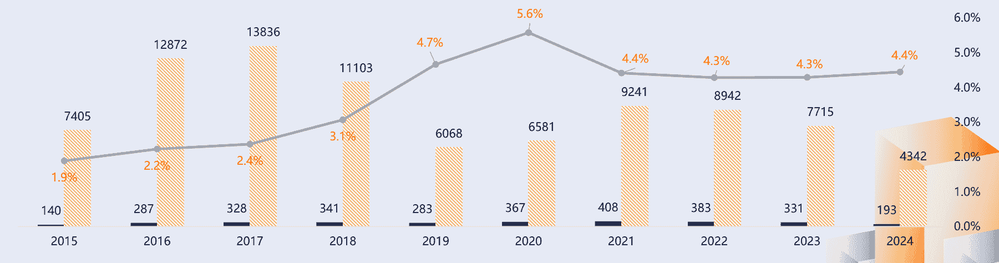
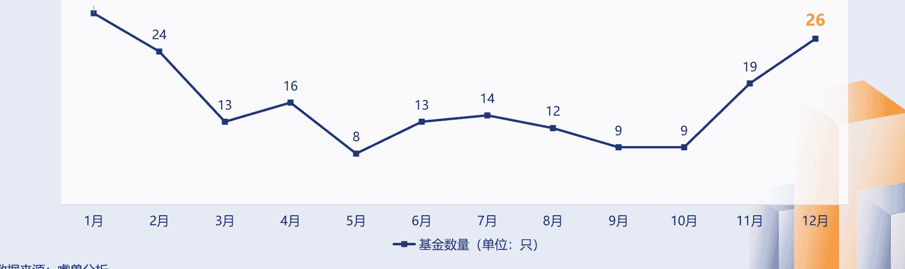
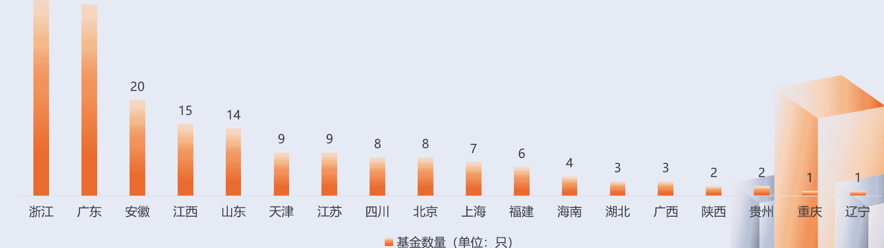
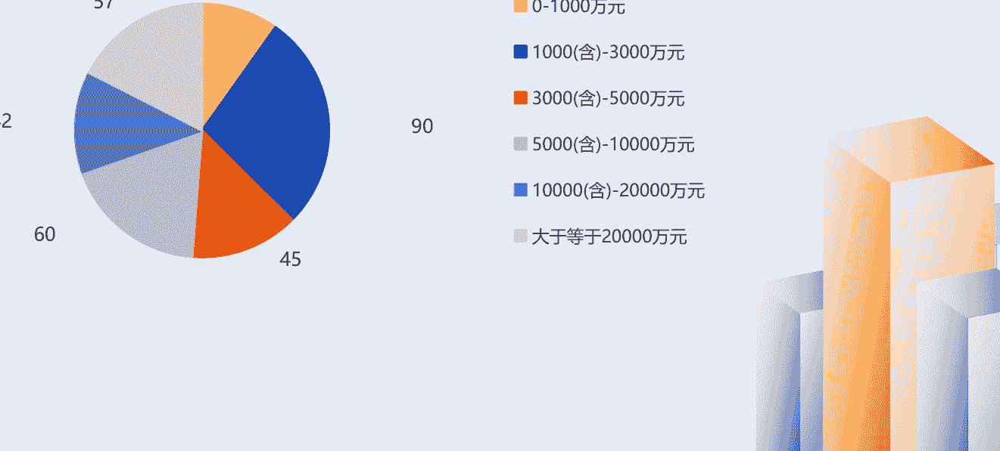
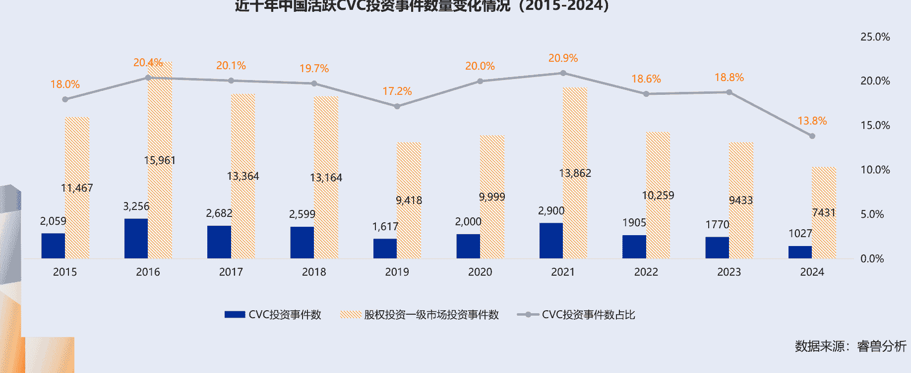
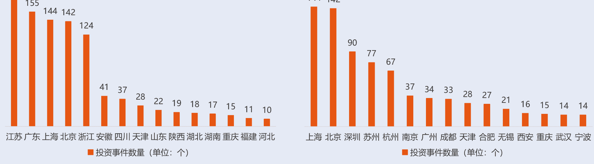
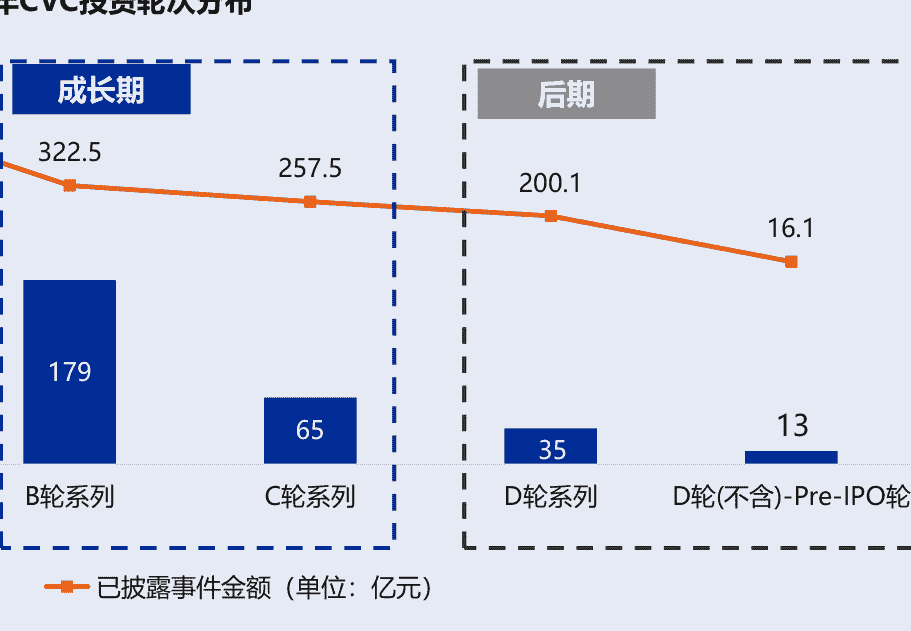
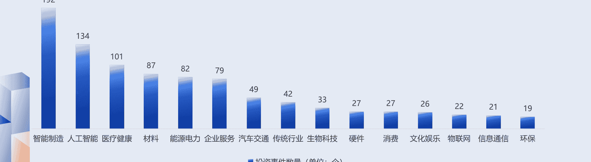
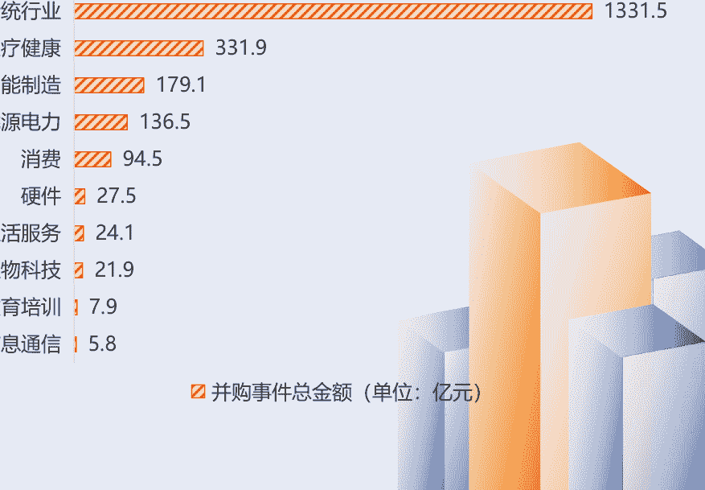

# 2024 中国企业创投 (CVC) 发展报告

创业邦研究中心
2025年2月

# 扫码加入 知识星球TOP 免费资源群

公众号：知识星球TOP

免费

- 每日免费获取高价值资源

微信：jntsg8价值

| 热门付费文章 | 各行各业报告 |
| --- | --- |
| 精选图书资源 | 副业赚钱方法 |
| 职场实用资源 | AI政经自媒体 |

微信：jntsg2

及时专注分享资料仅供个人学习，请及时删除，切勿商用传播

## CONTENTS 目录

- 01 备案基金表现
- 02 股权投资表现
- 03 并购表现
- 04 IPO表现

## 研究背景

2024年，全球地缘政治与经济格局深刻变革，颠覆传统商业生态，重构价值链。科技生物转型、人工智能、绿色能源等新兴经济增长点，新生产力成为重塑行业发展的关键力量。企业创投在此探索增长，通过投资初创企业获取新技术与新模式，实现战略转型并培育新质生产力。市场竞争激烈，对把握新质生产力方向的决策与策略能力要求更高。

与独立风险投资机构（IVC）不同，企业创投（CVC）具有独特的产业视角和强大的资源整合能力，在股权投资市场上发挥着不可替代的作用，已成为推动中国高质量的发展力量。

CVC作为连接龙头企业与初创企业的核心纽带，不仅帮助大企业获取技术突破和市场先机，还通过资本赋能推动产业生态的优化与升级。

创业邦长期关注企业创投与创业生态，尤其是关注企业如何通过本土加速创新进程，在复杂的环境中保持竞争力。本报告基于创业邦分析数据库，结合2024年最新市场动态，深入分析CVC在股权投资一级市场的布局与发展趋势，探讨其产业赋能等创新实践，为各方提供参考，助力把握机遇，实现可持续发展。

## 报告主要发现

备案基金表现受不确定性和2023年实施的私募新规等因素影响，2024年CVC备案基金处于低位，2024年中国CVC备案193只基金。

- 从2024年CVC备案基金所属的地域来看，浙江、广东的新增备案CVC基金数量最多，分别是41只和40只。从2024年备案基金城市分布来看，嘉兴以17城市领先，其中上海下游的启咨资本、尚质资本在嘉兴的基金占据近一半。

- 当前，做IPO成为不少上市公司布局一个市场的重要选择。2024年有326家上市公司参与布局456只。智能制造、传统行业、医疗健康领域布局IPO较为活跃。

## 股权投资表现

- 随着二级市场环境趋冷、政策监管等外部因素影响，中国CVC投资步入调整期。2024年，中国CVC参与的投资事件1027个，较2023年同比下降42%。

- CVC参与事项重点集中在早期投资，2024年，CVC参与与早期阶段（种子轮至A轮）的投资事件共735个，占比最高，高达71.6%。

- CVC融入智能制造和人工智能成为生产力热点领域。2024年，中国CVC在智能制造、人工智能领域参与的投资事件分别为192个和134个，在2024年人工智能的7个投资额超过1亿美元的大额事件中，CVC均有布局。

- 在我国独角兽成长过程中，CVC扮演着重要角色。2024年国内新增20家独角兽，其中11家独角兽有CVC参与投资，占比55%。

## 并购与IPO表现

- CVC是中国并购市场的参与者，2024年，CVC作为竞买方有5.6%参与并购，在传统行业、能源电力和智能制造领域的并购较为活跃。

- 2024年，228家境内外IPO的中国企业中，CVC投资的企业76家，渗透率达到33.3%。

## PART 01
## 2024CVC备案基金表现

### 近10年CVC新增备案基金：经历从热潮到调整期转变

> 近十年来，CVC新增备案基金数量经历了热潮到调整的转变。2021年，CVC新增备案基金达到高点408只，随后在市场环境和政策影响下，逐步下降，2024年，CVC新增备案基金193只，较2023年下降41.7%，处于十年低位水平。

> 虽然新增备案数量大幅下降，但CVC在私募基金中的占比保持稳定，显示出CVC在私募基金中仍具有重要影响力。睿诚分析数据显示，2018年之前，随着CVC的快速起，CVC新增备案基金占比从2015年的1.9%飙升至2020年的5.6%。2021年至今，CVC新增备案基金基本保持在4.4%左右。

### 十年中国新增备案基金变化(2015-2024)

数据来源：睿诚分析

### 2024年CVC新增基金数量：低位徘徊，年末回暖

> 在全球环境复杂、市场不确定性显著增加、私募新规落地等多重因素影响下，2024年CVC备案数量处于低位。月度上，1月达30只，为峰值之一；随着市场降温，春季低迷，5-10月份波动8只。

> 四季度形势好转，国内利好频出，市场信心提振，11月升至19只，12月达26只，年末回暖明显。随着政策优化、市场恢复，CVC有望在未来助力升级。

### 2024年CVC新增基金月度趋势

数据来源：睿诚分析

### CVC新增备案基金数量分布:浙江和广东居前列

> 从2024年基金所属的地域来看，涉及18个省份，其中浙江、广东的新增备案CVC基金最多，分别是41只和40只。浙江和广东经济发达，聚集了多数企业，通过设立CVC的方式打造增长，政策层面从税收优惠到项目扶持全方位支持。

> 在基金主体方面，恒望资本在浙江突出，新增备案基金数量居浙江首位；广东广汽资本同样亮眼，新增备案基金数量在广东居首。

### 2024年新增备案CVC基金省份分布

数据来源：睿诚分析基金数量（单位：只）

### 上市公司LP参与度：301家上市公司出资基金

> 发挥上市的资金优势成为当前不少企业的选择。睿诚分析数据显示，2024年上市公司LP依旧火热，有326家上市公司参与出资456只基金，出资规模共计712亿元。

> 其中42家上市公司平均单笔基金认缴规模在1亿元；57家上市公司平均单笔基金认缴规模超过2亿元。对于VC/PE来说，这些传统行业资金相对稳定，在当下融资困难下，来自上市公司的资金成为可靠的活水。

### 2024年上市公司平均单笔基金认缴规模

数据来源：睿诚分析

## PART 02
## 2024CVC股权投资表现

### 近十年中国CVC投资趋势：处于调整期，参与度创1年新低

> 中国CVC发展在经历2016年和2021年两个投资活跃度高点之后，随着二级市场环境趋冷、政策监管等外部因素影响，当前处于调整期。睿诚分析数据显示，2024年，中国CVC参与的投资事件1027个，较2023年同比下降42%；中国CVC参与的投资事件在中国一级市场投资占比下降至13.8%，较2023年下降4.9个百分点。

数据来源：睿诚分析

### CVC参投区域分布：苏州等新一线城市布局值得关注

> 睿诚数据显示，国内CVC在2024年投资布局中，显著位于江苏（171个）、广东（155个）、上海（144个）、北京（142个）和浙江（124个）等经济发达、科技创新强的城市。

> CVC参与投资事件的城市分布，上海以144个投资居首，北京142位列第二，深圳90位排第三。同时，苏州、杭州等新一线城市崛起，苏州制造业集群与新兴产业布局吸引77个投资事件，杭州数字经济活力有67个投资事件。它们通过特色产业与创新生态，提升对CVC吸引力，推动区域发展。

### 2024年CVC投资事件TOP15省份分布
### 2024年CVC投资事件TOP15城市分布

江苏 广东 上海 北京 浙江 安川 山东 湖南 重庆 福北 苏州 杭州 广州 天津 合肥 西安 重庆 宁波
数量（单位：个） 数量（单位：个）

数据来源：睿诚分析

### CVC阶段分布：重点在早期阶段

> 按阶段划分，2024年CVC参与早期、成长阶段多。其中早期阶段投资事件735个，占比最高，高达71.6%；其次是成长期244个，占比23.8%；后期48个，占比7%。

> 从具体轮次来看，A轮为CVC参与最多的轮次，2024年参与了423个，平均单笔投资金额5亿元。CVC依然重心放在早期前沿项目上，反映出CVC对未来格局的倾向。

数据来源：睿诚分析

### CVC行业分布：智能制造和人工智能

> 睿诚数据显示，2024年国内CVC参与投资主要在智能制造、人工智能、医疗健康和材料等28个行业。其中智能制造、人工智能和医疗健康领域获得CVC关注，分别为192、134和101个投资事件。当前产业结构不断升级、随着智能化方向的加速，智能制造领域展现出了潜力，日益受到CVC青睐。

智能制造 人工智能 医疗健康 材料 能源电力 企业服务 汽车交通 传统行业 生物科技 硬件 消费 物联网 信息通信 环保

数据来源：睿诚分析

### CVC投资新晋独角兽：参投比例高达55%

> 在我国独角兽成长过程中，CVC扮演着重要角色，对新兴公司的投资和孵化起到了关键作用。截止2024年12月底，中国存在独角兽512家，其中CVC参与投资的371家，占比72.5%。2024年内新增20家独角兽，其中11家独角兽有CVC参与，占比55%。

| 项目名称 | 成为独角兽时间 | 所属行业 | 当前轮次 | 最新融资资金额 | 历史投资 (CVC) |
| :--- | :--- | :--- | :--- | :--- | :--- |
| 月之暗面 | 2024年2月 | 通用大模型研发 | 人工智能 | A+ | 33亿人民币 | 美团、小红书、美团战略投资、阿里巴巴、京东、腾讯投资 |
| 望恒智能 | 2024年8月 | 汽车智能系统及解决方案 | 汽车交通 | 股权转让 | 115亿人民币 | 华为 |
| 垣石卫星 | 2024年2月 | 低轨互联网服务提供商 | 信息通信 | A | 67亿元人民币 | 恒信资本 |
| 中车半导体 | 2024年4月 | 功率软件研发 | 材料 | B轮 | 43.28亿人民币 | 仁越投资、国家产业投资基金、中芯聚源、恒培资本、金科科技、网络资本 |
| 微纳星空 | 2024年6月 | 卫星系统技术供应商 | 智能制造 | C1 | 10亿人民币 | 越秀产业基金 |
| 跃迁星 | 2024年7月 | AI模型技术研发 | 人工智能 | B轮 | 数亿人民币 | 腾讯投资 |
| 云擎智能 | 2024年12月 | 家用机器人研发 | 人工智能 | D+轮 | 数亿人民币 | 字节跳动、腾讯投资 |
| HumanityProtocol | 2024年5月 | web3应用底层研发 | 区块链 | 种子轮 | 3000万美元 | Animoca Brands |
| 科元精化 | 2024年3月 | 重锂材料品制造 | 传统行业 | D | 未披露 | 温氏投资、沃衍、星河资本 |
| JBD莱莱显示 | 2024年6月 | MicroLED微显示器制造 | 智能制造 | Pre-B+轮 | 未披露 | 比亚迪投资、吉利控股、蚂蚁集团 |
| NeoFusion | 2024年6月 | 核聚变技术研发 | 能源电力 | A轮 | 未披露 | 晓能电力 |

注：项目按融资金额排序

数据来源：睿诚分析

## PART 03
## 2024CVC并购表现

### 国内并购数据：CVC作为买方参与5.6%

> 睿诚数据显示，2024年国内并购事件共2479，其中CVC作为买方参与的并购事件138个，占比5.6%。从行业分布来看，2024年CVC作为买方参与的并购事件总金额为1151.5亿元，主要分布在传统行业、医疗健康和智能制造。

### 2024年CVC参与并购TOP10分布

| 行业 | 数量 | 金额(亿元) |
| --- | --- | --- |
| 智能制造 | 19 | 331.5 |
| 传统行业 | 18 | 331.9 |
| 能源电力 | 17 | 179.1 |
| 医疗健康 | 11 | 136.5 |
| 企业服务 | 10 | 94.5 |
| 消费 | 9 | 77.5 |
| 金融 | 8 | 27.5 |
| 汽车交通 | 7 | 21.9 |

并购事件数量（单位：个）并购事件总金额（单位：亿元）

数据来源：睿诚分析

### 国内并购事件列举：4个百亿事件

> 睿诚数据显示，2024年CVC为竞买方参与的38个并购事件中，金额超百的有4个，其中最大金额的事件来自传统行业，高达1151.5亿元。2024年6月，海尔集团购Grifols上海莱士，交易完成后海尔集团持股20%，交易金额达125亿元。2024年1月，阿里健康以135.12亿元的价格收购精准健康，2024年11月，华润集团116.9亿元从国家产业投资基金、芯电半导体（上海）有限公司完成长电技术的股权，交易完成持股23%。

| 项目名称 | 披露时间 | 事件金额 | 所属行业 | 并购状态 | 买卖方 |
| :--- | :--- | :--- | :--- | :--- | --- |
| 中国制造 | 2024-09-19 | 1151.507亿元 | 传统行业 | 进行中 | 中国船舶 |
| 上海莱士 | 2024-06-19 | 125亿元 | 医疗健康 | 完成 | 海尔集团 |
| 精准健康 | 2024-01-17 | 135.12亿元 | 医疗健康 | 完成 | 阿里健康 |
| 长电科技 | 2024-11-14 | 116.91亿元 | 智能制造 | 完成 | 华润集团 国家集成电路产业投资基金、芯电半导体（上海）有限公司 |
| 银泰产业 | 2024-12-18 | 74亿元 | 消费 | 进行中 | 雅莱齐 阿里巴巴 |
| 内蒙古能源 | 2024-07-02 | 67.39亿元 | 能源电力 | 完成 | 国家能源集团 国电电力 |
| 天士力 | 2024-08-05 | 62.12亿元 | 医疗健康 | 进行中 | 华润三九 天士 |
| 黄岩矿业 | 2024-01-12 | 61亿元 | 能源电力 | 完成 | 金川集团 青海黄银矿业管理有限公司 |
| 集优宇 | 2024-05-15 | 53.18亿元 | 智能制造 | 进行中 | 上海机电 |
| 润润光伏 | 2024-08-14 | 50亿元 | 传统行业 | | |

## 2025
中国企业创投100强

榜单正在报名中

扫描以上二维码即可参与报名

## 研究数据统计说明

【1】报告数据时间范围为2024年1月1日至2024年12月31日（融资披露时间），统计时间为2025年1月。

【2】报告中涉及的融资资金单位均以投融资货币为主，其他涉及的货币换以2024年12月31日汇率计算。

【3】数据来源：鲁睿分析。

【4】企业创业（CVC）：指具有明确主营业务的非金融机构企业（除保险类企业）衍生的风险投资部门/公司/基金。该风险投资部门/公司/基金兼财务目标和战略目标，对公司内部或外部创业发起股权投资。

【5】股权投资事件：本数据统计涵盖发生在中国企业参与的对国内实体企业和外国企业的涵盖范围从种子轮到Pre-IPO轮的股权投资（不包含并购、IPO及二级市场定增等价事件）。

【6】融资阶段：指种子轮、天使轮、A轮；“长期”指B轮、C轮；“后期”指D轮、E轮及之后、Pre-IPO轮。

【7】大额融资事件：金额1亿美元（含）以上的融资事件。

【8】上市公司LP参与度：本报告数据统计为上市公司当天在工商认缴出的基金。

【9】并购事件：本数据统计的境内并购及并购国内方并购国内企业；跨境并购指国内企业对境外企业并购。

【10】受限于技术与公开数据的水平，本报告仅供分享，不构成任何投资建议。过往表现不代表未来，投资可能带来金钱风险。任何依据本文做出决策，风险自自担，信息发布方不承担任何法律、法规及相关责任。

## 企业创业投联盟介绍

2018年5月，创业连同高通、腾讯、联想、小米、北齐、博世、三星等国内知名企业投资部门共同发起企业创业投联盟，2024年“企业创业投联盟”升级为“企业创业投联盟”。旨在促进企业内部投资和创新的联结，将趋势优势培养更强的发挥出来，并加速创新落地应用进程。同时，联盟升级后也将推动大企业之间的创新合作和产业生态建设，充分发挥大企业在产业链和创新链中的引领、带动、辐射作用。通过创新需求发布、资源对接、进产业、行业研讨会、发布研究报告等，推动中小企业之间的融通创新，促进产业的转型升级。

Corporate Venture Capital and Innovation Alliance

创业邦是领先的国际创新服务平台，为高成长企业、金融机构、产业大公司、政府区域提供全方位的媒体资讯、数字化转型、数据研究、创新咨询、教育培训、资本对接等服务。

### 关于我们

鲁睿分析是创业邦旗下横跨二级市场的综合性创新数据平台，致力于通过即时、有效、可触的行业一手数据，为大企业、政府、金融机构、投资机构等经济体，提供强力的创新驱动与投资决策依据。

## START YOUR FINANCE

起点财经，网罗天下报告
