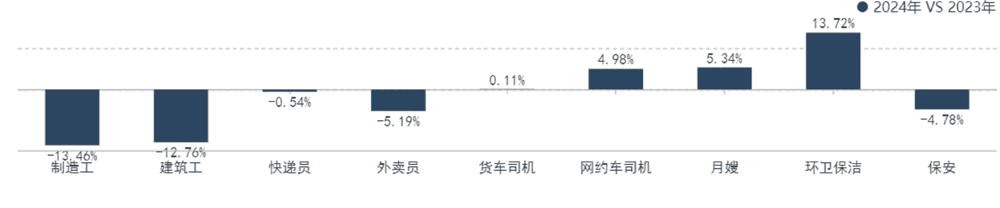
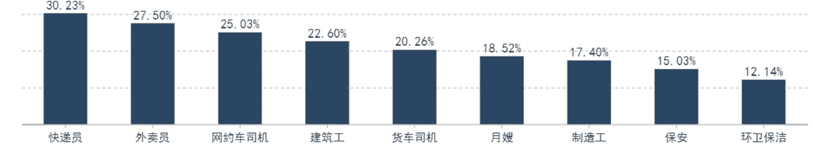
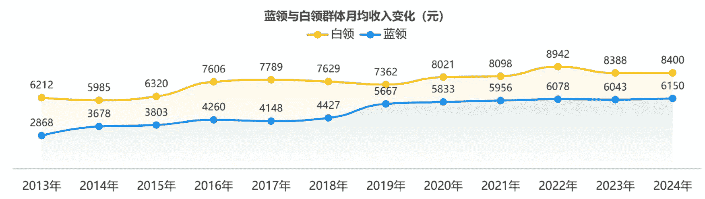
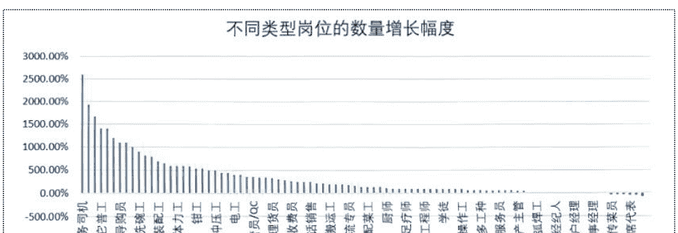
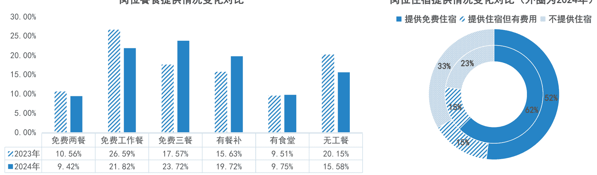
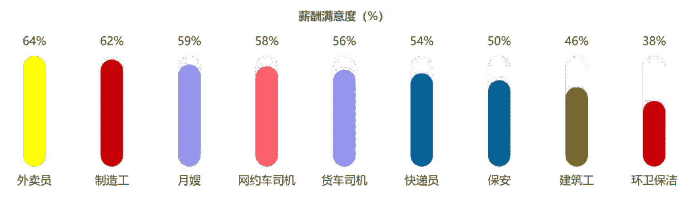
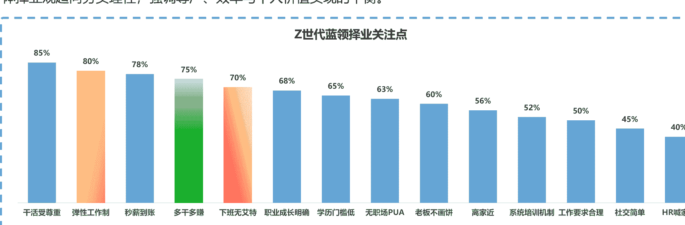
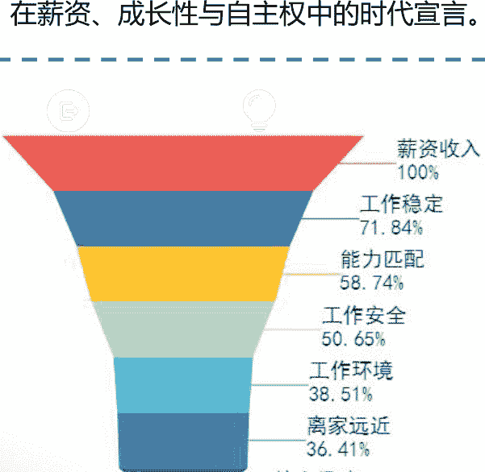
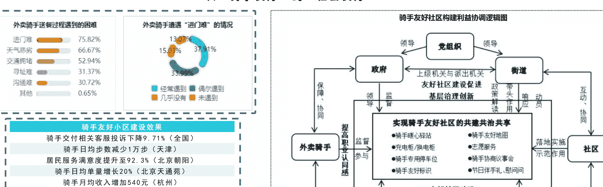

2024 Blue-collar Employment survey report

# 2024中国蓝领就业调研报告

中国新就业形态研究中心

2025年3月

# 扫码加入 知识星球TOP 免费资源群

免费

公众号: 知识星球TOP

- 每日免费获取高价值资源
- 可提供各类资源搜索服务

价值

微信号: jntsg8

| 热门付费文章 | 各行各业报告 |
| 精选图书资源 | 副业赚钱方法 |
| 职场实用资源 | AI政经自媒体 |

及时

微信号: jntsg2

专注

分享资料仅供个人学习，请及时删除，切勿商用传播

# 目录 CONTENTS

- 01 中国蓝领群体职业发展背景研究
- 02 数字经济时代的蓝领就业新图景
- 03 蓝领群体职业发展未来路径探索

# PART 01

## 中国蓝领群体职业发展背景研究

### 政策保障：从“生存型保障”向“发展型”完善

蓝领劳动作为工业化与城镇化的核心推动力量，构筑了实体经济和数字经济的坚实基础。随着更迭，新生一代蓝领的职业诉求已从“生存”全面转向“发展”，对技能提升、职业尊严和长期保障的需求日益增强。对此，国家出台了系列相关政策，形成“提技能能有回报、并事业有尊严、让城市有底气”的可持续发展生态，为制造业转型、服务业优化提升与共同富裕标注加强人才培养。

2023-2025年中国蓝领行业发展部分相关政策

| 发布时间 | 发布单位 | 政策文件 | 内容 |
| :--- | :--- | :--- | :--- |
| 2023年12月 | 人社部 | 《关于加强零工市场规范化建设的通知》 | 零工市场的公益性与普惠性，通过优化布局、完善服务、规范运行、强化信息平台建设、提升服务能力和推广经营，推动零工市场健康发展，促进灵活就业人员就业需求。 |
| 2024年06月 | 市场监管总局 | 《关于加强快递配送群体党建工作指导意见》 | 强创建新型组织网约覆盖和服务管理，发挥党员先锋作用，完善网约对接配送群体，推动党建工作与企业发展融合，引导其增强感情、听党、跟党，进入新业态党建高质量发展。 |
| 2024年09月 | 党中央、国务院 | 《关于实施就业战略增强促进充分就业的意见》 | 强调就业优先考虑政策、精准落实，通过产业发展与就业并行，优化就业公共服务、解决结构性矛盾等措施，实现就业扩质，提升青年就业获得机会。 |
| 2024年11月 | 全国总工会等四部门 | 《新就业形态劳动者权益指引》 | 在规范平台企业与劳动者的互动过程中，加强协商主体、权益、议题和回应落实等内容，涉及报酬支付、工作休息、劳动安全等关键问题。 |
| 2025年01月 | 中央社会工作部等八部门 | 发展连续就业、网约配送服务管理 | 举措提升好劳动者就业环境，优化住宅小区、商场、楼宇等周边环境，加强对快递、网约配送人员的关注，帮助解决困难、停车、用餐、职业发展等亟需解决问题。 |

资料来源：中国新就业形态研究中心

### 社会价值：从“劳动工具”向“智慧基建者”跃迁

在数字经济重塑分工的当下，外卖员、快递员等新兴群体正突破传统职业边界，以知识劳动者的姿态重构职业价值坐标系。数据显示，短视频平台蓝领创者账号增长210%、蓝领工装销量增长156%、“外卖诗人”集热销超10万，这些具象符号标识着体力劳动与智力劳动的认知边界正在消融。当强华快递能够预判订单流转周期、杭州物流老手掌握直播带货规律、陆家豪外卖手破解咖啡消费密码，这些炼于街巷的实战智慧被写入智能调度系统的底层逻辑。曾经隐在城市毛细血管中的服务者，如今已成为解码消费密码、驱动商业逻辑的底层操作系统。

| 企业人才实践 | 公众认知程度 | 主体发展后 | 社会价值认知 |
| :--- | :--- | :--- | :--- |
| 美国“同母计划”保障全3000余县市近800万注册护心安心就业，贵员“可持续发展计划”覆盖20万快递小哥，“滴滴橙计划”，覆盖近5万家庭的12.6万在校学生 | 抖音、快手平台数据显示，蓝领创者账号数量同比增长210%、“不了手的艺人”话题投放超120亿次，外卖员、快递员、焊工等职业相关内容赞量超行业平均值 | 95后快递员中43%在社交平台分享工作日常，“外卖诗人”王许华作品《狂赶的夏天》账号销量超10万；宝物类类销售增长156%，建筑工“反光马甲”成为短视频热门标签 | 中国社会科学院调查显示，公众对蓝领职业的尊重程度评分从2018年的4.2分升至2023年的7.1分，82%的受访者认为“技术工人”与白领人的社会地位相同 |

### 职业发展：从“规模红利”向“技能红利”转型

2024年我国蓝领就业规模达4.25亿，总量超增但增速放缓。细分来看，康养服务、家庭管家等高端岗位增速达15%，显著高于标准化快运/外卖岗位；网络主播呈现“金字塔”分化，超90%腰部从从业者向高强度体力化内容输出；基建、制造及物流智能化转型加速，传统劳力岗位受机器人替代冲击，新能源领域催生的技术蓝领需求年均增长20%。叠加劳动力年龄人口均年减少600万及自动化渗透率突破59%，预计2030年蓝领规模调至3.8-4.0亿，高技术及高端服务岗位占比60%，初级劳力岗位压缩至40%以下，形成“量减质升”的新格局。

## 主要蓝领群体就业规模

单位：万人

资料来源：根据国家统计局、人社部、交通部、商务部、国家邮局、中邮物、波士咨询、艾瑞咨询、各平台报告和ESG报告等整理

### 中国蓝职业定义、分类及趋势

蓝领职业指以体力劳动或技能为主，需专业技术资质或实践经验，服务于生产、制造、服务、维护等实体经济和数字经济的职业群体。其核心特征包括：

- 工作性质：直接参与物质生产、设备操作、现场服务或技术维护。
- 技能要求：依赖专业技能认证（如职业资格证书）或经验积累。
- 技术路线：从自动化、数字化、绿色化趋势向“技能+技术复合型”转型。

| 大类 | 细分领域 | 典型职业 | 特征 |
| :--- | :--- | :--- | :--- |
| 传统蓝 | 制造业 | 流水线操作、焊接、机械装配 | 逐步被自动化替代，需求稳定（如精密仪器） |
| 传统蓝 | 建筑业 | 钢筋施工、瓦工、木工、工程机械 | 短期需求旺季、长期需求增加、BIM技术能力升级 |
| 传统蓝 | 交通运输 | 货司机、快递员、地铁检修 | 智能化交通（如重卡）、智能化调度能力成为 |
| 传统蓝 | 基础服务业 | 保洁、餐饮、家政服务 | 标准化服务需求决定、高端家政护理技术影响 |
| 传统蓝 | 数字化生产 | 工业机器人操作、3D打印 | 需要程控、数字化协同工作 |
| 新蓝领 | 智能设备维护 | 无人机飞手、智能储能运维 | 智能化“软硬件结合”技术需求 |
| 未来 | 新能源产业 | 光伏安装、风电运维、电池回收 | 绿色经济需求爆发，亟需新能源设备操作 |
| | 数字化服务 | 外卖员、网约车司机 | 依托互联网发达，需求需实时数据处理 |
| | 人机协作岗 | AI辅助操作员、人机协作训练 | 需要理解人工智能、优化人机交互 |
| | 高端制造 | 半导体设备技、生物医药生产 | 碳中和驱动，亟需环保技术操作 |
| | 城市基础设施 | 智慧运维、5G基础建设 | 依赖驱动、新型能力 |

资料来源：中国新就业形态研究中心、行业研究、复合技术与市场动态

### 研究方法和说明

本报告采用文献研究、大数据监测、问卷调研、田野调查、专家访谈等方法，对群体职业发展状况进行研究。综合政策环境、市场环境、社会环境、群体规模、流动、保障等，选择制造工、建筑工、外卖员、快递员、司机、月嫂、保洁、保安等群体进行调研。

- 有效样本：2376份
- 调研时间：2024年12月
- 数据来源：问卷调查与计算系统
- 样本分布：制造工276份、建筑工498份、外卖员207份、快递员146份、司机778份、月嫂343份、保洁479份、保安262份

- 招聘信息数量：6345份
- 数据采集时间：2024年12月
- 招聘来源：智联招聘、BOSS直聘、直聘网、多多
- 抽样方式：一线城市4个、二线城市12个、三、四、五线城市6个，合计40城市
- 样本分布：东部36%、中部25%、西部39%
- 抽样城市：北京、广州、深圳、杭州、苏州、厦门、大连、武汉、郑州、长沙、合肥、成都、西安、长州、泉州、岳阳、九江、景德镇

# PART 02

## 数字经济时代的蓝领就业新图景

### 制造业、建筑业加速，涌现“新中产”

数据显示，传统制造业和建筑业自动化技术本地化，劳动流动比例分别下降13.4%和12.7%。然而，服务业就业格局，外卖员就业比例下降19%，经济发展推动外卖成“新中产”；月嫂的跨省流动增加5.34%，一线城市对专业月嫂的需求持续增长；快递员跨省流动微增0.54%，折射结构性变化；而网约车司机和环卫工因一线城市压力，聚集现象明显，分别增长4.9%和13.7%。

### 主要蓝领群体比例变化

单位：%

资料来源：根据国家统计局、人社部、国家发展委员会、中国社会科学院、艾媒咨询等；问卷调查与统计系统；样本量：N=2376；调研附件：2024年12月

### 新生群体流动率维持超25%高位，传统行业回落至20%

调研显示，新生群体流动率维持25%-30%高位。数字经济时代人才活跃特征——算法优化劳动生产率提升，实现“高流量—高价值”转化，技能认证拓展职业发展空间；传统行业中，建筑业与制造业流动率回落至20%。除大龄农民以外，重复性劳动密集、技能迭代后的群体较高较高风险。绿色转型政策加速从人力密集向技术驱动型转变，通过数字技术实现“稳存量—提质量”升级；月嫂、保安、环卫等刚需岗位借市场需求韧性，流动率稳定维持在12%-18%低位，行业特殊属性对技术替代风险有天然缓冲效应。

### 主要群体均流动率

单位：%

资料来源：问卷调查与计算系统
样本量：N=2376；调研时间：2024年12月

### 蓝领月薪十年上涨14%，增速约为白领的2.6倍，两者差距缩小

数据显示，从2013年至2024年，蓝领月收入累计增长114.4%，年均增长率约7.2%；蓝领月收入累计增长35.2%，年增长率约2.8%。相比而言，蓝领薪资增长显著于白领，增速约为白领的2.6倍，蓝领与白领收入差从2013年的2.17倍缩小至1.37倍。蓝领群体呈现出“波浪式前进”，2024年8400万同比微增约0.1%，暴露金融、互联网等传统优势行业增速乏力。蓝领凭借“技术护城河”突破天花板，白领则陷入“数字化博弈”。未来三年，随着工业互联网渗透率突破45%，蓝领中的“智能工厂”薪资超初级白领。

资料来源：中国就业形势、智联招聘、BOSS直聘等；问卷调查与计算系统；样本量：N=2376；调研时间：2024年12月

### 各地区岗位变化情况不同，小型企业成为新引擎

与2023年对比，相同岗位类型中，小型企业招聘数量有明显上升，主要集中在东北。东北地区增长最多的为普工（75%），下降最多的为家政/护理类（97.6%）；而华南和华中地区增长最快，增幅达到108%和57.2%。华北、华东和西南地区增长最快的分别为厨师/餐饮、零售。2024年以来，小型企业（100人以下）提供的岗位占比从2023年的10%提升到29%，表明小型企业在就业发展方面发挥重要作用。

| 地区 | 岗位（增幅） | 岗位（下降） |
| :--- | :--- | :--- |
| 东北 | 普工（75%） | 家政/护理（97.6%） |
| 华北 | 厨师/餐饮（50%） | 机械床 |
| 华东 | 零售（+73%） | 普工（13.7%） |
| 华南 | 家政/护理（+108%） | 普工（12.6%） |
| 华中 | 家政/护理（+57.2%） | 服务员（18.9%） |
| 西南 | 客服（+62.1%） | 电子/电气（12.7%） |

资料来源：聚多多、综合数据

### 薪资最低和最高值上涨

2024年以来，平台整体均工资范围为5241-7675元，工资的最低和最高值比2023年分别上涨4.2%和7.59%。从类型来看，司机、包装工、打工、搬运工工资上涨。

资料来源：聚多多、综合数据

### 福利不断：提供餐比例增加

与2023年相比，提供餐的岗位上升了15%，不提供餐的比例下降了4.57%。住宿方面，不提供住宿的比例显著上升，幅度为9.3%，表明员工越来越倾向于自己住，无需企业提供住宿条件。

资料来源：聚多多、综合数据

### 中国蓝领职业群体收入水平洞察

2024年，蓝领行业均收入微增1.77%至6150元，但各行业分化明显。货车司机增长4.2%，月均7751元；外卖员增长10.02%，受益于消费增长；相比之下，网约车司机收入下滑1.6%至6325元，反映市场竞争加剧；建筑工人收入缩水1.7%，受房地产低迷影响。整体来看，外卖、物流等新兴领域借助数字化提升效率，成为收入增长；建筑、制造业依赖政策与技改，低技能岗位淘汰加速，高技能需求崛起。

#### 主要蓝领群体月均收入

单位：元

| | 4.24% | 12.32% | 10.02% | -1.63% | 4.08% | 7.80% | -1.74% | 0.09% | 1.66% | 1.77% |
|---|---|---|---|---|---|---|---|---|---|
| 2023年 | 8924 | 9302 | 7791 | 8751 | 6813 | 7496 | 6430 | 6325 | 5884 | 6124 | 5538 | 5970 | 5980 | 5876 | 4531 | 4535 | 3805 | 3868 | 6043 | 6150 |
| | 月均 | 货车司机 | 外卖员 | 网约车司机 | 快递员 | 制造业 | 建筑工 | 保安 | 环保保洁 | 蓝领行业 |

资料来源：中国就业行业中心、智联招聘、BOSS直聘、猎聘、中智职、社联、各平台企业等
样本来源：问卷数据调查与统计系统；样本量：N=2376；调研时间：2024年12月

## 平台经济时薪是传统行业1.26倍，外卖员时薪是建筑工1.4倍

依托数字平台的月嫂、外卖员、货车司机凭借灵活接单与即时响应能力，以28-36元/小时的收入居第一队。制造工等依赖固定人力成本的传统岗位，时薪维持在23-27元区间。而承担高负载或基础公共服务的建筑工、环卫工处于薪酬洼地，时薪仅18-21元。反映出，平台经济通过算法调节服务价格（如高峰期补贴），但传统制造业依赖固定人力成本（如保底工资+五险金）；建筑、采矿等高危工种缺乏与死亡率挂钩的风险机制机制，劳动者承担了未被量化的“生存成本”。

| 主要蓝群体时薪收入（元/小时） | | | | | | | | | |
|---|---|---|---|---|---|---|---|---|
| | 28-36 | | | | | | | |

### 外卖员、制造工薪酬满意度超60%，收入获得敏感强

调研发现，蓝领劳动市场薪酬满意度呈现“哑铃型”分化。数字经济的外卖员(64%）、制造业工人(62%)稳居高位，证明数字技术增效与技能溢价显性化；网约车司机(58%）、货车司机(56%)等流动性岗位构成中带；而建筑工(46%）、环卫工(38%)等高风险/强公共服务岗位持续走底，暴露传统领域风险补偿与社会价值缺失双重结构性矛盾。整体来看，受数字技术驱动的群体（如外卖员、网约车司机、货车司机、快递员等）已实现效率溢价（平均满意度61.3%），但高风险（建筑工）或基础公共服务（环卫、保安）等群体仍依赖固定定价模式（平均满意度40.3%）。

样本来源：同星数据调查与统计系统
样本量：N=23726；调研时间：2024年12月

### 93%主播收入不到3000元

数据显示，行业头部与底部之间差距巨大：0.25%的头部主播通过算法流量倾斜和品牌溢价，获取了行业90%以上的收益，而93%的主播收入不到3000元，网络头部职业的劳动价值呈现极化趋势。

| 维度 | 精英主播 (0.25%) | 白领主播 (0.75%) | 头部主播 (6.2%) | 蓝颜主播 (93%) |
|---|---|---|---|---|
| 月收入 | 5000元-5万+（头部） | 2500元-4万（如头部） | 3-2万 | <3000元（日均收入） |
| 收入占比 | 50%（全+流量保障） | ±30%（旺季/活动流量影响） | ±40%（核心流量依赖） | ±70%~90%（无粉丝收入为主） |
| 典型类型 | 娱乐主播、电商主播、知识型IP | 兼职专业主播（美妆、科技、数码、知识导师） | 中头部主播（美妆、手机、知识分享者） | 兼职主播、颜值主播、头部带货（如农产品主播） |
| 收入结构 | 作品费（60%）+广告（25%）+分成（10%）+品牌活动费（5%） | 带货费（50%）+广告（30%）+分成（15%）+知识付费（5%） | 广告分成（70%）+带货（20%）+分成（5%）+品牌活动（5%） | 广告分成（80%）+带货（15%）+平台抽成（5%） |
| 成本 | 团队运营（40%）+服务费用（30%）+流量费用（25%） | 个人运营（15%）+内容制作（30%）+流量（20%） | 采购成本（30%）+内容制作（25%）+流量买卖（20%）+运营（5%） | 设置成本（20%）+流量补贴（30%）+生活花费（40%） |
| 时间 | 10-14小时（含/周末休息） | 8-12小时（内容积累） | 6-10小时（闲时直播） | 3-8小时（间隙性直播） |
| 职业状态 | 8.5/天（日内灵活运营、替代性） | 6-8/天（周需运营、粉丝维护） | 7-12.0/天（灵活、压力大） | 9-10/天（粉丝多、业务上坡） |
| 生存时长 | 留存极短 | 流量变差、粉丝流失、转化率下降 | 流量日波动、粉丝粘性、互动率下降、转化率受控 | - |
| 性产比 | 10000:1（成本高、运营难度高） | 1000:1（需持续优质内容） | 100:1（需维持粉丝互动） | 50:1（靠粉丝基础生存） |
| 粉丝 | 3-5年（头部主播）， 8-12年（头部主播） | 2-4年 | 1-3年（头部粉丝积累） | 1-2年（约粉丝增长1年后产出收入） |
| 社会保障 | 基础养老+公金 | 基础养老+公金 | 自行保险（基本无社保） | 无保障（无粉丝积累） |
| 生态价值 | 平台化主播、行业化、价值锚点 | 头部内容连接者、中小流量连接者 | 流量源水、新孵化器 | 基础连接平台、生态基石 |
| 增长 | 1:3.5（高收入增长） | 1:2:1-4 | 1.1:1:2-5 | 1:0:8:1.5（多渠道收入） |
| 投入 | 2000元+（高收入） | 300-600/日 | 100-300/日 | 0 |
| 行业地位 | 50%（核心流量） | 15%（各平台） | 30%（头部主播） | 20%（头部流量） |
| 平台标准 | 单人运营 | 多平台运营 | 多平台（3-5个平台） | 流量型（高互动） |
| 更新频率 | 每日直播，每周更新 | 每周5-8天+运营 | 每周3-6天+运营 | 每日1-2天活跃 |
| 粉丝画像 | 18-35岁（高消费、高粘性） | 25-45岁（粉丝） | 50岁以上（下沉市场） | 30-40岁（短视频/泛娱乐/游戏类） |
| 趋势 | IP化 | 专业化运营 | | |
| 健康 | 颈椎、腰椎、失眠 | 72.2%（心理压力） | | 90%（过度透支、职业焦虑） |

数据来源：中国互联网行业、艾瑞数据、QuestMobile等整合；样本量：N=2376；调研时间：2022年7月

### 中国蓝领群体工作体验

#### Z世代蓝领关注点：受尊重、工作平衡和即时回报

Z世代蓝领不再将“高薪”视为唯一目标，而是追求薪资、尊严、成长与生活质量的平衡。数据显示，Z世代蓝领最关注尊重与即时回报，85%重视尊重、80%倾向弹性工作、78%要求薪资、70%强调灵活性；成长(68%)和低学历门槛(65%)反映其兼顾现实与上升空间的态度，而反对职场PUA(63%)、拒画饼(60%)则是对职场文化的诉求。整体来看，Z世代蓝领观倾向务实，强调尊严、效率与个人价值实现。

注：Z世代又称“网络世代”或“互联网世代”，指通常1995年至2009出生的一代人。样本来源：问星数据调查与计算系统：N=2376；调研时间：2024年12月

### 年轻人加速涌蓝领市场，新就业形态重塑职业体验

伴随68%的90后入蓝领赛道，32.4%白领为“兴趣自由”跨界尝试，技术赋能催生“手脑兼用”新蓝领，46.3%从业者因灵活自由而扎根，这不仅是就业结构的重构，更是青年打破“体面焦虑”、在薪资、成长性与自主权的时代宣言。超2/3为年轻为主，生存压力是第一驱动力，“体验经济”催生跨界尝试。

- 57% 全职90后
- 68% 经济需求
- 50% 技能导向
- 17.5% 行动动机

白领转型驱动力：
- 32.7% 兴趣
- 26.2% 经济
- 20.5% 自由
- 100% 薪资收入
- 71.84% 工作稳定
- 58.74% 能力匹配
- 50.65% 工作安全
- 38.51% 工作环境
- 36.41% 家离远近
- 35.44% 社会保障

求职优先金字塔：
- 46.3% 自由
- 40.1% 门槛低
- 38.9% 关系简单

⭐客户满意度TOP3（此处未显示具体内容）

资料来源：智联招聘、58同城、BOSS直聘、智集网、前程无忧
样本来源：问星数据调查与计算系统；样本量：N=23726；调研时间：2024年12月

### “总工时”遮下的劳动真相：网络主播是长时间职业

通过“多维劳动强度指数模型(LII)”量化分析，劳动强度呈现“体力-脑力-环境”复合：体力型职业（建筑工）直观且不可忽视；脑力复合型职业（主播）容易被忽视；算法驱动型职业（网约车）具有调节作用。整体来看，“总工时”统计掩盖了真实强度，管理从“时长”转向“多维”。

典型劳动强度模型：LII=0.35×生理负荷+0.25×心理负荷+0.1×时间负荷+0.05×环境负荷

① 生理负荷：体力消耗、重复动作、压力与焦虑
② 时间负荷：高强度时段占比、决策难度
③ 环境负荷：极端温度、污染、安全隐患
④ 自由负荷：工作灵活自主性

典型劳动强度综合评价：

| 等级 | 职业群体 | 生理负荷 | 时间负荷 | 环境负荷 | 自由负荷 | LII总分 |
|---|---|---|---|---|---|
| | 建筑工 | 34 | 20 | 9 | 8 | 83.5 |
| | 车货司机 | 30 | 25 | 19 | 6 | 77.6 |
| 高 | 网络主播 | 25 | 30 | 20 | 4 | 77.5 |
| | 月嫂 | 29 | 27 | 21 | 5 | 77.1 |
| | 制造工 | 28 | 23 | 20 | 8 | 76.8 |
| 中 | 快递员 | 30 | 16 | 15 | 7 | 75.5 |
| | 网约车司机 | 22 | 27 | 20 | 4 | 74.2 |
| | 外卖员 | 25 | 27 | 17 | 3 | 73.2 |
| | 环保保洁 | 25 | 16 | 14 | 8 | 67.8 |
| 低 | 安安 | 20 | 21 | 15 | 7 | 66.3 |

### 骑手友好社区：新就业群体利益协调与基层治理

骑手友好社区通过制度创新将零和博弈转化为价值均衡，本质上重构了“平台经济-公共服务-社会治理”的协同关系，破解终端配送“最后100米”难题、数字化转型中的融入提供了可复制的解决方案。

#### 从“骑手友好”到“社会友好”

| 外卖骑手送餐过程中遇到的困难 | 外卖骑手遭遇“出门难”的情况 |
|---|---|---|
| 出门 | 75.82% | 13.0% |
| 天气差 | 66.67% | 37.91% |
| 交通拥堵 | 52.94% | |
| 寻找停车 | 31.37% | 偶尔遇到 |
| 路线通过 | 30.72% | 几乎未遇到 |
| 其他 | 0.65% | |

- 骑手友好社区建设
- 骑手交付相关投诉下降9.7%（全国）
- 骑手日均天数减少（天津）
- 居民满意度提升至92.3%（北京）
- 骑手日均收入增长21%（天津）
- 骑手月均收入增加540元（杭州）
- 社区骑手与安全事件减少52%（全国）
- 安全隐患举报量增长230+（重庆）
- 骑手就业体验提升32%（湖南、重庆）
- 业主对上门的投诉下降50%（全国）
- 骑手留存率提升25%（江苏）

资料来源：中国新就业行业态势，新就业群体利益协调与基层治理：基于外卖骑手友好社区的案例研究（访谈调研），参与学者：刘骏、张庆、陆婧薇、南婧、战磊

## PART 03 蓝领群体职业发展未来路径探索

### 新就业形态：广义测算1.24亿，成为就业市场的“稳定器”

从未来视角看，新就业形态是指依托互联网、人工智能数字技术，通过平台化、组织化实现的灵活就业模式，其核心特征是技术驱动、劳动关系活性和工作自主性增强。范围从狭义（平台关联型）向广义（技术渗透型）扩展，涵盖数字化赋能的传统职业及新兴领域。群体包括外卖员、主播、家政服务人员，并逐步延伸至AI训练、绿色经济从业者等。规模狭义统计达8400万人，广义测算1.24亿，年均增长率3%-5%，2030年规模预计达1.56亿。

| 分类 | 典型群体 | 规模 |
|---|---|---|
| 狭义范围（平台关联型） | 生产关系视角：平台主导的灵活约工、外卖员、家政服务人员（月嫂、保洁）、货运司机、主播、房地产经纪人等 | 8400万 |
| 广义范围（技术渗透型） | 生产力视角：技术改造的数字化岗位、无人机操作员、AI训练师、咨询师、虚拟现实设计师、数字游民等 | 1.24亿 |

### 生态重构：赋能蓝领发展

平台企业通过分层保障，引入职业保险积累养老基金，拓宽空间，助力蓝领（灵活就业者等）从生计型劳动向价值创造者转型，实现就业与尊严。

#### 生活保障

#### 未来支持

#### 未来保障

#### 创新就业

- 服务保障：80座社区中心、2万名手机维护，发放数十万流量
- 技能培训：线下34万场实训培训
- 权益：2025年起，覆盖所有灵活就业人员，实现全额覆盖
- 健康保障：建立爱心基金，护理热线日均XX次
- 荣誉奖励：连续7年获累计金达5000元，发放奖励
- 通用机：8000个移动充电站
- 职业提升：2万名司机主管经理，涵盖助力，助力职业规划/运营管理课程
- 技能保障：增长35万份，试点“优优计划”
- 就业促进：2024年“安心运”计划新增订单

- 社会保障：2022年7月起，已出资XX为了灵活就业人员职业保险试点，未来将逐步覆盖所有就业者
- 安全防护：80万辆司机故障事故率下降18%，12小时快速响应
- 家庭关怀：建立爱心基金资助XX子女
- 家庭支持：计划补助13.8万名儿童（高考困难家庭），每年1000元
- 收入保障：投入6亿“回补贴券”，贴折大950万户，优选订单
- 职业保障：覆盖150万份职业保险缴费试点
- 家庭关怀：“前瞻计划”资助XX子女
- 法律保障：制定方面优先采用“先得原则”
- 智能工具：智能手机推进充电站与电价分析
- 安全防护：推行“防疫劳务”自动保险，上线AI安全防控系统

信息来源：数据财经、财经报告、货运云、云行资讯、新闻华尔街财经科技等相关领域信息整理

### 蓝领行业2030展望：技能驱动、智能转型、保障完善，新蓝领崛起

到2030年，随着产业智能化加速，自动化替代减少低技能岗位需求，技能升级推动劳动力向“紫领”等高技能岗位转移，蓝领岗位内涵将发生根本变化。传统体力工种逐渐被自动化替代，而懂数字技术、操作智能设备的“新蓝领”为主。快速、外卖等新职业将建立规范的职业发展体系，收入水平和社会保障向蓝领看齐。职业教育改革将重塑劳动力结构，大批劳动通过技能提升。
