# 2024 AI工具类应用盘点报告

头部领跑，新锐崛起，多元共生齐构筑行业生态

## 扫码加入 知识星球TOP 免费资源群

免费

公众号:知识星球TOP

- 每日免费获取高价值资源
- 可提供各类资源搜索服务

价值

微信信号:jnts8

| 热门付费文章 | 各行各业报告 | 副业赚钱方法 |
| :--- | :--- | :--- |
| | 精选图书资源 | AI经营自媒体 |
| | 职场实用资源 | |

及时

微信信号:jnts2

专注

分享资料仅供个人学习，请及时删除，切勿商用传播

## CONTENTS 目录

01. AI工具类应用：发展背景
02. AI工具类应用：分类盘点
03. AI工具类应用：挑战及发展趋势

# 01
AI工具类应用

## 发展背景

### 定义及概念

### AI工具类应用

基于机器学习、深度学习、自然语言处理等多元人工智能技术构建的，辅助用户在生活、工作等诸多场景中，进行多模态内容创作与处理的智能化工具

### 应用场景落地

### 功能服务提供

### 底层技术支持

来源：TopAI自主研究及绘制

数字化发展进程向5.0大步进，推进与AI工具类应用的相互促进与影响

数据资源、计算能力、通信能力数字化发展进程：
- 激发数字化需求和行为
- 促进进程的发展和完善

用户（B端/C端）：满足和引导使用者需求

AI工具类应用：
加速数字化融合，推动数字化进程深化

## 中国数字化发展进程概览

| 前期阶段 | 近期阶段 | 中长期愿景 |
| :--- | :--- | :--- | :--- |
| 20世纪80年代~2000年 | 2000年~2012年 | 2012年~2020年 | 2024年~ |
| 1.0 | 2.0 | 4.0 | 5.0 |
| 办公自动化时代：计算机普及及阶段，网络设施初步饱和，部门间迈向互联互通 | 互联网信息化时代：互联网普及阶段，网络基础设施不断完善，企业业务流程在线转移 | 数字化时代：移动互联网高速发展，大数据、云计算等技术兴起，企业数字化加速转型 | |
| 数智化时代：人工智能技术不断成熟，物联网广泛应用，企业向智能化再升级 | 智能生态时代：对数字化加以整合升级，AIGC技术在多领域深度融合，企业更加注重智能生态构建 | |

数字经济渗透深度促进产业生态的协同和融合，激发用户对消费市场的需求

## 2023年中国第一、二、三产业数字经济渗透率

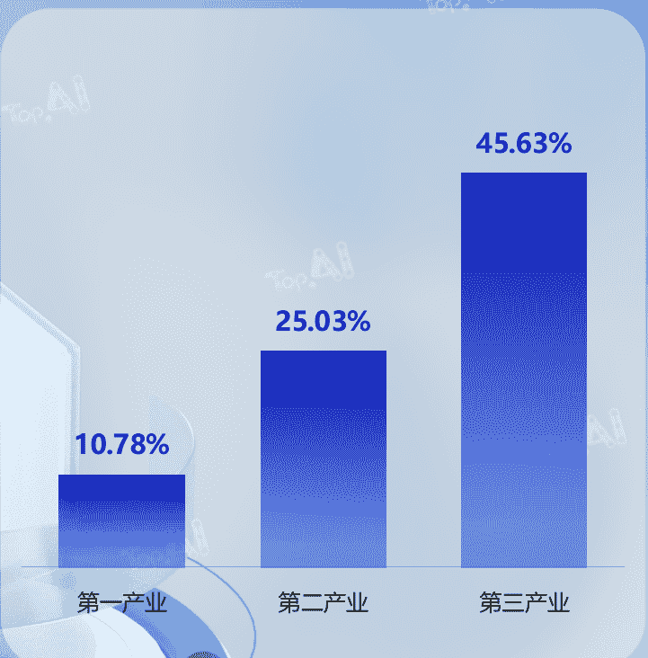

- 1 提供海量数据资源
- 2 提供丰富应用场景
- 3 推动用户需求升级
- 4 加强产业生态协同

- 农业数字化 → 土壤、气象、作物、病害等数据
- 工业互联网 → 设备运行参数、生产工艺指标等数据
- 业务数字化转型 → 用户行为、交易记录等数据
- 第一产业 → 种养技术指导、农产品价格波动等场景需求
- 第二产业 → 工业设计、供应链、库存管理等场景需求
- 第三产业 → 智能教育、智能医疗、传媒等场景需求
- 农业 → 农业决策支持、害灾预防等需求提升
- 制造业 → 生产过程优化、产品创新设计需求提升
- 服务业 → 消费者的个性化、便利化、智能化需求提升
- 产业协同创新 → 不同产业间的跨界合作有助于共同AI工具类应用
- 生态构建 → 为AI工具类应用落地，加速技术创新和功能升级

来源：TopAI自主研究及绘制

多技术的集成与协同

多技术的集成与协同，为AI工具应用的落地和场景覆盖提供了强力支撑

## 2024年中国信息通信技术成熟度——部分展示

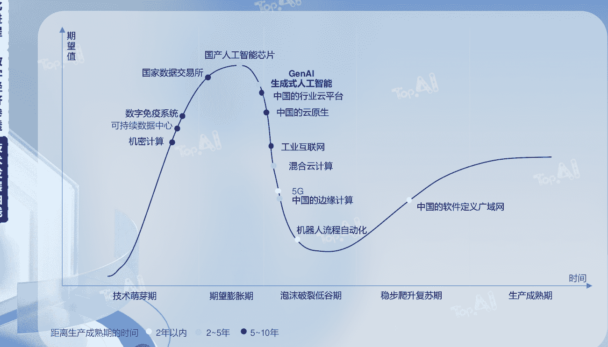

生成式人工智能的整体热度有所回落，在Gartner成熟度曲线中处于下降期为2~5年，新技术的成熟还需要经历差异化落地，实际场景挖掘，用户体验与交互方式优化

# 02
AI工具类应用类型盘点

## 总览

- 文本生成：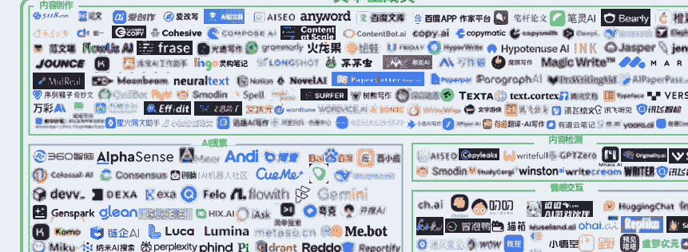
- 图像生成：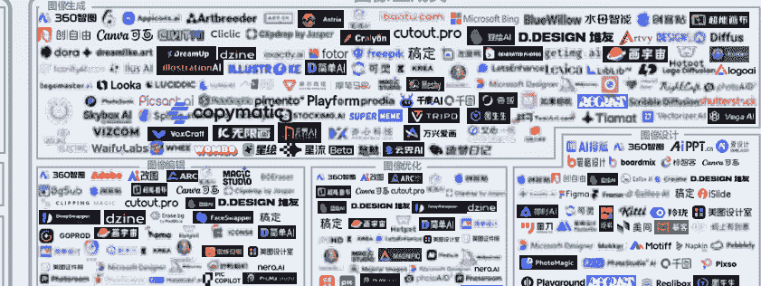
- 音频生成：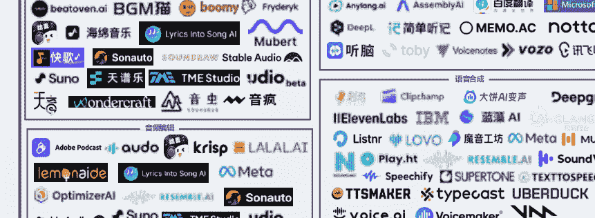
- 视频生成：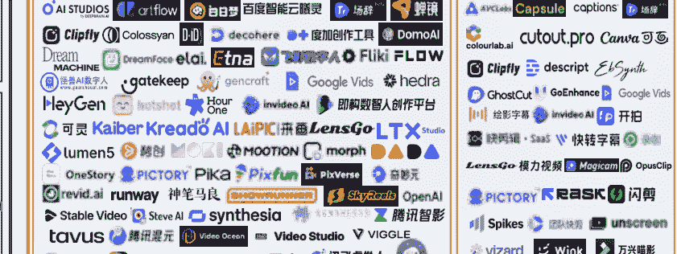
- 多模型综合应用：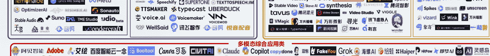

来源：AI自主研究及绘制。

### AIGC发展情况分类展示

### AIGC元年：2023年

- OpenAI 发布视频模型“Sora”，推动AI视频生成飞跃
- 发布新模型“GPT-4”，进一步拓展了多模态能力
- OpenAI 发布[GPT-4]，实现跨文本模态输入
- Midjourney 发布同图像生成模型，推动AI绘画术普及
- Stability AI 发布[Stable Diffusion]，加速在AI艺术领域的渗透
- ChatGPT 发布百亿级对话模型，华版AI模型
- 谷歌 Bard、斯坦 Alpaca-7B
- Suno AI 发布音乐模型“Sunv3”，推动音乐生成成为大步进步
- 快手 发布视频大模型“可灵”，推动在国内AI视频突破

### 2015年

- OpenAI 发布模型[DALL-E]，实现文图生成飞跃
- OpenAI 发布[GPT-1]，开启大语言模型爆发性增长
- Google 发布[DeepDream]，创造了AI模型文图

### 2018年 / 2021年

AIGC技术的应用进入高速发展期，向多场景、多领域、多模态持续拓展和深耕

- 内容生产速度提升
- 内容生成方式的变化
- 数据指数级增长

## AI工具类应用的技术成熟度与发展时间

文本生成类、图像生成类、音频生成类、视频生成类、多模态类：各模态相互依赖、促进，具有一定的协同效应。目前多模态类仍处于快速发展向成熟应用的过渡阶段，起步较晚但发展加速，未来有望在更多领域实现落地和创新。

- ChatGPT 发布、VALL-E 发布、DALL-E 2 发布、GPT系列模型发布、GPT-4 发布

AI工具类应用整体发展阶段：
- 早期研究阶段 (2000~2010年)
- 初步应用阶段 (2011~2016年)
- 快速发展阶段 (2017~2021年)
- 成熟应用阶段 (2022年~)

来源：TopAI自主研究及绘制。
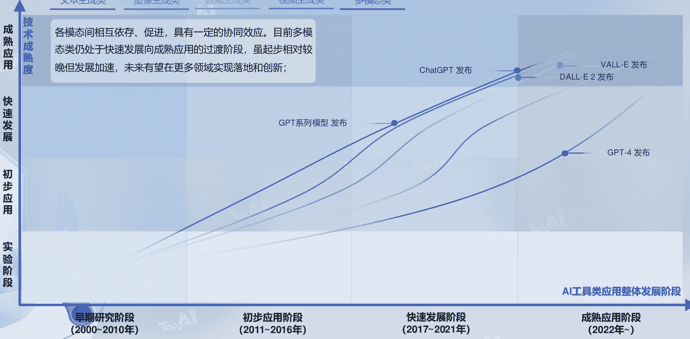

## 分类AI工具类应用的主要行业应用场景概况

| 应用成熟度 | 高 | 中 | 低 |
| :--- | :--- | :--- | :--- |
| | 电商 | 教育 | 医疗 | 娱乐 | 金融 | 文旅 | 农业 | 交通 | 房产 | 法律 | 游戏 |
| **文案生成类** | 商品信息生成营销文案生成 | 智能教案生成 | 智能总结 | 智能财报分析 | 策划内容生成 | 攻略建议 | 投资顾问 | 客户沟通 | 风险防控 | 案件 |
| **图像生成类** | 商品影像生成虚拟创作 | 影像分析健康数据可视化 | 艺术绘画 | 设计图纸手机设计 | 房屋场景生成 | 场景调整 | |
| **音频生成类** | | | | 背景音效生成语音合成 | 智能导航 | 智能推荐 |
| **视频生成类** | | | | | | | 视频增强特效生成 |
| **多模态综合应用** | | | | | | | | | |

来源：TopAI自主研究及绘制

## 分类展示图谱发展情况

### 文本生成类

| 内容创作 | 创作助手 | 写作指南 | AI插件 | 平台 | 论文 | 笔杆 | 笔库 | 角色桶 |
| :--- | :--- | :--- | :--- | :--- | :--- | :--- | :--- | :--- |
| 酷秀 | | | | Cohesive | COMPOSE AI | content at scale | | | |
| 文档 | FlowUs AI | frase | grammar | 光谱作业 | 火龙去 | FRIDAY | HyperWrite | INK | Jasper | jenn |
| MARK | 宝库AI助手 | 语境 | LONGSHOT | | | AI创作 | 写作 | Magic Writer |
| Midjourney | Moonbeam | neural text | Notion | NovelAI | Paperitter | Paperpop | ParagraphAI | ProWritingid | AIPaper |
| 序列粒子 | | Flutby | Outlit | Smitt | sudo | SURFER | 拟写作业 | 播客 | 讯云 |
| 万彩AI | 绘图助手 | Edit.it | 意语 | 文术标记 | wordverse AI | SONIC | WriteWise | 文字块 | 讯云社区 |
| AI创作助手 | | | | | | | | | | Xper AI | 通通-AI | 讯云绘 | 游游元
| yaara.ai | 远端Cosmos | | |

### AI搜索

| AlphaSense | Miner | 极速 | | | 小小讯 | AISEO copyleaks | GPTZero | Sapling |
| :--- | :--- | :--- | :--- | :--- | :--- | :--- | :--- | :--- |
| Colossal-AI | CONSENSUS | CueMe | Smodin study | | winston CREATER | deepseek | |
| devx. | dexa | | felow. | Gemini | | | | |
| Genspark | glean | HIKAI | iAsk | 夸克 | 提升AI | | | |
| Komo | Luca | Lumina | metaso.co | Me.bot | | | |
| Miku | 研米AI | perplexity phind | drant | Reddo | Reportify | | | |
| OpenAI | songgpt | 天工AI | Tiger | | Bot | | | |
| Wanderboat | whisper | XAnswer | 元爱大模型 | YOUD | 智直言 | | |

### 情感交互

| ch.ai | | | 互动助手 | HuggingChat | inworld |
| :--- | :--- | :--- | :--- | :--- | :--- |
| | 趣语 | 播客 | Museland.ai ohai | Replika | Saylo.AI |
| | 通语工具 | WOW | 小圈蛋 | 星境 | 游游境元 |
| 文本检测 | | | | | | | | |
| | 洗式翻译器 | 聚云小 | LongCloud | DeepTranslate Google 翻译 | 火山插件 | 火果 |
| 会议 | papago | 狗翻译 | 翻译助手 | 翻译平台 | 翻译插件 | AI绘作

来源：TopAI自主研究及甄析

## 文本生成类——功能概览

基于Transformer架构的深度学习技术，大规模预训练语言模型，从而能够根据输入的文本或指令生成连贯、合理的文本内容；

- 1 内容创作：涵盖通用创作、特定文案
- 2 情感交互：提升体验与交互方式优化
- 3 搜索：满足用户需求，实际落地挖掘
- 4 翻译：跨越语言，多模态拓展
- 5 内容检测：内容安全，功能升级

来源：TopAI自主研究及甄析

## 文本生成类：功能

- 1 内容创作：涵盖通用创作、特定文案
- 2 情感交互：提升体验与交互方式优化
- 3 搜索：满足用户需求，实际落地挖掘
- 4 翻译：跨越语言，多模态拓展
- 5 内容检测：内容安全，功能升级

来源：TopAI自主研究及甄析

（注：此处部分内容由于OCR识别存在缺失或重复，已根据上下文进行逻辑整理）

## 文本生成类：功能
[/content]

# 2024 AI工具类应用盘点报告

头部领跑，新锐崛起，多元共生齐构筑行业生态

## 扫码加入 知识星球TOP 免费资源群

免费

公众号:知识星球TOP

- 每日免费获取高价值资源
- 可提供各类资源搜索服务

价值

微信信号:jnts8

| 热门付费文章 | 各行各业报告 | 副业赚钱方法 |
| :--- | :--- | :--- |
| | 精选图书资源 | AI经营自媒体 |
| | 职场实用资源 | |

及时

微信信号:jnts2

专注

分享资料仅供个人学习，请及时删除，切勿商用传播

## CONTENTS 目录

01. AI工具类应用：发展背景
02. AI工具类应用：分类盘点
03. AI工具类应用：挑战及发展趋势

# 01
AI工具类应用

## 发展背景

### 定义及概念

### AI工具类应用

基于机器学习、深度学习、自然语言处理等多元人工智能技术构建的，辅助用户在生活、工作等诸多场景中，进行多模态内容创作与处理的智能化工具

### 应用场景落地

### 功能服务提供

### 底层技术支持

来源：TopAI自主研究及绘制

数字化发展进程向5.0大步进，推进与AI工具类应用的相互促进与影响

数据资源、计算能力、通信能力数字化发展进程：
- 激发数字化需求和行为
- 促进进程的发展和完善

用户（B端/C端）：满足和引导使用者需求

AI工具类应用：
加速数字化融合，推动数字化进程深化

## 中国数字化发展进程概览

| 前期阶段 | 近期阶段 | 中长期愿景 |
| :--- | :--- | :--- | :--- |
| 20世纪80年代~2000年 | 2000年~2012年 | 2012年~2020年 | 2024年~ |
| 1.0 | 2.0 | 4.0 | 5.0 |
| 办公自动化时代：计算机普及及阶段，网络设施初步饱和，部门间迈向互联互通 | 互联网信息化时代：互联网普及阶段，网络基础设施不断完善，企业业务流程在线转移 | 数字化时代：移动互联网高速发展，大数据、云计算等技术兴起，企业数字化加速转型 | |
| 数智化时代：人工智能技术不断成熟，物联网广泛应用，企业向智能化再升级 | 智能生态时代：对数字化加以整合升级，AIGC技术在多领域深度融合，企业更加注重智能生态构建 | |

数字经济渗透深度促进产业生态的协同和融合，激发用户对消费市场的需求

## 2023年中国第一、二、三产业数字经济渗透率

- 1 提供海量数据资源
- 2 提供丰富应用场景
- 3 推动用户需求升级
- 4 加强产业生态协同

- 农业数字化 → 土壤、气象、作物、病害等数据
- 工业互联网 → 设备运行参数、生产工艺指标等数据
- 业务数字化转型 → 用户行为、交易记录等数据
- 第一产业 → 种养技术指导、农产品价格波动等场景需求
- 第二产业 → 工业设计、供应链、库存管理等场景需求
- 第三产业 → 智能教育、智能医疗、传媒等场景需求
- 农业 → 农业决策支持、害灾预防等需求提升
- 制造业 → 生产过程优化、产品创新设计需求提升
- 服务业 → 消费者的个性化、便利化、智能化需求提升
- 产业协同创新 → 不同产业间的跨界合作有助于共同AI工具类应用
- 生态构建 → 为AI工具类应用落地，加速技术创新和功能升级

来源：TopAI自主研究及绘制

多技术的集成与协同

多技术的集成与协同，为AI工具应用的落地和场景覆盖提供了强力支撑

## 2024年中国信息通信技术成熟度——部分展示

生成式人工智能的整体热度有所回落，在Gartner成熟度曲线中处于下降期为2~5年，新技术的成熟还需要经历差异化落地，实际场景挖掘，用户体验与交互方式优化

# 02
AI工具类应用类型盘点

## 总览

- 文本生成：
- 图像生成：
- 音频生成：
- 视频生成：
- 多模型综合应用：

来源：AI自主研究及绘制。

### AIGC发展情况分类展示

### AIGC元年：2023年

- OpenAI 发布视频模型“Sora”，推动AI视频生成飞跃
- 发布新模型“GPT-4”，进一步拓展了多模态能力
- OpenAI 发布[GPT-4]，实现跨文本模态输入
- Midjourney 发布同图像生成模型，推动AI绘画术普及
- Stability AI 发布[Stable Diffusion]，加速在AI艺术领域的渗透
- ChatGPT 发布百亿级对话模型，华版AI模型
- 谷歌 Bard、斯坦 Alpaca-7B
- Suno AI 发布音乐模型“Sunv3”，推动音乐生成成为大步进步
- 快手 发布视频大模型“可灵”，推动在国内AI视频突破

### 2015年

- OpenAI 发布模型[DALL-E]，实现文图生成飞跃
- OpenAI 发布[GPT-1]，开启大语言模型爆发性增长
- Google 发布[DeepDream]，创造了AI模型文图

### 2018年 / 2021年

AIGC技术的应用进入高速发展期，向多场景、多领域、多模态持续拓展和深耕

- 内容生产速度提升
- 内容生成方式的变化
- 数据指数级增长

## AI工具类应用的技术成熟度与发展时间

文本生成类、图像生成类、音频生成类、视频生成类、多模态类：各模态相互依赖、促进，具有一定的协同效应。目前多模态类仍处于快速发展向成熟应用的过渡阶段，起步较晚但发展加速，未来有望在更多领域实现落地和创新。

- ChatGPT 发布、VALL-E 发布、DALL-E 2 发布、GPT系列模型发布、GPT-4 发布

AI工具类应用整体发展阶段：
- 早期研究阶段 (2000~2010年)
- 初步应用阶段 (2011~2016年)
- 快速发展阶段 (2017~2021年)
- 成熟应用阶段 (2022年~)

来源：TopAI自主研究及绘制。

## 分类AI工具类应用的主要行业应用场景概况

| 应用成熟度 | 高 | 中 | 低 |
| :--- | :--- | :--- | :--- |
| | 电商 | 教育 | 医疗 | 娱乐 | 金融 | 文旅 | 农业 | 交通 | 房产 | 法律 | 游戏 |
| **文案生成类** | 商品信息生成营销文案生成 | 智能教案生成 | 智能总结 | 智能财报分析 | 策划内容生成 | 攻略建议 | 投资顾问 | 客户沟通 | 风险防控 | 案件 |
| **图像生成类** | 商品影像生成虚拟创作 | 影像分析健康数据可视化 | 艺术绘画 | 设计图纸手机设计 | 房屋场景生成 | 场景调整 | |
| **音频生成类** | | | | | 背景音效生成语音合成 | 智能导航 | 智能推荐 |
| **视频生成类** | | | | | | | | 视频增强特效生成 |
| **多模态综合应用** | | | | | | | | | | |

来源：TopAI自主研究及绘制

## 分类展示图谱发展情况

### 文本生成类

| 内容创作 | 创作助手 | 写作指南 | AI插件 | 平台 | 论文 | 笔杆 | 笔库 | 角色桶 |
| :--- | :--- | :--- | :--- | :--- | :--- | :--- | :--- | :--- |
| 酷秀 | | | | Cohesive | COMPOSE AI | content at scale | | | |
| 文档 | FlowUs AI | frase | grammar | 光谱作业 | 火龙去 | FRIDAY | HyperWrite | INK | Jasper | jenn |
| MARK | 宝库AI助手 | 语境 | LONGSHOT | | | AI创作 | 写作 | Magic Writer |
| Midjourney | Moonbeam | neural text | Notion | NovelAI | Paperitter | Paperpop | ParagraphAI | ProWritingid | AIPaper |
| 序列粒子 | | Flutby | Outlit | Smitt | sudo | SURFER | 拟写作业 | 播客 | 讯云 |
| 万彩AI | 绘图助手 | Edit.it | 意语 | 文术标记 | wordverse AI | SONIC | WriteWise | 文字块 | 讯云社区 |
| AI创作助手 | | | | | | | | | | Xper AI | 通通-AI | 讯云绘 | 游游元
| yaara.ai | 远端Cosmos | | | |

### AI搜索

| AlphaSense | Miner | 极速 | | | 小小讯 | AISEO copyleaks | GPTZero | Sapling |
| :--- | :--- | :--- | :--- | :--- | :--- | :--- | :--- | :--- |
| Colossal-AI | CONSENSUS | CueMe | Smodin study | | winston CREATER | deepseek | | |
| devx. | dexa | | felow. | Gemini | | | | |
| Genspark | glean | HIKAI | iAsk | 夸克 | 提升AI | | | |
| Komo | Luca | Lumina | metaso.co | Me.bot | | | | |
| Miku | 研米AI | perplexity phind | drant | Reddo | Reportify | | | |
| OpenAI | songgpt | 天工AI | Tiger | | Bot | | | |
| Wanderboat | whisper | XAnswerAnswer 元 元大大 | YOUD |  直言 | | | |

### 情感交互

| ch.ai | | | 互动助手 | HuggingChat | inworld |
| :--- | :--- | :--- | :--- | :--- | :--- |
| | 趣语 | 播客 | Museland.ai ohai | Replika | Saylo.AI |
| | 通语工具 | WOW | 小圈蛋 | 星境 | 游游境元 |
| 文本检测 | | | | | | | | |
| | 洗式翻译器 | 聚云小 | LongCloud | DeepTranslate Google 翻译 | 火山插件 | 火果 |
| 会议 | papago | 狗翻译 | 翻译助手 | 翻译平台 | 翻译插件 | AI绘作

来源：TopAI自主研究及甄析

## 文本生成类——功能概览

基于Transformer架构的深度学习技术，大规模预训练语言模型，从而能够根据输入的文本或指令生成连贯、合理的文本内容；

- 1 内容创作：涵盖通用创作、特定文案
- 2 情感交互：提升体验与交互方式优化
- 3 搜索：满足用户需求，实际落地挖掘
- 4 翻译：跨越语言，多模态拓展
- 5 内容检测：内容安全，功能升级

来源：TopAI自主研究及甄析

（注：此处部分内容由于OCR识别存在缺失或重复，已根据上下文进行逻辑整理）

## 文本生成类：功能

# 总图谱 发展情况 分类展示

## 翻译：打破语言障碍，高效批量精准翻译多领域文本，促进跨语言交流沟通

### 主要功能

- 批量翻译
- 高效、大量文本翻译
- 本地化翻译
- 融入语言习惯和文化背景
- 垂直领域翻译
- 建立专业术语库，高精准翻译

### 主要应用场景

- 跨境电商
- 商品描述、用户评价、客户沟通...
- 国际会议与商务交流
- 演讲内容翻译、会议资料书写、语言谈判...
- 多语言文档处理
- 合同、报告、邮件...

### 价值提供

- 语言障碍破解
- 实现无语言障碍的高效理解
- 翻译成本降低
- 低成本批量文本翻译任务
- 翻译精度提升
- 融入本地化，保障翻译质量与可读性

### 典型应用场景 有语音翻译·AI写作

### 高精翻译

Causal understanding is a defining characteristic ... 因果推理是人类与AI的一个显著特征。

### 母语分级

> 原文：英语和汉语对于字母来说，学习AI困难还是容易吗？ 译文：Is anything difficult or easy to learn AI? Do it, and the difficult things become easy. do not.

### 阅读辅助

We Little in Pixie... 主要角色：小矮公主...

根据需求选择高精翻译、批量翻译、语言润色等翻译形式。

来源：TopAI自主研究及绘制

# 内容检测：智能检测风险及相似度，保障内容合规与原创性，维护信息质量与安全

### 主要功能

### 主要应用场景

### 价值提供

- AI内容识别：高效判断文本内容是否由AI一生成
- 学术领域：毕业论文、学术报告、竞赛论文...
- 内容质量保障：有效识别过滤低质量、虚拟信息
- 相似度检测：用于查重、原创检测等
- 内容平台：社媒发布、在线新闻、自媒体平台创作...
- 知识产权维护：保障原创权益、有效防侵权
- 风险检测：实时评估虚假、敏感、误导信息
- 企业文档管理：文档合规、知识库搭建、敏感信息标注...
- 风险防控加强：实时更新风险、安全加强强度

### 典型应用展示 GPTZero

### 待检测内容输入

### 内容检测结果

Was this text written by AI or a Human?

Dear Tom,
Everything's going well since we last met
and it was great catching up with you.
Recently I heard about ChatGPT, it's about
incredible. I've been using it for a while now and
it has made work so much easier. I can't wait to show you how it
begins the process of moving ideas and creating on the
Best, John

AI
We are highly confident this text was AI generated

- Try an example: ChatGPT Claude Human AI + Human
100% Probability AI generated

来源：TopAI自主研究及定制

## 图像生成——趋势

- 360智谱, Appicons.ai, Artbreeder, Astria, ibaotu.com, Microsoft Bing, BlueWater, 水田智能, 创酷贴, 超能桌面, Canva, DreamUp, Itlicic, Clipdrop by Jasper, Crayyon cutout.pro, D.S.DESIGN, Arvy DESIGNS, Diffusion, dora dreamlike.art, dznine, exactly.ai, fotor, freepik, 拟定 改稿 PHOTOS, getimai, A, 画画宇宙, Hotpot, Iconify.com, Illus, ILLUSTRATION OK, KERA, LetsEnhance, lexical, Liblib, Lag Diffusion logoai, logomaster.ai, Looka, LUCIDIC, LUMMA AI STUDIO, MAGIC Studio, Mesly, Microsoft Designer, natural, Love, Night photoAID, Photonic, Picsart, pimento, Performmyformida, 天谷, STOCKING.AI, SUPME NEME TRIPDO, 奇迹 如相机, Recraft, Stable Shifters, shutterstocklestack, SkyBox AI, stability.ai, starzai, VIZCOM, VoxCraft, UserArt.com, Tiamat, Vectorizer.AI, Vega AI, Visual WaifuLabs, WHEEMBO, 星星 Beta, 蝴蝶 云云衍, 逐景记, Adobe Arc AI MAGIC Studio BGeraser, 答酷, 答答, BGSub, Canva v3.0, cutout.pro, Clipdrop by Jasper, D.S.DESIGN, Deepswapper, CLIPPING MAP, FaceSwacer, dizines, Clipdrop by Jasper, Deepswapper, GOPRO Freedom by Pablo, Hotama, Hotspot, Maximum 设计, Mokker, Napkin Webly, Pixelcut Pixian AI PhotoStudio Major, Imagen, Microsoft Designer, Rotoroom, Pixelcut Pixian AI PhotoStudio Ma, removeal.ai Ribbet.ai, 水田智能 SnapEdit, WHEE Upscale.

## 图像生成类功能概述

- 1. 图像生成：根据指令生成图像或现有素材二次生成，基于生成对抗网络 (GAN) 和扩散模型 (Diffusion)
- 2. 图像编辑：元素替换，分区设计，实现画面重构，等技术，对图像加噪、噪声消除等
- 3. 图像优化：风格转化与画质增强，提升视觉效果
- 4. 图像设计：UI设计，智能化办公设计，提高效率

来源：TopAI自主研究及绘制

## 图像生成：依据用户需求快速生成定制化图像，激发创意丰富素材

### 主要功能

### 主要应用场景

### 价值提供

- 文本描述生成：输入内容、风格等生成多样化方案
- 游戏开发：游戏场景、游戏道具... 结合产品特点、风格设定，生成适配律律
- 创作效率提升：高效生成多种音乐风格和旋律，缩短创作周期
- 创作成本降低：降低专业曲师、音效师的人力和时间成本
- 个性化需求满足：高效定制根据不同场景、情感需求生成音频

### 典型应用展示 Suno 创作一首关于毕业季，四季的歌曲，用于毕业季短视频配乐

### 封面提供
### 歌名&参考提供
### 歌词参考（已略）

来源：TopAI自主研究及绘制

# 总图谱 发展情况 分类展示

## 图像编辑：智能化元素增减与分区设计操作，高效灵活编辑需求

### 主要功能

### 主要应用场景

### 价值提供

- 要素增减：识别已元素完成增、减、移动操作
- 电商图像处理：替换背景场景、替换产品视觉元素...
- 个性化定制：满足不同场景下的图像风格与审美偏好
- 分区特效设计：针对不同层级、元素进行特效制作、无缝合成操作
- 社媒内容编辑：加强色彩层次、调整图像风格...
- 视觉效果增强：丰富图像信息和情感表达，突出视觉重点
- 平面设计素材：替换元素、调整整体色调...
- 工作效率提升：简化图像编辑流程和手动步骤

### 典型应用展示 Canva AI改图、AI消除、AI扩图、AI提取

来源：TopAI自主研究及绘制

## 图像优化：实现图像质量与色彩的优化，增强视觉效果，提升吸引力与可用性

### 主要功能

### 主要应用场景

### 价值提供

- 图像色彩修复：放大图像智能填补缺失色彩
- 艺术作品数字化展示：年代久艺术作品的数字校正
- 艺术价值留存：清晰呈现艺术细节，延长艺术作品生命周期
- 图像质增强：通过提升分辨率改善噪点、模糊
- 老照片修复：修复旧损、模糊、折痕、褪色等问题
- 情感价值传递：更好地传承家族文化与记忆
- 拍摄画增强：用于低光环境拍摄、高精绘画需求...
- 信息可用性提升：为安防、医疗等领域提供准确、清晰的信息

### 典型应用展示

- 局部修复
- 细节修复
- 老照片修复
- 无损放大

来源：TopAI自主研究及绘制。

# 总览 发展情况 分类展示

## 图像设计：高效辅助设计工作，模块化简单操作，助力创意落地与视觉呈现

### 主要功能

UI 设计辅助：根据初步UI模板，增添装饰元素生成可视化UI草图，辅助设计

### 主要应用场景

UI / UX 设计：图标、按钮、背景图案、页面布局...

### 价值提供

- 设计效率提升：批量、高效生成设计草稿，节省时间和精力
- 办公设计：办公设计辅助根据输入的指令自动生成海报、ppt、图表等文件
- 广告物料设计：广告设计辅助，海报设计、字体设计、风格设计...
- 创意激发：创意设计辅助提供多种设计思路与创意灵感
- 设计门槛降低：设计设计辅助为新手和非专业用户提供设计可行性

### 典型应用展示（图片略）

# 总图谱 发展情况 分类展示

## 音频生成类——图谱

### 音乐创作

智能生成旋律、和声等元素、实时调整、激发音乐灵感。基于WaveNet、Tacotron等深度学习模型、学习批量音频数据、同时通过频谱处理等技术、实现音频生成、音频编辑指令；

### 语音合成

多风格音色定制、依场景动态调整、提升语音表现力

### 音频编辑

智能剪辑操作、特效辅助、打造优质音频作品

### 音频翻译

专业翻译、实时纠优化、推动跨语言交流

## 音乐创作：激发创作灵感，自动化生成旋律与歌词等，简化创作流程

### 主要功能

### 主要应用场景

### 价值提供

- 音乐生成：识别输入指令，生成对应旋律智能生成和弦，实现实时交互调整
- 音乐生成：精准捕捉动作细节实时调整动态变化响应
- 影视配乐：有效识别场景氛围、台词节奏等，生成配乐
- 游戏音设计：识别战斗场景等多种场景，生成背景音和动效
- 广告音乐制作：根据产品特点、风格设定，生成适配旋律
- 创作效率提升：高效生成多种音乐风格和旋律，缩短创作周期
- 创作成本降低：降低专业曲师、音效师的人力和时间成本
- 个性化需求满足：高效定制根据不同场景、情感需求生成音频

### 典型应用展示 Suno 创作一首关于毕业季，四季的歌曲，用于毕业季短视频配乐

### 封面提供
### 歌名&参考提供
### 歌词参考

[Verse]
毕业季已经到了
四年时光在心中悄悄挥手
回忆里藏青春与你
与我们一起走过那片草地

青春的旋律：抒情快乐流行

来源：TopAI自主研究及绘制

# 总览 发展情况 分类展示

## 语音合成：实现多场景差异化语音播与交互，提升信息传达效率与交互体验

### 主要功能

### 主要应用场景

### 价值提供

- 语言风格选择：多场景、多领域精准动态调整语音风格
- 智能客服：人性化回复、7x24即时响应...
- 交互体验提升：输出流式语音内容，扩大服务覆盖范围
- 角色色彩定制：依场景智能打造角色特征结合情绪感知变换色彩
- 虚拟人：高真语音合成，智能调整语音...
- 合成成本降低：减少人工制作的时间，高效生成批量内容
- 有声读物制作：清晰输出、自然流、智能转换...
- 多样化需求满足：多样化需求、色彩选择

### 典型应用展示（图片略）

来源：TopAI自主研究及绘制

# 总图谱 发展情况 分类展示

## 音频生成类——图谱

### 音乐创作

| 工具1 | 工具2 | 工具3 |
| :--- | :--- | :--- |
| 声创作 | beatoven | boomy | Udery |
| 快歌 | Suno | SOUNDRAW | Stable Audio |
| 乐谱 | TME Studio | udiobeta |

### 音频翻译

| 工具1 | 工具2 | 工具3 |
| :--- | :--- | :--- |
| Anylang.ai | AssemblyAI | Microsoft Bing |
| DeepL | notta | vozo |

### 音频合成

| 工具1 | 工具2 | 工具3 |
| :--- | :--- | :--- |
| 剪辑 | Clipchamp | Deepgram |
| ElevenLabs | IBM | ENLANG |
| Listnr | LOVO | MURFAI |
| Play.ht | RESEMBLE.AI | SoundView |
| Speechify | SUPERTONE | TEXT2SPE |
| TTSMAKER | typecast | UBERDUCK |
| voice.ai | Voicemaker | VOICEMOD |
| WellSaid | audio | LALAL.AI |
| lemonaide | Lyrics Song AI | Meta |
| OptimizerAI | RESEMBLE.AI | Sonauto |
| Stable Audio | TME Studio | udiobeta |
| 天签 | 音虫 | wondercraft |

来源：TopAI自主研究及绘制

## 音频生成类——功能概述

### 音乐创作

智能生成旋律、和声等元素、实时调整、激发音乐灵感。基于WaveNet、Tacotron等深度学习模型、学习批量音频数据、同时通过频谱处理等技术、实现音频生成、音频编辑指令；

### 语音合成

多风格音色定制、依场景动态调整、提升语音表现力

### 音频编辑

智能剪辑操作、特效辅助、打造优质音频作品

### 音频翻译

专业翻译、实时纠错优化、推动跨语言交流

## 音乐创作：激发创作灵感，自动化生成旋律与歌词等，简化创作流程

# 视频生成类——图谱

# 视频与特效生成

# 视频编辑与优化

| AI STUDIOS | artflow | 百秒 | 百度智能云 | 场坊 | 剪辑 |
|---|---|---|---|---|---|
| Clipfly | Colossyan | D-ID | decohere | 度创作工具 | DomoAI |
| Dream MACHINE | DreamFace elai. | Etna | 菲奇数字 | Fliki FLOW |
| 奈人AI | gatekeep | gencraft | Google Vids | hedra |
| HeyGen | hotshot | Hour One | invideo AI | 即刻智能创作平台 |
| 可灵活 | Kaiber Kreado AI LaIPIC | 画画 LensGo LTX Studio | |
| lumen5 | 酷酷 | PICTORY Pika | Pixfun morph PixVerse | 妙元 |
| redevid.ai | runway | 神气马良 | SHOWRUNNER | SkyReels OpenAI |
| Stable Video | Steve AI | synthesis | 腾讯智影 | |
| tavus | 腾讯云 | Video Ocean | Video Studio | VIGGLE |
| VMagic | 万界播播 | 万形微影 | 寻找 | 下辑剪人 |
| 火星 Typemovie | 铁问视频 | 艺琅 | 有言 | wonder |

- AVCLabs Capsule captions cutout.pro Canva
- colourlab.ai descript EbSynth
- GhostCut GoEnhance Google Vids 映影字幕 invideo AI 开拓
- 酷酷 SaS 快轻字幕 录帧
- LensGo 力视频 Magicam OpusClip
- Spikes 团队快讯 unscreen
- vizard Wink 万界创作

## 视频生成类——功能概述

基于自回归模型和扩散模型等模型，将图像、视频编辑处理技术与深度学习算法结合，实现视频的编辑、特效生成和内容创作；

### 1 视频&特效生成

智能创作延展，视觉模拟特效生成，增强视觉冲击力。

### 2 视频编辑&优化

智能剪辑和优化现有视频，优化叙事结构，提升观看舒适度。

# 视频&特效创作：智能生成视频内容与特效，降低创作门槛，丰富创意与表现形式

### 主要功能

### 主要应用场景

### 价值提供

# 文本驱动生成

# 广告创意与制作

# 创意可视化加速

对简单指令智能创作和延续
精准分析指令，针对性突出视觉焦点

输入色彩、主题等指令生成高质量广告视频

加速抽象概念和创意的可视化呈现

# 模拟特殊特效

# 影视前期制作

# 多样化效果呈现

根据物体材质、生物种类等因素
强化物理模拟，智能生物模拟

高效创意可视化，辅助团队评估可行性

多元素材合成生成，增添视觉吸引力。

# 游戏制作与开发

依据角色需求智能生成动作和行为为视频。

在影视、广告、游戏等行业效果显著。

### 典型应用展示

# 可灵

# 数字视频

- 创意描述:
- 一个北极熊在雪地上拉小提琴
- 视频比例: 16:9
- 生成模式: 标准
- 生成时长: 5s

# 自然视频

Prompt: 运动风骑着自车在公路上，速度感

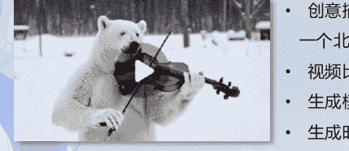

来源：TopAI研究及绘制。

# 视频编辑&优化：高效编辑视频，提升画质与稳定性，优化视频叙事性与视觉效果

### 主要功能

智能剪辑操作

智能识别，重塑逻辑，构建连贯叙事。

辅助元素添加

辅助字幕制作，智能适配翻译。

视频画质增强

校正处理低分辨率视频，智能提升画质。

### 主要应用场景

社媒内容创作

识别批量素材，完成配音、转场、剪辑等操作。

电商视频制作

融入商品信息一键式呈现视频。

老旧视频修复与数字化

进行超分辨率处理，实现智能降噪和色彩校正。

### 价值提供

激发用户在社交平台创作和分享的热情。

提升视频整体专业度与观赏性。

技术门槛降低视频编辑成本，简化操作步骤。

### 典型应用展示

视频优化

视频帧率提高、视频色彩修复、视频超清、人脸修复、视频背景修复。

来源：TopAI自主研究及定制。

## 多模态应用类——图谱

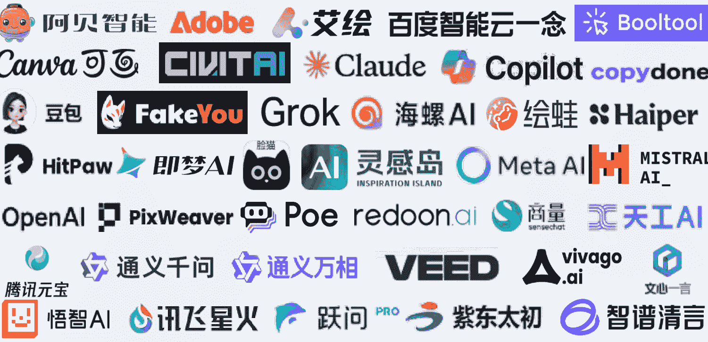

来源：TopAI自主研究及绘制。

## 多模态应用类——功能概述

### 1 多模态内容生成

基于CLIP模型技术，对不同模态进行联合训练、编码解码，实现多模态间的流畅转化。

### 2 多模态理解与交互

跨模态检索和对话交互，提升用户交互体验，满足用户多元化需求。

### 3 智能内容推荐

依据用户兴趣模型，向用户推荐个性化内容，打破领域限制，不断挖掘用户的潜在兴趣。

### 典型应用展示

# 多模态内容生成

# 多模态理解与交互

# 智能内容推荐

跨模态内容生成：
跨模态混合转换：
跨模态信息检索：
多模态对话交互：
用户兴趣建模：
个性化推荐生成：

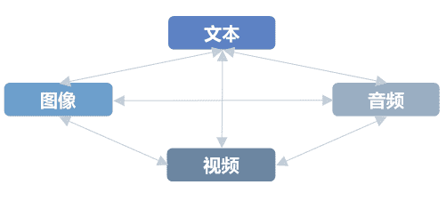

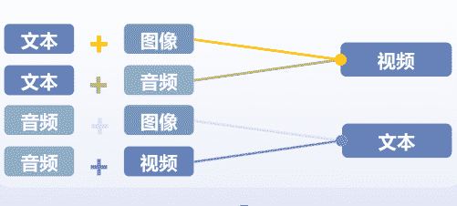

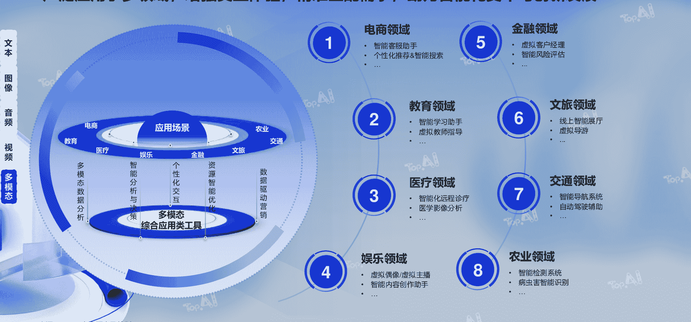

## 发展情况分类型展示

### 电商领域
- 智能客服级
- 个性化推荐与智能搜索

### 金融领域
- 虚拟客户经理
- 智能风险评估

### 教育领域
- 智能学习助手
- 虚拟教师指导

### 文旅领域
- 线上智能展厅
- 虚拟导游

### 医疗领域
- 智能远程诊疗
- 医学影像分析

### 交通领域
- 智能导航系统
- 自动驾驶辅助

### 娱乐领域
- 虚拟偶像/虚拟主播
- 智能内容创作助手

### 农业领域
- 智能检测系统
- 病虫害智能识别

来源：TopAI自主研究及绘制。

# 营销向型应用场景

# 交互向型应用场景

# 自媒体内容生成

- 辅助创作精彩文案、短视频脚本
- 生成多样风格、标题
- 智能高效生成创意自媒体内容

## Python

使用 Python 3 脚本实现业务的解决方案，自动化数据采集、分析与运维。

## EXCEL 数据

通过高效的数据处理能力，解决 Excel 数据问题，自动化数据清洗、汇总与统计。

## PPT 设计

利用 PPT 增强功能，制作高质量的演示文稿，快速生成精美幻灯片。

## 小号运营

专业运营技巧，提升粉丝增长率与转化率，快速产出爆款内容。

## 视频剪辑

掌握高效的视频剪辑技巧，提升视频产出效率，快速产出高质量短视频。

## 游戏运营

通过高效的游戏运营策略，提升用户活跃度，快速产出游戏文案。

## 工作效率助手

- 发发朋友圈
- 哄女朋友
- 回复老板
- 写点评、写论文
- 写邮件、写报告

- 精准流量密码撰写文章
- 策划笔记&各类爆单高效创作
- 深度洞察热点选题
- 快速提取文案和素材

## 创意感

## 小红书运营

通过高效的小红书运营，提升笔记量与互动，快速产出爆款文案。

## 脚本创作

通过高效的脚本创作，提升视频产出效率，快速产出高质量脚本。

## 插画

通过高效的插画技巧，提升设计效率，快速产出精美画面。

来源：TopAI自主研究及绘制。

# AI工具应用

# 挑战及趋势

## 发展情况分类展示

### 1 技术挑战
### 2 市场挑战
### 3 用户挑战

AI工具应用的发展进程，随着技术瓶颈、商业模式尚未完善、到用户体验亟待提升。然而，这一领域展现出极具潜力的前景。未来，随着AI工具应用在方面取得实质进展，技术瓶颈、商业模式、用户体验亟待攻克。

| 技术挑战 | 市场挑战 | 用户挑战 |
|---|---|---|
| 融合程度高 | 竞争激烈 | 粘性弱 |
| 创新性高 | 同质化较高 | 忠诚度低 |
| 内容质量高 | 模式化 | 意愿弱
| 数据安全 | 订阅制 | 付费 |
| 大量处理 | 探索中 | 流畅度需求
| 隐私保护 | 语义理解 | 自然交互需求

# 【创新】DeepSeek为例：技术赋能，目标

当前AIGC工具面临数据限制、算力限制、复杂处理能力有限等挑战。通过技术创新、开源策略以及聚焦用户，仍能实现弯道超车。以DeepSeek为例，将其AIGC技术作为工具，不断优化。采取开源和社区战略，共同进步，让工具更好地实现。

## 共享与改进

| 数据整合与处理 | 分散的信息岛 |
|---|---|
| 数据索引 | 查找、提取、融合 |
| 指令型 | 简单任务 |
| 多源信息综合 | 智能分析、决策 |
| 开源策略 | 社区合作 |
| 开放部分模型 | 开发者、社区建 |

## 工具属性

AIGC技术的本质在于帮助人们更高效、高质量地完成任务；DeepSeek以较低成本和算力资源预训练与推理的高效性。

## 优化工具体验

| “直明的”模型架构 - MoE | 适合人工干预的活 |
|---|---|
| 注意力机制 - MLA | 不需要心 |
| 强化学习和知识体系 | 大模型传递给小模型 |

## 开源与社区合作

## 工程优化

## AIGC技术的本质

来源：TopAI自主研究及绘制；

## 技术创新

# 多元发展：单一模态逐渐向多模态发展，同步推动应用场景的拓展和纵深

# 技术驱动

- 跨模态信息的融合和理解能力的提升
- 算力提升泛化，多模态模型降低对算力的依赖。

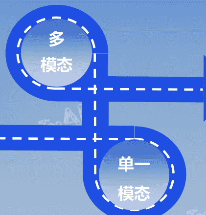

信息理解更全面、准确，多模态信息相互印证。

多元交互方式，为用户创造沉浸式交互体验。
多维数据关联，交叉分析，提供精准决策辅助。

# 市场需求

- 用户对自然、智能交互需求的提升
- 复杂化应用场景需求的推动

AI工具应用从单一模态向多模态发展的发展，同步带来了领域拓展和应用场景的纵深。

| 数据整合与处理 | 分散的信息岛 |
|---|---|
| 数据索引 | 查找、提取、融合 |
| 指令型 | 简单任务 |
| 多源信息综合 | 智能分析、决策 |
| 开源策略 | 社区合作 |
| 开放部分模型 | 开发者、社区建 |

## 工具属性

AIGC技术的本质在于帮助人们更高效、高质量地完成任务；DeepSeek以较低成本和算力资源预训练与推理的高效性。

## 优化工具体验

| “直明的”模型架构 - MoE | 适合人工干预的活 |
|---|---|
| 注意力机制 - MLA | 不需要心 |
| 强化学习和知识体系 | 大模型传递给小模型 |

## 开源与社区合作

## 工程优化

## AIGC技术的本质

来源：TopAI自主研究及绘制；

## 技术创新

# 多元发展：单一模态逐渐向多模态发展，同步推动应用场景的拓展和纵深

# 技术驱动

- 跨模态信息的融合和理解能力的的
- 算力提升泛化，多模态模型降低对算力的依赖。

信息理解更全面、准确，多模态信息相互印证。

多元交互方式，为用户创造沉浸式交互体验。
多维数据关联，交叉分析，提供精准决策辅助。

# 市场需求

- 用户对自然、智能交互需求的提升
- 复杂化应用场景需求的推动

AI工具应用从单一模态向多模态发展的发展，同步带来了领域拓展和应用场景的纵深。

| 数据整合与处理 | 分散的信息岛 |
|---|---|
| 数据索引 | 查找、提取、融合 |
| 指令型 | 简单任务 |
| 多源信息综合 | 智能分析、决策 |
| 开源策略 | 社区合作 |
| 开放部分模型 | 开发者、社区建 |

## 工具属性

AIGC技术的本质在于帮助人们更高效、高质量地完成任务；DeepSeek以较低成本和算力资源预训练与推理的高效性。

## 优化工具体验

| “直明的”模型架构 - MoE | 适合人工干预的活 |
|---|---|
| 注意力机制 - MLA | 不需要心 |
| 强化学习和知识体系 | 大模型传递给小模型 |

## 开源与社区合作

## 工程优化

## AIGC技术的本质

来源：TopAI自主研究及绘制；

## 技术创新

# 自然交互：高度理解指令逻辑，实现感化结果输出，增强人类认知智能

## 输入指令

### 用牛马的语气，评价下调

## 常见AIGC工具应用初级指令后生成

效果如“牛马”：代表模型本身，表现较为单一，感染力较弱。

撒三天没没夜干活的狗，结果就一个，累得萨的状态完全变好了，为了今天所说的送达，得提前提交或者往后送，这不是闹玩笑吧！就怕它不能成为合格的牛马，又被鞭着继续输出。

节后结束，心里看着很累的狗，生物本能就是累，上面的状态也不好，效率也上不好。而且，要求它休息完后上岗，继续输出好几天，妥妥了。

- 明确语义：
  - “牛马”在网络用语类似“社畜”，用户预期输出语气为：抱怨、无奈、讽刺等；
- 分析需求：
  - 用户可能希望的表现引起共鸣，需要接近生活；
- 口语化表达：
  - 避免过于词汇，分点清晰易懂，符合“牛马”直率风格；
- 考虑需求：
  - 抱怨之外，还想解决不合理之处和实际困扰；
- 最终审核：
  - 确保符合“牛马”的语气，保持幽默和讽刺，不偏主题

## DeepSeek-R1 深度思考，理解后生成

### 判断类型，强逻辑推理，对点对点

优化算法、持续训练，实现超越超越。

语言风格丰富，角度多样，感性与趣味性，易引发多种传播。

### 《小帅》？别说这么开玩笑了！
1. 搞笑哥，别闹我了
   - 三天没见过，五天不见，这就不怕老板说你把我们下个任务给侵吞了？的时候偷偷哭闹，这时候的MP，连道歉都专业了！
2. 生孩子俩打架
   - 上周六，我们俩闹了一周，周一直接我冷脸——我是谁？这周又是闹架了？生物本能如此，对比二子的KPI还没结束吗？
3. 长青？海的理想场
   - 可是凌晨凌晨，前几天急急，中间两天每天奔波，最后两天焦虑发作，复工第一天直接接进 ICU，这可能是
   - 分别清楚KPI吗？
4. 差的五个机器人
   - 凌晨的本质就是：跑步早晨的梦想转换成空气的实验，你你你两个，最后发现你跑到过期了，但是已经卖出性能了，根本停不下来！

# Thank you