# 2024 年中国养老产业商学研究报告
——银发经济专题

浙江大学管理学院老龄化与养老产业研究中心
浙江大学健康产业创新研究中心

2024 年 12 月

# 免费价值及时专注
# 扫码加入 知识星球TOP 免费资源群

- 每日免费获取价值资源
- 可提供各类资源搜索服务

| 热门付费文章 | 各行行业报告 |
| :--- | :--- |
| 精选图书资源 | 副业赚钱方法 |
| 职场实用资源 | AI政经自媒体 |

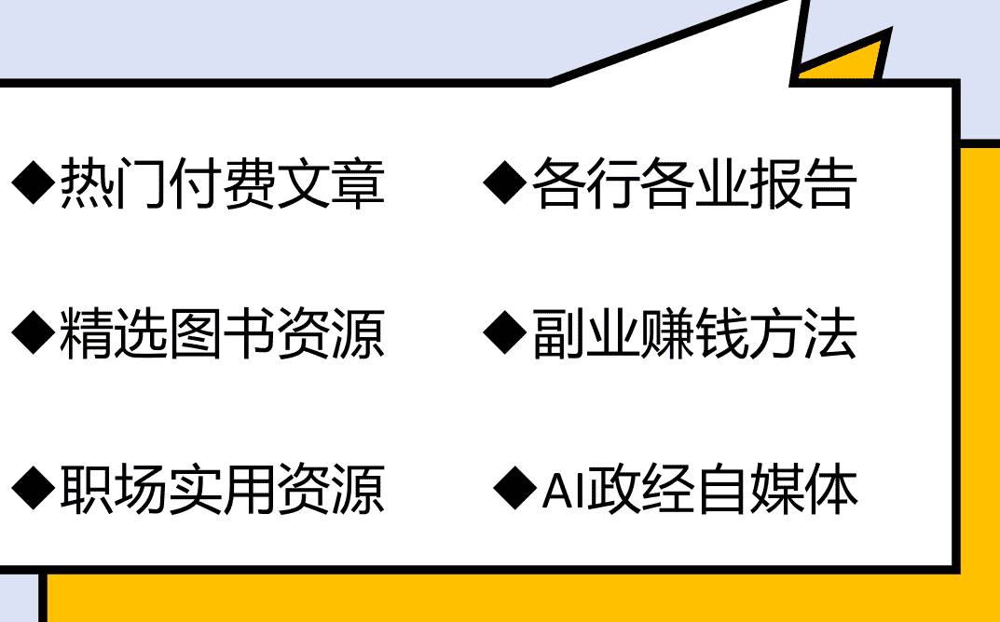

公众号：知识星球TOP   微信信号：jntsg8   微信信号：jntsg2

分享资料仅供个人学习，请及时删除，切勿商用传播

## 前言

2024年1月，国务院办公室发布了《关于发展银发经济老年人福利的意见》，各级政府随即将银发经济提出了重要议事程，“银发经济”一词，成为社会各界关注的热点。银发经济不仅只是针对老年人的产品和服务，它更是一种经济形态，涉及到各行业的方方面，以及对整个社会经济结构的重塑。在热议的同时，人们对于“银发经济到底包括哪些内容？银发经济与其它经济有什么区别？”引起了大量的疑虑。现在决定如何行为，为决定结果，要促进银发经济的发展，首先要在思想观念层面，对银发经济的正确认识。

为此，浙江大学管理学院老龄化与养老产业研究中心，根据管理学院、中心共建单位松下家电（中国）有限公司杭州华安实业集团有限公司的建议，将“银发经济”作为了研究“2024年银发产业商务研究报告”的主。本报告是该研究的内容。

报告首先分析银发经济的内涵、核心地位、基础情况，并进行相应的行业分析以及企业建议，以便政策制定者、企业家、学者以及对银发经济感知的各界人士，提供相关的见解和实用的方法。报告共分五章。在第一章中，我们将“银发经济”这一理念的起源与养老事业、老年产业、养老经济与银发经济等相关内涵，剖析银发经济的内涵与外延。在第二章中，我们利用统计数据和以往的研究成果，阐述了随着老龄化带来的人口结构演变，银发市场规模、购买意愿的提升，目前已形成一个规模大、稳定性持续时间较长的银发经济有效市场。在第三章中，我们说明了，虽然中国银发经济有着坚实的产业支撑，但升温的市场热以及“新”群体日益增长的需求和竞争特征，为银发经济的发展带来了生机，但仍需要面对目前银发经济的高质量发展，对于企业对市场价值及需求认知不足、市场规范化缺失、人才匮缺、技术创新等面临挑战。第四章对需求与市场特点的深入分析，揭示了银发经济的演进规律，并预测了现在和未来的热门领域。第五章中，我们为企业提供了接入银发经济的策略，核心内容涵盖资源蓝点、需求洞察、路径选择、渠道建设以及精准营销，为企业提供了一个科学的思维框架与操作指南。在附录中，我们进行了银发经济相关政策的汇编和经典实例的收录，供读者参考。

本报告在浙江大学管理学院的支持下，由浙江大学管理学院老龄化与养老产业研究中心和浙江大学健康产业研究中心共同完成。初稿分别由两个研究中心的专职研究人员袁建帅（第一章）、沈梦佩（第二章）、李婧薇（第三章）、何洁（第四章）、王喆（第五章）、郭翔（附录）撰写，研究中心的孙群、群教授、张大亮教授、房依然老师参与了每周专题研讨会与写作讨论，并对部分章节初稿进行了修改，并群教授提出了最初的提纲、具体组织了初稿的编写，并对初稿进行了详细的修改，最后形成了初稿。

本报告在形成过程中也得到了研究中心共建单位松下家电（中国）有限公司和杭州广宇医药集团股份有限公司的大力支持，在此一并表示感谢。

最后，祝每一位读者都能在银发经济的浪潮中，找到自己的定位，共同推动这一领域的繁荣发展。

## 目录

第一章 银发经济的内涵与外延................................................................1
1.1 起源与发展...............................................................................................1
1.1.1 国外......................................................................................................1
1.1.2 国内......................................................................................................2
1.1.3 认知变化...............................................................................................4
1.2 老龄事业与老龄产业......................................................................6
1.2.1 老龄事业...............................................................................................6
1.2.2 老龄产业...............................................................................................7
1.2.3 与产业的关系......................................................................................9
1.3 经济与老龄经济......................................................................11
1.3.1 经济...............................................................................................11
1.3.2 老龄经济...............................................................................................15
1.3.3 与老龄经济的关系......................................................................17

第二章 银发经济：国民经济新引擎......................................19
2.1 规模巨大的潜在消费群体......................................................19
2.1.1 当前老年人口：不可忽视的力量...............................................19
2.1.2 未来老年人口：蓄势待发的流量..................................21
2.1.3 人口结构演变：预期中的银发浪潮...............................................26
2.2 显著增加的社会支持..............................................................28
2.2.1 不断增加的财政支持......................................................................28
2.2.2 不断提高老年人可支配收入................................................................30
2.2.3 不断积累的财富......................................................................31
2.3 逐步解决老人的购买意愿..............................................................32
2.3.1 新发群体带来的购买意愿......................................................33
2.3.2 健康心理带来的消费增强......................................................35
2.3.3 补偿性心理带来的消费解放......................................................36

第三章 银发经济发展的现实基础与挑战......................................38
3.1 现实基础...............................................................................38
3.1.1 发展与国家方向一致，顺势而为...............................................38
3.1.2 发展银发经济具有坚实的产业支撑，优势明显...............................39
3.1.3 市场对银发经济的关注度，迎来“黄金期”......................................41
3.1.4 “新”人群的需求与消费特征，发现银发经济机会...............................42
3.2 面临的挑战......................................................................47
3.2.1 行业认知不足，商业模式适配性差，导致市场供需失衡...............47
3.2.2 市场规范化程度缺，政府监管不当，抑制老年消费...............49
3.2.3 人口储备稀缺，技术创新匮乏，陷入“低端”竞争...............50

第四章 银发经济产业分析与热点................................................53
4.1 产业发展规律................................................................53
4.1.1 老龄事业到老龄产业的增长轨迹...............................................53
4.1.2 传统产业—新产业—未来产业的体系...............................................55
4.1.3 加工—创新—自主的发展轨迹...............................................56
4.2 产业布局......................................................................58
4.3 未来热门赛道......................................................................61
4.3.1 基本性需求赛道...............................................................62
4.3.2 高阶性需求赛道...............................................................64
4.3.3 老年人和老年群的需求赛道...............................................66

第五章 银发经济企业建议................................................69
5.1 盘点资源，挖掘独特竞争力...............................................69
5.2 精准预测，寻找合适的切入点...............................................73
5.3 选择适配路径，提供产品和服务...............................................77
5.4 重构渠道连接，打通老年人触达...............................................81
5.5 优化营销策略，赢得老年人忠诚...............................................86

附录：银发经济政策和相关案例...............................91
1. 银发经济概述......................................................91
1.1 银发经济政策的探索历程...............................................91
1.2 银发经济政策的地域特色...............................................92
1.3 银发经济政策的聚焦产业...............................................93
2. 银发经济行业案例...............................................103
2.1 上海华章：“AI+教育”构建美好银发生活...............................103
2.2 浙江云和：“银发经济”促进老年产业焕新...............................107
2.3 红松如意：游学模式开启老年人的诗与远方...............................110

# 第一章 银发经济的内涵与外延

在2024年1月国务院办公室发布《意见》以后，随着各级政府将银发经济议日程，“银发经济”已成为世界关注的热词。银发经济的概念，产生于人口老龄化过程中，随着社会实践与理论探索的推进，银发经济的概念内涵也在不断发展之中。了解银发经济概念内涵的演变过程和背后的逻辑，将有助于更好地认识银发经济。

### 1.1 起与发展

#### 1.1.1 国外

银发经济（The Silver Economy）属于“养老经济”，它起源于20世纪70年代的日本，是老年人提供的商品和服务¹。这一概念提出后，在世界范围内传播和发展。2007年，欧盟理事会（EU）将银发经济定义为老年人提供的各种商品和服务，也包括延长老年寿命、促进老年人的志愿服务活动²。2014年，经济合作与发展组织（OECD）将银发经济定义为老年人生产和提供产品服务的行业或经济部门³。

随着老化社会的发展，一些学者指出⁴，银发经济作为一个广义的体系，其面对的群体除了老年人，还包括当时正经历年龄增长的群体以及为其退休进行准备的人的需求。这反映出一种前瞻性的观点，即银发经济不仅为老年人设计产品和服务，也包括为“未来的老年”进行准备的需求。这种扩展，使银发经济发展为老年人生活的行业和服务，涵盖金融、健康、康养、教育和文化等多个领域，为社会发展提供了更持续的消费动力和产业空间。这一观点并得到一些官方机构的认可⁵。

> ¹希彦莉，蒋莉，中国社会科学评论，2022(6): 49-66。
> ²Council of the European Union, “Opportunities and Challenges of Demographic Change in Europe,”
> ³Organisation for Economic Co-operation and Development, Fostering Resilient Economies: Demographic Transition in Local Labour Markets, http://www.oecd.org/cfe/Fostering-Resilient-Economies_final.pdf, 2014, p. 10-110.
> ⁴Andrzej Klimczak, Comparative analysis of national and regional models of the silver economy in the european union, International Journal of Aging and Later Life, 2016 (2).
> ⁵European Commission, The Silver Economy: Final Report, Brussels, EC, 2018, p. 3.
> ⁶欧盟委员会（EC）将银发经济解释为：满足50岁及以上老年人需求的所有经济活动的总和，包括他们购买的产品和服务，以及由这些活动产生的活动。银发经济面对的人，从老年群体拓展到了即将老年的群体。

#### 表 1 国外关于银经济的定义

| 国家或组织 | 时间 | 面向群体 | 涉及内容 |
| --- | --- | --- | --- |
| 日本 | 20 世纪 70 代 | 老年人 | 商品和服务 |
| OECD | 2014 | 老年人 | 产品和服务 |
| CEU | 2017 | 老年人 | 商品和服务、社会参与 |
| EC | 2018 | 50 岁以上人群 | 满足所有的经济活动 |

综上所述，长期以来，国外政府和国际组织对银经济的定义，主要侧重于面向老年群体，内容上以老年人提供商品和服务为主。随着老龄化进程的演进，老龄社会问题的日益严峻，以及老龄社会领域的观念更新，广泛的银经济面向的群体和内容，出现更加多元、多样化的趋势。

#### 1.1.2 国内

中国政府对银经济的认识，是逐步发展起来的。纵观养老政策文件，中国政府对老年相关经济活动的关注，经历了从关注养老保障、到加强养老产业、最终向银经济发展和银经济驱动的变化。

20 世纪 80 年代到 90 年代：随着人口老龄化趋势的日益增长，政府开始关注老年人养老保障，加强养老产业，主要涉及社会保障、医疗卫生和福利等方面，目标是为老年人提供基本生活保障。此阶段侧重于政府和家庭的责任，关注养老的基本。银经济的概念尚未被提出，但老龄事业已经开始展开来。

1990 年到2000 年：面对家庭养老功能的弱化，国家鼓励社会参与养老服务，推动养老服务的社会化进程，银经济萌芽开始出现。1993 年，民政部联合财政部发布的《关于加强城乡养老服务的意见》，要求专门为老年人提供的养老服务项目，在初创阶段给予税优惠。这是养老供给主体从家庭走向养老的萌芽。1994 年，民政部联合财政部发布了《中国养老工作七年发展规划（1994—2000）》，首次提出要坚持养老与社会养老相结合，扩大养老社会化范围。1996 年，国务院发布了《老年人养老保障办法》，进一步在法律上明确了养老与社会养老同步发展的思路。2000 年，《关于实现社会福利“社会化”的意见》，首次提出养老服务“社会化”的说法。

2000 年到2010 年间：随着人口的增长，老年人需求日益增加，政府开始关注养老产业的发展，希望进一步发挥市场的作用。国务院副总理李国际强在 2003 年 2 月在全国老龄委员会第五次会议上的话指出：“在社会主义经济条件下，老龄问题不应由政府包办解决，必须坚持养老事业与养老产业两个轮子一起转。养老事业主要由政府来推动；养老产业可在政府指导下，通过市场运作有序开展”。2006 年，在“十一五”规划中，首次提出“积极发展老龄产业”，鼓励养老服务业、老年用品、医疗保健、娱乐产业等。

2010年至2020年间：2013 年国务院印发了《关于加快发展养老服务的若干意见》，这是我国养老产业发展历史上的一个里程程，是我国老年年的政策目标。随后，《关于金融支持养老服务业加快发展的指导意见》、《关于进一步扩大旅游文化体育行业养老教育等领域的意见》、《智慧健康养老产业行动计划》等多个政策文件落地。老龄产业被视为我国的经济增长点，强调通过政策、资金等支持，鼓励产业开发老年化产品和服务，推动养老产业融合和养老产业多点开花。

2020 年年后，我国人口老龄化速度加快，政府文件首次明确提出“银发经济”。2021 年，“十四五”规划我国养老事业和养老服务体系规划等政策，提出“大力发展银发经济”“发展老年用品产业”“促进老年用品科技化、智能化升级”“有序供给老年人普惠金融服务”。2024 年 1 月，国务院办公厅《关于发展银发经济增加老年人福利的意见》，首次在层面对银发经济给出了明确的定义；银发经济是指向老年提供产品或服务，以及以老年阶段准备为一系列经济活动的总和。

| 1980 年年至1990 年 | 1990 年年至2000 年 | 2000 年年至2010 年 | 2010 年至2020 年 | 2020 年年后 |
| --- | --- | --- | --- | --- |
| 老龄事业 | 养老社会化 | 养老产业 | 经济增长点 | 银发经济 |
| 老年人基本保障 | 养老服务 | 市场作用 | 老年化产品 | 老年用品产业 |
| | 老年用品 | 医疗保健 | 产业融合 | 科技化、智能化升级 |
| | | 娱乐产业 | 多点开花 | 普惠金融服务 |
| | | 优质养老服务 | 优质产品 | 老年人福利 |

图 1-1 银经济相关政策演变过程

综上所述，我国对银经济的关注，是从“老年保障”逐渐扩展到“养老服务”“老龄产业”和“银经济”，其表述的内涵范围不断扩大，在全球中的地位逐步提升，反映了政府对老龄化的影响。这种认知的出现推动了银经济从单一公共服务逐步转向创新的多元体系，体现了积极老龄化的国家战略和前瞻性。

#### 1.1.3 认知变化

银经济相关变化，是人们对老年群体角色、价值和所需的深入。

第一，从本质角度，银经济是整个老年人的经济功能。传统上，老年人被视为非经济性的负担，重点在养老压力上。然而，随着老年群体的增加，意识到老年人并非单纯的受者，同样拥有丰富的生活，社会中的角色可以多元化，有消费需求和经济动力。与此同时，人们对老年生活的认知也更好，认识到老年群体的需求日益多元化，不仅有基本生活，还有多样化的旅游、消费等方面的需求。开始重视老年群体重新定义为“活跃的经济群体”、“新兴消费市场”，银经济随之从“应对老龄化”转向“利用老龄化的”。因此，银经济是一个经济体系，而不是政府公共职能，应该被特定的。

第二，从面向群体，银经济从老年阶段延伸至老年阶段。其面向群体不仅包括60 岁以上的老年人群，还包括广泛的“增龄”群体。年龄是连续的生命程，通过“增龄”不同阶段的社会保障、个人的财富储备和健康管理，将银经济融入全生命群体的互动。在增龄过程中，个体可以积累财富，通过健康管理、运动、饮食和调理等方式促进健康，从而为老龄化定坚实基础。这种全生命周期的物质和健康储备，能够提升老年期的生活质量，还能有效减少资源消耗，减轻社会压力。面对群体的多层次需求，银发经济具备了更广泛的市场，不仅围绕老年群体的短期需求，更是面向“全生命周期”的长期准备，同时也使得银发经济的发展的力量从老年群体“单打独斗”，转变为全年龄群体的互动，成为跨越年龄段的经济趋势。

第三，从内容内容，银经济是一种经济形态，是与银发相关的活动和行为的总和。银经济不仅作为市场驱动的产业，也是具有社会价值的产业。作为一种产业，银经济涵盖了医疗保健、养老服务、居家老化改造等多个领域，其核心是为老年人和增龄群体提供多样化、个性化的产品和服务。通过市场化运作，养老产业运营能够促进工业智能、控等新技术的发展，为银发发展提供动力。作为一项产业，银经济涵盖了老年医学基础、基本养老服务、公共环境消除障碍，以及公共基础设施建设等内容，其中包含了社会责任和公共职能，其目标是增强老年人的提升。银经济的发展，还使得资源从经验积累延续到老年生活，使财富积累与健康寿命增长，成为经济增长和社会福利的组成部分。银经济是产业和产业协同发展的经济形态，银经济的部门部分与其他部分相互联系，通过共同构建银经济的有机整体。通过产业和产业的融合，银经济能够更好地推动老龄化的可持续发展，促进经济繁荣与和谐，为所有增长群体提供充分、健康、有尊严的生活。

表 1-2 对老年人的认知与银经济相关进展的调研

| 旧认知 | 新认知 | 核心概念 |
| --- | --- | --- |
| 本质属性：老年经济功能的增强与银发发展式转型 | 非性的经济负担 | 活跃的经济体、新的消费市场 |
| 提供各种商品和服务 | 满足需求的场所，有经济活动 | |
| 面向群体：老年人 | 所有“增龄”群体 | 老龄经济 |
| 银发经济=老年经济+养老经济 | 涉及内容：各类行业 | 银发经济不仅是市场活动，也是一种社会福利制度 |
| 老龄产业 | 养老服务 | 老龄产业 |
| 养老服务 | 养老产业协同发展 | |

#### 1.2.2 养老产业

养老产业是指指向老年群体的产品和服务，提供满足其生活、健康、文化等方面需求的产业集合。银经济充分涵盖一二三产业，发展银经济既要改造传统产业，也需要培育新兴产业，还需布局未来产业，形成完整的产业。

首先，养老传统产业以满足老年生活照料等刚性需求和提供基本服务为主，属于产业链中最初、最完善的环节。养老产业是从老年经济生活服务延伸出来的基础产业。养老传统产业主要包括生活料料、长期护理、康复护理、基础医疗服务、家政服务、基础生活制品等，其特点是需求量、市场稳定，附加值相对较低。

其次，新兴产业满足老年多样化、个性化需求，主要是为了丰富老年人的生活方式和社会参与，涉及老年娱乐、教育培训、休闲旅游、健康管理、体育锻炼、社会参与等相关产业。

最后，未来产业是涉及养老的战略性和前沿性领域，有着引领和与全球老龄产业竞争、高科技和创新的深度应用。通过前沿科技让老年人和养老群体提供更高质量、更长的生活支持，并且以高质量供给创造新需求。这一产业聚焦于精致制造、智慧养老、生命科学、抗衰老技术和养老金融等领域，旨在形成具有核心竞争力的国际化产业体系，推动银发经济的持续发展。

养老产业的特点如下：

第一，多样性和层次性。老龄产业涵盖了老年生活的方方面，涉及养老服务、健康护理、康复医疗、老化改造、旅游闲暇、老年娱乐、教育培训、养老保险等多个领域。老龄产业还有许多层次，满足了“老食住行”等基础需求，还有发展性和享受性需求的满足，需求涉及养老管理、心理支持。

第二，政策支持与制度保障。养老产业的发展需要国家和地方政府的政策扶持，政策支持不仅包括对养老服务的税收优惠、资金补贴，制度要求制定和完善法律法规、标准，确保老年人在生活、健康等方面。政策和保障能够为养老事业提供足够的外部环境。

第三，公益性与普惠性。养老事业的公益性体现在政府、社会组织构建，为老年人提供不以盈利的服务。公益性意味着资源配置能够帮助弱势群体，特别是经济困难、失能的老人。普惠性则在政策制定和经费投入上，倾向公平分配，尽可能覆盖老年人。

第四，社会性与多方协作。养老事业的发展离不开各方力量的共同支持。政府的主导作用、家庭、组织和社区的发挥是不可或缺的。多方的协作要求政府和社会在资源、政策、管理等方面进行协调，特别是在养老服务、医疗、文化娱乐等方面，需要各级组织形成。这种社会性和互动，使养老事业成为共建、共治、共享的重要领域，主体共同承担老年人的责任。

时期养成起来的生活方式，会终身随着。如果从小养成均衡饮食、规律睡眠、适当运动和良好的个人卫生习惯，为未来保持健康打下坚实基础。青年期可能对中老年时期各个阶段可能出现的易发健康和疾病问题有所了解，适当加强自我管理，为老年期赢得良好的健康基础。而老年人则需要关注慢性疾病的预防和老年管理。

第二，50岁以后的退休生活准备，要对社会节奏的快速转变及其带来的经济、心理和社会适应挑战进行准备。对于劳动力在接近退休年龄时，对未来再就业规划进行选择，包括选择正常退休、提前退休、延迟退休等，就是再就业（包含全职、兼职或参与服务等）。对于选择延迟退休的老年人需要做好经济、心理和社会适应的准备。准备方面包括储蓄计划、投资策略、退休金计划，以及了解各种社会保障。这些措施，可以确保退休后仍有稳定的收入来源，以减少财务压力。心理方面，要需要适应从工作到退休生活的转变，涉及心理水平的重建和建立新的身份和目标。这一过程中可能会带来焦虑和不确定感，因此需要提前规划如何利用退休时间。

第三，在适应上，要建立和维持健康的社交网络，对防止退休后的孤立感非常重要，这包括与家人、老父母保持联系，或在社区中找到新的社交圈。对于选择再就业的老年人，最重要的是做好适应自己的健康状况、所需的工作。在决定再就业之前，老年人需要做好健康评估、技能评估与提升、兴趣探索等准备。老年人首先对自己的健康状况进行评估，评估自身能够承受的工作强度，以确保所从事的工作对健康造成负担。其次，要通过分析，明确哪些领域符合自己的经验和能力。如果感兴趣的工作需要技能，可以通过培训来提高自己的竞争力。最后，老年人再就业时，最好选择与兴趣相同的工作，以提高工作满意度。

退休前的准备工作，是让退休人员积极面对未来生活，考虑在步入老年阶段、要更加丰富、多彩的生活，实现身心的愉悦的“享老”状态。这些准备包括培养知识、学习一些长久伴自己的爱好，如摄影、绘画、音乐、园艺等，也可以学习一些实用技能，如烹饪、手工工艺或语言等；健康管理与健身训练，如日程安排、每日运动、饮食营养的配等；旅行规划，旅行是许多老年人热爱的闲暇活动，不仅能够宽视野，丰富生活体验，还能满足退休后休闲和社交的需求；财务和生活规划，根据退休后的生活需求，对未来的财务进行规划，包括保险、投资、储蓄等财务计划，为享老生活提供稳定的经济支持。

第四，70岁以上的养老准备，老年人当前及未来的老年生活，进行综合规划，以获取必要的支持。养老准备以照护为核心，包括老年日常生活中基本生活需求，如“食农行用”等规划的准备，还要考虑身体能力下降、半能、失能问题以及如何获得这些生活的支持。从这个角度上，养老准备具有“兜底”、“防风险”的意思，如传统观念的“养老儿辈”强调了家庭成员在养老支持中的作用。随着观念的转变，养老内容内在将逐渐变化，越来越多开始多元化的支持策略和个人的需求，经济自立、健康保险、社会参与成为养老准备的重要内容。

#### 1.3.1 养老准备

发展经济，理解人们老年需求的动因与行为模式，从而推动更加高效的产品和服务的供给。

Frieder R. Lang 在《Future Action and Aging as Preparation》一书中，将养老行为类为养老准备相关行为和预见性准备行为。这些行为虽然显然出发不同，但都对个体老年生活的经营起着积极。

养老相关的那些并非专门为养老准备的行为。个体在做出这些行为为时，并没有长期的考虑，是为了实现当前的需求或目标。虽然这些行为没有直接的老年意图，但他们在未来的老年阶段可以带来帮助的。例如，许多人储蓄和投资是为了实现短期或中期的财务目标，如为了购房、保值增值等，由于积累的资产，在未来老年阶段也会成为重要的经济来源，有助于保障退休生活的质量。

预见性养老行为则是那些针对老年人可能遇到的事件、挑战或负负担的行动。这包括财务负担、功能限制、照护困难等可预见的有意识准备。这类行为，通常是为了防止不希望的事件或状况，或降低这些事件或状况的影响。

LANG F R, LESSENICH S, ROTHERUND K. Aging as Future: A Study by the Foundation. Springer Nature, 2024; 2024-1-29. https://doi.org/10.1007/978-3-031-57504-2.

#### 表 1-4 养老行为分析

| 养老行为 | 预见性准备 | 兼两者 |
| :--- | :--- | :--- |
| 行为 | 无老年意图 | 有老年意图 | 有老年意图 |
| 目的 | 满足当前需求 | 选择长处 | 满足当前需求 |
| 行为 | 既满足当前需求 | 带来长处 | 且满足当前需求 |

从内涵和行为来看，我们认为老年经济是围绕着全龄人对衰老可能带来的风险，以及增进晚年生活质量的需求，开展的一系列经济活动。

#### 经济的主要内容

第一，健康产业。由于养老准备的核心之一，因此健康产业在老年经济中占据核心地位，涵盖了健康教育、健康管理、健身、预防性体检等多个领域，这些产业共同构成了一个全面支持体系，不仅有助于增强老年人的健康状况和质量，进一步带动老年经济的发展，也有助于减轻老年负担的可持续性。

第二，金融保险。随着养老观念的转变，人们越来越希望到老年时，能够保持独立性和自主性。这一趋势极大地推动了财务规划、养老产品、医疗保险、长期护理保险、投资理财与养老金融等需求的增加，保障老年期的经济安全。

第三，人力资源开发。从“养老”角度来看，人力资源开发主要包括职业规划、技能培训和中介服务三种。个体在进行职业规划时，可能会因为职业稳定性、养老金水平等因素，做出一些倾向性的选择，例如选择政府机构、事业单位、国企等，以确保未来生活的安全感和经济保障。为了获得这样的工作，个体需要参加技能培训，提高自己的知识水平。对于有意在退休后继续工作的人员，则能够参加再就业培训，寻求再就业介绍服务，以便退休后获得更多适合自己的岗位。

### 表 1-5 老行为与老年经济举例

| 行为 | 准备工作 | 预见性准备行动 | 兼顾 |
| :--- | :--- | :--- | :--- |
| 内容 | 健康产业 | 定期体检 | 抗衰健身锻炼 |
| 金融产业 | 投资理财 | 养老保险 | 财富规划 |
| 人力资源开发 | 职业选择 | 退休再就业培训 | 职业规划 |

#### 1.3.2 老龄经济

#### 内涵

老年经济是指老年群体的需求所形成的经济体系。它包括以老年服务需求为主的各类产品和服务，以及支持这些产品的基础的基础建设和由其衍生的相关经济活动。

#### 内容

老年经济涉及人的产品和服务，几乎是全行业、全产业的，范围很大。从产业链来看，包括资金、原材料、物流、研发、生产和制造、产品和服务、流通、销售等经济活动。

第一，养老产品，包括老年用品产品、老年服务产品、健康保健产品等。老年用品产品主要涵盖饮食等生活用品、适老化辅助具、生活护理类、休闲辅助类产品；老年服务产品涵盖适用产品和养老设施配套；健康保健类包括老年游戏与玩具、营养保健品、养老护肤产品、老年医疗器械、康复训练及健康保健具、健康监测产品、养老监控装置、智慧健康产品等。

第二，老龄服务，包括类型的养老服务、老年医疗卫生服务、老年文体闲服务、老年教育培训服务、老年金融支持服务、老年人力资源服务、居家适老化改造服务等。各类养老服务主要包括营性和非营利性居家、社区、机构养老服务；老年医疗卫生服务专门针对老年人设计的健康管理、疾病预防、慢性病管理和康复护理、老年病诊疗服务；老年文体闲包括文化娱乐、健身和文化旅游；老年教育培训主要指各类老年大学以及线上线下的老年教育；老年金融支持服务涵盖老年人普惠金融服务、商业养老保险、健康保险、养老理财产品等金融支持；老年人力资源指的是针对老年群体的就业、技能开发、志愿服务等；居家适老化改造是针对老年人的居住环境进行改造，提高生活的便利性和舒适性，帮助老年人维持独立生活，减少生活风险。

第三，基础设施建设，主要包括公共环境适老化改造、信息平台以及硬件设备，为老年人提供支持和养老护设施（医院、老年医学研究等）等。这部分主要由政府作为主体，组织相关事业单位进行建设。目前我国的适老化改造正稳步推进。

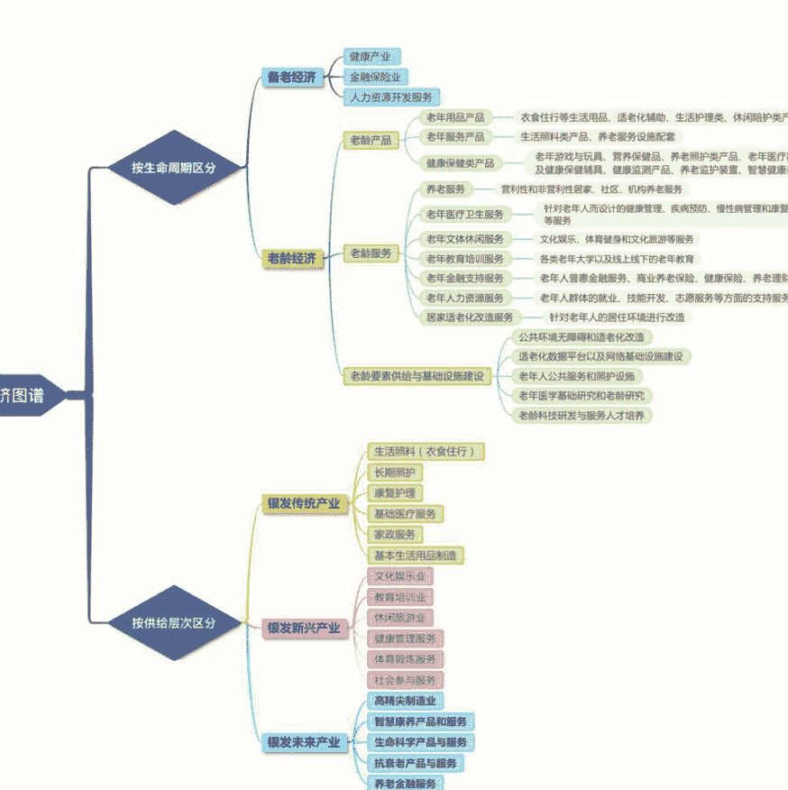

### 3.3 养老准备与老年经济的关系

老年经济涵盖了从全龄群体到老年期期间的需求，从老年阶段到老年期，从时序上构成了一个完整的生命周期。

第一，生命周期的连续性。养老准备聚焦于个体的健康管理、财务储蓄和职业规划，确保人们在进入老年生活时已具备健康、物资准备，从而提高生活质量。

第二，需求的连续性。这种延续性确保了老年经济中的一些需求在老年阶段继续延续。同时，需求在老年阶段会转化为新的需求。例如，在老年阶段转化为疾病治疗、康复护理、养老护理的需求。

第三，共同促进发展。养老准备通过健康、财富、就业等要素，为未来老年经济创造了基础。随着人口老化进程加剧，社会也会愈发意识到老年的重要性，这激励更多年轻人参与老年活动，从而提高老年经济的活跃度。

## 第二章 老经济：国民引擎

随着人口老化的加剧，传统意义上的国民经济支柱产业，如制造业、房地产和出口贸易等，逐渐露出增长乏力的迹象。这些产业曾经是国家增长的重要引擎，但如今面临劳动力成本上升、资源约束以及市场需求等多重击，对经济的支撑作用逐步减弱。这样的背景下，寻找新的增长点成为当务之急。而老年经济其巨大的市场潜力和广阔前景，有望成为国民经济的新支点。

有效市场规模（Effective Market Size）是指在特定时间内有能力购买某产品或服务的市场大小，可以简化为“有效市场规模=市场人口规模×购买意愿”。人口结构的深度演变，特别是老龄化的显著趋势，催生了一批庞大的老年群体；随着第一一代老人进入老年期，老年群体可支配收入增加，支付能力显著提升；并随着“60后”这一“新老人”的不断加入，老人及其家庭对于专业化、个性化服务的需求和接受度待提高。

### 2.1 潜在庞大的消费群体

潜在消费群体的规模，是有效市场规模的基石。要准确把握中国经济的底层逻辑，必须从老年人口的结构演变入手。从老年人口的当前规模、未来预期以及人口结构的演变来看，未来老年人口消费群体规模必然扩张。

#### 2.1.1 当前老年人口规模：不可忽视的力量

民政部、全国老龄发布的《2023年老年人事业发展公报》显示，截至2023年，全国60周及以上老年人口已达26997万，占总人口的21.1%；65周及以上老年人口为21676万，占人口的15.4%。中国已进入“中度老龄化”，老龄化程度在全球属于中上水平，而老年人口规模绝对全球第一。2020年，全世界60岁及以上的老年人口为10.5亿，中国的老年人口占老年人口的分之一（23.43%）。当年，全球

> [1]周柯，下一个风口：中国银经济三十年[M]。北京：中国工商出版社，2024，24。

> [2]民政部、全国老龄，2023年老年人事业发展公报[R/OL]。北京：民政部，24。

65及以上老年人口是 7.27 亿，中国老年人口仍然要占分之一（26.27%）。

[3]以上数据表明，中国目前已形成人口规模巨大的银发经济消费市场。

从年龄结构来看，目前我国老年人口主要集中在低龄“老年人”群体。根据国家统计局 2022年1%人口变动调查样本数据，我国60周及以上老年人口中，60~69周的低龄老年人口约为53%，70~79周占比约为33%，80周及以上高龄人口占比约为14%。现阶段，60~69周的低龄“老年人”数量庞大，受教育程度较高，身体状况良好，是老年经济市场最重要的组成部分。同时，80周以上高龄人口接近4000万，市场规模同样可见。

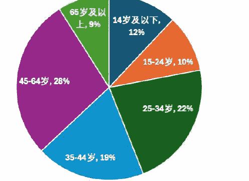 数据来源：2024年中国养老报告

图 2-1 中国老年人口结构

从性别结构上看，我国老年人口女性比例略高，尤其是高龄群体中，女性占比更高。根据中国社会的特点，在各个年龄段上男性多于女性，随着年龄的提高，男性人口占比逐渐减少。

#### 2.1.2 未来老年人口规模：蓄势的洪流

学术界关于未来人口结构预测的成果诸多，但由于研究模型本身具有复杂性和不确定性，得到的结论往往无法一致。无论用哪种模型预测，在

> [4]脚注：紧靠“把握老龄化机遇期”推进老年护理行业——专访社区养老服务权威负责人[J]。中国民政，2024(17):21-23。

未来30年内，中国老龄人口数量将爆发增长，老年人口总占比持续走高是不争的事实。

我国人口老化进程、程度深。与其他主要国家相比，中国在更早的经济发展阶段进入了老龄化，老龄化速度稳居第一队，且将会成为老龄化程度深的国家之一。从7%到14%的中度老龄化，法国使用了126年的中度老龄化，英国使用了46年、德国40年、日本24年。按照预测，中国从中度老龄化进入重度老龄化只需要7年，远于日本30年和德国的25年[5]。

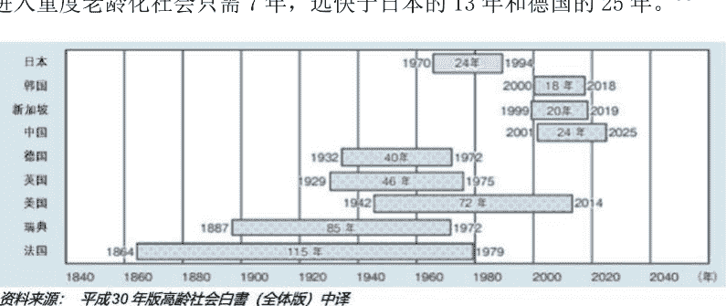

图 2-2 主要国家社会老龄化率从7%-14%所需的时间

将成为世界上规模最大的高龄人口国家。低龄老人和老年人的比例，将从2020年的4:1，转为2050年预测的3.2。[8]按照预测，2050年老年抚养比将上升到52.44%，2100年老年抚养比上升到111.4%。也就是说，2050年每2个劳动年龄人口养1个老人，到2100年每1个劳动年龄人口就要养1个老人。到2035年，我国失能老人将达到4600万，到2050年达到5800万左右。[9]未来，高抚养比和巨大的高龄、失能老人，必然会让养老服务市场带来巨大的增量。

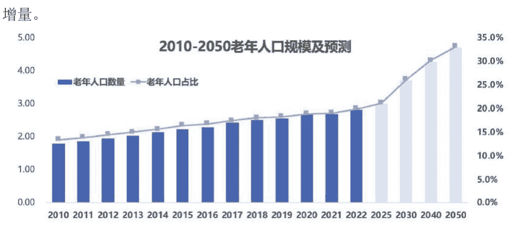

图2-3 2010~2050年老年人口规模及预测

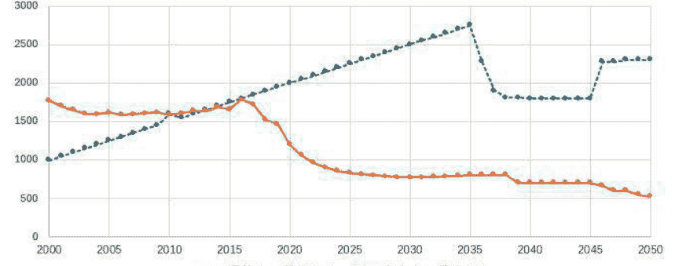

图2-4 2000~2050年新增退休老人与出生人口趋势

同时，我国老龄化具有高龄老人占比持续增长的特点，而这些人群是护服务的刚需对象。与1964年相比，我国60~69岁低龄老年人口占比降低了10个百分点，70~79岁老年人口占比提高了约1.5个百分点，80岁及以上老年人口占比，则提高了8个百分点。[10]

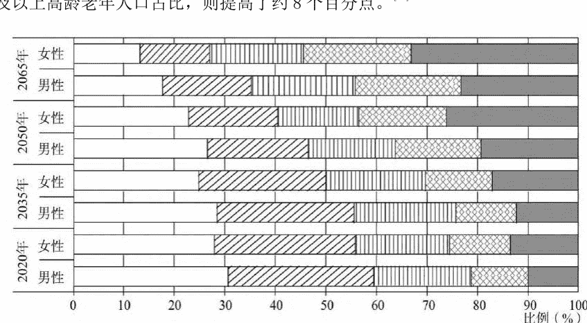

资料来源：新时代人口老龄化长期预测
- 中国人口年龄变化和年龄结构变化

#### 图 2-5 中国人口年龄比例和年龄结构变化

由于持续的少子化和老龄化趋势，市场正在替代儿童市场，成为消费者的增长点。根据人口统计标准，一个社会0~14岁人口占比的比例，在15%以下为少子化，15%~20%为严重少子化。2023年中国0~14岁人口占比为16.79%，落在严重少子化区域。根据国家统计局的数据，中国的总和生育率（TFR）2020年已破1.3，远低于人口更替水平所需的，这意味着每一位出生人口都要生育一次。[11]

2023年出生率进一步下降，全年人口为902万人，出生率为6.39%，总和生育率1.2，这是从1949年以来的最低水平。

假定目前的生育政策有效，社会生育率在2035年将不再大幅收缩，综合考虑年龄结构、性别结构等因素，到2035年，我国人口每年增加800万以上。

> [10] 严守，郭辉，“中国人口老龄化趋势与养老发展的前瞻[J]。”http://www.acm.com.cn/zxfb/upload/file/202404012/17129040495016304449.pdf

> [11] 国家统计局，“2021年经济和社会发展统计公报”。国家统计局，2022，http://www.stats.gov.cn/tij/ndjs/2021/20220204202024227272.html

> 国家统计局，“2023年经济和社会发展统计公报”。国家统计局，2024，http://www.stats.gov.cn/sjxf/zxfb/2042/20240228_1947195.html

> 新讯新闻，“未来10年，中国人口的精算结果。”新讯新闻，2024，https://new.qim.com/news/a/2024021024078200.shtml

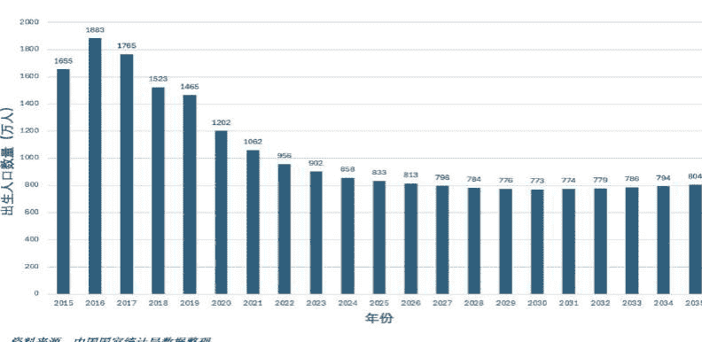

图2-6 出生数量预测

同时，由于人类预期寿命的大幅延长，老年消费群体的延续性且长期存在。人口平均预期寿命的延长，是医疗进步和生活条件改善的结果。根据国家统计局数据，中国的平均预期寿命已从1949年的35岁提高到2023年的78.6岁，与世界发达国家同一区域。过去20年，平均预期寿命提升，长寿趋势本身意味着人们可以享受更长的生活。长寿趋势与少子化现象相结合，老年人口的数量必然持续增加，在未来很一段时间内，老年群体将成为市场的主要动力。

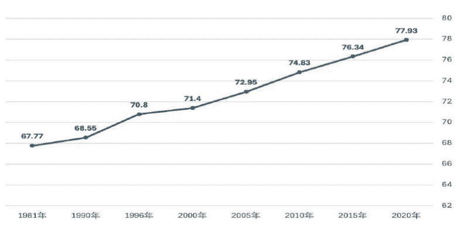

图2-7 平均预期寿命数据来源：中国统计局整理

## 1.3 人口演变规律：婴儿潮

人口年龄结构的演变对市场产生深远影响。“婴儿潮”是指在特定时期内出生率显著上升，导致大量人口集中在某一阶段，这些高峰不仅塑造了当时的社会结构，还会对后续几十年的人口结构演变产生深远影响。

根据人口演变规律，可以看到从1949年以来的三波“婴儿潮”高峰。到21世纪中叶，人口规模将持续增长、老龄化速度加速、老年需求多样化成为特点。企业需要根据这一人口演变规律，抓住人口窗口，合理分配资源，选择布局。

中国的第一波婴儿潮出现在1952年至1958年期间，期间内每年出生人口保持在2000万左右，1954年出生高峰为288万。根据上述提到的婴儿期结束，按照平均增长率估算，人口将在9年后逐步尾声。

第二波婴儿潮出现在1962年至1973年期间，出生人口在自然增长之后才开始反弹，每年人口保持在2400万~3000万之间，高于第一轮婴儿潮，出生率维持在27%~30%之间。1963年，我国出生人口和自然增长率均达到高峰，出生人口约3000万。这波婴儿潮约从2022年起进入高峰，并在未来5~10年内密集增长。我国还将迎来历史上最大的婴儿潮。2025年，我国60岁及以上人口将突破3亿并持续上升。在短期10年左右，我国老年人口数量将相继突破3亿和4亿关，这是中国历史上最大的一波婴儿潮。在这一时间点，我国仍处于这一波婴儿潮进入“新老人”的浪潮中，针对“新老人”的消费市场正当时。

> [14] 中国基金，“大人口龄化：婴儿潮、老龄化、Z时代（上）。”东方财富，2021。https://app-web.chnfund.com/js/20210514/t_13226809.html
> [15] 罗宇坤，婴儿潮发现市场机遇，中国社会科学，2022,(02):14-15。

第三轮婴儿潮出现在1986~1991年期间，该期间也是第二波婴儿潮的生育高峰，每年出生人口在2200万~2500万之间。虽然出生率平均水平低于前两轮“婴儿潮”，但仍保持在19%以上。按照2024年最新修订的男职工63周岁，女职工55、58周岁的法定退休年龄政策[10]计算，这波婴儿潮将在2041~2054年间迎来退休。第三轮婴儿潮之后，自1991年开始，我国出生率逐渐下降。

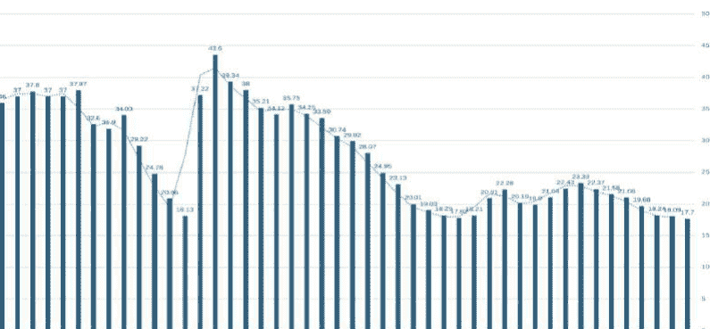

三波婴儿潮带来的银发浪潮，加之少子化和长寿趋势的协同作用，中国老年化程度将不断深化。综上可见，在未来的2030年以前，我国老年人口数量将爆发式增长，2025年老年人口突破3亿并持续增长，都是人口老化的关键时间点。规模上，第二波婴儿潮带来的60~74岁低龄“新老人”群体数量，将在2035年左右达到顶峰；以2035年为转折点，高龄老年人的数量将剧增；到2050年左右，我国人口规模和总人口占比双达峰值；未来10年内，老年人口主要集中在“新老人”群体，他们相对经济条件较好、受教育程度较高、身体状况良好，成为银发经济的主要群体。据此，面向“新老人”的消费市场有望打开，而失能、半衰老年人为主要客群的刚需护市场，则在起步阶段。

> [10] 中华人民共和国资源和社会保障部，“年龄政策”。2024年。https://www.mohr.gov.cn/n2525/c2635/content/2024/09/20240901_12345.html (注：此处根据原文修正，图2-7 平均预期寿命)

图2-7 平均预期寿命数据来源：中国统计局整理

#### 2.2.2 不断提高的老年可支配收入

老年群体的收入水平逐渐上升。随着养老保险制度的完善，老年人养老金覆盖率不断提高。与2002年相比，2018年全国城镇家庭均支配收入增加了4倍。此外，老年人的收入结构正在经历显著变化，这可能是由于改革开放后的红利，第一批高龄老人进入退休年龄，他们的退休收入显著拉高平均水平。根据2013年和2018年中国家庭收入调查（CHIP）数据，城镇人口中中位数收入（4000~10000）的占比增加，60岁及以上老人都有多套住房，来自自身的工资收入增长最快。

2020年老年人主要生活来源涵盖：
- 养老金：34.6%
- 成员供：32.6%
- 劳动所得：19.7%
- 转移性收入：3.1%

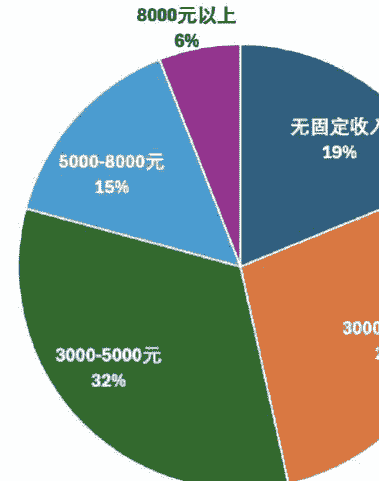

图2-8 2020年老年人生活来源情况资料来源：中国统计局整理

#### 2.2.3 退休的个人财富

现阶段，我国正处于第二波“婴儿潮”退休的高峰期，低龄“新老人”预计将在未来50年内集中爆发，并以每年2000万到2500万的规模持续。这是中国历史上规模最大、影响最深的一波婴儿潮。他们经历了改革开放，是中国红利期的最重要的生产者、参与者，也是第一批富起来的人。他们半辈子积累下的个人财富和实际支付能力，与上一代相比，已不可同日语。

> [22] 光大研究所，2020。银发潮流下，需求如何增长——消费趋势系列（二）。研究报告：https://pdf.dfcf.com/pdf/H3_AP202002201375316658_1.pdf

> [23] 夏绘、王亚奎。（2024）。中国老年收入的特征——兼养老保险对老年人收入的影响。上海对外财经大学报，2024(9)，1-22。

### 2.3 解放的老年购买消费意愿

要激发消费40后、50后，也就是第二代“婴儿潮”之前的老老人的消费，相对来说是困难的，他们的出生年代和成长经历，注定了他们节约保守的消费观念和精打细算的消费习惯。我们基本上属于基础性消费。

在积极的财政政策推动“两新”工作中，浙江财政政策的主要体现在在大规模补助资金、大幅提高补贴标准、合理化支持范围以及优化省内比例等方面。根据中央规定，该项目加力补助按照中央与地方85:15的比例，浙江省15%的配套资金由省财政保障。结合达地的第一批养老长期特别基金，省级配套资金已达105亿元，远超预期。

以浙江为例，2024年浙江推出了针对养老以旧换新老化改造补贴，纳入“洗衣、室内行走便利、居住环境改善、智能监测、辅助器具”等五项功能，为老年家庭进行改造。60周以上老年人补贴标准为50元，80周（含）以上老年人补贴为60元，每户补贴金额不超过2万元。

图2-9 1966年出生女性的全生命周期现金流

子女可以给予自己更多时间，对子女和第三代的感情渗透和依赖较强。

60后与我国改革开放同步成长的一代，是中国经济红利的主者、参与者和获益者，也是第一批积累起来的人。青少年时期经历过贫匮的年代，并且形成了节俭的习惯，但在年轻时就迎来了改革开放，青少年时期经历了1990年下海潮，1994年社会主义市场经济体制建立，2000年加入世界组织参与全球化。如今的他们许多已经拥有成就，衣食无忧。他们曾经顽强不拔，勇于进、勇于创新；保守守旧，勇于接受新观念；勤俭、奢侈享受、愿意消费、舍得消费。在养老观念上，这一群体经历了经济实力的增强、住房条件的改善和健康状况的提升，不再仅仅满足于生存、保障养老的充足。

60后现在的意识逐渐觉醒，注重健康、人关、社交、旅游等性消费，在感受到身体出现症状时，也会注重科学方法的维护健康。他们接受信息的来源更加广泛，接受养老的能力相对较强。作为唯一的子女的父母，他们不愿推卸子女，养老观念也从养老转变为自我负责，愿意接受和购买高质量的社会养老服务。他们将在未来很长一段时间内是银发经济新兴产业和未来产业的绝对消费群体。

以60后为典型代表，第二波“老人”老年群体退休“入老”为界限，第一波“新老人”的前半生积累了大量的财富，且拥有充分的实际自主支配能力，因此，现阶段倾涌的银发群体和过去的银发群体相比，在购买意愿上存在差异。

| 表一“60后”与“新老人”的消费对比 |
| “老年后” | “新老人” |
| :--- | :--- |
| 所属年代 | 第二波“婴儿潮”之前出生的40后、50后 | 第二波“婴儿潮”中或之后出生的60后、70后 |
| 成长环境 | 改革开放前，相对贫匮、动动荡 | 改革开放后，相对宽松、繁荣、机会众多 |
| 个性认知 | 集体主义色彩 | 自我意识觉醒 |
| 价值观念 | 思想消费、苦耐消费、勤俭节约、务实 | 个性解放、个人自主、开放多元、开拓进步 |
| 消费需求 | 刚需为主、适度消费、农行业、“金钱经营” | 多样化、个性化需求、精神追求、自我实现 |

#### 消费观念

- 节约为本，功能为先，更看实用性和性价比对比
- 积累消费主义，追求品牌品质，注重情感价值、情绪价值

#### 消费行为

- 精致细算，精懂消费，易受媒体营销影响、“情感”消费
- 趋超消费、差异消费、多样化、个性化消费

#### 消费习惯

- frugal、省钱：被动消费
- 挣钱、花钱：主动消费

#### 消费渠道

- 倾向于线下消费，逐步接受线上消费渠道
- 线上渠道消费习惯已养成，对外界信息的接受度更高

### 2.3 老年老龄期的消费意识觉

2020年，60后仍在路上走60步，与40后和50后相比，60后是全新一代的老龄群体。60后的消费意识更强、收入更多、受教育程度更高，对于退休生活的预期也更加丰富。

我国人的平均预期寿命，从1949年的约35年到2023年的78.6岁，增加了一份期待。刚从退休的“新人”，他们的实际状况与工作时代相比，并不会发生断层式的变化。在这样一个短期内，三十到四十年后，被称为“健康老龄期”的全新阶段，一切皆可能。当有了更长的健康预期寿命，人就有更多的选择，会生出更多的消费。老年人关心是如何让自己的老年生活更好，以及如何对过去对家庭和责任性的时间和爱做出补偿。

而随着开放和消费带来的自我意识增强，这波“老年人”的消费思想转变成为自我价值和情感价值体现，趋超消费、差异消费、多样化个性化消费开始流行。与传统老人去买菜是为省两块钱可以走两公里不同，老人更认为“省是为了花钱”，他们有闲钱购买物质追求更高层次的追求。同时，他们对于外界信息的接受度更高，更相信自己的判断能力，通过广告和营销来了解消费，给老年品牌的打造和市场营销带来了可能的新性。

针对这一“老人”的趋势，未来，老年生活的革新将会成为主流。老年教育、老年文旅、老年影视、老年保健等赛道，将会带来重大机遇。以老年旅游为例，基于“老人”群体人口基数大、消费能力强、空闲时间多、文化需求的特点，老年旅游市场近年来持续扩大。2020年我国康养旅游人数已达675万人次，老年旅游从福利事业向旅游产业转变，从小众市场向主流市场转型。2016-2020年，中国老年旅游游客消费年均增速23%，2021年，中国老年文旅消费超过7000亿元。预计到2050年，老年人口消费总额将达4万人民币以上。[28] 王梅，“健康老龄期”研究的回顾与展望”。人口研究，1996（36）：71-75。

#### 2.3.3 补偿心理带来的消费解放

60后“新老人”在改革开放之前，中国的经济基础相对弱，生活水平偏低，幼年时期经历了计划末期，物资匮乏，因此形成了节俭的习惯；但在成年时就迎来了改革开放，青少年时期经历了1990年下海潮，1994年社会主义市场经济体制建立，2000年加入世界组织参与全球化。这一代人在经济飞跃的好时代参与到国家建设，完成了社会化的转变，并在退休后积累了个人财富由于经济和各种限制未能实现的愿望。老年人的补偿性消费，是指他们通过消费来弥补年轻时未能实现的愿望。这种消费行为在“新群体”中较为普遍，尤其是在旅游、健康、娱乐等方面。许多“老人”在子女独立、经济负担减轻、拥有闲暇时间之后，做补偿性消费，常寻找机会满足年轻时限制未能实现的愿望，美容、健身、旅游观光等。这种消费是一种心理平衡，消除某些方面的焦虑和不安。此后，随着社会进步和经济收入的提高，老人正在摆弃“节消费、老自己”的传统观念，花钱买健康、花钱买质量成为老人的时尚潮流。当他们从繁忙的工作和家庭负担中解脱出来，就会发出强烈的消费意愿，希望自己的晚年生活过得幸福、充足、丰富多彩。

因此，“老人”的消费意愿甚至比年轻一代更强。综上所述，老人市场将在很一段时间内都是高质量的“三有”市场，即“有”规模基数大并具有高速增长潜力的消费群体，“有”得到显著提升的实际能力，“有”得到极大解放的主动消费意愿。根据人口结构演变规律，中国全球最大的“婴儿潮”人口约在2020年至2022起进入退休高峰，我国已处于这一数量快速增长浪浪潮内。最大的第二婴儿潮带的60~74岁低龄“老人”群体数量将在2035年达到顶，在未来10年内，相对经济条件较、受教育程度较高、身体健康的“老人”，将成为老年经济的主要消费群体。因此，面向“老人”的消费市场布局适当。而以失能、半失能老人为主客群的刚需护理市场，由于现阶段的主要客群是第一婴儿潮带的传统老人，虽然消费者群体的人口基数也带来了巨大的市场需求，但由于传统老人相对支付能力和支付意愿较为弱，市场尚处于被动消费阶段，距离真正的规模主动消费爆发还需要一段时间。

# 第三章 老年经济发展的现实基础与挑战

我国老年人寿命明显增长、人口规模不断壮大，伴随着“老年群体”消费能力和消费意愿的增强，老年经济高质量发展基础日益稳实。在老年经济已被列入国家级战略规划的当下，坚实的产业支撑、逐渐升温的市场热度以及“新”群体新月异的需求与消费特征，都为老年经济的发展带来了无限机遇。

但目前，老年经济的高质量发展仍然对企业市场价值及需求带来挑战、市场化匮乏、人才储备稀缺、技术创新资金等严峻挑战。底层老年产业的发展基础与困难，有助于了解、把关、利用“新”群体带来的产业效应，在破解偏差、供需错位、监管难题等困难的基础上，能够发挥企业自身优势、持续扩大老年市场有效性。

### 3.1 现实基础

#### 3.1.1 老年经济发展与国家政策方向一致“顺势而为”之常

我国从2000年开始发展老年养老产业，形成了老年产业并行的格局。2013年1月，中央、国务院发布的《加强老年养老的意见》，首次提出“积极培育老年经济”；2017年5月，国务院发布的《养老服务体系规划》，进一步明确要大力发展老年经济；2024年1月，国务院发布的《关于发展老年经济的意见》，明确指出“老年经济”这种新型形态，涵盖了向老年人提供全方位产品与服务。近年来，国家层面的政策制定对老年经济高度重视。实际上自2019年1月，中央、国务院发布的《积极应对人口老龄化规划》以来，民政部、住建部、卫健部、商务部等多个部门联合，针对老年服务、老年用品、数字化等方面，持续为老年经济提供有力支持。这一系列政策的背后，反映了对人口老龄化关注老年人的多样化转变，预示着中国将促进老年经济发展，发现新的增长点，也是重要措施。

#### 3.1.2 老年经济具有坚实的产业基础、优势

老年经济不是养老行业之一，而是老年经济的。在《关于发展老年经济的意见》中，国家围绕老年餐饮、居家养老、社区养老、老年健康服务、老年文体产业、农村养老等老年用品制造、智慧养老、康复辅助器具、养老旅游、老化改造等领域，提出了一系列支持。从这些重点领域来看，老年经济呈现出多面化、综合性、强势并行的特征，涵盖了各类产品和服务，提供了坚实的产业支撑，具有多方面的优势，主要体现在：

- 产业链领先、门类领先，协同优势：根据产业分类统计，我国其中41个工业大类、27个行业和666个行业具有全球最完整、规模最大的产业体系，是全球唯一拥有产业分类中全部门类的国家。从食住行到文旅休闲，从原材料的采集与供应到产品的生产制造，再到销售与市场推广，以及之后的售后服务，我国都能形成一个完整的产业和供应链。这意味着，范围内包括健康服务、生活用品、政务服务、旅游娱乐、金融管理、保险业、教育等，拥有充足和丰富的产业门类均可将其涵盖，能够从基础的生活用品到高端的健康管理、文化旅游等全方位的产品和服务。从产业协同来说，老年经济既有其本土相关产业，又有衍生产业，涵盖了养老和服务和研究、设计、生产。(1)老年文旅教育中国首创人会【杭州】成功举办

#### 3.1.2.2 制造业优势

我国制造业在全球范围内具备强大的竞争力，特别是在生产、制造技术、成本等方面，有着显著的优势。这意味着，在老年经济发展上，我国已具备扎实的工业基础，生产能力强大，配套完善，具备较大的全面性和自主性，为发展经济提供了优厚的基础。

- 一方面，制造业的优势不仅体现在生产上，还可以推动产业延伸。例如，这些产品包括但不限于老年服装、康复、保健、文体用品等，更可以利用先进的技术和工艺，研发适合老年人使用的各类产品，不断提升产品质量和性能，以满足老年人日常的多样化需求。
- 另一方面，制造业的优势不仅体现在生产上，还可以推动产业延伸。例如，制造业企业可以与医疗、养老等相关产业进行合作，共同开发适合老年人的产业。这种跨产业的合作，可以优势互补，推动产业链的协同发展。同时，制造业企业还可以利用其在供应链管理、物流配送等方面的优势，为其他老年产业中的企业提供高效、便捷的物流服务和售后服务。

#### 3.1.2.3 满足老年人的多元化需求

随着我国产业与养老产业的深度融合、文化与创意新产业的兴起，以及数字技术的崛起，我国产业发展态势多元化特征更加明显，这些都是为了满足老年人的多元化需求，推动老年经济的持续健康，注入了动力。老年群体的需求和偏好紧密相关，呈现多元化、个性化的特征，从基础的衣食住、健康管理到文化娱乐等方面，都有多元化的优势，有利于老年经济提供更全面的服务，更好地满足不同类型老年人的需求。例如：

- 养老方面：居家养老、社区养老、机构养老等多种模式；
- 健康方面：康复、长期照料、健康管理等服务；
- 文化娱乐方面：老年大学、文体中心等各类选择。

#### 3.1.3 市场对老年经济的关注，迎来“黄金期”

老年经济涵盖多元化和规模化，使其逐步成为发展的新动能。权威数据显示，目前老年经济正处于加快发展阶段，老年经济规模约7万亿元，占GDP比重6%。预计到2035年，我国老年经济规模将达到30万亿元，占GDP比重约10%。事实上，数据隐含了老年经济的巨大潜力，也凸了当前社会对高质量老年服务的关注。其中，2024年8月，新增相关企业注册3.8万家，数量持续上升，增长73%。未来5年内，投资市场已经捕捉到了这一趋势背后的庞大市场，投资热情高涨，将目光投向与老年需求相关的多个领域，已成为热门赛道。截至2024年8月，核心企业已有22家A股上市，市值高达804亿元，覆盖了健康、老年旅游等多个领域。聚焦老年人的需求来看，可以一步解决抗衰、预防、防范老化、独立生活支持等十个领域，涵盖了医疗器械、金融、酒店餐饮、食品、教育、康养、家具家电等行业。目前，有的公司重心在于贴近老年转型阶段和心理状态。例如，京东集团、万能健康、瑞医药、大股份布局养老局、康养院、养老服务中心等项目，实现了深度医养融合。有的公司不断适应适老化产品。值得注意的是，更多能够连接老年经济通过“化学反应”的“关键节点”也连通群众之路。

#### 3.1.4 “新老人”的需求与供给呈现均衡

随着老口龄化的持续推进，“新老人”及老年群体成为养老市场的“新贵”，其消费潜力对老年经济的拉动被积极期待。如第三章所述，我国老人的需求特征异质性强，消费内容和消费方式也表现出明显的特征。这些差异化的需求，将带动消费热点的转移，为老年经济的发展开辟空间。

54-60岁老年人经历过物资相对匮乏的年代，成长于改革开放、社会财富快速积累的年代。拥有资产的中年，其经历的社会变迁具有现代技术转型特征，是互联网围的中年一代，属于新时代的“新老人”。他们大部分具有更高的文化水平和知识储备，也有更强的消费能力及意愿，积极拥抱消费，在物质需求上以品质和体验为主，同时也在健康康养、文化娱乐等方面更多需求，是银发经济中主动性消费的主要群体。

55以上的老人是潜在的老龄人口，其职业生涯与高速的增长和信息技术的飞速发展相邻。他们不仅是改革开放的见证者和参与者，也是经济红利的获得者。他们大部分拥有更广的视野、更新的观念，核心活跃往往体现在情感和自我实现等精神层面，接受新事物并注重消费体验，既是前沿产品和服务的消费主力，也是对产品创新的有力动力，为有效扩大内需提供了重要的动能。

如果老人的日常需求按需求划分为生活需求、精神需求和发展需求三大类，传统老人以及大部分老人（统称为“传统老人”）与“新”老人及消费群体（统称为“新老人”）的大致需求差异如表3-2。

| 表3-2 需求差异分析 | 生活需求 | 精神需求 | 发展需求 |
| :--- | :--- | :--- |
| 健康需求 | 养老需求 | 产品需求 |
| 工作需求 | 社会交流 | 文化需求 | 技术需求 |
| 传统老人 | 无病无忧 | 子孙养老 | 便宜维持生活 | 家庭为主 | /闲暇 |
| 新老人 | 注重养生 | 多元化 | 品质 | 不“老”、追求自我实现 | 主动社交 | 弥补心理提升自我 | 主动了解积极体验 |

#### 3.1.4.2 消费内容拓展，消费方式多元，带有明显的时代特征

近年来，随着我国老人收入水平的不断提高，老年人口消费观念不断转型，消费和消费方式逐渐多元，消费特征显著。

从消费内容来看，老年人已从传统的衣、食、住、行等基础消费，向文化旅游、体育健身、休闲娱乐等服务转型。在满足物质的基础上，对社交、尊重等精神层面的需求不再增加，老年人日常生活更加注重品质和时尚。已有研究表明，在1960-1975年出生的老年及老年人群，享乐型消费随着年龄增长逐渐增加的趋势，尤其是文化娱乐、旅游和美容需求提升[11]。

AgeClub新增商业研究院对老年消费市场的报告显示，45-65岁老年家庭（“新老人及老年人群”）是50-65岁老年人的总资产最高，是目前老年消费领域中，休闲旅游占据规模最大，是老年化群体消费最大的市场[13]。全国养老一项调查结果表明，老年旅游人数占全国旅游人数超过20%，成为中老年旅游市场的第二大市场。

同时，对数字化的不断熟悉，相比于传统老人和过渡性老人，1950年出生的老年群体日益增加，其消费的意愿、动力也更强。银发经济的增长，正经历着从传统的健康康养到美容、数字智能、知识付费的转变。2023年以来，老年消费者购买智能设备的增速超过了52%[14]。

从消费方式来看，随着消费场景的多样化和便利性的提升，银发群体消费也逐渐从线下市场转向线上，且消费易被“价值供给”重塑。

《中国互联网发展状况报告》显示，2022年上半年，老年中国新增72万，其中，50-60岁及以上老年群体占比15.2%和20.8%，达到113万和154万。

并非银发市场的数量有所增加，其购买能力也在显著提升。《互联网数字消费发展蓝皮书》（2024）显示，“银发”是数字消费增长潜力巨大的，60岁以上互联网用户使用率增长，在健康康养、文娱旅游消费中表现突出[15]，主流APP对老年消费者的消费增速已达到80%以上[16]。中国移动互联网数据库一项针对50岁及以上老年群体的调查结果显示，老年人的线上消费增长，尤其关注爱和、家居生活需求显著。

老年消费领域也呈现出活跃之外，还偏好注重质量、时尚等内容[17]。《2022银发经济报告》显示，中国短视频在老年群体中的渗透率已高达71.2%，意味着城乡老年人活跃度很高。

- [11]赵世彤，陈媛静.银发经济中老年消费特征及发展研究[J].新疆上海大学学院（社会科学学会），1-11-2024-1021.https://doi.org/10.14116/cnki.cn1039/4.2024.002065.005
- [12]李颖.银发经济的现状与潜力分析[J].中国南方财经，2020，(01) :18-21。
- [13]刘新.银发经济市场的现状与机遇[J].中国日报，2021年12日03版。
- [14]数据来源：预计老年消费规模400万亿元 银发经济活跃消费“蓝海”AgeClub
- [15]数据来源：《互联网数字消费发展蓝书》
- [16]数据来源：中国新闻
- [17]数据来源：中国移动互联网数据库

#### 3.1.4.3 银发市场迎来新机遇

老年人的需求与消费特征与传统老人有明显不同，视野更加开阔，对物质享受、品质追求、情感归属的追求逐渐增加。这些变化与新动能匹配，目前供给体系尚完善、老化程度充分，银发产业带来了较大的空间，推动银发经济供给侧的增长与迭代。

从消费对象来看，银发群体消费意识觉醒，许多老年人不再满足于物质消费，自我表达、自我悦的消费逐渐转向健康的保健品和体育健身等，成为了老年人的重心。另外，还有研究显示，社交规模和密度的提高，让老年人在消费时，更愿意结交同龄朋友，分享经验和体验，扩大自己的社交圈。

- [18]数据来源：老年人网“成瘾”
- [19]杨虹，《银发经济背景下的老年人消费倾向研究》，[J].北京，2024(4):89-92。
- [20]王莹萍，《不同年龄层社交网络对老年人消费的影响》，[J].经济研究，2023(13):55-58。

#### 图3-1 不同类型老年人的需求类型与消费特征

### 3.2 面临的挑战

#### 3.2.1 认知不到，商业模式适应性弱，导致供给失效

从老龄产业到银发经济，我国政府对其概念的定义经历了从初步提出、逐步明确到深化拓展的进程。加上我国正从老龄化向深度老龄化社会转型，发达国家的人口结构转型在一定程度上压缩了银发经济逐步发展、成熟的时间差。相比于发达国家，我国企业对银发经济的认知尚浅、薄弱但存在差距，主要表现为：

一方面，企业对银发市场价值不到。大部分企业还持着传统观念，认为老年人不舍花钱、不懂得消费，其购买力在全年龄段中是最弱的。这导致很多企业认为银发市场的份额较弱。通常来说，消费和收入成比例，收入越高消费能力越强，也有许多企业认为相比年轻人来说，老年人普遍收入相对较低，消费能力有限，若将大量资金投入老年市场，投资回报率难以保障，反而影响成本回收速度和盈利，因此企业对“银发经济”市场投入有限。

另一方面，企业缺乏对老年群体特征的精准描写，并能真正掌握老年人的消费需求与偏好。目前还没有针对性的养老服务。虽然2013年以来各级政府出台了一系列促进养老服务发展的措施，但养老服务仍然呈现出老年人需求无法得到满足和养老机构床位空置的矛盾现象。有关研究显示，我国老年人服务需求满足率为15.9%，还有84.1%的老年人需求未得到满足。主要由于资金与市场的错位，企业认为老年人的钱难、市场小，所以也不敢做“领头羊”去银发市场的新领域进行开发，更愿意固守传统、养老等已成熟的领域。然而，需要养老护理服务的是老人，对于他们来说，养老服务不是过时的被动选择，只要还有可能就不愿接受。对于新时代的“老人”群体，他们需要更加个性化、多元化的服务，而其价值不仅限于基础层面，这种理解了银发市场的内涵，也影响了产品与供给结构的匹配。

#### 3.2.2 市场规范化欠缺，监管不到，抑制消费欲望

目前，我国银发消费潮起，政府虽在银发消费方面制定了一些扶持政策，但社会、企业对银发消费的重视程度不足，尚未形成较为完善的支持体系。

一方面，针对老年群体的特殊需求还缺少规范化体系，导致市场定位模糊，且入门槛低、产品及服务鱼龙杂、质量参差不齐、由于分散。学历不高、年龄偏大、职业培训缺乏、专业性不高等等问题也较为突出。老年人易受促销营销、骗局影响，对产品及服务的真实性缺乏清晰认知和辨别，购物后经常发现“无用”，降低了老年人的预期和消费欲望。

另一方面，市场监管体系缺失，导致银发市场透明度不高。我国已意识到银发经济的必要性，但目前尚未全面完善法律法规、行业标准及监管意见。例如，2020年12月，国务院办公室发布的《关于建立健全养老服务监管体系促进高质量发展的意见》中，关注的重点是机构、服务人员和补助资金的监管，其他方面未涉及，这种缺位是导致银发市场扭曲、秩序混乱的直接原因之一。据腾讯发布的《老年人反诈皮书》显示，2019年上半年，该平台老年人举报诈骗案超过2万次，其中99%的老年人遭受了资金损失；数据分析，诈骗主要于交易、返利及养老，合计在总举报案中占比超过60%。细分市场中，养老骗是老年人的重灾区，利用老年人追求健康长寿的心理和信息劣势，以健康形式吸引老年人，引导消费至诈骗，不少老年人深受其害。此外，老年车、旅游、理财等领域也是问题频发，严重损害了银发群体的消费信心，削弱了消费热情。

#### 3.2.3 银发人才稀缺，技术创新匮乏，陷入“低端内卷”竞争

目前，我国银发产业人才队伍不健全、结构不合理、技术创新能力弱等因素相互交互，导致银发产品及服务陷入了同质化、价格战等“低端内卷”的局面。

#### 3.2.3.1 银发人才队伍不健全，对人才缺乏

鉴于银发经济“多方面、综合性、多元”的鲜明特征，银发经济未来必须朝着多元化方向发展，以满足银发群体多层次、多样化的需求。因此，需要在养老、医疗、文化、娱乐、旅游、健身等方面具备更专业性、技能、创新的专业人才，为银发经济提供内动力。

目前，人才队伍不能满足市场所需。从卫生健康的数据来看，我国现有的持证护理员总数仅为30.2万人，接近450万失能老年人，难以满足养老市场需求；且从当前已有的少数服务人员队伍来看，人员构成不合理，稳定性较差，学历不高、年龄偏大、职业培训缺乏、专业性不高等等问题也较为突出。预见，未来人才队伍建设仍面临巨大压力。

#### 3.2.3.2 技术创新不足，模仿老化

尽管银发市场规模持续增长，但银发产品及服务的创新仍处于初期阶段，创新动力缺乏。由于投入不足，多数企业出于成本考虑，产品开发大多停留在表面阶段，功能单一且与实际需求不符。这种模仿老化的现象，导致银发群体对银发产品的使用体验不佳。

- [28]援自：《老年人反诈皮书》发布

# 第四章 经济产业分析与热点梳理

老龄产业是经济发展的重要环节，理清老龄产业的发展脉络，能够有效揭示市场规律和发展方向，提供投资机会。本章通过对老龄产业的演进路径的回溯，把握发展规律，预测发展方向，识别未来热门赛道，为投资者和创业者提供参考。

### 4.1 老龄演进规律

鉴于我国特殊的经济发展背景，老龄产业经历了从福利性产业起步，逐步向福利性产业与市场化产业并进的发展规律。产业内部的多样性也随着社会认知、技术进步和经济发展的共同作用逐渐被激发。本节通过梳理我国养老产业的演进规律，精准分析老龄产业的发展阶段和趋势，为老龄产业的布局、资源配置、投资方向提供依据。

#### 4.1.1 老龄产业至养老产业的结构增长

老龄产业与养老产业同属于经济发展的组成部分。老龄产业是国家为老年者、老年人、机构、所有老人所面临的目标而实施的一系列政策，是依靠政府财力为老年人提供的基本公共服务。①老龄产业是满足老年人的特殊需求而提供产品和服务的部门和企业。②老龄产业以公益性为主，而养老产业本质上都是社会福利产业。

积极应对老龄化的背景下，在推动银发经济高质量发展的过程中，我们既看到具有良好的人口基础和市场机遇，也要看到认知不足、产品质量水平不够、人才建设滞后等挑战。随着社会观念的重塑以及对老年人口关注度的提高，加上政府、社会、市场在政策支持、产业协同、技术创新等方面的努力，我们理由这些问题都将逐步解决。面向未来，激活长寿时代红利，增强银发群体消费能力，拓展银发经济发展空间，推动银发经济走向健康、更可持续的发展道路，将不仅为老年人口提供更好的生活质量和福祉，也是推动经济高质量发展的重要支点。

在重点群体保障、基本需求得到满足的前提下，才有可能惠及更多群体、满足更高层次的需求。养老事业“根基越深、牢越牢”，才能正常带动养老产业的“竞技发力”。养老产业不仅通过构建社会保障制度让养老产业释放活力，而且通过出台养老政策等，直接促进养老产业的合理发展。十三五期间，在党和国家重大规划和政策引领下，我国养老法律法规、规章制度和政策不断健全，社会保障不断加强，养老体系日益完善，养老产业发展取得了一系列新成就。养老产业充分投入，带动了养老产业的发展，通过“公经营”、“委托托管”等方式服务基本的养老需求等，养老产业通过政府获得了政策支持，提升了能力，从而进一步将其他层次需求转化为有效效果。在经济发达地区，养老产业多数由政府财政收状况良好的长三角地区布局，来源主要依赖“医保”和“政府采购”[3]。这证明了养老产业对养老产业的发展具有重要性。

#### 养老事业与养老产业协同发展的一些思考

养老事业的发展，离不开养老产业的支持，只有在一个产品相对面对，产品和服务供给具有丰富的市场，以税收和经济增长带动养老事业，养老事业才能实现高质量发展，逐步提高保障层次[5]。养老发展的核心目标，是解决老年人日益增长的生活需求与供给平衡不之间的矛盾。多元化产业的发展，为养老事业的发展提供了补充和延伸。养老事业如果能实现老年需求的保障和安全作用，让老年人多元和个性化需求的满足，就需要依靠市场的竞争来完成。市场主体对老年需求的洞察通常更敏锐、反应更快，能够精细刻画多元化需求并专业化供应。政府可以通过购买服务的形式，完成养老服务的安排，完成养老业务中的服务供给责任。以承担兜底保障为主的基层养老院为例，近年来以公办为主的养老院，通过向公办民营转化，通过引入专业化的养老企业，可以降低养老成本，提升养老服务的质量。养老服务的发展，为长期护理保险的实施提供了条件，助力了养老事业的新领域。[6]可以说，养老产业的发展了养老服务供给的增加和配置的合理，也有助于利用自身优势，不拓展和延伸养老业的范畴。

我国银发转型之“扎根”、2010年以来的逐渐“发枝”，未来，在巨大的市场有效需求和强有力的科技智能的催化下，将进入“勃勃成长”的快速发展期。

#### 4.1.2 产业从传统产业向养老业的转型

根据产业的现代转型，改革开放后二十五期间，我国的银发产业处于探索阶段，与养老相关的产业虽然还属于社会主义市场经济体制改革已经开始发展，这一阶段的银发产业主要通过政府的直接介绍与支持推动。在2013年之前，各部门都出台了一些关于养老业的政策文件，但其影响力并不很大，老龄服务和养老产品供给不健全、城乡区域发展不平衡等问题不断出现。（《国务院关于加快发展养老服务的若干意见》（[2013]35）发布，标志着我国的银发产业正式启动。社会对老年需求的认识逐渐加深，开始围绕养老服务为中心的传统产业，如护理、保健等基础养老业。这些服务，以满足老年人的基本生活需要、康复护理等基本需求为主，养老产品和服务的供给相对较小单一，供给链和体系尚未形成。

创新驱动的新格局：随着技术进步和生活水平的提高，老年需求增长，将成为必然所需，向享受型、发展型、转型转变，产业更加细分、专业化、职业化。银发经济开始出现新的业态，国家政策鼓励支持养老服务产业与康养、旅游、健康等融合发展，丰富养老服务产业新模式、新业态。2017年，财政部等3部门联合发布《关于政府和社会资本合作模式支持养老服务发展的实施意见》，提出鼓励养老机构与卫生医疗机构、健康服务机构开展合作，支持打造“以健康管理为基础、以养老服务为核心，以医疗服务为支撑”的全生命周期养老服务链，重建一批以养老为主，附加健康、健身、医疗、教育、文化娱乐、互联网等现代养老的“养老+”综合业态。

这一阶段的银发产业，不再以“养老服务为主体”，而是转向“养老、为老、养、康、养”共同发展的新格局。创新在这一阶段的银发产业发展中，使得越来越多角色的活跃，凸显了智慧养老、康复辅助器具、抗衰老、养老+金融。

- [3]李娜.养老事业与养老产业协同发展的理论性思考[J]。上海大学学（社会科学版），2023, 40(01):115-127。
- [4]党宪在接受《华夏时代》记者采访
- [5]林奎.养老服务高质量发展进展：养老与产业协调发展[J]。华中科技大学（社会科学版），2024.5
- [6]杜巍，精准推进养老产业协调发展[J]。行政管理，2023，07(47-49)。DOI:10.1491/j.cnki.1674-7563.2023.07.007。
- ①李彦，老龄产业供给侧路径研究——基于福利主义视角》，老龄科学，2018(02):72-80。
- ②玉福，老龄新政策下发展趋势》，老年科学，2020(02):22-25。
- [9]王莉，我国养老产业中长期发展的现状与路径[J]。老年科学研究，2024，12(03):1-10。
- [11]钟帅，多角度视我国制造业现状与趋势——第二十四次全国统计数据和企业综合调查结果分析[J]。工业与信息化，2020;21(21):27-31.10.19609/j.cnki.1299/f.2020.x01.0004。

### 4.2 市场概况

在我国，无论是从业人员的数量、研发投入的资金，还是营业额占比例，在全国范围内都是第一，制造业作为国民经济支柱的格局并未改变。但在创新方面，很一段时间里，我国目前处于辅助阶段，模仿可以实现盈利，这个过程在很大程度上延续。模仿改进阶段，企业通过引入、购买或借鉴其核心技术并通过小规模的改进来节省研发和市场投入，降低投资风险。以OEM（Original Equipment Manufacturer，原始制造商）模式承担生产制造的角色，在国际贸易中扮演角色。以我国康复助器产品举例，国际中高端市场被国外的企业占据，产品重心在中端，技术含量低，且多以模仿为主。其中康复助器核心技术、关键部件主要依赖进口，缺乏自主产权和专利技术。我国能够生产助轮椅、助行器等产品，但由于未掌握核心技术，70%以上仍为代工产品。这个阶段通常处于国际价值链的底端，附加值较低，在代工的过程中，企业已经积累了大量的技术和生产经验，最大限地改进并完成初步的资本积累。

模仿创新阶段，随着对产品、市场、制造的理解，企业逐步完成对产品改进的深入解构，通过消化吸收，不仅达到达到产品的基本性能指标，而且可以通过微创新在功能、外观和性能等方面进行改进，以增强产品的竞争力和适应本土市场。在这个阶段，企业不仅是仿制，而是开始对模仿对象进行一定程度的本土化个性化调整，并逐步提升自主能力，使其适应市场和消费者。企业通过模仿产品进行深度理解并再创造，逐渐发展自己的产品和商业模式，为自主品牌的发展打下基础。以智能座椅为例，智能座椅作为一种服务已经彻底改变了轮椅的概念，具有人机交互、自主避障、取物等更智能、更安全的功能，是现阶段人工智能发展领域重要的一环。随着我国失能半失能老年群体的增加和国内研发能力的提升，中国电动轮椅市场规模快速增长，2023年国内智能轮椅市场规模约69.72亿元，且目前已成为全球较大的电动轮椅出口国。根据中国海关总署数据，2023年国内智能轮椅出口量为69.7万。

这一阶段的银发产业，不再以“养老服务为主体”，而是转向“养老、为老、养、康、养”共同发展的新格局。创新在这一阶段的银发产业发展中，使得越来越多角色的活跃，凸显了智慧养老、康复辅助器具、抗衰老、养老+金融、智能穿戴设备、远程医疗、智能家居系统、虚拟现实、人工智能等领域。银发产业更加多元化，且这些新兴产业涉及到高科技、智能用品、智能医疗、智能服务、智能家居、健康、旅游、智能娱乐、社交等多元化需求。

这一阶段的银发产业，不再以“养老服务为主体”，而是转向“养老、为老、养、康、养”共同发展的新格局。创新在这一阶段的银发产业发展中，使得越来越多角色的活跃，凸显了智慧养老、康复辅助器具、抗衰老、养老+金融、智能穿戴设备、远程医疗、智能家居系统、虚拟现实、人工智能等领域。银发产业更加多元化，且这些新兴产业涉及到高科技、智能用品、智能医疗、智能服务、智能家居、健康、旅游、智能娱乐、社交等多元化需求。

养老产业的发展遵循从传统产业向新兴产业转型的规律，随着人口老龄化的深入，银发产业的概念正在改变。随着人口老龄化的深入，需求快速增长，技术创新不断加强了养老产业的发展。智慧养老、康复辅助器具、抗衰老、养老+金融等领域成为养老产业的发展的关键。随着人口老龄化的深入，技术创新不断加强了养老产业的发展。高技术、智能化、数字化需求、虚拟终端、虚拟养老院等方面突破。高技术支持是养老产业的发展基础，未来方向将提供更多老年人的服务。

养老产业的发展遵循从传统产业向新兴产业转型的规律，随着人口老龄化的深入，银发产业的概念正在改变。随着人口老龄化的深入，需求快速增长，技术创新不断加强了养老产业的发展。智慧养老、康复辅助器具、抗衰老、养老+金融等领域成为养老产业的发展的关键。随着人口老龄化的深入，技术创新不断加强了养老产业的发展。高技术、智能化、数字化需求、虚拟终端、虚拟养老院等方面突破。高技术支持是养老产业的发展基础，未来方向将提供更多老年人的服务。

#### 4.1.4 养老产业向长期发展的趋势

市场供给远远无法满足国内的老龄用品需求，很多制造商看到了未来这个领域的巨大机遇，却缺乏资金、技术和政策支持，企业规模过小，运作困难。解决和改善老人的居住环境，也是传统产业发展的一部分，虽然不是房地产、保险业等杂渗透养老产业，但养老产业面临很多现实问题，未能形成成熟的开发模式与市场匹配的局面。

图 4-1 老养老产业链况

| 上游 | 中游 | 下游 |
| :--- | :--- | :--- |
| 设备终端 | | 养老设施 |
| 智能硬件 | 康复具 | 老年养老 |
| 医疗终端 | 监护设备 | 老年规划 |
| 食品/药品 | 特殊食品 | 老年化改造 |
| 保险品 | 老年旅游 | 老年人消费群体 |
| 药品 | 老年护理 | 老年金融 |
| | 医疗康复 | 老年教育 |
| 养老技术研发 | 养老产业投入 | |

从产业的水平来看，我国的银发尚处于发展的阶段。图(4-2)养老事业和传统产业中满足老年人基本需求的供给来看，尽管该领域的市场发展起步较早，满足的需求层级较低，但仍有较广阔的提升空间。

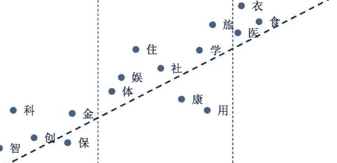

### 4.3 市场成熟度

在传统产业中，以老龄用品为例，目前我国养老用品市场供给缺口大，产业发展不充分，目前共有6万多种养老用品，其中日本的近4万种，德国生产的有2万多种，而我国市场上自主开发的老龄用品只有2000多种。

在传统产业中，以老龄用品为例，目前我国养老用品市场供给缺口大，产业发展不充分，目前共有6万多种养老用品，其中日本的近4万种，德国生产的有2万多种，而我国市场上自主开发的老龄用品只有2000多种。

医疗保健费用为2120元，占人均消费支出的9.2%，2015-2023年支出增长率82%。结合其他先行步养老的国家在权益市场的表现优秀，日德医药行业年化收益率为4.5%，排名第二（1994-2021年），韩俄医药行业年化收益率15%，排名第一（2015-2022年），欧洲（欧元区）的医疗健康行业年化收益率为4.5%，排名第一（1998-2022年），可以说，在老龄化过程中，医疗健康行业的龙头优势增长十分明显。其中，随着养老管理理念的转变，人们对健康的重视程度也逐渐加深，疾病预防、筛查，将有望成为养老健康领域的重点发展方向。

#### 4.3.2 老龄市场需求

2004年，国家统计局制定《文化与娱乐相关分类》，将文化及相关产业定义为：为社会公众提供、娱乐产品和服务的活动，以及与这些活动有关联的集合。并将文化产业划分为六大活动范围，分别为：为社会公众提供物性文化产品和娱乐产业的活动，为社会公众提供可与选择的娱乐产品和娱乐服务，提供文化管理和运营等服务，提供文化、娱乐产品所需的设备的生产和销售活动，提供文化、娱乐服务所所需的设备、产品的生产和销售活动，以及与文化、娱乐行业的其他活动。来说，老龄化产业是指，为老年人提供文化产品和服务的制度和组织，涉及影视、娱乐、老年休闲、体育教育、教育培训、旅游观、展览展示等方面。

- 老年旅游

目前的产业市场来看，老年旅游是产业规模最大的一部分。根据中国老龄趋势调查，我国每年老年人数量占全国老年人总数的20%以上。2016年，中国老龄协会协助老年旅游者促进委员会与同龄旅游联合发布《中国老年人消费行为研究报告2016》。对50岁及以上老年人的消费进行了系统分析。根据报告，月收入5000元以上的中国老年旅游者占比57.8%，月收入超过7000元的老年者占比31.3%。中国养老研究院发布的《国内老龄发展年度报告（2022-2023）》显示，2021年45岁以上老年旅游合计出11.9亿次，占据国内旅游市场规模36.81%。其中45-64岁群体9.2亿次，占比27%，为旅游市场第一大客源。区域方面，地区占据绝对优势。来自上海、北京、广东、天津、浙江、河南、四川、湖、北、江西10个地区的老年旅游者占比73.5%，其中3地区占比高达36.7%。

> 数据来源：国家统计局2024年《中华人民共和国2023年国民经济和社会发展统计报告》
> https://www.wind.com.cn

旅游养老、候鸟式养老起，以文旅与健康管理的新型态势，进一步步措了老年旅游的方式。未来，随着60年以后的退休以及中高收入中老年人舒适深度游等产品的开发，老年旅游将进一步得到快速发展。

#### 老年文体

然而相比老年旅游，我国的老年特殊市场，特别是老年的发展较为滞后。对标日本，在日本老年娱乐、运动健身方面的发展，展现见下表（4-1）。

#### 表 4-1 老年文体市场状况

| 老年娱乐市场 | 内容 |
| :--- | :--- |
| 老年娱乐市场 | 日本推出了以游戏为主的闲暇市场，其中有老年机、麻将、卡牌等游戏场景，契合老年需求。2020年7月，日本ISR宣布推出日本第一款老年人参与的竞技设施e-Sports。日本推出了面向老年人的TV，通过活动运营、衍生服务三方面，以高性价比的中老年特色服务吸引顾客。 |
| 老年运动市场 | 根据日本数据，日本老人具有一定的运动需求。截至2021年，65-69岁老年人需求较高，运动参与度为67.0%，75岁以上老年人需求增加，运动参与度为53.7%。在运动上，强调训练的强度、使用器的训练以及潮流，日本已经产生了一系列适合老年人的运动活动，例如，用户年龄为61岁的日本健身Curves，专注于老年人健康长期服务的Resilience有限公司Leiras健身房等。 |

老年娱乐、运动市场目前较为冷冷，注意到该领域的企业较少，但市场消费却出了空缺。《商界》数据显示，从2014年后，是KTV房留更长时间的消费者。在KTV的高频消费者中，69.7%为60后，后者仅占12.6%。

全K族数据也显示，平台用户画像中，70后用户占比17%，仅次于95后。在线时长上，70分钟是20分钟的3倍，在交流、信和社交次数均高于其他年龄段。

基于日益增长的健康、娱乐和社交的需求，老年文体市场将衍生新的空间，迎来巨大的商机。城市居民对于老年人的健身健身场所就是健身房，但目前市场上专门为老年人制定的健身房之又少。线上健身方面，市场上针对中老年人的专业健身内容严重短缺，老年在在线健身服务占比不足5%。运动器械方面，目前面上可选的老年健身器材种类单一，功能相对简单，也不太符合老年人的训练需求，健身器材和质量严峻。

#### 老年教育

由于日益增长的健康、娱乐和社交的需求，老年人精神追求丰富，学习需求随之增长，老年教育成为社会生活不可或缺的一部分。随着老龄化的加速，老年教育资源日益投入，以公益大学为主要载体。中国老年协会发布的《老年教育发展报告（2019-2020）》显示，目前老年教育市场稳定，主要包括政府办、民办、社会办几种，其中政府办占老年人口总数的70%以上。数据，截至2019年，我国共有老年教育用户量6亿左右；截至2020年，老年教育市场规模达137亿元，复合增长率超过10%。通过多元化模式的发展，更好地满足老年群体的化需求。

#### 4.3.3 智慧健康

随着生活水平的提高，老年群体对于晚年生活质量有了更高的要求，智慧养老产品和服务愈发重视。当下，传统上应用于医院等专业机构的医疗设备，特别是小型化的医疗械（如血糖仪、血氧仪等），正依靠电商渠道加速进入家庭，逐步从医疗属性转向更具保障属性。2022年，全球智能家居渗透率14.1%，到2026年有望提升至24.8%。一线城市老人对智能产品的消费意愿增强，实际需求重要性较高。北京市统计局发布的《北京市老年人使用报告》显示，84.1%的访问者使用智能产品，使用意愿最高的三类智能产品分别是“健康管理”（55.7%）、“安全监测”（46.6%）和“智能家居”（32.1%）。年龄段中，60-69岁老人对智能产品的使用意愿强烈（86.6%）；80岁以上老年人出于安全需要，“安全监测”产品的使用意愿强烈（50.3%）。还有一些老人对智能产品价格过高、技术不够成熟（如机器人等），尚未在家庭应用。在国内尚未形成规模化的背景下，更多企业需要研发投入，增加功能以解决老年人的实际场景。家用机器人的市场仍处于起步阶段，但未来会有更大增长的空间。根据世界机器人大会数据，2023年中国服务机器人市场规模约55亿元。由于老年人是大多数的人口基础，养老服务是其基本需求，同时智能机器人相比老年人更加便利、可靠和成本低，随着产品的成熟和成本的下降，未来必将展现广阔的市场。市场可见的，是用于老年人群无力的可穿戴式外骨骼市场。

- 养老金融

养老金融是一个概念体系，旨在应对老年化挑战，围绕社会成员的各种种养老所需的金融供给的总和，包括养老保险、养老服务、养老金融三部分。保险是养老金融产品的重要形态，商业养老保险兼具长期储备和长寿管理能力，能够与基本养老保险紧密衔，是重要的补充养老手段。在银发行业，保险业务同样有很大的发展空间。例如，《2017年老年人消费白皮书》显示，除了传统的储蓄方式外，有近20%的老年考虑购买理财和保险产品进行资产配置。在老年医疗方面，保险公司来说有不小挑战，尤其是对众多慢性疾病的老年人，可以选择的产品仍然多。从目前市场来看，一般情况下健康状况的惠民保险业务成为了老年医疗保险的“主力”。在老年医疗保险的探索中，机构可以着重针对老年人的特质、特殊治疗、特殊护理等需求，开发适合的商业保险。在长护方面，目前9个城市试点，但商业保险的发展较为薄弱。在银行方面，近年来推出的“个人养老金”及理财业务，也有很大的推广空间。

#### 抗衰老

抗衰老市场涵盖了美容服务、美容仪器、药品、保健品等。随着老年行业的发展、抗衰知识的普及以及抗衰技术的进展，我国抗衰产业处于快速发展阶段，以美容为主。根据Frost & Sullivan数据显示，2017年中国医美规模从990亿元升至1890亿元，增长率高达17.5%。对比日韩等国，医美渗透率仍有较大提升。预计2030年，医美规模达到3500亿元，65岁以上用户占比最高。其他像基因技术、再生医学、分子诊断等目前属于未来领域，但随着技术的进步，未来将展现巨大的市场潜力。

# 第五章 老年经济介入策略

随着老年经济的逐渐升温，众多企业试图参与其中却不知从何入手。本章探讨老年经济介入策略，旨在为企业提供一个科学的框架与实用的操作指南，核心内容涵盖资源盘点、需求洞察、路径选择、渠道建设及精准营销等一系列策略。

### 5.1 资源能力、企业竞争力

“没有资源，何谈竞争力”。企业在进入老年经济市场前，首先要明确自身的独特竞争力。为此，需要首先盘点资源和能力。**企业资源**是指企业拥有的、能够为客户创造价值的资本、财务、社会、人力、技术等有形和无形资源，越难以模仿，越有可能成为竞争优势。企业能力是指企业协调各种资源将其投入生产应用的能力。即使企业不具备价值的资源，只要能够有效组织，同样可以创造独特的竞争力。

盘点资源能力，有三个具体原因：

- 这是企业决定定位市场的基石。老年经济涉及各行业，从哪个领域入境是企业面临的难题。通过分析企业的各种无形资源以及利用资源的能力，企业可以清晰地了解自己在领域具备优势，从而定位市场。一家企业的主要业务是旅游服务，那么该企业进军老年旅游市场更容易。

- 这是企业少投入获得回报。老年经济市场发展迅速，竞争日益激烈。企业要以最小的投入获得回报，就必须充分利用现有的资源和能力，将这些投入到需要开展的老年领域中。例如某经营型企业，其优势在市场认知度高，那么品牌就是企业的独特竞争力，进入老年服务行业时，无需聘请设计师、增加服装生产，只需要向合适的老年教师生产即可，从而降低投入，缩短产品上线时间。

- 这是企业发展战略的基石。企业在利用各种分析工具对现有的资源和能力进行盘点后，或许发现企业并不拥有老年市场的独特资源，资源可能也不。进入老年市场需要重新构建独特的竞争力。这对于企业来说是非常重要的，可以帮助避免规避风险，从盲目跟风转为战略性发展。

如一家传统家电制造企业，计划进入老年经济市场，但自己在适老化设计、智能家居布局、健康功能集成等方面积累了积累。通过盘点，企业可以制定后期的战略，比如通过技术许可或并购的方式，快速获取相关领域的核心技术，加速自身在老年经济领域的竞争力。

#### 表 5-1 企业资源类型

| 类型 | 有形资源 | 无形资源 |
| :--- | :--- | :--- |
| 分类 | 1. 土地 | 6. 品牌 |
| | 2. 建筑 | 7. 商誉 |
| | 3. 工厂 | 8. 知识产权 |
| | 4. 储货 | 9. 人力资源 |
| | 5. 资金 | 10. 技术资源 |
| 维度 | 价值性 | |
| | 组织可用性 | |
| | 稀缺性 | |

#### 图 5-1 企业资源雷达图示例

#### 表 5-2 企业资源得分表

| 资源类型 | 企业资源述 | 价值性 | 稀缺性 | 模仿成本 | 组织可用性 | 总分 |
| :--- | :--- | :--- | :--- | :--- | :--- | :--- |
| 1. 土地 | ...... | X | X | X | X | |
| 2. 工厂 | ...... | X | X | X | X | |
| 3. 技术 | ...... | X | X | X | X | |
| 4. 品牌 | ...... | X | X | X | X | |
| 5. 人力 | ...... | X | X | X | X | |

注：维度范围选择1-10，分越高，表示属性越强。

#### 表 5-3 基于动态能力的变量及测量方法（示例）

| 变量名称 | 测量方法 |
| :--- | :--- |
| 感知能力 | 市场灵敏度，管理层对于市场趋势的预见能力 |
| 环境适应性 | 政策解读的准确性以及策略调整的及时性 |
| 抓住机会的能力 | 竞争对手的关注程度，管理层对于竞争对手的关注程度 |
| 产品创造速度 | 新研发周期 |
| 市场扩展能力 | 新增长率 |
| 资源利用效率 | 资源投入产比 |
| 组织结构活性 | 组织结构调整频率 |
| 重新配置的能力 | 技术创新能力，创新研发投入 |
| 资产结构与优化能力 | 资产周转率 |

> [1] 希普，[美]赖，周长，《战略管理（中文第7版）[M]。闵，北京：中国市场出版社，2007。
> [2] QuestMobile, 《2022智能养老趋势报告》
> [3] EBOL.（2023-01-13）https://www.askci.com/chanye/20230113/1085052110040.shtml
> [4] 卓京，刘桃梅，中国养老金融发展报告2016 |m．北京：社文化出版社，2016:3
> [2] Teece D J. Explplicating Dynamic Capabilities: The Nature and Foundations of (sustainable) Enterprise Performance[J]. Strategic Management Journal, 2007(13): 1319-1350.
> [3] Hefat C. E., Rubitschek R. S. Dynamic and Integrative Capabilities for Promoting Innovation in Digital Platform-based Ecosystems[J]. Research Policy, 2018(8): 1391-1399.

企业的企业的竞争力竞争力来源于专有的高价值资源以及专有的管理能力。通过细致的分析，我们可以找到企业的独特竞争力，甚至在一步之间创造公司的战略。一方面，企业可以将独特竞争力用于老年产业，深化企业在该产业的布局。以一家专注于青少年教育培训的机构为例，该机构专属基础课程涵盖英语、钢琴、绘画、跳舞等多个领域，以及一类优秀的大师团队，构建了独特的竞争优势。在此基础上，企业无需远离其教育核心，而是可以通过调整目标，将专有的资源和经验延伸至老年领域。通过调整课程内容，使之更贴老年人的兴趣与需求，企业就能够快速有效地在老年教育市场落地。另一方面，企业可以将独特竞争力跨界到其他行业，实现多元化布局。

案例：资堂——推出50岁以上的女性化妆品

资堂作为日本化妆品品牌，成立于1872年。品牌名称源自中文《易经》中的“至尊万物资生”。如今，资堂已成为一家全球性的化妆品品牌，其产品涵盖护肤、彩妆、头部护理等种类。随着日本老化程度不断增加，银发女性消费能力不断提高，她们对美丽、抗衰的需求日益增长，这为资堂开拓了这一化妆品市场。在2000年，资堂推出了针对老年女性群体的品牌——EVITA。在2015年，50岁以上女性化妆品的消费额，占日本化妆品市场总额的46.7%。中老年女性的市场规模已突破1000亿元人民币。

资堂作为一家化妆品品牌，布局领先赛道，银发化妆品自然成为它必然的选择。相比于市场上的竞争对手，资堂的关键资源和能力如下：

大量的资金。数据显示，2015年，资生婴儿人数已超过1000人[5]，研发投入达7.1亿元人民币。[6]

**关键能力：**[7]机会和感知的能力。资生堂长期关注本土化妆品企业并成为佳肤、美丽、珀王等企业的产品情况，对竞争对手推出老年女性化妆品，资生堂意识到要尽力快速布局这一市场。资生堂还有非常的市场洞察，对于熟龄女性的护肤需求是非常高的，知道她们的肌部问题主要集中于光老化、使用辅助成分主要在于护肤程序复杂、产品不可以使用等。[7]抓住机会保持持续创新的能力。

资生堂对于对手及老龄化的竞争技术优势执行行业领先，并持续迭代升级，构建强大的防御壁垒，并以自身为主。(3) 重配置的能力。2014年起，资生堂改变了企业的管理制度，启动矩阵式经营结构，增强灵活性，能够适应快速市场的变化。资生堂还有遍布全球的研发中心，能够根据本地的市场需求快速迭代，并进行针对性的产品研发。

总的来说，资生堂的独特竞争在于强大的品牌力、卓越的产品，以及差异化，抓住机遇、应对对手的组织化研发能力。凭借这些优势，资生堂建立了一条新的产品线，专门设计产品适合50岁以上的女性化妆品、护肤和护理用品，并在同年推出了PRIOR系列。资生堂还通过邀请口碑活动、举办化妆会开设专业门市及发布会等方式进行突破。数据显示，PRIOR推出以后取得了超过120%的销售增长。

### 5.2 精准需求需要，找到合适的切口

“用用户为主，需求至上。”市场广阔而复杂，不同消费者的需求差异迥异。企业想要在市场中立足，就需要通过洞察需求，找到自身资源和能力的切入点。精准洞察消费者需求也是一切设计和服务提供的前提。企业需要深入到细节发现消费者的生活方式，了解习惯和偏好，来帮助他们打造符合需要的产品和服务。精准洞察消费者需求是企业赢得消费者信任，长远发展的基础。企业能够深入到解消费者的需求，提供定制化、个性化的服务，并在产品和服务中体现对消费者的关心和尊重，就能在与消费者的互动中建立信任关系。

企业在进入养老市场，需要对银发目标人群的需求有一个整体认知。

根据马斯洛需求层次理论，需求分类：生理需求主要是指衣食住行的需求；安全需求主要是对人身安全、工作和生活环境安全、经济保障、就业保障等方面的需求；社交需求主要是针对伴随、社交活动的需求；尊严需求主要是对于自尊和受到他人尊重的需求；自我实现的需求是个体追求自己的能力或潜能的需求。(18)根据这些需求，我们可以列举出对应的产品和服务的类，见图5-2。

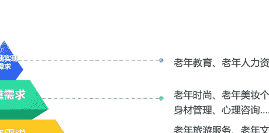

- 老年教育、老年人力资源服务...
- 老年同居、老年爱护、医疗养老、老年器材管理、心理咨询...
- 老年旅游服务、老年文化娱乐活动、助险机器人智能设备...
- 医疗服务、营养保健品、健身器材、健康监测设备、防跌神器、养老保险...
- 老年服、老年食品、助听、老年适、装修、车车、家政服务、老年养老服务...

图5-2 马斯洛需求层次的银发市场分类

除此，需求的划分方式还有很多，例如显性需求和刚性需求和弹性需求划分。显性和刚性需求是根据消费者的需求是否会在购买时表现出差异来进行划分的。显性需求是指消费者识别到并有购买的某种品或服务，如老年服装、衣服、代车等；刚性需求是指消费者没有直接提出或不能清晰描述的需求，如心理咨询、伴随机器人、防跌神器等。刚性需求和弹性需求是根据价格受变动的影响程度进行划分的。刚性需求是指供求关系中受价格影响较小的需求，对应的产品和服务包括老年需求、失智能照护服务、医疗服务等；弹性需求是指供给关系中受价格影响较大的需求，对应的产品和服务包括医药抗衰、家政服务、家庭机器人等。然而，显性和隐性、刚性和弹性需求的划分，是相对而言的，对于某人在某时刻而言是刚性需求或弹性需求，对于另一人而言，可能是刚性需求或显性需求。

对马斯洛需求层次中每一层级包含的银发市场产品及服务的分类按显性隐性、刚性弹性的程度进行划分，可以将每个类别归类到图5.3的四个象限中。第一界限是显性需求和刚性需求对应的品类，都是明确需要的必需品，消费者成本低且需求大，是企业可以迅速进入的领域。第二界限是显性需求和弹性需求对应的品类，这些产品和服务的认知是比较高的，需求会有增长。对于企业来说，如果通过技术进步、减少成本、规模化生产等方式，使得需求明显，企业将有效地占据市场并取得成功。第三界限是隐性需求和弹性需求对应的品类，这些产品和服务的普及性不高，一些老年人甚至不知道这些。对于企业来说，成本较高，意味着有限的受众，入门槛大，推广速度慢。第四界限是隐性需求和刚性需求对应的品类，这些产品和服务普及并不高，但对老年人来说是必要的。综上，从需求分类的视角，按照四界限对企业进入市场的难度从低到高排序为：第一界限的难度最低，第二界限和第四界限的难度相当，第三界限最高。

| 显性需求 | | 第一界限 | |
| :--- | :--- | :--- | :--- |
| 家庭机器人 | 老年护理服务 | 老年文化活动 | 医疗服务 |
| | 养老服务 | 老年服 | |
| | 助听 | 老年用品 | 老年鞋质 |
| | | 老年教育 | 健身器材 |
| | 医疗器械 | 老年护理 | 养老保险 |
| 弹性需求 | | 隐性需求 | 健康监测设备 |
| | 随型机器人/智能设备 | | 老年养老服务 |
| | 老年服务管理 | | 老老化改造 |
| | 心理咨询 | | |
| | 老年培训 | 三界限 | 隐性需求 |
| | | | 四界限 |
| |需求 | 安全需求 | 尊重需求 | 自我实现需求 |

图5-3 按需求属性划分的银发消费品四界限

当企业全面了解市场整体需求、选定业务赛道后，至关重要的是通过多种渠道，全面深入该领域内的消费者需求，严谨辨别这些真伪。企业应聚焦于那些普遍存在的、持久性的、触及消费者核心且展现出明确支付意愿的真实需求。如图5-4，从产品设计、生产到上市的每个阶段，需求的洞察都是不可缺的，不同阶段适用的方法：

在产品研发之前，企业可以通过市场调研，利用问卷、焦点小组讨论、深度访谈等法直接倾听消费者的声音，捕捉他们的需求。在产品设计过程中，企业可以通过原型测试，通过构建早期版本，邀请目标用户进行测试和评估。在产品设计完成后、生产制造前，可以采用实物参与的方法验证和锁定需求，避免生产后无人问。在产品全面上市之前，企业可以选择合适的市场范围。产品上市后，需要持续追踪消费者的反馈，不断迭代和优化产品，这时可以使用A/B测试，通过将用户随机分组，使用不同的版本，然后收集和分析数据来评估各版本的表现，以此确认哪个版本更符合消费者的偏好。也可以通过问卷、访谈等方法了解消费者需求，为产品的优化提供依据，并将产品推进至下一个生命周期。

## 材料：足力——为老年人打造一款舒适的鞋

足力创立于2012年，是中国老年鞋类的开创者，全球老龄消费品龙头企业。足力研发出发，深入研究老年脚型，独特创造老年脚型的专业鞋，增强老年人穿鞋舒适度。目前，足力养老专店超过3200家，遍布全国省市大中小市。据统计，2020-2023年，足力养老连续四年老年鞋销量第一。

足力养老的成功，离不开对于老年消费者需求的深度洞察，具体做法如下：

- 1. 选择符合老人需求、刚性需求和显性需求的品牌。足力品牌创立于北京：“老年人并非不消费，是他们的消费更理性，更倾向于购买自身舒适的产品。”由于老年人是不可忽视的生理需求，而鞋类作为行为的必需，是老年人群体的刚性需求。而且老年人对自身鞋有清晰的认识与理解，一双舒适鞋是老年者的需求。在需求的增加下，老年市场展现出了巨大的发展活力，为足力养老的快速增长和扩张奠定了基础。

- 2. 深入访谈老人，进行需求调研。在品牌创立之初，创始人瞻性地设立了调研部门，自带领团队深入老年频繁活跃的公园、购物中心、他们居住之所，从而开展了广泛的访谈调研。这一过程中，团队与多个老年朋友进行了面对面的交流，细致地挖掘了他们在老年方面的需求，特别是针对老年人特殊的特点进行了调研，并进行了详尽的数据收集。通过调研，调研部门总结了老年人的大问题：脚走路不累、脚趾痒、平衡力差、容易滑。

- 3. 针对需求设计。2017年，足力建立了足部科学研究院，服务于后续的设计。2023年，足力与“中国养老”达成战略合作，共同致力于为老年人打造专业鞋，起草了《老年鞋》国家标准（GB/T 43587-2023）正式实施。目前，足力在产品外观、鞋底、鞋垫等方面先后获得发明、实用新型等5项专利。

### 5.3 选择合适的路径，提供产品和服务

在深入洞察消费者需求后，接下来的关键便是考虑自身资源能力有效地满足这些需求。企业可以选择四条路径：一是依靠自身的研究实力自主研发，既有领域积累了一系列竞争优势；二是学习国内经验，通过收购和合资的方式获取所需资源；三是携手伙伴构建战略联盟，实现资源与能力的共赢；四是采取财务策略，培养具有高潜力的新兴企业。

#### 表5-4 企业满足需求的四种路径

| 路径 | 特点 | 条件 |
| :--- | :--- | :--- |
| 自主研发 | 研发成功率低 预期收益高 成本自负 | 有技术可迁移 业务内缺乏现有技术 |
| 收购合资 | 研发成功率高 预期收益大 成本高 | 需要快速进入新领域 业务进入壁垒较高 企业不愿意独立承担风险和成本 |
| 战略联盟 | 研发成功率一般 预期收益分 成本分担 | 企业间资源整合 企业间竞争少 |
| 财务投资 | 研发成功率低 预期收益高 投入高 | 企业资金强势，看好市场，但缺乏经营管理的能力 |

#### 5.3.1 自主研发

自主研发适用于以下情况：

- 企业在既有领域积累了一系列竞争优势，利用这些优势开展全新业务领域，自主研发成为一种常见的战略选择。通常情况下，那些领先在相关领域拥有市场机遇的科技企业更倾向于采用自主研发。以大奇推出的助听器为例，该领域的核心竞争力在芯片与算法技术。作为AI领域的领跑者，科技技术在该领域具有显著优势，其自主研发能够识别多种噪音模式。

- 二是企业在目标业务领域尚未积累足够的竞争力，对新兴或萌芽期的产业（其中不具备竞争力的现有企业），自主研发可能成为一种可行的策略。以足力为例，该产品品牌创立之初，市场上尚无人细分。在此情况下，企业无法通过收购行业内现有企业来获取竞争力，只能通过自主研发的方式设计、生产，从而成功进入这一新兴市场。

企业在自主研发时，首先要深入了解养老市场的消费者的需求，具体的参考策略二。随后，企业可以组成专门的研发团队，投入必要的资金和资源进行新产品的设计和开发。因为企业进入的是养老市场，其产品设计需要遵循安全、适老以及通用三个原则。安全性是指材料安全、结构安全以及功能安全。适老性强调界面简洁、人性化以及舒适性。比如老年人的智能设备，应该考虑老年人的特点，采用大字体、语音提示和一键操作等，提高产品的易用性。而通用性意味着消除老年标签，采用标准化设计理念，并能够应对需求的变化，比如一类可调节角度的助老椅，并未特意强调为老年设计，其尺寸、结构均符合标准化原则，并增加移动功能，可以满足更多的需求。最后，企业在研发设计过程中，还需要高度重视与消费者的互动及反馈，持续调整和优化产品功能，确保最终产品能够精准对接养老市场的实际需求。

### 3.5.2 机会

企业想要涉足的领域是新的，或者自己在关键竞争力上有所欠缺。比如北方新百，它是一家商贸类企业，其布局健康养老业务并不具备产业基础和技术优势，因此可以通过聚安通等渠道，将养老业务纳入公司版图。

企业想要进入的行业窗口期短期，有利于快速提升企业在市场中占据领先地位。比如国药集团作为一家医药健康领域具有深厚实力的企业，为了布局养老银发产业，选择了华润医药持有华润51%股权，从而扩大其在脑血管疾病治疗领域的业务规模，提升了“老龄健康-慢病管理”领域的业绩。

企业想要进入的领域已经相当稳定，进入壁垒较高。比如中国平安保险行业发展，这一领域使得平安集团获得了银行的牌照和资源，拓展了金融服务，为更多的养老奠定了基础。

企业看到处于创业或成长期的产业，但不愿意承担风险和成本，可能会由另一企业合作，利用自身优势分担成本。例如，国药集团国际有限公司（简称“国药国际”），与知名医药企业赛诺（Seragon）达成战略合作，成立合资公司。

战略联盟包括技术开发、产品联盟、营销联盟、供应链联盟。技术联盟专注于两个以上的企业共同研发，加速创新步伐；产品联盟是两个以上的企业为了增强老年人市场影响力，联合推出产品；营销联盟是两个以上的企业通过分销渠道，开拓市场；供应链联盟是在同一条供应链中企业之间整合资源、能力和竞争力。

财务投资包括风险投资、私募股权投资（PE）。风险投资通常于初创或成长期的企业；私募股权投资则于已形成现金流的成熟企业，投资目标企业以控制权，并在一定时期退出，实现资本增值。

案例：南京新城

- 1. 国内养老
安通：2016年，南京新城收购了国内最大的养老服务企业安通。安通深耕上海、广东等26省市，涉及2800万老年人。
康康：2017年，南京新城通过跨境转让获得康康51%的股权。康康作为国内居家服务的领军者，在全国建立了30个智慧指挥中心，覆盖200个区县，成功组建并运营团队，涵盖超过382万用户。

- 2. 国际养老市场
以色列养老：2017年，南京新城跨国投资，收购了以色列的居家服务商纳培（Natali）。纳培以其卓越的居家服务、应急救援和远程医疗服务，服务范围涵盖以色列全国，及八分之一的人民。
A. S. Nursing：2017年，南京新城收购了以色列高端养老企业A. S. Nursing。这家是以色列长期养老服务的经营者，拥有超过30年的经验，布布全国26家分支机构，为老年人提供包括专业服务、私人入住及养老咨询在内的全方位服务。

今日，南京新城已形成了以安通、康康、Natali、A. S. Nursing等为核心的健康养老集群，实现了“养老社区+养老机构+线上平台”的四位一体模式，并融合了“互联网+养老”理念，实现线下无缝衔接的智能化服务。2023年，南京新城健康养老与养老板块的收入，达到了21.31亿元人民币。

等购物平台之一。与此相对的渠道分为线下渠道和线上渠道。从企业的角度看，渠道可以分为自营渠道和合作渠道。自营渠道是指企业自主构建的销售通路，用以直接推销销售其产品或服务，如自营的门店。合作渠道是指两个或多个组织或个人为了共同的目标或利益而进行的合作，如生产商与网红合作进行直播带货。综合线上、线下、自营、合作，我们可以将渠道分为四个类：线上自营渠道、线上合作渠道、线下自营渠道以及线下合作渠道，如图5-5所示。

| 自营渠道 | 合作渠道 |
| :--- | :--- |
| 线下自营渠道 | 合作渠道 |
| 例：自营门店 | 例：经销商营销合作；机构合作 |
| 引入方式：渠道、活动推广 | 合作方式：营销经营 |
| 注意事项：选址 | 注意事项：合作的选择、合同签订 |
| 线上自营渠道 | 线上合作渠道 |
| 例：官网、社媒体、微信 | 例：网红合作、电商平台 |
| 引入方式：SEO、社交引流、广告 | 合作方式：广告、带货；利用流量、技术、物资等 |
| 注意事项：人工运营 | 注意事项：合作的选择 |

图5-5 接触老年用户的四大渠道

#### 5.4.1 自营渠道

线下自营渠道的主要形式是自营实体。自营实体能够为消费者提供直观的购物体验，深化品牌与消费者之间的交流与互动。对于部分不熟悉网络操作、对购物质量持有怀疑态度以及容易被诈骗的老年群体而言，自营实体成为了他们接触品牌的重要窗口。

在自营实体的布局中，选址环节至关重要。为了确保老年客户群体的有效覆盖，将店铺设立在老年人口密集区域是明智之举。理想的选址应聚焦于老小区周边、出口入口、市场及超市附近等流量汇聚之地，以便接触到更多的老年客户。对于那些需要体验才能认知并促成交易的商品，如专为老年人定制的鞋子，自营实体更是不可或缺的。这类商品往往需要消费者进店试穿，通过亲身感受的舒适度和适用性。

自营实体的获客方式，较为常见的是地面推、活动推销等。地面推主要是依靠传单、扫购、赠送礼品等形式进行获客。这种方式比较引起人群的反感，要注意避免将落地设在机场、超市等消费者停留时间较短的场所，应优先考虑公园、广场等消费者愿意长时间停留的区域。同时，地面推也要选择在消费者相对空闲且轻松的时段，如清晨或晚后休息的时间，提高地面推的效果。活动推销主要是依靠促销、体验等形式进行，同时也要注意促销的短期效应，以及体验活动对消费者的转化影响。

#### 5.4.2 线下合作方案

线下合作常见的形式，是与经营商、代理商合作以及与其他企业和机构合作。

老年经常活动的场所包括超市、商店、中理疗养等，还有越来越多的老年人愿意前往健身、美容院。如果产品是适合这些场所的，比如保健品、化妆品、按摩椅等，就可以与这些商家合作，由他们进行经营或者代销。这种方式主要是由经营商和代理商管理的。与这些商家合作时，企业应建立严格的筛选机制，确保经营商和代理商良好的信誉、专业的销售渠道和广泛的客户基础。同时，制定明确的合作协议，包括合作目标、利润分配、售后服务条款等，保障双方权益。

在寻求合作时，企业的思路可能会更加开放，寻找那些能够接触老年人的企业与机构作为特殊。显而易见的选择包括居家养老服务、社区日照机构、养老院、家政公司、社区委会、协会以及退休人员部门等，这些组织在日常生活中与老年人有着密切的联系。

此外，一些新的渠道也可以考虑加入保险市场。保险从2016年开始开展试点，截至2023年，试点范围已扩大到49个城市，覆盖1.8亿人，享受待遇达134.29万人^[13]。作为养老护理需要有专业的护理人员进行评估并定期提供服务，这些都是客户需求。还有辅助工具，2019年民政部开展辅助器具社区租赁试点，截至2023年3月服务累计91.8万人^[14]，其中很大一部分是老年人。通过辅助具租赁开展合作，咨询、租赁、安装、维修、回收等，都能与消费者建立联系。不仅如此，老年学和老年旅游，近年来非常火热。与长期保险、辅助具零售有望享受人群相比，老年学和老年旅游的受众有消费能力，是企业需要重点关注的合作对象。企业进行合作的方式非常丰富。例如，在老年大学开展健康讲座及产品体验活动，让老年人在学习中体验健身产品的效果。同时，可以与老年旅游公司合作，设计包含产品体验的旅游线路，让老年人在享受之旅乐趣的同时，了解并购买自己的产品。这种合作可能需要企业对合作进行筛选，包括老年和目标消费者是否匹配，机构是否有良好的信誉等等；并且要注意长期合作关系的维护。

#### 5.4.3 老年合作成果

线上合作是指企业通过互联网平台，与具有影响力的个人（如网红、KOL）、其他渠道或电商平台合作以达到品牌推广、产品销售或市场拓展等目的的一种合作方式。线上合作的好处在于，它能够帮助企业积累粉丝基础和影响力，快速提升品牌知名度和光环，为企业带来更多的客户。通过专业的 KOL 或网红合作，企业能够更加精准地触达目标消费者，提高营销效果；此外，线上还能帮助企业降低市场推广成本，提高销售转化率，与品牌和市场的双赢。

与影响力广的 KOL（意见领袖）或网红合作的方式，主要是打广告和带货。通过他们，企业可以邀请他们打广告，快速扩大品牌知名度和影响力，利用他们庞大的粉丝基础和强大的号召力，精准传递品牌信息，转化粉丝向消费者的有效转化。企业邀请网红带货，不仅能提升影响力，还能积累网红的信誉积分，增强消费者信赖，建立品牌口碑。在选择 KOL 和网红时，企业应深入分析其粉丝特征，确保与品牌目标用户一致。例如，抖音、小红书，“时尚”粉丝主要集中在18-50岁的年龄段，对于化妆品等而言是适合带货伙伴。此外，企业还需要合作内容的创意性和吸引力，同时严格把控广告内容的质量，确保每次合作都能为品牌带来价值。与电商平台合作，为企业提供了一个流量、技术、物流等服务于一体的综合平台，简化了交易，扩大了销售，帮助企业实现快速增长，在竞争不断加剧的情况下，电商平台的费用也不低。^[13] http://www.ee.gov.cn/znzs/gzdw/2024/0290/t20240290391415485.shtml
[14] https://www.mca.gov.cn/n2623/n2638/n2703/c16626409979998478/content.html

#### 5.4.4 线上自建渠道

线上自建渠道主要包括企业的网站、官方社区、电商平台店铺、微信群等。此类渠道融合了线上与自建的双重优势：线上赋予其敏捷的购物体验和高效的数据采集能力；而自建则确保企业对渠道的全面掌控，精准传达品牌理念，直接对接消费者获取即时反馈，迅速适应市场变化，调整合适的策略。

然而，线上自建渠道面临两大挑战：首先，对于老年群体而言，他们可能因为使用不便或缺乏信任而拒绝购物；其次，自建渠道在启动阶段较为困难，认知度低、用户积累缓慢。针对数字鸿沟的问题，企业应从零开始对其教育，成本较高。因此，更为有效的策略是聚焦于购物平台的易用性和安全性，适应老年者的特定需求。同时，企业应针对老年人在购物过程中遇到的不便之处，例如老年群体可能遇到阅读困难、下单流程复杂、难以定位以及退货等问题，企业可以对网站进行改进、优化布局，提升阅读体验；简化购物流程，使得过程更加直观；强化售后体系，明确订单入口。其次，老年人对于购物的谨慎态度主要源于网络诈骗。他们害怕自己在网络领域的局限，面对网站时尤为谨慎。此时，企业应致力于建立长期稳定的信任，通过提供高质量的产品和服务积极售后支持，赢得老年者的信任。

案例：退休俱乐部——自建渠道

退休俱乐部自2015年起创立，有利于打造一个为老年人设计的综合平台，其核心板块涵盖旅游、本地生活、电子商务、社交互动等。

- 1. 电视节目：“退休吧”作为老年部的标志性节目，上海范围内热播，收获较高的收视率。节目精准定位老年群体，内容丰富多彩，涵盖健康养生、趣味爱好、养老指南、旅游探险以及生活资讯，有效吸引老年人群的关注，积累了许多忠实用户。
- 2. 专刊报：《老友报》精心策划并面向老年人群，每周固定发行，每期发行量高达十万。报纸内容丰富，包括健康、旅游、理财规划、家庭生活、养老知识等，直接送达家中，极大地提升了品牌知名度和影响力，更是巧妙地将流量引导至公众号，实现了线上线下同步的有效转化。
- 3. 微信公众号：“退休俱乐部”已成为老年资讯的重要渠道，拥有百万粉丝。公众号坚持每日更新资讯，视频保持高频推送，实现了高质量的内容创作，激发老年人的兴趣与购买欲望。通过公众号，用户可以轻松进入商城购物，享受一站式服务体验。退休俱乐部运用电视节目的影响力建立基础，电视与营销的广泛影响力带来流量，再利用公众号的权威性，精准定位老年群体，实施有效营销策略，实现了从认知到转化的无缝对接。目前，退休俱乐部积极拓展服务版图，向长三角地区扩展，逐步覆盖了50岁及以上的老人群，累计人次超过二十万。

### 5.5 优化营销策略，赢得老年人信任和信赖

企业进入市场的最后一步，是促进消费者的购买行为。如何让老年消费者买单？企业可以在持续营销中创造诱惑。尽管这一领域的营销曾遭遇一些质疑与批评，但我们也不得承认，在引导老年人消费方面展现了巨大的实力。良好的营销，保健品公司能够赢得老年人的青睐，关键在于它们对于老年人需求、消费习惯的精准把握。他们巧妙地运用了免费福利、情感共鸣、科学普及、现场说法、感恩回等策略，成功激发了老年人的购买欲望并维持持续消费。当然，在借鉴营销的同时，企业也应时刻保持警醒，确保产品的质量和安全性，坚决抵制套路营销、虚欺诈等，以赢得消费者的信任。

根据营销经验，具体而言，针对老年人的营销分为六步：

第一步，建立联系。为了吸引老年消费群体，采用免费发放福利作为切入点至关重要。这些福利能够引起他们的兴趣，降低初次尝试产品的门槛，确保他们不会因为价格因素而错过机会机会这些免费福利的类型是多样的，比如油、鸡蛋、纸巾等食品、健康咨询、体检、旅游服务、微信红包、优惠券等。通过获取这些免费福利，商家可以借此获得老年人的联系方式，成功与老年人建立初步联系。免费只是开启对话的敲砖，老年人可能会享受福利后就不再保留联系。企业需要采取持续且丰富的策略，开展每日活动，在日常互动中培养老年人的参与。

第二步，取得初步信任。这一步的目标是消除老年人内心的焦虑和恐惧。建立起信任，企业可以通过展示实力和文化。一方面，向老年人展现权威性、专业性，展示资质、行业认证、专利等；同时，充分利用规模、用户数量等优势，提升老年人的认可度。展示实力和诚信经营，尽量避免任何形式的虚假宣传，确保每一次展示都真实。另一方面，对于老年人来说，他们倾向于选择具有社会责任感、文化底蕴的品牌。因此，企业积极传递价值观、环保等，建立信任需要情感交流。许多老年人可能会遭遇孤独、朋友远离或家庭困境，导致感受不到关怀。基于这样的营销，销售人员需要表现出足够的同理心，给予老年人关怀。

第三步，触发消费动力。这一步的目的是让老年人感觉到自己需要。老年人的需求是层次化的，包括生理需求、安全需求、社交需求、尊重需求和自我实现需求。有些需求是显见的，有些需求藏于内心处，这就需要企业把握老年人的痛点、热点，激发其潜在需求。在这个过程中，传递先进理念，积极发挥品质生活，强调健康、快乐的生活方式。

第四步，证明产品效果。这一步需要老年人证明产品正是需要的，重点在于让老年人眼见、耳所闻、身体体验。具体的表现方式可以是权威报告、临床试验结果，也可以邀请消费者看工厂，通过观察生产流程，从原料到成品每一步，使老年人产生共鸣。通过测试、试用、试吃等多种形式的活动，让老年人直接接触产品。

第五步，触发购买行为。此阶段，企业需要巧妙运用价格策略与服务策略，为老年人营造既有吸引力的购物环境。一方面，限时低价、限时折扣、限时促销等策略，制造紧迫感与稀缺性，激发老年人的购买欲望。这些策略利用人们害怕错过的心理，促使老年人在时间内做出决策。另一方面，赠品、增值服务等策略，更能让老年人感受到实实在在的优惠，从而感觉自己占了便宜。这种心理上的满足感往往成为推动下单的动力。此外，完善的售后服务体系也是不可缺的一环，企业需要承诺售后保障，无理由退换、质保等，消除老年人的顾虑，让他们在购买过程中更加安心放心。

第六步，维护客户关系促进增长。老年客户关系策略多种多样，要注意经常互动，让老年人受到关心和尊重；如点赞、赠送生日礼物等。二是举办活动，老年人喜爱社交和聚会，企业可以定期举办回馈、体验会、节日庆典活动，吸引老年人参加，增加消费者的粘性和忠诚度。三是建立客户忠诚计划，如积分积分、会员特权等，鼓励他们重复购买，让每一次消费都成为积累信任的机会。这极大促进了“老带新”模式，充分挖掘老年客户中具有影响力和活力的活跃成员。通过奖励推荐行为，让老客户成为品牌的传播者，通过口碑效应引入新鲜血液，加入良性循环。

案例：安利——保健食品巨头的营销策略

安利是一个全球知名的食品品牌，创立于1933年，由卡尔·马戈创立。该品牌以植物营养为基础，致力于提供高质量的营养补充食品，帮助人们实现健康目标。安利的产品种类丰富，包括蛋白质粉、多种维生素矿、益生片、铁片等。安利之所以能够依靠强大的销售能力获得巨大成功，要点如下：

- 1. 通过展示企业、文化以及生产过程获得初步信任。销售员详细介绍了安利的背景，他们强调安利的历史悠久，拥有巨大的研发实力和科研团队，这些为消费者提供了品质保证。销售员积极推广安利的品牌文化，强调安利以人为本、诚信经营。他们分享安利公司的精神和公益活动，如捐资成立安利公益基金，帮助贫困儿童营养和教育等领域，这些举措展示了安利的社会责任，有助于消费者对产品的认同和好感。销售员还会详细介绍产品的过程，从溯源、选择原料，到采集、提取、生产、包装，每一个环节都做到可追溯。他们强调坚持绿色产品、绿色环境、绿色社会的理念，确保为消费者提供纯净、安全、有效的绿色产品。这些信息的传递，有助于消费者建立信任。

2024 年年初，国务院发布《关于发展银发经济增长老年福利的意见》（以下简称《意见》），这是中国出的首个支持银发经济发展的专门文件，具有“开天明义”的历史地位。《意见》指出银发经济的两个新特点，一是在对象上，不仅包括 60 岁以上老人，也包括老年人；二是在本质属性上，是一种经济形态，既包括银发产业。对于如何界定政府与市场的关系提供了框架，银发经济政策发展的重大转变，此后 2024 年也被视为“银发经济元年”。由此开始，我国银发经济将进入产业与产业协同发展的阶段，实现已有政策和市场双驱动，促进未来银发经济的规模化、标准化、集群化和品牌化发展。

### 1.2 银发经济的地域特色

从地域特色出发，坚持因地制宜、因势利导，发展地方特色银发产业，是一段时间内我国地区银发经济政策的主要举措。例如，老龄程度高等且欠发达地区，则应顺应乡村振兴带来的需求升级，发展“银发+休闲农业/文旅/特色食品/康养”等产业。例如，2022 年 9 月黑龙江人民政府发布办公厅《黑龙江省养老健康服务产业发展行动方案（2022-2026年）》，指出要培育银发经济园区，打造养老、健康养、医疗服务、旅游、休闲娱乐等多元融合的养老产业集群，促进银发康、养生、中药种植、乡村采摘、药养养养、科普传播发展。

全省重点布局建设 14 个银发经济园区，重点打造 4 个中医药产业，建设 3-5 个中医药健康旅游服务基地。

而对于银发发展水平的优势地区，无论老龄程度如何，银发经济政策引导上都应充分利用制造业和数字领域的基础，发展“银发+智慧养老”、“银发+智慧医疗”等产业。例如，老龄化程度最高是中国最大的经济中心城市，对国家要求的银发发展速度极快。2022 年 7 月发布的《上海市促进智能产业高质量发展行动方案（2022-2025年）》，涵盖了银发经济，发展车辆制造、通讯可穿戴设备，支持一键圈养、一键圈车等应用。

而老龄化程度相对较低、经济发展水平较高的天津市，也在 2022 年 6 月发布的《天津市进一步推进银发事业发展和养老服务体系建设的具体措施》中指出，要落实智慧康养产业行业引导，加大智慧康养产品供给、智慧健康新应用、智慧养老服务推广，鼓励组织企业申报智慧健康。

### 1.3 银发经济政策的重心

从银发经济政策趋势来看，养老公共管理和养老服务行业在 2019 年之后占据主导地位，老年权重有重要上升，更多消费场景的银发政策数量在稳步提升，如老年用品及相关产品制造、老年文体服务等。未来老年消费领域将巨大，将迎来更多好政策、创新养老产品、改善老年消费行业、银发消费增长潜力，极有可能成为未来银发经济政策新风。

值得的是，《关于发展银发增加老年人福利的意见》明确了产业发展的巨大潜力，从老年自身需要的老年用品、健康养老产品和康复辅助，到抗衰、养老金融和老年旅游等高品质服务，对全社会老化的推进、产业的多元化，也《意见》提倡创新银发产业，完善相关标准及推广目录。

对于老年生活、老年保健品、居家养老等满足老年基本生活需求的传统银发产业，《意见》鼓励创新银发产业，完善相关标准及推广目录。对于文娱旅游等跨银发产业，《意见》提振养老银发产业，推进健康银发产业，另一方面，完善相关服务设施及规定，健全扶持机制并加强监管，以改善老年人的文娱体验。对于智慧医疗、康养等未来银发经济，《意见》指出要加强老年规划部署，支持银发经济领域科研发，提高自主研发水平。同时，侧重发挥银发企业数字化转型的规模效应，推进产业集群，建立高水平银发经济产业园区，支持企业、科研院、行业协会等将发挥出来，推动银发经济科技的落地转化。

#### 国家级银发经济主要政策索引

| 发布时间 | 发布单位 | 文件名称 | 主要领域 | 相关内容 |
| :--- | :--- | :--- | :--- | :--- |
| 2006年2月 | 国务院 | 《关于加快发展养老服务的意见》 | 养老服务机构、老年医疗卫生、老年用品产品 | (1)建立养老服务准入制度，积极扶持养老资金，鼓励社会力量通过合资、合作等多种方式开展。(2)支持开展养老护理、临怀 |
| 2013年9月 | 国务院 | 《国务院关于加快发展养老服务的意见》 | 养老服务机构、老年医疗卫生、老年用品产品 | (1)加强老年服务规划，根据实际情况，对养老服务给予支持。(2)制定措施，引导社会力量开发养老服务，满足老年需求。(3)充分发挥市场配置作用，大力发展养老服务多样化。 |
| 2014年8月 | 国务院 | 《国务院关于推进养老业发展的若干意见》 | 养老服务机构、老年休闲服务 | (1)在养老资源丰富的地区，鼓励社会资本通过融资、合资、合作等途径，采取PPP等方式开展。(二)逐步扩大市场，凡法律法规没有明确的领域向社会资本开放。 |
| 2014年9月 | 国家发展委员会、民政部、财政部 | 《关于加强健康与养老服务工程的通知》 | 养老服务机构 | |
| 2015年2月 | 民政部、发展改革部、教育部等 | 《鼓励资本参与与养老服务的实施意见》 | 养老服务机构 | (1)开放市场：鼓励资本参与居家和社区养老发展。(2)政策优惠：对符合条件的养老性企业免税；对小型微养老企业补助。(3)用地需求：建设养老服务所需用地，适用国家规定的用地供应，积极发展养老旅游，规范老年旅游发展。 |
| 2015年8月 | 国务院 | 《国务院办公室关于进一步促进养老和消费的意见》 | 老年旅游休闲业务 | |
| 2015年1月 | 卫生计委、民政部、改革部 | 《推进卫生与养老服务相结合的指导意见》 | 老年医疗服务、养老机构 | (1)大力推进农村养老和养老发展的多层次体系。(2)积极创新养老特色的信托产品(3)支持养老服务的多元化融资工具。(4)推进城乡养老保险体系建设，优化保险资金使用。(5)积极服务居民养老的专业化金融产品。 |
| 2016年3月 | 中国人民银行、民政部、银监会等 | 《关于金融支持养老服务快速发展的指导意见》 | 金融支持、养老金融服务 | |
| 2016年10月 | 国务院 | 《老年教育发展规划（2016—2020年）》 | 老年教育培训 | 鼓励社会力量参与老年教育。通过政府购买服务、项目合作等方式，支持和鼓励各类社会力量通过资、合资、合作等形式举办或参与老年教育。 |
| 2016年12月 | 国务院 | 《关于全面开放养老服务市场提升养老服务质量的若干意见》 | 养老服务机构 | 全面开放养老服务市场，降低准入门槛，鼓励外资准入，简化行政审批。完善机制，加速推进向社会提供养老服务的办养老机构转型为专业养老技术和产品的企业。 |
| 2017年2月 | 工业和信息化部、民政部、国家卫生委员会 | 《智慧健康养老产业行动计划（2017-2020年）》 | 养老科技科技创新养老 | 重点聚焦健康养老关键技术和产品的研发，以及推动在养老行业中优先使用智慧健康养老产品，财政补贴和个人购买智慧健康养老产品，按照企业标准、政府扶持、市场化的方式，实现覆盖多区域、多类型的试点。 |
| 2017年8月 | 财政部、民政部、人力资源保障部 | 《关于运用政府和社会资本模式支持养老发展的实施意见》 | 养老服务机构 | 重点引导和鼓励社会资本通过 PPP 模式，建立养老保障基本养老服务和改进中端养老服务。 |
| 2018年4月 | 财政部、税务总局、人力资源保障部 | 《关于开展养老服务试点的通知》 | 养老金融 | 在上海、福建、厦门等地实施试点，对符合规定的养老产品支出，允许在个人所得税内抵扣，对养老金支支再次征收个人所得税。 |
| 2019年4月 | 国务院 | 《关于推进养老服务的意见》 | 养老服务机构 | 支持养老化发展 |
| 2019年10月 | 国家卫生委员会、发展改革委、教育部等 | 《关于建立完善养老服务体系的意见》 | 养老服务机构 | (1)大力发展养老化，积极落实养老扶持政策，扩大养老服务供给。(2)加强养老化需求，落实养老服务供给，养老养老养老养老养老养老养老养老化发展。 |
| 2019年10月 | 国家卫生委员会、发展改革委等 | 《关于推进医养结合发展的意见》 | 养老服务机构 | (1)大力发展养老化，积极落实养老扶持政策，扩大养老服务供给。(2)加强养老化需求，落实养老服务供给，养老养老养老养老养老养老养老化发展。 |
| 2019年1月 | 自然资源部 | 《关于推进养老发展的意见》 | 养老服务机构 | (1)大力发展养老化，积极落实养老扶持政策，扩大养老服务供给。(2)加强养老化需求，落实养老服务供给，养老养老养老养老养老养老化发展。 |
| 2019年1月 | 中共中央、国务院 | 《国家积极应对老龄化中期规划》 | 养老服务机构 | (1)发展经济，推动养老服务融合。(2)强化老龄化能力，深化创新驱动发展，把技术创新作为老龄化的第一动力。 |
| 2019年12月 | 工业和信息化部、民政部、国家卫生委员会等 | 《关于促进老年用品发展的指导意见》 | 老年用品产业 | 全面提升老年产业体系智能化水平，加大老年健康支撑力度，加强辅助技术研发和应用。推进当地老年用品产业，培育新型企业，建立老年产品标准体系、开展老年示范工程、开展“养老爱老”购物等措施。(1)加强发展商业保险，鼓励社会参与养老产品，满足养老保险第三支柱。 |
| 2020年1月 | 银保监会、发展改委员会、教育部等 | 《关于促进养老领域商业发展的意见》 | 养老金融服务、养老服务机构 | 多元养老产业供给，增加多样化服务供给。税收优惠：商业保险机构设立养老、护理等服务，按照规定享受相关税收优惠。纳入保险：符合条件的养老机构举办及设内的医疗机构，按照规定纳入保险定点范围，规范性文件，强化效能，优化服务。 |
| 2020年7月 | 民政部、国家发展委员会、财政部等 | 《关于实施老年住房适老化改造工程的指导意见》 | 居家老化改造 | 各地将居家老化改造纳入养老服务体系建设，针对困难老年人需要的居家适老化项目通过财政补贴、社会捐赠等方式予以支持。 |
| 2021年3月 | 文化旅游部、改革部、财政部 | 《关于推动公共文化服务高质量发展的意见》 | 老年文体服务 | 支持装修装饰、家政服务、物资等相关领域拓展老化改造业务，积极培养有见头部企业和富有新活力的中小企业，推动市场规模不断扩大、服务质量持续提升。 |
| 2021年10月 | 工业和信息化部、民政部、国家卫生委员会 | 《智慧健康养老产业行动计划（2021-2025年）》 | 养老科技和智慧养老服务 | 积极应对老龄化趋势，提供更适合老年人的人性化产品和服务，让老年人享有更优质的晚年生活。1、专一智慧健康养老产品供给工程；健康管理智能类产品、康复辅助器具类产品、养老监护智能类产品等；2、专一智慧健康养老工程：远程医疗、个性化健康管理、互联网+养老服务等；3、专一智慧养老服务推广工程：家庭养老社区、智慧食堂、“时间银行”互动助养服务、老年人能力评估。积极培育发展经费：（1）加强政策引导，编制相关专项规划，完善支持政策体系，系统推进养老产业发展。鼓励各地利用具有优势的特色养老产业，用现有资金渠道支持养老产业发展。 |
| 2021年1月 | 发展委、国务院 | 《关于加强养老工作的意见》 | 老年用品、养老服务 | (1）大力发展养老化，积极落实养老扶持政策，扩大养老服务供给。（2）加强养老化需求，落实养老服务供给，养老养老养老养老养老养老养老化发展。 |
| 2022年2月 | 国务院 | 《关于十四五养老规划》 | | | |
| 2022年4月 | 国务院 | 《关于进一步促进养老和消费的意见》 | 老年旅游休闲服务 | (1）大力发展养老经济，促进智慧健康养老发展，推进公共空间、消费场所等无障碍建设，提高养老水平。（2）多渠道增加养老服务供给，依法利用闲置用地新建、改建养老社区，推动降低运营成本。（三）结合老旧小区改造、城市城区嵌入服务建设等，优化家政、养老、助餐等服务布局。（四）实现养老服务机构 |
| 2022年4月 | 国务院 | 《关于进一步释放消费活力的意见》 | 老年旅游服务 | |
| 2024年1月 | 国务院 | 《关于发展养老的意见》 | 养老服务机构、老年用品文体服务 | |
| 2024年8月 | 国务院 | 《关于改进服务消费高质量的意见》 | 居家适老化改造、养老服务机构 | |
| 2024年10月 | 民政部、商务部、中央网信办等 | 《关于进一步提升养老消费质量的若干措施》 | 养老服务机构、老年用品产品、养老科技与智慧养老服务、老年居家适老化改造 | |

# 2. 银发经济发展经验

随着中国社会老龄化的加速，银发正日益成为新的经济增长点，吸引了众多创业者和投资者的关注。在此背景下，开发华、浙江云县以及北京红松等企业或地区，通过其独特的视角与实践经验，展现了如何精准把握市场需求，充分自身资源，成功切入银发市场，为其他希望进入银发市场的创业者和投资者提供了黄金借鉴。

### 2.1 开发华：“AI+教育”构建美好老年

是杨松柏母亲在网上找了一些有趣的课程，比如声乐课、舞蹈类，她也愿意尝试。这些课程不是专门针对老年人的设置的，她感觉觉得课程不适合自己，趣味性也大打折扣。杨松柏便有了“做专属属于老年人的兴趣课”的想法，但那时他又觉得，中老年人的文教育并非刚性需求，业务也相对分散，并不是一个好的选择。

20年前，杨松柏受国家大学邀请，让他们提供关于老年大学线上学习的问建议。在这个过程中，初创团队跑了很多老年大学的老师和同学进行调研。杨松柏才发现，老年教育是一个他想象中完全不同的赛道。

首先，线下供给非常匮缺。全国有7万个老年大学，但报名难，很多人要排队入学，有些学生上课要跨越整个周期，用户生命周期。老年大学是兴趣驱动的，学生的积极性很强，更是要找到新鲜事情做。对于丰富的生活，一个学生可能会报很多门课，也可能会坚持学习多年，因为对他来说是非常重要的学业。此外，市场巨大。在1962年到1978年间14年新增2500万的婴儿，未来的老龄化加剧和政策支持，将会带来巨大的经济市场。

“之前被认为是成人教育中的老年教育，有着自己的独特性。比较之，更像K-12教育，你只需要服务，用户就能长期留。”在老年人的需求有了新认知后，杨松柏觉得，这赛道特点与初创团队十分匹配。

考公、考研这类人才培训是有时间的紧迫性的，用户希望一天就能收获，第二天靠努力，下月就能加薪、一次就可以如此。这种特殊特性使得我们相关的业务的用户几乎不存在任何复购行为，使得他们成为教育赛道的玩家，把主要精力放在营销上。

初创团队的几个合伙人来自K-12 行业，营销能力有所欠缺，更擅长产品、服务、口碑。这种模式适合长期经营性的业务，也更关注驱动生产力的进步。通过长时间的调研，大家发现，把团队之前在 K-12 行业的经验，把学而思的模式，应用在中老年教育中，是完全可行的。

因此，初创团队最后选择入局发现赛道，2020年开启华赛正式成立，将在线上中老年教育明确为发展方向，这又是一个必然的结果。

#### 发展战略

2021 年，创立之初的天使融资，开开彩获得了初期基金和红虹资本的数千万人民币投资，并推出首批在线课程，包含国画、书法、舞蹈等。他们从相对熟悉和擅长的老年文娱教育起家，但整体战略布局并不止于此。

纵向战略上，开开彩坚持以 AI 为核心，持续化产品与服务创新。

垂直战略上，开开彩坚持以 AI 为核心，持续化产品与服务创新。在进入教育行业之初，杨松柏等人发现如今这个赛道的门槛并不高，只要有教育量的老人、有较强的销售能力，就能取得很多学生，但绝不是传统的“小工作坊”做法。他们在 K-12 行业已经看到过这种做法的结果——品牌吞活率低，影响范围有限。开开彩坚持了 AI 在技术业务上的核心地位。

老年教育的用户需求非常丰富，又以数据为导向。如果没有 AI 能力作为支撑，无法为用户提供更好的个性化服务。从赛道的长期竞争来看，基于 AI 技术的持续创新不可少。

在储备 K-12 的行业经验，研发团队依然坚持把 AI 业务开展起来，面对的是老年群体，持续进行在线课程和服务。2022 年，开开彩推出 AI 智能助教，基于学生的互动反馈，向其交付个性化内容。这也是真的，当面对同一门课的学习者，他们看到的课程内容、聊天信息、课后练习等都能完全不同，真正实现了基于用户标签的个性化教学。2023 年，开开彩又推出了“精英主播”线上直播，打造出一个数据驱动的互动的直播课堂。

开开彩的研发也已经实现模块化、流程式化输出，并且随着收集的数据持续更新，AI 技术在输出上取得了巨大的优势。研发团队可以根据用户画像给出不同的产品方案，在出品上达成“高效、低成本”个性化分层教学。学生是什么样的数据需求，研发团队就能对应其所需的教学内容。

尽管 AI 的研发投入成本高，短期内可能难以看到清晰的投资回报，开开彩坚持将 AI 成为必选项，也界定了技术在用户满意度、用户转化率、内部管理和管理效率上的价值。开开彩也将每年拿出营收的 15%到 20%，坚持到 AI 研发，持续探索 AI 技术在银发赛道的深耕。

横向战略上，创业团队将教育作为切入口，力图打造一个银发群体多元化的综合性平台。他们充分考虑了银发群体在不同年龄阶段的需求差异：

- 50-60岁属于活力老年人，未退休或刚退休，文化旅游、教育培训等精神化消费需求较大；
- 60-68岁老年人，基本上已退休，可能存在基础疾病，但不影响健康，其消费多围绕生活场景；
- 68-77岁老年人，年龄已经接近我国均预期寿命，可能会有慢性疾病，他们的消费核心关注点下降，对医疗健康类产品和服务需求较高；
- 77岁以上老年人，自理能力下降，可能半失能或失能，关注点是护理，如上门护理、养老机构等。

结合我国人口结构的观察发现，1962年到1975年出生的一批老人，正处于潮期，49岁至62岁的年龄，属于银发族中的活跃老人。他们时间充足，需要新的事物、新的组织、新的生活方式，并且有一定的物质积累和消费意愿。此外，文化类需求是领先，这也是开开彩的选择之一。

而在“在线”方式切入老年教育，开开彩首先能够在更大范围内高效触达目标客户。以60到70岁的人，以中线城市为主；以50到65岁的老人，以二三线城市为主，线下教育难以实现大规模，在线模式则可以用杨松柏等人在K-12行业积累的经验，尤其在标准化运营方面，开开彩可以支持数十万学员。

最重要的是，老年教育作为横向切口，为开开彩构建了一个庞大的用户流量。自立以来的时间里，开开彩的用户总时长超过200万小时。2023年，在线联动模式后，开开彩在多个城市的用户量达到50万，逐渐形成“城域一体化”模式，线上课程和线下俱乐部全部融合，实现线下联动，为学员组织丰富的线下活动，包括团体课程、社交、讲座，让老年群体更有归属感。截至2024年8月，开开彩在全国范围内建立了6个实体俱乐部。

#### 未来展望

开开彩创立还几年，万的市场空间，杨松柏认为他们取得的成绩只是长的第一步。从2024年开始，开开彩将在几年内，在全国范围内打造集养老、文娱活动、康养文旅、趣味赛事等一体的综合平台，满足银发群体在精神、社交和生活质量方面的化需求。未来研发团队也会更多借助AI的技术，让开开彩的各项服务更加普及。

杨松柏说：“我们做的是一件充满情怀的事情，不仅是在给爸爸妈妈做产品，也是在给自己做产品。希望以后，成为领先。”

# 2. 云木与“银发经济”促进木产业焕新

云木的历史悠久，20世纪70年代后期发展迅速，成为了当地支柱产业。近年来，随着中国人口老龄化的加剧，云木政府和企业看到老年玩具市场的潜力，发展老年玩具，开启产业转型之路。本案例描述了云木产业，从生产工艺走向自主创新，并在银发浪潮中抓住机遇，开启“云木+健康”新章节。

### 云木之乡

云木之乡多年有着“中国木玩具之乡”的美名。走在云木老街上，本地民众都能说出云木发展的脉络——起源于明清，兴于民国，盛于改革开放。

20世纪70年代初，云木走上了规模化生产的道路。从生产溜溜、竹雕、陀螺等易木玩具，云木从上海轻工获得了第一批国外订单，开启了木制玩具产业“走出去”世界的序幕。随着改革开放的东方，新一代云木年轻人纷纷投入创业产业，逐渐开辟了一片天地。从1972年到2000年，木玩具产值从104万增加到4.3亿元，实现了“从无到有”，为木玩具的飞跃奠定了基础。

彼时，云木属于典型的劳动密集型制造，劳动力需求大而技术程度较低。云木木制玩具80%以上出口，而且大多为贴牌生产，不仅使得云木木的知名度只在业界传播，而且市场上出现“优劣竞争”。早期的云木产业主要是木材资源和劳动力，效益十分低。进入新世纪以后，木玩具产业受到“双重击”也愈发明显：在内，劳动力成本升、原材料价格上涨、汇率波动等因素叠加；在外，外界形势日益复杂，外部需求具有大幅回升。

云木越来越多的木玩具企业意识到了，拥有自主品牌才有话语权。2004年后，木玩具产业开始转型升级，除了重视品牌注册，大家也积极参与国内市场的开拓，木玩具与幼儿教育的结合，正是当地走出的发展之路。

2004年，云木当地幼儿园园长发现教育教育与木产业的结合点，联动企业收集废弃玩具并将其制作教材教幼儿园小朋友，又得了非常不错的教学成果，在省、市赢了奖。木玩具与幼儿领域的契合“信号”，很快被当地企业和政府批准。

2007年，云木举办了第三届中国玩具节，举办第一届“木玩具+幼儿”高峰论坛，邀请学者及业界人士，共同接触木玩具领域。

2009年，云木成立了木家头部企业，承担当地老年教育研发基地。2016年，云木与教育部签订战略合作，开发老年教育教具。此外，木玩具企业开始转型电商，木玩具销售额从2014年的7亿增长到19亿元。至此，云木产业发展到一定阶段，仍没有资源密集型企业转型难题，竞争激烈，容易陷入同质化、利润薄等问题。

面对疫情持续、国内环境变化等因素，云木优化产业结构，寻找老年玩具市场的“蓝海”。一些敏锐的从业者发现到，传统认知中，木玩具主要面向小朋友，但老年人同样有互动游戏的需求。长期以来，老年人一直被忽视的状态，另一方面，中国老化加剧，意味着这类玩具市场上巨大的需求，木玩具进一步转型升级的重要路径。

2020年1月，云木成立了老年木产业发展工作组，将“老年木+养老”融合发展，提升产业能力和竞争力。2022年，云木政府发布《云木县“十四五”发展规划》，指出要“打造老年木产业特色品”，全力推进老年木产业发展。

在持续鼓励和引导下，云木立足“木玩具名城”的产业优势，参考以往经验，精准对接老年人需求。截至2022年12月，云木共有40余企业参与生产、研发老年木产品近200款。云木县发布《云木县老年木产业发展三年行动（2023-2025年）》，在市场开展行动，强调“木产+老年服务”融合模式，开发具有功能并推广老年养、老学、社区空间等。许多企业引入了高端专业人才，或与专业研究所合作，对传统木进行优化改造，或研发创新品牌，开发适合老年人的产品并推向全国。

2023年，浙江云县小米科技有限公司随同浙江省养老工作调研，访问比利、德国、奥地利等国，进一步拓展老年玩具海外市场，与奥地利知名的Cool Tool木玩具公司签订了合作协议。在访问期间，他们赠送了礼物、技巧、迷宫、记忆卡片等特色老年木智，赢得了当地老年人的喜爱。

### 红松：如意

红松成立于2020年6月，红松初创伙伴CC投获了1000万人民币天使投资，经纬资本投了2000万美元。红松有限公司专注服务于退休人员，以“重塑退休时代价值”为使命，通过优质的内容、多样化的服务丰富老年人的生活。

红松学堂创始人李乔曾深耕交通行业，作为行业部总裁、去哪儿集团副总裁，曾负责APP负责人，积累了丰富的管理经验。联合创始人何嘉为四川大学博士、中国老年协会委员，曾担任“健康路”、“好好吃饭”等节目主持人。红松学堂创业团队成员也曾在腾讯、学而思、美团等互联网公司工作。他表示：“我非常认可李乔团队对退休人员的洞察，看好老人在社交及平台构建的能力，也认可他在创业过程中表现出的快速落地能力，我们将持续支持红松在新退休领域的不断探索。”

“新退休老人”，是指20世纪60年代出生左右的退休老人。与上一代退休人员相比，他们消费能力更强，更加愿意接受新事物，“退而不休”成为一种新的生活方式。同时，随着网络、移动支付等互联网基础的完善，退休人员的消费行为正在大规模线上。尽管新退休群体能力强、时间充足，但在线化基础不错，也有丰富的娱乐及社交意愿，彼时却缺乏互联网产品能够解决他们的陪伴及精神需求。红松的创业团队意识到了老年人在线上平台上的缺口，致力于将红松打造成一代退休人群的文娱及社交社区。

红松采用“兴趣社交+学习”的模式，2020年、2021年继续推出“红松”微信小程序和红松APP。基于老年人热于加入各类兴趣组织的现状，从丰富的内容和社交需求切入，为用户提供兴趣场景和学习课程，解决老年人孤独和价值敏感的问题。起初，红松依托微信生态以“小程序+公众号”为载体，借助腾讯教育音视频能力，提供如在线、直播课程等服务。2021年8月，红松旗下兴趣课程学习品牌——锦销课程（现已名为红松课程）正式成立，策划开发涵盖国语、插画、电子、书法等在内的十个兴趣课程类，为几万名老年用户提供了专业的、优异的、多样的在线课程。

在老年人社交化的形式进行深入调研后，红松运营团队发现，与年轻人相比老年更倾向于人类社交，他们非常非常依赖熟人网络和意见领袖（Key Opinion Leader, KOL）。随着对微信生态的依赖，我们步入全新发展阶段，红松推出了“红松站”，红松类似于社区，但互动形式更加多样化。在这里，老年人可以依靠自身加入相同主题，如口语、画画、摄影等，与相同兴趣喜好的好友交流。每个小站都拥有自己的站长，站长是主动的主题发起人，以图文或者直播课程促进进行良好交流。小站长一部分来自合作签约的优秀站长，也能够通过平台运营，他们都有自己的兴趣与专业领域，乐于表达和呈现。作为舞台的红松，会向小站长提供运营管理工具，如直播、群聊、聚会等功能。

老年教育的用户需求非常丰富，又以数据为导向。如果没有AI能力作为支撑，无法为用户提供更好的个性化服务。从赛道的长期竞争来看，基于AI技术的持续创新不可少。在储备K-12的行业经验，研发团队依然坚持把AI业务开展起来，面对的是老年群体，持续进行在线课程和服务。2022年，开开彩推出AI智能助教，基于学生的互动反馈，向其交付个性化内容。这也是真的，当面对同一门课的学习者，他们看到的课程内容、聊天信息、课后练习等都能完全不同，真正实现了基于用户标签的个性化教学。2023年，开开彩又推出了“精英主播”线上直播，打造出一个数据驱动的互动直播课堂。

开开彩的研发也已经实现模块化、流程式化输出，并且随着收集的数据持续更新，AI技术在输出上取得了巨大的优势。研发团队可以根据用户画像给出不同的产品方案，在出品上达成“高效、低成本”个性化分层教学。学生是什么样的数据需求，研发团队就能对应其所需的教学内容。

尽管AI的研发投入成本高，短期内可能难以看到清晰的投资回报，开开彩坚持将AI成为必选项，也界定了技术在用户满意度、用户转化率、内部管理和管理效率上的价值。开开彩也将每年拿出营收的15%到20%，坚持到AI研发，持续探索AI技术在银发赛道的深耕。

文化特色。拍摄经验丰富的摄影师跟随游学之旅，深度拍摄风光大片，用镜头。红松 APP 中专门开设相关板块，以“视频+语音讲解”的方式，介绍各个游学项目的内容和特色，红松的风光展现和文化气息的细致解读，吸引了不少老年用户闲逛咨询。红松的游学主题非常丰富，涉及到合唱、陶瓷、制作东巴纸、制作剪纸艺术、舞蹈、书画等。

不少与红松游学的用户表示，他们对游学团非常信任，对于食宿、行程安排的满意度也很高，即使是游学经验少的老年人，也能很快融入团体，轻松享受出行。在 2024 年上半年，就有近万老年人参与了红松的线下游学。他们走了 12 座城市，游历了 20 个 A 级景区、6 个 B 级景区，走访了欧洲国家，打卡了 33 个艺术地标。

2024 年，红松完成亿元 B+轮融资，成为了国内融资规模最高、用户量最大的退休后互联网服务平台。同时，红松启动品牌大升级，内容包括规范并统一旗下多个品牌的品牌认知，强化红松主品牌形象。

联合创始人何嘉解释，游学等业务在红松发展过程中，受到用户实际需求激发而成长起来的，之前从名称到具体表达都未被统一在一个主品牌之下。随着红松用户基数的增长，这种态势会给用户带来不必要的混乱，影响服务质量的提升，也会对公司运营成本造成额外损耗，不利于红松品牌知名度进一步扩大。品牌升级后，围绕线上课程，红松已形成了包括“红松如意行”在内的多条业务线，覆盖银发教育、银发社交、银发文旅等领域。
