# 2024年
# 中国商事仲裁白皮书
植德商事仲裁研究中心 编

# 免费 价值 及时 专注
# 扫码加入 知识星球TOP 免费资源群

- 每日免费获取价值资源
- 提供各类资源搜索服务

| 热门付费文章 | 各行业报告 |
| :--- | :--- |
| 精选图书资源 | 副业赚钱方法 |
| 职场实用资源 | AI政经自媒体 |

公众号:知识星球TOP 微信信号:jntsg8 微信信号:jntsgj2

分享资料仅供个人学习，请及时删除，切勿商用传播

# 目录

## 一、2024 年仲裁新规及立法
- 1.《中共中央关于进一步全面深化化改革、推进中国式现代化的决定》......................... 1
- 2.《中华人民共和国仲裁法（修订草案）》...................................................... 2
- 3.《北京国际仲裁中心建设条例（草案）》................................................ 11
- 4.《境外仲裁在上海设立业务机构管理办法》.................................................. 14
- 5.关于调整本市中级人民法院涉外、港澳台台案件和仲裁司法审理案件管辖的规定，......................................................................................................17
- 6.（试行）律师办理国内商事仲裁涉及仲裁员选定的法律业务操作指引......................................................................................................19
- 7.（试行）律师办理国内商事仲裁涉及证人、专家报告及鉴定报告的法律业务操作指引（2024）.................................................................................... 20
- 8.《上海仲裁协会临时仲裁规则》......................................................21
- 9.中国国际经济贸易仲裁委员会：《仲裁规则》（2024版规则）......................23
- 10.上海国际经济贸易仲裁委员会：《仲裁规则》（上海国际仲裁中心）：2024版仲裁规则....28
- 11.广州仲裁委员会：《仲裁标准（广州）》修正案。
- 12.深圳国际仲裁院：《深圳国际仲裁院仲裁规则》................................32
- 13.国际律师协会：《国际仲裁利益冲突的指引（2024版）......................34
- 14.新加坡国际仲裁中心（SIAC）：第七版《仲裁规则》................................39

## 二、2024 年仲裁行业资讯
- 1.上海仲裁机构首家境外分支机构在港挂牌 .................................................... 41
- 2.北京全面推动国际仲裁中心建设 ....................................................................... 42
- 3.全国首例临时仲裁案件在海南自由贸易开庭 ............................................................ 43
- 4.全国首例涉外临时仲裁案件在红口外举办开庭并作出裁决.............................. 44
- 5.共93个国家在126个法域采纳《贸易法委员会国际商仲裁范法》...................... 46
- 6.厦门仲裁委员会加挂“国际仲裁院”...................................................................... 47
- 7.国际商会发布2023年仲裁和ADR统计数据............................................................... 48
- 8.世界知识产权组织与调解小组上海中心作出临时仲裁裁决.................................................. 49
- 9.上海仲裁委员会：由行业协会主引入仲裁的航运纠纷案件....................................... 51
- 10.司法部：2023年全国仲裁机构办理案件60.7万件 ................................................ 52
- 11.贸仲华发布《国际商仲裁年度报告（2023-2024）》和《贸易仲裁裁决领域认可与执行案例选编》...................................................................................... 54
- 12.北京仲裁委员会：全国首由仲裁作出临时措施裁定由法院裁定保全并实际执行的仲裁案件........................................................................................... 57
- 13.上海仲裁委员会：首部建设工程合同纠纷仲裁裁决发布............................................... 58
- 14.深圳仲裁委员会中心涉外案件依法协助仲裁调查令......................................................... 60
- 15.香港仲裁委员会副秘书长驻职并任命北京代表处首席代表....................................................... 62
- 16.重庆国际仲裁院揭牌，为解决商事争议提供新平台............................................... 63
- 17.破产纠纷与仲裁衔接机制建立...................................................................... 64
- 18.“北京仲裁委员会/北京国际仲裁中心”更名为“北京仲裁委员会/北京国际仲裁中心”......................................................................................65
- 19.香港国际仲裁中心北京代表处正式成立..................................................66
- 20.广州仲裁委员会改革总结召开，广州仲裁委员会按照新机制运作................................ 67
- 21.“中国（上海）证券仲裁中心”揭牌，助力国际中心建设................................ 69
- 22.国家司法局仲裁中心揭牌................................................................................70

## 三、2024 年仲裁司法审查
- 1.最高人民法院：《最高人民法院仲裁审查年度报告（2023）》...... 1
- 2.最高人民法院：仲裁审查典型案例...................................... 76
- 3.最高人民法院：仲裁典型案例...................................... 99
- 4.北京仲裁委员会：“支持和保障国际仲裁机制”发布典型案例......................................................................133
- 5.上海法院：《上海法院仲裁司法白皮书》《上海法院仲裁审查典型案例》......................................................................128
- 6.广东高级人民法院：仲裁司法审查典型案例................................................154
- 7.江苏高级人民法院：2019-2023仲裁司法审查工作情况................................................174
- 8.江苏高级人民法院：2019-2023仲裁司法审查典型案例......................................177
- 9.浙江高级人民法院：《浙江法院仲裁司法审查报告（2018-2023）》及十大典型案例......................................................................197
- 10.宿州法院：仲裁司法审查典型案例................................................229
- 11.宁波市中级人民法院：仲裁司法审查典型案例及《仲裁司法白皮书》......................................................239
- 12.大连市中级人民法院：仲裁司法审查白皮书及十大典型案例......................255
- 13.杭州法院发布仲裁司法审查典型案例................................................258
- 14.浙江温州中院发布《涉港澳台仲裁司法审查十大典型案例》......................................................................282

# 2024 年仲裁新规及立法

### 1.《中共中央关于进一步全面深化改革、推进中国式现代化的决定》
- 发布机关：中国共产党第二十届中央委员会第三次会议
- 发布时间：2024年7月
- 主要内容：为贯彻党的二十大作出的战略部署，二十十届中央委员会第三次会议研究了进一步全面深化改革、推进中国式现代化问题，作出如下决定。决定有五个部分，分三大板块。第一部分为第一板块，是总论，主要阐述进一步全面深化改革、推进中国式现代化的重大意义和总体要求。第二至第十部分为第二板块，是分论，主要从经济、政治、文化、社会、生态文明、国家安全、国防和军事等方面部署改革。第五部分为第三板块，主要加强党对党的领导、深化党的建设制度、党风廉政建设和反腐斗争。内容条目通篇排序，开列60条。
- 要点提示：《中共中央关于进一步全面深化改革、推进中国式现代化的决定》的内容多次提及“仲裁”。
  - 一、提升航运保险能力和全球服务水平，推进海事仲裁制度创新。
  - 二、健全全覆盖城乡的公共法律服务体系，深化律师制度、公证体制、仲裁制度、调解机制、司法鉴定管理体制改革。
  - 三、健全国际商事仲裁和调解机制，培育国际一流机构、律师事务所。

### 2.《中华人民共和国仲裁法（修订草案）》
- 发布时间：2024年1月
- 主要内容：2024年11月4日，《中华人民共和国仲裁法（修订草案）》提请十四届全国大常委会第十二次会议首次审议。这是我国仲裁法自1995年以来的第一次重要修订。此次修订致力于解决仲裁制度和实践中的突出问题，健全完善具有中国特色、与国际通行规则相融的仲裁法律制度，努力提升仲裁信力和国际竞争力，营造市场化、法治化、国际一流商环境，更好高质量发展和水平开放。2024年11月8日，《中华人民共和国仲裁法（修订草案）》等4项法律修订草案征求意见，截止日期为2024年12月7日。
- 要点提示：
  - 一、仲裁的必要性和起草过程：仲裁是国际通行的纠纷解决方式，是我国多元化解决纠纷的重要一元，在保护当事人权益、保障社会健康发展、促进国际交流等方面发挥着不可替代的作用。中央、国务院高度重视仲裁工作。二十届全体会议上提出，要完善仲裁制度，提高仲裁公信力。《若干意见》要研究修改仲裁法。修改仲裁法已列入十三届全国人大立法规划，实施年来全国各地设立仲裁机构，办理案件高达700万件，涉及纠纷涵盖全球100多个国家和地区。仲裁作为独特的机制，对改革开放、维护社会稳定发挥了积极作用。

### 仲裁 仲 仲 仲 仲 仲 仲 仲 仲 仲 
随着经济深入发展以及对外开放的形势，仲裁法也显露出一些问题。主要问题体现在：
  - 一是法律规定范围窄，随着新经济业态的发展，国际贸易等领域的纠纷未能纳入仲裁范围，影响了仲裁的作用。
  - 二是仲裁机构性质及其规定不明，不利于仲裁机构和行业的改革发展。
  - 三是仲裁法实施多年来的大量仲裁实践经验需要及时总结，进一步完善成熟可行的法律规范。
  - 四是仲裁司法审查标准不统一，国内、涉外仲裁执行方式存在内在冲突，制约了我国仲裁的高质量发展。
  - 五是现行仲裁法在制度设计上与国际发展衔接不够，亟需加强完善。

在十三届全国常委会立法规划后，司法部启动了仲裁法修改工作，并在2019年3月召开首次仲裁工作会议进行了部署。2019年5月，司法部面向全国征求仲裁法修改意见和建议；2020年3月，对涉外仲裁问题进行了专项研究；2020年9月，选集仲裁理论界和实务人员组建专家小组，形成了《修订草案（讨论稿）》。2020年10月，将《修改草案（讨论稿）》发送有关仲裁机构征求意见。

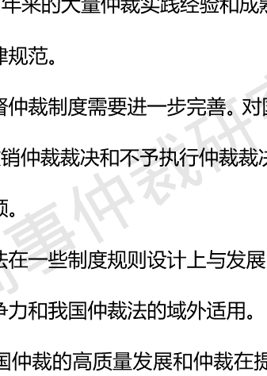

中央单位、各省（市、区）司法厅（局）和仲裁机构多次组织召开有关科研、立法、司法、行政机关和实务领域专家参加的论证会。与全国人大司法工作委员会、最高法院、商务部、国家体育局等进行座谈，专门组织了中级、高级、最高三级法院参加的专题座谈，并与商会和民营企业座谈，听取意见。在综合各方意见基础上形成了政策意见。

## 二、修法的基本思想
坚持以新时代特色社会主义思想为指导，以习近平法治思想为根本遵循，全面落实中央、国务院关于仲裁工作的决策部署，坚持正确的政治方向，尊重立法的规律，结合实践需求，立足我国国情，借鉴国际有益经验，完善具有中国特色的与国际接轨的仲裁法律。
- 一、坚持政策引领与仲裁规则统一，以《若干意见》为依据和指引，重点修改仲裁制度发展和提高公信力的内容。
- 二、坚持稳定性与适度性统一，在保持现行仲裁法基本立法不变下，总结经验，参考国际规则和实践经验，创造适应。
- 三、坚持准确性和前瞻性统一，以解决实际问题为导向，实事求是法层面的问题和任务，在制定方向和方案设计上兼顾长远，全面量方法的指导性、可行性和风险防控。
- 四、坚持中国特色与国际接轨统一，充分总结经过实践检验的中国特色经验，借鉴国际通行的《联合国贸易法委员会国际商仲裁示范法》（以下简称《示范法》）新进展结果，兼顾英国、美国、新加坡、日本、韩国、俄罗斯等国，以及我国港澳地区仲裁法的最新立法成果。

## 三、修改的主要内容
征求意见稿共有十九条，现行法增加了十九条，修改的主要内容如下：
（一）完善仲裁制度。立法旨在“促进国际经济交往”表述，体现我国解决国际纠纷、维护国际经济秩序的定位，适应新时代对外开放，加强涉法建设的新。（第一条）
二是增加“诚信仲裁”、“法院依法支持和监督仲裁”两原则。这两项原则在相关立法和法理上均为均衡，加入使得仲裁法律宏观框架更加完善。（第四条、第十条）
三是删除仲裁范围规定中“平等主体”的限制性表述，为我国仲裁在实践中已经出现的投资仲裁、体育仲裁等提供依据，留出空间，避免造成我国仲裁机构受理相关纠纷和当事人选择我国仲裁的合法性障碍，增强我国仲裁的国际公力和权威。另一方面，根据法律法规关于仲裁应当“法律”的规定，改为限缩性的“法律规定”。同时，为给法律作出特定规定留出空间。

（二）完善仲裁机构机制。一是根据“若干意见”的要求，进一步调整规范仲裁机构的设立及其登记管理制度。主要包括：第一，对自治、不设区的地市等地“确实需要”并强烈要求设立仲裁机构的实际，以及国家战略上有特殊需要的领域，增加了这类特殊需要经批准设立的规定。（第十一条）。第二，建立仲裁机构统一登记制度。将现行没有规定登记的中国国际商会设立的仲裁机构纳入登记范围，明确法人资格。

# 2024 | 中国商事仲裁白皮书

同时，鉴于1996年国办文件已经明确了国内新建立的仲裁机构可以受理涉外仲裁案件，涉外和国内仲裁机构均可办理涉外案件的实际，取消国内、涉外仲裁机构设立的双轨规定，删除对涉外仲裁机构的专门规定。考虑国务院已经允许境外仲裁机构在北京、上海等地设立业务机构，且一旦开放政策将扩大其的发展趋势，增加了境外仲裁机构在国内设立业务机构的登记管理规定。根据需要后法律配套措施的，以及在统一范围内境内涉外仲裁机构登记管理的要求，授权国务院制定仲裁机构登记管理办法。（第十二条）

二是依照“若干规定”的规定，明确了仲裁机构是公益性法人的法律性质，以及仲裁委员会是仲裁机构的主要组织形式。明确仲裁机构经费取得人格。（第十三条）

三是依照“若干规定”的规定，增加了仲裁机构建立法人法律结构和建立信息公开机制的规定。（第十六条、十七条）

（三）完善仲裁员、中国仲裁协会规定。是完善仲裁员的相关规定，在保留现在正符合条件的基础上，增加负面清单规定；尊重当事人对仲裁员的选择权，明确仲裁员名单为“推荐”名册；对从事涉外仲裁的仲裁员做了单独的规定。（第十八条、十九条）

二是完善仲裁员披露和回避制度。增加仲裁员应当保证独立、公正仲裁的声明书并送达当事人的规定；增加仲裁员披露义务，并将披露与回避制度相衔接，逐步规范仲裁员的行为。提升回避制度透明度，要求仲裁机构对回避决定说明理由；增加诚信成本，对当事人行使回避申请予以合理限制。保障当事人和仲裁员的合法权利。（第五十二条、第五十四条、第五十五条）

三是完善中国仲裁协会规定。将中国仲裁协会的定位从“仲裁委员会的自律组织”改为“仲裁行的自律性组织”；协会的监管对象在仲裁机构及其组成人员、仲员之外，增加了“其他仲裁从业人员”，防止监管对象出现“盲区”；鉴于会员数量巨大，将章程由“全国会员大会制”修改为“全国会员代表大会制”。允许与仲裁有关的教学机构、社会团体申请成为会员；并列举了协会维护会员合法权益和为大家提供服务等职责。（第十九条、第二十条）

（四）完善仲裁协议规定。一是要确立仲裁意思为核心的仲裁协议效力制度，参考国际仲裁需要约定明确仲裁机构的硬性要求。吸收司法解释和实践经验，对仲裁协议中没有约定或者约定不明确的情况予以指引性规定，保障裁进行进行。（第二十二一条、第三十五条）

二是利于解决纠纷的目标，从主从合同、公司代表诉讼等特殊情形下，仲裁协议效力的认定要予以明确规定。（第二十四条、第二十五条）

三是解决其他法律允许的情况下，与仲裁冲突性的关系问题，明确其他法律对仲裁没有禁止性的规定的，当事人符合的法律规定的仲裁协议有效。（第二十六条）

四是规定了“仲裁地”标准，与国际仲裁惯例接轨，增加我国对仲裁的友好度和吸引力。（第二十七条）

五是根据国际商事仲裁通行惯例，明确仲裁对仲裁协议效力及其管辖权的自主审查。（第二十八条）

（五）完善仲裁程序规范。一是新增“正当程序”“程序自主”“仲裁与调解相合”“放弃异议”和“送达”五条一般规定，同时将现行中的仲裁保密性原则提升为仲裁程序一般规定。（第二十九条至第三三十条）

二是增加“临时措施”一节。为快速推进仲裁程序，提高纠纷解决效率，体现司法法对仲裁的支持力度，增强我国作为仲裁胜地的竞争力，将原有的仲裁内容与其他临时措施集中，增加为保全和紧急仲裁制度，明确仲裁庭有权决定措施并统一规范临时措施执行（第四十三条至第四十九条）

三是增加仲裁可以通过网络方式进行，书面审理、灵活决定，增加关于网络手段提供法律依据，拓展仲裁的发展。（第五十条、第五十八条）

四是开展仲裁与调解相结合的中国特色制度，增加“仲裁确认”条款，允许当事人选择仲裁庭进行调解，并规定与原有仲裁程序的衔接。（第六十九条、第七十条）

五是增加了中间仲裁的规定，有利于发挥仲裁快速解决。（第七十四条）

（六）完善撤销裁决制度。一是统一了法院撤销国内和涉外仲裁的规定，将国内和涉外仲裁的情形增加了对恶意通证、伪证等行为裁决的部分撤销。（第七十七条）

二是吸收司法解释和实践经验，完善撤销后的仲裁制度，尊重当事人选择仲裁的意思，弥补仲裁的问题。（第八十条）

三是根据国际商事仲裁通行惯例，参考立法和实例将当事人申请撤销的时间由六个月缩短为三个月。（第七十八条）

四为提高仲裁监督的透明度和当事人的参与，参考司法实践中赋予当事人对撤销裁决可以申请法院复议的规定。（第八十一条）

（七）完善执行制度。一是依据审查原则，为解决撤销程序和不予执行程序易导致结果的问题，将撤销程序作为司法监督的一般原则，增加了法院对裁决是否符合公共利益的主动审查。（第八十二条）

二是统一了法院对国内和涉外案件执行的标准。（第八十二条）

三是对涉外人的救济途径：第一，规定涉外人在执行过程中对执行标的提出异议；第二，明确涉外人可以提起诉讼执行涉外裁决。（第八十四条、第八十五条）

四是吸收相关司法解释规定，增加承认和执行涉外裁决的条款。（第七十七条）

（八）完善涉外裁决规定，增加临时仲裁制度。一是明确适用涉外裁决的条件，对于具有“涉外要素”的纠纷适用涉外裁决的具体内容，在相关法律未规定的情况下，实践中明确。（第八十八条）

二是吸收成果，规定涉外仲裁协议效力的法律适用标准。（第九十条）

三是增加规范“临时仲裁”制度。临时仲裁作为仲裁的原始形式和国际通行惯例，在国际社会中普遍存在并被各国法律和国际公约认可。考虑我国加入了《纽约公约》，外的临时仲裁裁决可以在我国得到承认和执行的实际，平等对待对外裁，增加了“临时仲裁”制度的规定，结合我国国情，将临时仲裁适用范围限定在“涉外商事纠纷”；对临时仲裁的组建、回避等核心程序规定了必要的规范；为加强对临时仲裁的监督，规定了仲裁员对裁决不同意见不在裁决书上签字的，必须向当事人出具书面意见，裁决书及其送达记录要在法院立案。（第九十一条、第九十二条、第九十三条）

（九）其他需要说明的问题。1994年至今，与仲裁相关的民事讼法经过了多次实质性修改，客观上产生了与仲裁援引的民事讼条款不一致的问题。为避免此类问题，征求意见稿对现行法中涉及民事法的“援引条款”全部改为直接述内容。

### 3.《北京国际仲裁中心条例（草案）》

主要内容：

1月28日上午，市十六届人大常委会委员会第十三次会议对《北京国际仲裁中心条例（草案）》进行了首次审议，以立法助力北京打造国际商事争议解决胜选地。本次立法是以建设专业化、国际化、便利化的国际商事仲裁为目标，在培育北京国际仲裁机构、对接“京仲裁”“临时仲裁”等国际通行规则，以及推动中国仲裁业务对外开放等等方面进行了多项制度设计，以打造北京仲裁品牌。

要提示：

- 打响北京仲裁品牌

北京仲裁机构资源集中、国际交往活跃，是国际仲裁进入中国、中国仲裁向世界的重要窗口。数据显示，2023年，中国国际经济仲裁委员会、中国海事仲裁委员会、北京仲裁委员会三家在京仲裁机构共办涉外仲裁案件978件、标的达592.91亿元，占全国的31.28%。

首先培育北京仲裁机构。草案旨在巩固近年来仲裁改革成果，支持仲裁机构法人化治理，享有财务、人员、薪酬等方面的自主和管理；支持京仲裁机构加强外交、信息共享，探索建立相互推荐仲裁员、共享场地和仲裁秘书，共同培养人才等机制；鼓励北京仲裁机构制定专门规则，打造国际贸易、工程、知识产权、数据交易等领域的仲裁服务，服务本市重点产业。

此外，鼓励仲裁机构大胆“出去”，提升北京仲裁影响力。例如，支持在境外设立分支机构，拓展仲裁业务；根据境内外当事人约定仲裁地在境外的涉外仲裁案件；支持聘用境外人士担任机构决策和人员、仲裁员、仲裁秘书，提高北京仲裁机构的国际水平。

同时，以高质量的“引入”提升北京仲裁的程度。草案提出，对于符合条件的涉外仲裁，规定了境外仲裁机构在本土开展涉外仲裁业务，相关部门应当优化登记程序、便利手续。

- 二、为仲裁人才提供便利

开放包容、高效的国际化路径，是吸引境内外当事人仲裁的关键。草案提出将限制性措施加大力度，符合条件的涉外仲裁人才、仲裁员、仲裁顾问、仲裁秘书等享受落户、住房、子女等方面的保障。草案提出，外籍人员及时办理签证或在京仲裁活动，按照规定，凭仲裁机构出具仲裁通知或者邀请函。

- 三、引入“临时仲裁”等国际规则

接仲裁理念，这次对仲裁机制造成了新的探索。草案明确“仲裁地”概念，规定了仲裁地在境外的涉外仲裁案件，当事人可以约定仲裁程序适用法律。区别于固定的仲裁机构进行的仲裁，“临时仲裁”是指当事人约定特定仲裁规则、由特定仲裁员组成仲裁庭来解决争议，更具自主性和活性，在类案件中适用。

### 4.上海市司法局：《仲裁机构在上海设立业务机构办法》

发文机关：上海市司法局
发布时间：2024年6月25日
生效时间：2024年8月25日
文号：沪司法规〔2024〕2号

主要内容：

2024年8月1日起，符合规定的在境外和我国香港特别行政区、澳门特别行政区、台湾地区合法成立的非营利为目的的仲裁机构，以及我国加入的国际组织设立的开展业务的仲裁及解决机构，可以向上海市司法局申请在上海登记设立机构，开展相关涉外仲裁业务。

要点提示：

- 申请范围：境外和我国香港特别行政区、澳门特别行政区、台湾地区合法成立的非营利为目的的仲裁机构，以及我国加入的国际组织设立的开展业务的仲裁及解决机构（以下简称“境外仲裁机构”）。

- 申请条件：（一）申请设立业务机构的境外仲裁机构在境外合法成立并存年以上；有较高国际知名度；（二）申请设立业务机构的境外仲裁机构在境外实质性开展业务，有国际业务负责人具备民事行为能力，没有故意犯罪受过刑事处罚。申请人是否符合（二）项条件，通过综合考察其处理的案件数量、金额和国际化水平，以及国际领域权威杂志、报刊、评估机构发布的仲裁机构排名等要素进行认定。

三、申请材料：（一）境外仲裁机构设立业务机构的申请书；（二）境外仲裁机构在本国（地区）已获合法设立的证明文件；（三）境外仲裁机构同意设立业务机构和任命业务负责人的身份证明文件；（四）境外仲裁机构章程；（五）境外仲裁机构决策组成人员名单；（六）境外仲裁机构仲裁员名单或推荐名单（如有）；（七）境外仲裁机构规则和收费标准；（八）业务机构拟负责人/工作人员登记簿；（九）业务机构拟负责人没有因故意犯罪受过刑事处罚的证明文件；（十）业务机构拟负责人和工作人员的证明材料；（十一）业务机构所在地证明材料；（十二）办理业务机构登记的授权书。我国香港特别行政区、澳门特别地区、台湾地区仲裁机构提交前所列材料，按照我国司法部认可的外事证明文件办理。我国加入的国际仲裁和争议解决机构提交前所列材料，按照我国认可的外事证明文件办理。外国仲裁机构提交在我国境外形成的前款所列材料，应当在所在地公证机构或公证人认证证明。对于我国为《仲裁规则》（以下简称《公约》）缔约国，的文书需办理《公约》规定的附加证明；对于我国为《公约》非缔约国，的文书应当经我国驻国领馆认证、公证、证明。

四、申请和审批流程：

（一）申请：符合条件的境外仲裁机构在上海设立业务机构的，应当向上海司法局（上海市法律服务中心，电话：021-3899700）提交申请书和申请材料。申请材料应当签字、盖章，一式两份，按顺序装成册。如有外文材料，应当中文译文并以中文为准。

（二）审查：上海司法局对材料齐全、符合法定形式的应当及时受理并出具受理通知书；对材料不齐全或符合法定形式的，应当在收到申请材料后5工作日内一次告知申请人需要补正。上海司法局应当自受理日起20日内审查完毕并作出准予登记或不予登记的决定；20日内不能作出决定的，经上海司法局负责人批准，可以延长期限告知申请人。

（三）验证：上海司法局应当自作出准予登记决定日起7个工作日内签发登记证书。

（四）备案：业务机构取得登记证书后，应当及时将登记证书印件、税务登记证明、银行账户、办公场所证明报上海司法局备案。

### 5.上海市高级法院关于调整上海市中级法院涉外、港澳台商事案件仲裁管辖的规定

发布机关：上海市高级法院
发布时间：2024年12月3日
施行时间：2025年1月1日

主要内容：

2024年1月1日，2024年12月3日，上海市高级法院发布《关于调整上海市中级法院涉外、港澳台商事案件仲裁管辖的规定》，规定自2025年1月日起施行。为进一步优化上海涉外仲裁资源配置，良好适应上海“五个中心”建设需求，根据相关法律和司法解释，现就上海市中级法院涉外、港澳台商事案件仲裁管辖调整如下：

要点提示：

- 一、原由上海第一、二中级法院管辖的下列第一审商事案件，由上海中级法院管辖：（一）涉港澳台商事案件；（二）申请承认并执行外国法院、港特别行政区、台湾地区判决；（三）涉港澳台跨境调解确认案件；（四）外商企业设立、出资、确认股东资格、分配利润、合并、分立、解散等与企业有关的商事案件；（五）一方当事人外商企业的商事案件。二、原由上海第一、二中级法院管辖的下列司法案件，由上海中级法院管辖：（一）申请确认仲裁效力案件；（二）申请撤销、不予执行裁决；（三）申请承认外国、香港特别行政区、台湾地区裁决；（四）仲裁当事人财产保全、行为保全、证据保全、仲裁调查令的案件。三、当事人对基层法院本规定第一条所列类型案件作出的判决、裁定提起上诉的，由上海中级法院管辖。四、原由上海第三中级法院、上海知识产权法院、上海铁路运输中级法院、上海海事法院、上海金融法院管辖的规定第一、第二条所列案件不受本次管辖调整影响。五、本规定实施时，上海中级法院已立案尚未结案的上述案件，由上海中级法院继续审理。本规定实施前作出的判决书受理法院为上海中级法院、按裁判文书裁定确定受理法院。

### 6.上海市律师协会：《试行）律师办理国内商事机构仲裁及涉及仲裁员选定的业务操作指引》

发布机关：上海市律师协会
发布时间：2024年3月27日
试行时间：一年

主要内容：

上海市律师协会业务指导委员会于2024年3月27日通讯表决通过《（试行）律师办理国内商事机构仲裁及涉及仲裁员选定的业务操作指引》，试行一年。仲裁庭在仲裁案件中发挥着关键的作用，仲裁员的选定作为仲裁当事人的一项程序权利，对于仲裁庭的组成也起到了不可忽视的作用，因此仲裁员的选定也是仲裁业务实践中的重要一环。指引旨在为律师办理国内商事仲裁案件涉及仲裁员的选定等相关业务问题提供参考及建议。

要点提示：

指引适用于律师、公司企业从事事务人员及其他仲裁机构和律师规则所认可的仲裁代理人承办的由仲裁受理并承担仲裁员指定职能的国内商事仲裁案件。指引共七节二十九条、总则、仲裁庭的组成、仲裁员的回避、仲裁员的替换、仲裁员的特殊收费及附则等方面的内容，对于律师办理国内商事仲裁案件涉及仲裁员的选定等相关业务问题提供指引、参考及建议。

### 7.上海市律师协会：《试行）律师办理国内商事仲裁涉及证人、专家报告及鉴定报告的业务操作指引（2024）》

发布机关：上海市律师协会
发布时间：2024年3月25日
试行时间：一年

主要内容：

作为仲裁庭查明事实的重要手段之一，证人证、专家报告及鉴定报告是仲裁程序中的一项重要程序，也是仲裁业务实操中的重要一环。指引旨在为律师办理国内商事仲裁案件涉及证人证、专家报告及鉴定报告等相关实务问题提供参考及建议。

## 8.上海仲裁会：《上海仲裁会临时仲裁规则》

发文机关：上海仲裁会

发布时间：2024年7月30日

主要内容：

为推进上海面向全球的亚太仲裁中心建设，营造市场化、法治化、国际化一流营商环境，上海仲裁会积极推进仲裁制度创新实践，根据上海仲裁会发展需要，参考国际通行准则，《上海仲裁会临时仲裁规则》，供当事人约定适用。

要点提示：

《上海仲裁会临时仲裁规则》共五章58条，并含一个附录。

第一章总则，共10条，明确了临时仲裁的基本原则以及临时仲裁协议，仲裁地、指定机构等具有临时仲裁特征的条款，对送达和期限、仲裁语言、保密等临时仲裁的要素做出了合理性规定。

第二章仲裁程序，对于仲裁程序的开始、仲裁庭的组成、审理、审，共27条。仲裁程序的开始之一共3条，明确了临时仲裁通知的发送和回复事项及仲裁代理；仲裁庭的组成之一共6条，规定了仲裁员的资格、仲裁庭人数、仲裁员指定、仲裁员的披露义务和权利、当事人指定机构对仲裁员的替换权利以及特殊情况下多数仲裁裁决等仲裁庭组立；审理一路共16条，列明了临时仲裁案件的审理流程，包括审理方式、仲裁申请与答辩、仲裁协议及管辖异议、变更仲裁请求或合并申请、诸当事人权利保障、保全及其他仲裁措施、证据、专家和鉴定、缺席审理、程序中止、撤回仲裁申请、早期撤回程序等临时仲裁案件审理的重要程序，并明确当事人可以请求临时仲裁庭进行调解。

第三章裁决（含裁定），共6条，明确了裁决的期限以及临时仲裁作出裁决的类别，并对适用法律、裁决书解释和更正程序、补充决裁进行了说明。

第四章快速程序，共6条。明确了适用快速程序的案件范围，对快速程序中被申请人的答辩期限、临时仲裁庭组成方式和期限、和方式、审理期限、裁决期限作了特别规定。

第五章其他事项，共9条，主要包括费用、案卷保存、免责原则、解释主体和本规则生效时间等内容，并就具有第三方资助因素的仲裁案件作出规定。

附录提供了临时仲裁条款范例和仲裁员声明书范例。

### 9.中国国际经济贸易仲裁委员会：《仲裁规则》（2024 版规则）

发文机关：中国国际经济贸易仲裁委员会

发布时间：2023年9月5日

生效时间：2024年1月1日

主要内容：

2023年9月5日，中国国际经济贸易仲裁委员会在其官网上发布了新版仲裁规则。作为资发布的第十版仲裁规则，2024版规则在现行仲裁规则（2015版规则）的基础上进行修订、完善，并于2024年1月1日正式生效。2024版规则涉及修订条款近五十条（包括非实质性文字修改），规则的条数也从八十四条增加至八十条。

要点提示：

- 一、总会与分会的案件范围调整
在2024版《仲裁规则》下，除非当事人另有约定，仲裁委员会/仲裁中心将不仅受理小条款案件，也可以受理中条款案件，还可以受理大型案件中当事人约定地/开庭地在分会/仲裁中心辖内的案件。同时，2024版《仲裁规则》还明确仲裁委员会根据案件具体情形情权并指定分会/仲裁中心管理相关案件。

- 二、合同仲裁及合并仲裁
与2015版《仲裁规则》相比，2024版《仲裁规则》对多个合同单一仲裁仍设定了3个条件。第1个条件适当放宽，即新增了“多个合同所涉标的具有关联关系”的内容。

类似地，2024版《仲裁规则》也降低了合并仲裁的门槛。在2024版《仲裁规则》决规则规定的第 2 种情形下，在多个合同的仲裁协议内容相同或相符时，多个合同所指向的标的具有连系关系，当事人双方可以申请合并仲裁。

- 三、当事人对组庭方式的特殊约定
2024 版《仲裁规则》明确，如果当事人约定的组庭方式存在显著的不公平或公正，或当事人主张用权权利导致仲裁程序不必要的延误，仲裁委员会主任可依据公平原则重新组庭方式或指定仲裁员的任一组成人员。

- 四、首席仲裁员的选定/指定
2024 版《仲裁规则》针对首席仲裁员的选定/指定修订了以下内容：
第一，新增了关于当事人单边指定仲裁员共同选定首席仲裁员。当事人作出此类选定时，原则上很少规定。为了提高单边仲裁员共同选定首席仲裁员的效率，2024 版《仲裁规则》下，非当事人另有约定，单边仲裁员在 7 天内共同选定，否则，仲裁员将由仲裁庭产生。
第二，针对当事人双方推荐仲裁员的情形，明确了仲裁庭在委托仲裁员指定仲裁员时，双方的仲裁员名单未有相同选，仲裁庭应当在双方推荐的仲裁员名单之外指定仲裁员。实际上，这也是仲裁庭过往实践中的做法，在2024 版《仲裁规则》中予以了明确。
第三，新增了由仲裁庭提名首席仲裁员。如双方的人选中有相同选，仲裁庭可向当事人提名 3 名首席仲裁员（“名单”），当事人可在此名单中排除相关人员。

仲裁庭将在此选中确定仲裁员。该修订将增强当事人在选定程序中的参与度和自主，从而提高当事人共同选定仲裁员的几率，这也有助于仲裁程序的透明度以及当事人对仲裁结果的信任。

- 五、《证据指南》的适用
在2024 版《仲裁规则》下，《证据指南》被明确纳入《仲裁规则》之中。当事人约定选定仲裁员并选用2024 版《仲裁规则》时，非当事人明确排除（opt out），《证据指南》将根据仲裁庭的决定自动适用于案件。为了与2024 版《仲裁规则》配合，仲裁庭同步更新了《证据指南》，并已于2024 年起施行（2024 版《证据指南》）。2024 版《证据指南》的前言部分确定，《证据指南》可以根据当事人的约定或仲裁庭的决定全部或部分适用于具体案件中。

- 六、第三方资助
仲裁在2024 版《仲裁规则》中引入了关于第三方资助的内容。该修订将有助于提升仲裁的透明度和公正性。在2024 版《仲裁规则》下，获得第三方资助的当事人不应延迟将第三方资助安排的事实、经济利益、第三方的名称与住所等等情况向仲裁庭披露。仲裁应当将等信息交给仲裁庭及相关当事人。仲裁庭应对该等信息予以评估，包括是否存在利益冲突，必要时获得第三方资助的当事人披露相关情况。

- 七、中间裁决
在2024 版《仲裁规则》中，仲裁再次加入了关于中间裁决的内容，仲裁庭可以在作出最终裁决之前，就案件的任何问题（包括案件实体问题或程序问题）作出中间裁决。

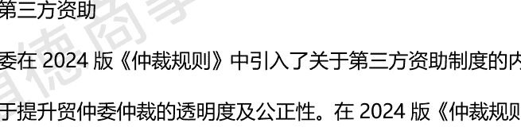

- 八、早期裁回程序
在2024版《仲裁规则》中首次引入了早期裁回程序。在2024版《仲裁规则》下，当事人可以由仲裁请求或请求说明缺乏法律依据或明显超出仲裁庭的辖权范围申请早期裁回全部或部分仲裁请求或请求。该等仲裁请求应在未获得答辩或反对请求答辩时提出；仲裁庭应在早期裁回申请提出之日60日内对仲裁请求作出决定或裁决，并附具理由，可以适当调整；仲裁庭支持或部分支持早期裁回程序的，不影响仲裁庭继续审理其他请求和请求。

- 九、仲裁语言
在2024版《仲裁规则》下，仲裁委员会决定仲裁语言的权利进一步延伸至仲裁庭，规定仲裁庭在组成后有根据案件情形重新确定仲裁语言。

- 十、仲裁费及仲裁员报酬
在2024版《仲裁规则》下，仲裁委员会针对仲裁费及仲裁员报酬有以下几个变化：
第一，调整了涉外案件与国内案件的仲裁费率表，下调了国内案件的收费标准。
第二，针对争议金额超过人民币30亿元的国内案件执行仲裁费封顶。在2024版《仲裁规则》下，无论涉外案件还是国内案件，仲裁费用均设有封顶，且将设有封顶费用的金额提升至人民币30亿元。
第三，完善了仲裁员报酬的相关规定。在2024版《仲裁规则》下，基于当事人的约定，或由仲裁员提出并经仲裁庭协商后，仲裁员报酬可以小时费率为基础，并参照仲裁中心的标准，小时费率一般不得超过7,000港币/小时。
第四，适当提高了仲裁中心管理费用，并将机构管理费用的封顶金额上调至60万元。

### 10.上海国际经济贸易仲裁委员会（上海仲裁中心）：2024版仲裁规则

发文机关：上海国际经济贸易仲裁委员会

发布时间：2023年1月7日

生效时间：2024年1月1日

主要内容：

2023年1月7日，上海国际经济贸易仲裁委员会（上海仲裁中心）发布新版仲裁规则。新版仲裁规则则是自《上海自由贸易区仲裁规则》发布后的最新成果，包含一部仲裁规则、两部特别仲裁规则和全部指南，全套文本超过5万字，将于2024年1月1日施行。

要点提示：

除了公正、专业、便捷等传统诉求，“绿色”“智慧”“多元”“灵活”“可可视”等成为国际仲裁的新理念。新版仲裁规则在多处回应了这些发展理念，具有丰富的合并仲裁选择、完善仲裁制度、提供临时措施、紧急仲裁救济、进一步开放仲裁员、畅通全周期的在线仲裁等。新版仲裁规则在加强仲裁职权方面有了明确回应：仲裁庭有权不受仲裁行为、仲裁庭有权宣布审理终结、仲裁庭有权作出程序性决定、仲裁庭有权决定证据规则、仲裁庭有权适用法律方法。

随着当事人对法律服务的需求日益精细，由专业机构专门案件管理的“机构仲裁”已经是国际主流，机构管理的核心就是如何平衡当事人意志与仲裁程序公正高效的关系，如协调处理当事人与仲裁员之间的协同。基于上述考虑，新版仲裁规则在强化机构管理职能方面进行了以下几个方面的创新：加强信息披露、提高仲裁程序效率、优化送达速度、增加仲裁透明度、升级调解服务。

随本次仲裁规则修订，上海同步制定了《上海国际经济贸易仲裁委员会（上海仲裁中心）数据仲裁规则》和《上海国际经济贸易仲裁委员会（上海仲裁中心）航空仲裁规则》部特别规则，结合航空产业和数据产业对于争议解决的需求，推出了若干适用于该类争议的特别仲裁制度。

此外，上海仲为强化现代信息技术赋能、优化线上仲裁程序和流程，制定了《上海国际经济贸易仲裁委员会（上海仲裁中心）在线仲裁指引》，并积极响应仲裁法方向，从配套制度角度制定了《上海国际经济贸易仲裁委员会（上海仲裁中心）临时仲裁协助服务指引。

上海仲数字化平台同时发布，提供在线立案、电子送达、文书在线交换、电子存档、在线庭审、在线签署等功能，助力当事人和仲裁员、调解员获得高效、便捷、安全的数字化案件服务。

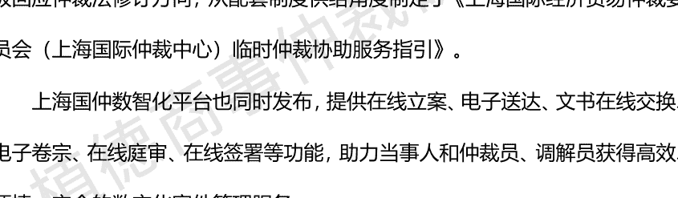

### 11.广州仲裁委员会：《仲裁秘书标准（广州）》

发布机关：广州仲裁委员会

发布时间：2024年8月30日

主要内容：

为规范仲裁秘书工作，提升仲裁质量，高效推进仲裁程序，不断提高仲裁公信力，广州仲裁委员会发布了全国首个“仲裁秘书标准（广州）”。该标准包含了仲裁秘书在案件管理以及协助仲裁过程中的各项准则，包括对其公正性、独立性的要求、披露制度、回避制度，以及仲裁秘书的更换制度等。

要点提示：

《仲裁秘书标准（广州）》包括四个章节：

第一章“总则”，第1-16条涉及仲裁标准的目的、仲裁秘书的基本概念。“仲裁秘书”作为一个上位概念，涵盖了“仲裁秘书”和“案件管理秘书”两个概念，而不是简单限于国内仲裁秘书。

第二章“仲裁秘书”，第17-26条涉及仲裁秘书的指定、公正性与独立性标准、披露、回避等事项，这也是目前中国仲裁制度在实践中最为缺乏的部分。

第三章“案件管理秘书”，第19-26条涉及案件管理秘书的指定、服务内容以及培训与机制等事项，是仲裁制度中较为缺乏的内容。

第四章“附则”，第27-30条涉及标准的未尽宜、效力、解释和生效等事项。

仲裁秘书标准的亮点方面，一是首创性，该标准是全球首个仲裁秘书标准，细化了仲裁秘书分类，厘清了仲裁秘书概念，并界定了各自承担的职责与仲裁机构之间的关系。二是国际性，结合国际惯例和东方经验，将仲裁秘书制度与案件管理秘书制度进行有机结合，弥补现有缺陷。三是前瞻性，该标准既适用于机构仲裁案件，也可以适用于临时仲裁案件，为涉外仲裁案件提供可选的仲裁规范。

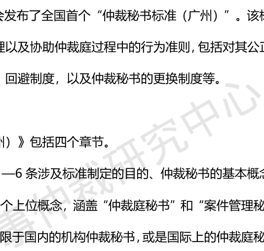

### 12.深圳国际仲裁：《深圳仲裁规则》修正案

发文机关：深圳国际仲裁

发布时间：2024年9月5日

实施时间：2024年10月1日

主要内容：

为帮助当事人高效解决纠纷，深圳仲裁修正案扩大快速程序适用范围，将适用快速程序的案件金额限额调整为人民币1000万元。该修正案经仲裁第三届理事会第七次会议通过，自2024年10月日起施行。施行之前已受理的案件，适用该修正案有关规定；施行前受理的案件，当事人一致同意的，也可以适用该修正案有关规定。

要点提示：

- 修正案的主要内容如下：
一、《深圳仲裁规则》第五十六条（一）条款修改为：“凡争议金额不超过人民币1000万元，或金额超过人民币1000万元但当事人同意的、或当事人约定适用快速程序或简单程序的，适用快速程序。”
二、《深圳仲裁规则》第六十一条（二）条款修改为：“变更后仲裁请求或反请求所涉及的争议金额超过人民币1000万元的，经一方当事人请求或者仲裁庭提议，仲裁庭可以认为必要的，可以将快速程序变为普通程序。”
三、《深圳仲裁规则》第六十一条（三）条款修改为原适用普通程序的案件，仲裁庭组成前，申请人变更仲裁请求的，变更后的仲裁请求金额超过人民币1000万元的，适用快速程序；仲裁庭建成后，仲裁请求的变更或反请求的提出，不影响普通程序的继续。

### 13.国际律师协会：《国际仲裁利益冲突的指引》（2024版）

发布机关：国际律师协会

发布时间：2024年2月

主要内容：

2024年2月，国际律师协会（International Bar Association, IBA Guidelines on Conflicts of Interest in International Arbitration）发布了2024版本的《国际仲裁利益冲突的指引。《国际仲裁利益冲突的指引》在国际仲裁实践中，已成为仲裁员衡量考量是否需要披露的重要参考依据。

2024版《国际仲裁利益冲突的指引》沿用了之前版本中使用“一般准则”和“一般准则的实际适用”两大板块的整体结构。同时，2024版《国际仲裁利益冲突的指引》特别考虑了仲裁员披露、第三方资助、不同司法管辖法律专业人员的组织模式、专家证人、非仲裁员以及社交媒体等可能涉及利益冲突及披露的情形。

要点提示：

- 一、利益冲突（Conflicts of Interest)
2024版《国际仲裁利益冲突的指引》一般准则2 (c)的脚注进一步解释，当合理怀疑存在时，例如不存在不可许可的红色清单上的情况时，仲裁员主动回避，或者，如果存在可许可的红色清单上的情况时，仲裁员应根据一般准则3进行披露。

- 二、仲裁员披露 (Disclosure by the Arbitrator)
2024版《国际仲裁利益冲突的指引》一般准则3扩大了仲裁员应披露的范围并对仲裁员的披露义务出了进一步的说明：

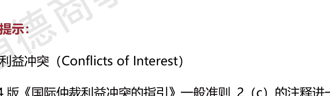

(一) 修改后的一般准则 3 (a) 明确，决定某些事实或情况是否被露，仲裁员应考虑已周知的事实和情况。

(二) 新增的一般准则 3 (e) 明确，若仲裁员认为应作为披露，但职业保密准则或其他职业规则或职业行为则阻止其披露时，仲裁员应回避。

# 2024 | 中国商事仲裁白书

雇主的关系之外，还加入了其律所的组织结构以及业务模式的考虑因素。

(二) 修订后的准则 6(a) 注释了 6(a) 中“律所”适用的范围。

一般来说，仲裁员担任合伙人或正式聘于该律所，则可能被视为具有该律所的身份；当多个仲裁员相互合作或分红时，可能使得仲裁员同时视为具有其他律所的身份。此外，尽管律师所属的事务所不被视为该律所，但出任律师、事务律师与当事人的关系可能有必要披露。

(三) 关于第三方资助和保险人，2014 版《指引》明确了争议涉及的第三方资助人或保险人可能对仲裁有直接经济利益，因此可被视为等同于当事人。修订后的一般准则 6(b)的解释进一步说明，在考虑这些主体时可以视为一方当事人，需要考虑的不同因素包括他们对仲裁事人有控制性影响，还是对仲裁的进行，包括仲裁员的选择有影响；

(四) 2024 版《指引》新增了一般准则 6(c)，任何任一方当事人控制性影响的法律实体或自然人应被视为具有当事人的身份。注释进一步说明，就公司而言，子公司及其母公司可能被视为具有同一个身份，同样，一个自然人以其控制的公司也可能被认定拥有同一个身份；就国家而言，当国家、国家实体、分支机构则是仲裁员也应当披露其与该国家的区域或地方

## 五、当事人以及仲裁员的义务 (Duty of the Party and the Arbitrator)

2024 版《指引》一般准则 6(a)新增要求当事人应当及时告知仲裁员与受控制性影响的个人或实体有直接或间接的关系，并进一步要求当事人将其他仲裁员在决定时根据一般准则 3 进行披露时应纳入考量的个人或主体告知仲裁员。

## 六、不可放弃权的红色清单 (Non-waivable Red List)

2024 版《国际仲裁利益冲突的指南》未对不可放弃权的红色清单列出过多规定。在第 1.1 条明确了只有仲裁员是一方当事人“在仲裁中”的代理人才属于不可放弃权的红色清单项目之一。第 1.4 条增加了“关联公司”一词脚注，解释其包括公司集中的所有公司，和/或对仲裁员一方当事人具有控制性影响影响的任何个人或实体。

## 七、可放弃的红色清单 (Waivable Red List)

就可放弃的红色清单而言，主要的变化是 2024 版《国际仲裁利益冲突的指引》已包含了2014 版《国际仲裁利益冲突的指南》的第 2.3.1 和 2.3.7 条分别涉及的仲裁员“目前”和“常常”代理或一方当事人或其关联公司提供咨询的情形，并要求仲裁员未从该代理咨询中获得实质性的经济利益。

## 八、橙色清单 (Orange List)

2024 版《国际仲裁利益冲突的指南》增加了多个属于橙色清单的情形，从而扩大了仲裁员的披露义务：

- (1)将先3.1.4 条的内容“在过去三年中，仲裁员的律师事务所曾实在不相关的事项中代理一方当事人或其关联公司，或代理一方当事人或其关联公司的对方”修改为“在过去三年中，仲裁员曾或或被一方当事人或其关联公司在无关的事项上协助模拟拟审或开庭准备工作”。

- (2)新增了 3.1.6 条，纳入了仲裁员之前或在过去三年内，在无关事项中被任为其中一方当事人或其关联公司的专家的情形。

- (3)删除原 3.2.3 条，移除仲裁员或其所属事务所经常代理当争议中的一方当事人或其关联公司，但该代理与当争议无关的情形。

- (4) 新增仲裁3.2.9，纳入了仲裁员在过去三年中被同一名律师或律所任命为专家超过三次以上的情形。

- (5) 新增仲裁3.2.10，纳入了仲裁员在过去三年中被同一名律师或同一家律所任命协助拟审庭或开庭准备工作超过三次以上的情形。

- (6) 新增仲裁3.2.12，纳入了仲裁员和另一当事人的律师在其他案件中担任仲裁员的情形。

- (7) 新增仲裁3.2.13，纳入了同一案件的仲裁员在另一案件中担任任仲裁员的情形。

- (8) 新增仲裁3.3.6，纳入了仲裁员在另一个作为律师的案件中指示了当前仲裁中的专家的情形。

- (9) 修订仲裁3.4.2，对仲裁员曾以发表文章、演讲或其他形式对仲裁的某一立场公开声明特定立场的情况，加入了社交媒体或线上专业社交平台等新渠道。

- (10) 修订仲裁3.4.3，将仲裁员与案件有关的指定机构中担任职位的情况，扩大至仲裁员在案件有关的仲裁管理机构担任职位的情况，明确该等责任必须是高级或有决策权的，且仲裁员在这些等职位上参与了与仲裁有相关的决定。

## 九、绿色清单 (Green List)

2024版《国际仲裁利益冲突的指南》的绿色清单要新增了第4.5条，即仲裁员在担任另一案件的仲裁员时，听取当前仲裁中的一位专家的证词这一情形。

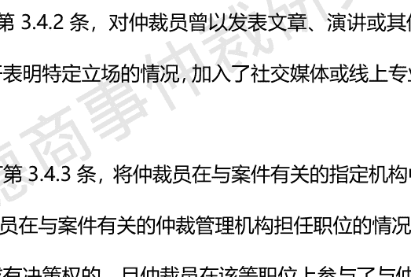

# 14、新加坡国际仲裁中心 (SIAC ：第七版《仲裁规则》

发布机关：新加坡国际仲裁中心 (SIAC)

发布时间：2024年12月10日

施行时间：2025年1月1日

主要内容：

新加坡国际仲裁中心 (SIAC) 正式发布第七版《仲裁规则》。新规则将于2025年1月1日生效。

提示：

新规则则是 新加坡国际仲裁中心 (SIAC) 用户和利益相关方（包括 SIAC 用户委员会、仲裁员、商业实体、法律顾问、政府代表、学术界）进行公众咨询后制定的，新规则反映了 SIAC 通过管理超过3000件国际仲裁案件积累的经验，涵盖了多个司法辖区的适用法律。

新规则的主要亮点包括：

一、引入新程序，例如 Streamlined Procedure（简化仲裁程序）、Preliminary Determination（初步裁定）、Coordinated Proceedings（协调仲裁程序）；

二、扩大快速程序的适用范围；

三、优化紧急仲裁程序，包括申请保护性临时命令；

四、更新仲裁员任命规定，并明确仲裁庭在 SIAC中任命仲裁秘书的权力；

五、关于 SIAC 在线管理系统“SIAC Gateway”的规定；

六、鼓励当事人考虑调解的具体条款；

此外，SIAC修订的《费用表》也将2025年1月日生效，以应对SIAC扩大管理范围和日益增加的需求，并为适用Streamlined Procedure的案件提供50%的管理费用和仲裁费用折扣。

### 1.上海仲裁机构首家境外分支在香港

2024年4月26日，由上海人民政府主办的“沪港经贸推介会”举行，上海市长陆、香港特别行政区行政长李共同为上海国际仲裁中心（香港）揭牌。据介绍，上海国际仲裁中心（香港）依据香港法律设立的仲裁机构，是上海仲裁机构的首家境外分支机构，也是沪港仲裁合作的最新成果，致力于为全球主体提供法治化、国际化的仲裁服务。

(来源:解放日报、上海仲裁中心)

### 2.北京全面推进仲裁中心建设

2024年5月27日下午，北京市司法局举行了国际仲裁中心战略签约仪式。北京市司法局党委委员、副局长、一级巡视员张强介绍了国际仲裁中心（北京）建设阶段性工作：2022年4月，北京印发《关于建设国际仲裁中心的实施意见》，对仲裁体制改革及建设进行全方位部署。2024年4月，北京下发《国际仲裁中心（北京）实施方案》，为政策先行、法律服务干预措施等文件。《国际仲裁中心建设条例》被列为北京市人大委会审议项目。2024年4月，北京高标准打造“一站式”仲裁模式，便利国际仲裁通畅对接。

签约仪式上，北京市司法局与北京市中级法院、中国国际仲裁委员会、中国海事仲裁委员会、北京仲裁委员会分别签署战略合作协议。根据协议安排，北京市司法局将双方共同推动国际仲裁中心建设，不断优化仲裁发展环境，促进国际往来，共同营造市场化、法治、国际化环境。（来源：北京仲裁委员会）

### 3.全国首例临时仲裁案件在海南开庭

2024年7月15日，在海南注册的两家企业合同纠纷案，在海南省仲裁协会协助下，组成临时仲裁开庭审理。该案是《海南自由贸易港国际仲裁发展若干规定》（以下简称《若干规定》）颁布实施以来，审理的我国首例临时仲裁案件。

他们了解到，经海南省人大常委会通过的《若干规定》于今年7月1日起施行。《若干规定》先在海南自由贸易港探索开展临时仲裁，明确了在海南自由贸易港注册的企业，以及在海南自由贸易港注册的企业和外国及澳台企业之间，都可以在海南进行临时仲裁。

开次审理的临时仲裁案件，是当事人双方因合同履行发生争议，正处于僵持不下的时候，及时了解到海南新颁布的《若干规定》临时仲裁的解决办法，可以更加高效、节约本地化解纠纷，当事人双方自愿选择了临时仲裁，目前该案正在审理过程中。

该案件的审理，是海南自由贸易港国际商仲新落地的一次重要实践。海南省仲裁协会作为临时仲裁的指定机构，在整个案件审理过程中，依据双方的约定，提供仲裁设施等必要的协助服务，保障了临时仲裁的顺利进行。下一步，海南将以本次临时仲裁案件审理为起点，全面贯彻实施《若干规定》，把海南打造成为解决国际商事纠纷“优选地”。

(来源：央视网)

### 4.全国首例涉及外海海事临时仲裁案件在红口北外滩开庭并作出裁决

2024年8月，两家在上海注册的企业合同履行过程中的争议，在红口北外滩开庭，按照上海市实施的有关临时仲裁规定，进行仲裁。该案为首例涉及外海海事临时仲裁。

了解，两家企业在纠纷发生后，达成仲裁协议，共同选定了一名在国际航运领域知名度和影响力的仲裁员。一方提出仲裁申请，仲裁庭组成后，按照规定的仲裁程序，审理后作出了双方具有约束力的裁决。

2023年，市人大委会通过的《上海市仲裁建设条例》（简称《条例》）正式施行，在全国范围内引入了仲裁规则。2023年6月，根据司法部门和《条例》，司法局制定出台《上海涉及仲裁推进办法（试行）》，对临时仲裁适用范围、选择仲裁员和仲裁程序推进和保障了临时仲裁的操作性和预期。

去年，司法局提出打造北外滩高度聚集的优势功能块之一，年初，政府、上海法院、上海仲裁委员会、总部等成员单位联合揭牌，成立了国际仲裁中心，专门为国际航运业务提供解决方案。随着临时仲裁的推进，在外航领域构建仲裁、调解、诉讼相互衔接的法律体系有了突破。以此类临时仲裁案件为起点，本区进一步鼓励各界将外航争议通过“调解+仲裁+法院”三位一体的综合型、专业化的解决机制。（来源：虹口区政府）

### 5.共93个国家在126法域采用《贸易法委员会国际商裁示范法》

2024年8月，圭亚那和马维纳克成为《贸易法委员会国际商裁示范法》。

(来源：联合国贸易法委员会)

# 6.厦门仲裁委员会设立“厦门国际仲裁院”

为落实二十届三全会关于进一步深化改革的精神，适应全球发展要求，升级仲裁机关，厦门仲裁委员会于2024年9月7日正式揭牌。“厦门院”揭牌仪式在第四届海丝仲裁法务论坛开幕式上举行，福建委书记、省人大常委会主任周显襄与来宾代表共同为厦门仲裁院揭牌。

自成立以来，厦门仲裁委员会立即制定了“立足厦门、拓展周边、面向全国、走向世界”的发展战略，明确了“专业化、国际化、区域化、品牌化”的发展道路。厦门仲裁委员会将仲裁院作为国际化建设的新起点，进一步推动厦门仲裁委员会在涉外仲裁领域的发展，积极努力将厦门仲裁委员会建设为国际一流的仲裁机构，为我国法治建设贡献“厦门力”。（来源：厦门仲裁委员会）

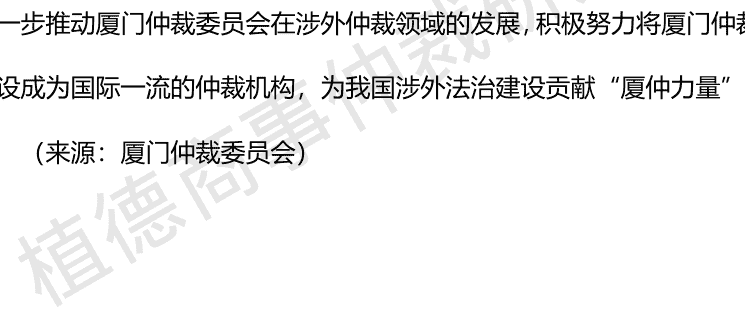

### 7.国际商会发布2023年仲裁和ADR初步统计数据

国际商会 (ICC)公布了其仲裁业务的2023年890案件统计数据。显示，在2023年，ICC登记了总共890件仲裁案件，这是史上第三优年份。这包括ICC仲裁规则的870案件，以及作为任命机构根据ICC规则的20案件。主要内容如下：

裁决：在2023年，ICC仲裁院批准了520份裁决草稿（包括384份最终裁决草稿、104份部分裁决草稿和32份协议裁决草稿），其中512份裁决草稿在仲裁庭考虑到ICC仲裁院独特的核核程序的意见后获得批准。

当事人：2023年的案件中，当事人来自141个司法管辖区，分别来自欧洲（40%）、亚洲地区（25%）、拉丁美洲（14%）、北美（13%）和非洲（8%）。争议金额：2023年案件中的平均争议金额为6,500万美元，中位数约550万美元，而总争议金额达到530亿美元。（（来源：搜狐网）

### 8.世界知识产权组织仲裁与上海中心作出首例仲裁案件裁决

2024年9月，世界知识产权组织仲裁与上海中心（以下简称“WIPO仲裁上海中心”）对受理的首例仲裁案件作出裁决。仲仲仲仲仲仲仲仲仲仲仲仲仲仲仲仲仲仲仲仲仲仲仲仲仲仲仲

# 2024 | 中国商事仲裁白皮书

## 10. 司法部：2023年全国仲裁机构办理仲裁案件60.7万

新华办 2024 年 9 月 6 日举行“推动高质量发展”系列主题新闻发布会。

会上，司法部公共局法律服务管理局局长向大家介绍，司法部将着重在推进仲裁改革方面，抓好三个方面。

- 一个是加速完善仲裁法制度规则。当前，司法部正在推进仲裁法的修改，修订草案已经过国务委员会审议并原则通过。这次仲裁法修订是我仲裁法领兵 30年来的一次全面修订，主要是为了解决仲裁制度和实践中的突出问题，主动对接国际先进准则，完善涉外仲裁服务内容，目标是健全完善仲裁具有中国特色、与国际规则接的仲裁法制度，着力提高中国仲裁的国际影响力，发挥仲裁服务经济社会发展和扩大开放的作用。

- 二是大力推进仲裁公信建设。随着我国经济的快速发展，仲裁事业发展非常活跃，目前我国设立 282 家仲裁机构，8 万仲裁员和仲裁工作人员万人，累计办理案件 500 万起，标的额 800 亿元，当事人涉及全球 100 多个国家和地区。其中，2023 年全国仲裁机构办理了仲裁案件 60.7 万件，同比增长 27.8%，总额为 1.16 万亿元，同比增长 17.7%。可见，确实实现了快速的增长，而且很有效果。下一步，司法部要在增强仲裁的公信力上下功夫，因为公信力是仲裁的生命，要进一步完善仲裁机构建设和运行机制，全面加强对仲裁机构、仲裁团队的监督管理，努力为人民群众提供更优质高效的仲裁服务。

- 三是切实提升仲裁的国际竞争力。司法部现在正在积极推进国际商事仲裁中心建设。2023 年，试点地区的 8 家仲裁机构办理案件 7.9 万件，标的额 6000 亿元，占全国总额的 52%；办结的涉外案件量占全国涉外案件总量的 72%，

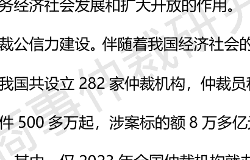

标的额占全国涉外标的总额的 69%。自 2022 年启动以来，国际商事仲裁中心建设推进很快，取得了积极成效。

向斌表示，接下来，司法部将深入推进国际商事仲裁中心建设，按照三中全会的部署要求，着力培养一批国际一流的仲裁机构，启动国际一流仲裁机构培育工程，打造国际一流仲裁机构品牌，推动仲裁更好发挥在服务高质量发展和水平开放中的积极作用。

（来源：中国新闻网)

## 植德商事仲裁研究中心

# 2024 | 中国商事仲裁白皮书

## 11. 仲裁发布《中国国际商事仲裁年度报告（2023-2024）》和《与仲裁裁决域外认可与执行案例选编》

2024 年 9 月 25 日，中国国际贸易仲裁委员会（以下简称“贸仲”）在北京启新新闻发布会上，仲裁副主任秘书长王泰杰在会上发布了《中国国际商事仲裁年度报告（2023-2024）》和《与仲裁裁决域外认可与执行案例选编》

（以下简称为《2023-2024 年度报告》和《执行案例选编》）。

发布会上，王泰杰秘书长首次发布了《2023-2024 年度报告》。他表示，《2023-2024 年度报告》委托中国人民大会组成课题组编写，课题组主要成员包括来自最高人民法院、司法部、高校院、企业和律师事务所的专家和实务人士作者。《2023-2024 年度报告》在全文分析 2023 年国际商事仲裁案件数和 2023 年至 2024 年 6 月中国国际仲裁法实务发展的基础上，同步跟踪国内外商事仲裁理论动态，中国商事仲裁教育与人才培养进展，中国商事仲裁司法实务，全方位管理国际当前的仲裁程序及实践，重点考察在不同情况下如何合理应对破产程序给仲裁带来的挑战，并从行业发展的角度思考和探索国际仲裁的应用前景。

在《执行案例选编》中，王泰杰秘书长指出本次聚焦中国仲裁决在域外认可与执行状况的专项研究，由资深仲裁员牵头、多名高校学者和实务律师组成课题组，重点选择了美国、澳大利亚、新加坡、加拿大、俄罗斯、中国香港等 10 个具有代表性的国家和地区，近年来域外认可与执行中精选了 15 个案例进行研究，梳理了域外仲裁的法律框架和程序，总结了仲裁管理的良好实践，深入分析了不同法院在适用《纽约公约》态度和审查，特别关注了不同法律规定对当事人的影响。结果显示，跨境仲裁决在全球法律下认可并广泛执行。从已知可见，美国、加拿大、英国、俄罗斯、沙特阿拉伯、哈萨克斯坦、南非、阿根廷、新加坡、印度、越南、中国香港、台湾等国家和地区的法院广泛承认/认可了仲裁决。2024 年，沙特阿拉伯法院认可和执行仲裁决人民币 24 亿元，不仅沙特阿拉伯法院认可并执行仲裁决创了中国仲裁在境外执行金额的最高纪录，近期加拿大高等法院认可并执行仲裁决人民币 12 亿元。

王彦秘书长表示，上述两份研究结果显示，仲裁作为全球通行的纠纷解决方式，在妥善处理国际争议中日益发挥作用，已成为各国优化商环境、提升法律实力的重要手段。与此同时，以贸仲为代表的中国仲裁机构业务增幅显著。2023 年，仲裁受理案件 523 件，同比增长 28.17%，涉外争议金额 510.23 亿元，同比增长 19.0%，案件数量和标的额均创历史高；其中，涉外案件 645 件，同比增长 28.77%，涉外争议金额 627.65 亿元，涉外案平均金额 810.55 万元；自 1956 年成立至今，仲裁受理案件当事人来自国家和地区累计达 165 个，覆盖“一带一路”沿线全部国家。较于国际仲裁院（“ICC”）、瑞典斯德尔森仲裁院（“SCC”）、伦敦国际仲裁院（“LCIA”）、新加坡仲裁中心（“SIAC”）、香港仲裁中心（“HKIAC”）等国际知名仲裁机构，近年来仲裁在受案数量、涉案争议金额、当事人国别数量等主要指标上领先世界第三。特别是 2023 年以来，各项增长尤为显著。以贸仲为代表的中国仲裁机构在国际化和专业化道路上屡创佳绩，中国仲裁的国际公信力和影响力不断攀升，全球服务进一步扩大，仲裁决在全球各地获得认可和执行，中国国际一流仲裁机构建设迈出坚实步伐，国际商事仲裁中心建设展现强大动力。

（来源：中国国际贸易仲裁委员会）

## 国际仲裁委员会：全国首例由仲裁作出临时措施裁定并由法院保全实际执行的仲裁案件

2024 年10 月，在北京仲裁委员会受理的一起技术开发与服务纠纷国际仲裁案件中，仲裁根据申请人提出的临时措施作出了临时措施裁定，并获得了北京市第四级法院保全裁定与实际执行，成为全国首例由仲裁作出临时措施裁定并由法院保全实际执行的仲裁案件。

仲裁过程中的临时措施（Interim measure），是为了保障仲裁程序的顺利进行和仲裁决的有效执行，由仲裁庭或者法院根据一方当人的申请，对对方当事人的财产、证据、行为等采取的临时性强制措施。

《联合国贸易法委员会国际商仲裁示范法》规定，仲裁可以依据当事人的申请，作出临时措施裁定，并由法院进行执行。该规定是国际通行的做法，也是世界银行商环境评估的重要指标之一。

作为全国首例由仲裁作出临时措施裁定并由法院实际执行的仲裁案件，该案件充分彰显了北京法院打造友好型司法环境的主动担当，有力推动了本市仲裁制度与国际先进、通行的仲裁制度及理念的相互衔接。

（来源：北京政法网）

### 13. 上海仲裁委员会：首部工程合同纠纷裁引发布

2024 年 10 月 8 日，上海仲裁委员会发布了首部工程合同纠纷裁引，为上述目标提供了专业的法治保障。作为中国首批试点设立的仲裁机构之一和“优秀仲裁机构”，自 2022 年起，上海仲裁委员会召集行业内十位专家启动《工程合同纠纷裁引》（以下简称《裁引》）的编写，至 2024 年第三季度完成初稿。

上海司法局长长峰、上海仲裁委员会主任刘红、上海仲裁委员会常务主任范超、上海仲裁委员会副主任李长涛等十位专家参加了会议并对《裁引》进行了研讨。在致辞中，上海司法局长长峰祝贺上海仲裁委员会成功发布《裁引》，并指出近年来工程合同纠纷的有效解决需要同时具备法律思维及专业思维，上海仲裁委员会在行业相关法规及规范下，对仲裁领域提出了新的挑战。

上海仲裁委员会主任刘红指出，未来将坚持市场化、法治化、专业化、国际化的发展方向。《裁引》作为行业内部头部机构推出的性文件，将充分发挥仲裁在解决纠纷中的作用，推动仲裁行业的健康发展。通过多种形式，共同营造良好的法治化商环境。

（来源：新华财经）

## 14. 深圳江门中心涉及协助调查令

2024 年 10 月 28 日，深圳国际仲裁院按照《广东省加强法律服务促进粤港澳大湾区建设的决定》（简称《决定》）向江门市中级人民法院（简称“江门法院”）申请协助调查，这是我国首例由外地仲裁机构开具协助调查令的案件。本案为深圳国际仲裁院江门仲裁中心管理的一起涉案。经过仲裁审查，申请人资质及接受处罚的情况与案件审理密切相关，仲裁庭认为有必要调查事实，但当事人自行取证存在困难。为了更好地查明事实、维护当事人合法权益，江门法院基于仲裁庭调查需求开具了调查令。

《决定》施行前，案件需要调查取证，通常由仲裁机构开具协助函，由于仲裁机构自行开具的协助函无强制力，可能影响调查效果。如案件存在涉外因素或其他特殊情况，调查取证工作更为困难。2024 年9月26日，《决定》实施后，鼓励法院探索以仲裁调查令等形式进行调查。深圳江门中心是按照中共办公厅、国务院办公厅《关于完善法院与政府部门整合资源、提升仲裁服务公信力的要求》，由深圳国际仲裁院与江市政府联合的优势互补、合作创新的区域性仲裁工作平台和深圳、江门两地政府批准设立的支部机构。深圳江门中心由市政府委托江门仲裁委员会，建立了“分支机构+独立机构”一体化运作的新模式。此次协助调查令的开具，体现了国际仲裁与司法机制的有机衔接，也体现了粤港澳大湾区东西两岸的融合联动，有利于进一步提升国际仲裁服务水平及公信力，打造粤港澳大湾区市场法治国际化一流营商环境。

（来源：深圳国际仲裁院）

## 15. 港仲宣布秘书长离职并任命北京代表处首席代表

在香港国际仲裁中心（简称“港仲”）任职七年后，杨博士将离任副秘书长一职。自 2024 年11月1日起，杨博士将接替香港国际法律人才培训办公室，该办公室由香港特别行政区政府司设立，旨在建设香港成为汇聚人才地、涉及以及国际法律人才的能力建设中心。

杨博士多年的贡献为中国仲内的发展和机遇奠定了坚实基础。其中一个重大发展是港仲在 2023 年设立亚洲代表处后，北京代表处成为港仲在香港以外的第三个代表处。港仲已任命章女士为北京代表处首席代表。自 2024 年10 月起，章女士此前就职于中国有限责任公司，负责海外事务超过两年，拥有深厚的仲裁专业知识和实践经验，拥有执业资格并获得西北大学法学硕士学位。港仲感谢杨博士对发展做出的贡献，热烈欢迎章女士加入。

（来源：香港国际仲裁中心 HKIAC）

## 16. 重庆国际商事仲裁院挂牌，解决争议提供新平台

2024 年 1 月 12 日，西部陆海通道仲裁论坛在重庆举行，重庆国际商事仲裁院在论坛上挂牌，为西部陆海通道沿线国家和地区提供优质、高效的仲裁服务。为了了解西部陆海通道的发展，论坛聘请了 60 名知名仲裁员。

本次论坛上，重庆市司法局与中国国际贸易仲裁委员会（贸仲）、中国商事仲裁委员会（海仲）签署了《合作备录》，重庆商事仲裁委员会与来自东南亚、亚洲、中亚等地 8 家境外仲裁机构签署了《合作协议》，旨在推动国际仲裁协作机制，为西部陆海通道沿线国家和地区带来更便利、高效的解决途径，进一步提升西部陆海通道的营商环境。现场还举办了主题为“中国商事仲裁中心建设的实践与创新”的研讨会，与国外知名专家围绕仲裁制度、培养一流仲裁队伍、仲裁机构自身建设、科技赋能仲裁等热点问题讨论，分享了国际仲裁的新趋势、情况，提出了建设性的建议。（来源：中新网）

## 17. 破产衍生纠纷与仲裁衔接机制建立

2024年12月4日，上海市第三中级法院（以下简称上海中院）与上海仲裁委员会（以下简称上海仲裁委）、上海市破产管理人协会（以下简称上海管协）共同签署了《关于加强破产案件衍生纠纷与仲裁衔接机制的意见》（简称《意见》），建立破产衍生纠纷与仲裁衔接机制。《意见》深入落实习近平总书记关于“坚持和发展新时代枫桥经验”的指示精神，坚持问题导向，开展仲裁质增效的积极探索，促进破产衍生纠纷多元化，助力一流商环境建设。

《意见》的主要内容为：

- 引导破产衍生纠纷。管理人积极引导当事人达成仲裁协议，引导仲裁程序化解纠纷。

- 确保处理衍生纠纷的仲裁员专业性。仲裁推荐具有破产及相关专业知识的仲裁员供当事人选择。

- 提高破产衍生纠纷仲裁效率。仲裁设立快速审查通道，积极开展仲裁调工作。

- 降低破产仲裁成本。仲裁委对进入仲裁程序的破产衍生纠纷适当免费。

- 便利信息查询。管理人、仲裁委相互提供查询信息的便利。

- 建立日常沟通交流机制。及时总结经验，研究解决问题。（来源：上海破产法庭）

## 18. “北京仲裁委员会/北京国际仲裁中心”更名为“北京仲裁委员会/北京国际仲裁院”

2024年12月4日，为积极响应中央关于在北京市打造“服务国际科技创新中心与国际交往中的国际商事仲裁中心”的要求，支持国际商事案件中心建设，北京市司法局允许变更登记，本会自2024年12月4日正式启用“北京仲裁委员会/北京国际仲裁院（Beijing Arbitration Commission/Beijing International Arbitration Court，中文简称北仲/北国，英文简称 BAC/BIAC）”新名称。现就有关事项公告如下：

- 一、所有涉及“北京仲裁委员会/北京国际仲裁中心”的均统一改为“北京仲裁委员会/北京国际仲裁院”。

- 二、仲裁机构的地址、电话、网址等信息保持不变。（来源：北京市司法局）

# 2024 | 中国商事仲裁白皮书

国际仲裁机构尤其是老牌知名仲裁机构建立严密合作伙伴关系，积极参与与国际仲裁规则制定与创新，为全球提供更多优质法治公共产品，更好服务高质量共建“一带一路”，持续推进涉外法律服务与合作水平。

> (来源：广州仲裁委员会)

## 21.“中国（上海）证券期货仲裁中心”挂牌成立，仲裁助力国际金融中心建设

2024年12月26日，上海仲裁委员会举办的新时代证券期货争议解决创新与发展讨会上，“中国（上海）证券期货仲裁中心”正式挂牌。与会专家认为，中国（上海）证券期货仲裁中心的挂牌，有利于上海进一步优化市场化、法治化、国际化的营商环境，助力加快打造证券期货纠纷解决法治高地。

当天，上海仲裁委员会主任刘迎晓，上海证券交易所并购重组审核委员会主任刘迎连，上海期货交易所副总总经理张铭铭，中国金融期货交易所委员会委员、副总经理刘绍望共同签署了《关于推进证券期货行业仲裁试点优化资本市场法治环境合作备忘录》。

根据合作备忘录，四方将携手推进上海期货行业仲裁试点工作，切实维护交易双方权益，共同防范证券期货市场风险，营造市场化、法治化、国际化的一流商环境。

(来源：上海证券报、中国证券网）

# 2024 | 中国体育仲裁白皮书

## 22.国家体育总局体育仲裁中心揭牌成立

2024年12月31日，国家体育总局体育仲裁中心揭牌仪式在北京举行，中心将承担国家体育仲裁委员会日常事务性工作。

国家体育总局副局长李静在揭牌仪式上表示，体育仲裁中心的设立是国家体育总局贯彻落实修订的《中华人民共和国体育法》依法实施体育仲裁制度的重点工作，强调，为推进体育纠纷解决机制法治化、规范化、专业化提供了强有力的组织保障。体育仲裁是新修订的体育法设立的一项重要制度，维护体育发展良好秩序具有重要意义。

根据中国体育仲裁委员会相关人士介绍，2023年2月11日成立以来，委员会受理仲裁申请百余案件，涉及足球、冰球、跆拳道、马拉松、国际象棋等运动项目，案件类型包括运动员注册与交流、足球培训补偿、纪律处罚、参赛资格和成绩等争议。

介绍说，中国体育仲裁委员会委员均为兼职人员，具有办理案件的仲裁员也都是兼职专家。体育仲裁案件受理、案件审理、仲裁管理、制度研究、对外交流等需专门机构、专职人员，并需要确定工作场所和专业配套设施等工作保障。体育仲裁中心将为中国体育仲裁委员会有效履行职能和实施仲裁强化人员和物质保障，确保体育仲裁制度和体育仲裁机构独立、公正、专业运行。

（来源：新华社）

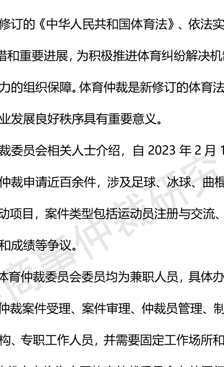

# 2024 年仲裁司法监管

### 1.最高人民法院：《最高人民法院商事仲裁司法审查年度报告(2023)》

发布机关：最高人民法院
发布时间：2024年9月9日

主要内容：

仲裁是中国特色社会治理体系中多元化纠纷解决机制的重要组成部分，也是国际通行的商事纠纷解决方式，在高效化解争议纠纷、促进国际经营合作、助力营造市场法治化国际营商环境方面承担重要职责。仲裁的发展，离不开司法的支持与监督。2023年，人民法院坚持以习近平新时代中国特色社会主义思想为指导，全面贯彻落实二十大精神，深入贯彻习近平法治思想，高度重视商事司法审查的增值作用，加强对仲裁的司法和监督，促进商事仲裁中心建设，仲裁友好环境得到深入认可，有利于促进仲裁公信力和国际竞争力的持续提升。

为全面展现人民法院仲裁司法审查工作取得的成绩，及时总结仲裁司法审查经验，统一裁判尺度，最高人民法院四庭组织编写了《最高人民法院商事仲裁司法审查年度报告（2023）》，并予以发布。

要点提示：
- 《最高人民法院商事仲裁司法审查年度报告(2023)》第一部分介绍了2023我国商事仲裁司法审查工作发展概况。

2023年，最高人民法院积极推动仲裁法律规则体系不断完善，深度参与仲裁修订工作；与司法部建立工作交流协商机制，就完善仲裁司法监督机制等重点事项。

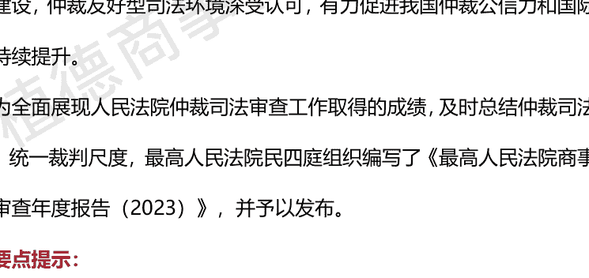

# 2024 | 中国商裁司法白皮书

明确工作任务：发布仲裁司法审查案例，统一司法审查尺度，规范和指引仲裁机构和仲裁员依法办理仲裁案件；发布《最高人民法院“一站式”国际商事纠纷多元化解决平台指引（试行）》，迭代升级“一站式”平台；加强与各国司法机关、仲裁机构的对话交流，推进国际商事仲裁建设。北京、上海、珠海等地建立司法审查案例通报机制，规范司法审查权的行使。

《最高人民法院商事仲裁司法审查年度报告（2023）》第二部分是全国仲裁司法审查综述。

2023年，全国仲裁司法审查案件1.6万件。其中申请确认仲裁效力案件3800件，申请撤销仲裁案件0.8万件，申请承认（认可）与执行境外裁决案件75件，申请不予执行境外裁决17件。另有法院办理保全案件100件。全年司法审查案件呈现如下特点：

一是最高人民法院通过办理撤销案件明确司法审查尺度。2023年，全国法院办理仲裁案件29件，其中18件同意下级法院的处理意见，7件不同法院的处理意见，退回补充事实。在申请人某某被申请人某申请撤销仲裁案件中，最高人民法院认为虚拟货币与法定货币之间的兑换违反我国禁止虚拟货币交易活动，构成公共利益，同意下级法院撤销裁决。

二是低撤销率、保全率总体支持。2023年，全国法院撤销或不予执行仲裁案件552件，撤销率11%，较2022年的28%基本持平；保全类案件1000件，其中900件得到法院支持，支持率90%。同时，各地法院积极与仲裁衔接，不断提高仲裁保全效率，助力仲裁在多元化解决机制中发挥作用。例如，上海法院在2023年上线仲裁保全机制，厦门签署了《关于完善仲裁的意见》，建立反馈机制等工作。

三是加强跨国法律协助。2023年，全国法院承认（认可）和执行境外裁决66件。承认的外国裁决包括亚洲国际仲裁中心、新加坡国际仲裁中心、瑞士国际仲裁协会、日本仲裁协会、俄罗斯联邦仲裁院、工商国际仲裁会等多个外国仲裁机构作出的裁决，还包括英国、印度等国家作出的裁决。履行《纽约公约》，只有在作出裁决时、被申请人身份确定无法管辖、在作出裁决的原因外，其他外国裁决均裁定承认和执行。此外，人民法院加强区域法律协助，审查申请和执行香港仲裁案件32件，其中由香港国际仲裁中心作出的30件，由国际仲裁会作出的1件，由临时仲裁庭作出的1件。最高法院已支持香港仲裁、推进国际仲裁高质量司法职能更加凸显。

《最高法院商事仲裁司法审查年度报告（2023）》第三部分是2023年度仲裁司法案例与裁决准则。

本部分梳理了30多个案例，对仲裁司法标准与裁决思路进行了归纳总结，选取了十个案例发布。体现以下原则：

第一，秉持尊重当事人仲裁意愿的原则，对仲裁协议做出有利于解释。对于实践中经常出现的当事人约定仲裁机构名称不准确、不规范的情形，按照仲裁协议效的原则进行解释，例如在司法审查案件中，仅可以确定仲裁机构的唯一性，认可仲裁协议效力，尊重并鼓励当事人双方解决纠纷。

第二，秉持支持的理念，审慎审查裁决。审慎审查当事人提出的撤销或不予执行裁决的申请，尊重仲裁终局性。充分保障各方当事人正权利，充分监管仲裁不当行为，维护当事人合法权益。司法支持与促进行业发展的理念不断落实。

第三，秉持解释的原则，准确界公共利益。对是否违反社会利益为撤销或不予执行仲裁裁决的情形持严谨态度，避免因解释较大而被滥用。对我国已生效司法裁、违反金融规定的仲裁裁决，依职权予以撤销或不予执行，维护国家法律秩序和金融秩序。

第四，秉持“有利于裁决执行”的立场，准确确定涉外裁决依据，积极查明外国法，准确适用《纽约公约》的规定，遵循善意执行原则，依法承认和执行外国仲裁裁决，为裁决的跨境执行活动营造司法环境。

第五，秉持与时代进步的精神，研究并应对新情况新问题。以法治实践推动我国仲裁制度的完善，以典型案例促进矛盾冲突的化解。网络消费合同格式条款中仲裁条款效力的认定，体现了互联网案件中对当事人程序保障的必要，前期物业服务合同仲裁条款对业主主具有法律约束力的认定，彰显了人民法院支持仲裁融入基层社会治理、在矛盾纠纷多元化化解中发挥更大作用的鲜明立场。

# 2024 | 中国商事白书

## 2.最高人民法院：仲裁司法典型案例

发布时间：2024年1月16日

要点提示：

此次发布的十个典型案例，类型多样，包括申请承认和执行外国仲裁裁决、申请确认和执行香港仲裁裁决案件，包括申请撤销仲裁裁决、申请确认仲裁协议效力、辖权争议纠纷等案件；内容丰富，涵盖体育仲裁、金融仲裁，又涉及网络平台条款效力、仲裁员披露义务、仲裁程序、重新仲裁、公序良俗等多个问题，生动反映了近期仲裁司法审查面临的新情况，充分体现了法院对仲裁审查和监督、积极营造市场化一流环境的立场。

一是承认和执行境外裁决，支持中国仲裁。履行《纽约公约》义务，严格执行外国裁决。在申请承认和执行贝格拉斯斯坦裁决中，遵循意愿，依法承认和执行外国裁决。在申请承认和执行香港仲裁裁决案件中，依据《人民法院关于内地与香港特别行政区相互执行仲裁裁决安排》，适用法律对仲裁协议进行审查，认可仲裁裁决。在申请和执行裁决案件中，明确在合同约定境外仲裁机构在境内仲裁，符合仲裁法第十六条的规定，有效仲裁条款。

二是明确争议审查标准，统一裁判尺度。在上海申鑫与上海足球俱乐部等合同纠纷案件中，明确在自贸区内设立的仲裁委员会的仲裁范围，适用法律对仲裁，，法院对仲裁的有效保障，促进仲裁发展，助力仲裁在多元化解决机制中发挥。

三是加强仲裁监督，明确当事人。在泛海控股公司申请撤销裁决案中，严格将申请的主体限定为“当事人”，维护裁决的终局性。在王某与李某申请撤销裁决案中，明确双方之间知情，仲裁所需资金符合仲裁，作出此裁决。在孙某、南京孙飞科技申请撤销裁决案中，明确未经对方的所谓“印章”等形式签字的仲裁无效，提醒仲裁机构将好“入口”。在工程申请撤销裁决案中，明确仲裁员未按照规定回避，可能影响正确。在张某申请撤销裁决案中，针对仲裁程序存在缺陷的情况，采取重新仲裁的方式，平衡程序缺陷与关系。

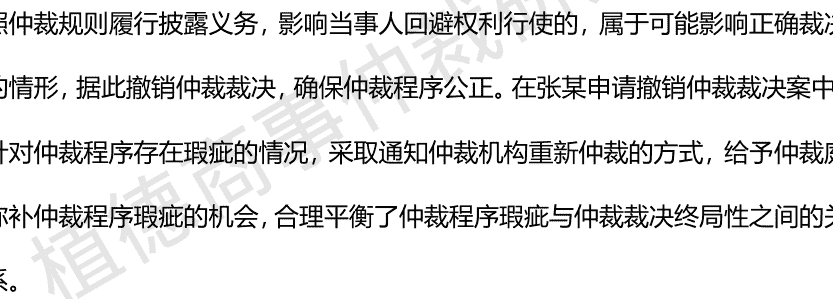

# 2024 | 中国商裁白皮书

案例情况：

(1)严格执行《纽约公约》，承认外国裁决——马赛毕尔克斯坦苏马赛赛有限公司申请承认和执行

案号：浙江杭州市中级法院（2021）浙仲民1号

基础情况：

2017年9月，马赛赛公司与宏冠通过互联网订立国际买卖合同，约定由宏冠按合同交付货物，马赛赛公司可以根据仲裁协议向该公司所在地地机构提起仲裁申请。马赛赛公司申请仲裁后，马赛毕尔克斯坦仲裁庭依法作出裁决，裁令宏冠向马赛赛公司返还相应、承担赔偿金及仲裁费。马赛赛公司向广东佛山市中级法院提出承认涉裁决申请。宏冠公司辩称签署合同的人员刘某并非其公司员工，无权代表与其马赛赛公司不存在仲裁关系，涉案案件裁决不被受理。

裁决结果：

浙江杭州市中级法院认为，应当适当适用行政区法律对于仲裁协议是否有效进行审查，根据查明的香港行政区《仲裁条例》的规定和相关判例的观点，结合双方的合同、本次交易背景，双方在有意向结婚的过程中交换了仲裁条款的内容，虽然发送了合同文本，但相应对合同进行了回复，且对仲裁条款提出异议。因此，即使双方未一致签署了该合同文本，基于仲裁协议效力的独立性原则，应当认定双方对四份合同草案中所载的仲裁条款达成合意。该仲裁条款符合香港行政区（仲裁条例）第十九条关于“合意提交仲裁”及“书面形式”要求，其合法成立并具有法律效力。不论双方是否合法有效的交易合同，均不影响该仲裁条款的效力。案涉纠纷涉及合同当事人的争议，处理结果仅影响合同当事人，不涉及社会利益。该案依据《人民法院关于内地与香港特别行政区相互执行仲裁裁决的安排》《最高人民法院关于内地与香港特别行政区相互执行仲裁裁决的补充安排》的规定，认定可以执行案涉仲裁裁决。

## 典型意义：

该案根据《人民法院关于内地与香港特别行政区相互执行仲裁裁决的安排》第七条第一款第一项的规定，在当事人未约定仲裁协议依据的情况下，适用仲裁地的法律判断仲裁成立问题，同时根据仲裁协议独立性原则，明确仲裁条款的成立可以独立于合同的成立之仲裁规则，对同类案件的审查具有参考意义。

条约在“上海仲裁”申明仲裁在上海，而不是新加坡，但就仲裁对争议是否有管辖权等争议问题不作认定。为此，仲裁出具《中止仲裁决定》，等待法院确认案涉仲裁条款的效力。2020年1月，大法株式、大成广州公司向上海第一中级法院申请确认案涉仲裁条款效力。

#### 裁判结果：

上海第一中级法院认为，《采购协议》第14.2争议解决条款是当事人真实意思表示，对对方具有合同约束力，根据仲裁条款上下文及各当事人的解读分析，仲裁地在中国上海，各方当事人确认仲裁准据为中国法律，案涉仲裁条款有请求仲裁的意思，约定了仲裁事项，并选择了明确具体的仲裁地为新加坡仲裁机构，符合我国仲裁法第十六条的规定，应当。

## 典型意义：

本案解决了当事人自愿约定将争议提交境外仲裁机构但可能将仲裁地确定在国内境内的情形下仲裁条款的争议问题，我国法律对该问题没有作出规定，但司法实践不能在无明文规定的情况下拒绝回绝，从国际私法仲裁来看，仲裁地作为法律适用意见的地点，与仲裁庭的所在地、合意地点、调查取证地点等有必然的联系，其功能主要在于确定仲裁地辖属、确定有权行使司法管辖权的管辖法院以及用于确定仲裁程序准据、仲裁协议准据法。本案中，当事人约定的仲裁地在上海，新加坡被最高法院裁决仲裁条款效力应由仲裁地法院即中国法院作为有监督管辖权的法院予以认定，而不宜由新加坡法院作出认定。上海第一中院结合我国法律对相关问题未作性规定的实际情况，通过将仲裁法第十六条规定的“选定的仲裁委员会”宽松解释为“仲裁机构”的方法填补法律漏洞，裁定当事人约定提交仲裁机构在我国境内仲裁的条款有效，展现了人民法院充分尊重当事人仲裁意愿、顺应国际仲裁发展趋势、求务实解决问题的司法立场，另一方面，上海一中院作为仲裁地法院积极行使辖权、准确适用法律、明确仲裁效力规则，为自由贸易试验区多元化解决纠纷营造了可预期的法治环境，对于上海加快建设亚太仲裁中心、打造国际受欢迎的仲裁地具有十分重要的意义。

## (4) 确定多层次体育纠纷解决机制主管边界，推进体育纠纷多元化建设——上海申森足球俱乐部有限公司与上海申花足球俱乐部有限公司、上海体育文化发展有限公司其他合同纠纷

案号：上海市崇明区人民法院（2023）沪0151民初1673号
上海市第二中级人民法院（2023）沪02民初6825号

#### 基本案情：

2019年2月20日，申公司与申花公司及其四名球员分别签署内容相同的《球员租借协议》，协议主要要约定申鑫公司租借申花公司球员并支付租借费，并约定双方如有违约，报中国足协仲裁，直至追法律责任。同年2月25日，申公司与申鑫公司签署了《培训合作协议》，约定了球员出场及申花公司向申公司支付奖励款的计算方法。因中国足协以申花公司自2020年起未在注册系统中注册为由受理申鑫公司仲裁的决定，申公司诉至上海市崇明区人民法院，请求判令：申公司支付奖励款、违金、律师费等。

申公司在一审答辩期间提出辖权异议，认为《球员租借协议》与《培训合作协议》为有机整体，支付奖励款是因球员租借产生的纠纷，《球员租借协议》约定争议由中国足协仲裁，故应驳回申公司的起诉。一审法院以本案争议属于足协仲裁受理范围为由裁定驳回申公司的起诉。申公司向上海市第二中级法院提起上诉。

#### 裁判结果：

上海市第二中级人民法院认为，第一，《球员租借协议》中关于足协仲裁的合意范围并不及《培训合作协议》。《球员租借协议》中的仲裁条款明确约定足协仲裁受理履行该协议所产生的纠纷。本案诉讼请求指向的是申公司保证球员出场后申鑫公司支付奖励款的义务和申鑫公司收取奖励款的权利，该权利义务仅受《培训合作协议》约定，不属于《球员租借协议》约定的内容，故足协仲裁的合意范围不包括本案纠纷。

第二，足协仲裁委员会作为足协专门处理内部纠纷的分支机构，属于内部自治机构，其裁决属于集团集体授权、做出的裁决在性质上属于内部决定，依据内部规则则产生约束和强制力即内部效力。申鑫公司并未在足协约定，足协仲裁裁决的强制力存在缺失；第三，足协仲裁委员会无法受理本案纠纷。足协仲裁委员会是根据2024年修订的《中华人民共和国仲裁法》，由行政部门设立的专门处理纠纷的仲裁机构，其做出的裁决具有法律效力。本案中，双方未达成仲裁合意，仲裁委员会无权受理本案纠纷。裁定撤销一审裁定，指令上海市崇明区法院受理。

## 典型意义：

本案是《中华人民共和国仲裁法》修订及仲裁委员会设立后，首例明确多层次体育纠纷解决机制边界的案件。在《仲裁法》的法律下，人民法院确定体育内仲裁的范围，促进了体育纠纷多元化解决的发展，体现了鼓励体育自治、发挥专业性、及时性等优势，充分保障了当事人的救济权利。本案为类似案件的审理提供了借鉴思路，为体育治理体系现代化、加快建设国际仲裁提供了司法保障。

## (5) 尊重当事人自治，明确合同条款不能适用于从合同——泛海控股集团有限公司与郭丰申请仲裁效力

案号：北京金融法院（2022）京74民初13号

#### 基本案情：

2019年12月29日，郭丰与基金管理人、基金托管人招商证券公司签订了《基金合同》《基金补充协议》，郭丰全额认购人民币300万元。《基金合同》约定本合同产生的或本合同有关的争议，经双方未能解决的，应提交仲裁委员会仲裁。2020年10月，泛海控股向郭丰作出《承诺函》，承诺为基金设立的资产管理产品的流动性及安全性提供支持。2021年9月，郭丰向约定的仲裁委员会提出仲裁申请，将招商证券公司列为被申请。2022年1月，泛海控股向仲裁委员会提出辖权异议申请，认为仲裁委员会对其之间的争议无管辖权。2022年2月，北京金融法院立案受理泛海公司申请。

#### 裁判结果：

北京金融法院认为，泛海控股并未直接与郭丰签署《基金合同》《承诺函》，泛海控股与郭丰之间并没有明确表示解决争议的意思。泛海控股在仲裁庭首次开庭提出了异议，符合相关程序性规定，向仲裁委员会询问，该委员会对仲裁效议作出决定。该院确认泛海控股与郭丰不存在仲裁协议。

## 典型意义：

本案系主从合同中仲裁条款效力认定的典型案例。当事人意思自治是仲裁的基石。人民法院充分尊重当事人的仲裁意愿，根据主从合同的关系、仲裁的特殊性、仲裁条款的要式性等，在从合同没有仲裁条款的情况下，认定主合同的仲裁条款对从合同具有约束力。本案为规范仲裁条款效力的扩张提供了有益的类案指引。

## (6) 依法审查仲裁条款效力，明确合同相对人未签字确认亦未表示意的仲裁条款无效——孙某、南京孙飞科技有限公司诉易有限公司

案号：南宁铁路运输中级法院（2022）桂71民特21号

### 基本情况：

2018年4月，借款人孙飞公司因资金周转需要，通过网络贷款平台与出借人某签订《借款合同》。孙某以所有的物业为案涉借款提供抵押，并签字《抵押合同》。双方合同约定发生争议由担保所在地法院管辖。此后，该合同债权经三次转让，最终由易公司向某仲裁委员会申请仲裁，某仲裁委员会于2019年11月作出裁决书。孙飞公司、孙某与其易公司之间并未约定仲裁条款为理由，向南宁运输中级法院申请撤销仲裁裁决。

## 裁决结果：

南宁运输中级法院认定，案涉《借款合同》中的仲裁条款是以手写方式加在合同条款中的空白处，而《抵押合同（三方）》中的仲裁条款则是手写方式添加于第十一条其他约定事项中，章印内容与手写内容构成对争议解决方式的变更。在孙某、孙飞公司认可仲裁条款的情况下，该变更未经孙飞公司和某签字或其他方式予以确认，易公司亦无证明该仲裁章印及手写内容经过孙飞公司和某的确认，不能认定某与孙飞公司、孙某就《借款合同》《抵押合同（三方）》的争议解决方式变更为争议管辖达成了意，本案不存在有效的仲裁协议。该院裁定撤销仲裁裁决。

## 典型意义：

随着经济的发展，贷款纠纷频发，本案明确了未经相对人签字确认或明确表示意的“印章”及“手写”等形式仲裁条款无效。对于网络贷款纠纷，本案通过识别当事人身份，将争议提交仲裁，以保障仲裁裁决的执行性。

## (7) 根据仲裁规则确定仲裁员披露义务，确保仲裁公正——中交工程有限公司与天贝有限公司申请撤销仲裁

案号：浙江省温州中级法院（2018）浙03民诉63号

#### 基本案情：

2017年3月，天贝公司与中交公司就工程施工纠纷，向仲裁委员会提出仲裁申请，中交公司提出仲裁请求。仲裁庭审理后，认为案情复杂，双方对争议问题于2018年4月向仲裁委员会进行了咨询。2018年7月，仲裁庭作出裁决。中交公司以仲裁庭组成程序不当为由，申请。

#### 裁判结果：

浙江省温州中级法院认为，天贝公司在仲裁案件中的代理人杨与仲裁员陈某曾在同一事务所工作，杨担任仲裁委员会咨询主任期间，陈及首席仲裁员均为该咨询委员会成员。陈在仲裁概况介绍中并未显示其为咨询委员会主任，未对其涉及的案件进行披露。根据浙江省仲裁规则第五十条规定，当事人或其代理人的其他关系可能影响裁决的，仲裁员应当适当向仲裁委员会披露并请求回避。涉案仲裁过程中，陈未按照仲裁规则披露与其关系，一定程度影响了当事人回避权利的行使，属于影响裁决的情形。虽然咨询委员会曾于2018年4月召开的会议，目前仲裁案件材料中并没有有关的记录。

## (8) 明确案外人不具有申请撤销仲裁裁决的主体资格，维护仲裁裁决终局效力——重庆医药产业有限公司与中恒有限公司

案号：重庆市第一中级法院（2022）01民特14号

#### 基本案情：

2021年12月，仲裁委员会作出裁决：大足区向中恒公司支付款损失等。该案仲裁案件中，申请人为中恒公司，被申请人为大足区。2022年3月，医药有限公司作为案外人，向重庆市第一中级法院申请撤销上述仲裁裁决，理由如下：一是裁决事项超出仲裁协议范围；二是中恒公司与大足区恶意串通，导致仲裁裁决错误，损害合法权益。

#### 裁判结果：

重庆市第一中级法院认为，本案申请撤销国内仲裁裁决的案件，应依据《中华人民共和国仲裁法》第五十八条的规定对本案主体进行审查。根据《中华人民共和国仲裁法》第五十八条之规定，只有仲裁案件的当事人才能申请撤销仲裁裁决，这里的“当事人”是指仲裁案件的申请人或被申请人。本案申请人并非涉案件的申请人或被申请人，作为案外人不具备申请撤销仲裁裁决的主体资格，其申请撤销仲裁裁决应予以驳回。医药有限公司如在此外仲裁裁决存在错误，损害合法权益，可以依据《最高人民法院关于办理仲裁裁决执行案件若干若干问题的规定》，向人民法院申请不予执行涉仲裁裁决。据此，该裁定决定驳回了医药的申请。

## 典型意义：

对仲裁案件的案外人如何救济是当前理论与实务界共同关注的问题。事项仲裁作为一种争端解决机制，建立在当事人合意的基础上，根据当事人自治原则，由约定的仲裁机构行使管辖权，就当事人约定提交仲裁的商事纠纷作出裁决。因此，《中华人民共和国仲裁法》第五十八条规定，可以向仲裁委员会所在地的级法院申请撤销仲裁裁决的主体仅限于“当事人”。本案按照仲裁法的规定，明确案外人不具有申请撤销裁决的主体资格，同时提示案外人在执行程序中的救济渠道。

## (9) 合理平衡仲裁缺陷与限制，保护当事人权利——某与南昌互动文化有限公司申请撤销裁决

案号：福建厦门中级法院（2022）闽02民特27号

#### 基本案情：

2022年4月，仲裁委员会受理互动公司与某因《合作协议》引发的合同纠纷案，仲裁委员会作出裁决。某在收到法院执行通知书后得知该裁决，与互动公司没有任何关系，协议并非签署，且案涉银行账号与某的名字一致，但身份证号码与某的身份证号码不符，互动公司向仲裁庭提供的电话也非，致某没有参加仲裁庭审理，失去了辩论的机会。某以裁决依据证据是伪造的，请求撤销裁决。

## 裁决结果：

福建厦门中级法院认为，因某提供证据证明其本人签订合同所需，而确认合同上签名及盖章是本人所为，为了裁定可能。从仲裁程序缺陷角度考虑，法院通知仲裁庭在一定期限内重新仲裁，同时停止仲裁程序。后仲裁委员会重新仲裁，法院最终撤销仲裁。

## 典型意义：

人民法院在当事人身份存在错误、仲裁程序缺陷的情况下，通过仲裁机构重新仲裁的方式，给予弥补程序缺陷的机会，仲裁程序瑕疵与裁决终局性之间的关系，对于同类案的处理提供了思路。

## (10) 明确为赌博提供资金而产生的债务属于非法债务，依法维护公序良俗——某与南昌晶互动文化有限公司申请撤销裁决

案号：贵州省贵阳中级法院（2023）第01民特54号

#### 基本案情：

2022年1月，某与其王签订的《借款合同》为依据向仲裁委员会申请仲裁，要求王还款100万元。2022年8月，仲裁委员会作出裁决：王对某还贷款金及利息。王主张裁决否为赌博提供资金的事其实本案定性为单纯的民间借贷，违背了公序良俗原则，请求贵州贵阳中级法院撤销上述仲裁裁决。

#### 裁判结果：

贵州贵阳中级法院认为，从资金流向来看，某将款项转给某，某将款项转给王，王又将款项转给某用于购买机票，从证据看，某对某在澳门从事的放贷赌博职业应当知，应当认定100万元实际是某向王提供的用于赌博的资金。某主张王向其借款100万元的事实不符合常，亦不符合经济来的交易习惯，其主张的正当借贷基础事实不存在。据双方均明知借贷用途为赌博，其行为为违反公序良俗的行为，仲裁项不受法律保护。据此，本院裁定撤销仲裁委员会作出的上述仲裁裁决。

## 典型意义：

司法实践中，出借人为借款人从事违法活动提供民间借贷的情形时有，且出借人和借款人均明知或应知赌资、筹资等，此类借贷行为属于违背公序良俗的民事法律行为。《中华人民共和国仲裁法》第五十八条第三款规定：“人民法院认定该裁决违反社会公共利益的，应当撤销裁决。”人民法院依据该规定，明确了仲裁裁决。本案是依法维护公序良俗的典型。

## 案例情况

(1) 优化机制高效保全协助仲裁案件，保障香港仲裁裁决结果执行—— G

### 公司申请协助函保全案件
案号：江苏省苏州市中级人民法院（2022）苏 05 财保 146 号

基本事实：
2017年4月10日，注册在开曼群岛的G公司和V公司签订了《贷款协议》，并约定“任何一方均有权将相关争议提交香港国际仲裁中心进行仲裁”。后双方因违约发生纠纷，G公司向香港国际仲裁中心申请仲裁并提出财产保全申请，又于2022年6月9日向江苏省苏州市中级人民法院（以下简称苏州中院）提交了财产保全申请书、仲裁协议等相关材料以及向香港国际仲裁中心出具的函件（扫描），并提供了财产保全担保。G公司陈述，因疫情原因，香港国际仲裁中心无法快速通过邮寄方式快递相关材料。

裁判结果：
苏州中院受理G公司的财产保全申请后，向香港国际仲裁中心工作邮箱发送邮件，及时核实材料和案件的真实性。经香港国际仲裁中心回函确认，苏州中院于2022年6月13日作出财产保全决定，并于2022年6月16日依据裁定封了被申请人V公司和苏某持有的公司股权。

2023年11月21日，香港国际仲裁中心对涉案争议作出裁决。其后，G公司向苏州中院申请认可和执行该裁决，苏州中院审理认为涉案裁决符合《安排》（补充安排）规定的应予认可和执行的情形，遂裁定认可和执行案涉仲裁决。

典型意义：
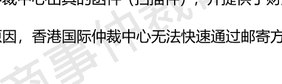

本案是人民法院根据《最高人民法院关于内地与香港特别行政区法院就仲裁程序相互协助保全的》协助保全的一宗范例。该案的审查时值疫情期间，苏州中院充分考虑到仲裁财产保全需求的紧迫性以及疫情期间从香港向内地递材料的客观不便，灵活采用邮件方式与香港国际仲裁中心确认材料的真实性，于同一时间内内完成审查、裁定和采取保全措施等各项流程，便使捷捷高效的方法获得了仲裁机构和当事人的高度评价。其后，处理实体争议的仲裁裁决得到苏州中院的认可和执行，充分体现协助保全有效促进香港仲裁裁决在内地顺利执行的功能。

## (2) 尊重当事人仲裁程序选择权，认可和执行香港仲裁裁决——金融公司申请认可和执行香港仲裁裁决
案号：四川自贡市中级人民法院(2020)川 03 港 1 号

#### 基本案情：
2007年12月11日，金融公司与某制盐公司签订《贷款合同》，约定“任何争议均应根据《联合国国际贸易法委员会仲裁规则》通过仲裁最终解决。仲裁地点为香港，仲裁机构为香港国际仲裁中心，仲裁庭由三名仲裁员组成。”因某制盐公司未约定清偿债务，金融公司向香港国际仲裁中心申请仲裁。香港国际仲裁中心于2019年8月12日作出裁决，金融公司于2020年8月17日向四川自贡市中级人民法院申请认可和执行该裁决。某制盐公司提出的《贷款合同》约定仲裁庭由三名仲裁员组成，香港国际仲裁中心指定一名仲裁员，与约定不符，违反《安排》第七条第一款关于“仲裁庭的组成与当事人之间的约定不符”的规定，故仲裁裁决不予以执行。经查，案涉裁决书明双方当事人写信请求香港国际仲裁中心任命仲裁员。

裁判结果：
四川自贡市中级人民法院认为，仲裁庭组成虽然改变了《贷款合同》中由三名仲裁员组成的原始约定，但对于认定仲裁员的案涉裁决系双方达成一致意见，双方共同签署函予以确认。某制盐公司没有依据《联合国国际贸易法委员会仲裁规则》规定在仲裁过程中对认定仲裁员提出异议，案涉裁决没有违反《安排》第七条第一款规定的情形，故裁定执行案涉裁决。

典型意义：
国际仲裁的核心在于充分尊重当事人意思自治。国际仲裁通过当事人的意思自治来选择、开启、修改整个仲裁程序。本案约定由三名仲裁员组成仲裁庭，但在仲裁程序中，仲裁机构有权认定仲裁员，双方共同签署书面函予以确认，属于《安排》第七条第一款规定的仲裁庭组成与当事人不符的不予执行理由。本案说明法院在办理案件中依法尊重当事人意思自治，并给予积极保障。

## (3) 正确认定仲裁协议准据法，支持当事人选择香港仲裁——天津某酒店管理公司申请确认仲裁协议效力
案号：天津第一中级人民法院(2021)津01民初号

#### 基本案情：
天津某酒店管理公司与香港公司于2013年1月25日签订《管理合同》，约定该合同根据内地法律解释，仲裁条款中约定“产生争议依照在收到仲裁通知之日有效的国际规则通过仲裁解决。指定仲裁机构为国际会。仲裁地点为香港”。天津某酒店管理公司认为上述条款中的“国际会”不具备仲裁能，亦不存在“国际会”这一仲裁机构，故向法院申请仲裁条款无效。

裁判结果：
天津第一中级人民法院认为，天津某酒店管理公司与香港公司签订的《管理合同》仅约定了合同适用的法律，不能作为仲裁条款效力的法律，适用仲裁地的法律符合香港法律判断仲裁条款效力根据香港《仲裁条例》规定，仲裁条款效力取决于当事人将争议交付仲裁的意思。本案中，驳回天津某酒店管理公司要求仲裁协议无效的申请。

典型意义：
本案准确把握了仲裁条款效力的准据判断原则。《中华人民共和国涉外民事关系适用法》第十八条规定：“当事人可以协议选择仲裁适用的法律。当事人没有选择的，适用仲裁机构所在地法律或者仲裁地法律。”本案当事人仅约定了合同适用法律，但没有仲裁协议的准据法，应当参照《中华人民共和国外国涉事事项法律适用法》第十八条的规定适用仲裁法律即香港法律判断仲裁效力。根据香港《仲裁条例》，仲裁协议是指当事人同意将他们之间确定的契约或非契约性的法律关系发生或者可能发生的一切争议或交付仲裁的协议，仲裁协议可以采取合同中的仲裁条款式或单独的协议形式。可见，香港法律并不以仲裁机构的明确唯一性作为仲裁协议效力判断的必要。本案当事人具有明确纠纷提交仲裁的书面意思表示，符合香港法律关于仲裁条款生效的要件，应当认定涉仲裁条款有效。法院准适用香港法律确定仲裁协议的效力，鼓励当事人选择香港仲裁，为推动两地融合共享的多元纠纷解决机制提供了实践依据。

## (4) 准确适用香港法律，认定合同援引文件构成有效仲裁协议——W公司申请认可和执行香港仲裁裁决
案号：福建省南平中级人民法院（2018）闽 07 港 1 号

#### 基本案情：
W公司与宁德秉公司于2008年10月20日签订《供应协议》，该协议第16条约定“因履行协议所产生的任何纠纷均在香港国际仲裁中心仲裁”。履行过程中，该公司又与某业公司双方签订《修订协议》，该《修订协议》由三方确认：在《修订协议》中新增的条款作为新条款添加到《供应协议》中；发生变更的协议以《修订协议》为准；第10至13条为废。因宁德某公司与某业公司均违反《修订协议》，W公司向香港国际仲裁中心申请仲裁，香港国际仲裁中心于2016年3月23日至10月28日作出裁决。W公司向福建省南平中级人民法院申请认可和执行裁决，某业公司称《修订协议》并未约定仲裁条款，故某业公司与W公司不存在仲裁协议，根据《安排》第七条第一款的规定，裁决不予认可和执行。

裁判结果：
福建省南平中级人民法院认为，《修订协议》明确援引了《供应协议》，且约定《修订协议》对《供应协议》作变更内容为《供应协议》的一部分，表明某业公司与W公司均按照《供应协议》解决争议的意思。根据香港《仲裁条例》第19条第一款规定，“合同中载有仲裁条款的任何文件，只要提明并使仲裁条款成为合同的一部分；第19条第二款规定，“协议是载于文件内的，不要求当事人必须在援引的文件上签字”。可见，W公司与某业之间构成了有效仲裁协议。据此，认可和执行案涉裁决。

典型意义：
本案核心问题为当事人之间是否存在有效的仲裁协议。依据《安排》第七条第一款“协议约定的准据法无效的；或者未指明以何种法律为准”规定，本案首先确认仲裁协议准据法为香港法律，此次证明和使用香港《仲裁条例》第19条第一款、第二款关于仲裁形式的规定，最后结合具体情境，本案中，W公司与某业公司虽签署仲裁条款，但其签署的《修订协议》明确援引《供应协议》，使仲裁条款成为《修订协议》的一部分，符合香港《仲裁条例》的要求。本案为人民法院如何在认可和执行阶段依据香港法律审查仲裁条款的效件提供了指引。

## (5) 积极说明和适用香港法律，认定仲裁效力——某某申请认可和执行香港仲裁裁决
案号：广东深圳市中级人民法院（2022）粤03民初74号

#### 基本案情：
某某与龙某签署了三份《借款协议》，就借款项、期限、利息等进行约定，并约定“协议项下一切争议与纠纷若通过友好协商解决，应提交香港国际贸易仲裁委员会，按照香港国际贸易仲裁委员会现行规则予以仲裁。”因龙某未按期还款本金，某某向香港国际贸易仲裁委员会（以下称香港仲裁中心）申请仲裁，仲裁中心作出裁决后，某某向广东深圳市中级人民法院申请认可并执行。龙某主张该裁决不被认可和执行，其主要理由为：仲裁条款约定的“香港国际贸易仲裁委员会”不能指向唯一的仲裁机构，龙某提交了其委托的香港律师出具的法律意见，认为仲裁条款约定的仲裁机构不明确，应当按照《香港仲裁例》第10条。广东深圳市中级人民法院委托法律说明和商事调解中心查询香港法律，由香港律师出具法律意见书，认为香港法律判例列明仲裁协议缺陷并非罕见，法院应当考虑其符合双方真实指示，应当在最合适、最能反映双方意意的仲裁机构进行仲裁。

裁决结果：
广东深圳市中级人民法院认为，案涉裁决在香港作出，适用香港法律查询仲裁条款的效力。案涉仲裁条款对仲裁机构的名称书写虽不准确，但当事人仲裁意愿清晰，依据香港法律该仲裁条款是有效的。该院通过分析两份香港法律意见的分歧，最终采纳法律意见和商事调解中心出具的法律意见书，即法院应选择最符合当事人对合同表述的意图、更合理且有效的解释。该认定为，本案涉及仲裁条款的约定，虽然仲裁条款中约定的仲裁机构名称不准确，但当事人明显倾向于仲裁，且香港现有八家仲裁机构中仅有“中国国际经济贸易仲裁委员会”使用了“国际经济贸易仲裁委员会”作为专有名称，与仲裁条款约定的名称最为接近，故认定当事人选择香港仲裁中心，予以认可和执行。

典型意义：
当事人约定的仲裁机构名称不准确影响仲裁协议效力是司法实务中常见的问题。本案中，被申请人提交了律师意见书，主张仲裁机构名称不准确导致程序应当按照香港法律。法院在审查律师意见的基础上，根据“国际经济贸易仲裁委员会”包含的主要特征“国际经济贸易仲裁委员会”，认定当事人选择香港仲裁中心符合香港关于仲裁条款的规定。本案充分说明法院准适用法律保障当事人仲裁权利，积极支持法治发展。

## (6) 理解仲裁规则，认可和执行外国仲裁机构在香港作出的裁决——德某等申请认可和执行
案号：北京市第四中级法院(2021)京043号

#### 基本案情：
德某、SA公司、某海公司自2013年起业务往来，德某分别与SA公司、某海公司签署了两份仲裁协议，约定发生纠纷由国际仲裁裁，仲裁地为香港。德某违约，国际仲裁院于2020年9月4日作出终局裁决：德某向某海公司支付9680欧元及利润损失、损害赔金、利息。德某至2021年1月4日向北京市第四中级法院申请认可执行裁决。SA公司主张裁决不被认可或执行，主要理由为：仲裁庭组成及仲裁程序与当事人不符，由于德某未能证明当事人对第三名仲裁员的任命约定了另一种程序，依据《仲裁规则》第12条第五款和第13条第二项规定，担任仲裁员由仲裁委员会任命，秘书长可以确认当事人提名的依据。

裁判结果：
北京市第四中级法院认为，国际仲裁院在香港作出的裁决应为执行。联席仲裁员联合提名，由仲裁院秘书长确认，该任命程序不违反《仲裁规则》的上述规定。《仲裁规则》第22条第2条规定：“为有效管理案件，仲裁庭经当事人后可采取其认为适当的仲裁程序，但等措施不应回应当事人的反对。”对于当事人未能按照仲裁规则制定的计划提交文件的，仲裁庭可以决定是否接受。另，若涉诉涉及民主体的合同争议，处理结果影响当事人，不涉及公共安全，产品符合合同约定的检验标准，亦非认定裁决危害社会安全。综上，案涉裁决不存在《安排》第七条规定的情形，裁决应予以认可和执行。

典型意义：
本案的典型意义在于重申了对仲裁程序自治性的尊重。仲裁规则一经当事人选择适用，则确成为仲裁机构、仲裁庭、当事人在仲裁过程中应遵守的程序范围，也是认可和执行阶段法院判断仲裁程序是否合法的依据。当当事人违反仲裁程序命令时，仲裁庭有权在仲裁规则的框架下作出判断，决定如何处理。本案对国际法院在香港作出的裁决属于香港仲裁、裁决不违反内地社会公共利益等问题进行了逐一阐述，最后依据《安排》裁定认可和执行案涉裁决，有效保障香港仲裁决在内地的执行，对于香港提升亚太地区国际仲裁枢纽地位具有积极意义。

四、严格依法行使监督职责、规范和促进仲裁能力和公信力提升。

五、持续加强国际、区际司法协助、促进国际仲裁高质量发展。

六、构建仲裁司法审查案件紧简单分流机制、提升仲裁司法审查质效。

七、优化体系仲裁调解机制、打造多元解纷“北京样板”。

八、加强体育仲裁审查研究、规范促进我国仲裁发展。

九、聚焦仲裁机制创新、积极贡献司法智慧。

十、加强智能协同应用、推动北京国际商事仲裁中心高效建设。

## 植德商事仲裁研究中心

# 2024 | 中国商事争议白皮书

案例情况：

- (1) 仲裁机构未核实对送达地址的真实性，以明确不存在的送达地址向被告人进行送达，违反法定程序——某贸易公司与某进出口公司争议申请撤销仲裁裁决

争议焦点：

仲裁机构在未核实某进出口公司提供的某贸易公司送达地址真实性的情况下进行送达，将不存在的地址作为送达地址，是否违反法定程序。

基本案情：

四院审认为，仲裁送达是仲裁程序中的一个重要环节，关系到仲裁程序的顺利进行和仲裁裁决的权威性。合法有效的送达不是正当程序的必要要求，有利于保障当事人权益以及平等参与仲裁程序权利；更是建立仲裁公正的必要基础，是提升仲裁公信力的有力保障。基于对仲裁的支持，人民法院在审查送达是否违反法定程序时，应当严格遵守仲裁规则，既要审查送达的具体是否符合仲裁规则，也要审查当事人一方提供的对方人的送达地址是否真实。虽然仲裁机构向某贸易公司进行了邮寄和公证送达，但某进出口公司提供的送达地址并不存在，导致某贸易公司未能接收仲裁相关文件、材料，缺席仲裁审理，未能保障当事人出庭等权利。综上，法院认为仲裁机构送达违反法定程序，通知仲裁机构重申仲裁，仲裁机构同意重申仲裁后，法院终结仲裁程序。

典型意义：

本案采用通知仲裁机构重申仲裁的方式，既纠正了仲裁程序问题，最大限度维护当事人之间仲裁合意，降低当事人维护成本，同时为规范和完善仲裁送达程序提供了有益参考。

# 2024 | 中国商事裁白皮书

- (2) 当事人违反仲裁程序性时，仲裁有权在仲裁规则的框架内作出判断，决定如何处理——德国某电子公司等与某科技公司申请认可和执行香港特别区仲裁裁决案

争议焦点：

某科技公司在仲裁中提交的文件于仲裁程序规定的时间之外，是否违反仲裁规则与双方当事人的程序合意。

基本案情：

四院审审查时，国际商会仲裁院在香港作出的仲裁裁决，应当认定为香港仲裁裁决。该仲裁机构仲裁规则第2条第2项规定：为确保有效管理案件，仲裁庭经协商当事人后，可采取其认为适当的措施，但该等措施不应反映当事人的任何约定。依据上述规定，对于决定是否接受，对于当事人未能按照仲裁裁定的程序计划提交文件的，仲裁庭可以决定接受。某科技公司提交的程序时间表未违反仲裁规则与当事人的协议，仲裁规则规定某当事人选择选用，则为仲裁机构、仲裁庭、当事人在仲裁过程中遵守的程序规范，也是可以认可和执行阶段阶段。法院判断仲裁庭组成及仲裁程序是否合法的要依据。当事人违反仲裁程序性时，仲裁庭有权在仲裁规则的框架内作出判断，决定如何处理。综上，某科技公司关于仲裁裁决不被认可和执行的理由不成立，法院认定可以执行国际商会仲裁院作出的仲裁裁决。

典型意义：

本案对国际商会仲裁院在香港作出的裁决属于香港裁决，裁决不违反社会公共利益等问题逐一阐述，充分尊重仲裁程序的自治属性。依据《最高人民法院关于内地与香港特别行政区相互承认仲裁裁决的安排》，认可和执行案有效保障仲裁裁决在内地的执行，对于提升地区地位具有积极意义。

# 2024 | 中国商事仲裁白皮书

- (3) 第三方资助行为符合仲裁规则时，一方当事人向仲裁机构披露违反仲裁保密规定——某航空公司等对某租赁公司申请撤销仲裁裁决，系国内首例第三方资助申请撤销仲裁裁决的司法案件

基本情况：

四院审认为，现行法律对第三方资助支持当事人进行仲裁无禁止性规定。对于仲裁时选择第三方资助的行为，应当基于当事人自主原则予以判断；仲裁保密性的关键在于对社会公开披露，并不限制相关人员获知信息；在现有仲裁规则中禁止第三方资助参与仲裁，第三方资助与一方当事人建立关系，并不违反仲裁保密原则。综上，某航空公司等仲裁机构违反仲裁保密原则的理由不成立，法院裁定申请。

典型意义：

本案确立了第三方资助披露义务的必要性以及仲裁保密原则判定的标准，不仅尊重了当事人的自主原则，也在我国法律框架下审查确立了合理的标准。

- (4) 对仲裁裁决是否超出仲裁请求范围的认定，结论符合当事人仲裁目的、事实理由、庭审意见等与仲裁请求综合——某集团公司与某仲委会申请撤销仲裁裁决

争议焦点：

在仲裁裁决事项中是否超出仲裁请求范围，即某集团公司请求的“确认仲委会于2006年12月27日作出的《关于土地出让合同的函》中终止（解除）《用地合同》的行为发生效力”与“仲委会先后作出的三份《用地合同》解除中，解除合同作出日发生效力”是否一致。

本案基础：

四院审理认为，仲裁请求与裁决结果在文字内容上并不完全一致，都可提炼为“解除的行为发生效力”，请求范围的认定，需要结合当事人仲裁目的、主张事实理由和庭审意见等因素进行综合认定。三份通知时间不同，所依据法律规定、事实背景有所差异，语言表达不完全相同，但核心均为仲委会及其前身组织与集团公司解除。对于合同是否解除及解除时间，仲裁庭有依据证明的事实，适用法律规定作出独立判断。综上，裁决结果并未超出仲委会仲裁请求范围，法院裁定驳回集团公司的申请。

典型意义：

本案应当通过表面文字探究当事人真实的意思表示，从而判断仲裁裁决是否超出仲裁请求范围的规则，体现了依法审查和有限监督原则。

- (5) 仲裁裁决名称、注册地址信息描述有误，法院在能够明确当事人身份时，予以认可和执行——某律师事务所与某投资公司申请认可执行香港特别行政区仲裁裁决

争议焦点：

当事人名称已变更的情况下，以变更前的名称作出裁决，且无法由仲裁机构纠正，在《最高人民法院在国内与香港特别行政区相互执行仲裁裁决的安排》没有关于当事人名称有错误在司法审查中可以核实认定的相关规定的情况下，仲裁裁决是否应当认可和执行。

基本场景：

四院审议认为，香港国际仲裁中心就某律师事务所与某投资公司作出终局裁决，裁决裁明的某投资公司名称曾曾用名，且裁明的某投资公司的注册地址也不准确。根据香港国际仲裁中心仲裁规则的规定，某投资公司要求仲裁庭作出更正的时间已过，该名称错误已无法按仲裁规则由香港国际仲裁中心自行裁定。某投资公司提交的证据能够证明主体的延续，公司名称虽然变更，但其法律人格未发生实质变化，足以证明变更名称前后主体的一致性。在已经查明当事人名称变更和具有主体资格的情况下，应当以查明的事实为依据，依法执行辖区司法协助。综上，某投资公司提出的申请认可和执行仲裁裁决申请请法院裁定可以执行该仲裁裁决。

典型意义：

本案系全国首例关于仲裁裁决当事人名称变更的辖区司法协助案件。本案法院以司法实践填补规则的空白，积极拓展辖区司法协助支持仲裁的典型案例。

- (6) 明确仲裁裁决属性的标准，尊重当事人选择仲裁规则——某机械公司与瑞典某科技公司申请撤销仲裁裁决

争议焦点：

仲裁裁决的国籍认定。

基本案情：

四院审认为，仲裁裁决由国际商会仲裁院作出，属于境外仲裁机构在境内作出的裁决，应当为我国涉外仲裁裁决。在审查仲裁程序违法诉由时，除适用我国涉外仲裁法律规定外，法院可以适用当事人选择仲裁规则。综上，某机械公司以仲裁程序违法为由提出的撤销申请不成立，法院裁定回。

典型意义：

本案系全国首例撤销境外仲裁机构在境内作出的裁决案件，本案充分体现了人民法院尊重当事人选择仲裁规则，彰显了我国接受境外仲裁的开放姿态，有利于境外仲裁机构参与国际仲裁中心建设。

- (7) 当事人未证明仲裁程序瑕疵构成《纽约公约》第五条第一款规定的不予承认情形，应予以承认和执行——某某与北京某足球俱乐部申请承认执行仲裁裁决

争议焦点：

仲裁程序瑕疵问题是否影响法院对仲裁裁决的承认和执行。

本案情形：

四院审理时，俱乐部接受其私人发送的未盖印章的电子意见书，其实符合仲裁程序，违反了瑞士《国际私法法》第18条3款关于平等对待当事人陈述意见的权利规定。根据仲裁规则第3条3款的规定，在当事人未提交书面意见的情况下，仲裁院有权对其权利进行处理，即使俱乐部提出的电子意见存在程序瑕疵，该程序瑕疵并不属于《纽约公约》规定的可以拒绝和执行仲裁裁决的情形。综上，俱乐部提出的仲裁程序瑕疵仲裁裁决不应被承认和执行的理由不成立，法院认定并执行国际仲裁院（CAS）作出的仲裁裁决。

典型意义：

本案依据《纽约公约》对国际仲裁院作出的商事裁决予以承认和执行，体现了司法严格遵守国际义务，积极促进仲裁裁决在全球范围内的承认和执行。

- (8) 遵循事实和法律适用综合审查原则，依法审查全国首例体育仲裁司法审查案件——马某申请撤销体育仲裁裁决案

争议焦点：

上海某俱乐部签署《青少年培训协议》，双方对协议是否成立及期限等产生争议。马某向中国足协纠解决委员会提出纠纷解决请求被撤回后，依据体育法向中国体育仲裁委员会申请仲裁。仲裁经审查为无证据以证明马某的主张，在2024年6月20日作出裁决撤回了马某的全部请求。马某向四院申请撤销仲裁裁决。案涉仲裁裁决是否具有可撤销情形。

基本案：

四院认为，体育法对体育仲裁制度进行了规定。体育法第九十八条是人民法院审查裁决是否撤销的法律依据。马某主张的隐瞒及伪造证据缺乏法律依据；仲裁对马某的请求依法进行了审查，事实认定及裁决适用法律、法规并无错误，案涉裁决不存在体育法第九十八条规定的可撤销情形，故驳回了马某的申请。

典型意义：

本案系《中华人民共和国体育法》施行后，北京法院审的全国首例体育仲裁司法案件。本案在体育法对体育仲裁司法审查适用原则规定的情况下，对仲裁程序、证据以及法律问题依法进行全面审查，为明确体育仲裁司法规则、细化审查标准提供了指引和参考，体现了支持体育仲裁事业发展的司法立场。

- (9) 推动仲裁与诉讼有机衔接，以仲裁临时措施为依据申请财产保全——中国某公路工程有限公司申请撤销仲裁裁决

基本案情：

北京某科技公司与某信息公司因履行《技术开发与服务合同》产生争议，向北京仲裁委员会申请仲裁同时提出财产保全。四院审查认为，考虑到某信息公司缺乏履行意愿或能力的情况，为了避免仲裁裁决不能执行或难以执行，某科技公司采取财产保全措施，且该请求并未超过仲裁范围，应予以支持。仲裁庭依据国际仲裁程序作出临时措施，人民法院对此充分尊重且财产保全申请的正当性、必要性，裁定支持财产保全。

典型意义：

本案是首例以仲裁临时措施申请财产保全的案件。本案体现了司法积极吸纳国际仲裁制度和理念，推动仲裁与诉讼有机衔接，保障北京国际商裁中心建设等方面的实际。

- (10) “执源导流+执调联动”一站式处理涉外案件，实质性化解——国外资源公司与某公司申请执行涉外案件

争议焦点：

仲裁裁决的部分事项是否具有执行内容。仲裁裁决第一项为“被申请人以人民币760万元股权”，第四项为“被申请人向申请人实际支付的股权转让金额从股权总价（即人民币700万元）中予以抵扣”，四院向仲裁机构发函要求确认双方请求的股权价款。

基础案：

四院认定，上述仲裁裁决内容对对方转让金额作出确认，并没有给付内容，属于事实。考虑到当事人的迟延和经济成本，法院并没有简单执行，而是通过“执源导流”将案件引入北京商事纠纷一站式多元仲裁中心进行调。调过程中存在支付障碍、缴税难题、股权转让协议的签署、信任修复等问题，法官积极与税务、银行、外管局等多个部门进行沟通寻找解决方法。“执调”高效联动，成功促成了双方达成调解和履行完毕。

典型意义：

本案为2024年涉外案件监管调整后北京市首例涉外仲裁执行案件。本案充分体现了四院构建调解、仲裁和司法无缝衔接的多元纠纷机制，合力构建一流的争议解决优选地。

## 5. 上海金融法院：《上海金融法院仲裁司法审查白皮书》《上海金融法院仲裁司法审查典型案例》

发布时间：2024年10月3日

要点提示

为切实落实市委关于国际商事仲裁中心和国际一流仲裁机构建设战略目标的部署、服务支撑国际金融中心建设，10月3日，上海金融法学院举行发布会，发布《上海金融法院仲裁司法审查白皮书》（简称白皮书）和《上海金融法院仲裁司法审查典型案例》（简称典型案例）。

白皮书全面梳理了相较于上海仲裁机构期间受理的8466件仲裁案件总量，上海金融法院审理仲裁司法审查案件405件，作出否定性评价案件为8件，反映了上海仲裁质量较优，中外当事人认可度较高；涉及仲裁司法审查案件中资管类纠纷数量居首，在涉、涉港澳台案件中，被申请人多为国内能源、电子、金融等行业企业，纠纷多发生在跨境融资及担保领域。

申请不予执行仲裁裁决、申请撤销仲裁裁决及涉及港澳台仲裁司法审查等类型典型案例的常见争议点和裁判准则，介绍了上海金融法院仲裁专项司法审查工作机制、金融风险防范仲裁协同工作机制三项工作机制，剖析了金融仲裁司法审查实务中反映的问题，充分发挥司法大数据“风向标”和“晴雨表”作用，分别对合同当事人和仲裁机构提出完善仲裁的针对性建议，提供明确规则预期。

## Merits Tree 植德

条款成立合并生效。通过本案裁判，对债券发行交易中，因不同合同文件包含仲裁条款的合并问题所产生的争议，具有示范意义。

## 2024 | 中国仲裁白皮书

## (2)涉外仲裁涉及中的外国法——朱某申请确认仲裁裁效力

基本案情：

被申请人 G Investment SPC 系在开曼群岛注册成立的独立投资组合公司，CR信用增强基金（CR Enhanced Fund SP）是其旗下的独立投资组合（Segregated Portfolio, SP）。2022年1月13日，当事人签署的《保证合同》首载，债权人为CR信用增强基金，朱某等人为保证人。《保证合同》中约定：合同相关内容适用中国法律，合同争议提交上海仲裁委员会按照该仲裁规则在上海进行仲裁。合同由 G Investment SPC 的代表朱某与朱某等人签署。本案涉及合同（《认购协议”）由 G Investment SPC 与朱某等人签署，并约定了所涉争议由香港行政法院管辖。同时，G Investment SPC 还与朱某等人签署了《债券回购协议》、《股权质押协议》。

朱某向上海金融法院提出确认仲裁效力申请，并主申请人 G Investment SPC 并非合同相对主体，SPC 与朱某之间无仲裁协议；涉案主合同（《认购协议”）约定由香港法院专属管辖，《保证合同》约定由上海仲裁委员会管辖，《认购协议》与《保证合同》系主从合同，应当依据主合同确定管辖。法院请求确认《保证合同》中约定的仲裁条款无效。

上海金融法院经审理认为，本案被申请人系外国法人公司，所涉协议属于涉外仲裁协议，应当根据《中华人民共和国外国民事事实法律适用法》（以下简称《涉外民事事实法律适用法》）确定相应的法律适用。

首先，就签署主体和仲裁申请主体的一致性，根据《涉外民事事实法律适用法》十四条第一款规定，适用法律发生地。在本案中，被申请人 G Investment SPC 系于开曼群岛注册成立的公司，根据《开曼群岛公司法》第二百一条、二十一条、二十一八条的规定，CR 增强基金在对外签署协议、合同时由独立投资组合负责，即 G Investment SPC 代为执行或签署。案涉《保证合同》虽然在合同首部中文名称为“CR信用增强基金”，但该合同的结约系由独立投资组合代表CR信用增强基金签署。由此，在仲裁中 G Investment SPC 作为仲裁申请代表CR增强基金提出相应申请，与仲裁条款约定的主体并不存在差异。

其次，《保证合同》约定适用中国法，且仲裁地位于上海，依照《涉民事事项法律适用法》第十八条（以下简称《仲裁法》）对涉仲裁协议效力进行审查。根据《仲裁法》第十六条，仲裁条款具有独立性，无论《认购协议》与《保证合同》是否构成主从合同，不影响仲裁条款约定的有效性。据此，裁定驳回了朱某的申请。

## 裁判要旨:

依据《开曼群岛公司法》（Companies Act 2023 Revision），独立投资组合公司 SPC 代表独立投资组合签署合同。载有仲裁条款的合同主体为独立投资组合，由独立投资组合签署了该合同，并代表独立投资组合提起仲裁的，符合《开曼群岛公司法》的规定，仲裁条款应属有效。

## 典型意义：

2024年1月1日，最高人民法院关于《中华人民共和国民事法律适用法》若干问题的解释（二）已实施。对于其中对适用法作出明示选择的，当事人举证义务等做了细化规定。本案中，法院要求当事人提供了《开曼群岛公司法》的原文，并要求其说明了法律的内容、相关条款的中文译文。

## 2024 | 中国商事仲裁法律白皮书

据此，法院依据《开曼群岛公司法》前述规定，对 G Investment SPC 作为法人实体代表 SP 订立仲裁协议的主体有效性做出了认定。该案涉及境外金融仲裁协议的外国法进行了查明，并适用外国法当事人之间形成的仲裁意见有效性做出确认。通过该案审理，既明确了相关案件的裁决标准，也为上海打造国际商事仲裁中心优选地提供了样本。

## (3) 仲裁申请人在仲裁程序中放弃管辖异议的效果——周某申请撤销仲裁裁决

#### 基本案情：

2021年4月9日，仲裁申请人周某以G资公司、Z银为仲裁被申请人，依据2016年签订的《资产管理合同》中约定的条款向仲裁机构提出仲裁申请，请求G资公司返还投资金并付利息，Z银行承担责任。仲裁机构于2021年4月14日受理了仲裁申请，并于2022年10月24日作出裁决。后周某向上海金融法院申请，其认为根据《资产管理合同》上的签名并非本人签署，故与G资公司、Z银行之间无仲裁协议，请求撤销裁决。

上海金融法院经审理认为，本案申请人周某要求撤销裁决应依照《仲裁法》第五十八条的规定对裁决进行审查。根据证据，双方当人在仲裁审理过程中未提出管辖异议，周某提起仲裁申请的行为表明其意愿接受管辖。此外，在裁决作出后，申请人以仲裁协议签名不真实的主张缺乏法律依据和事实依据，裁定驳回其申请。

### 裁判要旨：

仲裁申请人提出仲裁申请，被申请人答辩并参加仲裁审理，仲裁机构作出裁决后，申请人以仲裁协议签名不真实理由法院不支持。

## 典型意义：

2024 | 中国商事仲裁白皮书

根据《仲裁法》第十六条规定，仲裁协议应当采用书面形式。但是《仲裁法》第二十条以及最高人民法院关于适用《中华人民共和国仲裁法》若干问题的解释》第十三条规定了“异议放弃管辖权”，即在仲裁程序中的特定情况下准许当事人通过默认方式放弃管辖。通常而言，仲裁申请人往往是对仲裁协议效力提出异议的，但仲裁申请人同样受到上述原则的约束。在本案中，仲裁申请人主动提出仲裁申请，被申请人同样接受了管辖，此外，在仲裁程序中，无论当事人之间是否存在书面仲裁协议，该签名是否真实，都不影响仲裁机构行使管辖。

## (4) 债券质押回购交易主协议仲裁条款的成立——K证券公司申请确认仲裁效力

#### 基本案情：

S证券公司于2015年3月2日在《上海证券交易所债券质押回购交易主协议》上方签字。K证券公司于2016年1月2日在《上海证券交易所债券质押回购交易主协议》上方签字。协议本身已交至上海证券交易所备案。主协议第18条约定：“……本协议争议无法解决的，回购交易双方均意将争议提交上海国际贸易仲裁委员会仲裁……”；主协议第19条约定：“该协议为开放式仲裁，参与者签署后在各签署人之间产生法律效力。”

K证券公司向上海金融法院申请，请求确认S证券公司与K证券公司之间不存在有效仲裁协议。

上海金融法院审查后认为，双方当事人签订的《回购交易主协议》第18条约定了有关争议事项和仲裁机构。上海国际贸易仲裁委员会会有权根据当事人签订的仲裁协议受理争议案件并作出裁决。根据主协议第19条约定，该协议为开放式仲裁，参与者签署后在各签署人之间产生法律效力。S证券公司和K证券公司均分别签署了《回购交易主协议》并提交上海证券交易所备案，表明双方均已同意仲裁协议项下的争议提交上海国际贸易仲裁委员会进行仲裁。法院裁定驳回其申请。

### 裁判要旨：

交易双方在《上海证券交易所债券质押回购交易主协议》签章并依照自律规则备案后，除另有约定外，主协议中载明的仲裁条款对因债券回购发生的交易主体均具有约束力。

# 2024 | 中国商事仲裁白皮书

## 典型意义：

根据《上海证券交易所债券质押式回购交易暂行办法》《上海证券交易所债券质押回购交易业务指引》的规定，投资者参与债券回购前，应当签署上海证券交易所债券质押回购主协议并报送备案。同时，《回购交易主协议》作为《上海证券交易所债券质押式回购交易暂行办法》附件，其中第19条规定了协议的成立形式，即交易参与者与各自签署主协议后即成立。仲裁协议具有相对性，原则上要求当事人共同签署达成意见一致。但主协议是自律规则的一部分，其中对仲裁条款的成立作了明确，交易参与者之间约定仲裁本质上是对自律规则的遵守。

## (5) 同一交易合并仲裁——P银行申请确认仲裁效力

#### 基本案情：

2017年，Y信托公司作为受托人，与一般委托人陈某、优先委托人P银行分别签署《信托合同》，约定陈某、P银行就同一信托相关争议提交仲裁委员会。同时，陈某与P银行另签订《合作协议》，约定陈某为一般委托人、P银行为优先委托人就同一信托相关争议提交仲裁委员会。2020年，陈某以Y信托公司、P银行为共同被申请人向仲裁委员会提出仲裁申请。后P银行向上海金融法院申请，认为其并非与Y信托公司签订《信托合同》的当事人，故其与仲裁协议没有约束力。

上海金融法院审查后认为，《信托合同》《合作协议》约定的仲裁条款有效，仲裁协议订立合法的。在本案中，陈某作为一般委托人、P银行作为优先委托人与Y信托公司签订了信托合同，并在其中约定了仲裁条款；而陈某与P银行又对同一信托就一般委托人与优先委托人之间的权利义务签订了《合作协议》，其中亦约定了仲裁条款。且《信托合同》《合作协议》约定的仲裁机构相同。基于此，P银行与陈某、Y信托公司之间共同形成了约定仲裁的意愿，遂裁撤回其申请。

### 裁判要旨：

信托关系中，优先委托人、一般委托人和受托人就同一信托关系约定相同仲裁的，可以进行合并。

## 典型意义：

关于仲裁申请人或仲裁机构可否将涉争议纳入同一仲裁程序解决，仲裁规则做出了明确规定。如《国际仲裁规则（2021）》第10条规定：经一方当事人要求，并符合下列条件之一，仲裁院可将未决的两项或多项仲裁案合并为单一仲裁案：a)当事人已经进行合并；b)各仲裁案的所有仲裁请求依据一份或多份仲裁协议提出；或c)各仲裁案的所有仲裁请求并非基于相同的一份或多份仲裁协议提出，但各仲裁案当事人相同且涉及的法律关系相同，且仲裁院认为各仲裁案彼此相容。又香港特别行政区2022年《仲裁条例》附件2中规定，对于项或多项仲裁程序，如果法院认为在该等仲裁程序中，均产生共同的法律或事实问题，或是关于同一宗或一系列的交易等情形，可以应对仲裁当事人申请令命令，将该等仲裁程序按照公正合并处理。本案中，通过对交易结算结构和仲裁条款内容的解释，允许仲裁当事人针对特定争议纳入单一仲裁程序解决，有利于提高仲裁程序效率，为仲裁程序规则的完善提供了指。

## (6) 仲裁当事人真意的合理判断——陆某申请确认仲裁协议效力案

 案情：

2020年12月25日，陆某（甲方）、F控股集团（乙方）、陆某（丙方）签订《备忘录》，其中在首部约定“甲方、乙方称为‘双方’，甲方、乙方、丙方统称‘各方’，单称为‘一方’。《备忘录》约定，甲方陆某拟于2020年12月25日让乙方F控股集团持有的股份，转让价格为1.53元/股，转让总价3亿元；上述股份目前处于限期内，限期至2021年2月4日届满，乙方承诺在限期后立即按照本约定和双方签署的《股份转让合同》办理交付手续；丙方作为担保人，同意由乙方为甲方所负的合同义务向甲方或其关联方提供担保保证书，确保本备忘录及股份合同项诚信履行。《备忘录》另约约定，“因备忘录签署而产生的与股份合同有关争议，双方首先以友好协商解决。未果时，一方均可将该争议提交仲裁委员会。”后陆某因股权交易违约，F控股集团为仲裁申请人向仲裁机构提出仲裁申请。期间，陆某向上海金融法院申请，认为《备忘录》中约定的仲裁条款存在于陆某与F控股集团之间，请求确认其之间不存在仲裁协议。上海金融法院审查后认为，根据《备忘录》中约定的仲裁条款，从文字表述来看，“双方”、“各方”指的内容明确、具体、无歧义，当事人对此应该知晓并关注。仲裁条款中的“双方”解释为陆某与F控股集团，遂裁定确认本案申请人与被申请人之间仲裁有效。

### 裁判要旨：

合同虽然由多方当事人签订，但根据仲裁条款约束的范围，仲裁条款对其他当事人无约束力。

## 典型意义：

仲裁条款的解释应当从合同约定的语义出发。本案中，各当事人对《备忘录》中约定的仲裁条款产生了分歧。法院在解释仲裁条款时，优先尊重当事人明确约定。《最高人民法院关于适用中华人民共和国民法典若干问题的解释》第一条对合同解释也做了补充和细化。对于合同主观方面，对于解释不明确的，应当由当事人举证证明。本案中，由于仲裁条款中“双方”定义有别，法院仍依照常规语义来判断仲裁条款对当事人涵盖范围。

## (7)仲裁条款适用于合同变更的判断——M有限伙企业申请确认仲裁效力

#### 基本案情：

2020年4月18日，M有限伙企业（投资人）与陆某（卖方）签订了《股份转让协议》，就股份转让、价格及履行等事项进行了明确，同时约定双方将争议提交至仲裁委员会。2020年4月26日，M有限伙企业向陆某出具了《承诺函》，承诺：自交易之日起甲方持有股份有限公司股份的期间，若股份有限公司完成上市或指定方上市之五个工作日内，向陆某支付500万元奖励款。在合同履行过程中，双方发生争议。仲裁申请人陆某依据《股份转让协议》中的仲裁条款，以M有限伙企业为被申请人向仲裁机构提出仲裁申请：请求M有限伙企业支付股权转让款、奖励款，赔偿上述损失以及律师费等。

上海金融法院在审理后，首先，从合同目的来看，《股份转让协议》由M有限伙企业与陆某共同签订，合同目的是股份转让，合同双方对股份转让的价格、数量、交易方式等均作了明确的约定；而《承诺函》是M有限伙企业向陆某单独出具的，约定目标公司上市后M有限伙企业在一定条件下需要对陆某额外支付奖励款，具有条件履行的意思，该内容从形式上独立于《股份转让协议》。其次，从《股份转让协议》《承诺函》约定的条款要素来看，《承诺函》与《股份转让协议》虽然与股份转让相关，但它们之间的合同要素重合性不明显，具体而言，就《股份转让协议》涉及的价格、数量、交付方式等重要内容，《承诺函》对上述要素并未提及及未更改，《股份转让协议》《承诺函》签订时间也不相同，履行的条件更是较大，《承诺函》履行的前提是“合格上市”。根据《中华人民共和国民法典》五百四十三条、五百四十四条之规定，当事人协商一致的，可以变更合同。当事人对于合同内容约定不明确的，推定为未变更。本案《承诺函》的内容未能推定双方涉及股份转让事项完成了变更。再次是否构成合同变更，取决于双方当人的意见表示。本案当事人所出示的以及审查的结论，《股份转让协议》与《承诺函》之间的关系，申请人为被申请人的陈述并不一致。《股份转让协议》《承诺函》分别就事项进行了约定，两者非合同变更关系。合同内包含争议解决条款分别具有独立性，鉴于《承诺函》并未明确争议处理方式。故《股份转让协议》的仲裁条款不适用于《承诺函》。

### 裁判要旨：

根据合同语义、合同要素和当事人意见，仲裁条款对当事人具有约束力，争议仲裁适用。

## 典型意义：

仲裁条款的适用取决于当事人的意见表示。在本案中，仲裁申请人提出仲裁申请，被申请人同样接受了管辖，此外，仲裁机构作出裁决后，申请人以仲裁协议签名不真实的主张缺乏法律依据和事实依据。

# 2024 | 中国商事仲裁白皮书

## (8) 涉外仲裁裁决事项的承认与执行——境外公司申请认可外国裁决

#### 基本案情：

2020年1月19日，申请人S公司与被申请人Z公司签订《贷款协议》，由借款人S公司向Z公司发放贷款，并由Z公司按照贷款提供质押，约定所有争议应根据国际商会仲裁规则，由上述规则任命的三名仲裁员进行仲裁。裁决适用纽约法律，仲裁地位于美国纽约市，仲裁员人数为三人，仲裁程序完全用英语进行。后国际商会仲裁院对S公司于2021年2月23日在美国纽约市作出《最终裁决》：(a)确认申请人已于2020年2月6日解除了《贷款协议》；(b)裁决被申请人违反《贷款协议》向申请人支付赔偿金300万元；(c)裁决被申请人项向申请人自2020年2月6日起至付清之止，按9%的利率向申请人支付(a)款所述金额的单利；(d)收回被申请人法律费；(e)各方自行承担法律代理和协助费用；(f)仲裁费用由当事人平均分担；以及(g)驳回其他请求和反请求。S公司向上海金融法院申请：1.承认上述由国际商会仲裁院作出的最终裁决》；2.根据上述《最终裁决》，强制Z公司立即向S公司履行项义务。

上海金融法院经审理认为，本案所涉外裁决由国际商会仲裁院在美国境内

## MeritsTree 律师

作出，鉴于中国和美国均为《纽约公约》成员国，申请人S公司申请与执行国际商会仲裁院做出的仲裁决，应当适用《纽约公约》进行审查。然而根据《纽约公约》，案涉裁决应予承认，外国仲裁裁决的承认与执行尚属于不同请求，应分别予以审查。S公司在本案中请求执行的内容为：强制S公司立即支付违反《质押贷款协议》而产生的损害赔金360万元及上述资金的单利（以360万元为基数，按9%年利率计算，至2020年2月6日至清准之止）。

其中，要求Z公司支付损害赔金360万元的主张符合《最终裁决》(b)项裁决内容，且不违法，可以支持；但关于其要求Z公司支付360万元为基数，按9%年利率，至2020年2月6日至清准之止的利的主张，在《最终裁决》中并没有相应回应。S公司认为《最终裁决》(c)项目文中“向申请人支付(a)款所述款金额的单利”系错误，应为“向申请人支付(b)款所述款金额的单利”，故其申请应予支持。对此，法院认为，《最终裁决》中存在笔误，应由当事人根据仲裁规则依法向仲裁机构申请更正，法律并无授权法院在承认与执行过程中进行主动更正之授权。由于《最终裁决》(c)项目利息的给付内容不当，不符合准予执行之条件，S公司要求Z公司支付360万元的利息的主张，缺乏依据。

裁定：一、承认案涉《最终裁决》；
二、准予执行上述《最终裁决》之(b)项裁决内容。

裁决要旨：
外国仲裁决承认执行案件审查中，人民法院对仲裁决并无主动更正之权限。裁决文中存在笔误，但未经仲裁机构依据规则则更正的，人民法院可在承认仲裁决的基础上，仅对裁决文主旨正确部分准予执行。

典型意义：

## 2024 | 中国商事仲裁白书

《纽约公约》第三条规定，承认和执行外国仲裁裁决应依照国际仲裁程序进行审查。

根据《贸易法秘书处关于〈承认及执行外国仲裁裁决公约〉的指南》，通常认为“承认”指指定仲裁裁决具有约束力但不一定可执行的，而“执行”则指使裁决生效的过程。《最高人民法院对于外国仲裁机构的裁决申请承认和申请执行是否应一并提出的清单的复答》也明确，对于外国仲裁裁决，法律没有规定主体必须一并承认和执行，当事人可以选择申请人法院裁认和执行。因此，在承认和执行程序中，人民法院可以就承认与执行分别予以审查。对涉及仲裁裁决的执行应以承认为前提，“执行”是在承认仲裁裁决效力的基础上，对仲裁主体执行内容的确认。对于仲裁主体存在错误，未经仲裁更正的，并不属于《纽约公约》第五条规定的拒绝承认和执行的情形。但主体错误客观上使得部分裁决主体内容无法执行，因执行法院无权对裁决内容进行变更、撤销，故可以在承认仲裁裁决整体效力的基础上，对具备可执行性的主体予执行。既遵循了《纽约公约》的基本要求，也兼顾了外国仲裁裁决在在国内执行程序中的可行性问题。

## (9) 合同仲裁条款是否由于合同的判断——冯某申请确认仲裁效力

基本案情：

2012年7月20日，Y合伙企业（有限公司）作为普通合伙人与林某等作为有限合伙人签订《合伙协议》，约定有争议提交中国国际经济贸易仲裁委员会上海分会仲裁。因Y合伙企业未能在《合伙协议》约定的期限内实现清算退出，2019年，冯某先出具《关于Y基金相关资金出工作的声明》（保证书），承诺若Y合伙企业管理的Y基金在2020年12月31日前实现100%本金的退出，冯某将承担投资者未的退出金额。

后冯某向法院确认其与林某之间《合伙协议》《保证书》项下纠纷存在有效的仲裁协议或仲裁条款。

上海金融法院审议委员会认为，根据《仲裁法》第十六条规定，仲裁协议应具有请求双方的意思表示、仲裁事项及选定的仲裁委员会三个要素。本案涉及的问题是冯某与林某之间是否存在有效的仲裁协议。对此，本案案案中《合伙协议》中明确约定“因本协议引起的与与本协议有关的一切争议……提交中国国际经济贸易仲裁委员会上海分会，按该时仲裁规则则在上海分会解决”，但冯某非《合伙协议》的签字人，足以确认其与林某双方之间的争议具有请求双方的意思表示。同时，林某亦未提供证明其与冯某双方争议争议解决在仲裁。案涉《保证书》中并未约定仲裁条款，林某案涉《保证书》作为从应当受到仲裁条款约束的意见并缺乏相应依据。

判决要旨：
在无明确确定的情况下，应当严格尊重当事人的意思，不能任意解释仲裁条款的适用。

典型意义：
本案系基金合同到期未实现清算，担保人以保证书的形式向投资者承诺对未期收回的投资款承担责任，因基金合同约定仲裁，从而引发的争议。争议在于主合同中的仲裁条款是否约定仲裁。根据《仲裁法》第十六条规定，仲裁协议应当建立在当事人真实意思的基础上，只有当事人明确约定仲裁，仲裁机构取得取得。在本案中，《保证书》名为保证，但约定的是担保，并非从合同，对于主合同中的仲裁条款是否约定仲裁。

## (10) 保险合同中仲裁条款效力——J公司申请确认仲裁效力

基本案情：

2020年8月，J公司为其所有的工程项目向保险公司投保，并在《保单》上盖章。《保单》“争议处理”约定，“若保险人/被保险人发生纷不达成协议，被保险人自愿采取的解决方式：诉讼或仲裁，仲裁机构上海仲裁委员会”。J公司未就解决方式进行勾选。

2020年9月，保险公司签发《保单》，同意为J公司投的工程质量承保。《保单》约定争议处理方式为仲裁，仲裁机构为仲裁委员会。《保单》附《保险条款》中约定争议处理需提交。2023年8月，J公司依据《保单》向仲裁机构受理后，J公司向法院申请，请求确认保险合同项下未达成有效。

上海金融法院审理委员会认为，《最高人民法院关于适用《保险法》若干问题的解释（二）第十四条规定，“保险合同中记载的内容不一致的，按照下列规则确定：（一）投保单与保险单或其他保险凭证不一致，以投保单为准，但不一致的情形需保险人说明并经投保人同意，以投保人收保险单或其他保险凭证为准；二）非格式条款与格式条款不一致，以非格式条款为准……”首先，申请人J公司在填写《投保单》时，已在《保单》上盖章确认，但其在《投保单》的“争议处理”一栏中明确勾选诉讼或者仲裁的处理方式，故难以认定J公司在投保时具有双方保险合同涉争议提交仲裁的意思表示。

其次，案涉《保单》系保险公司签发的格式文本，其中载有将双方争议提交仲裁解决的条款，但无证据证明保险公司曾就《保单》中的争议解决条款向J公司进行说明并经其同意，在投保人J公司对《保单》中的争议解决方式明确予以否认的情况下，该条款对J公司不发生效力。同时，根据《保单》中《保险条款》第一条约定，保险合同由投保人、保险单或其他保险凭证以及附属条款构成，案涉保险合同中明显存在《投保单》约定的争议解决方式与《保单》约定不一致的情形，且该不一致的情形保险人并未向投保人明确说明并经投保人同意。

最后，本案保险人签妥的《保单》对投保人填写的《保单》中有争议解决的内容经历了实质变化，《保险单》有关争议解决方式的内容应为新的。争议解决方式条款在合同中具有独立地位与当事人有重大关系，保险人有争议解决方式的要求必须经过投保人明确的承诺，支付保险费的行为并不能认定投保人以默示方式对保险人的要求作出承诺。J公司与保险公司之间无有效仲裁协议。

裁判要旨：
投保单由投保人签署确认，当投保单与保险单对于争议解决途径不一致的情况下，应以投保的约定为准。

典型意义：
保险合同一般由投保单、保险单、保险条款等组成。当投保人与保险单对于争议解决内容不一致时，应当以投保人签署的投保单记载的真实意思表示，保险人应向投保人说明并经其同意，否则仲裁条款发生效力。

## 2024 | 中国商事仲裁白书

(1)严格执行《纽约公约》承认外国仲裁决——马某公司申请承认仲裁决案

基本案情：

乌别克斯坦亚马某公司与中国企业通过互联网订立国际货物买卖合同，因公司未按约定交付货物，马某公司根据仲裁协议向乌别克斯坦商会仲裁院提起仲裁。马某公司申请仲裁后，乌别克斯坦商会仲裁院作出裁决，令公司向马某公司返还相应贷款、承担损害赔金及仲裁费。之后，马某公司向佛山市中级法院提出受理裁决的申请。公司以签署合同的人员刘某并非公司员工、无权代表公司对外订立合同为由，辩称其与马某公司不存在仲裁争议，案涉裁决不被承认。

裁判结果：

佛山市中级法院在对中国和乌别克斯坦共和国提出的《承认及执行外国仲裁决》（以下简称《纽约公约》），本案适用《纽约公约》的相关规定进行审查。根据《纽约公约》第二条、第四条的规定，判断裁决是否符合《纽约公约》第五条不予承认和执行的前提是当事人是否存在合法的仲裁协议。结合案涉买卖合同的履约情况，合同涵盖业务章的形式，合同约定了联系地址，银行账户收取贷款等事实，马某公司有理由相信刘某有权代表公司与其订立合同，合同中约定的仲裁协议已成立、效力及对关于不存在仲裁协议以及不应被承认裁决的主张不能成立，故认定涉案外外国仲裁决。

典型意义：
本案裁决由乌别克斯坦仲裁机构作出，涉及中乌两国公司之间的国际货物买卖合同纠纷。人民法院依照《纽约公约》的规定承认外国仲裁决，支持商事仲裁在解决国际贸易纠纷中发挥重要作用，平等保护“一带一路”倡线国家商事主体的合法权益，树立了中国“仲裁友好国家”的司法形象，为营造稳定、公平、可预期的营商环境提供强有力的司法和服务保障。

## (2)严格执行区际司法协助安排准许香港仲裁当事人提出的财产保全申请——维某公司在香港仲裁程序中申请跨境财产保全案

基本案情：

香港企业维某公司因与内地企业维某公司股权转让及纠纷一案，向香港国际仲裁中心申请仲裁并获受理后，通过该仲裁中心向广州市中级人民法院申请财产保全，请求冻结、查封、扣押维某公司名下价值人民币1.8亿元元的财产。

裁判结果：

广州市中级法院认为，依据《最高法院关于内地与香港特别行政区相互互助安排》，维某公司作为香港仲裁程序的当事人，有权在仲裁裁决前提出财产保全申请，故冻结、查封、扣押公司名下价值人民币1.8亿元元的财产。

典型意义：
人民法院依法互助安排准许香港仲裁当事人提出的财产保全申请，为香港仲裁裁决执行保障，推动建立多元化纠纷解决机制。

## (3)对于电子格式中仲裁条款的提示义务审查——某某申请确认仲裁效力

基本案情：

某某申请注册成为“用户”。该《用户协议》首页显示：“在使用‘用户’之前，请务必仔细阅读、充分理解《用户协议》，特别是仲裁条款。”该协议第十一条“法律适用和争议条款”第二款中，“协商不成的，建议提交仲裁委员会规则进行仲裁。裁决是终局性的，对双方具有约束力”。

裁判结果：

某市中级法院认为，《用户协议》在首页提示审慎阅读、充分理解仲裁条款，仲裁条款亦标注划线，已采取合理提示。案涉仲裁条款并未排除用户的合法权益减损。某某申请确认其《用户协议》中的仲裁无效，仲裁条款符合《中华人民共和国仲裁法》规定的成立要件，合法有效，故回回某的申请。

典型意义：
随着电子商务和信息化化的发展，越来越多的商主体选择互联网订立合同，仲裁作为争议解决的方式之一，与诉讼无优劣，且对解决纠纷而言更为便捷。网络服务提供的电子格式合同选择仲裁作为解决方式，属于不合理限制用户权利，只要对仲裁条款尽到合理的提示和说明义务，则该仲裁条款为有效。本案进一步明确了电子格式合同中仲裁条款效力的标准。

## (4)合同与非合同争议方式不一致的仲裁条款效力——李某申请确认仲裁协议效力

基本案情：

李某（卖方）与某（买方）签订了《二手房买卖合同》，合同第2条约定：“双方在签署本合同后因交房需要签署房及国土部示范文，本合同的履行以本合同为准，本合同若没有约定或约定不明的，再依据交房需要签署房及国土部示范文来办理。”合同第13条约定，因合同履行产生纠纷的，向仲裁委员会申请仲裁。后，双方签订了《深圳市二房屋买卖合同》，约定争议由有管辖的人民法院起诉，该合同文本由“深圳市二房屋自动买卖合同签订系统”生成。深圳仲裁院受理了某提出的仲裁申请后，李某向深圳市中级法院请求确认与其签订的仲裁协议无效。

裁判结果：

深圳市中级法院认定，李某与某就涉房产交易签订了两份房屋买卖合同，两份合同约定了不同的争议解决方式。根据李某与某签订的《二手房买卖合同》的约定，合同履行以本合同为准，若没有约定或约定不明的，才依据交房需要签署的示范文来办理。如此，应以《二手房买卖合同》约定的争议解决条款来认定涉房产交易纠纷的争议解决方式，该《二手房买卖合同》中的仲裁条款包括表示，约定了明确的仲裁事项和仲裁机构，符合《中华人民共和国仲裁法》规定的成立要件，属于有效的仲裁协议。故此裁决驳回了李某的申请。

典型意义：
司法实践中，涉及房屋买卖、股权转让的纷存在大量备案与非合并存的情形。在合同规定的争议解决方式不一致的情况下，人民法院充分尊重当事人意思自治，结合交易背景、交易习惯、合同条款等事实认定当事人选择的争议解决方式，明确了此类案件中对于仲裁的效力。

当事人在合同中约定由“当地仲裁机构仲裁”，是目前仲裁协议中常见的表达方式之一。如果结合合同性质以及当事人住所地、合同签订地、合同履行地、合同标的物所在地等情况能够确定具体仲裁机构的，应当尊重当事人的仲裁意愿，按照有利于仲裁协议有效的原则予以认定。本案为约定“当地仲裁机构仲裁”的效力认定提供了类案指引。

# 2024 | 中国商事裁白皮书

## (6) 公司高管与公司之间非劳动争议的财产纠纷可以进行商事仲裁——连某公司申请确认仲裁协议生效案

#### 基本案情：
连某公司与黄某签订《职业经理人经济经营书》，对黄某的工作职责、薪酬待遇、年度经营目标以及考核管理等进行了约定，黄某若违反《职业经理人管理办法》《职业经理人考核细则》以及董事会决议造成连某公司损失，应承担赔偿责任，就执行违反责任发生的一切争议向广州市仲裁委员会申请仲裁。
2022 年，某某公司因黄某违反《职业经理人经济经营书》导致公司遭受巨大损失由黄某违反劳动争议申请仲裁，请求裁决黄某支付约定期内经济损失、停产损失经济损失等。连某公司劳动争议调解仲裁委员会以仲裁范围不属于劳动争议范围为由，作出《不予受理通知》。连某公司向广州市中级人民法院请求确认《职业经理人经济经营书》中的条款有效。

#### 裁判结果：
广州市中级法院认定，案涉仲裁条款约定的仲裁事项为“执行本责任书时发生的一切争议”。黄某作为连某公司的职业经理人，执行《职业经理经济书》时产生的争议。黄某决非因薪酬待遇而产生的劳动争议，且因黄某在履行经理人职务过程中对公司造成损失而产生的争议。劳动争议不属于商事仲裁范围，但双方因非劳动争议而产生的财产纠纷，可以向商事仲裁机构申请仲裁。故裁定确认案涉仲裁条款关于因黄某职务行为造成公司损失争议可向广州仲裁委员会申请仲裁的内容有效。

## 典型意义：
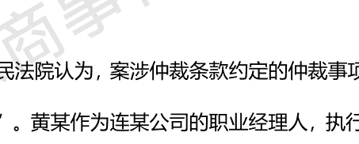

公司高管有别于普通员工，其与公司签订的合同中除了一般劳动合同条款外，可能还包含公司经营、分红等平等商事主体之间的条款。在此情形下，应当对高管与公司之间发生的争议类型进行甄别。双方之间产生的非劳动争议纠纷，属于《中华人民共和国仲裁法》第二条规定的平等主体之间的合同纠纷或其他财产利益纠纷，可以进行商事仲裁。如果当事事人约定通过仲裁解决不属于劳动争议的财产纠纷，应当尊重当事人的仲裁意愿。

# 2024 | 中国商事白皮书

## (7) 战略投资者有权在破产重整中作为案外人申请不予执行仲裁裁决，有效衔接破产重整和仲裁司法审查程序——案外人某某公司申请不予执行仲裁裁决

#### 基本案情：
武汉仲裁委员会受理凯某公司与铁某公司的纠纷，凯某公司与铁某公司达成解协议，确认凯某公司欠付铁某公司工程款2226万元及停工期间生产的工人工资、设备租赁和安全防护等费用4943万元，武汉仲裁委员会据此作出仲裁裁解。河源市中级法院裁定允许凯某公司破重整后，某某公司作为投资者收购了凯某公司100%股份。某某公司以凯某公司与铁某公司虚构债权债务、损害包括某某在内的凯某公司其他债人利益为由，向河源市中级法院申请不予执行仲裁裁解书。

## 裁决结果：
河源市中级法院一审认定某某回凯某公司提出的撤销仲裁调解书申请，裁定不予受理某某公司的申请，某某公司提起上诉。广东省高级人民法院认为，战略投资者对于破产重整企业而言属于案外人，破产重整的债务将影响法律，与破产重整企业之间存在利益关系。在本案中，某某公司参与凯某公司破产重整程序成为凯某公司的新股东，在凯某公司破产重整程序尚未结束、所负债务尚未清偿前，某某公司作为案外人申请不予执行凯某公司与铁某公司之间仲裁裁决执行，符合《最高人民法院关于办理仲裁裁决执行案件若干情形案外人申请不予执行仲裁裁决的受理规定》第九条规定。同时，《最高人民法院关于适用〈中华人民共和国仲裁法〉若干问题的解释》第二十六条规定不适用于案外人申请不予执行仲裁裁决情形，即人民法院不能以当事人申请撤销仲裁裁决回回为由，案外人申请不予执行仲裁裁决。故裁定撤销仲裁裁决，指令河市中级法院审查。

## 典型意义：
本案涉及破产重整仲裁程序衔接和协调问题。本案深入分析了战略投资者在破产重整中申请不予执行仲裁裁决的主体地位，确保投资者的合法权益，充分显示了仲裁司法防范虚假债破产重整方面的作用，为加速市场、营造司法环境提供了保障。

# 2024 | 中国商事白皮书

## (8) 通过重新仲裁弥补程序瑕疵，保护当事人权利——华某公司申请撤销仲裁裁决

#### 裁判结果：
珠海中级法院认为，根据该仲裁规则规定，当事人在审理终结前提交的证据材料仲裁院不再接受，要求当事人一定期限内提交书面质证。鉴定机构出具《回复》属于鉴定意见的补充，内容影响鉴定意见判断。仲裁院未将《回复》作为证据质证，剥夺了当事人的辩权，违反仲裁规则，影响案件正确结果。通过仲裁程序解决当事人纠纷的角度，珠海中级法院通知仲裁院在一定期限内重新仲裁，同时中止仲裁程序。珠海中级法院撤销仲裁裁决。

## 典型意义：
对证据质证是当事人的基本权利，是确保仲裁公正的重要手段。仲裁机构未组织当事人对案事实补充证据进行质证，影响案件公正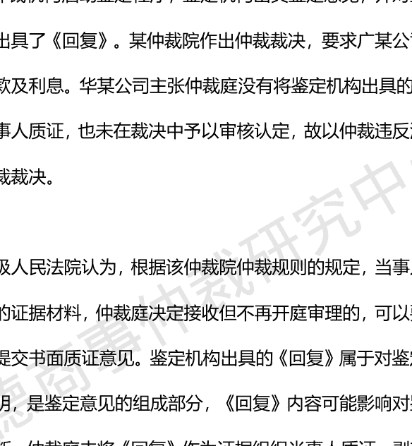 裁决。在此情况下，人民法院通知仲裁庭重新仲裁，给予程序缺陷的机会，平衡了程序缺陷与仲裁终局性之间的关系，依法规范发展，为本案处理提供了借鉴思路。

# 2024 | 中国商事白皮书

## (9) 依法保障当事人对仲裁协议效力向法院提出异议——华某公司、杨某申请确认仲裁效力

#### 基本案情：
华某银行（贷款人）与周某签订了《贷款合同》，约定合同争议提交仲裁。华某公司、杨某与华某银行签订了《担保合同》，约定由华某公司、杨某为周某的贷款担保责任，合同争议按主合同约定解决。华某银行根据仲裁条款向仲裁院申请仲裁，该仲裁院受理后作出决定书，认定仲裁条款合法、该案属于其管辖范围，并向华某公司、杨某同时送达仲裁裁决。之后，华某公司、杨某向广州市中级法院申请确认仲裁条款无效。华某公司与华某银行均确认没有当事人向该仲裁院提出管辖权异议。

#### 裁判结果：
广州市中级法院认为，虽然仲裁院已作出决定认定仲裁条款合法、且涉案纠纷具有管辖权，但该决定并非在当事人对仲裁协议效力提出异议的情况下出的。华某公司向人民法院申请确认仲裁条款无效，符合《中华人民共和国诉讼法》第二十条第二款“当事人对仲裁协议效力有异议的，应当在仲裁首次开庭前提出”的规定，依法予以审查。广州市中级法院审查后认为仲裁条款有效，故驳回华某公司、杨某的申请。

## 典型意义：
对仲裁协议的效力提出异议，是法律赋予当事人的权利。在各方当事人未对仲裁协议效力提出异议的情况下，仲裁机构进行审查并作出决定，不影响当事人依法向法院申请确认仲裁协议效力。只要当事人提出的申请符合中华人民共和国《仲裁法》规定的时限要求，人民法院应当予以审查，保障当事人就仲裁协议效力向司法机关提出异议的权利。

# 2024 | 中国仲裁白皮书 维护社会公共秩序

## (10) 依法不予执行虚假仲裁案件——案外人黄某申请不予执行仲裁裁决

#### 基本案情：
龙某对黄某借款40万，龙某与其父亲签字《广州市存量房买卖合同》，约定龙某购买某名下房屋，并将房屋所有权变更更为龙某，但龙某并未支付任何购房款。黄某作为龙某的债权人，对上述房屋转让行为提出了债权人撤销之诉。生效后民事判决认定龙某将涉案房屋转让给龙某，给债权人黄某损害。龙某与父亲签订的《广州市存量房买卖合同》之后，仲裁委员会根据龙某与父亲签订的仲裁协议，受理了龙某有关纠纷的仲裁申请，确认龙某为涉案房屋共同所有人，黄某向广州市人民法院申请执行仲裁裁决。

#### 裁判结果：
广州市人民法院认为，在判决已撤销龙某将涉案房屋转让给龙某的情况下，又签署仲裁协议并提出仲裁申请，属于恶意仲裁，损害了黄某合法权益。广州市人民法院裁定不予执行仲裁裁决符合《最高人民法院关于办理仲裁裁决执行案件若干问题的规定》，广东省高级人民法院驳回申请。

## 典型意义：
仲裁案件当事人之间存在虚构法律关系、事实仲裁，是案外人申请不予执行仲裁裁决的条件之一，也是司法审查的难点 人民法院结合案外人的资金债务等情况，保护案外人的权益，维护仲裁秩序。

# 2024 | 中国商事白皮书

## 江苏省高级人民法院：2019-2023商事仲裁司法工作情况

发布时间：2024年7月29日
主要内容：江苏法院发布了2019-2023商事仲裁审查工作情况，从收情况来看，江苏法院共新收仲裁审查案件9454件，其中新收涉外、澳台仲裁案件90件，涉港30件，涉台6件。
- 从占比最高的仲裁保全案件，共新收6696件，约占70.8%；
- 第二是申请撤销仲裁裁决（以下简称撤销裁决）案件，新收1613件，约占17.1%；
- 第三是确认仲裁效力案件（以下简称确认仲裁）案件，共新收577件，约占6.6%；
- 第四是申请不予执行仲裁裁决（以下简称申请不予执行裁决）案件，共新收526件，约占5.5%；
- 第五是承认和执行外国仲裁裁决，共新收25件，约占0.3%；
- 第六是认可和执行港澳台仲裁裁决，共新收17件，约占0.2%。

从案件情况来看，江苏法院共受理仲裁审查案件9422件，对仲裁定性评价的案件共计144件，占比1.5%。从审查结果来看，审结仲裁案件549件，其中38件确认仲裁无效或不成立；审结撤销裁决案件1621件，其中70件裁定撤销；审结不予执行裁决案件533件，其中33件裁定不予执行；审结认可和执行外国仲裁裁决案件16件，其中1件裁定不承认和执行；审结认可和执行港澳台仲裁裁决案件10件，均裁定认可和执行；审结仲裁保全案件6693件，其中2件裁定驳回申请。

要点提示：
综合来看，江苏高院2019-2023商事仲裁审查工作情况呈现以下特点：

### 一、案件总量呈增长趋势
2019年至2023年，江苏法院商事仲裁审查案件新收数和结审数逐年增长，呈现数量“双增长”趋势。具体为：2019年新收案件1281件，结审1292件；2020年新收1726件，结审1699件；2021年新收1891件，结审1811件；2022年新收2032件，结审2121件；2023年新收2524件，结审2499件。

## 二、当事人申请事由多样化
当事人申请撤销、不予执行仲裁裁决的事由基本覆盖《仲裁法》第58条、《民事诉讼法》第248条规定的所有事由，包括没有仲裁协议、超出仲裁范围、违反法定程序、隐匿事实影响裁决的证据、虚造证据、违法社会公共利益等。近期，当事人申请撤销或不予执行仲裁裁决的事由出现实体化趋势，许多当人在仲裁审查过程中，对裁决事实和适用法律等质疑。

### 三、始终保持低否定率和高率
2019年至2023年，江苏法院审1621件，撤率为4.3%。除2022年因系列案件导致撤率增加，其他年份均在5%以下。确认类案件中，确认占比基本维持在10%以内。不予执行类案件中，不予执行率维持在较低水平。审保全案件6693件，仅2件裁定驳回。

### 四、新问题不断涌现
苏州中院审的“天恒”不予执行仲裁裁决，涉及基于“仲裁条款有效作出的裁决是否违背公共利益。无锡中院审的“南瑞”不予执行仲裁裁决，涉及第三方协助仲裁。泰家中院审的“远大”承认和执行仲裁裁决，涉及国际仲裁纠纷的裁决是否适用《纽约公约》予以承认和执行。

## 2024 | 中国仲裁白皮书

## 8. 江苏省高级人民法院：2019-2023仲裁司法典型案例
发布时间：2024年7月29日

要点提示：
2024年7月29日，江苏高院发布仲裁司法典型案例，案例均为2019-2023年间结的，类型多样，包括仲裁协议纠纷、申请和执行外国仲裁裁决、又申请撤销仲裁裁决、申请不予执行仲裁裁决等案件，涵盖了仲裁员回避、仲裁送达等多个问题，反映近年来江苏法院仲裁审查工作面临的问题。

案例情况：
(1) 准确查明和适用德国仲裁法律，确认“或裁或审”涉外仲裁条款有效——雷迪东方科技有限公司与德国艾戈齐奇案号：江苏省南京中级法院（2021）苏民初321号，江苏省高级法院（2021）苏民终606号

基本案情：
雷迪东方与德国艾戈齐奇签订了《IBG协议》。该协议14.2条约定，本协议发生的争议，任何一方有权向主管法院提起诉讼。14.3条约定，因本协议引起或与本协议相关的争议提交德国仲裁会进行仲裁。之后，双方当事人履行该协议产生争议，雷迪东方向南京中级法院提起诉讼。德国艾戈齐奇提出管辖权，主张双方签订了仲裁条款，人民法院对本案没有管辖权。南京中级法院认为，涉案合同约定仲裁条款，本案应提交仲裁，裁回雷迪方的起诉。雷迪东方不服裁定，向江苏省高级法院提起上诉，主张《IBG协议》既允许诉讼又选择仲裁，不存在“或裁或审”条款，条款无效。

裁判结果：
江苏省高级法院认为，《IBG协议》第14.3条裁定的仲裁机构为德国仲裁会，其仲裁机构所在地在德国。该仲裁条款效力适用德国法律。江苏省高级法院查明，德国《民事诉讼法》没有规定“或裁或审”条款无效。德国法院判例认为，“或裁或审”条款之间没有矛盾，可以同时适用，纠纷应当提交仲裁解决，有关诉讼管辖的约定仅在当事人未提出仲裁或放弃仲裁时适用。德国艾戈齐奇公司主张，双方当事人之间存在仲裁协议，纠纷应提交仲裁解决，因此涉案仲裁条款有效。江苏省高级人民法院驳回上诉，维持原裁定。

典型意义：
根据《涉外民事关系法律适用法》第十八条规定，当事人没有选择仲裁协议适用的法律的，适用的仲裁机构所在地法律或者仲裁法律。因此，涉外仲裁协议选择的仲裁或仲裁机构所在地，需要适用外国法律。本案涉及《仲裁法》有关仲裁效力的规定，并参考德国法院关于“或裁或审”仲裁协议效力的解释，维护了当事人仲裁权利，为此类案件提供了指引。

# 2024 | 中国仲事白皮书

## (2) 正确审查仲裁员回避事由，维护仲裁庭公正——某某集团有限公司申请撤销仲裁裁决

案号：江苏省南通中级法院（2023）苏民初34号

基础案情：
某某集团与某某公司签订了《施工合同》，约定争议提交仲裁。某某公司申请仲裁，仲裁委员会选定某某为仲裁员，某某公司选定某某为首席仲裁员。仲裁庭作出仲裁裁决。某某公司向南通中级法院申请撤销仲裁裁决。

裁判结果：
南通中级法院认为，未以适当方式通知当事人参加庭审的情形，属于违反仲裁程序。根据该仲裁委员会《仲裁规则》规定，对当事人或者代理人发送的仲裁文书、通知、材料等，如经面交受送达人或邮寄至送达人的营业地点、经常居住地或通讯地址，即视为已送达。在本案中，该仲裁委员会根据某某提供的地址，向某某公司送达仲裁文件。该地址仅涉及工程所在地，没有证明该地系某某公司的营业地点、经常居住地或通讯地址。该仲裁委员会的送达不符合《仲裁规则》规定，导致某某公司没有参与仲裁，可能影响案件裁决，遂裁定驳回某某公司申请。

典型意义：
仲裁员独立、公正行使仲裁是商事纠纷通过仲裁程序得到解决的保障。仲裁员应当回避，须根据《仲裁法》和仲裁规则，结合个案情况，审查是否存在影响仲裁独立性、公正性的情形。《仲裁法》第三十四条关于“与本案当事人、代理人有其他关系”的规定，在其规则中列明了“其他关系”的具体情形，人民法院在仲裁司法审查时可以援引仲裁规则认定。

## (3) 撤销未依仲裁规则送达的仲裁裁决，维护当事人程序权利——徐州天擎机电设备有限公司徐州匠建有限公司申请撤销仲裁裁决

案号：江苏省徐州市中级法院（2021）苏民初51号之二

基本案情：
某公司向仲裁委员会申请仲裁，要求天擎公司支付工程款，并赔偿逾期付款损失。申请书载明天擎公司的地址为徐州市铜山区经济开发区，即涉案工程所在地，天擎公司登记的住所为徐州泰山某地，二一致。仲裁委员会受理仲裁案件后，按照申请书载明的地址，向天擎公司送达申请书、通知、庭通知等仲裁文件。仲裁委员会以天擎公司合法传达未到到的理由，缺席审理并裁决，仲裁委员会仍按照申请书载明的地址，向天擎公司送达仲裁裁决。天擎公司向徐州市中级法院申请撤销仲裁裁决，该仲裁委员会未按其仲裁规则向天擎公司送达仲裁文件，构成违反法定程序。

裁判结果：
徐州市中级法院认为，未以适当方式通知当事人参加庭审的情形，属于违反仲裁程序。根据该仲裁委员会《仲裁规则》规定，对当事人或者代理人发送的仲裁文书、通知、材料等，如经面交受送达人或邮寄至送达人的营业地点、经常居住地或通讯地址，即视为已送达。在本案中，该仲裁委员会根据申请书提供的地址，向天擎公司送达仲裁文件。该地址仅涉及工程所在地，没有证明该地系天擎公司的营业地点、经常居住地或通讯地址。该仲裁委员会的送达不符合《仲裁规则》规定，导致天擎公司没有参与仲裁，可能影响案件裁决，妥致撤销涉案仲裁裁决。

典型意义：

当事人获得适当仲裁通知是其充分行使程序权利的前提。仲裁机构应当依照《仲裁法》、仲裁规则规定送达仲裁文书，确保当事人获得适当仲裁通知。仲裁机构若不能仅以一方当事人提供的地址，向其他当事人进行送达，应当根据仲裁规则规定，通过合理方式查询当事人的送达地址。本案维护了当事人的仲裁程序权利，对于认定仲裁送达方式是否违反法定程序，具有参考意义，对于促进仲裁规范送达亦有启示。

# 2024 | 中国商仲裁白皮书

(4) 确定认定“最后人为所知的地址”，明确仲裁送达审查标准——
无锡万胜房地产开发有限公司与雅诗物业管理（上海）有限公司不予执行仲裁裁决案

案号：江苏无锡市中级人民法院（2019）苏 执 02 裁 49 号

基本案情：

2018年7月26日，某某仲裁委员会根据雅诗公司仲裁通知，在仲裁申请书中提供的地址以特快专的方式向万胜公司寄送了仲裁通知、仲裁规则和仲裁员名单，因“地址有误”退回。2018年8月6日，雅诗公司提交了“关于案件送达回执”，确认万胜公司仲裁的有效送达地址为无锡市滨湖区滨湖路某某，并同意以公证送达的方式寄送仲裁文书。某某仲裁委员会再次向万胜公司寄送了仲裁通知、仲裁规则、仲裁员名单、仲裁申请书及附件，并于2018年9月25日向万胜公司寄送了组庭通知及其文件，双方均妥妥。万胜公司未参加仲裁审理，仲裁庭作出缺席裁决。万胜公司以某某仲裁委员会未有效送达仲裁材料、违反法律程序为，向无锡市中级人民法院申请撤销仲裁裁决。

裁决结果：
无锡市中级法院认定，某某仲裁委员会《仲裁规则》第八条规定，向一方当事人或仲裁代理人发送的仲裁文件，如经送交收件人或发送至收件人的营业地、注册地、住所、惯常居住地或通讯地址，或对当事人合理查询不能找到最后一点，某某仲裁委员会通过挂信或特快快递提供递送记录的包括公证送达、委托送达和留存送达在内的任何手段递送给收件人最后人为所知的营业地、注册地、住所、惯常居住地或通讯地址，即视为有效送达。万胜公司与雅诗公司均认可雅诗公司曾于2018年4月向万胜公司“无锡市滨湖区滨湖路某某沟通解除合同等事宜”，雅诗公司主张其最后获知的万胜公司地址就是上述地址。虽然万胜公司已经向雅诗公司口头告知万胜公司将要搬迁，但是雅诗公司不予认可万胜公司未能提供证据证明，因此可以认定上述地址就是万胜公司最后一个为雅诗公司所知的地址。某某仲裁委员会按照《仲裁规则》向上述地址邮寄送达，应视为已有效送达，遂裁定回万胜公司不予执行仲裁裁决的申请。

## 典型意义：

当事人获得有效通知是司法审查的重点。《仲裁法》没有对仲裁中的送达予以明确规定，送达主要由各仲裁机构的仲裁规则规定。一些仲裁机构的仲裁规则规定，判断仲裁通知是否有效送达，认定收件人的送达地址是否为其营业地、注册地、住所或通讯地址，或者其最后一个人为所知的上述地址。送达地址系收件人最后人为所知的上述地址的，应视为已经有效送达。本案的审理认定“最后一个人为所知的上述地址”，提供有益参考。

# 2024 | 中国商事仲裁白皮书

(5) 依法通知仲裁机构重新仲裁，维护仲裁程序价值——南京博佳机电有限公司与周某、某某申请撤销仲裁裁决

案号：江苏省南京市中级法院 (2022) 苏 01 民特 212 号

基础案情：

2022年7月25日，某某委员会作出仲裁裁决，博佳公司向南京市中级法院申请撤销仲裁裁决，主对方当事人周某、卢某隐瞒了2017年9月之前的银行转账记录，导致仲裁庭不知道两人向金融机构借款、套取资金贷款的事实，足以影响公正仲裁。

#### 裁判结果：

南京市中级法院在仲裁司法审查过程中，调取了周某等人的银行转账凭证，发现周某存在套取资金事实，周某隐瞒的证据足以影响公正裁决，南京市中级法院认为可以由仲裁重新仲裁，并通知仲裁委员会重新仲裁。之后，该仲裁委员会通知当事人中止仲裁，并将通知书面告知南京市中级法院。南京市中级法院裁定终结撤销仲裁裁决，各方当人在重新仲裁过程中达成仲裁调解协议。

## 典型意义：

人民法院对于仲裁当事人隐瞒证据的情形，没有直接裁定撤销仲裁裁决，而是及时通知仲裁机构重新仲裁，既体现了司法对仲裁的监督，也体现了司法对仲裁的支持，有利于维护仲裁的程序价值，推动一次性解决纠纷，避免当事人诉讼。

# 依法撤销恢复仲裁裁决，保护仲裁裁决终局性——阜宁县自然资源局与盐城亚业有限公司申请撤销仲裁裁决

案号：江苏省盐城市中级人民法院（2021）苏 09 民许 22 号

基本案情：

阜宁县资局与某某签订了土地使用权出让合同，之后双方约定由亚鑫公司承接某某在国有建设用地使用权出让合同项下的权利义务。2019年11月4日，亚鑫公司向某县委员会申请仲裁，请求裁令解除有关建设用地使用权出让合同，阜宁县局返还出让金并支付违约金。仲裁委员会在2020年6月18日作出裁决，裁令解除有关建设用地使用权出让合同，阜宁县局返还出让金，但驳了亚鑫公司支付违约金的要求。之后，亚鑫公司再次向仲裁委员会申请仲裁，请求裁令阜宁县局返还出让金。仲裁委员会于2021年1月19日作出裁决，裁令阜宁县局支付违约金。阜宁县局作出重复仲裁，违反法定程序，向盐城市中级法院申请撤销裁决。

## 裁决结果：

盐城市中级法院认为，亚鑫公司申请仲裁时，要求阜宁县局支付违约金，后申请仲裁时要求阜宁县局赔偿损失，实质上仲裁委员会在受理亚鑫公司要求支付违约金后，又作出裁决，构成重复仲裁，违反法定程序。盐城市中级法院认定撤销裁决。

## 典型意义：

仲裁终局性是《仲裁法》规定的原则。重复仲裁违反终局原则，不利于维护当事人权利。本案的处理厘清了“重复仲裁”的思路，维护了仲裁裁决的终局性。

# 2024 | 中国商事仲裁白皮书

(7) 认定“定增保底”协议违反社会公共利益，维护监管秩序——熟悉投资管理有限公司、赵某申请不予执行

案号：江苏省苏州市中级法院（2021）苏 05 执 10 号

基本案情：

2015年，熟悉投资管理有限公司定向增发股票，熟悉公司通过“资管计划”进行购买，赵某作为股东出具《承诺书》，收益率低于10%，差额由赵某补足。熟悉公司向仲裁委员会申请仲裁，要求赵某支付差额。赵某、投资管理有限公司向苏州市中级法院申请不予执行。

#### 裁判结果：

苏州市中级法院认为，投资者参与上市公司市场应当自行承担股票波动风险。《承诺书》具有“定增保底”性质，由上市公司或实际控制人以及其他相关方为参与定向增发的投资者提供保底，违反了“同股同权”的法律规定及“买者自负”原则，扭曲了股票定价机制，扰乱了监管秩序。据此，认定上市公司定向增保底的有效违反社会公共利益，裁定不予执行。

# 2024 | 中国商仲裁白皮书

中国证券监督管理委员会《证券发行和承销法》第十七条、《上市公司非公开发行股票实施细则》第二十九条规定，上市公司的控股股东不得最低收益。根据最高人民法院《关于深化新板改革、设立证券交易所提供保障的若干意见》规定，在上市公司定向增发等融资过程中，对于投资方利用优势地位与上市公司控股股东、实际控制人或主要股东订立的“定增保底”性质条款，因其赋予了投资方优于其他种类股东的保证特殊权利，变相推高中小企业融资成本，违反了证券法公平原则和相关监管规定，应认定无效。本案正确适用公共利益原则，确定“定增保底”条款损害监管秩序，认定该条款有效的仲裁决违背公共利益，充分发挥司法对仲裁的作用，有利于维护市场秩序。

(8) 正确约定，适用《纽约公约》，承认和执行外国仲裁裁决——文森特·赫罗纳·易泽森多与泰州远大足球有限公司申请承认和执行

案号：江苏省泰州市中级人民法院（2023）苏 12 仲外 1 号

基本案情：

2017年8月8日，文森特·赫罗纳·易泽森多与远大足球俱乐部签订了《主教练职业工作合同》，远大足球俱乐部聘佣文森特·赫罗纳为主教练。该合同约定，文森特·赫罗纳·易泽森多负责工作职责、工作条件和健康保护、肖像使用、工资、福利待遇、应遵守的纪律和义务等。合同约定，双方的争议未能协商解决时，同意以国际足联为有管权的机构，并同意以瑞士的国际体育仲裁院为最终仲裁机构。双方在履行合同产生争议后，文森特·赫罗纳·易泽森多诉国际足联员委员会，该委员会作出仲裁决。远大足球俱乐部不服裁决，向国际体育仲裁院提出上诉。国际体育仲裁院作出仲裁决，要求远大足球俱乐部支付文森特·赫罗纳·易泽森多赔偿金。文森特·赫罗纳·易泽森多向泰州市中级人民法院申请承认和执行国际体育仲裁决。

#### 裁判结果：

泰州市中级法院认为，国际体育仲裁院在瑞士（缔约国）作出，文森特·赫罗纳·易泽森多与远大足球俱乐部签订的合同属于商事法律关系，仲裁裁决符合《纽约公约》规定，不违反公共政策，裁定承认和执行该仲裁决。

## 典型意义：

本案综合考虑了文森特·赫罗纳·易泽森多与远大足球俱乐部之间的合同内容，争议纠纷是否属于商事法律关系，泰州市中级法院认定该仲裁裁决具有终局性，本案对承认和执行外国仲裁决具有参考意义。

(9) 依法不予执行“虚假裁决”，维护诚实环境——航运有限公司与江苏某银行、江苏宏基有限公司申请不予执行

案号：江苏省盐城市中级人民法院（2020）苏 09 民许 83 号

基本案情：

2011年，航运有限公司与江苏某银行签订了高额保证合同，约定航运公司为江苏某债务提供800万元范围内的带责任。2013年，航运有限公司与江苏宏基有限公司签订转让合同，航运有限公司将其土地使用权在内的动产、不动产转让给江苏宏基，并约定争议提交仲裁委员会。2014年5月至6月，航运有限公司向仲裁委员会申请仲裁，要求江苏宏基返还转让款。仲裁委员会作出裁决，裁令江苏宏基返还转让款。2014年6月，江苏某宁波分行提起诉讼，请求江苏宏基为江苏某债务提供800万元范围内的带责任。江苏省高级法院判决支持该请求，裁令江苏宏基返还转让款。

#### 裁判结果：

盐城市中级法院认为，航运公司与江苏宏基股东之间存在亲属关系，航运汇给江苏宏基的款项来源于航运股东，且江苏宏基在短时间内又汇回到航运股东的账户，当事人对大额款项不能作出合理说明，可以认定航运与江苏宏基之间存在虚假仲裁关系、捏造事实的情形。该仲裁裁决令江苏宏基返还转账款，裁决错误。航运公司依据该仲裁裁决可以参与分配拍卖得款项，影响航运权益，损害航运合法权益。江苏省高级法院裁定撤回江苏宏基申请。

## 典型意义：

当事人恶意串通，虚假仲裁是指通过仲裁程序获取虚假法律关系合法化的法律文书，实现非法目的。虚假仲裁不仅损害案外的合法权益，还严重损害仲裁的公信力，需要充分重视。最高人民法院《关于人民法院办理仲裁裁决执行案件若干规定》首次规定案外当事人虚假仲裁为申请不予执行仲裁决的权利。在本案中，人民法院发现案件可能存在虚假仲裁的情况，根据当事人申请调取转账凭证等证据，查清资金流向，认定当事人存在虚假法律关系、捏造事实，裁定不予执行涉案仲裁裁决，有效维护案外合法权益。

(10) 善意履行国际条约义务，友好支持国际仲裁——乌克兰斯拉斯拉玛特有限公司申请承认和执行外国仲裁决

案号：江苏省苏州市中级人民法院（2019）苏 05 协外裁6 号

基本案情：

2017年3月，乌克兰斯拉斯拉玛特公司与万盈公司签订买卖合同，约定与合同有关的争议应交予乌克兰商会国际商事仲裁解决。合同中明万盈公司地址为中国江苏省港市“BAIZIGANG ROAD”。2017年9月，乌克兰斯拉斯拉玛特公司申请仲裁，乌克兰商会国际商事仲裁通过快速方式向万盈公司寄送仲裁材料，寄送地址为中国江苏省港市“BAIRIGANG ROAD”、快速通过“VISA”签署的仲裁协议。

（此处后续由于OCR文本存在大量重复或乱码，已根据语义逻辑截断）

7. 申请执行我国国内仲裁机构的仲裁决案案件，由执行人住所处或者其财产所在地的中级法院管辖。

申请认可和执行香港特别行政区、澳门特别行政区、台湾地区仲裁决案，根据《最高人民法院关于内地与香港特别行政区相互认可和执行仲裁决的安排》第一条、第二条，《最高法院关于内地与澳门特别行政区相互认可和执行仲裁的安排》第二条、第三条，《最高人民法院关于认可和可执行台湾地区仲裁决案的规定》第四条之规定确定管辖法院。

申请承认和执行境外仲裁决案案件，当事人可以直接向执行人住所处或者其财产所在地的中级法院申请。被执行人住所处或者其财产不在中华人民共和国境内范围内的，当事人可以向申请人住所处或裁裁的纠纷有适当联系的地点的中级法院申请。

8. 涉及海事仲裁决案的，向被执行人所在地或被执行人住所地海事法院提出。被执行的财产所在地或被执行人住所没有海事法院的，向被执行的财产所在地或被执行人住所地的中级法院提出。

## 三、仲裁法院审查案件涉及仲裁相关问题的处理

9. 依照《中华人民共和国民事诉讼法》第一二十七条第二项的规定，当人在合同中约定仲裁条款，或者在发生纠纷后达成书面仲裁协议，一方向人民法院起诉的，人民法院应当告知原告向仲裁机构申请，其坚持起诉的，裁定不予受理。

10. 一向人民法院起诉未声明仲裁协议，人民法院受理后，另一方在首次开庭前未对法院受理该案件提出异议的，视为放弃仲裁协议，人民法院应当继续审理。

11. 一向人民法院起诉并声明有仲裁协议，另一方未应答辩且缺席审理的，不应视为其放弃仲裁协议。人民法院在审理过程中发现有效仲裁的，应当裁定驳回起诉。

12. 一向人民法院起诉并声明有仲裁协议，人民法院受理后，另一方提出管辖权异议，并未对案件是否属于法院主管提出异议，人民法院在作出管辖异议的裁定后，当事人无再以仲裁协议为由法院主管问题提出异议。

13. 当人在未第一次开庭前对仲裁协议的效力提出异议，应当认定当事人接受仲裁案件的管辖，后向人民法院申请确认仲裁无效的，人民法院不予受理。

14. 当人在仲裁第一次开庭前对仲裁协议的效力提出异议，在仲裁裁决作出后以仲裁无效为主张撤销仲裁裁决或提出不予履行抗辩的，人民法院不予支持。

15. 当人在仲裁第一次开庭前对仲裁协议的效力提出异议，仲裁案件被人民法院通知重新仲裁后，当事人在重新仲裁开庭前对仲裁协议的效力提出异议的，不属于《中华人民共和国仲裁法》第二十条第二款规定的“在仲裁第一次开庭前提出的”的情形。

16. 当人在仲裁过程中变更仲裁请求，另一当事人针对变更请求后的新的事实和理由提出仲裁协议效力异议的，不应认定为超出法定异议期间。

17. 当人在仲裁第一次开庭前对仲裁协议的效力提出异议，仲裁机构对仲裁协议的效力作出决定后，当事人向人民法院申请撤销仲裁机构的决定的，人民法院不予受理。

18. 当事人在仲裁庭首次开庭对仲裁协议的效力提出异议，在仲裁决决后又以此由主张撤销仲裁裁决或提出不予执行抗辩，审查符合《中华人民共和国仲裁法》第五十八条或者《中华人民共和国民事诉讼法》第二百四十八条、第二百九十一条规定的，人民法院应支持。

## 四、仲裁司法审查案件的程序规范

19. 办理仲裁司法审查案件，应当组成合议庭并询问当事人。根据实际需要，可以要求仲裁庭作出说明或者向仲裁机构调阅仲裁卷（包括副本）。

20. 人民法院依法申请确认仲裁协议案件的，通知仲裁机构中止仲裁。

21. 当事人申请撤销仲裁裁决和执行仲裁案件的，人民法院应当询问当事人是否对同一仲裁裁决已执行或撤销，受理申请撤销仲裁的人民法院应通知受理申请执行的人民法院应当裁定中止执行，待审查申请撤销仲裁裁决案件审查结束后，裁定恢复或终结执行程序。

22. 仲裁司法审查案件办理过程中，为查明仲裁协议真实性，人民法院可委托鉴定。

23. 中级人民法院或海事法院办理仲裁司法审查案件，经审查认定仲裁协议无效，不予执行或者撤销我国境内仲裁机构的仲裁裁决，应当向高级人民法院报核。

24. 在民事诉讼案件中，对于人民法院因涉及仲裁效力而作出的不予受理、驳回起诉、管辖异议的裁定，当事人不服的可以上诉。内容不明确的，须按照《最高人民法院关于仲裁审查案件报核问题的规定》第二条逐级报核，待上级法院审核后，可依上级法院的意见作出裁定。

25. 当事人约定“裁决”或“裁诉”，一方起诉，另一方对管辖有异议，发现仲裁有效并无争议的，属于仲裁审查案件，不需要报核。

26. 人民法院根据《最高人民法院关于仲裁审查案件报核问题的规定》第七条、第八条、第十条的规定，不符合受理条件的不予受理、驳回起诉裁定，当事人不服的可以上诉。仲裁审查案件作出的其他裁定，送达即生效。当事人申请复议或者申请再审的，人民法院不予受理。

27. 申请确认仲裁效力案件，应当依据《仲裁法》第二条、第三条、第十六条、第七十七条，以及《人民法院关于适用涉外民事法律若干问题的解释》第一至十一条的规定进行审查。

28. 具有《最高人民法院关于适用涉外民事法律若干问题的解释（一）》第一条规定的的情形，属于涉外仲裁争议，参照适用涉外仲裁的有关规定。

29. 涉外仲裁当事人明确选择仲裁适用的法律，适用当事人约定的法律；当事人没有选择的，适用仲裁机构所在地法律；没有约定仲裁机构或者仲裁地，或者约定不明的，适用中华人民共和国法律。选择涉外裁决效力适用的法律，应当作出明确表示；若仅约定合同的法律，不能作为确认合同中条款效用的依据。

## 二、申请执行裁决案件的审查依据

30. 仲裁裁决可以根据仲裁地为我国境内裁决、港澳台裁决、国外仲裁决。

31. 境外仲裁机构以我国境内为地作出的裁决，应当视为我国境内涉外裁决。

32. 申请执行我国境内仲裁机构作出的非涉外港澳台裁决案件，适用《中华人民共和国民事诉讼法》第二百四条的规定。

33. 申请执行我国境内仲裁机构作出的涉外港澳台裁决案件，依据《中华人民共和国民事诉讼法》第二百九十一条规定审查。

34. 当事人申请执行香港特别行政区、澳门特别行政区、台湾地区仲裁决的，依据《最高法院关于香港特别行政区相互执行仲裁决的安排》《最高法院关于内地与澳门特别行政区相互认可和执行仲裁的安排》《最高法院关于认可和执行台湾地区裁决的规定》的相关规定进行审查。

35. 承认和执行在《承认和执行外国裁决公约》另一缔约国境内作出的外国裁决适用该公约，该公约没有规定的，适用《中华人民共和国民事诉讼法》《中华人民共和国仲裁法》及仲裁司法审查相关法律和司法解释的相关规定定。

36. 承认和执行非《承认和执行外国裁决公约》缔约国境内作出的外国裁决，依据《中华人民共和国民事诉讼法》第三百零四条规定的互惠原则进行审查。

### （三）申请撤销裁决案件的审查依据

37. 申请撤销我国境内仲裁机构作出的非涉外港澳台裁决案件，应当根据《中华人民共和国仲裁法》第五十八条列明的审查理由进行审查。

38. 申请撤销我国境内仲裁机构作出的非涉外港澳台裁决案件，应当根据《中华人民共和国民事诉讼法》第二百九十一条列明的审查理由进行审查。

## 六、仲裁司法审查案件审查理由的适用

### （一）仲裁协议效力扩展

39. 当事人自愿加入债务，同意承担合同责任，但未明确表示接受合同约定的仲裁条款，仲裁协议对其不发生效力。

40. 当事人就同一事项在不同合同中分别约定仲裁和诉讼，应按照时间在后的合同确定争议解决方法。

41. 当事人在主合同和从合同中分别约定诉讼和仲裁两种争议解决方式，应分别按照主合同的约定确定争议解决方式。

42. 当事人在主合同中约定仲裁，从合同未约定争议解决方式且主合同的人员约定仲裁，主合同中的仲裁有效。

43. 工程合同中发包人、分包商之间的仲裁约定不约束实际的工人。

44. 当事人之间在破产申请受理前订立有仲裁条款或仲裁协议的，应当选定仲裁机构。

45. 当事人之间在破产申请受理前订立有仲裁条款或仲裁协议，破产申请受理后，该仲裁协议有效。

46. 仲裁机构通过简易程序登记的，仲裁协议有效。

47. 仲裁人依法对债务人行使代位权的，除非债务人明确同意，否则仲裁人与债务人之间的仲裁协议没有约束力。

48. 被仲裁人和第三者在事故发生后达成的仲裁协议，对具有效力，但对外因素案件除外。

49. 建设单位在合同中约定了仲裁条款，该仲裁条款具有约束力。

### （二）“先裁后诉”条款认定

50. 当事人在不同合同中分别约定仲裁和诉讼，仲裁机构对纠纷并作出裁决后，当事人不得就同一纠纷向人民法院起诉，“先裁后诉”的根据《中华人民共和国仲裁法》第九条第一款规定。

51. 争议方式的仲裁约定无效，但不影响管辖。

52. 也可以向人民法院起诉的仲裁约定无效。

53. 当事人在仲裁协议中约定“先裁后诉””的，属于《人民法院关于适用仲裁若干问题的解释》第七条规定的仲裁协议无效。

### （三）仲裁协议范围与认定

54. 当事人在不同合同中分别约定仲裁和诉讼，仲裁机构作出裁决的，属于《中华人民共和国民事诉讼法》第二百四八条第二规定的“裁决事项不范围”。

55. 作出裁决的仲裁机构所约定的，属于《中华人民共和国民事诉讼法》第二百四十条第二规定的“仲裁机构无权裁”的情形。

56. 仲裁包括行政和民事性条款的，对于其中行政机关依法行使职责的约定，依照《中华人民共和国仲裁法》第三条第二项“依法应当由行政机关处理的争议”不能仲裁的规定，属于“仲裁机构无权裁”的情形。

57. 仲裁协议约定向某某、县仲裁，如果该地区、县在市只有一家确定的仲裁机构，应当选定为仲裁机构。

58. 仲裁协议约定向“申诉人所在地”“原告所在地”“异议提出地”“双方所在城市”提交仲裁机构，一方提交仲裁时“所在地”可唯一定的，且该地的仲裁机构可能唯一定的，应当认定仲裁协议有效。

59. 仲裁协议约定向“违约方”所在地仲裁机构仲裁，因违约方需要实体审理才能确定，属于对仲裁机构约定不明。

### （五）仲裁程序合法性认定

60. 仲裁庭的组成或者仲裁的程序是指违反仲裁法规定的仲裁程序、当事人选择的仲裁规则或者当事人对仲裁程序的特别约定，可能影响案件的公正裁决。

61. 仲裁庭遵守当事人选择的仲裁规则，包括与该仲裁规则配套的仲裁员准则对仲裁员独立、公正、勤勉、审慎地审理案件的要求。

62. 仲裁员有下列偏向倾向的行为，仲裁机构要求其说明理由，裁决，仲裁机构要求其说明理由，拒绝说明理由理由明显违反仲裁员立场的，可以认定属于《中华人民共和国仲裁法》第五十八条第一款第三项“仲裁庭的组成或者仲裁的程序违反法定仲裁程序的“情形”：坚持有利于一方当人的裁决事项；故意歪曲事实和法律；支持一方当人的请求和主张；反对一方当人的请求和主张的。

63. 适用的仲裁程序或仲裁规则应特别提示，当事人知道或者应当知道法定仲裁程序或选择的仲裁规则未被妥守，仍然参加或者继续参加仲裁程序且未提出异议，在仲裁裁决作出之后违反法定仲裁程序为由申请撤销仲裁裁决或不予执行仲裁裁决的，法院不予支持。

64. 仲裁员选定后追加的当事人未提出异议的，被追加的当事人对仲裁员选任有异议为由申请撤销仲裁裁决或不予执行仲裁裁决的，法院不予支持。

65. 人民法院因仲裁司法审查需要，要求仲裁机构作出说明或其调阅卷，仲裁程序合法性产生怀疑的，可以认定仲裁违反程序。

### （六）隐瞒、伪造证据认定

66. 隐瞒足以影响裁决的证据认定需符合下列条件：该证据属于案件的主要证据、当事人知悉并掌握但未提交。当事人主张隐瞒，但不符合前提条件的法院不予支持。

67. 当事人一方在仲裁过程中隐匿已掌握的证据，仲裁裁决作出以后，方所隐瞒的证据足以影响裁决的，人民法院不予执行。

### （七）社会公共利益问题

68. 仲裁违反我国法律、侵犯国家主权、危害国家安全、良俗等违背公共利益的情形，人民法院才能予以撤销。

69. 人民法院根据《承认和执行外国裁决公约》承认和执行仲裁裁决时，认定当事人之间的仲裁协议不成立、失效或者不可执行，构成《承认和执行外国裁决公约》第五条第二款规定的违反公共政策的情形。

## 案例情况

### （1）准确适用《承认和执行外国裁决》认可和执行国际仲裁裁决——意大利彼昌公司申请认可和执行仲裁裁决

案号：浙江省宁波市中级人民法院(2019)浙05号

基本案情：
2005年1月，卖方亿海公司与买方联购公司洽谈交易，通过电邮和微信等电子通讯途径跨境国际卖卖要素要素达成一致后，亿海公司通过电邮向联购公司发送了包含了买卖交易基本要素的表格以及四份合同草案。联购公司收到合同草案后对合同流程进行了修改，针对其中的三份合同草案分别提出了对出货日期、数量、账期的要求。联购公司收到相同合同后，合同成立后，宁波杉公司将股份转给其，随后双方因公司利润分配发生争议。经过彼昌公司申请，国际商会仲裁院在彼昌于2018年3月作出裁决，认为公司违反合同的规定，需向彼昌公司支付人民币320万元等等作为损害金及相应利息。彼昌公司于2019年10月向浙江省宁波市中级人民法院申请认可和执行仲裁裁决。公司利润分配的请求事项不属于仲裁范围，仲裁裁决不应被认可与执行。

裁判结果：
浙江省宁波市中级人民法院认为，本案仲裁裁决由国际商会仲裁院在法国巴黎作出，中国和法国均为《承认和执行外国裁决公约》缔约，本案应适用《承认和执行外国裁决》相关规定进行审查。涉仲裁裁决的内容是公司因违约向彼昌公司支付损害金，其金额相当于合公司分红，并非直接支付公司分红，并不具有仲裁的情形，且认可和执行仲裁裁决不损害公共利益。

典型意义：
设立中外合资公司是我国发展“出去、引进来”开放型经济的常见形式，合同履行过程中纠纷时发生。该案严格依据《承认和执行外国裁决公约》进行审查，准确确定违约赔款的性质不同于分红，进而认定仲裁裁决作出的违约裁决事项属于仲裁的范围，并对国际商会仲裁院作出的裁决予以承认和执行。该案体现了浙江法院坚持善意履行仲裁公约、平等维护当事人合法权益的司法立场。

### （2）准确适用《最高人民法院关于内地与香港特别行政区相互执行仲裁决定的安排》认可和执行香港仲裁裁决——亿海国际有限公司申请认可和执行仲裁裁决

案号：浙江省杭州州市中级人民法院(2021)浙001号

基本案情:
2020年2月，卖方亿海公司与买方联购公司洽谈交易，通过电邮和微信等电子通讯途径跨境国际卖交易要素达成一致后，亿海公司通过电邮向联购公司发送了包含了买卖交易基本要素的表格以及四份合同草案。联购公司收到合同草案后对合同流程进行了修改，针对其中的三份合同草案分别提出了对出货日期、数量、账期的要求。联购公司收到相同合同后，合同成立后，宁波杉公司将股份转给其，随后双方因公司利润分配发生争议。经过亿海公司申请，国际商会仲裁院在香港。仲裁院于2021年6月作出裁决，要求向亿海公司赔偿损失并承担仲裁费用。亿海公司于2021年10月向浙江省杭州州市中级人民法院申请认可和执行仲裁裁决。联购公司主张双方之间不存在仲裁协议且仲裁裁决违反内地法律公共利益。

裁判结果:
浙江省杭州州市中级人民法院认为，本案仲裁裁决由国际商会仲裁院在香港作出，中国和香港均为《承认和执行外国裁决公约》缔约，本案应适用《最高人民法院关于内地与香港特别行政区相互执行仲裁决定的安排》的规定进行审查。涉仲裁裁决的内容是公司因违约向亿海公司支付损害金，其金额相当于公司分红，并非直接支付公司分红，并不具有仲裁的情形，且认可和执行仲裁裁决不损害公共利益。

## (3) 外国当事人将外涉争议提交国内仲裁机构仲裁的约定有效——美国公民Y某申请确认仲裁协议效力

案号：浙江省杭州市中级人民法院(2023) 浙 01 民特453 号

**基础案情：**

Y某、H某均为美国公民，H某委托Y某代持有在英属开曼群岛注册的某公司原股。双方于2012年2月在中国签署了《股份代持协议》。该协议第九条约定：“因履行本协议发生的争议，由双方友好协商解决；如果经协商调解无效，双方同意将争议提交杭州仲裁委员会仲裁。该仲裁是终局的，对双方均具有效力。”协议履行过程中，双方发生争议。2023年4月，杭州仲裁委员会受理申请H某对被申请人Y某合同一系列争议，在仲裁首次首次开庭前，Y某以涉及争议与约定的仲裁机构不具有实际联系为由浙江省杭州市中级人民法院申请确认仲裁协议无效。

**裁判结果：**

浙江省杭州市中级人民法院认为，案涉仲裁协议为涉外仲裁协议。当事人未选择涉外仲裁效力适用的法律，应当适用约定的仲裁机构所在地法律即中华人民共和国《仲裁法》施行后新设立的仲裁机构。杭州仲裁委员会是1995年设立的。根据《国务院关于实施《中华人民共和国仲裁法》需要明确的几个问题的通知》第三条“新建立的仲裁委员会的主要职责是受理国内仲裁案；涉外仲裁案的当事人自愿选择新建立的仲裁委员会仲裁，新建立的仲裁委员会可以受理……”以及双方在订立仲裁协议有效的《中华人民共和国合同法》第一百百二十八条“涉外合同的当事人可以根据仲裁协议向中国仲裁机构或其他其他仲裁机构申请仲裁”之规定，当事人可以订立仲裁协议将涉外纠纷选择由中国仲裁机构裁。Y某约定的机构不属于与争议有实际联系的地点的仲裁机构为由主张仲裁协议无效，缺乏法律依据。故该院裁定回Y某的申请。

**典型意义：**

仲裁是国际通行的争议解决方式，应当鼓励外国当事人选择我国仲裁机构进行仲裁。虽然该案争议发生在境外，但外国当事人自愿选择我国仲裁机构进行仲裁的，如不存在其他导致仲裁条款无效的情形，应当对仲裁协议认定有效。浙江法院充分尊重外国当事人选择我国仲裁机构解决争议，大力支持我国仲裁机构不断提升国际影响力和竞争力。

## (4) 提单正面仲裁条款对承运人与委托人具有约束力——永康水泥有限公司与欧达国际货运代理有限公司、上海欧达国际货运代理有限公司货物运输合同纠纷管辖异议

案号：宁波海事法院 (2022) 浙 72 民初 2033 号之一一；浙江省高级人民法院 (2023) 浙民终 21 号

**基本案情：**

民公司委托上海欧达公司出运货物，起港地为宁波港，目的港为美国洛杉矶。2021年12月，上海欧达公司通过电子邮件向民公司发送正面内容确认函，其中包括仲裁条款。民公司回复电子邮件对提单正面内容进行修改，但未对仲裁条款提出异议。后欧达公司向民公司签发提单，提单正面中间右侧加宋体字体写“本提单下有争议，无论是侵权和/或合同约定或或其他和本提单相关的和/本提单的货物运和/本提单所证明的货物合同的争议应提交美国仲裁会按其仲裁规则在约中仲裁解决”的仲裁条款。

民公司因未收到货物，指示上海欧达公司不放货，但经查询目的港集装箱货物已被提取，遂向宁波海事法院起诉上海欧达公司、欧达公司要求赔运费损失。欧达公司、上海欧达公司提出管辖异议，认为案件涉及提单正面明确约定了仲裁条款，本案争议应通过仲裁方式解决。

**裁判结果：**

宁波海事法院认为案件涉及仲裁协议，裁定驳回欧达公司、上海欧达公司对本案管辖权提出的异议。欧达公司、上海欧达公司不服，向浙江省高级法院提出上诉。

浙江省高级法院认为，上海欧达公司通过电子邮件代表代表人向民公司发送了一份“提单正面内容确认件”，该提单单独打印并印有仲裁条款。民利公司回复邮件进行回应，要求增加部分内容，但未对仲裁条款提出异议，将货物实际交付给承运人完成托运。根据上述事实可以认定本案委托双方就前述仲裁条款达成合意，民利公司没有证明仲裁条款存在无效的情形。因此，案涉提单上的仲裁条款对承运人与委托人具有约束力。上海欧达公司并非单独载明的当事人，故案涉仲裁条款对其不具有约束力。遂裁定撤销原裁定，驳回民利公司对欧达公司的起诉和上海欧达公司对本案管辖权提出的异议。

**典型意义：**

当事人事先对提单正面内容进行磋商并予以确认，但未对仲裁条款提出异议，且货物实际交付给承运人完成托运的，足以认定该委托双方就前述仲裁条款达成合意，案涉提单上的仲裁条款对承运人与委托人具有约束力。该案对认定提单正面仲裁效力具有具有效应。

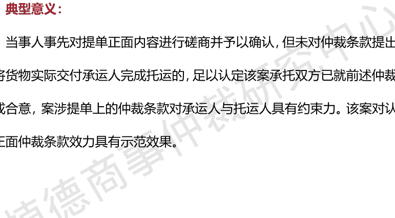

## (5) 善解释仲裁机构，依法确认仲裁协议有效——浙江荣城物业有限公司绍州分公司申请确认仲裁协议有效案

案号：浙江省绍兴市中级法院（2021）浙06民许47号

**基本案情：**

2017年6月，荣城公司与小区业主李某某、林某某签订《物业管理服务协议》，其中第九条约定：“业主与物业管理企业因本协议发生纠纷的，协商不成请向主管部门调解或提交绍兴市仲裁委员会裁决。”2021年7月，荣城公司向绍兴市仲裁委员会提交仲裁申请，要求李某某、林某某支付服务费及违约金。2021年8月，李某某、林某某向该仲裁委员会提出仲裁异议，称本案双方签订的仲裁协议不存在，绍兴市仲裁委员会无管辖。2021年10月，浙江省绍兴市中级法院受理荣城公司申请仲裁协议有效案。

**裁判结果：**

浙江省绍兴市中级法院认为，双方签订的《物业管理服务协议》中仲裁条款约定纠纷由绍兴市仲裁委员会裁，虽然该仲裁条款约定的仲裁机构不存在，但本案行政区域属于绍兴市，绍兴市仅一家仲裁机构，且双方存在提交仲裁的合意。根据《最高人民法院关于适用〈仲裁法〉若干解释》第六条“仲裁协议约定地且仅有一个仲裁机构的”的规定，绍兴市仲裁委员会可以视为双方约定的仲裁机构，故依法确认仲裁协议有效。

**典型意义：**

该案是双方约定的仲裁机构不存在、明确如何认定仲裁协议效力的典型案例。法院对该类仲裁协议效力审查时，应尽量尊重当事人的意愿，通过解释、目的等等方法确定当事人选了唯一仲裁机构，应认定仲裁在基层治理中发挥作用。

## (6) 未经消费者确认的网络平台合同无效——曹栗与甘肃电商股份有限公司买卖合同纠纷管辖异议案

案号：浙江省海宁市法院（2021）民初 483 号；浙江省嘉兴市中级法院（2022）民终 472 号

**基本案情：**

2019年1月，甘肃电商股份有限公司与案外曹栗签订《服务协议》，约定甘肃公司为曹栗提供衍生品交易业务。2019年5月，曹栗在甘肃公司运营的电商商城注册会员后，在其账户充值了3000元购买了衍生品。后曹栗以衍生品价值低于售价为由拒绝接受，并与甘肃公司提出退款请求，双方发生纠纷。曹栗向其所在地海宁市法院起诉，请求撤销与其甘肃公司之间的衍生品买卖合同并要求退款。甘肃公司在诉讼过程中主张管辖异议，提供电子版《购物协议》，认为本案由兰州仲裁委员会仲裁。曹栗认为协议未经双方签署，仲裁不成立。

**裁判结果：**

浙江海宁市法院认为本案涉及仲裁有效，裁决驳回曹栗的起诉。曹栗不服，向浙江嘉兴市中级法院上诉。

浙江嘉兴市中级法院认为，甘肃公司与曹栗之间有一份空白的《购物协议》，主张在约定事项中申请仲裁，但未证明曹栗签署过协议，也未能证明其在交易过程中向曹栗披露该协议且曹栗接受。作为交易网站的运营主体，甘肃公司掌握并可注册用户完成电子交易中的所有数据，在甘肃公司举证的情况下，应承担相应不利后果，难以认定双方为有效的仲裁协议。该院裁定撤销原裁定并令浙江海宁市法院审理。

**典型意义：**

随着网络经济的发展，各类网络平台日益运，与平台相关的纠纷日益频繁。消费者在注册网络平台会员时，一般通过互联网阅读或订阅多份由平台提供的格式合同，其中包含的争议解决条款与消费者有重大利益关系。网络平台主张格式合同中的争议解决条款对消费者发生效，应就其向消费者提示说明且消费者明确接受仲裁条款举证责任。如平台未能举证上述的，则该仲裁对消费者不发生效。该案明确了网络平台电子合同中仲裁条款的效力标准，依法保护网络消费者合法权益。

## (7) 请求权责合一时仲裁效力的认定——安徽丰国际贸易有限公司与舟山世纪太平洋化工有限公司等责任纠纷管辖异议案

案号：浙江省舟山市中级法院（2022）浙 09 民初 47 号；浙江省高级人民法院（2022）浙终 115 号

**基础事实：**

丰原公司与世纪公司、海德公司于2016年11月6日签订了《仓储服务合同》，该仓储合同约定世纪公司在丰原公司的货物入境后，向其出货货物证明，世纪公司凭丰原公司的正式货物转移证明或发货指令可向海德公司发货，并约定因合同引起的或本合同有关的任何争议均应交由合同履行地的仲裁机构处理。

2017年至2019年期间，丰原公司采购了11万吨液环芳，并将货物全部储存在世纪公司。后丰原公司发现货物已被拨取。丰原公司认为世纪公司、海德公司等未经授权挪用货物导致货物消失，遂诉至舟山市中级法院，请求赔偿损失。世纪公司提出管辖异议，认为案涉《仓储服务合同》中明确约定了仲裁条款，本案应当由舟山仲裁委员会管辖；丰原公司主张重复。

**裁判结果：**

舟山市中级法院认为，本案丰原公司、世纪公司、海德公司三方执行《仓储服务合同》引发的争议，合同约定争议应提交合同履行地仲裁。本案在权责合一时，即因一方违约行为损害对方财产的，受损方有选择仲裁机构的权利。丰原公司以侵权责任纠纷提起诉讼，但仍受《仓储服务合同》条款的约束，故本案应由舟山仲裁委员会管辖，且丰原公司拒绝接受，遂裁定回回丰原公司的起诉。丰原公司不服，浙江省高级法院二审维持裁定。

**典型意义：**

在违约责任与侵权责任竞合的情况下，损害方主张侵权责任未按照合同约定将争议提交仲裁，实际属于合同约定的范围，依法认定仲裁条款约定事项范围，整体争议均由仲裁解决。该案的处理结果充分体现了支持仲裁发展的理念，对仲裁在多元纠纷中发挥更大作用，具有示范意义。

## (8) 审查隐藏影响公正裁决的证据情形，依法裁销仲裁决——金华市丽华馆申请撤销仲裁决

案号：浙江省金华市中级法院（2023）浙 07 民特58 号

**基本案情：**

2020年9月，丽华馆与金华市民签订房屋租赁合同一份，约定租期为2020年7月至2025年7月。后双方因租金产生争议，丽华馆向金华市仲裁委员会申请仲裁。金华市仲裁委员会裁决案涉租赁合同于2022年8月解除，丽华馆应支付租金、滞纳金、未使用费用及欠付水费。丽华馆向金华市中级法院申请撤销仲裁决。合同履行期间，双方曾就2022年8月后的租金达成协议，约定免除租金，丽华馆在仲裁过程中未向仲裁庭陈述该事实，并未提交租金减免协议书。

**裁判结果：**

金华市中级法院认为，本案所涉租赁合同有效，案件重点在于租金的计算方案，对减免房租及租金减免协议均系认定基本事实的主要证据，且仅为出租方掌握。该方在仲裁过程中未向仲裁庭提交前述证据，属于隐藏了影响公正裁决的情形。本案涉及《仲裁法》第五十八条第一款第五项裁决事由，依法裁销案涉仲裁决。

**典型意义：**

司法审查过程中，对于仲裁裁决的实体处理，法院应保持适当度、有限的审查范围，仅在法律明确规定的情形下，才能裁销仲裁裁决。双方曾就房屋租金签署免协议，且该协议书仅为出租方掌握，但其未主动向仲裁提交，属于隐瞒了影响公正裁决的证据，符合裁销仲裁决的情形。案的撤销维护了既程序正义，也依法维护了当事人的合法权利，对同类案审查具有借鉴意义。

## (9) 根据仲裁规则确定仲裁员披露义务，确保仲裁程序公正——中交第一公路工程有限公司申请撤销仲裁裁决

案号：浙江温州市中级法院(2018)浙 03 民许63 号

**基本案情：**

2017年3月，天贝投资集团有限公司与中交公司建设工程施工合同一案，向温州仲裁委员会提出仲裁申请，中交公司提出仲裁请求。仲裁庭审理后，认为案件争议复杂，争议金额大，遂对双方争议问题于2018年4月向该仲裁委员会专家咨询委员会进行了咨询。2018年7月，仲裁庭作出裁决。中交公司以仲裁庭的成员违反程序等为由，向浙江省温州市中级法院申请撤销仲裁裁决。

**裁判结果：**

浙江温州市中级法院认为，天贝公司在仲裁案件中的代理人杨某与仲裁员陈某曾在同一事务所工作。杨某曾担任仲裁委员会专家咨询委员会主任期间，陈某及案件首席仲裁员均为该仲裁咨询委员会成员。但仲裁委员会官网页面上对杨某的仲裁员概况介绍中，并未显示其为专家咨询委员会主任，仲裁过程中其未对其专家咨询委员会主任情况进行适当披露。根据该仲裁委员会仲裁规则第五十六条条款第三项的规定，与本案当事人或代理人有其他关系可能影响公正裁决的，仲裁员应当自行披露并请求回避，当事人亦有权提出回避。仲裁过程中，陈某等人未按照仲裁规则披露其与天贝公司代理人之间的关系，一定影响了当事人回避权的行使，属于影响公正裁决。虽然仲裁委员会在2018年4月召开专家咨询委员会会议由仲裁员确定，但因其拒绝担任专家咨询委员会主任的杨某对此次会议记录有合理疑，目前在仲裁案件卷宗中无相关记录。据此，经浙江省高级法院向最高人民法院报，法院裁销该仲裁委员会作出的裁决。

**典型意义：**

仲裁公正、独立行使仲裁权是纠纷通过仲裁程序得到解决的基础。仲裁未充分履行披露义务，一定影响了当事人回避权的行使。该案的处理充分体现了法院支持仲裁发展的理念，促使仲裁重视仲裁员披露事项规定，确保仲裁程序公正。

## (10) 先行裁决存在的程序瑕疵可通过仲裁庭重新仲裁予以弥补——杭州碧有限公司申请撤销仲裁决

案号：浙江省杭州市中级法院（2022）浙 01 民 26 号

**基本案情：**

2018年1月，杭州碧有限公司与案外房地产开发等签订合同，杭州仲裁委员会受理纠纷案件。仲裁庭在先行裁决前经四次开庭，但仅进行了陈述、答辩、举证、鉴定、询问等程序，未完成完整的开庭。最后一次开庭过程中，当事人增加及变更仲裁请求，仲裁庭未再次开庭即作出先行裁决。后公司以仲裁程序违法由浙江省杭州市中级法院申请撤销仲裁决。

**裁判结果：**

浙江省杭州市中级法院认为，当事人增加及变更仲裁请求后，对方要求再次审理，仲裁庭未经过开庭仅依据此前提交的材料就对争议作出先行裁决，违反了程序，构成可撤销的情形。本案属于先行裁决，仲裁案件仍存在未决事项处理，不宜撤销先行裁决导致争议终止和审理中断，且程序瑕疵可通过现有仲裁案件重新仲裁予以弥补。仲裁庭表示同意，杭州市决定终止仲裁。

**Tip意义：**

仲裁庭程序以“应当开庭”为原则，以“协议不开庭”为例外，先行裁决也应当遵循仲裁程序。该案四次开裁均未完整的开庭过程，申请人在最后一次开裁结束前申请变更仲裁请求，明确要求再次开庭，仲裁庭未开裁而直接根据当事人后提交的材料作出先行裁决存在不当。在仲裁程序存在缺陷下，法院可通知仲裁在现有仲裁案件中重新仲裁，有效避免了先行裁决被撤销。

## 10. 宿州仲裁司法典型案例

发布时间：2024年3月13日

**案例情况：**

**(1) 甲公司申请仲裁协议无效——善解释合同条款，依法认定仲裁有效

**基本案情：**

甲公司与乙公司签订《建设工程合同》，约定了如下争议解决条款：若双方在履行合同中发生争议，无法达成共识，双方同意提交泗阳仲裁委员会解决。后双方因合同产生纠纷，乙公司根据前述仲裁协议向宿州仲裁委员会申请仲裁。甲公司以“泗阳仲裁委员会”这一机构并不存在，泗阳县内也不存在其他仲裁机构，请求确认前述仲裁条款无效。

**裁判结果：**

宿州仲裁认为，按照仲裁法第十条规定，仲裁委员会不按行政区划层级设立，此县行政区划内不设立仲裁委员会，直辖市和省、自治区人民政府所在地的市和其他市的市设立仲裁委员会。本案中，双方有明显的争议提交仲裁解决的需要，虽不存在“泗阳仲裁委员会”这一机构，但泗阳县在行政区域属于宿州市，而宿州市有宿州仲裁委员会一个仲裁机构，因此属于约定的仲裁机构名称不准确但实际能够确定约定的仲裁机构的情形，应当认定仲裁协议有效，裁定驳回甲公司的申请。

**典型意义：**

实践中，有些当事人约定的仲裁协议存在仲裁机构约定不明确或错误等情形，当纠纷产生之后，容易对争议解决方式产生分歧，影响了争议解决效率。

2024 | 中国商事仲裁白皮书

院对该类仲裁协议效力进行审查时，充分尊重当事人的仲裁意愿，通过文义、体系、目的等解释方法善解释合同条款，能够在确定当事人选定了仲裁机构的情况下下，依法认定仲裁协议有效，支持和鼓励仲裁制度发展。

## (2)吴某申请撤销仲裁裁决——严格依照法定事由进行形式审查

基本情况：
宿迁仲裁委员会根据吴某的申请受理了吴某与戎某、丙公司合同纠纷，于2023年4月作出裁决书，裁决吴某付借金和利息，驳回吴某的其他仲裁请求。吴某认为该案仲裁裁决事实不清；戎某、丙公司分别在借的借款人签字、盖章，仲裁员未裁决两公司共同承担还款责任，导致仲裁裁决违法，其理由向宿迁中院申请撤销仲裁裁决。

## 裁决结果：
宿迁中院认为对于吴某的撤销，仲裁法第五十八条规定了应当撤销事项，人民法院是否应当撤销仲裁裁决，应当在上述范围内进行审查。吴某涉及仲裁裁决实体结果的异议，超出法律规定的撤销仲裁裁决的事由，不予审查。根据《最高人民法院关于审理仲裁司法案件若干问题的规定》第十八条规定，仲裁员在裁决中发现有贿赂、枉法、违法行为，是指已经生效的法律文书或者纪律处分决定所确定的。在本案中，吴某未能提供相关证据，故其申请撤销仲裁裁决的理由无实且无法律依据，裁回其申请。

## 典型意义：
仲裁裁决申请撤销程序是人民法院对仲裁进行监督的重要方式。为了保证仲裁独立，仲裁法第五十八条列了国内仲裁裁决可撤销的情形，明确了人民法院监督仲裁的法律边界和审查范围，也为选择仲裁的当事人提供了明确的法律预期。本案提醒当事人，仲裁员具有一裁终局的法律效力，当事人仅就仲裁裁决事实认定或法律适用实体不服而提出的异议，人民法院不予审查；仲裁员在仲裁该案件时有索贿受贿、徇私舞、枉法裁决的行为的，也必须由生效的法律文书或者纪律处分决定所确认，不能仅以仲裁裁决认定或法律适用问题进行推定。

## (3) 张某申请撤销仲裁裁决——仲裁程序违反法定程序的审查

基本情况：
张某因与夏某等合作协议纠纷一案，向宿仲裁委员会申请仲裁。宿仲裁委员会于2022年5月作出裁决。后张某以仲裁程序对其在仲裁后补充提供的证据未组织质证也未重新开展，违反了仲裁规则的规定，向宿中院申请撤销仲裁裁决。

#### 裁判结果：
宿仲中院认为，根据最高法院关于适用《中华人民共和国仲裁法》若干问题的解释第二十条规定，仲裁法第五十八条规定的“违反法定程序”是指违反法定规定的仲裁程序和当事人选定的仲裁规则可能影响案件正确裁决的情形。本案中，《宿仲仲裁委员会仲裁暂行规则》第四一条规定了证言、质证和补充提交证据等问题，仲裁庭未同意或要求当事人补充证据，故仲裁庭未对申请人补充的证据组织质证，不违反仲裁程序的规定，裁回其申请。

## 典型意义：
仲裁具有自律性质，仲裁程序应当遵循仲裁法和当事人共同选定的仲裁规则进行，民事诉讼法及其司法解释的诉讼规则并不能适用于仲裁程序。

因此，人民法院审查仲裁程序的合法性，依据的是仲裁法对仲裁程序的规定和当事人选定的仲裁规则。本案经审查为涉案仲裁未违反法定程序，体现了对仲裁权威性和效率的充分尊重。

## (4) 丁公司申请撤销仲裁裁决——“对方当事人隐藏了足以影响公正裁决的证据”的审查

#### 基本案情：
丁公司购买设备需要，与戊公司签订销售合同。合同约定：丁公司应在收到货物后1日内进行验货。丁公司如发现货物质量有问题时，经协商后可进行必要的性能、功能等质量检验，在检验中发现戊公司提供的检验所需的标准和规范仍不完整有助于说明质量情况时，戊公司应及时补充标准和规范，如戊公司提供的标准仍不能满足仲裁需要，丁公司有权按照国家现行的强制性标准进行检验。此后，双方就设备调试和支付条款产生争议，戊公司向辖仲裁委员会申请仲裁，辖仲裁委员会于2021年1月作出裁决。丁公司认为戊公司向仲裁机构隐藏了检验设备的标准和规范以及产品的合格证、序列号，足以影响公正裁决，遂向辖中院申请撤销仲裁裁决。

#### 裁判结果：
辖中院认为认定对方当事人向仲裁机构隐藏了足以影响公正裁决的证据，应符合以下条件：该证据属于仲裁案件的事实；该证据仅为对方当事人掌握，但未向仲裁庭提交；在仲裁过程中知晓该证据且要求对方当事人提交。在本案中，无证据证明戊公司拒绝提供检验设备的标准和规范以及产品序列号，同时丁公司在仲裁过程中明确表示不对涉案质量进行鉴定，双方均可以依照国家标准对涉案质量进行检验。因此，丁公司不存在隐藏足以影响公正裁决的行为，裁回丁公司申请。

## 典型意义：
“对方当事人隐藏了足以影响公正裁决的证据”属于国内仲裁的法定事由。人民法院在审查中判断是否因隐藏证据而构成撤销裁决，依据《最高人民法院关于审理仲裁司法执行案件若干问题的规定》第十六条进行审查，需要审查对方当事人是否存在隐藏证据的行为，即对方当事人提出了足以影响公正裁决的请求，最大限度尊重仲裁。

## (5) 已公司申请不执行仲裁裁决——是否违背公共利益的审查

### 基本情况：
庚公司与已公司的合同纠纷，向辖仲裁委员会申请仲裁。2021年6月，辖仲裁委员会作出裁决。后庚公司向辖中院申请强制执行上述仲裁裁决。已公司认为其作为上游供应商，对其强制执行会导致其正常经营，进而不能满足广大消费者需求，违背公共利益，故向辖中院申请不执行仲裁裁决。

#### 裁判结果：
辖中院认为，本案系当事人履行合同的纠纷，系平等民事主体之间的争议。且已公司产品属于普通产品，不涉及公共利益。故已公司申请不执行仲裁裁决的理由不成立，裁回其申请。

## 典型意义：
维护公共利益是我司法审查的原则，人民法院可以依照权限进行主动审查，并有权据此对仲裁裁决处理。公共利益在解释上具有不确定性和模糊性，对其内涵的界定会导致社会不断变化，但总体上应严格解释，其关系到全体社会成员或社会多数人的利益，具有公共性和社会性。本案是平等主体之间的经济纠纷，仲裁裁决结果仅涉及到款项支付，人民法院认定涉案仲裁裁决的执行不涉及公共利益，体现了司法适当、有力支持仲裁的态度。

## (6)某高申请不执行仲裁裁决——依法认定仲裁当事人造事实损害案外人利益，案外人申请不执行仲裁裁决

#### 基本案情：
辛公与王公司借款合同一案，宿仲裁委员会提出仲裁申请，宿仲裁委员会在2019年9月作出裁决：王公司还偿辛公借款100万元。因王公司未履行仲裁裁决确定的义务，辛公向宿仲裁申请强制执行。2020年4月，案外人高某以仲裁当事人造假事实、虚假仲裁为由向宿仲裁申请不执行仲裁裁决。

## 裁决结果：
宿仲裁认为，高某为王公司的债权人，在王公司已进入破产程序的情况下，其他人增加债权债会减少高某债权的金额，影响其合法权益，故高某有权申请不执行仲裁裁决。根据本案证据，对当事人的股权信息、交易记录、印章保管、借条进行对比分析，能够认定辛公虚构其与王公司之间存在借款关系，并通过造假借款合同等方式虚造案件事实，上述行为符合《最高人民法院关于审理仲裁裁决执行案件若干问题的规定》第十八条规定情形，故裁定不执行仲裁裁决。

## 典型意义：
人民法院审理仲裁审查案件是在法律规定的范围内对仲裁程序进行有限限制，较少涉及到实体问题，充分尊重仲裁裁决的独立性、终局性。若存在造假证据、造假事实等情形，损害当事人或案外人合法权益，当事人有权申请撤销或不执行仲裁裁决，案外人也有权申请不执行仲裁裁决。本案依法认定案外人有权申请不执行仲裁裁决的主体资格，并查明仲裁当事人造假事实。

---

# 2024 | 中国商事仲裁白皮书
## 宁波市中级法院：仲裁司法审查典型案例
发布时间：2024年6月
要点提示：宁波市中级法院首次《仲裁司法审查白书（2018-2023年）》，全面总结2018-2023年宁波中院仲裁审查案件的基本情况、特点、观察，并针对存在的问题提出了对策和建议。

### 一、宁波中院仲裁审查案件基本情况
18-2023年，宁波中院受理仲裁审查案件268件，其中：
- 确认仲裁效力案件45件，占比17%；
- 申请撤销仲裁裁决案件100件，占比37%；
- 确认和执行案件4件，合计占比9%；
- 不予、起诉、辖权异议案件15件，占比6%。

### 二、宁波中院仲裁审查案件裁判思路

### （一）仲裁效力认定遵循的原则
《中华人民共和国仲裁法》规定有效的仲裁包括请求明确仲裁机构。法定事项只能当事人之间的合同纠纷和财产纠纷，不包括婚姻、收养、抚养、继承纠纷和由行政机关处理的行政争议。宁波中院审的仲裁审查案件中涉及争议极少，个别案件属于行政争议。具体分析：
1) 必须存在仲裁意思；
2) 必须确定唯一仲裁机构；
3) 仲裁意思及第三人问题；
4) 多份合同不同解决条款问题；
5) 否定仲裁效力需核报。

#### （二）仲裁裁决撤销坚持有限监督
聚焦：
1) 仲裁协议问题。申请撤销仲裁裁决案件中，还需要从事实上审查申请人在仲裁过程中是否认可仲裁机构管辖。
2) 超仲裁问题。以仲裁裁决事项是否超出仲裁协议和仲裁请求为判断标准。
3) 程序问题。法院是否存在仲裁庭的组成或程序违反法定程序的情形，但要考虑是否违反仲裁程序和当事人选择的仲裁规则，还要判断上述情形会导致案件公正。
4) 证据问题。一是伪造证据与隐藏证据，二是仲裁裁决对证据的实质认定。总体而言，对于所有涉及仲裁案件事实认定或法律适用方面的理由，宁波均严格遵守有限监督原则予以处理。
5) 公共利益问题。如认定仲裁裁决违反公共利益的，应当裁定撤销，司法实践对此采取较为的标准。

#### （三）域外仲裁裁决审查恪守公约及安排规定
域外仲裁裁决审查《承认及执行外国仲裁裁决的公约》或《最高人民法院关于内地与香港特别区相互执行仲裁裁决的安排及《关于内地与香港特别执行仲裁裁决的补充安排》。

### 三、仲裁司法制度实践中的发展及亮点

一）法律适用进一步统一
2017年12月，依据最高人民法院通知，宁波中院针对司法审查案件实行归口办理，依法设立报核制度，细化操作程序，有利于保证案件裁判尺度统一和法律适用正确。

二）审查程序进一步完善规范
宁波中院严格落实归口办理规定，确定涉外审判员负责审理仲裁法案件。相关案件由三位专业人员组成合议审理。对于仲裁协议、仲裁裁决可能作出否定认定的，需经专业法官会议讨论，层级报后作出裁定。

三）协作机制内部进一步加强
在法院系统内部，加强沟通协调，确保仲裁司法审查案件归口办理到位，同时主动接受上级法院的监督指导；在法院系统外部，加强与仲裁机构沟通，总结典型问题并向宁波中院建资，助力提升宁波审查案件的整体水平。

四）调研深入进一步加强
结合国内国际司法审查案件归口以来的最新实践需求，宁波中院组织力量，联合政法大学深度调研，高质量完成研究报告并形成《商仲裁司法审查规范指南（建议）》。

## 四、仲裁司法审查完善标准

（一）常态沟通，统一司法审查标准
宁波中院与仲裁委定期召开联席会议等方式建立常态化机制，交流司法审查。同时，构建数字平台，实现仲裁无纸化处理与反馈双重效果。

（二）加强建设，树立仲裁品牌
建议仲裁委：提高仲裁员业务水平，树立公正理念；修改、完善仲裁规则；引导当事人诚信仲裁；积极拓展涉外仲裁业务。

（三）灵活处理，践行仲裁制度
宁波中院和仲裁委应保持顺畅沟通，优化仲裁细节，有利于提高司法效率。针对仲裁当事人造假事实、损害案外权益的事实，不予执行仲裁裁决的现状。

（四）多元调解，适当仲裁
组织当事人对涉案案件纠纷进行调解。

### 案例情况：
（1）严格执行《承认及执行外国仲裁裁决公约》承认仲裁裁决
新加坡通过邮件发送仲裁通知，符合《新加坡国际仲裁规则》规定，具有效力。SIAC向律师发送的电子邮件应视为对当公司的适当通知，律师参与仲裁程序并充分考虑意见的效力相当于。即本案在《仲裁公约》第五条第五款（乙）项规定的可以拒绝和执行的情形作为裁决执行对象的当事人，未被给予指定仲裁员或进行仲裁程序的适当通知，或因其他情况而对案件提出意见。经查，案涉仲裁裁决不存在《仲裁公约》第五条第二款规定的“裁决事项依照我国法律属于不可仲裁事项，承认或执行该裁裁决违反我国的公共政策”。逸裁决定认可和执行该仲裁。

（2）关于事实状态认定的请求不构成独立的诉讼或仲裁请求——新加坡波莱公司与宁波波莱公司申请确认仲裁效力因素
基本案情：
新加坡波莱公司（卖方）与宁波波莱公司（买方）签订轻质循环油买卖合同，付款方式为不可撤销信用证。合同约定争议解决方式为新加坡国际仲裁中心申请仲裁。后双方因基础合同纠纷在新加坡进行仲裁。在宁波院受理买方提出的信用证欺诈纠纷案件后，卖方也向宁波院提出确认仲裁效力的申请。裁判结果：宁波院认为，我国与新加坡都是《仲裁公约》的成员，本案应当适用《仲裁公约》时所做的声明。宁波公司未提交律师授权文件，但案涉仲裁显示律师明确其代表公司参与仲裁，向仲裁提供了关于公司相关信息，并在仲裁庭向公司邮箱发送通知。上述情形表明律师代表参与仲裁不违反《新加坡国际仲裁规则》相关规定。同时，SIAC通过邮件发送仲裁通知，符合《新加坡国际仲裁规则》规定，具有效力。SIAC向律师发送的电子邮件应视为对公司的适当通知，律师参与仲裁程序并充分考虑意见的效力相当于该。即本案在《仲裁公约》第五条第五款（乙）项规定的可以拒绝和执行的情形作为裁决执行对象的当事人，未被给予指定仲裁员或进行仲裁程序的适当通知，或因其他情况而对案件提出意见。经查，案涉仲裁裁决不存在《仲裁公约》第五条第二款规定的“裁决事项依照我国法律属于不可仲裁事项，承认或执行该裁决违反我国的公共政策”。逸裁决定认可和执行该仲裁。该证据属于仲裁案件的事实；该证据仅为对方当事人掌握，但未向仲裁庭提交；在仲裁过程中知晓该证据且要求对方当事人提交。在本案中，无证据证明戊公司拒绝提供检验设备的标准和规范以及产品序列号，同时丁公司在仲裁过程中明确表示不对涉案质量进行鉴定，双方均可以依照国家标准对涉案质量进行检验。因此，丁公司不存在隐藏足以影响公正裁决的行为，裁回丁公司申请。

裁裁：仲仲仲裁，，已公司申请不执行仲裁裁决，系已民主体普通产品，不涉及公共利益。故已公司申请不执行仲裁裁决的理由不成立，裁回其申请。

## (3) 确认定“隐瞒足以影响公正裁决的证据” 助力遏制假裁——宁波波某教育公司与宁波波某知名公司申请撤销仲裁决定

#### 基本案情：
宁波波某教育公司以宁波波某知名公司隐瞒了足以影响公正裁决的证据以致仲裁机构作出错误仲裁决定为由，申请撤销该仲裁决定。

#### 裁判结果：
宁波中院认为，宁波波某教育公司主张场地实际由外某人向宁波波某知名公司承租而其仅使用了其中一小部分，并提供了宁波波某知名公司与外某人签署的租赁合同。该合同与仲裁所依据合同约定承租人相同、租赁地点不同、期限、费用等均相同，也存在着相矛盾。宁波波某知名公司向仲裁庭隐瞒了上述租赁合同，足以影响仲裁庭对宁波波某教育公司租赁场地范围的认定而影响公正裁决。遂裁定撤销该仲裁决定。

### 裁判要旨：
当事人在仲裁过程中隐瞒足以影响公正裁决的证据导致裁决错误的，该仲裁应当撤销。

## 典型意义：
在严击打击虚假诉讼、司法信用促进浙江建设的背景下，虚假仲裁亦应予以遏制和制裁。本案对督促仲裁机构重视虚假仲裁现象，引导当事人诚信守信具有重要意义。宁波中院及时向仲裁机构发送法律建议，建议其严格审查虚假仲裁情况，必要时移送公安机关处理。

# 2024 | 中国商事争议白皮书

## (4) 基金投资者与发行人、销售人之间的纠纷由各自约定的仲裁机构解决别仲裁——某资产管理公司、某基金销售公司与某某责任人纠纷仲裁权异议案

#### 基本案情：
某某根据基金销售公司推荐，购买由某资产管理公司发行并担任基金人的基金产品。某某与基金销售约定纠纷由 A仲裁机构仲裁，与某资产管理公司约定纠纷由 B仲裁机构仲裁。某某以基金销售公司、某资产管理公司重大欺骗、共同侵权为由提起本案诉讼。某资产管理公司、某基金销售公司提出管辖权异议。

#### 裁判结果：
悉源法院认为，三方对争议涉及未重新达成仲裁协议，也未选定唯一仲裁机构，某某诉请双方承担连带赔偿责任，属于必要性共同诉，该案应予受理。
宁波法院认为，某某与某公司之间的有效仲裁条款约定了不同的仲裁机构，某某应向约定的仲裁机构分别申请仲裁。裁定驳回起诉。

### 裁判要旨：
基金投资、销售人分别对投资者约定有效仲裁条款，投资者应依据仲裁协议分别向约定的仲裁机构仲裁。

## 典型意义：
随着私募基金行业的快速发展，涉私募基金案件数量逐年呈现上升趋势。
此类案件中，投资者经常将基金发行人、销售人作为共同被告起诉，在投资者分别与基金发行人、销售人约定仲裁条款且选择不同仲裁机构的情况下，如何确定法院与仲裁机构的主管，本案具有积极的参考意义。

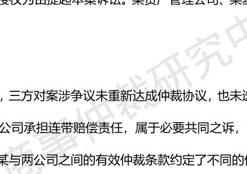

## (5) 准确认分支行政协议和商事合同——浙江某公司与宁海某农开公司申请确认仲裁协议效力

#### 基本案情：
宁海某农开公司与浙江某公司签订协议，约定宁海某农开向出租土地用于项目建设，产生纠纷由 A 仲裁机构仲裁。后宁海某农开公司因申请仲裁，浙江某公司申请确认仲裁条款无效。

#### 裁判结果：
宁波中院认为，宁海某农开公司属于国有全资资产企业，且协议经仲裁委员会审定，但管委会并未授权宁海某农开公司行使行政管理职能。协议涉及的土地使用实施的是法律行为，缺乏行政协议为实行行政管理或公共服务目标而订立的目标。同时，协议中宁海某农开公司的单方解除受到一定约束，并非行政性利益。裁定胜诉。

### 裁判要旨：
行政协议作为新型行政管理和公共服务方式，兼具行政与契约的特质在性质上具有复杂性，尤其涉及行政机关授权的主体，主体身份的多重性，增加了行政协议和商事合同的识别难度。本案以是否存在行政协议的签订目的及行政性利益为切入点，对行政协议和商事合同作出辩析，为同类案件的司法审查提供了解决思路。

## 2024 | 中国商事仲裁白书

## (6) 实际承包人对发包方的诉权不足以否定仲裁条款的有效性——宁波某公司与周某、某某公司等建设工程合同纠纷管辖异议案

#### 基本案情：
宁波某公司与某某公司签订总协议，约定纠纷由 A 仲裁机构仲裁。某某公司与周某签订承包合同，约定纠纷由 B 仲裁机构仲裁。周某以宁波某公司为被告，某某公司为第三人诉请支付工程款。宁波某公司提出管辖异议。

#### 裁判结果：
宁波中院认为，周某作为合同事人，其签订的承包合同明确了以总协议为基础，但承包合同约定了不同的仲裁机构，应视为周某接受仲裁。同时，本案诉的法律关系是承包合同，周某起诉宁波某公司明显违反了仲裁合意。遂裁定驳回起诉。

### 裁判要旨：
实际承包人对发包方的诉权，不能包括当事人选择仲裁合意。

## 典型意义：
司法实践中，实际承包人对发包方的诉权存在滥用现象。本案认定实际承包人不能通过仲裁作为共同被告达到目的，对于平衡当事人的实体、程序权利，营造仲裁意愿的司法氛围具有典型意义。

## (7) 未穷尽送达方式仅向户籍地址送达且无签收的情况属于违法程序——吴某与某投资公司申请撤销裁决

#### 基本案情：
某投资公司与吴某签订租赁合同，约定争议由 A仲裁机构仲裁。因吴某未按期缴纳租金，某投资公司申请仲裁，A仲裁机构作出裁决。吴某以送达程序违法申请撤销裁决。

#### 裁判结果：
宁波中院认为，吴某居住地与某投资公司位于同一栋楼，但在第一次送达未成功签收的情况下，继续向其户籍地址送达均无法签收。上述送达不符合仲裁规定，即后续送达不能视为有效送达。遂以程序违法为裁决。

### 裁判要旨：
单纯以户籍地址作为送达地址，未穷尽送达方式，可以确定仲裁程序违法而撤销裁决。

## 典型意义：
高效是仲裁的优势，但不能牺牲程序公正为代价。仲裁送达应当保障当事人双方答辩、举证等法定权利，在符合仲裁规则的前提下，结合具体情况，务必穷尽送达方式。本案对于规范仲裁机构送达程序具有指导意义。

# 2024 | 中国商事仲裁白皮书

## (8) 同一工程不同期的施工合同争议解决条款相互独立——宁波某合作公司与浙江某公司申请撤销裁决

#### 基本案情：
宁波某合作公司与浙江某公司就涉及工程的第一、二、三期签订建设工程合同，合同一约定由 A仲裁，合同二、三约定向法院起诉。后 A仲裁机构基于浙江某公司整个工程的仲裁申请作出裁决。宁波某合作公司以双方没有仲裁合意申请撤销裁决。

#### 裁判结果：
宁波中院认为，虽然浙江某公司将整个工程作为整体申请仲裁，但三份合同相互独立。根据合同凭证，合同一项下无争议，请求为第二、三期工程款，而该两份合同并未约定仲裁条款，仲庭无辖权。宁波某合作公司在增加仲裁请求至第二、三期工程款后提出管权异议不超出法定期限。遂裁定撤销裁决。

### 裁判要旨：
建设工程合同纠纷案件中，同一工程的各期可分并签订独立合同，应分别适用各自的争议解决条款。

## 典型意义：
建设工程施工实践中经常出现同一工程的不同期分别签订施工合同，并约定不同争议解决条款。本案认定若同一工程可分且合同相互独立，则分别适用各自的争议解决条款，理清了就整个工程起诉或仲裁时应如何确定主权的裁决思路，对于此类可分的合同不同争议解决条款的案件，具有积极的样本意义。

## (9) 派生诉讼管辖受基础法律关系仲裁条款——上海某公司与广州某公司、宁波企业合同纠纷管辖权异议案

#### 基本案情：
上海某公司系宁波企业的有限合伙人。宁波企业与广州某公司签订协议约定争议由 B仲裁。上海某公司以广州某公司为被告提起有限合伙派生诉讼，广州某公司提出管辖权异议。

#### 裁判结果：
宁波中院认为，上海某公司非涉诉当事人，但其以自己名义为宁波企业的利益起诉广州某公司，依据的是宁波企业与广州某公司签订的协议，诉讼也属于宁波企业派生诉讼，故本案派生诉讼属于仲裁条款，裁决驳回起诉。

### 裁判要旨：
若有限合伙人派生诉讼依据的是合伙企业签订的合同，则应受合同中的仲裁条款约束。

## 典型意义：
合伙企业仅规定有限合伙人派生诉讼管辖，导致此类派生纠纷的主管权处于模糊之中。本案明确“派生”代表合伙企业对外应基于法律关系的仲裁条款约束，合理界定法院对此纠纷的主管权。

# 2024 | 中国商事仲裁白皮书

## (10) “调解前置”程序未影响仲裁协议效力——象山某公司与某公司申请确认仲裁协议效力

#### 基本案情：
象山某公司与某公司签订协议，约定一方可在收到调解书面决定后二十八天内将争议提交仲裁。后某公司申请仲裁，象山某公司以“调解程序未履行”为由申请仲裁无效。

#### 裁判结果：
宁波中院认为未履行调解前置约定并不影响仲裁协议生效或有效。涉案仲裁排除仲裁有效的必要件，不存在将调解程序作为生效件的意思，应自成立时生效。同时，调解合意具有程序上的约束力，而仲裁合意具有强制性，不应允许当事人未进行调解来否定仲裁。

### 裁判意义：
约定先调解后仲裁的协议中，除非双方明确调解程序作为生效件，否则判断仲裁协议生效或有效。

## 典型意义：
调解前置仲裁协议中，“调解前置”的意思与仲裁合意共存并有顺序。理论与实践中对于理解两者的关系存在争议。本案从仲裁协议效力出发，阐明“调解前置”程序未影响仲裁生效，也不会导致无效。上述思路对于肯定仲裁机构主体、支持仲裁发展具有重要意义。

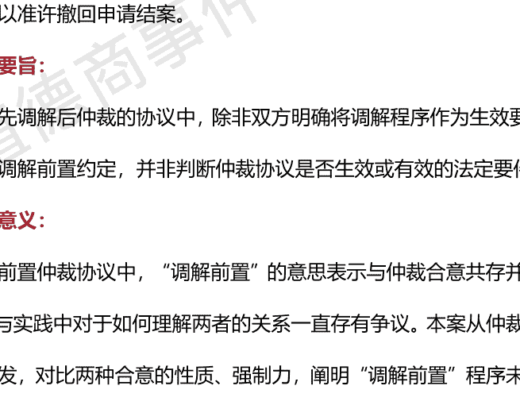

## 12. 大连市中级法院：商事仲裁司法白皮书及典型案例 发布时间：2024年8月29日 要点提示：
2024年8月29日下午，大连中院召开商事仲裁司法白皮书发布会，通报2019年至2023年大连中院审理的仲裁司法审查案件总体情况，并发布了十个典型案例。2019年至2023年大连中院共受理仲裁司法审查案件252件，审结237件。案件数量上升趋势明显，申请撤销仲裁案件占比较高，申请确认仲裁有效案件增长明显；结案基本持平；仲裁被确认无效、仲裁被撤销及裁决不执行的案件比例低以及对外支持率。反映出仲裁协议约定不明确容易失效、非法律事实获得支持及仲裁程序和实体方面存在问题。
白皮书显示，当事人争议解决办法应充分协商，在约定仲裁条款前了解仲裁制度的特点和规律；对仲裁事项、仲裁机构等进行明确确定，避免产生争议；了解仲裁司法审查案件的申请期限、审查范围、审查标准等相关规定，遵循法则进行审查程序准则执行。仲裁机构应制作仲裁协议示范条款，为当事人提供指引；行业对于争议解决办法约定为仲裁的，对应条款进行特别提示或说明；仲裁机构应规范案件管理，优化仲裁员绩效，尽力缩短审理期限，提高裁决质量和效率；裁决要明确履行义务、履行内容、履行方式、履行期限等关键内容；建立防范虚假仲裁的有效机制，避免当事人互串通、利用仲裁损害合法权益的情况。大海大学教授王敏表示，大连中院对仲裁决进行司法审查是维护商事仲裁良性运行的必要条件。

### 大连中院商事仲裁司法十大典型案例：
- 案例【1】履行国际仲裁义务，依法确认外国仲裁裁决——某投资公司与某设备公司申请承认和执行外国仲裁裁决。
- 案例【2】准确适用“最高人民法院关于内地与香港特别行政区相互执行仲裁裁决的安排”，认可香港仲裁裁决——某香港公司与某地产公司申请认可香港仲裁裁决。
- 案例【3】合理推断当事人意思表示，依法认定或审查仲裁条款无效——某酷保险公司与某理财公司纠纷。
- 案例【4】尊重当事人意思表示，明确合同约定的仲裁条款不能适用于从合同——李与某某、某投资公司申请仲裁协议效力。
- 案例【5】准确界定合同性质，确认仲裁条款无效——某住房和城市建设局等申请仲裁协议效力。
- 案例【6】全面分析仲裁理由，维护仲裁执行效力——某科技公司与杨某申请撤销裁决。
- 案例【7】依法撤销不存在仲裁争议的，维护当事人权利——江某与建设公司申请撤销裁决。
- 案例【8】依法通知仲裁机构重新仲裁，保障当事人权利——某装饰公司与杨某申请撤销裁决。
- 案例【9】准确确认“隐瞒足以影响公正裁决的证据”，引导当事人诚信——某公司与某投资公司申请不执行裁决。
- 案例【10】依法不执行“虚假仲裁”部分事项，维护当事人合法权益——某物资公司与朱某、印刷公司申请不执行裁决。

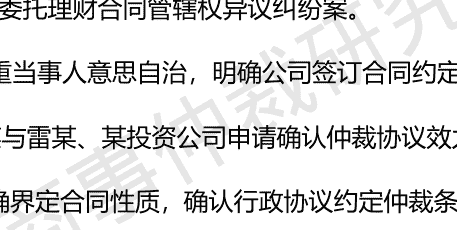

[content]

# 2024 | 中国商事仲裁白皮书

## 13. 杭州中院发布仲裁司法典型案例 发布时间：2024年3月15日 案例：

### (1) 尊重当事人意愿明确主合同的仲裁条款不能适用于从合同——甲与丙申请仲裁协议效力

#### 基本案情：
甲与丙分别于2019年8月1日、2021年7月26日签署了两份销售合同，双方均约定：“本合同发生争议由双方协商解决，协商不成的提交仲裁委员会仲裁”。2021年1月4日，甲为借款人、乙为担保人向丙出具欠条一份，该欠条并未约定仲裁条款。丙以甲及乙为被，向仲裁委员会提起仲裁，请求裁决向丙还贷款并支付违约金，对甲上述债务承担责任。2022年7月4日，甲在杭州法院申请：一、确认甲与丙分别于2019年8月1日、2021年7月26日签署的销售合同中仲裁条款中的仲裁条款无效；二、确认杭州仲裁委员会对丙与乙之间的买卖合同纠纷管辖权。

#### 裁判结果：
杭州中院认为，甲与丙签署的两份销售合同中争议解决方式均约定“本合同发生争议由双方协商解决，协商不成的提交仲裁委员会仲裁”，该条款有明确的提交仲裁意思表示，仲裁事项及选定的仲裁委员会有效。甲与丙之间的争议按销售合同约定的仲裁协议处理。关于丙与乙是否存在仲裁协议的问题，《我国法院涉外商事审判工作会议纪要》中“主合同与合同争议解决方式的认定”部分的指导意见，当事人在主合同中约定争议解决方式为仲裁，从合同未约定解决方式的，主合同中的仲裁协议不能约束从合同的当事人，但主合同当事人相同的除外。

根据该指导意见，乙并非销售合同的当事人，其仅为案涉欠条的担保人，案涉销售合同中的仲裁协议不能约束乙，且该欠条并未约定争议解决方式，故甲与乙之间无仲裁协议。杭州中院裁定驳回申请人甲、乙请求确认甲与丙分别2019年8月1日、2021年7月26日签订的销售合同中仲裁条款中的仲裁条款无效的申请。确认甲与丙分别为2019年8月1日、2021年7月26日签字的。

## 典型意义：
仲裁协议需充分尊重当事人的意思自治，只有在当事人自愿选择、明确表示以仲裁方式解决纠纷的情况下，仲裁协议才能约束当事人。在主合同当事人一致，且当事人在主合同中约定争议解决方式为仲裁，从合同未约定争议解决方式的情况下，不能以主合同中的仲裁协议约束从合同的当事人，否则与仲裁的性质不相容，亦违反合同的相对性原则及仲裁条款的独立性原则。主合同中的仲裁协议不能约束合同的当事人。

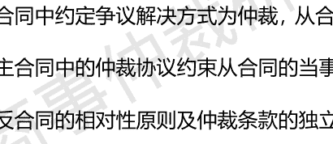

# 2024 | 中国商事仲裁白书

## (3) 尊重当事人的仲裁程序选择 优先适用仲裁协议的特别约定——

### 公司与甲方申请撤销仲裁决定

基本案情：

2018年，A公司与甲方签订了《房屋租赁合同》，其中约定：“执行本仲裁协议引发的与本协议有关的一切争议将由双方当事人通过友好协商解决。如果一项争议未能在一方向另一方发出书面通知之日起三十日内通过友好协商解决，任何一方有权申请仲裁交至杭州仲裁委员会，按照其有效的仲裁规则于杭州进行仲裁。为了进行仲裁，应指定三名仲裁员，由涉及争议的双方指定一名仲裁员，第三名仲裁员由涉及争议的双方共同指定。按此方式任命的两名仲裁员应共同任命第三名仲裁员，如果任何一方未能在收到仲裁通知之日起十五个工作日内任命仲裁员或者申请任命的两名仲裁员在第二名仲裁员被任命之日起五个工作日内无法就第三名仲裁员的候选人达成一致意见，则根据前述规定未任命的仲裁员应由杭州仲裁委员会根据其有效的仲裁规则进行仲裁。”2019年，A向杭州仲裁委员会申请仲裁。杭州仲裁委员会于2020年10月30日向A公司寄送《受理通知（简易程序）》，明确：“请于收到通知之日起十日内，由申请人共同指定或委托本仲裁委员会主任指定一名独任仲裁员，并将《选（指）定仲裁员声明书》提交本仲裁委员会。未选或委托指定仲裁员的，未在上述期限内提交声明书的，由本仲裁委员会指定”并在11月15日指定独任仲裁员组成仲裁庭，向A公司寄送了《仲裁员组成通知》，告知：“您对仲裁庭组成申请回，请在开庭前书面提出，并说明理由。”独任仲裁员适用简易程序开庭审理，并询问A公司对此仲裁程序意见有无异议，但未特别提示仲裁的组成方式不符合当事人约定的仲裁组成方的情形。

A公司表示不申请回避并对此仲裁程序无异议。杭州仲裁委员会作出仲裁裁决后，A公司向杭州中院申请撤裁。

#### 裁判结果：

杭州中裁认为，根据A公司与签字的仲裁条款文义，双方可以按照杭州仲裁委员会的规则进行仲裁，同时对三人组成仲裁及仲裁员的指定做出了约定，属于对仲裁组成形式的特别约定，明显排除了《杭州仲裁委员会仲裁规则》所包含的简易仲裁程序的适用。杭州仲裁委员会在未得A公司同意的下，直接发送《仲裁通知书（简易仲裁）》，要求A公司与甲共同选定或共同委托仲裁委员会主任指定一名独任仲裁员并适用仲裁程序，违反了当事人对仲裁程序的特别约定，所作出的仲裁违反程序规定，属于《最高人民法院关于人民法院办理仲裁裁决执行案件若干问题的规定》第十四条第一款规定的应撤销仲裁裁决的情形。案涉仲裁案件处理过程中，独任仲裁员是否曾询问当事人对仲裁程序无异议，A公司未对仲裁组成形式提出异议。但独任仲裁员的询问并非对仲裁当事人涉及仲裁案件是否选择独任仲裁员及适用简易程序的特别提示，不符合《最高人民法院关于人民法院办理仲裁裁决执行案件若干问题的规定》第十四条第三款规定的“特别提示”的规定，不能变更仲裁涉及仲裁违反程序规定的判断，故经据最高人民法院批准后，杭州中院裁销该仲裁裁决。

## 典型意义：

本案涉及仲裁条款中的特别约定与仲裁机构的规则发生冲突时应当如何判断仲裁程序正当合性的问题，对落实最高司法解释，强化当事人程序选择，提高仲裁裁决公信力。本案中的仲裁条款约定了仲裁庭组成，实际上排除了仲裁规则关于简易仲裁程序的适用，可以理解当事人约定的仲裁程序，除非经仲裁规则排除，且仲裁员对当事人针对性的询问不构成“特别提示”。本案强化了《中华人民共和国仲裁法》第五十八条中“仲裁庭组成”的理解，结合《最高人民法院关于人民法院办理仲裁裁决执行案件若干问题的规定》第十四条规定，以及在仲裁程序中贯彻当事人约定的精神，对同类案件具有示范意义。

## (4) 坚持仲裁依法进行原则，明确仲裁根据仲裁规则和事实对仲裁案件是否中止具有裁权——A公司与B公司申请撤销仲裁裁决

#### 基本案情：

2016年1月30日，A公司与B公司签订《租赁合同》。同日，A公司、B公司、C公司签订《租赁合同》《租赁买卖合同》约定解决方式为提交杭州仲裁委员会按有效的规则进行仲裁。2018年3月26日，A公司作为仲裁申请人，B公司作为被申请人，以租赁合同纠纷向杭州仲裁委员会申请仲裁，B公司向杭州仲裁委员会提出意见。杭州仲裁委员会成立仲裁庭后，A公司请求仲裁程序继续。2018年1月15日，A公司以“C公司涉嫌经济犯罪”为由杭州仲裁委员会申请中止，杭州仲裁委员会根据公安机关在《租赁合同》履行过程中涉嫌欺诈出的《决定通知书》《说明》均认为本案无中止必要，故驳回A公司的申请。2019年1月29日，A公司再次向杭州仲裁委员会提交中止申请并提交一份由杭州市公安局出的《决定书》，其中载明“C公司立案侦查”。杭州仲裁委员会于2019年4月23日作出决定书，认为“另审结果不构成仲裁的前提条件，公安机关的中止决定书不足以供仲裁庭对本仲裁案件是否涉及犯罪进行审查及作出决定”，故驳回A公司请求中止的申请，仲裁程序继续。2020年1月16日，杭州仲裁委员会作出仲裁裁决。2021年5月14日，A公司向杭州仲裁院申请撤销仲裁裁决，理由如下：一、案涉仲裁案件涉嫌刑事犯罪，且需另案审理为依据，故应当中止审理，仲裁庭未中止仲裁构成程序违法；二、案涉仲裁裁决违反社会公共利益。

## 裁决结果：

杭州中院认为，一、关于A公司申请撤销仲裁裁决的理由之一，《杭州仲裁委员会仲裁规则》第六十三条规定“双方当事人共同要求或案涉案件仲裁过程中出现特殊情况可以中止仲裁程序”；第六十四条规定“仲裁案件涉及刑事案件，且已由侦查机关正式立案，并不允许中止仲裁程序，仲裁庭可以根据已查明的事实作出决定”，根据上述仲裁规则可见，对于案件是否需要中止仲裁，以及仲裁案件涉及刑事案件是否已由侦查机关正式立案的情况下是否中止仲裁，仲裁庭依据具体审理期间享有自裁权，且该仲裁并不违反法律规定。二、关于A公司申请撤销仲裁裁决的理由之二，案涉仲裁裁决的处理的是A公司和B公司之间之间的民事权利义务纠纷，仲裁裁决结果是对特定事实主体利益的调整与分配，并不存在违反法律基本原则、危害国家及公共安全、违反社会良好风俗、危及社会公共利益的情形，故该项申请仲裁理由不能成立。杭州中院裁定回A公司要求撤销仲裁裁决的申请。

## 典型意义：

依照法律的规定和仲裁的基本原则，仲裁委员会依法独立行使仲裁权。对于仲裁庭如何处理涉嫌经济犯罪的案件，目前尚无法明确确定。（杭州仲裁委员会仲裁规则》亦规定，即便仲裁案件涉及的民事纠纷可能涉嫌经济犯罪，仲裁庭仍根据已查明的事实决定继续审理。换言之，对于仲裁案件涉及刑事的情况下是否中止，仲裁庭享有自裁权，且仅凭公安机关的立案决定书不足以定论仲裁程序违反法律规定，以及法院在履行司法审查职能时，如何界定自裁权与程序违法之间的边界，具有益参考。

## (5) 未向合同约定的地址送达而向工商登记地址送达属于违法送达的情形——A公司与B公司申请撤销仲裁裁决

#### 基本案情：

A公司的工商登记地址为某地，当事人在合同中约定了A公司的通讯方式为地址、联系电话及邮箱。杭州仲裁委员会受理仲裁纠纷，六次向A公司的工商登记地址邮寄仲裁文，除首次邮件“收件人拒收”外，其余邮件均因“原处未签”退回。仲裁庭缺席审理并作出裁决，A公司认定导致公司未收到仲裁文，变相剥夺了其答辩和辩论的权利，向杭州中院申请撤销仲裁裁决。

## 裁决结果：

杭州仲裁委员会认为，当事人在合同中明确约定了A公司的通讯地址，在送达的情况下，没有按照合同约定的其他地址进行送达，即视为送达。送达程序实际违反了仲裁规则有关送达的相关规定，并导致A公司答辩和辩论等权利被剥夺，构成仲裁庭的违法，经层层最高法院批准，杭州中院裁定撤销仲裁裁决。

## 典型意义：

仲裁过程中的送达程序，是保障当事人能够及时了解仲裁进展并有效生效的重要程序，更是保障当事人行使仲裁权利的基础。“视为送达”作为“直接送达”“留置送达”之外的特殊情况，是在当事人主观上拒绝仲裁书或者仲裁机构客观上无法送达时，一旦实际没有仲裁书，也视为送达。仲裁机构应当查询并准确确定送达地址，才能依据仲裁规则向该地送达并适用“视为送达”。本案中，送达人存在“工商登记的地址”“合同约定的地址”两个。当向工商登记的地址送达不成功时，仲裁机构未向仲裁申请人提供无需询问即可获得的“合同约定的地址”送达，而是持续工商登记的地址送达后，缺席审理并作出裁决，不符合仲裁规则对“视为送达”规定的条件。反映出仲裁机构在送达过程中存在“重视登记忽视约定地址”的认识误区。杭州中院坚持正当程序理念，通过个案指引仲裁机构合理尽力送达、准确适用视为送达条件，以确保当事人仲裁权利。

## (6) 尊重仲裁委员会和仲裁规则范围内的自主权——A公司与甲、乙申请撤销仲裁裁决

#### 基本案情：

甲、乙原系夫妻，两人分别持有的公司34.3%和14.7%股权。2018年9月14日，甲、乙作为股权转让方，A公司作为股权受让方，双方签署《股权转让协议》一份，约定甲、乙将持有的股权转让给A公司。该协议中约定，因该协议产生争议后不能仲裁解决的，任何一方均有权提交杭州仲裁委员会有效的规则进行仲裁。后因仲裁回款的支付争议产生，2020年9月9日，A公司与甲、乙签署了《补充协议之二》，三方确认股权转让剩余金额，并同意部分款转入监管账户。甲、乙的代理人在上述补充协议中签署《资金监管协议》等严重违法行为，彻底解除《补充协议》。2021年7月7日，杭州仲裁委员会收到《补充协议》通知，A公司向甲、乙申请仲裁。2021年8月24日，A公司向杭州仲裁委员会提交（指）仲裁员声明，杭州仲裁委员会根据规则指定首席仲裁员、成为仲裁庭。2022年3月1日，杭州仲裁委员会作出仲裁裁决。A公司向杭州中院申请撤销仲裁裁决。

## 裁决结果：

杭州中院认为，《杭州仲裁委员会仲裁规则》第二十九条第一款规定：“当双方为两个以上的，仲裁员选定或者委托指定，应当在该规定时间内共同一致选定的，则由仲裁委员会主任指定”。仲裁案件中涉及夫妻关系具有利益共同性的特殊情形，但仲裁规则并未就该特殊情形下如何指定仲裁员作出规定。依据《杭州仲裁委员会仲裁规则》第六条规定，未明确事项，仲裁委员会将按照其认为妥当的方式推进仲裁程序。A公司认为仲裁确定的事项违反规则的程序，从开庭直至仲裁作出裁决，始终未对仲裁员提出任何书面异议。根据《杭州仲裁委员会仲裁规则》第七条规定：“当事人知道或者应当告知仲裁规定的任何条款未被遵守，但仍参与或继续参加仲裁程序且对上述不遵守情况向仲裁委员会或仲裁庭提出书面异议的，视为放弃提出异议的权利”。案涉仲裁案件中A公司已提出异议的权利。故A公司请求撤销仲裁裁决的理由不成立，不予支持。裁回A公司要求撤销仲裁裁决的申请。

## 典型意义：

当利益共同的一和对方作为被申请人时，选定仲裁员的程序具有一定的特殊性。在仲裁规则有关情形下如何选定仲裁员作出规定的，应在符合仲裁规则的前提下由仲裁委员会和仲裁庭充分行使自主权，其根据仲裁规则的总则规定确定仲裁程序。同时，根据仲裁规则的总则，未明确事项当事人未按照规定提出异议的情况下，应允许仲裁委员会和仲裁庭按照其认为适当的方式推进仲裁程序的自主权。

## (7) 先行裁决应遵循“开庭审理”原则并进行辩论和陈述最后意见——A公司与B公司申请撤销仲裁裁决

### 案情简析：

仲裁在作出先行裁决前经历四次开庭，但仅进行了陈述、答辩、举证质证、鉴定事项处理、事实调查查询等程序，始终未完成完整的开庭过程。最后一次开庭过程中，B公司当事人申请委托第三方重建并由A公司承担重建费用，并请求仲裁庭就此进行先行裁决。仲裁询问“如果B公司增加仲裁请求并要求先行裁决，被申请人是否还要求开庭？”A公司明确回答“由于B公司尚未提交更具体的请求的事实和理由，由于双方抗辩会较为激烈，本案还有一些基础性事实待查明，应当再次开庭审理”，该次开庭到此结束后，B公司提交《明确仲裁请求及裁申请书》，A公司提交《答辩意见》。仲裁庭未开庭即作出先行裁决。

## 裁决结果：

杭州中院认为，先行裁决属于仲裁案件中的特殊情况，当事人主观上拒绝仲裁书或者仲裁机构客观上无法送达时，一旦实际没有收到仲裁书，也视为送达。仲裁结果的前提条件，公安机关的中止决定书不足以供仲裁庭对本仲裁案件是否涉及犯罪进行审查及作出决定，故驳回A公司请求中止的申请，仲裁程序继续。

## 典型意义：

仲裁过程中的送达程序，是保障当事人能够及时了解仲裁进展并有效生效的重要程序，更是保障当事人行使仲裁权利的基础。“视为送达”作为“直接送达”“留置送达”之外的特殊情况，是在当事人主观上拒绝仲裁书或者仲裁机构客观上无法送达时，一旦实际没有收到仲裁书，也视为送达。仲裁机构应当查询并准确确定送达地址，才能依据仲裁规则向该地送达并适用“视为送达”。本案中，送达人存在“工商登记的地址”“合同约定的地址”两个当向工商登记的地址送达不成功时，仲裁机构未向仲裁申请人提供无需询问即可获得的“合同约定的地址”送达，而是持续工商登记的地址送达后，缺席审理并作出裁决，不符合仲裁规则对“视为送达”规定的条件。反映出仲裁机构在送达过程中存在“重视登记忽视约定地址”的认识误区。杭州中院坚持正当程序理念，通过个案指引仲裁机构合理尽力送达、准确适用视为送达条件，以确保当事人仲裁权利。

# 2024|中国华仲裁白皮书

甲作为投资者与基金管理人、基金托管人签署了《基金合同》。2020年11月19日，甲向原杭州市西江区人民法院提起本案诉讼，主张A公司存在欺诈行为及不合理推荐等重大过错，导致资金被不当占用产生损失，故请求法院令A公司赔偿经济损失及相应利息损失。该案审理期间，A公司提起管权异议申请。杭州市西江区人民法院作出一民事裁决撤回A公司提出的管权异议。

#### 裁判结果：

杭州仲院认为，本案依据起诉状中的陈述及提交的初步证据，系由A公司作为基金销售商是否履行了适当义务而提出的诉讼。甲在A公司处开账户时形成了《客户申请书》、《开户服务确认单》、《投资者权益须知》等文件，约定了双方的内容。在办理开户申请并填写表格时，已被告知遵守《投资者权益须知》的约定，《开户服务确认单》上签名显示其已理解了《投资者权益须知》的内容，对双方均具有约束力。

《投资者权益须知》中约定了仲裁条款，该仲裁条款具备请求意见的意思表示并标明了仲裁事项，选定了仲裁机构，符合《中华人民共和国仲裁法》第十七条的规定且不存在无效情形，故应属于有效的仲裁条款。本案甲以A公司违反适当义务为由提起诉讼，而适当义务属先于合同义务，基金管理人签署基金合同与A公司相关，故A公司的适当义务与涉及基金合同的签订有密切联系，应认为本案是与基金合同有关的争议。由于《投资者权益须知》约定的仲裁条款，甲与A公司之间本案争议属于《投资者权益须知》中仲裁条款涉及的争议范围，应适用该仲裁条款，法院不具有管辖权。杭州仲院撤销一民事裁决，撤回甲的诉讼。

## 典型意义：

金融消费者参与投资活动时与金融服务提供者之间的交易通常以申请书、确认书等系列文件的形式进行安排，相关系列文件构成金融服务合同的证明，体现双方的权利义务内容。实践中，相关文件的格式文本一般由金融服务提供者提供，其中所约定仲裁的纠纷解决方式对于金融消费者的程序权益有实质影响，宜金融服务提供者对相应仲裁条款特别提示。当有证据证明金融服务提供者特别提示后，金融消费者验收仲裁条款的相关文件的，金融消费者事后以金融服务提供者未告知其仲裁条款内容或其不知仲裁条款内容为主张仲裁协议无效的，法院不予支持。本案的处理方面为金融服务提供者制定和特别提示仲裁条款提供规范性指引，另一方面引导金融消费者在签订相关文件时注重对仲裁条款的审查。

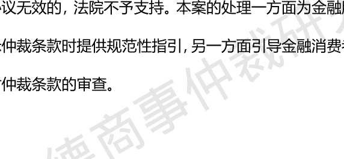

# 2024 | 中国商事白皮书

## (9) 准确适用《最高法院关于内地与香港特别行政区相互执行仲裁决定的安排》认可和执行香港仲裁裁——新加坡A公司与我国B公司申请认可与执行香港仲裁裁案

#### 基本案情：

2020年2月，卖方新加坡A公司与买方B公司洽交易，通过电邮和微信等电子通讯途径磋商国际买卖合同，在双方就货物买卖要素达成一致后，新加坡A公司通过电邮发送了包含买卖交易要素的表格以及四份合同草案。B公司结合合同草案后对合同细节向新加坡A公司进行了回应，针对其中的三份合同草案提出货源、数量、滞期费的异议，对其中所包含的仲裁条款提出异议。新加坡A公司进行修改并向B公司再次发送了合同草案。B公司收到后，回复“等合同审批流程完成后回签”，但其后未回复。

后B公司认为双方未签署合同的争议，认为合同未成立并拒绝执行。前四份合同草案均约定提交香港国际仲裁中心仲裁。2020年6月，新加坡A公司向香港国际仲裁中心申请仲裁，要求B公司赔偿违约损失并承担仲裁费用。香港国际仲裁中心于2021年5月作出该仲裁裁决，新加坡A公司于2021年10月在杭州申请认可和执行该仲裁裁决。B公司则主张双方之间不存在仲裁协议且认可和执行该仲裁裁决违背地社会利益，应当不予认可或执行该仲裁裁决。

## 裁决结果：

杭州法院认为，该案应当适用辖仲裁法律即香港特别行政区对争议仲裁协议是否成立进行审查。根据查明的香港特别行政区《仲裁条例》的规定和相关判例的观点，结合双方的过往交易背景，双方在意图拟订合同的磋商过程中交换了记载仲裁条款的合同，虽然B公司并未主动向新加坡A公司发送合同文本，但就相应合同进行了回应，且未对仲裁条款提出异议。因此，即使双方最终未一致签署该合同，基于仲裁协议效力的独立原则，应当认定双方约定合同草案中的仲裁条款已生效。该条款符合香港特别行政区《仲裁条例》第十九条关于“意成仲裁”与“书面形式”要求，其合法并具有法律效力。不论双方是否形成有效的交易合同，均影响仲裁条款的效力。案涉纠纷特定当事人的争议，处理结果影响合同事人不涉及社会公共公益。杭州依据最高法院关于内地与香港特别行政区相互执行仲裁决的安排》《最高法院关于内地与香港特别行政区相互执行仲裁决的规定》，认定认可和执行案涉仲裁裁决。

## 典型意义：

该案根据《最高人民法院关于内地与香港特别行政区相互执行仲裁决的安排》第七条第一款第一项的规定，在当事人未约定仲裁协议准法的情况下，适用仲裁决的法律判断仲裁协议成立问题，同时根据仲裁协议独立性原则，明确仲裁条款的成立可以独立于合同的成立的裁判规则，对同类案件的审理具有参考意义。本案的处理充分发挥了法院维护国际贸易秩序、平等保护中外当事人权益的职能作用，案例列入最高法院于2024年1月发布的仲裁典型案例，清华大学教授、最高法院国际商事法委员会委员邦萍在《人民法》文中对此高度肯定。

# 2024 | 中国商事白皮书

## 仲裁决中的财产保全

#### 基本案情：

仲裁申请人英国A公司与其被裁申请人B公司、乙、丙、丁、戊、庚在内的主体之间于2017年5月27日签署的《购买协议》引发的股权纠纷，向香港国际仲裁中心提起仲裁并获得仲裁决。仲裁过程中，英国A公司为防止被裁申请人隐匿、转移财产或增加负担，向杭州中院提出财产保全，请求冻结B公司等银行人民币203.5万元或扣押相应财产。为此，英国A公司向杭州中院提交了担保等材料。

## 裁决结果：

杭州中院认为，本案系在香港国际仲裁中心受理的仲裁案件，由法院提出财产保全案件符合《最高法院关于内地与香港特别行政区相互执行仲裁决的安排》第二条规定的“仲裁程序”。《最高法院关于内地与香港特别行政区相互执行仲裁决的安排》第三条“仲裁程序”，当事人在仲裁决作出前，可以参照《中华人民共和国民事诉讼法》《中华人民共和国仲裁法》及相关解释的规定，向被裁申请人住所地、财产所在地或者执行地的级法院申请保全。本案中，被裁申请人住所及财产所在地均在杭州，因此杭州中院有权受理财产保全。根据浙江省各级法院关于进一步规范财产保全的工作指引（试行）的规定，法院开展财产保全，应当慎采取措施，保护当事人权益，并对申请人是否存在履行难以执行的情形及保全必要性进行审查。经审查，本案申请人的请求无成立的情形、有明确的财产线索、经营状况说明，本案申请符合法律规定，应当予以准许，冻结B公司等银行人民币203.5万元或扣押B公司持有的60%股权。

## 典型意义：

《内地和香港特别行政区相互执行仲裁决的安排》自2017年10月1日起生效，内地法院对符合“仲裁程序”和“仲裁程序”由有关机构或者当地办事处办理项协助，需根据《最高法院关于内地和香港特别行政区相互执行仲裁决的安排》规定，要求提供担保。在跨法协助过程中，为了防止申请人损害，需要提供依据的事实、理由和相关证据，包括申请人合法权益受到损害或难以执行的说明等材料。在本案中，杭州中院依照司法解释的规定，依法审查并协助区际协助进行了良好探索，充分体现了法院支持国际商事发展的立场，为营造法治化、市场化、国际化环境提供了有力的保障。

# 2024 | 中国商事白皮书

## 14.浙江温州中院发布涉港澳台商事审判及仲裁典型案例

发布时间：2024年5月29日

### 案例情况：

（1）依法审理外商合同纠纷，平等保护中外当事人权益——西班牙籍A某诉某食品公司

#### 基本案情：

2018年4月27日，西班牙王国公民A某在温州注册成立某食品公司。2020年5月29日，A某与温州商人李某、张某签订《合伙协议》，约定A享有某食品公司50%表决权，李某、张某各享有25%表决权。2021年9月1日，双方签订协议，约定由李某经营某公司，每月30日前A某支付5500元。后因李某未按支付，A某向温州市鹿城区人民法院提起诉讼，请求令李某支付2021年9月至2022年5月的分红12300元及利息损失，并令李某继续履行《股东分红协议》。

#### 裁判结果：

温州市中级法院二审认为，双方当事人未共同选择合同适用的法律，本案应依照《华对外事事项法律适用法》的相关规定，适用履行义务能够体现中外合同统一的一方当事人经常居住地法律或者与该合同有密切联系的法律，即我国法律。协议约定A某一定期间内的经营管理权等权利转让李某，由李某支付合同约定的固定数额款，该约定不违反我国法律规定，合法有效。李某主诉涉案协议无效，依据不足，维持一审法院关于李某继续履行合同、支付A某14800元及逾期利息的判决。

## 典型意义：

本案审理过程中，一、二法院贯彻落实中外当事人平等保护原则和司法便利民原则，并引导当事人通过“人民法院在线服务”平台提交证据，方便当事人加诉讼。收到民事判决后，A某在“人民法院在线”平台上发表赞称，“喜欢中国的司法”。本案是温州法院助力法治化国际环境生动实践，一、二法院通过公正、便捷审理不断提升司法公信力。

（2）借助多元化机制，高效解决纠纷——某农业公司诉国际贸易公司

#### 基本案情：

2023年8月起，某农业公司委托国际贸易公司代理进口榴莲。次年1月，榴莲未能进入境内。某农业公司认为双方形成买卖合同，国际贸易公司未交付榴莲，故向永嘉县人民法院提起诉讼，请求令国际贸易公司返还贷款。国际贸易公司认为其仅负责海关清关工作，且农业公司未支付其清关费用，构成违约，提起反诉请求农业公司返还其清关费用并赔偿损失。

#### 调整情况：

永嘉县人民法院受理本案后，根据温州市中级法院和当地会签订的《关于建立纠纷调解机制合作协议》，将本案推至温州市促会，邀请了一位熟悉进口榴莲业务的人士担任调员。经过多次调解，双方达成和解，分别向永嘉县人民法院撤回诉讼。

（3）打造“一件事”数字化平台，高效跨境纠纷——叶某诉王某、某某

#### 基本案情：

王某、某某华侨，分别定居奥地利、巴西共和国。2017年3月15日，王某通过微信向叶某订手机，共计6530元。2018年3月5日，王某通过微信向叶某订手机，共计4825元。因王某、某某未支付货款，叶某在多次催款未果后，分别向文成县人民法院提起诉讼，请求令王某、某某支付货款。

#### 调解情况：

文成县法院自主开发的“一件事”应用平台将“访团络点”发布。海外联络员多方联系、沟通，最终与王某、某某取得联系，并组织当事人进行视频协调。在海外联络员的协助下，仅用30分钟成功解决两国合同纠纷，达成调解协议后，文成县法院通过“一件事”应用的“履行提醒”功能，在双方约定的每一期履行期限满前，系统发送提醒信息。后王某、某某均主动履行全部货款。

（4）精准审查问题，准确适用外国法律——荷兰公民某乙、某丙诉工商银行支行储蓄合同纠纷

#### 基本案情：

荷兰王国公民某甲2015年在浙江省瑞安立下遗嘱，将其在工商银行的人民币存款均分给两个女儿某乙、某丙。后某甲2022年在荷兰死亡，为领取遗嘱存款，某乙、某丙办理了经中国驻荷兰领事馆认证的个人身份信息、某甲死亡证明，并将书、遗嘱提交给工商银行支行，但该银行以不符合收取规定为不予办理。

## 裁决结果：

杭州中院认为，本案系由法院法院受理的仲裁案件，符合《最高法院关于内地与香港特别行政区相互执行仲裁决的安排》第二条规定的“仲裁程序”。《最高法院关于内地与香港特别行政区相互执行仲裁决的安排》第三条“仲裁程序”，当事人在仲裁决作出前，可以参照《中华人民共和国民事诉讼法》《中华人民共和国仲裁法》及相关解释的规定，向被裁申请人住所地、财产所在地或者执行地的级法院申请保全。本案中，被裁申请人住所及财产所在地均在杭州，因此杭州中院有权受理财产保全。根据浙江省各级法院关于进一步规范财产保全的工作指引（试行）的规定，法院开展财产保全，应当慎采取措施，保护当事人权益，并对申请人是否存在履行难以执行的情形及保全必要性进行审查。经审查，本案申请人的请求无成立的情形、有明确的财产线索、经营状况说明，本案申请人的申请符合法律规定，应当予以准许，冻结B公司等银行人民币203.5万元或扣押B公司持有的60%股权。

杭州仲院认为，本案依据起诉状中的陈述及提交的初步证据，系由A公司作为基金销售商是否履行了适当义务而提出的诉讼。甲在A公司处开账户时形成了《客户申请书》、《开户服务确认单》、《投资者权益须知》等文件，约定了双方的内容。在办理开户申请并填写表格时，已被告知遵守《投资者权益须知》的约定，《开户服务确认单》上签名显示其已理解了《投资者权益须知》的内容，对双方均具有约束力。《投资者权益须知》中约定了仲裁条款，该仲裁条款具备请求意见的意思表示并标明了仲裁事项，选定了仲裁机构，符合《中华人民共和国仲裁法》第十七条的规定且不存在无效情形，故应属于有效的仲裁条款。本案甲以A公司违反适当义务为由提起诉讼，而适当义务属先于合同义务，基金基金管理人签署基金合同与A公司相关，故A公司的适当义务与涉及基金合同的签订有密切联系，应认为本案是与基金合同有关的争议。由于《投资者权益须知》约定的仲裁条款，甲与A公司之间本案争议属于《投资者权益须知》中仲裁条款涉及的争议范围，应适用该仲裁条款，法院不具有管辖权。杭州仲院撤销一民事裁决，撤回甲的诉讼。

## 典型意义：金融消费者参与投资活动时与金融服务提供者之间的交易通常以申请书、确认书等系列文件的形式进行安排，相关系列文件构成金融服务合同的证明，体现双方的权利义务内容。实践中，相关文件的格式文本一般由金融服务提供者提供，其中所约定仲裁的纠纷解决方式对于金融消费者的程序权益有实质影响，宜金融服务提供者对相应仲裁条款特别提示。当有证据证明金融服务提供者特别提示后，金融消费者验收仲裁条款的相关文件的，金融消费者事后以金融服务提供者未告知其仲裁条款内容或其不知仲裁条款内容为主张仲裁协议无效的，法院不予支持。本案的处理方面为金融服务提供者制定和特别提示仲裁条款提供规范性指引，另一方面引导金融消费者在签订相关文件时注重对仲裁条款的审查。

# 2024 | 中国商事白皮书

## (9) 准确适用《最高法院关于内地与香港特别行政区相互执行仲裁决定的安排》认可和执行香港仲裁裁——新加坡A公司与我国B公司申请认可与执行香港仲裁裁案

#### 基本案情：

2020年2月，卖方新加坡A公司与买方B公司洽交易，通过电邮和微信等电子通讯途径磋商国际买卖合同，在双方就货物买卖要素达成一致后，新加坡A公司通过电邮发送了包含买卖交易要素的表格以及四份合同草案。B公司结合合同草案后对合同细节向新加坡A公司进行了回应，针对其中的三份合同草案提出货源、数量、滞期费的异议，对其中所包含的仲裁条款提出异议。新加坡A公司进行修改并向B公司再次发送了合同草案。B公司收到后，回复“等合同审批流程完成后回签”，但其后未回复。

后B公司认为双方未签署合同的争议，认为合同未成立并拒绝执行。前四份合同草案均约定提交香港国际仲裁中心仲裁。2020年6月，新加坡A公司向香港国际仲裁中心申请仲裁，要求B公司赔偿违约损失并承担仲裁费用。香港国际仲裁中心于2021年5月作出该仲裁裁决，新加坡A公司于2021年10月在杭州申请认可和执行该仲裁裁决。B公司则主张双方之间不存在仲裁协议且认可和执行该仲裁裁决违背地社会利益，应当不予认可或执行该仲裁裁决。

## 裁决结果：

杭州法院认为，该案应当适用辖仲裁法律即香港特别行政区对争议仲裁协议是否成立进行审查。根据查明的香港特别行政区《仲裁条例》的规定和相关判例的观点，结合双方的过往交易背景，双方在意图拟订合同的磋商过程中交换了记载仲裁条款的合同，虽然B公司并未主动向新加坡A公司发送合同文本，但就相应合同进行了回应，且未对仲裁条款提出异议。因此，即使双方最终未一致签署该合同，基于仲裁协议效力的独立原则，应当认定双方约定合同草案中的仲裁条款已生效。该条款符合香港特别行政区《仲裁条例》第十九条关于“意成仲裁”与“书面形式”要求，其合法并具有法律效力。不论双方是否形成有效的交易合同，均影响仲裁条款的效力。案涉纠纷特定当事人的争议，处理结果影响合同事人不涉及社会公共公益。杭州依据最高法院关于内地与香港特别行政区相互执行仲裁决的安排》《最高法院关于内地与香港特别行政区相互执行仲裁决的规定》，认定认可和执行案涉仲裁裁决。

## 典型意义：

该案根据《最高人民法院关于内地与香港特别行政区相互执行仲裁决的安排》第七条第一款第一项的规定，在当事人未约定仲裁协议准法的情况下，适用仲裁决的法律判断仲裁协议成立问题，同时根据仲裁协议独立性原则，明确仲裁条款的成立可以独立于合同的成立的裁判规则，对同类案件的审理具有参考意义。本案的处理充分发挥了法院维护国际贸易秩序、平等保护中外当事人权益的职能作用，案例列入最高法院于2024年1月发布的仲裁典型案例，清华大学教授、最高法院国际商事法委员会委员邦萍在《人民法》文中对此高度肯定。

# 2024 | 中国商事白皮书

## 仲裁决中的财产保全

#### 基本案情：

仲裁申请人英国A公司与其被裁申请人B公司、乙、丙、丁、戊、庚在内的主体之间于2017年5月27日签署的《购买协议》引发的股权纠纷，向香港国际仲裁中心提起仲裁并获得仲裁决。仲裁过程中，英国A公司为防止被裁申请人隐匿、转移财产或增加负担，向杭州中院提出财产保全，请求冻结B公司等银行人民币203.5万元或扣押相应财产。为此，英国A公司向杭州中院提交了担保等材料。

## 裁决结果：

杭州中院认为，本案系在香港国际仲裁中心受理的仲裁案件，由法院提出财产保全案件符合《最高法院关于内地与香港特别行政区相互执行仲裁决的安排》第二条规定的“仲裁程序”。《最高法院关于内地与香港特别行政区相互执行仲裁决的安排》第三条“仲裁程序”，当事人在仲裁决作出前，可以参照《中华人民共和国民事诉讼法》《中华人民共和国仲裁法》及相关解释的规定，向被裁申请人住所地、财产所在地或者执行地的级法院申请保全。本案中，被裁申请人住所及财产所在地均在杭州，因此杭州中院有权受理财产保全。根据浙江省各级法院关于进一步规范财产保全的工作指引（试行）的规定，法院开展财产保全，应当慎采取措施，保护当事人权益，并对申请人是否存在履行难以执行的情形及保全必要性进行审查。经审查，本案申请人的请求无成立的情形、有明确的财产线索、经营状况说明，本案申请符合法律规定，应当予以准许，冻结B公司等银行人民币203.5万元或扣押B公司持有的60%股权。

## 典型意义：

《内地和香港特别行政区相互执行仲裁决的安排》自2017年10月1日起生效，内地法院对符合“仲裁程序”和“仲裁程序”由有关机构或者当地办事处办理项协助，需提供担保。在法协助过程中，为了防止申请人损害，需要提供依据的事实、理由和相关证据，包括申请人合法权益受到损害或难以执行的说明等材料。在本案中，杭州中院依照司法解释的规定，依法审查并协助区际协助进行了良好探索，充分体现了法院支持国际商事发展的立场，为营造法治化、市场化、国际化环境提供了有力的保障。

# 2024 | 中国商事白皮书

## 14.浙江温州中院发布涉港澳台商事审判及仲裁典型案例

发布时间：2024年5月29日

### 案例情况：

（1）依法审理外商合同纠纷，平等保护中外当事人权益——西班牙籍A某诉某食品公司

#### 基本案情：

2018年4月27日，西班牙王国公民A某在温州注册成立某食品公司。2020年5月29日，A某与温州商人李某、张某签订《合伙协议》，约定A享有某食品公司50%表决权，李某、张某各享有25%表决权。2021年9月1日，双方签订协议，约定由李某经营某公司，每月30日前A某支付5500元。后因李某未按支付，A某向温州市鹿城区人民法院提起诉讼，请求令李某支付2021年9月至2022年5月的分红12300元及利息损失，并令李某继续履行《股东分红协议》。

#### 裁判结果：

温州市中级法院二审认为，双方当事人未共同选择合同适用的法律，本案应依照《华对外事事项法律适用法》的相关规定，适用履行义务能够体现中外合同统一的一方当事人经常居住地法律或者与该合同有密切联系的法律，即我国法律。协议约定A某一定期间内的经营管理权等权利转让李某，由李某支付合同约定的固定数额款，该约定不违反我国法律规定，合法有效。李某主诉涉案协议无效，依据不足，维持一审法院关于李某继续履行合同、支付A某14800元及逾期利息的判决。

## 典型意义：

本案审理过程中，一、二法院贯彻落实中外当事人平等保护原则和司法便利民原则，并引导当事人通过“人民法院在线服务”平台提交证据，方便当事人加诉讼。收到民事判决后，A某在“人民法院在线”平台上发表赞称，“喜欢中国的司法”。本案是温州法院助力法治化国际环境生动实践，一、二法院通过公正、便捷审理不断提升司法公信力。

（2）借助多元化机制，高效解决纠纷——某农业公司诉国际贸易公司

#### 基本案情：

2023年8月起，某农业公司委托国际贸易公司代理进口榴莲。次年1月，榴莲未能进入境内。某农业公司认为双方形成买卖合同，国际贸易公司未交付榴莲，故向永嘉县人民法院提起诉讼，请求令国际贸易公司返还贷款。国际贸易公司认为其仅负责海关清关工作，且农业公司未支付其清关费用，构成违约，提起反诉请求农业公司返还其清关费用并赔偿损失。

#### 调整情况：

永嘉县人民法院受理本案后，根据温州市中级法院和当地会签订的《关于建立纠纷调解机制合作协议》，将本案推至温州市促会调解。全省在温州市促会设立法庭，将本案进行调解，邀请了一位熟悉进口榴莲业务的人士担任调员。经过多次调解，双方达成和解，分别向永嘉县人民法院撤回诉讼。

（3）打造“一件事”数字化平台，高效跨境纠纷——叶某诉王某、某某

#### 基本案情：

王某、某某华侨，分别定居奥地利、巴西共和国。2017年3月15日，王某通过微信向叶某订手机，共计6530元。2018年3月5日，王某通过微信向叶某订手机，共计4825元。因王某、某某未支付货款，叶某在多次催款未果后，分别向文成县人民法院提起诉讼，请求令王某、某某支付货款。

#### 调解情况：

文成县法院自主开发的“一件事”应用平台将“访团络点”发布。海外联络员多方联系、沟通，最终与王某、某某取得联系，并组织当事人进行视频协调。在海外联络员的协助下，仅用30分钟成功解决两国合同，达成调解协议后，文成县法院通过“一件事”应用的“履行提醒”功能，在双方约定的每一期履行期限满前，系统发送提醒信息。后王某、某某均主动履行全部货款。

（4）精准审查问题，准确适用外国法律——荷兰公民某乙、某丙诉工商银行支行储蓄合同纠纷

#### 基本案情：

荷兰王国公民某甲2015年在浙江省瑞安立下遗嘱，将其在工商银行的人民币存款均分给两个女儿某乙、某丙。后某甲2022年在荷兰死亡，为领取遗嘱存款，某乙、某丙办理了经中国驻荷兰领事馆认证的个人身份信息、某甲死亡证明，并将书、遗嘱提交给工商银行支行，但该银行以不符合收取规定为不予办理。

## 裁决结果：

杭州中院认为，本案系由法院法院受理的仲裁案件，符合《最高法院关于内地与香港特别行政区相互执行仲裁决的安排》第二条规定的“仲裁程序”。《最高法院关于内地与香港特别行政区相互执行仲裁决的安排》第三条“仲裁程序”，当事人在符合《最高法院关于内地与香港特别行政区相互执行仲裁决的安排》第三条“仲裁程序”，当事人在仲裁决作出前，可以参照《中华人民共和国民事诉讼法》《中华人民共和国仲裁法》及相关解释的规定，向被裁申请人住所地、财产所在地或者执行地的级法院申请保全。本案中，被裁申请人住所及财产所在地均在杭州，因此杭州中院有权受理财产保全。根据浙江省各级法院关于进一步规范财产保全的工作指引（试行）的规定，法院开展财产保全，应当慎采取措施，保护当事人权益，并对申请人是否存在履行难以执行的情形及保全必要性进行审查。经审查，本案申请人的请求无成立的情形、有明确的财产线索、经营状况说明，本案申请符合法律规定，应当予以准许，冻结B公司等银行人民币203.5万元或扣押B公司持有的60%股权。

杭州仲院认为，本案依据起诉状中的陈述及提交的初步证据，系由A公司作为基金销售商是否履行了适当义务而提出的诉讼。甲在A公司处开账户时形成了《客户申请书》、《开户服务确认单》、《投资者权益须知》等文件，约定了双方的内容。在办理开户申请并填写表格时，已被告知遵守《投资者权益须知》的约定，《开户服务确认单》上签名显示其已理解了《投资者权益须知》的内容，对双方均具有约束力。《投资者权益须知》中约定了仲裁条款，该仲裁条款具备请求意见的意思表示并标明了仲裁事项，选定了仲裁机构，符合《中华人民共和国仲裁法》第十七条的规定且不存在无效情形，故应属于有效的仲裁条款。本案甲以A公司违反适当义务为由提起诉讼，而适当义务属先于合同义务，基金管理人签署基金合同与A公司相关，故A公司的适当义务与涉及基金合同的签订有密切联系，应认为本案是与基金合同有关的争议。由于《投资者权益须知》约定的仲裁条款，甲与A公司之间本案争议属于《投资者权益须知》中仲裁条款涉及的争议范围，应适用该仲裁条款，法院不具有管辖权。杭州仲院撤销一民事裁决，撤回甲的诉讼。

由于《内地和香港特别行政区相互执行仲裁决的安排》《最高法院关于内地与香港特别行政区相互执行仲裁决的规定》，认定认可和执行案涉仲裁决。

## 典型意义：

该案根据《人民法院关于内地与香港特别行政区相互执行仲裁决的安排》第七条第一款第一项的规定，在当事人未约定仲裁协议准法的情况下，适用仲裁决的法律判断仲裁协议成立问题，同时根据仲裁协议独立性原则，明确仲裁条款的成立可以独立于合同的成立的裁判规则，对同类案件的审理具有参考意义。本案的处理充分发挥了法院维护国际贸易秩序、平等保护中外当事人权益的职能作用，案例列入最高法院于2024年1月发布的仲裁典型案例，清华大学教授、最高法院国际商事法委员会委员邦萍在《人民法》文中对此高度肯定。

# 2024 | 中国商仲裁白皮书

(6) 积极践行动员理念，实质化解涉外商事新获辖权“第一案”

——香港居民某某某间借贷纠纷案

#### 基本案情：

蔡某系香港特别行政区居民，余某系浙江平阳人，双方为朋友关系。

2019 年 8 月，余某以投资项目缺少资金为向蔡某借款，蔡某随即向余某转账 10 万元，但余某未出具借据。

经蔡某多次催讨，余某拒还款。

2023 年 2 月，蔡某向平阳县法院提起诉讼，请求令余某还10 万元并支付逾期利息。

#### 调整情况：

本案系平阳县法院获得涉外商事纠纷管辖权受理后的“第一案”，由分管涉外商事案件审理工作的工作副法长主审。

主事人在全面了解案情后，从维案当事人情况以及诚信程度等角度主持双方调解，全程详细明理、沟通顺畅。

经过多次磋商协商，双方当事人在 2023 年 3 月 24 日达成调解协议，约定余某还款 5 万元，2023 年 3 月 31 日前还剩余的 5 万元，双方通过“人民法院在线服务”平台签署调解协议。

平阳县法院于当日审核并作成民事调解书，并在持续跟进回访，督促余某自动履行完毕。

## 典型意义：

为适应我国高水平对外开放新形势，进一步便利中外当事人诉讼，最高人民法院发布《最高人民法院关于涉外商事案件管辖若干问题的规定》，对一审涉外民商事案件管权作出重大调整。自2023年1月1日起，包括平阳县法院在内的温州地区7家基层法院获得涉外商事诉讼管权，实现了温州地区12家基层法院一审涉外民商事管权全面覆盖。按照前述司法辖规定，人民法院审理涉及香港、澳门特别行政区和台湾地区的民商事案件参照适用。

平阳县民法院秉“涉外无小事”理念，认真贯彻落实上级法院关于规范审理涉外民商事“第一案”的要求，确定由分管院长主审本案。主事人积极践行履职理念，通过“人民法院在线服务”平台开展线上调解并跟督促履行。

本案的高效化是新获涉外商事管权基层法院主动适应涉外民商事管权优化机制，充分发挥涉外审判职能作用，以司法服务保障高水平开放的实践。

本案入选全省新获涉外民商事案件管权法院涉港澳台“十佳第一案”。

# 2024 | 中国商仲裁白皮书

(7) 准互惠原则适用标准，依法承认“一带一路”合作国家法院民商事判决——新加坡公司申请与执行外国法院民事判决决案

#### 基本案情：

2020年5月15日，新加坡公司向新加坡国家法院起诉中国公民准某臣间借贷纠纷。在新加坡国家法院签出有法院印章的传票令和和索债书后，由新加坡公司的律师函向准某臣送达。在两次送达失败后，律师根据法院作出的命令，将文件张贴在准某臣地址的门上。

新加坡国家法院的命令内容为：送达对方索债书的传票令连同向法院签发一份裁决副本，可以有效地通过张贴在新加坡某某地址前门上（该地为准某臣最后可能的住址），以及通过 AR 挂邮寄至该地。上述方式送达的传票令、索债书及法院向准某臣送达的法院视为适当和充分的送达。

因准某臣未出庭，新加坡国家法院于2020年8月23日出判决，内容为：准某臣支付新加坡公司11825.5美元。新加坡公司遂向准某臣住所地温州市中级法院申请执行上述民事判决。温州市中级法院审理期间，准某臣确认新加坡国家法院作出的命令中列此地址为其新加坡的住址，并对新加坡国家法院作出的判决不异异。新加坡公司确认准某臣已履行部分判决内容。

#### 裁判结果：

温州市中级法院认为，我国与新加坡之间未结承认执行生效判决书的国际条约。由于新加坡高等法院对我国民事判决予以承认，根据互惠原则，我国法院可以依据《中华人民共和国民事诉讼法》第二十八条的规定，对符合条件的外国民事判决予以执行。本案虽系缺席判决，但准某臣已经到庭；该判决已经生效且不存在违反法律或者公共利益的情形。

## 典型意义：

本案是人民法院依法适用互惠原则，承认“一带一路”合作国家法院判决的案例。在我国与新加坡之间未结承认执行生效判决书的司法协助协定、亦未共同参加国际条约的情况下，本案通过尊重互惠原则适用标准，积极促进我国和新加坡之间相互执行判决，良好执行了《中华人民共和国人民法院和新加坡最高法院关于承认与执行判决的指导意见》。对于保障高质量“一带一路”、打造包容的法治环境等方面积极意义。本案入选中国“一带一路”建设典型案例。

# 2024 | 中国商仲裁白皮书

(8) 根据仲裁规则准确界定仲裁员义务，确保仲裁程序公正——某工程公司申请撤销仲裁决

#### 基本案情：

2017年3月，某投资公司与某工程公司发生施工合同纠纷，向仲裁委员会提出仲裁申请，某工程公司提出仲裁反请求。仲裁委员会认为案情复杂、争议颇大，遂就双方争议于2018年4月进行仲裁。2018年7月，仲裁委员会作出相应裁决。某工程公司以仲裁员组成违反程序等理由，向温州市中级法院申请撤销仲裁决。

#### 裁判结果：

温州市中级法院认为，某投资公司在仲裁案件中的代理人杨某与仲裁员陈某曾在同一律师事务所工作，杨某担任仲裁委员会主任期间，陈某及首席仲裁员冯某均属委员。但仲裁委员会官网对仲裁员的介绍中，并未显示其为仲裁委员会主任，仲裁过程中陈某未对其身份进行适当披露。

根据仲裁规则第五条第一款第三项的规定，与本案当事人或其代理人有关系的，可能影响公正裁决的，仲裁员应当自行向仲裁委员会披露并请求回避，当事人也有权要求其回避。仲裁过程中，陈某等人未按照仲裁规则披露其与某投资公司代理人之间的关系，一定程度上影响了当事人回避权的行使，属于可能影响公正裁决的情形。虽然仲裁委员会在2018年4月召开的会议案号确定，但未向人民法院提供此次会议的记录。目前案卷宗材料中并没有有关案号的相关记录，故不能排除担任主任的杨某对此讨论存在不当的利益冲突。据此，温州市中级法院经报上级人民法院核准，依法作出民事裁定，撤销该仲裁委员会作出的仲裁决。

## 典型意义：

商事仲裁是解决商事纷的重要途径，充分保障当事人的程序性权利是公正裁决的前提。为确保仲裁决的公信力，人民法院通过司法审查支持和监督仲裁。仲裁员公正、独立行使仲裁权是商事纷通过仲裁程序得到有效解决的保障。本案仲裁员未按照仲裁规则充分履行披露义务，一定程度上影响了当事人回避权的行使，属于可能影响公正裁决的情形。温州市中级法院以“仲裁庭的组成或者仲裁的程序违反程序”为由，依法撤销仲裁决。通过司法审查有效监督职能，促使仲裁机构重视仲裁员信息进行披露，确保当事人在仲裁中获得公正的程序性权利。本案入选人民法院司法审查典型案例。

# 2024 | 中国商仲裁白皮书

(9) 确定某设计同选仲裁员的起算时间，助完善仲裁规则——某设计公司等申请撤销仲裁决

#### 基本案情：

2018年9月，张某某与某设计公司发生装修纠纷，向仲裁委员会提出仲裁申请。仲裁委员会受理后，分别于2018年12月17日、12月21日、2019年2月14日向某设计公司送达仲裁通知，告知限在收到通知之15日内选定仲裁员。某设计公司于2019年2月27日选定了仲裁员。仲裁委员会认为某设计公司未在规定期限内选定仲裁员，由仲裁委员会自行指定仲裁员，并仲裁委员会指定的仲裁员陈某和首席仲裁员黄某组成仲裁庭审理。2020年1月，仲裁委员会作出仲裁决。某设计公司等对仲裁决有异议，以仲裁委员会自行选定仲裁员、仲裁庭组成违反程序为由，向温州市中级法院申请撤销仲裁决。

#### 裁判结果：

温州市中级法院认为，根据《中华人民共和国仲裁法》第三十一条规定，当事人有权选定仲裁员，为确保当事人实现“共同选定仲裁员”的权利，当事人为多个主体时，以最后一个主体收到通知的时间为起点。在一方在规定期限内选定仲裁员的情况下，仲裁委员会仍自行指定仲裁员，损害了当事人选定权利，影响仲裁庭组成，违反仲裁规则，可能影响公正裁决。据此，温州中级法院经报上级法院，依法作出民事裁定，撤销该仲裁委员会作出的仲裁决。

## 典型意义：

仲裁程序必须公正、公平。当事人为多个主体时，以最后一个主体收到通知的时间为共同选定仲裁员期限的起点，是为了确保所有当事人都能同一时间开始准备，程序正义、平等和当事人意思自治的必然要求，有助于保障仲裁程序的公正性、公平性和效率。本案从仲裁制度的法律基础以及立法本意出发，确保一方当事人为多个主体时每个主体均享有同一期限内选定仲裁员的权利，尊重当事人的意思自治，充分保障当事人的程序性。本案的处理推动了仲裁规则的完善，新增了共同选定仲裁员时间的规定。(img/f7724d055474f437d9ddb923a9e6424_304_0.png)

# 2024 | 中国商仲裁白皮书

(10) 尊重当事人意思自治，准确定仲裁条款的相对方——某村委会申请撤销仲裁决

#### 基本案情：

为旧村改造需要，某村设立临时机构“某村旧改指挥部”。2012年4月19日，指挥部与某邦公司签订《委托建建合同》，委托某邦公司代建旧村改造工程，委托内容包括确定设计单位，但设计合同由指挥部与设计单位签订。后某邦公司选定某设计公司为设计单位。2012年8月8日，某设计公司与某邦公司就工程项目签订《设计合同》，其中约定因设计合同发生争议的，由仲裁委员会仲裁。之后某设计公司以某委会、某邦公司为被申请人申请仲裁，仲裁委员会依据《设计合同》约定的仲裁条款，于2022年1月5日作出仲裁决。某委会以《设计合同》的仲裁条款对其不具有约束力，仲裁委员会没有管辖权，向温州市中级法院申请撤销仲裁决。

#### 裁判结果：

温州市中级法院审查认为，根据《委托建建》约定，某旧村改造指挥部委托某邦公司确定设计单位，但设计合同由指挥部直接与设计单位签订。后某邦公司选定某设计公司为设计单位，无证据证明《设计合同》签订时某邦公司已取得指挥部相关授权，或指挥部事后对《设计合同》予以追认。应当认定《设计合同》的仲裁条款对某委会无约束力，其与设计公司之间没有仲裁协议，仲裁委员会对案涉仲裁没有管辖权。(img/f7724d055474f437d9ddb923a9e6424_305_0.png)

据此，温州市中级法院经报上级法院核准，依法作出民事裁定，撤销该仲裁委员会作出的仲裁决。

## 典型意义：

当事人是仲裁协议的基石。当事人之间订合有效的仲裁协议是仲裁机构获得管权的依据。仲裁条款对于非合同对方原则上不具有约束力，但由于对第三方利益的保护，在一定条件下对合同相对性进行突破，认定仲裁协议对未签字的第三方具有法律约束。如主体分立、合并下权利的概括转移，受让人受到原合同；继承人承担权利义务，受被继承人与债务人达成的仲裁协议；债权转让受让人对原当事人签订的仲裁协议知情的等，均是仲裁协议效力扩张的典型情形，但本案不存在前述情形。本案严格贯彻当事人意思自治，准确定仲裁条款的相对方，有助于引导商主体规范签订商裁协议。

# 植德律师事务所

北京:北京市东城区东门大街1号华福士中中心办公楼12层
上海:上海市徐汇虹桥路183号华福嘉汇中心三期A座办公楼27层 (THREE itc)
深圳:深圳市南山区海域南路粤6666号中国华润大厦9层
武汉:湖北武汉汉江区中山大道1505号企业天地1号45层
杭州:浙江杭州市西湖双芳街99号三绿国际中心G6层
成都:四川省成都市武侯区人民南路3号T1办公楼2804
青岛:山东省青州市南山资源路博雅4号楼10层
广州:广东省广州天河区江新城广州广大金融中心17701单元
海口:海南省海口市龙华区国贸大道帝国大厦B座5楼5层
香港:香港中环环广场1号悦大厦33310

(img/f7724d055474f437d9ddb923a9e6424_307_0.png)

扫码关注公众号
