# 中国零售地产与消费市场
# 2024年度研究报告

仲量联行研究部
2025年2月

SEE A BRIGHTER WAY
向光而为

# 扫码加入 知识星球TOP免费资源群

免费
公众号:知识星球

- 每日免费获取高价值资源
- 可提供各类资源搜索服务

价值

微信号:jntsg8

| 热门付费文章 | 各行各业报告 |
| 精选图书资源 | 副业赚钱方法 |
| 职场实用资源 | AI政经自媒体 |

微信号:jntsg2

及时

专注

分享资料仅供个人学习，请及时删除，切勿商用传播

# 目录

## 01 宏观经济
- 客流 | 04
- 社团 | 06
- 网上零售趋势 | 10
- 节假日经济 | 12
- 消费意愿 | 13
- 消费贡献率 | 14
- 价格指数 | 15
- 居民收支 | 16
- 支出构成 | 18

## 02 零售市场
- 数据概览 | 21
- 存量分析 | 23
- 供应分析 | 25
- 空置率分析 | 30
- 供需分析 | 32
- 租金分析 | 33

## 03 消费趋势
- 租赁总览 | 一级态 | 35
- 租赁总览 | 二级态 | 36
- 业态价值 | 37
- 情绪价值 | 38
- 理性审慎 | 39
- 品质生活 | 40

## 04 市场应对
- 政府端 | 消费激励 | 42
- 物业端 | 业主策略 | 43
- 投资端 | 融资分析 | 44

## 05 未来展望
- 供应端 | 47
- 需求端 | 48
- 政府端 | 51
- 回顾与展望 | 52

# 宏观经济

## 市内客流：地铁客量稳增长，2024年低线城市增速领先

- 地铁日均客流同比增速
- 2024年中国重点城市地铁日均客流量

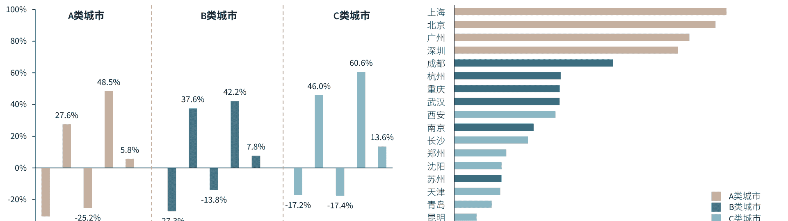

注：A类城市包括：北京、广州、深圳；B类城市：成都、苏州、重庆、武汉、南京；C类城市：长沙、郑州、天津、西安、沈阳、南州、天津、青岛、昆明、大连、厦门。由于杭州、无锡等数据未纳入左图计算，右图数据源自微博。所有客流量数据不含地铁线路。

数据来源：iFind数据库，仲量银行研究部，2025年2月
中国零售产业与消费趋势2024年年度报告
4 | 行业财富2025年版版权所有

## 城市客流：空铁客流持续升，均超2019年水平，增速收敛

- 中国民航旅客吞吐量及同比增速
- 中国铁路旅客发送量及同比增速

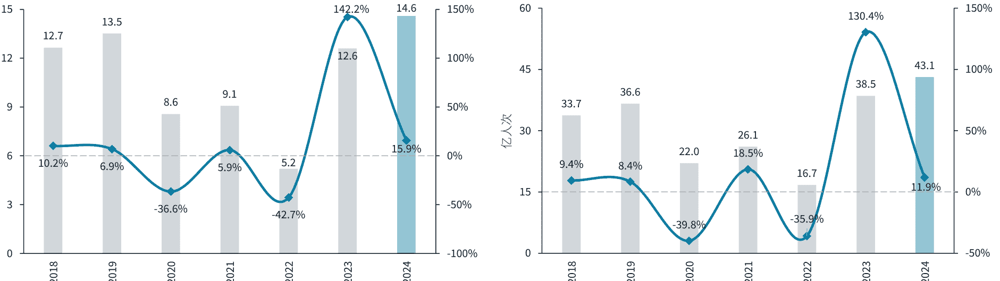

机场旅客吞吐量（左侧） 同比增长（右侧）
铁路旅客发送量（左侧） 同比增速（右侧）

中国零售地产与消费市场2024年度跟踪报告
数据来源：中国民用航空局、中国交通运输部、仲量行业研究部，2025年2月
5 | 仲量量行2025年版权所有。

## 社零：社零总量稳健增长彰消费基本盘，餐饮与零售增速收缩

- 中国社会消费品总额同比增速
- 按消费分类中国零售总额同比增速（月度）

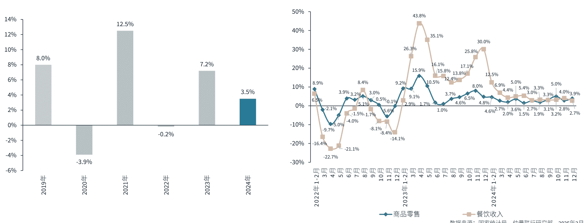

中国零售地产与消费市场2024年度研究报告
数据来源：国家统计局，仲量银行研究部，2025年2月

## 社零：月度社全年同比上涨，增速回归稳定区间但低于2019年水平

- 中国社会消费零售总额及增速（月度）
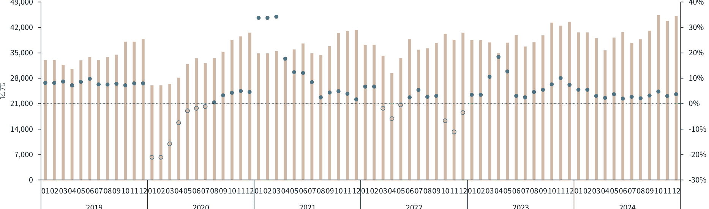

- 消费零售额（左轴）
- 消费零售额同比大于（右轴）
- 消费零售额同比小于（右轴）

注：1月和2月的当值为平均值。
中国零售地产与消费市场2024年度报告
7 | 仲量银行2025年版权所有。
数据来源：国家统计局，仲量银行部，2025年2月

## 社零：2020年后首次出现负增长，电器用品增长强劲

- 2024年中国社会零售总额及增速（按消费类型）

| 消费类型 | 2024年1-12月累计（亿元） | 2024年1-9月增速 (%) | 2024年1-6月增速 (%) | 2023年1-3月增速 (%) |
| :--- | :--- | :--- | :--- | :--- |
| 汽车类 | 50,314 | -0.5 | -2.1 | -1.1 | 3.8 |
| 石油及制品 | 24,000 | 0.3 | 2.3 | 4.1 | 4.5 |
| 粮油、食品类 | 21,737 | 9.9 | 9.9 | 9.6 | 9.6 |
| 服装、鞋帽、针织品 | 14,691 | 0.3 | 0.2 | 1.3 | 2.5 |
| 家用电器和视频类 | 10,037 | 12.3 | 4.4 | 3.1 | 5.8 |
| 日用品类 | 8,091 | 3.0 | 2.2 | 2.3 | 0.7 |
| 通信材料 | 7,902 | 9.9 | 11.9 | 11.3 | 13.2 |
| 中西药品 | 7,157 | 3.1 | 4.7 | 4.4 | 3.3 |
| 烟酒类 | 6,159 | 5.7 | 6.8 | 10.0 | 12.5 |
| 化妆品类 | 4,357 | -1.1 | -1.0 | 1.0 | 3.4 |
| 文化用品用品 | 4,327 | -0.3 | -2.9 | -5.8 | -8.0 |
| 金银珠宝类 | 3,300 | -3.1 | -3.1 | 0.2 | 4.5 |
| 饮料类 | 3,200 | 2.1 | 4.5 | 5.6 | 6.5 |
| 建筑及装材料 | 1,692 | -2.0 | -2.6 | -1.2 | 2.4 |
| 家具类 | 1,691 | 3.6 | 1.1 | 2.6 | 3.0 |
| 体育、娱乐用品 | 1,415 | 11.1 | 9.7 | 11.2 | 14.2 |

数据来源：国家统计局、仲量银行研究部，2025年2月

## 社零：全国多城社零温和增长，武汉领先，北上呈负增长

## 2024年中国重点城市社会零售总额
## 2024年中国重点城市社会零售总额同比增速

| 城市 | 总额 (亿元) |
| :--- | :--- |
| 上海 | 4200 |
| 重庆 | 2800 |
| 北京 | 2600 |
| 广州 | 2100 |
| 深圳 | 1900 |
| 成都 | 1600 |
| 苏州 | 1400 |
| 南京 | 1300 |
| 武汉 | 1100 |
| 杭州 | 950 |
| 青岛 | 800 |
| 郑州 | 750 |
| 长沙 | 700 |
| 宁波 | 650 |
| 西安 | 600 |
| 沈阳 | 550 |
| 无锡 | 450 |
| 昆明 | 400 |
| 厦门 | 350 |
| 大连 | 300 |

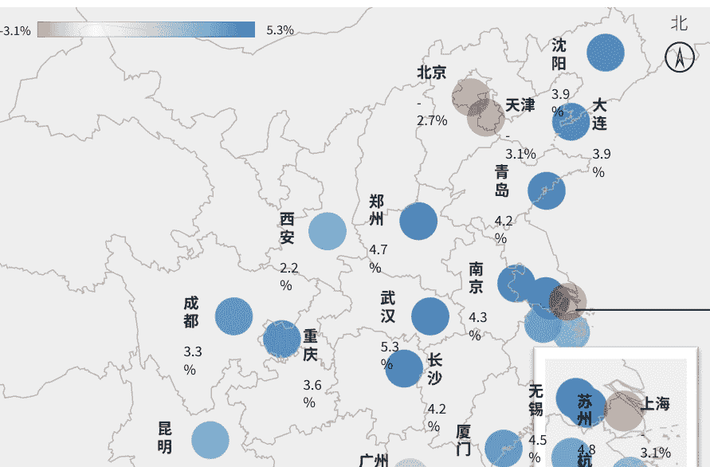

- A类城市
- B类城市
- C类城市

0 10000 15000 20000 亿元

注：天津公布社会消费零售市场总额的增速数据。
中国华产与消费市场2024年度报告
9 | ©仲量银行2025年版所有。
数据来源：统计局、仲量银行部；2025年2月

## 网上零售额：线上增速持续领先，凸显消费韧性

- 中国网上零售额与社会品总额累计
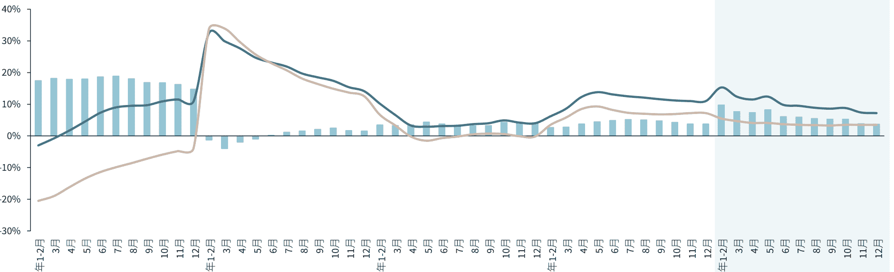

## 网上零售额：线上增速放缓，占比稳居第一

- 中国网上零售额（左轴）
- 同比增速（右轴）
- 实物网上零售额占零售额的比（右轴）
- 食品类商品
- 穿类商品
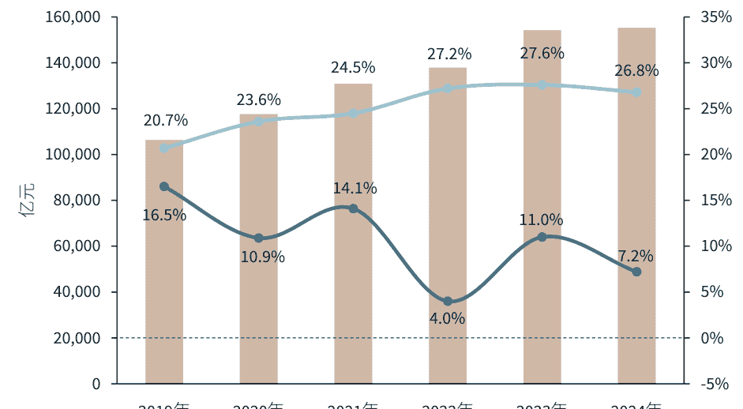
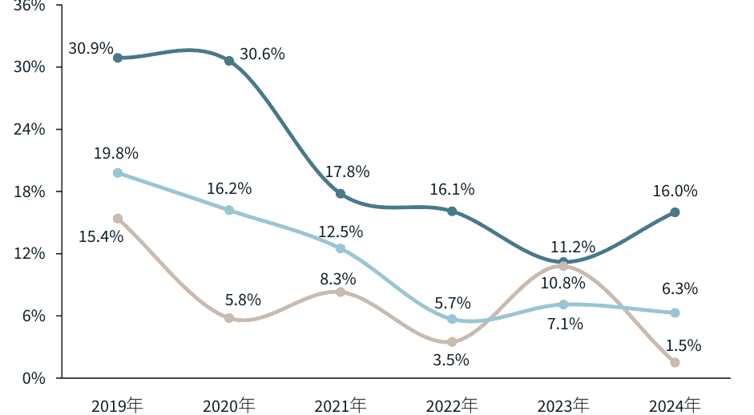

数据来源：统计局，仲量行业部
中国零售地产与消费市场2024年度报告
11 | 仲量联行2025年版所有。

## 节假日经济：2024年旅游收入已超2019年水平，但旅游人数仍恢复中

- 2019-2024年中国旅游
| 70 | 60 | 50 | 40 | 30 | 20 | 10 | 0% | 20% | 40% | 60% | 80% | 120% |
| :--- | :--- | :--- | :--- | :--- | :--- | :--- | :--- | :--- | :--- | :--- | :--- | :--- |
| 亿次 | 60.1 | | | | | | | | | | | |
| | 57,250.9 | 2019 | 953 | | | | | | | | | |
| 28.8 | 22,286.3 | 2020 | 774 | | | | 38.9% | 47.9% | | | | |
| 32.5 | 29,190.7 | 2021 | 899 | | | | 51.0% | 54.0% | | | | |
| 25.3 | 20,444.0 | 2022 | 808 | | | | 35.6% | 42.1% | | | | |
| 48.9 | 49,100.0 | 2023 | 1,004 | | | | 85.8% | 81.4% | | | | |
| 56.6 | 57,500.0 | 2024 | 1,023 | | | | 93.5% | 100.4% | | | | |
| 70,000 | 60,000 | 50,000 | 40,000 | 30,000 | 20,000 | 10,000 | 0 | 250 | 500 | 750 | 1,000 | 1,250 | 1,500 |

■ 旅游收入（左轴） ■ 人均花费（右下轴） ● 游客数量（左上轴）
-- 旅游收入较2019年恢复程度（右轴） -- 游客人数较2019年恢复程度（右轴）

数据来源：文化旅游，仲量行研研究院，2025年2月
中国零售地产与消费市场2024年度研究报告
12 | ©仲量银行2025年版版权所有。

## 节假日经济：节假日出行持续火热，游客人数和收入均超2019年水平

- 中国主要假日国内游客人数、收入较2019年同期恢复程度
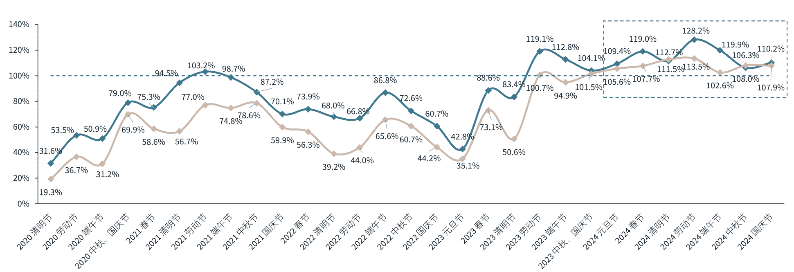

注：2023年春节未公布2019年同期的恢复程度，图中数据为脚注所得。
中国零售地产与消费趋势2024年度研究报告
数据来源：文化和旅游部、畅量银行研究、2025年2月
© 畅信银行2025年版权所有。

## 消费意愿：住户新增贷款双双下滑，消费者信心仍在线线以下

- 中国住户新增贷款及增速
- 中国消费者指数
- 住户增加量（左轴）
- 住户新增贷款同比率（右轴）
- 住户贷款量（左轴）
- 住户新增贷款环比率（右轴）
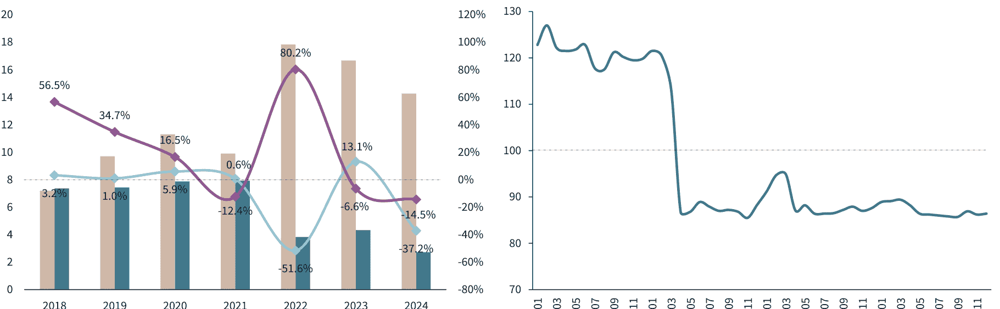

注：消费者指数数据范围为-0到100，100为临界值，100以上为足够；信心预期指标的临界值为50%，50%以上为良好、50%以下为负。
中国零售业与消费市场2022年度环境
数据来源：中国人民银行、国家统计局、申量银行部，2025年2月

## 消费贡献率：消费保持拉动力，但贡献率持续下滑

- 中国最终消费对国内总值增长贡献率（累计）
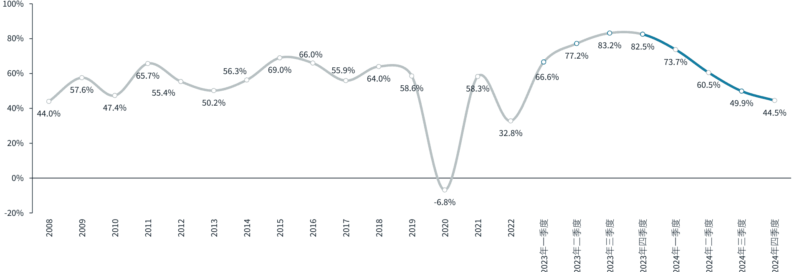

注：2023年四季度和2024年四季度数据为2023和2024年全年。
中国零售地产与消费市场2024年度报告
数据来源：国家统计局，仲量行部，2025年2月
15 | 仲量行2025年版权所有。

## 价格指数：居民消费价格总体稳，保持微涨

- 中国居民消费指数走势（累计同比）
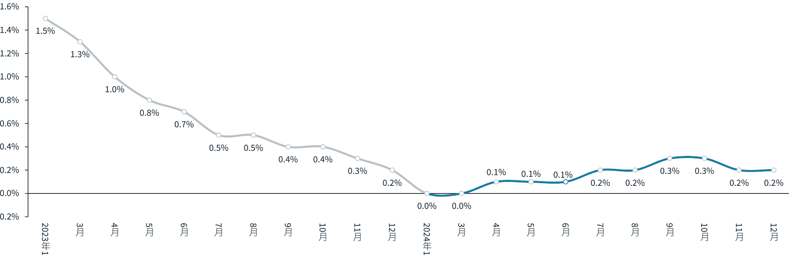

## 居民收支：居民收入和支出稳定增长但增速放缓

- 中国居民人均收入与支出同比增长率
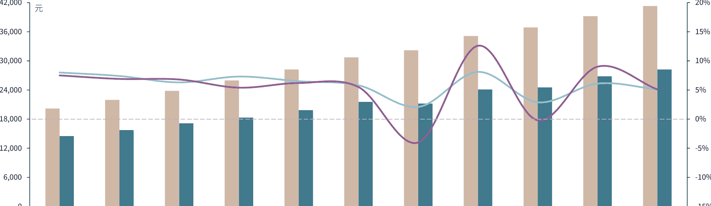

| 人均支配收入（左轴） | 人均消费支出（左轴） | 人均支配收入增速（右轴） | 人均消费支出增速（右轴） |

注：增速均为扣除价格因素的实际增速。
数据来源：国家统计局、仲量银行研究部，2025年2月
中国地产与债券市场2024年度研究报告
17 | ©仲量行2025年版权所有。

## 支出构成：居住支出占比继续下降，交通通信、教育文化娱乐占比上升

- 中国居民消费支出构成
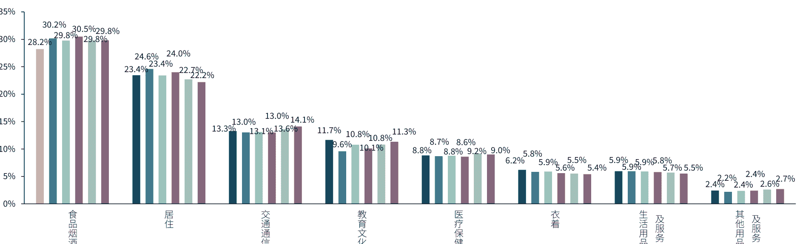

| 2019年 | 2020年 | 2021年 | 2022年 | 2023年 | 2024年 |

## 支出构成：总体支出增速缓，教育、交通增幅先

- 中国居民各类消费支出累计增速变化
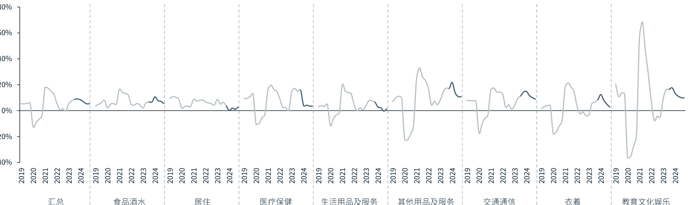

| 总体 | 食品酒水 | 居住 | 医疗保健 | 生活用品及服务 | 其他用品及服务 | 交通通信 | 衣着 | 教育文化娱乐 |

中国零售地产与消费市场2024年度研究报告
19 | 仲量行2025年版权所有。
数据来源：国家统计局，仲量联行研究部，2025年2月

# 零售地产市场

## 数据概览：仲量联行中国优质零售地产市场

## 优质零售地产40城

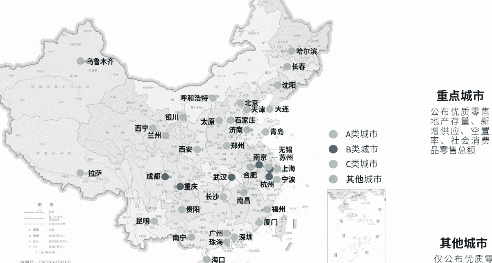

### A城市
北京、上海、广州、深圳

### 重点城市
公布优质零售地产量、新增供应、增长率、社会消费品总额

### B城市
除一线城市外，GDP排名前10的城市（6个）
成都、武汉、重庆、南京、杭州、苏州

### 重点城市中剩余1.5或二线城市（11个）
西安、沈阳、青岛、长沙、宁波、郑州、昆明、珠海、哈尔滨、兰州、厦门、无锡

### C城市
其他城市

### D城市
其他省（19个）
合肥、福州、南昌、太原、南宁、珠海、哈尔滨、兰州、厦门、宁波、拉萨

仅公布优质地产量
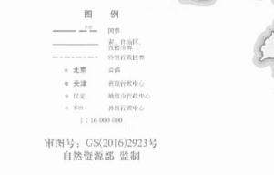

备注：基于此分类。
数据来源：自然
地产与消费市场2022年度报告
21 | 仲量行2025年版所有。

## 重点城市概要：2024年优质零售市场

### A城市
| 总量（平方米） | 新增供应（平方米） | 空置率 | 空置率同比（百分点） |
| :--- | :--- | :--- | :--- |
| 上海 | 16,993,000 | 714,000 | 11.0% | 0.0 |
| 北京 | 16,380,000 | 1,616,000 | 7.1% | 0.9 |
| 深圳 | 7,806,000 | 435,000 | 2.3% | -0.8 |
| 广州 | 5,664,000 | 173,000 | 3.9% | -1.6 |

总量: 46,842,000平方米 新增供应: 2,938,000平方米 空置率: 7.3% 空置率同比变化: -0.0个百分点

### B城市
| 总量（平方米） | 新增供应（平方米） | 空置率 | 空置率同比（百分点） |
| :--- | :--- | :--- | :--- |
| 成都 | 12,292,000 | 820,000 | 10.6% | -1.5 |
| 武汉 | 9,618,000 | 920,000 | 13.1% | 0.1 |
| 重庆 | 9,094,000 | 345,000 | 13.5% | -1.8 |
| 南京 | 6,812,000 | 553,000 | 4.8% | 0.2 |
| 杭州 | 6,586,000 | 305,000 | 9.7% | 0.0 |
| 苏州 | 6,255,000 | 450,000 | 11.5% | -1.0 |

总量: 50,656,000平方米 新增供应: 3,393,000平方米 空置率: 10.8% 空置率同比变化: -0.4个百分点

### C城市
| 总量（平方米） | 新增供应（平方米） | 空置率 | 空置率同比（百分点） |
| :--- | :--- | :--- | :--- |
| 西安 | 7,650,000 | 528,000 | 10.6% | -0.7 |
| 沈阳 | 7,009,000 | 113,000 | 18.0% | -0.4 |
| 青岛 | 5,862,000 | 70,000 | 8.1% | -0.7 |
| 长沙 | 5,574,000 | 579,000 | 10.6% | 0.1 |
| 天津 | 4,750,000 | 317,000 | 12.2% | -0.7 |
| 郑州 | 4,496,000 | 80,000 | 12.4% | -0.6 |
| 宁波 | 4,477,000 | 142,000 | 12.9% | -0.6 |
| 昆明 | 4,311,000 | 0 | 16.8% | 1.9 |
| 大连 | 2,636,000 | 0 | 9.3% | -3.5 |
| 厦门 | 2,918,000 | 365,000 | 6.6% | 0.1 |
| 无锡 | 1,884,000 | 170,000 | 13.3% | -1.0 |

总量: 51,200,000平方米 新增供应: 2,365,000平方米 空置率: 12.2% 空置率同比变化: -0.5个百分点

[content]
## 40城存量：沪京存量超千万，华东及华中商业存量领先

2024年中国40城优质零售地产存量

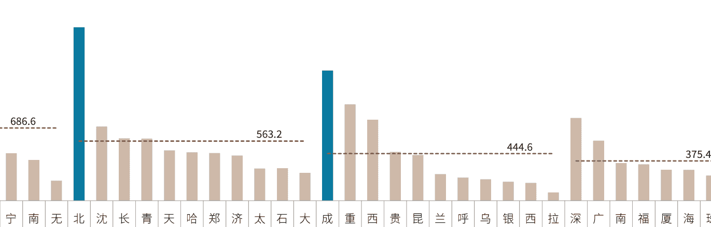

- 华东及华中（10个）
- 华北（11个）
- 华南（8个）

中国零售地产与消费市场2024年度研究报告
23 | ©仲量银行2025年版权所有。

数据来源：仲量银行研究部，2025年2月

## 存量分析：D城市人均零售面积较高，华南、华北低于40城平均值

/ 2024年中国40城人均优质零售面积

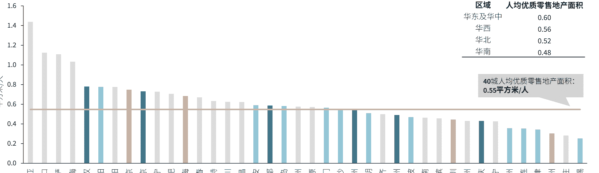

| 区域 | 人均优质零售面积 |
| --- | --- |
| 华东及华中 | 0.60 |
| 华西 | 0.56 |
| 华北 | 0.52 |
| 华南 | 0.48 |

40城人均优质零售面积：0.55平方米/人

注：郑州更新至2024年第二季度，大更新至2024年第三季度，人口数据为七常住人口；重庆人口数据调整为重庆市主都市常住人口。

中国地产与消费市场2024年度研究报告
24 | ©仲量银行2025年版版权所有。

数据来源：各城市统计局，仲量银行研究部，2025年2月

## 供应分析：下半年新项目密集供应，全年新增供应同比微涨1.4%

/ 中国重点城市优质零售供应（年度数据）
/ 中国重点城市优质零售供应（季度数据）

> 尽管2024年上半年供应有所下滑，但下半年供应集中发，全年供应同比比涨1.4%。

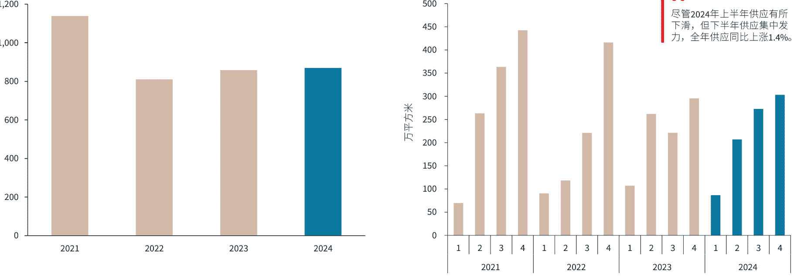

注：后文分析将重点城市数据。

数据来源：仲量银行研究部，2025年2月。

中国零售地产与消费市场2024年度研究报告
25 | 仲量银行行2025版版权所有。

## 供应分析：零售地产开发回归一线及强二线城市

/ 2024年中国重点城市优质零售地产新增供应
/ 2024年中国重点城市优质零售地产新增供应

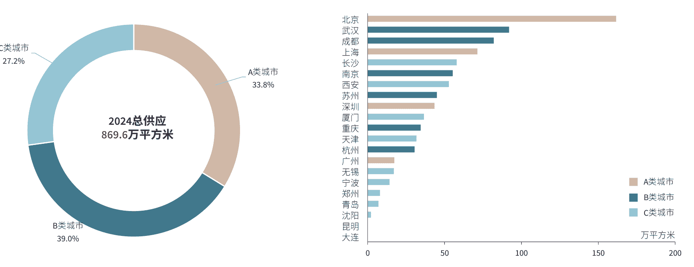

中国零售地产与消费市场2024年度研究报告

## 供应分析：头部运营商引领开发，高奢项目不乏亮点，非商业多元创新

/ 2024年中国重点城市新增供应占比
/ 2024年中国重点城市优质零售地新增项目

> 传统商业代表

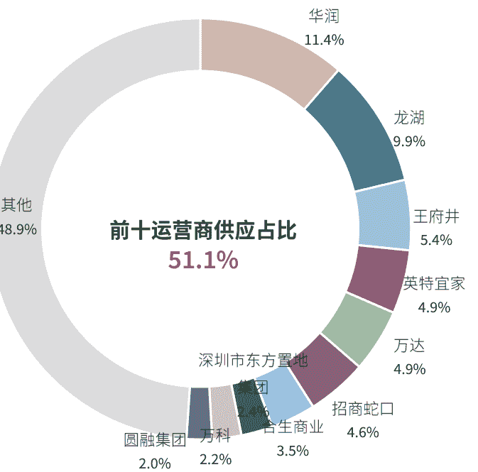

其他：48.9%
- 华润：11.4%
- 龙湖：9.9%
前运营商供应占比：51.1%
- 王府井：5.4%
- 英特宜家：4.9%
- 万达：4.9%
- 深圳市东方万城
- 固丽集团：2.0%
- 招商国际：2.2%
- 华盛商业：3.5%

> 非商业代表
高奢定制项目

上海、北京、成都、广州、武汉、南京、西安
注：右侧非商业代表，并未纳入库。
中国地产与消费市场2022年度报告
数据来源：仲量银行研究部，2025年2月。27 | ©仲量银行行2025年版权所有。

## 供应预测：北京继续跑供应，多元化

2025年中国重点优质零售地产新增预测
2025年部分零售项目

| 城市 | A类城市 | B类城市 | C类城市 |
| --- | --- | --- | --- |
| 北京 | | | |
| 杭州 | | | |
| 上海 | | | |
| 深圳 | | | |
| 天津 | | | |
| 南京 | | | |
| 重庆 | | | |
| 武汉 | | | |
| 西安 | | | |
| 青岛 | | | |
| 成都 | | | |
| 苏州 | | | |
| 宁波 | | | |
| 广州 | | | |
| 厦门 | | | |
| 昆明 | | | |
| 长沙 | | | |
| 郑州 | | | |
| 无锡 | | | |
| 大连 | | | |

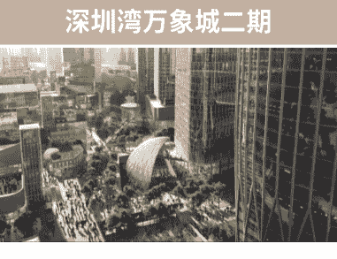
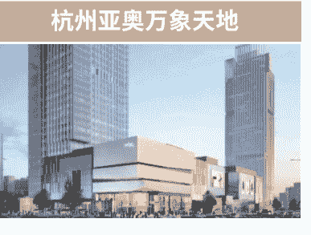

注：苏州、厦门更新至2024年第二季度，大连更新至2024年第三季度，2025年预计大连无新增。
数据来源：仲量银行研究部，2025年2月
28 | ©仲量银行发行所有。

## 供应预测：未来三年北上供应持续高企，南京、苏州新增有所回调

/ 中国重点城市优质零售地产新增预测

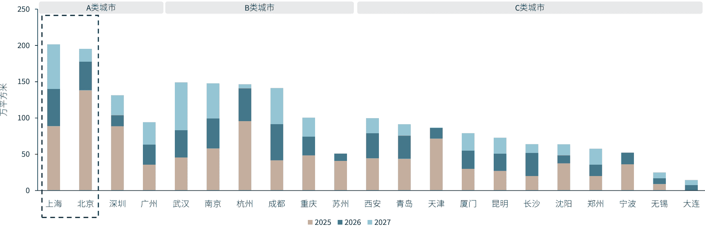

中国零售地产与消费市场2024年度报告
29 | ©仲量银行2025年版版权所有。

数据来源：仲量行业研究部，2025年2月

## 空置率分析：2024年空铺逐步回填，超半数城市空置率下降

/ 2024年中国重点城市优质零售空置率及同比变化

| | -10.0% | -8.0% | -6.0% | -4.0% | -2.0% | 0.0% | 2.0% | 4.0% |
|---|---|---|---|---|---|---|---|---|
| 上海 | | | | | | | 7.1% | | |
| 北京 | 3.9% | | | | | | | | |
| 广州 | 2.3% | | | | | | | | |
| 深圳 | | | | 13.5% | | | | | |
| 重庆 | | | | 13.1% | | | | | |
| 武汉 | | | | 11.5% | | | | | |
| 苏州 | | | | 10.6% | | | | | |
| 成都 | | | | | 9.7% | | | | |
| 杭州 | | | | | | | | | | | |
| 南京 | 4.8% | | | | | | | | |
| 沈阳 | | | 18.0% | | | | | | | |
| 昆明 | | | 16.8% | | | | | | |
| 无锡 | | | 13.3% | | | | | | |
| 宁波 | | | 12.9% | | | | | | |
| 郑州 | | | 10.6% | | | | | | |
| 天津 | | | 12.2% | | | | | | |
| 长沙 | | | 10.6% | | | | | | |
| 西安 | | | 9.3% | | | | | | |
| 大连 | | | 8.1% | | | | | | |
| 青岛 | | | 6.6% | | | | | | |

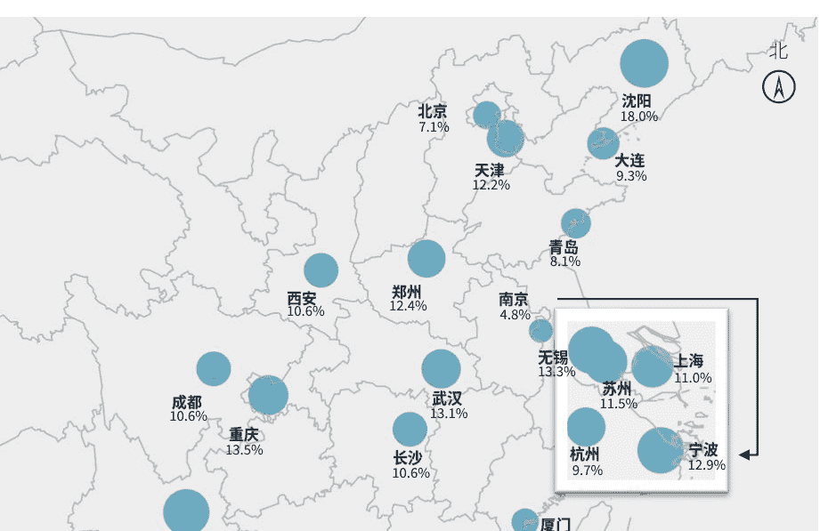

注：郑州、厦门更新至2024年第二季度，大连更新至2024年第三季度。
- 空置率（下降）
- 空置率大幅跌（向下）
- 空置率涨（向上）

数据来源：仲量银行研究部，2025年2月
中国地产与消费市场2024年度报告
30 | ©仲量银行所有。

## 空置率分析：整体回落，但短期内供应再度上涨

/ 各城市空置率走势

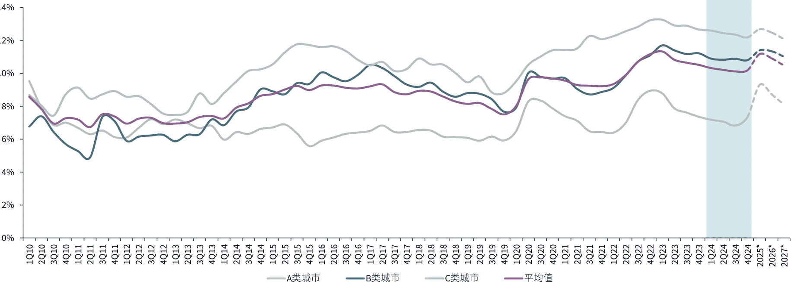

注：为预测值。
中国房地产与消费市场2024年度报告
31 | ©仲量银行2025年版所有。

## 供需分析：2024年新增供应基本持平，空置率修复

/ 中国重点城市优质零售地产供应及空置率

> 2025年预计新增同比上升，空置率仍有压力

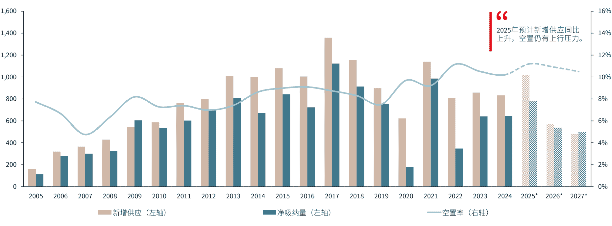

注：为预测。
中国零售地产与消费市场2024年度报告
32 | ©仲量银行2025年版权所有。

数据来源：仲量银行研究部，2025年2月

## 租金分析：全年持续承压，季度跌幅扩大

/ 中国重点城市优质零售地产平均首层租金同比

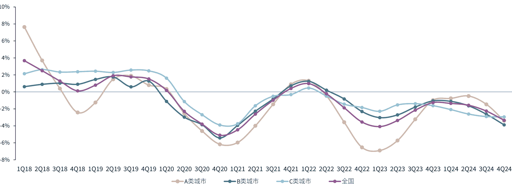

注：租金变化为样本变化。
中国零售地产与消费市场2024年度报告
33 | ©仲量银行2025年版版权所有。

# 消费趋势

## 租赁总览：餐饮需求回落，娱乐业态增幅明显

/ 上海与成都购物中心新租赁面积占比

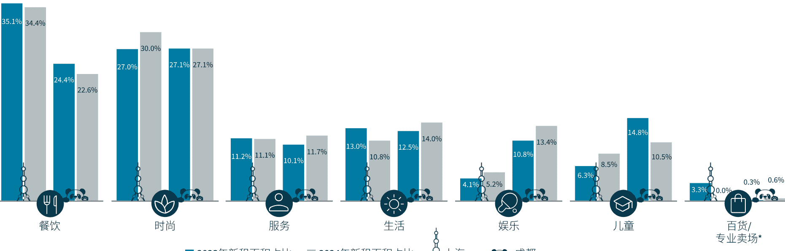

- 2023年新租赁面积占比
- 2024年新租赁面积占比
- 上海、成都
注：指百货或专业卖场的主形式出现在购物中心。上海、成都租赁均基于头部零售项目，所有租户分析均用此范围。
中国零售地产与消费市场2022年度报告
35 | 仲量银行2025年版权所有。

数据来源：仲量银行研究部，2025年2月

## 租赁总览 业态：正餐退潮明显，娱乐游戏需求上行

/ 上海与成都购物中心新租业态占比

| | 2023年新租赁面积占比 | 2024年新租赁面积占比 | 成都 | 上海 |
| :--- | :--- | :--- | :--- | :--- |
| | 22.3%餐饮快包 | 24.6%餐饮快包 | | 23.8%餐饮快包 |
| | 1.9%奢侈手表 | 0.7%奢侈手表 | | 1.4%奢侈手表 |
| | 1.6%美妆护肤 | 2.5%美妆护肤 | | 0.9%美妆护肤 |
| | 1.2%配饰 | 1.0%配饰 | | 1.0%配饰 |
| | 27.0% | | 27.1% | | 2.7%家居家具 |
| | 30.0% | | 12.5% | | 2.9%电子休闲 |
| | 13.0% | | 14.0% | | 2.2%潮玩用品 |
| | 10.8% | | 1.2%用品 | | 2.6%书刊礼品 |
| | 3.4%家居家具 | | 2.7%家居家具 | | 2.5%食品饮茶 |
| | 2.6%电子休闲 | | 2.8%电子休闲 | | 0.0%食品饮茶 |
| | 2.0%潮玩 | | 2.6%书刊礼品 | | 0.2%其他 |
| | 2.6%汽车 | | 0.4%食品饮茶 | | 25.0%正餐 |
| | 0.5%食品饮茶 | | 0.2%其他 | | 2.8%快时尚 |
| | 1.7%超市 | | 0.1%其他 | | 4.1%咖啡 |
| | 0.2%其他 | | 3.24%正餐 | | 2.2%便利店 |
| | 35.1%正餐 | 34.4%正餐 | | 24.4%正餐 |
| | 24.4%正餐 | 16.3% | | 15.8%快时尚 |
| | 4.1%咖啡 | 3.9%快时尚 | | 1.8%咖啡 |
| | 2.2%便利店 | 3.0%咖啡 | | 0.8%便利店 |
| | 0.8%便利点 | 0.4%时尚 | | 0.2%其他 |
| | | 3.4%正餐 | 2.4%正餐 | 2.3% | |
| | | 0.1%% |  ..% | | | ..%% | |
| | | 6.4%游戏 | 8.1%百玩 | 1.5%潮玩 |
| | | 0.1%%玩科技 | 3.4%家居家具 | 0.9%食品饮茶 |
| | |  ..%%运动 | 2.9%健身运动 | 0.0%用品 |
| | |  ..%% | | ..9%服务 | 6.0%健身运动 |
| | | | ..7%家具 | | 2.7%服务 |
| | | | 1.3%生活服务 | 0.8%生活服务 |
| | | | 4.1%咖啡饮茶 | 2.8%娱乐 |
| | | | 0.6%服务 | 3.7%娱乐及快 |
| | | | 10.8% | |
| | | | 13.4% | |
| | | | 10.1% | |
| | | | 11.7% | |
| | | | 14.8% | |
| | | | 10.5% | 专业运动 |

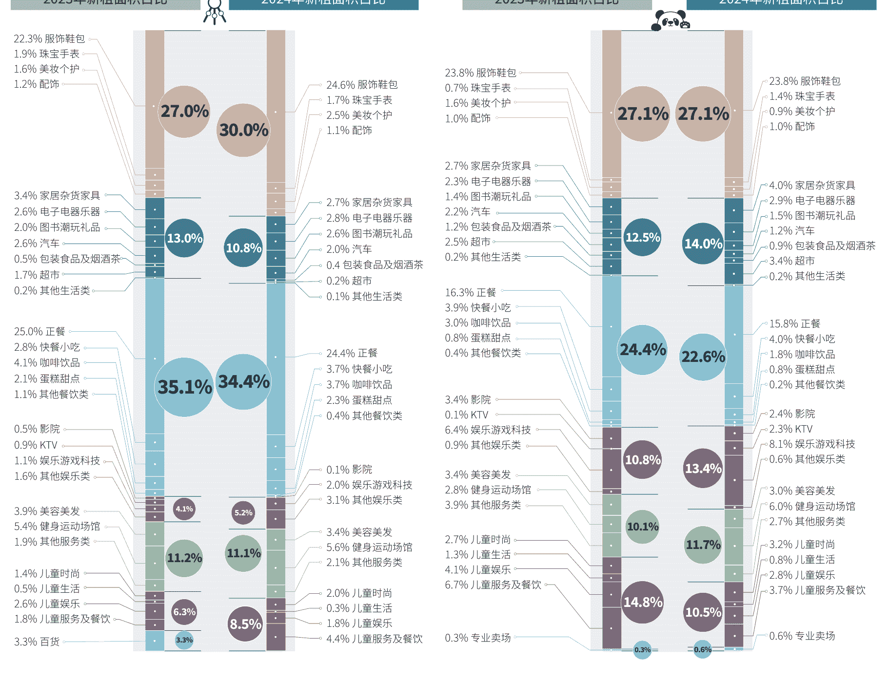

时尚 餐饮 娱乐 服务(含童装) 百货/专业业态
中国零售数据与消费趋势2024年度行业报告
36 | ©仲量发行所有

## 行业趋势：市场呈轻零售、餐饮、重体验的消费新趋势

/ 2024年中国优质零售产业变化和消费趋势

情绪价值：Z时代的消费更注重消费过程的情绪价值：一次经济、经历经济、演艺经济、悦经济已经是对这一趋势的最好解释。情绪需求带动相关态的租需上涨。例如2024年游拉动的二级市场的新租占比，上海和成都分别下降0.6和0.1个百分点；包含游戏的二级市场新租占比分别下降0.9和1.7个百分点。

理性性：居民收入下降期的背景下，消费者优先考虑消费合理性，重视消费性价比，寻求实用收益最大化，在有限的预算约束中做出购买决策。同类产品中，更具价格优势的成为消费者广泛，客单价对零售需求的下降是非常理想的。上海和成都的正餐新租占比比较2023年分别下降0.7和0.5个百分点，相反快餐业的比例有所上升。

品质生活：2019年后，健康意识大拓展，更多人将健身作为生活的核心。运动需求增加带健身运动场所租需上升，上海和成都的健身房新租占比提升0.2和3.2个百分点。同时，滑雪、徒步、登山等户外运动也成为新生活方式，首次户外运动服装的新租占比上升，上海和成都分别增长23.1和0.9个百分点。

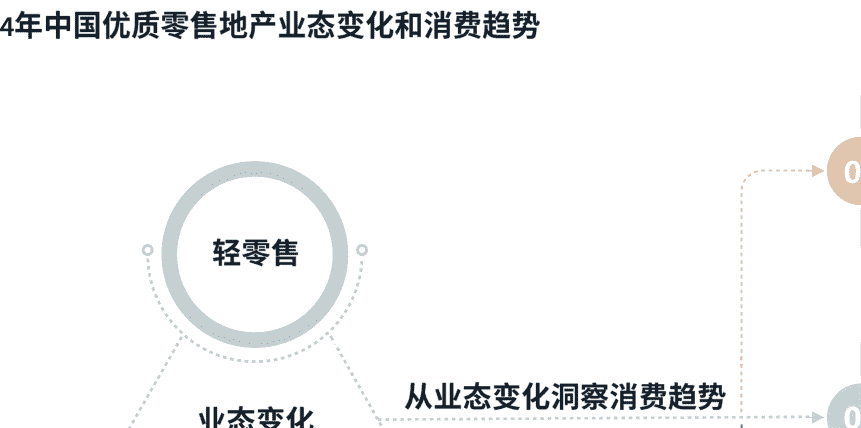

轻零售 业变化 洞察消费趋势 餐饮 重体验
数据来源：仲银行报告，2025年2月

## 情绪价值：情绪需求迅速上升，带动相关业态成为消费市场驱动力

> 潮流生活水平上升，消费观念逐步由注重实用向追求消费体验和精神价值转变。Z世代更是助推了这一进程，他们往往更注重消费过程的情绪价值：二元经济、演艺经济、盲盒经济、悦意经济都是对这一趋势的诠释。2024年情绪引起，带动相关消费持续升温。

演艺经济：年轻一代为演唱会、跨界演出付费，市场快速增长。

潮玩崛起：Z世代消费力崛起，潮玩凭借独特情感共鸣迅速占领市场。

悦享经济：随着Z世代消费力崛起，潮玩凭借及时快乐，成为重要动力。

2024年国内零售同比增长15.3%，人均付费有所提升。

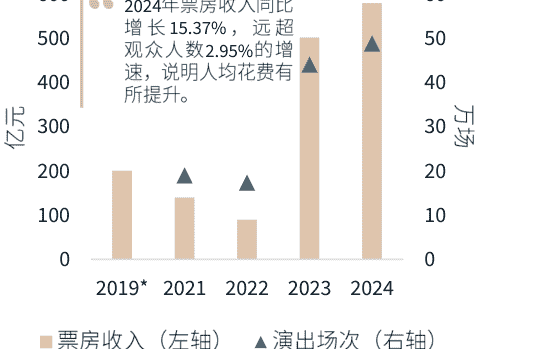
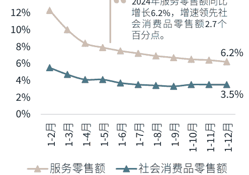

注：2019年未公布场次。数据来源：行业协会、艾根咨询、统计局、仲量银行部，2025年2月。
地产与消费市场2024年度报告
38 | ©仲量银行2025年版所有。

## 理性审慎：延续，高端消费萎软，性价比核心要素

正餐退潮：消费者开始减少外出，选择更经济实惠的外卖，这种趋势导致消费萎缩。2024年，上海中餐占比上升0.6个百分点，成都下降了0.5个百分点。

| | 快餐小吃 | 正餐 |
| --- | --- | --- |
| 上海 | 2.8% | 3.7% |
| 成都 | 3.9% | 4.0% |
| 上海 | 16.3% | 24.4% |
| 成都 | 15.8% | 25.0% |

## 奢侈品集团总体表现的消费分型转变

平价服饰欢迎：
- 国内高端：从线下开店的主理品牌
- 优选商店：经营头部品牌的折扣集合店
- 白牌链：品牌授权加工厂的其他品牌

消费者对价格更加严敏，奢侈品压力增大，低价、高时性的平价服饰更受睐，因为“理性消费”的新潮，反而市场欢迎。

国际美流失，国内妆妆崛起

| 排名 | 品牌 | 占比 | 同比 | 排名 | 品牌 | 占比 | 同比 |
|---|---|---|---|---|---|---|---|
| 1 | 雅诗 | 50.1% | 3.9% | 6 | 百子 | 25.4% | 58.2% |
| 2 | 欧莱雅 | 35.0% | 12.0% | 7 | 水之华 | 22.9% | -0.1% |
| 3 | 上上美家 | 33.21% | -8.5% | 8 | 兰仙咖啡 | 15.68% | -3.5% |
| 4 | 珀莱生物 | 28.11% | -9.6% | 9 | 九朵雅 | 13.52% | 27.7% |
| 5 | 珀薇 | 28.05% | 18.9% | 10 | 珀珂 | 11.8% | 7.2% |

国际化妆品及护肤品进口占比及趋势
2024年上半年国内本土化妆品上市合计营收263.79亿元，同比增长20%。国际化妆品在中国市场增速放缓，2024年全球总量下降43.2亿美元，同比下降7.9%并处于最低。在此背景下，更具竞争力的中国化妆品开始受睐，国际化妆品牌份额将不断压缩。

## 品生活:运动消费热度不减，细分领域积极扩张，健身馆持续选优

- 上海和成都运动户外服饰鞋包新占比
- 上海和成都健身运动场新占比

| 上海 | 运动户外服饰鞋包 | 3.0% | 同比 3.1个百分点 | 6.1% | 2023 | 2024 |
| :--- | :--- | :--- | :--- | :--- | :--- | :--- |
| 上海 | 健身运动场 | 5.4% | 同比 0.2个百分点 | 5.6% | 2023 | 2024 |
| 成都 | 运动户外服饰鞋包 | 3.6% | 同比 0.9个百分点 | 4.5% | | |
| 成都 | 健身运动场 | 2.8% | 同比 3.2个百分点 | 5.6% | | |

- 运动装备细分，更多大众运动品牌进中国
- 中国典型健身房品牌活跃情况

| 户外 | MONTANE | | Cervélo BELIEVE IN BIKES | | Vuori |
| :--- | :--- | :--- | :--- | :--- | :--- |
| | 北京|中国首店 | 深圳|中国首店 | 上海|中国首店 |
| 篮球 | Curry Brand | 跑步 | Brooks | 高尔夫 | WAAC |
| | 成都|全球首店 | 上海|中国首店 | 上海|中国首店 |

| 融资时间 | 公司名称 | 融资金额 | 健身房类型 |
| :--- | :--- | :--- | :--- | :--- |
| 2024.4 | 亚能运动 | A轮 | 千万元 | 月付制 |
| 2024.4 | 古德里健身 | C轮 | 近2亿元 | 传统健身俱乐部 |
| 2024 | 浩健健身 | A轮 | 1200万美元 | 私月付制 |
| 2021.8 | 乐运动 | D轮 | 未披露 | 月付制 |
| 2021.5 | 超级裸猩 | E轮 | 数亿美元 | 灵活按次计费 |

> 受欢迎健身房热销，消费者对付费健身的需求增加，例如月付、季、年卡模式，推动了健身房活化。传统健身俱乐部品牌变得更灵活，多个国潮健身品牌入市场。

中国奢侈品与消费市场2024年度行业报告
数据来源：艾信格、欧瑞、数据整理，中信银行报告，2025年2月

# 市场应对

## 政策端 | 消费激励：消费品以旧换新等政策助力2024年消费市场

- 政策内容：2024年3月，国务院印发《推动规模设备更新和消费品以旧换新行动方案》，向地方直接安排1500亿元超长期特别国债支持消费品以旧换新。
- 政策效果：带动汽车、家电、家装、电动自行车等销售额超过1.3万元，全社会消费品零售总额同比增长3.5%，拉动消费增长效果显著。

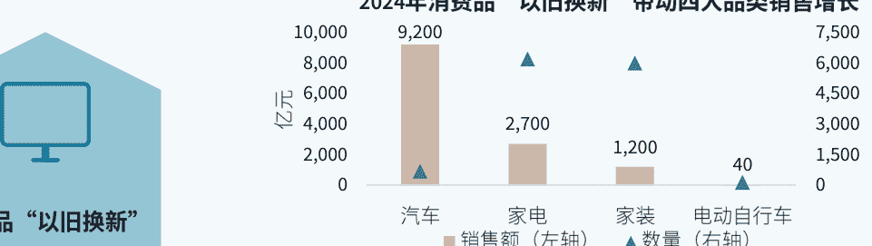

| 2024年消费品“以旧换新”带动四大类品销售增长 | | | | |
| :--- | :--- | :--- | :--- | :--- |
| | 10,000 | 9,200 | | 7,500 |
| | 8,000 | | | 6,000 |
| | 6,000 | | 2,700 | 4,500 |
| | 4,000 | | | 1,200 | 3,000 |
| | 2,000 | | | 40 | 1,500 |
| 汽车 | 家电 | 家装 | 电动自行车 | 0 |
| 销售（左侧） | | | 数量（右侧） |

- 举办活动：商务全年举办4大主题活动，开展12场重点活动，包括国内消费促进、国际消费季等系列活动，成功举办了中国国际进口博览会、中国国际消费品博览会。
- 发放消费券：各地大力发放消费券的力度，涵盖餐饮、旅游、文化、体育等行业和领域。

- 数字消费：构建智慧商圈、智慧街区、智慧门店等消费场景，发展“互联网+医疗服务”等新模式。
- 绿色消费：更好满足新能源、绿色家居等消费需求，拓展常态化。
- 培育品牌：支持消费孵化，推动老字号创新发展，激发消费活力。

数据来源：商务部、国家发改委、公开信息、仲量研究院

## 物业端 | 策略：刺激租赁与消费需求，采取“先填后调”

- 为保证入驻，采取多种方式：
1. 降低初始租金，针对不同业务态调租金，鼓励长期租赁，提供租金折扣；
2. 提升品牌比例，吸引新品牌或保留已有品牌；
3. 调整位置，将承受压力的商家移至面积较小的铺位以减轻压力，稳定项目结构。

- 迎消费升级，增加营销活动：
1. 商场分类类别的营销活动，在店铺、节日期间，采取多倍积分、积分分减、积分抵扣等方式，给予消费者折扣；
2. 商场联合商家推出无消费券、乐园票、餐饮套餐，增强消费粘性。

- 为覆盖更多品牌，降低品牌档次：
1. 对传统业态（如鞋包、配饰等）降低品牌档次，引入非遗类品牌；
2. 对非传统业（如台球馆、休闲娱乐等）也积极引入品牌；
3. 增大娱乐业比例，增加目的客访比、保持项目空置率。

- 积极积累多元化方面，提升增量效益：
1. 出租部分中庭、公共区域、仓储等，以提升租赁面积，同时加强品牌招商，提升收益；
2. 重视“两广”（广告和广场）收入，并打造集市、快闪、引入展览等活动，在提升流量的同时增加元素收入。

中国地产与消费市场2024年度报告

## 投资端 | 融资分析：消费融资持续降温，融资金额及数量均下降趋势

- 消费领域融资金额及数量（不完全统计）
- 2024年融资数量下降27.2%
- 2024年融资金额下降9.4%

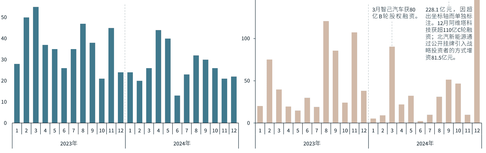
3月明智汽车获228.1亿元，因出让单独立股权；12月京东汽车获得10亿元融资；北新能源通过公开挂牌引入新投资者增81.5亿元。
注：“融资数据不含轮次融资。”
数据来源：公开信息整理，仲量行研究部，2025年2月

## 投资端 | 融资分析：2024年消费融资持续收缩，食品饮料降温明显

- 消费领域融资数量（不完全统计）

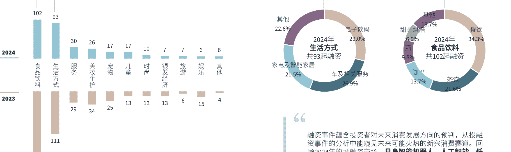

> 融资事件蕴含投资者对未来消费方向的判别，从投融资事件的分析中能看到未来可能出现的热兴消费赛道。回2024年的投融资市场，具有智能机器人、人工智能、低空经济领域活跃，为未来消费供给新的动力。

注：融资数据不包含IPO后级融资事件。
中国地产与消费市场2024年度研究报告

# 未来展望

## 供应端：未来传统商业供应下降，存量商业将进入密集调优

- 未来供应下降
传统商业进入存量时代，未来新增供应下降，同时“非标”商业持续成为为中国零售地产供给一个关键。

- 加速调优
存量时代商业竞争激烈，迫使运营商不断焕新消费场景和品牌矩阵，符合消费需求。

- 开发头部
头部开发能更好整合资源并推动项目落地，同时其强大的招商运营能够获取更多商业项目。

- 重塑态结构
零售面积占比进一步下降，体验占比上升，以适应市场变化。

- 回归高城市
在优质零售市场完成转型后，一线和二线城市的经济活力和消费需求引发供应开发重点转向。

- 品牌迭代
不仅存在商场，也存在于品牌身上，未来更多品牌将加入优质行列，追求更长曲线。

- 新增供应
上海与成都购物态结构对比：

| 城市 | 2023年面积占比 | 2024年面积占比 |
| :--- | :--- | :--- |
| A类城市 | | |
| B类城市 | | |
| C类城市 | | |

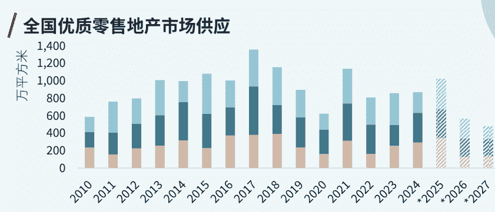
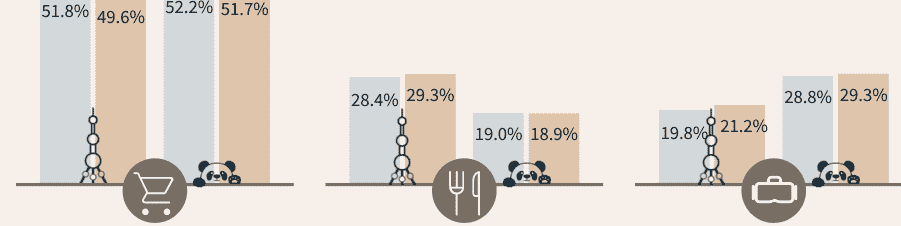

## 需求端: 零售市场六大热词

- 非遗再造：让中国文化火起来，让商品走出去。
- 数智经济：Deepseek引爆，数智经济与消费同频共振。
- 县域消费：从“反向旅游”到“下沉”，挖掘县域潜力。
- IP联：从《哪吒之魔》爆红到海外粉丝东南亚席卷全球。
- China Travel：凭借签证便利、免税政策等利好，吸引全球游客。
- 冰雪热潮：随着冬奥等重要赛事举办，掀起冰雪热潮。

## 需求端: 非遗、人工智能、县域持续活跃

- 非遗再造
2024年1月春节再度成功成为首个“非遗再造”春节，带动真实消费时代，深度影响品牌选择谱谱，小众的假日旅游迅速崛起。

## 政策导向
国务院办公会议强调，要积极促进“人工智能+消费”，以新产品、新场景和新活力。

## 消费意愿
根据调研显示，约60.7%的受访者表示有用，其中19.7%的消费者愿意支付20%以上费用。
- 非遗：212%
- 体验：387%
- 手工：623%
- 春节会：228%

- 餐饮：大众餐饮火锅和茶在2024年开始开放县城陆续下沉。
- 零售：生活用品等零售易购、云零售、京东等地加速下沉。

## 2025年春节关键词搜索量

| Top 01 | Top 02 | Top 03 | Top 04 | Top 05 | Top 06 | Top 07 | Top 08 | Top 09 | Top 10 |
| :--- | :--- | :--- | :--- | :--- | :--- | :--- | :--- | :--- | :--- |
| 密云 | 阿那亚 | 中证 | 张家界 | 阿宁 | | | | | |
| 黄山 | 西萨 | 庆 | | | | | | | |

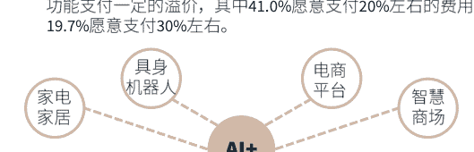

## 需求端：IP联、入境、冰雪消费将成为未来关键词

- IP联
- China Travel
- 冰雪热潮

从《哪哩2》、《黑神话：悟空》的爆红到海外粉丝东南亚，中国IP消费热潮席全球。China Travel凭签证送便利、免税政策等利，结合短视频、直播等线上传播，吸引全球玩家。随着冰雪运动和冰雪旅游的兴起，吸引大批去北方城市体验冰雪运动，有效带动运动装备、旅游消费等消费。

## 全球动画电影榜

| 排名 | 影片名称 | 上映年份 | 票房(亿元) |
| :--- | :--- | :--- | :--- |
| 1 | 哪吒之魔童闹海 | 2025 | 124.9* |
| 2 | 头脑战士2 | 2024 | 123.19 |
| 3 | 冰雪奇缘 | 2019 | 105.4 |

## 中国出游优化入境免税政策

- 延长时长：从72小时延长44小时。
- 增加口：从40个增加60个。
- 扩大范围：从19个增加25个。
- 增加区域：在允许区域内跨境旅行。

| 哈尔滨 | 哈尔滨 | 目标 |
| :--- | :--- | :--- |
| 游客人数 | 人数 | 冰雪经济规模 |
| 与去年相比 | 增长3倍 | 1.5万亿元 |
| 2025年春节假期 | | |

## 政策支持
2024年1月，国务院办公厅发布《关于高质量发展冰雪经济活力的若干意见》。
- 类IP品牌：POP MART、泡玛特、卡游等。
- 赛事：北京第2届冬奥会。

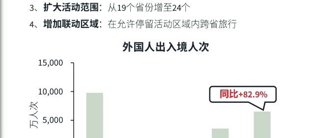

数据来源：国务院办公厅、国家移民管理局、职业协会、数据整理，中信银行，2025年2月

## 政府端: 消费专项行动，助力消费潜力

- 以旧换新
2025年将继续实施消费品旧换新补贴，并加大力度，预算下调800亿元，同比增长2.8%。

- 宽松货币政策
2024年国家多次调整利率，保持流动性充足。2025年将实施多次降低贷款利率，减少居民支配支出。

- 扩大服务
政府将加强服务建设，“N+消费”体系，拓展线下消费、医疗等领域，有望丰富供给。

- 提升居民收入
一方面增加居民收入，方便更多劳动者获得岗位；另一方面提高城乡收入基础标准，减少居民负担。

- 创新消费
政府将通过多种形式，打造新消费场景，组织线下消费活动，激发市场消费活力。

- 改善消费环境
政府将加强国际中心建设；推进步行街、商圈改造与升级；完善城乡统一建设。

数据来源：商务部、公开信息、中信银行行业，2025年2月

## 回顾与展望：中国优质零售市场总结

经济的不确定性引发消费者对内需的谨慎态度，进而导致短期消费收缩、波动，时尚、餐饮等消费需求下降。得益于市场回暖和娱乐等体验消费需求上升，而经营方在招租压力下，愿意转型入刚需行业，填补原本的空白。因此，获得KTV、球馆、VR、电竞等在购物中心里积极拓展。

2024年，中国21个城市优质零售市场供应基本持平，增量规模相当，租赁总量升至近1.5亿平方米。全国（含直辖市、省会城市、县级市）总量约2亿平方米。2025年中国预计还将迎来千万平方米的新增供应，有望超出2024全年水平。延续2024年的供给走势，中国零售地产开发重回一线城市，重回核心地位。

2024年优质零售项目的各种租金入住数跌，整体表现不及预期。根据仲量行业，中国21城优质购物的首层租金下降了3.3%，跌幅与去年同期相同。2025年，在新增供应供给的压力下，市场面临空置率恶化、租金承受的困难，部分运营已下调租金，市场仍在探索新的价格平衡。

仲量行行业报告，2025年2月

## 作者

姚耀 Daniel Yao
中国区研究部总监
Daniel.Yao@jll.com

朱铁 Jacky Zhu
中国区零售地产及消费研究负责人
Jacky.Zhu@jll.com

吴洁敏 Jiemin Wu
中国房地产咨询负责人
Jiemin.Wu@jll.com

## 关于仲量行研究

仲量行的研究团队通过市场领先的报告和服务提供最新资讯、分析和洞见，以应对商业房地产动态及未知的挑战和机遇。我们遍布全球的550多位行业研究人员通过长期追踪和分析经济和市场趋势，预测60多个国家/地区的未来趋势，从而提供无可比拟的本地和全球视角。在覆盖全球的实时信息和创新思维的推动下，我们的研究和专业知识为我们的客户创造竞争优势，推动达成有效的投资策略和最优的投资决策。

萨曦 Sissi Lu
研究部董事
Sissi.Lu@jll.com

寇情 Rebecca Long
研究部经理
Rebecca.Long@jll.com

甘甜甜 Tina Gan
研究部助理经理
Tina.Gan@jll.com

吴晓川 Jonathan Wu
研究部资深分析师
Jonathan.Wu@jll.com

> © 仲量行2025年版权。保留所有权利。

# 仲量银行中华区分公司

### 北京
北京市东直街23号
朝阳区中贸大厦南楼
邮编100004
电话+86 10 5922 1300

### 杭州
浙江杭州市
上城区新区路228号
杭州江城北61号
T2办公楼802室
邮编310000
电话+86 571 8956 5888

### 沈阳
辽宁沈阳市
沈河区北城61号
沈阳国际中心221层
邮编110013
电话+86 22 3415 8555

### 西安
陕西西安市
雁林区二环路西64号
长安路262-02-03
邮编710065
电话+86 29 8932 9800

关于仲量银行
200多年来，作为全球领先的商业服务和投资管理公司，仲量行（国际资本时代：JLL）继续帮助客户投资、建造、租赁和管理各类业务。办公、住宅、酒店和零售等业务。作为（财集）50强企业，2024财年收入234亿元，业务涉及全球80多个国家和地区，员工总数超过12万人。我们致力于“重塑房地的未来，让世界更美好”的企业，整合全球资源并深耕本地市场，维护客户更多信息请访问 joneslasalle.com.cn。JLL是仲量银行的品牌名称及注册商标。

### 成都
成都成都市
锦江区成都金融中心1座29层
邮编610021
电话+86 28 6668 5000

### 南京
江苏南京市
秦淮区中山中路18号
金陵大厦办公楼2201室
邮编210018
电话+86 25 8296 0660

### 深圳
广东省深圳市
福田区福中路13号
建业国际大厦3层19层
邮编518004
电话+86 755 2834 5388

### 香港
香港中环交易广场779号
中环广场一楼
电话+852 2845 5000
www.jll.com.hk

### 重庆
重庆重庆市
渝中区解放路江门屯444号
邮编400001
电话+86 23 6237 8588

### 青岛
山东青岛市
市南区市东路1号
邮编266006
电话+86 532 2191 9667

### 澳门
澳门旅游湾路5A
澳门葡溜中心168楼
电话+853 2871 8820
www.jll.com.mo

### 武汉
湖北武汉市
武昌区武汉汉路大道688号
邮编430019
电话+86 27 5959 2100

### 台北
台湾台北市
信义区信义路7号
台北中国大厦20楼15层
邮编11049
电话+886 2758 9888

### 广州
广东省广州市
天河区珠江新江路6号
广州汇恒金融中心
2801层
邮编510063
电话+86 20 2338 8818

### 上海
上海上海市
静安区南京汇路288号
上海广大国际港汇中心一层22层
邮编200021
电话+86 21 6393 3333

joneslasalle.com.cn
仲量行
©仲量行2020-2025版权所有。保留所有权利。此处信息来源于我们作为咨询的客户。我们对其准确性不任何保证或声明。

### 联系我们
400-000-8250

# START YOUR FINANCE

起点财经，网罗天下报告
