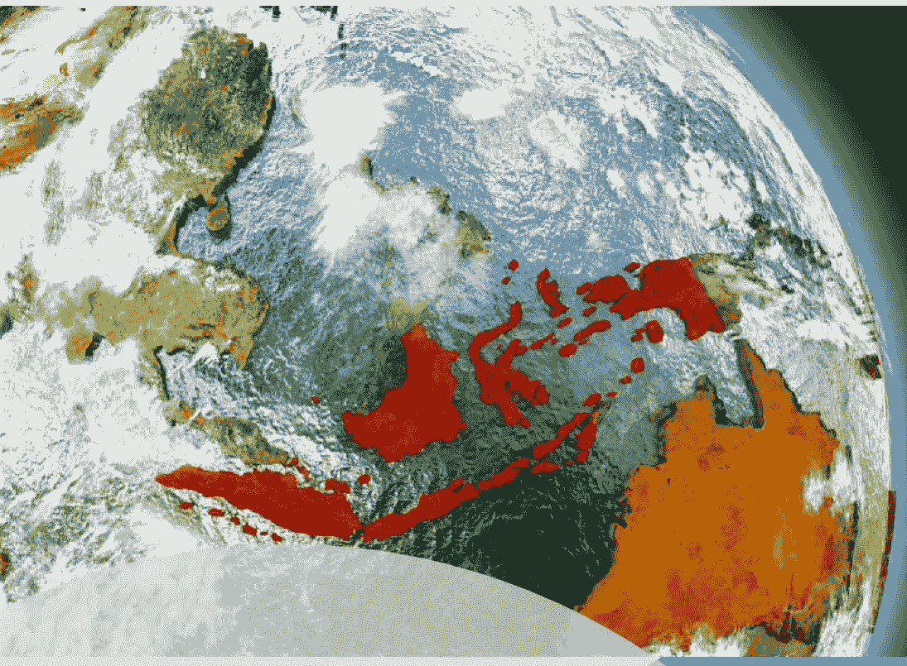
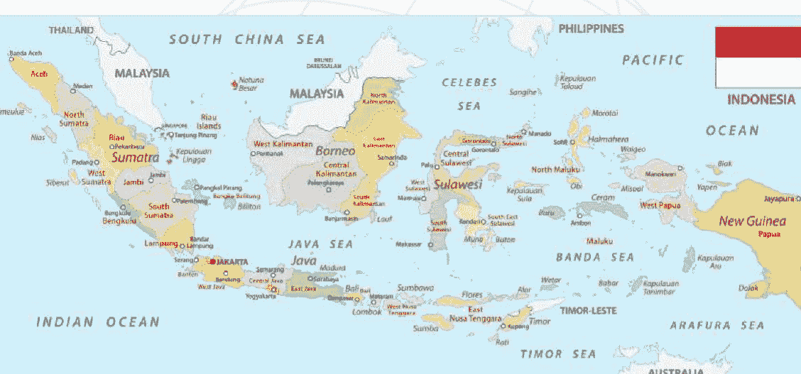
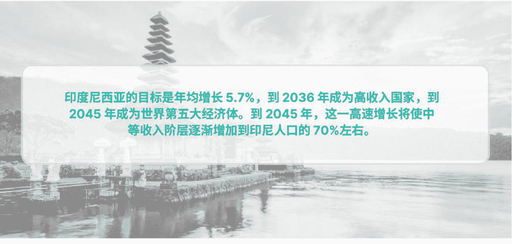
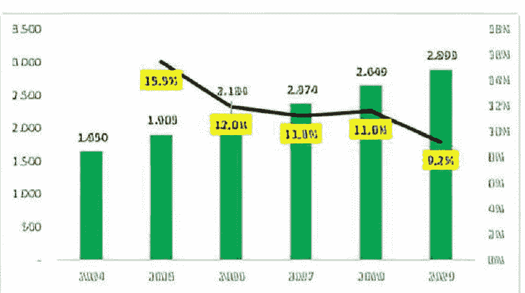
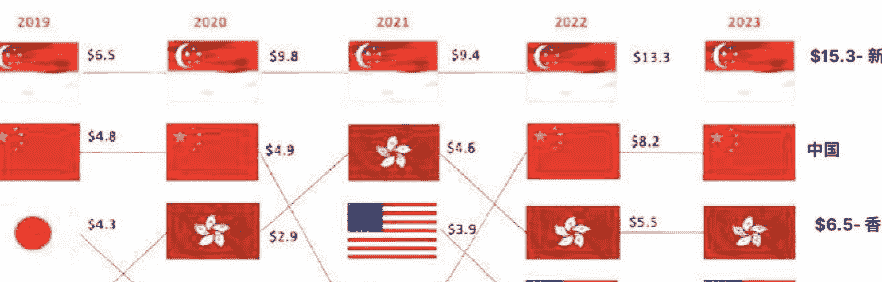
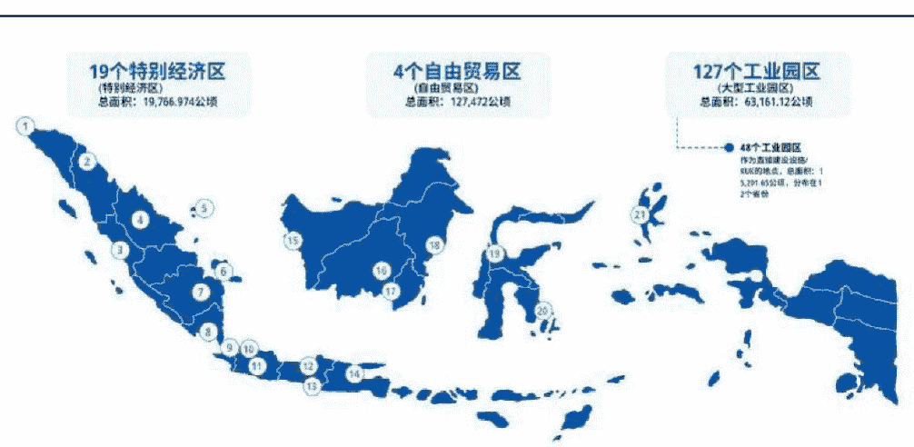
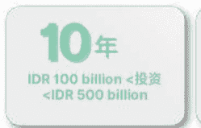
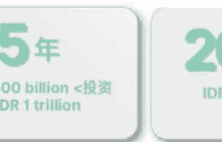
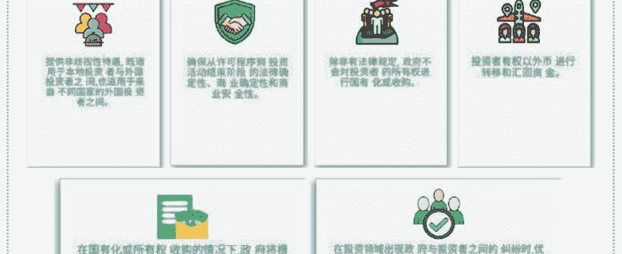

# 2024 年印度尼西亚投资指南

# 免费 价值 及时 专注

# 扫码加入 知识星球TOP 免费资源群

- 每日免费获取价值资源
- 可提供各类资源搜索服务

| 热门付费文章 | 各行行业报告 |
| :--- | :--- |
| 精选图书资源 | 副业兼职方法 |
| 职场实用资源 | AI经营自媒体 |

公众号:知识星球TOP 微信公众号:jntsg8 微信公众号:jntsg2

分享资料仅供个人学习，请及时删除，切勿商用传播

## 免责声明
本文件“2024 年在印尼经商”中提供的信息仅作为潜在外国投资者的一般指南，不能替代任何专业建议。Reanda Bernardi及其任何关联公司均不对根据本文件资料而采取的行动所引起的任何损失承担任何责任。

未经Reanda Bernardi 事先书面许可，不得以任何形式转载本文件的任何部分。

# 目录

前言

- 1. 印尼概要 01
- 1.1 总体介绍 01
- 1.2 经济情况 04
- 1.3 政治情况 08
- 2. 投资机会 09
- 2.1 投资需求 09
- 2.2 潜力行业 12
- 2.3 新首都 15
- 2.4 经济特区作为战略投资地点 18
- 3. 创业企业 26
- 3.1 印尼的外资企业种类 26
- 3.2 外国企业的设立 28
- 4. 企业经营 37
- 4.1 用工相关 37
- 4.2 土地相关 41
- 4.3 进出口相关 43
- 4.4 国内产品的利用 45
- 4.5 投资保护 47
- 4.6 合同签订 47
- 4.7 SNI 认证 47
- 4.8 非税务合规 48
- 4.9 记账要求 48
- 4.10 审计要求 49

# 5. 企业退出 50
5.1 清算程序 50

# 6. 税务 51

6.1 国家税务机关 51
6.2 企业所得税 51
6.3 个人所得税 61
6.4 增值税和奢侈品税 66
6.5 其他税项 67
6.6 社会保障及退休缴款 68
6.7 双重税收减免 69
6.8 常设机构 72
6.9 税务会计 75

关于利安达

参考文件

## 前言

Reanda Bernardi拥有50多年的企业经营经验，我们的品牌被印度尼西亚亚洲及全球多家企业视为值得信赖的合作伙伴，我们竭力提供高质量的持续性的服务，为客户的成功赢得我们的胜利。

合作伙伴的关键在于理解对方的进展是我们承认的一部分，我们很荣能提供首版投资指南，作为“印度尼西亚指南 (IIG) 2024”。

在 IIG 2024年，我们重点介绍了总统维科沃、多项（2014-2024年）引发的一系列变化，例如：创造就业法、印度尼西亚2045年规划、为商业许可所开发的基于一站（OSS OSS）以及新的“优先投资清单”，这将帮助更多的投资者来到印度尼西亚，创造更多机会。

本指南涵盖当前的经济政策、投资环境、最新收税法规、要求和整体业务框架。它是为现有客户和潜在的外国投资者提供指南，帮助我们在进入印度尼西亚市场的同时，遵守监管要求，在投资机会等方面提供相关的关键因素信息。

请注意，除非另有说明，本指南的内容反映了截至2023年12月31日的法律和条件。新当选的总统 Prabowo Subianto和总统 Gibran Rakabuming于2024年10月20日就职。本指南不包含最新信息。我们建议投资者咨询相关政策和专业人士的建议。Reanda Bernardi的专业人员随时提供帮助。最后，我们欢迎客户提供反馈，我们可以更新在接下来的出版中。您的反馈对我们来说非常宝贵。

此致，

Michelle Bernardi
首席执行官
2024年10月1日

## 01 印度尼西亚

印度尼西亚是世界上最大的群岛国家，由五个主要岛屿和约30个较小的岛屿组成，共约17000个人居住。它位于东南亚主要的海上通道。印度尼西亚人口居世界第四。

## 印度尼西亚各省

| No. | 省 | 岛 | 总面积 (平方公里) | 人口 (万) |
| :--- | :--- | :--- | :--- | :--- |
| 1 | 亚齐特区 | 望达亚 | 57956 | 5.3 |
| 2 | 北苏门加威 | 望辇 | 72981 | 14.8 |
| 3 | 南苏门加威 | 巨万 | 91592 | 8.5 |
| 4 | 西加门加威 | 巴巴塔 | 42297 | 5.53 |
| 5 | 明古亚省 | 明古市 | 19919 | 20.3 |
| 6 | 内内省 | 北干鲁 | 87023 | 6.8 |
| 7 | 廖内群岛 | 内群岛 | 8201 | 2.1 |
| 8 | 丹爪省 | 占碑市 | 5016 | 3.5 |
| 9 | 腊特省 | 望门答威 | 34623 | 9.01 |
| 10 | 邦加里答威 | 加莱-加里答威 | 16224 | 1.47 |
| 11 | 西加拉亚省 | 俾蟒 | 147307 | 55.2 |
| 12 | 东加拉亚省 | 沙马屿 | 129066 | 3.8 |
| 13 | 南加拉亚省 | 黑马加望望 | 38744 | 4.3 |
| 14 | 中加拉亚省 | 帕加哈答威 | 153564 | 26.7 |
| 15 | 北加拉亚省 | 纳勒土 | 75467 | 7.0 |
| 16 | 万万灵省 | 西冷 | 96662 | 12.8 |
| 17 | 达加沙辖区 | 望加达 | 1664 | 10.6 |
| 18 | 西加哇省 | 万隆爪岛 | 35377 | 49.94 |
| 19 | 中亚鲁省 | 三安亚 | 32801 | 36.52 |
| 20 | 日密特省 | 日惹市 | 3133 | 3.66 |
| 21 | 西望屿省 | 流水哈马岛 | 47922 | 40.67 |
| 22 | 巴厘汶省 | 丹纳吕沙 | 578 | 4.3 |
| 23 | 东沙哇加答省 | 吉布-弗苏威纳斯-巴马岛 | 47931 | 5.46 |
| 24 | 西沙哇加答省 | 马瑞亚达戈岛-巴马岛 | 19708 | 5.32 |
| 25 | 加达哈腊省 | 加达哈腊答威 | 12435 | 1.2 |
| 26 | 西加拉西答省 | 马爪屿 | 16788 | 1.3 |
| 27 | 中加拉西答省 | 丹仑加拉西答威 | 61841 | 3.05 |
| 28 | 北加拉西答省 | 万僚 | 13852 | 2.62 |
| 29 | 东南部加拉西答省 | 肯省 | 3814 | 2.7 |
| 30 | 南部加拉西答省 | 望加望 | 46717 | 9.01 |
| 31 | 马加曼省 | 容鲁望亚哈马拉岛 | 31982 | 1.23 |
| 32 | 马爪古省 | 安乍马爪岛 | | |
| 33 | 巴士答望省 | 努丁亚曼 | 102949 | 10.9 |
| 34 | 巴布汶省 | 亚拉威 | 319038 | 3.2 |
| 35 | 中巴鲁亚省 | 纳哈巴 | 588 | 9 |
| 36 | 高地巴布亚 | 宝望亚巴布岛 | 83415 | 5 |
| 37 | 南巴鲁亚省 | 马老省 | 109557 | 1.4 |
| 38 | 西南巴布亚省 | 棱京 | 3741 | 8.3 |

## 印尼概况
比纬6°至南11°15'东经94°45'至141°65'。

| 地点 | 描述 |
| :--- | :--- |
| 印度尼西亚西部 (WIB) | GMT+7，覆盖苏门腊岛和爪哇岛的所有省份，以及加里曼丹。 |
| 印度尼西亚中部 (WITA) | GMT+8，覆盖加里曼丹省份和南加里曼省、巴塞尔岛、东加拉省。 |
| 印度尼西亚东部 (WIT) | GMT+9，覆盖马布亚岛。 |
| 面积 | 1,904,569 平方公里 |
| 海拔 | 海平面至4,884 米 |
| 国家名称 | 印度尼西亚共和国 |
| 管理体制 | 单制（民选）人民议会(MPR)、人民代表委员会(DPR)、地区代表委员会(DPD) |
| 国际成员 | 联合国、东南亚联盟、G20、世界银行、亚洲合作组织、伊斯兰合作组织、一带一路议、不结盟、环太平洋协会、多边投资担保机构 |
| 货币 | 印尼卢 |
| 经济 | 发展 |
| 司法权 | 印度尼西亚最高法院和宪法法院 |
| 官方语言 | 印尼语 |
| 人口 | 2.79亿 |
| 人类发展指数 | 0.707 (2023) |
| 国际电话号 | +62 |
| 电压 | 230V, 50Hz |
| 最近口 | 加达、泗水、望兰、巴巴达 |

## 1.2 经济概述
印度尼西亚是东南亚最大的经济体，按购买力平价计算是世界十大经济体，且是20国成员之一。印度尼西亚将于2022年担任G20主席。

### 印度尼西亚经济指标

| 指标 | 2019 | 2020 | 2021 | 2022 | 2023 (e) |
| :--- | :--- | :--- | :--- | :--- | :--- |
| 人口（百万） | 286.07 | 270.02 | 272.25 | 274.54 | 276.5 |
| 按购买力平价计算的国内生产总值（亿印度盾） | 15,832,000 | 15,434,200 | 16,970,800 | 18,634,200 | 21,746,800 |
| 按基准价格计算的实际国内生产总值（亿印度盾） | 10,949,300 | 10,720,500 | 11,200,000 | 11,908,300 | 10,148,000 |
| 按基准价格计算的国内生产总值增长率（%） | 5 | -2.1 | 3.7 | 5.3 | 5.20 |
| 按基准价格计算的人均收入（亿印度盾） | 15,300,000 | 15,000,000 | 16,700,000 | 18,300,000 | 19,800,000 |
| 人均国内生产总值（美元） | 4,135 | 3,855 | 4,260 | 4,580 | 4,850* |
| 通胀率（%） | 3.2 | 1.8 | 2.1 | 4.5 | 3.8 |
| 通胀率（%） | 6.4 | 3.5 | 4.1 | 5.2 | 4.8 |
| 消费指数（%） | 2.7 | 1.7 | 1.9 | 4.1 | 3.6 |
| 汇收入（亿印度盾） | 160,000 | 155,000 | 160,000 | 170,000 | 180,000 |
| 旅游收入（亿印度盾） | 220,000 | 50,000 | 60,000 | 90,000 | 220,000 |
| 美元/印度盾汇率（平均） | 14,100 | 14,600 | 14,300 | 15,000 | 15,300 |

## 东南亚与中国的增长率 (%)

| 国家 | 2018 | 2019 | 2020 | 2021 | 2022 | 2023 | 2024 ** |
| :--- | :--- | :--- | :--- | :--- | :--- | :--- | :--- |
| 印度尼西亚 | 5.2 | 5.0 | -2.1 | 3.7 | 5.3 | 5.0 | 5.0 |
| 新加坡 | 3.4 | 0.9 | 5.4 | 7.6 | 3.6 | 2.4 | 2.5 |
| 马西亚 | 4.8 | 4.3 | -5.6 | 3.1 | 8.7 | 4.3 | 4.5 |
| 泰国 | 4.2 | 2.2 | -6.1 | 1.5 | 2.6 | 3.8 | 3.5 |
| 越南 | 7.1 | 7.0 | 2.9 | 2.6 | 8.0 | 5.2 | 6.0 |
| 菲律宾 | 6.2 | 6.1 | -9.5 | 5.7 | 7.6 | 5.6 | 5.8 |
| 缅甸 | 1.1 | 3.9 | 1.1 | -1.6 | 0.8 | 2.5 | 2.0 |
| 柬埔 | 7.5 | 7.1 | -3.1 | 3.0 | 5.2 | 5.6 | 6.1 |
| 老挝 | 6.3 | 4.7 | 0.5 | 2.5 | 4.0 | 4.2 | 4.5 |
| 缅甸 | 6.4 | 6.8 | 3.2 | -18 | 3.0 | 3.0 |
| 东汶 | -0.6 | 3.0 | -8.6 | 1.5 | 3.2 | 2.8 | 3.5 |
| 中国 | 6.6 | 6.0 | 3.2 | 8.1 | 3.0 | 5.1* | 4.6 |

## 印度尼西亚 2045 年愿景
印度尼西亚的目标是年均增长 5.7%，到2036 年成为高收入国家，到2045 年成为世界第五大经济体。到2045 年，这一高速增长将使中收入阶层增加到印度尼西亚人口的 70%左右。

## 印度尼西亚2045年景规划中的经济增长情景

| 1986 - 2015 | 指标 | 2016-2045 年设想方案 基本 | 高 |
| :--- | :--- | :--- | :--- |
| 5.10 | 经济增长（十亿美元） | 5.10 | 5.70 |
| 16.0 | 世界国内总值排名* | 7.0 | 5.0 |
| 3.378 | 人均国内生产总值（美元） | 19.794 | 23.199 |
| | 取得高收入国家地位的年份 | 2.038 | 2.036 |

| 32.80 | 投资额* | 33.10 | 38.10 |
| 21.10 | 工业贡献* | 22.50 | 26.00 |
| 13.50 | 工业贡献* | 7.80 | 7.40 |

资料来源：国家发展部/国家发展规划局（BAPPenas），2019 年。
* 期末，占国内生产总值的百分比。
**基本原理：全球经济低增长，结构改革需要如期进行。高：结构改革如期进行，全球经济相对高速增长。

## 印度尼西亚2045 年愿景
印度尼西亚的目标是年均增长 5.7%，到2036 年成为高收入国家，到2045 年成为世界第五大经济体。到2045 年，这一高速增长将使中收入阶层增加到印度尼西亚人口的 70%左右。

## 印度尼西亚2045年远远景规划中的经济增长情景
| 1986 - 2015 | 指标 | 2016-2045 年设想方案 基本 | 高 |
| :--- | :--- | :--- | :--- |
| 5.10 | 经济增长（十亿美元） | 5.10 | 5.70 |
| 16.0 | 世界国内总值排名* | 7.0 | 5.0 |
| 3.378 | 人均国内生产总值（美元） | 19.794 | 23.199 |
| | 取得高收入国家地位的年份 | 2.038 | 2.036 |
| 32.80 | 投资额* | 33.10 | 38.10 |
| 21.10 | 工业贡献* | 22.50 | 26.00 |
| 13.50 | 工业贡献* | 7.80 | 7.40 |

## 印度尼西亚2045 年愿景
印度尼西亚的目标是年均增长 5.7%，到2036 年成为高收入国家，到2045 年成为世界第五大经济体。到2045 年，这一高速增长将使中收入阶层增加到印度尼西亚人口的 70%左右。

## 02 投资机会

### 2.1. 投资需求

为了实现2025-2029年期间的5.6%至6.1%的平均经济增长率和7.2%至7.9%的投资增长率，印度尼西亚在2025-2029年期间要素总需要投资45000万亿印尼盾。为了满足这些需求，政府将出资9.2%至11%，约为3633万亿至4453万亿印尼盾。国家企业将出资8.3%-8.9%，价值为3603万亿至3618万亿印尼盾。其余的804万亿至3848万亿印尼盾（84%至85%）将由公共部门和/或私营部门承担。

## 投资目标与实现情况 2020年-2024年

| 目标(单位:万亿盾) | 实现额(万亿盾) |
| --- | --- |
| 2020 | 817.2 | 826.3 |
| 2021 | 858.5 | 901 |
| 2022 | 968.4 | 1,207.2 |
| 2023 | 1,099.8 | 1,418.9 |
| 2024 | 1,239.3 | 829.9* |
| 计 | 4,983.2 | 2,557.2 |

*截至2024年6月

2020-2023年印度尼西亚直接投资总额为3743.9万亿印尼盾，而政府的目标是4353.4万亿印尼盾，超出609万亿印尼盾或16%。

## 投资目标

从 2025 年到 2029 年的未来 5 年，政府约需要 11 855 万亿尼盾。2025 年，政府的目标是 1905 万亿尼盾，比 2024 年的目标增加 15.5%。

## 按工业分类的直接投资趋势

除石油天然气和金融业外，林业、渔业和制造业是外商投资的前三大工业。在 2025 至 2029 年期间，这两个行业仍将是外商投资的首选目标。

按工业分类的2019-2023年外国直接投资趋势（单位：十亿美元，不包括石油、天然气和金融部门)

| | 2019 | 2020 | 2021 | 2022 | 2023 |
|---|---|---|---|---|---|
| 制造业 | 9.5 | 13.2 | 16.6 | 19.3 | 28.7 |
| 服务业 | 15.4 | 12.2 | 11.5 | 14.2 | 14.8 |
| 采矿业 | 2.3 | 2 | 3.8 | 4.1 | 4.7 |
| 粮食作物和种植 | 0.0 | 1.2 | 1.1 | 1.3 | 1.95 |
| 畜牧业 | 0.9 | 1.2 | 0.03 | 0.04 | 0 |
| 林业 | 0.4 | | 0.05 | 0.06 | 55.99 |
| 渔业 | 0.02 | | 0 | 0.03 | 25.7 |

## 2025-2029年国外直接投资趋势预测
(单位:十亿美元，不包括上游石油、天然气和金融部门)

| | 2025 | 2026 | 2027 | 2028 | 2029 |
|---|---|---|---|---|---|
| 制造业 | 30 | 32 | 34 | 36 | 38 |
| 服务业 | 16 | 17 | 18 | 19 | 20 |
| 采矿业 | 5 | 5.5 | 6 | 6.5 | 7 |
| 粮食作物种植 | 2 | 2.1 | 2.2 | 2.3 | 2.5 |
| 畜业 | 0.05 | 0.06 | 0.07 | 0.08 | 0.09 |
| 林业 | 100 | 110 | 120 | 130 | 140 |
| 渔业 | 30 | 35 | 40 | 45 | 50 |

## 2019-2023年主要来源国外直接投资趋势（单位：十亿美元)

## 投资机会
前五大国外直接地（单位：十亿美元)
2019-2023

### 2.2. 优先发展领域

目前，印度尼西亚政府在 34 个省的 6 个部门实施了 81 个项目，总投资额为 239 万亿盾，具体如下：

| 工业 | 项目数量 | 项目名称 | 地点 | 投资金额(亿美元) | 内部收益率 | 净值(十亿盾) 增长 |
| --- |---|---|---|---|---|---|
| 农业 | | 综合养殖 | 万达喀内加 | 925.5 | 16.7 | 697.3 |
| | 14 | 回奶种 | 琅巩纳苏拉莱 | 276.1 | 13.7 | 338.7 |
| | | 综合养殖 | 万达喀内加 | 1,670 | 13.5 | 462.5 |
| | | 牛肉养殖 | 东亚望加 | 699.7 | 19.3 | 694.9 |
| | | 海藻养殖 | 塔卡卡 | 南巴西 | 102.7 | 15.7 | 38.5 |
| | | 食品产品的加工 | 北门答 | 170.7 | 21.9 | 181.8 |
| | | 综合纺织 | 西吉望加 | 507.2 | 14.6 | 191.3 |
| | | 综合纸织 | 中马戈瓦 | 马鲁吉 | 549.6 | 11.8 | 67 |
| | | 加工工业-综合棉 | 玛琅 | 东爪哇 | 742.7 | 18.8 | 293.2 |
| | | 加工工业-综合甘蔗 | 西里巴望加 | 南门答 | 1,060 | 15.1 | 608.4 |
| | | 牛肉养殖 | 爪哇 | 西吉望加 | 556.2 | 18 | 342.3 |
| | | 大豆种植 | 摩喀 | 南巴西 | 63.4 | 11.9 | 122.1 |
| | | 亚豆 | 布布亚 | 351 | 11.7 | 158.2 |
| | | 西里布亚 | 法达瓦 | 西里布亚 | 1,840 | 18 | 730 |
| 可再生能源 | 2 | 火能发电 | 勒加里 | 万丹 | 403 | 13 | 152.2 |
| | | 太阳发电 | 琅巩纳苏拉莱 | 东亚望莱 | 465.2 | 11.1 | 104.2 |
| 工业 | 39 | 纺织业 | 弗伦西 | 东亚望莱 | 1,880 | 16.3 | 743 |
| | | 钢铁采矿业 | 吉打邦 | 西吉望加 | 37,180 | 17.5 | 21,370 |
| | | 下游产业 | 格麦西瓦 | 西吉爪哇 | 4,170 | 17.2 | 210 |
| | | 农业工具和机械 | 爪西瓦 | 东爪哇 | 784.8 | 20.1 | 426.6 |
| | | 无线医疗仪器 | 堪德望当 | 北门答 | 367 | 20.7 | 305.7 |
| | | 天然气飞机行业 | 马加加洛 | 西里答 | 2,730 | 12.8 | 113.6 |
| | | 生物质产业 | 望加加努苏 | 东爪哇 | 2,810 | 12.8 | 659.4 |
| | | 太阳能电池行业 | 西爪哇 | 万丹 | 1,010 | 18.4 | 1,360 |
| 工业 | | 电子元件材料的高端制造 | 吉尔丹巴 | 西加罗座 | 4,480 | 14.5 | 4,650 |
| | | 独立制锂行业 | 麦格斯西克斯 | 东刚哇 | 608 | 14.5 | 73 |
| | | 车辆制造行业 | 物恰洛 | 西瓦姆涅 | 374.1 | 17.5 | 181 |
| | | 玉米加工产业用于物料 | 哥哈哈哈 | 哥哈萨瓦 | 797.2 | 16.6 | 502 |
| | | 金矿加工产业 | 麦格斯西克斯 | 东瓦姆涅 | 17,190 | 16 | 710 |
| | | 地质矿产 | 林丹 | 胡内群岛 | 877.8 | 15.2 | 342.2 |
| | | 废物物料 | 苏丹 | 西瓦姆涅 | 3,160 | 12 | 721 |
| | | 纺织压产业 | 巴巴巴萨 | 北萨丁郡 | 3,860 | 12 | 236.2 |
| | | 防融产业 | 萨隆 | 西加罗座座 | 3,770 | 14.6 | 985.2 |
| | | 脂产业 | 吉尔丹巴 | 西加罗座 | 5,610 | 12.2 | 140.4 |
| | | 合成色料 | 哥哈哈 | 哥哈萨瓦 | 643.8 | 17.8 | 242.7 |
| | | 机动车辆动力系统和底线挂 | 物恰洛 | 西瓦姆涅 | 1,880 | 11.1 | 38.5 |
| | | 食用油产业 | 萨罗丹 | 北萨丁郡 | 2,260 | 11.1 | 989 |
| | | 基础矿物的矿(MEG) | 帕穆培宁 | 东加罗座 | 1,510 | 10.2 | 557.6 |
| | | 可扩散和加工矿物 | 勃戈利亚 | 西加罗座 | 956.5 | 17.2 | 481.8 |
| | | 合成聚合物加工 | 盖亚 | 布萨曼 | 660 | 12.6 | 183.1 |
| | | 以煤为成分的天然燃料 | 南赛 | 西萨丁郡 | 189.2 | 15.7 | 48.8 |
| | | 炼纯产业 | 萨门蕾 | 东萨姆 | 3,080 | 11.7 | 605 |
| | | 通用电缆的钢铁产业 | 塔喀萨 | 南瓦内西 | 3,080 | 32.7 | |
| | | 原炼棕油(CPO)下游产业 | 镁瓦 | 胡内 | 227.7 | 27.7 | 9,620 |
| | | 产地 | 布鲁曼 | 北加罗座 | 269.6 | 18.0 | 77.5 |
| | | 可加工工业 | 达达 | 中瓦内西 | 49.8 | 21.9 | 35.9 |
| | | 铝丝制造 | 林丹 | 胡内群岛 | 58.4 | 12.9 | 1,920 |
| | | 育肉屠头 | 索诺 | 西南哈比亚 | 1,670 | 27.6 | 321.4 |
| | | 氧化铝精炼厂 | 卡麦里 | 胡内群岛 | 7,580 | 9.2 | 4,590 |
| | | 氧化铝精炼厂 | 卡麦里 | 胡内群岛 | 7,580 | 12.5 | 8,250 |

| 行业 | 项目数量 | 项目名称 | 地点 | 内部收益率 | 净值(十亿指数) |
| --- |---|---|---|---|---|
| 工业 | | 不错的钢铁炼厂 | 北墨西哥罗亚 | 中亚亚西 | 15.3 | 1,190 |
| | | 钢铁纺织厂 | 南海 | 西萨根西 | 10.8 | 9,890 |
| | | 海景炼油厂 | 科奎梅 | 中亚豪里 | 9.8 | 891.8 |
| | | 钢铁炼油厂 | 科罗巴 | 南亚洲 | 12.7 | 1,380 |
| 基础设施 | | 化学工程 | 巴巴多 | 东亚豪里 | 13.7 | 416.5 |
| | | 基础设施 | 巴巴多 | 东亚豪里 | 10.8 | 106.9 |
| | | 聚合物和混合物 | 巴巴多 | 东亚豪里 | 20.7 | 553.1 |
| | | 综合SPKU设备 | 雅加达湾区 | 加勒比地区 | 10.7 | 21.6 |
| | | 加工业 | 东亚 | 15.8 | 187.8 |
| | | 加工业 | 波哥斯特海 | 日喀西斯 | 12.6 | 76.6 |
| | | 液化天然气(LNG)炼和再化 | 盖耳多 | 巴巴多 | 13.9 | 384.8 |
| | | 比通国际 | 比通 | 北墨西哥 | 9.5 | 2,930 |
| 经济区和产地 | | 宏世高速物流 | 西亚南部 | 11.5 | 174.3 |
| | | 宏世高速物流中心 | 莱聚 | 西亚南部 | 16 | 809.8 |
| | | 产地 | 俄纳哈比萨尔 | 东亚豪里 | 18.4 | 856 |
| | | 围伊亚工业园区 | 缅鲁真亚 | 缅籍 | 14.8 | 188.3 |
| | | 钢铁工业园区 | 东亚亚 | 亚亚 | 14.8 | 102.2 |
| 旅游业 | | 四星度假村和会议中心 | 绍加 | 利刚豪里亚 | 13.2 | 266.7 |
| | | 广 fact的度假村 | 马尔代夫 | 马马古 | 12.2 | 83.8 |
| | | 生活生态度假村 | 哈勒哈梅 | 万洋 | 1,750 | |

## 2.4. 作为战略投资地点的经济区

2020 年第 11 号法律修订的关于工业的 2014 年第 3 号法律以及关于工业部门组织的 2021 年第 28 号政府条例规定，工业活动必须位于工业区内。工业园区提供税收优惠、基础设施和物流、靠近资源、较低的劳动成本和较高的水平等设施。目前有：

| 19个特别经济区 |
| (特别经济区) |
| ：19,768,974公顷 |

| 4个自由贸易区 |
| (自由贸易区) |
| ：127,472公顷 |

| 127个工业园区 |
| (工业园区) |
| ：63,161,123公顷 |

| 1,360个保税区 |
| (保税区) |

| 91个物流中心 |
| (保物流中心) |

| 10个新巴厘岛 |
| (领先港口的岛) |

+ 1 亚亚特
亚亚特工业园区
+ 2 北方门吉
- 苏肯吉工业园区 (KEK)
- 望星工业园区
- 望丝工业园区
- 苔吉工业园区
+ 3 西方门吉
巴东工业园区
+ 4 库内
- 丹城棉纺工业园区
- 杜仕工业园区
- Tenayan工业园区

+ 5 内群岛
- 爪哇首都工业园区
- 梭拉工业园区
- 巴里望工业园区
- 坦比工业园区
- 明光工业园区
- 特拉肯工业园区
- 工业2000
- 腊纳工业园区
- 联合工业园区
- 卡工业园区
- 西点工业园区
- 行政工业园区
- 萨哇靠望岸工业园区
- 曼加里工业园区
- 达布安工业园区
- 达布望安工业园区
- 达万工业园区
- Indah工业园区
+ Kara工业园区
Malindo Cipta Perkasa工业园区
Mega Cipta工业园区
国际工业园区
基础设施

+ 6 帕努物比亚
伊代工业园区

+ 7 南苏门答
Tanjung Enim工业园区

+ 8 楠锡
Lampung工业园区
KI Wayagha工业园区

# 9 万绿

+ - Nikomas Gemilang工业园区
- 代代亚工业园区
- MGM 亚盛工业园区
- SBS工业园区
- 李曼格纳工业园区
- Suminar Bina Sukses工业园区
- 千甲工业园区
- Pasarraya工业园区
- Cikampawang工业园区
- Purkati Kendana Alam工业园区
- Griyalaya工业园区
- Sumber Rezeki工业园区
- 亚肯纳工业园区
- Pankapuri工业园区
- Tekno BSD工业园区仓库
- 亚利达肯廖苏苏智亚城
- 普法工业园区
- 卡苏拉克工业园区
- 广庆万苏华苏米工业园区
- 吉丰工业园区

# 19 中亚六城

+ - 华信工业园区
- ATI工业园区
- ESKI (Sembilan工业园区)
- VDNI工业园区
- Morawati工业园区
- Standard工业园区
- 普许工业园区

# 12 中广许

+ - KITB工业园区
- Batang工业园区
- Clangeng工业园区
- Kendal工业园区
- Tanjung Perak工业园区
- BSB工业园区
- Terboyo Semarang工业园区

# 20 南苏拉西

望皓工业园区

# 10 雅加达及其地区

+ - 雅加达工业园区 Pulodagung
- Berikat Nusantara工业园区

# 13 日亚转运地区

皮亚安东工业经济区

# 14 芜井

+ - 普格西西工业园区
- 马纳工业园区与港口园区
- 曼宁工业园区
- 纳鲁万工业园区谷称
- Sidoarjo工业园区Berbek
- Safe N工业园区
- SRIE工业园区
- Tuban工业园区

# 11 西加哇

+ - 印中联工业园区
- Bekaasi工业园区
- MM2工业园区
- Jababeka工业园区
- 东加工业
- Gobogas工业园区
- 格津纳工业园区(GIIC)
- 丽雅工业园区
- 汶井工业园区
- 特卡纳工业园区
- 卡斯工业园区
- 普拉苏加工业园区
- 桑坦工业园区
- 阿尔塔工业园区
- 斯鲁莱纳工业园区
- 武吉美兰工业园区
- MOS工业园区

# 15 望加里蒙

+ - Ketapang生态与林业
- KBS工业园区

# 16 中加里曼

+ - Surya Borneo工业园区

# 17 望加里蒙

+ - Batu Licin工业园区

# 18 东加里曼

+ - Batuika/BCIP工业园区
- Karlangau工业园区
- Kaltim工业园区

## 特区 (Kawasan Ekonomi Khusus/KEK)

+ 1. 阿洛哈洛克望特别经济区（工业），北亚乍和阿洛哈洛望城市（622.5公顷），民丹岛、内群岛（333.6公顷）。
政府条例第05/2017-2017年2月 PT Patriot Nusantara 主要活动：石油和天然气；石化工业；工业开发于2018年8月
政府条例第42/2017-2017年10月 PT GBKEK 主要活动：制造；物流运营于2018年12月

+ 2. 塞答吉特别经济区（工业），北门章西马嘉贵（222.8公顷），邦国柔望岛（333.6公顷）。
政府条例第29/2012-2012年6月 PT Kawasan Industri (KIN) 主要活动：橡胶工业；棕油工业；运营于2015年5月
政府条例第6/2016-2016年3月 PT Belitung Pantai Intan 主要活动：旅游；运营于2019年3月

+ 3. 巴兰航空术（工业），巴沙岛、内群岛（30公顷），万省潘潘稽（1500公顷）。
政府条例第67/2017-2021年6月 PT Batam Teknik (BAT) 主要活动：MRO制造、维护、修理
政府条例第26/2012-2012年6月 PT Banten West Java 主要活动：旅游；运营于2015年5月

+ 4. 农沙经济区（旅游），巴沙岛、内群岛（166公顷），西喀哇暗物（1,040公顷）。
政府条例第68/2021-2021年6月 PT Taman Resort Internet (Tamarin) 主要活动：旅游；数字技术
政府条例第69/2021-2021年6月 PT MNC Land Lido 主要活动：旅游和创意产业

+ 5. 加则滨特区（工业），北亚乍和阿洛哈洛望城市（622.5公顷），民丹岛、内群岛（333.6公顷）。
政府条例第05/2017-2017年2月 PT Patriot Nusantara 主要活动：石油和天然气；石化工业；工业开发于2018年8月
政府条例第42/2017-2017年10月 PT GBKEK 主要活动：制造；物流运营于2018年12月

+ 6. 月朗越经济区（旅游），北门章西马嘉贵（222.8公顷），邦国柔望岛（333.6公顷）。
政府条例第29/2012-2012年6月 PT Kawasan Industri (KIN) 主要活动：橡胶工业；棕油工业；运营于2015年5月
政府条例第6/2016-2016年3月 PT Belitung Pantai Intan 主要活动：旅游；运营于2019年3月

+ 7. 万泉琅越经济区（旅游），巴沙岛、内群岛（30公顷），万省潘潘稽（1500公顷）。
政府条例第67/2017-2021年6月 PT Batam Teknik (BAT) 主要活动：MRO制造、维护、修理
政府条例第26/2012-2012年6月 PT Banten West Java 主要活动：旅游；运营于2015年5月

+ 8. 前朗越经济区（旅游），巴沙岛、内群岛（166公顷），西喀哇暗物（1,040公顷）。
政府条例第68/2021-2021年6月 PT Taman Resort Internet (Tamarin) 主要活动：旅游；数字技术
政府条例第69/2021-2021年6月 PT MNC Land Lido 主要活动：旅游和创意产业

# 9. Kendal自由贸易区 (工业），肯德、中米莱（1,000公顷）。
政府条例第85/2019-2019年12月 肯德工业园(KIP) 主要活动:纺织和服装、家具、食品饮料、汽车、电子

# 10. 格西威自由贸易区 (工业），格西、东米莱（2,167公顷）。
政府条例第7/2021-2021年6月 PT Berkah Kawasan Manusia Sejahtera 主要活动:造纸、林业、化工、五工业、物资

# 11. Singhasari 经济区 (旅游），玛琅、东苏莱（12,303公顷）。
政府条例第68/2019-2019年9月 PT Intelegensia Grahatam 主要活动:旅游和数字技术

# 12. Sanur 经济区 (旅游），登巴鲁、巴厘岛（41.3公顷）。
政府条例第41/2022-2022年11月 PT Hotel Indonesia Natour 主要活动:旅游和健康

# 13. Mandalika 经济区（旅游），中洛岛、西美兰（1,035.7公顷）。
政府条例第52/2014-2016年6月印度尼西亚发展中心(ITDC) 主要活动:旅游运营到2017年10月

# 14. 桑东莱经济区（工业），东加里桑曼（557.3公顷）。
政府条例第85/2014-2014年10月 PT Maloy Batuta 主要活动:棕油、木业运营到2019年4月

# 15. 帕卢拉西经济区（工业），帕鲁、中苏拉（500公顷）。
政府条例第31/2014-2015年5月 PT. Bangun Sulawesi Tengah 主要活动:搅拌和钢铁、加工运营到2017年9月

# 16. Likupang 格西威经济区（旅游），北米哈纳、北拉西（197.4公顷）。
政府条例第84/2019-2019年12月 PT. Minahas Resort Development 主要活动:旅游、加工产业、农业产业

# 17. 毕立松经济区（工业），比、北苏古达（534公顷）。
政府条例第32/2014-2014年5月 PT. Membangun Sulut Hebat 主要活动:加工产业;农业产业;药业

# 18. 摩罗泰特经济区（旅游），摩罗华、北马古拉（101.8公顷）。
政府条例第50/2014-2015年5月 PT. Jabebeka Morotai 主要活动:旅游、渔业运营到2019年4月

# 19. Sorong经济区（工业），索龙、巴巴亚（523.7公顷）。
政府条例第31/2016-2016年8月 PT. Malamoi Olob 主要活动:工程;林业;棕油运营到2019年10月

经济特区为快速实现国家发展而准备的。这些地区最大限地开展工业活动、出口和其他具有高价值的经济活动。经济特区由一种或几种活动组成：

## 给予经济特区的收优惠

a. 企业所得税 (PPH)
- 主要活动的税收免为100%，取决于投资金额非主要活动符合税收规定
- 假期的主要活动的税收优惠：

b. 增值税
增值税免征：
- 从海关区域内的其他地方(LDDP), 自由贸易区(FTZ)和保税区(TPB)交付的有形货物进口
- 有形货物的进口
- 向特别经济区(SEZ)进口的消费品
- 在同一特别经济区(SEZ)或其他特别经济区内交付的应税服务(JKP)和/或应税货物(BKP)

c. 海关与消费税
- 对特别经济区(SEZ)的资本品和消费品免征进口关税，且不收取进口税(PDRI)
- 用于生产非成品的原材料或辅助材料免征进口消费税

d. 奢侈销售税
对于维护、修理和大修(MRO)租户的应税货物和应税服务的交付不收奢侈税

e. 奢侈销售税
- 对已完成建设/开发的租户，延期收取进口关税和进口税
- 对含有40%本地成分(TKDN)的成品，适用0%进口关税

f. 地方税
地方税和/或地方费减少50%~100%。

g. 货物交通
- 禁止商品适用于出口/进口
- 进口限制不适用

h. 旅游SEZ的特殊设施
- 位于旅游SEZ内的商店可以与外国护照持有者的增值税退税
- 在旅游购买住宅或住所可以享受奢侈销售税免

## 贸易区和自由港 (Kawasan Perdagangan dan Pelabuhan Bebas/KPPB)

自由贸易区和自由港 (KPPB) 受2021年第41号政府条例（Peraturan Pemerintah/PP）管辖。KPPB的定义是印度尼西亚共和国统一国家管辖范围内的一个区域，该区域与海关区域分开，因此免征进口税、增值税、奢侈销售税和消费税。2021年第41号政府条例规定，进出KPPB的货物必须在指定港口进行。本案例中所指的港口是指获得负责运输部门政府事务的部长可许可并被规定为海关区域的港口。印度尼西亚有4个KPPB，总面积为127,472公顷，主要用于出口活动。

# 国家旅游区域和超超级优先之地

重点旅游目的地的开发是2010-2025年国家发展总体规划的一种实现形式，该规划由 2011年第50号政府条例规定，是旅游业发展的基础，目的是提高旅游目的地的质量和数量，实现能够推动民经济发展的旅游。国家旅游区域和超超级优先之地：

C. 有一定要求的商业领域是指所有投资者都可以经营的商业领域，包括符合要求的要求的合作社和中小微企业；

- a. 对国内投资者的投资要求。（这些要求可能包括有关投资价值、某些商业实体允许的业务领域以及需要实缴资本/某些资产的业务领域的要求）

B. 对国外资本所有权有限限制的投资要求，但这一要求不适用于以下情况：

- 在 2021 年第 10 号总条例之前批准在某些商业领域的投资

- 根据印尼与投资者原籍国之间的协议获得特殊权利的投资，除非2021 年第 10 号总条例的规定对投资更有利。对于国外资本所有权的限制也用于根据同一业务领域的法律规定接受合并、收购或因合并产生新的公司。

- c. 持有特殊许可证进行投资的要求。

- d. 在酒精类经营和监管方面有单独法律严格限制和监督的业务领域。

D. 未分类的业务领域
保留的业务领域不属于 a、b 或 c 类，因此对所有投资者（包括外国投资者）开放。

## 特殊业务领域（单一目标许多）

特殊业务领域是指根据有关规定不能与其他业务领域合并的某些业务领域。
医院、航空、与水运输有关的服务、私人推广机构、订阅推广机构、运输管理服务、仓储和其他存储等若干业务领域被归类为单一目标用途。

单一多数是指国内（本国）资本的所有权必须保持大于国外资本的总体所有者，例如，单一多数领域是其他旅客的航空运输（KBLI 51109），外国资本最多占49%。

## 为科技型初创企业提供经费

位于经济特区（KEK）内的外国投资活动，如参与从事以技术为基础的开拓性业务，其投资价值可低于 10,000,000,000 印尼盾（10 亿卢比），不包括土地及建筑物的价值。

## 业务分类

自2020 年关于创造就业的第 11 号法律（“第 11/2020 号法律”）颁布以来，印尼采用了“基于风险的方法（RBA）”概念。

RBA 商业许可概念是一种基于商业活动风险水平的商业许可。风险越高，企业必须获得的营业执照就越多。

| 风险分析 | 描述 | 商业活动分类 |
| :--- | :--- | :--- |
| | 与以下方面相关 | 根据风险分析的结果，商业活动的分类应为： |
| 危险等级 | 1. 健康 2. 安全 3. 环境和或 4. 资源利用和管理 | 1. 低 2. 中低 3. 中高 4. 高 |
| | 包含： 1. 几乎不可能 2. 不太发生 3. 可能发生，或 4. 几乎肯定会发生 | |
| 业务活动规模 | 1. 微型 2. 小型 3. 中型 4. 大型 | |

## 业务活动分类

## 业务许可

- 企业识别别号码(NIB)

低

- NIB
- 标准证书和声明以符合标准(自我声明)

中低

- NIB
- 基于验证签发的标准证书(自我声明和验证)

中高

- NIB
- 营业执照
- 所需标准证书

高

### 2.2. 实收资本

投资者必须在成立合约中明确授权资本与实收资本的金额。除法律法规另有规定外，外资企业的最低实收资本为 10,000,000,000 印尼盾(10 亿印尼盾)。例如，根据 2021 年第 5 号政府条例，建筑工程的资本要求至少为 25 000,000,000 印尼盾(250 亿印尼盾)。对于高于最低要求的投资，考虑到税收因素，允许贷款融资。

法律禁止外资投资进入微型与小型企业。外资只能进入大型企业。根据定义，大型企业是指实收资本超过 10 亿印尼盾的企业，不包括土地和营业场所所建的。

### 2.3 股东人数要求

印尼《公司法》要求有限责任公司至少有两个股东，可以是个人或公司。对于100% 开放的投资，外资投资者需要确定第二个股东（可以是其关联方）来持有外资公司。

印尼法禁止代表股东安排（即由地方代表持有股份）。根据《投资法》，当地一方与外国投资者签订的协议将被无效。

## 投资阶段

一旦成立，下一步就是注册企业识别号（Nomor Induk Berusaha/NIB）。NIB 由一个13位数字组成，该号码记录了电子签名并具有安全功能。NIB 是免费的，只要企业经营，它就是有效的。NIB 通过网络 oss.go.id 处理，由印尼投资委员会（BKPM）。

## 施工前阶段

根据第 46/2023 号政府条例进一步修订的第 28/2021 号政府条例，所有工业活动必须位于工业区。工业区提供工业所需的设施。在施工之前，必须准备好以下文件：

- 建筑图纸
- 建筑许可证
- 公用设施连接

## 施工阶段

公司需要提交文件。在申请同时，可以立即施工，包括：

a. 环境管理与监管计划 (RKL-RPL)。环境管理计划 (RKL) 是处理业务或活动计划对环境造成的主要影响。同时，环境监测计划 (RPL) 是对业务或活动受到重大影响的部分。RKL 是管理活动造成的重大影响，而 RPL 则是环境管理工具。位于工业区的公司需要 RKL-RPL，并提交环境影响分析 (Analisa Dampak Lingkungan/AMDAL) 的文件。工业区需要向区域环境局 (Dinas Lingkungan Hidup/DLH) 更新 AMDAL。所有活动必须遵守 AMDAL。实施 RKL-RPL 每六个月进行一次调查。

b. 建筑审批 (PBG)。 建筑审批 (以前为 Ijin Mendirikan Bangunan/IMB) 是政府要求的项许可，适用于新建、改建、扩建或维护建筑的项目。该许可由申请人或建筑物所有者通过 SIM 系统提交。PBG 是 IMB 的改进，IMB 必须在建筑完成后，而 PBG 允许立即施工。

c. 建筑合格证书 (Sertifikat Laik Fungsi/SLF)。SLF 由地区政府颁发，特殊建筑由中央政府颁发用于证明建筑安全。建筑竣工后可以使用。住宅建筑的 SLF 有效期为永久，多功能建筑的 SLF 有效期为5年。

## 运行阶段

一旦完成了投资前、施工前到施工的所有流程，就可以开始运营。根据第 5/2021 号政府法规，公司在运营前必须获得运营许可，该许可证通过 OSS 办理。除运营许可证外，还必须获得以下文件：

- 临时许可证
- 环境报告
- 存储许可证
- 电机许可证
- 消防许可证

此外，公司开始运营还需要其他文件，根据行业调整的：

- 医疗设备
- 仓库证书
- 食品许可证
- 工业区
- 

## 经营业务

一般来说，外资公司没有强制雇用印尼员工的要求。根据 2021 年第 34 号政府条例以及2021 年第 8 号人力条例，外资公司在雇用外国人时每位外籍员工至少雇用一名印尼员工。人力部发布一份职责清单。

## 外国人的工作许可证

雇用外国人之前，雇主需要从人力部获得外籍员工计划（RPTKA），作为工作许可证。但是不需要进行 RPTKA 管理的情况包括：

- 拥有一定股份的董事或监事成员，或符合BKPM 第 4 号2021 年条例标准的股东。他们将获得来自 BKPM 的签证和居留许可。
- 国家驻处的外交和领事人员
- 外资公司因紧急情况停止生产、职业培训、技术型初创企业、商务访问和特定时期需要的外国人。但是技术型初创企业和职业公司可以豁免 RPTKA 验证，最长为3个月。

## 外籍员工佣计划验证的步骤

外国雇主应当提交 RPTKA 申请。提交后，人力部将进行可行性评估，并在最多2个月内发布结果。此外，人力部将向雇主收取外籍员工补偿金，每个职位每月金额为100。然而，外国机构、国际机构、社会机构、宗教机构和教会机构的某些职位除外。最后，RPTKA 将用于获得外国人签证和居留许可。

## 外籍员工佣计划的类型

| RPTKA Types | Validity |
| :--- | :--- |
| 临时工作的外籍员工佣计划 | 最长有效期为6个月，且不可延期 |
| 工作超过6个月的外籍员工佣计划 | 最长有效期为2年，可以延期 |
| 非外籍员工补偿金的外籍员工佣计划 | 最长有效期为2年，可以延期 |
| 特殊经济区的外籍员工佣计划 | 最长有效期为5年，可以延期。对于董事或专员，只需批准一次，在担任董事或专员期间持续有效 |

RPTKA 延期申请须在到日前至少30个工作日提交。

## 员工类型

员工分为三类：

- a. 合同员工：合同员工基于某一特定时期或固定期限雇用协议 (PKWT)。PKWT 最多只能为5年，如果员工尚未完成，可以延长超过5年。PKWT 不允许有试用期。如果规定，试用期将无效，工作期限仍将被计算。PKWT 必须在签署后3个工作日内在劳动部在线注册。合同员工终止时，如果合同为1年，雇主必须提供1个月工资的补偿。如果少于或多次一年，补偿按比例计算。此要求不适用于外国合同。

- b. 正式员工：正式员工基于某一时期或非固定期限雇用协议（注：此处此处应为PKWTT与PKWT混淆）。非固定期限协议允许有用期，并且必须在协议中明确。非固定期限协议员工有权获得许可或补偿金。

- c. 外包：外包是外包公司与员工之间基于固定期限雇用的关系。外包公司对员工的保护、福利、工作要求在集体劳动协议中规定。

## 员工解雇 (PHK)

PHK 是由于某些原因导致员工与雇主之间的关系终止。如果发生 PHK，雇主必须支付补偿金，根据 2021 年第 35 号政府条例规定。

## 地区最低工资

根据 2021 年第 36 号政府条例，雇主必须为本地员工支付省级工资。此外，外国员工的工资根据第 17/22 号条例决定。

## 社会保障

根据 2021 年第 24 号法律，社会保障（BPJS）实施医疗计划（BPJS Kesehatan）和职工保障计划（BPJS Ketenagakerjaan），包括工伤保险（JKK）、养老保险（JHT）和失业保险（JKP）。所有公司必须注册社会保障。

## 移民

根据 2021 年第 48 号条例，签证有两种类型：

- a. 访问签证：来印尼进行投资活动的外国人可以使用一次或多次。
- b. 有限留签证（KITAS）：在印尼居住用于工作和非工作目的的外国人。KITAS 与工作签证完全相同；对于在印尼成立的外国公司，KITAS 有期为1年，可以延期。

## 土地所有权

印尼有几种土地所有权：

- 永久产权 (HM)：永久产权是世袭的，是人们对土地拥有的最强和完整的权利。没有有效期，可以转让。HM适用于公民、政府规定的法人和社会实体。

- 建设权 (HGB)：建设权是指在非自有的土地上建立和拥有建筑的权利。HGB授予公民和注册的法人实体包括外商公司。HGB可以转让给对方。国家土地和管理土地上的HGB期限最长为30年，可延长20年，可以延续30年。永久产权上的建设续期。

- 培育权 (HGU)：培育权是指为了农业、渔业或畜牧目的培育土地和管理的权利。HGU授予公民、注册的法人实体包括外商公司。HGU授予期限最长为35年，可延长25年，可以延续35年。根据《土地法》第28条第2款，授予面积至少5公顷以上的土地必须使用适当的资本和技术。

## 使用权 (Hak Pakai)

使用权是指使用或收集由国家直接控制的土地或属于公共土地的收益的权利，授权人和被授权人根据授权决定进行租赁。使用权期限为25年，也可以申请延长时间。

## 管理权 (Hak Pengelolaan)

管理权是国家的控制权，其实施委托权利给持有人。此权利授予印尼政府相关实体。

## 分层房屋所有权 (HMSRS)

分层房屋所有权是独立单元房屋的所有权，并享有公共部分、公共物品和公共土地的共同权利。HMSRS可以根据法律规定授予外国人。但外国人对分层单元/房屋的所有权仅在经济特区、自由贸易区和自由港、工业区及其他区域内。外国人对分层房屋的所有权有以下限制：

- 最低价格；
- 土地面积；
- 土地或公路的地块数量；以及
- 住宅或住宅房屋的分配。

## 租赁权

租赁权由每个人和每个法人拥有。如果一个人或法人使用他人的土地用于其建设目的，他们必须向房屋支付一笔钱作为租赁。只要双方同意，租赁期没有限制。

## 外国人的土地所有权

根据29/2021号政府条例，公司只需通过OSS系统获得商业识别号（NIB）即可开始其进出口活动。

## 4.3. 进出口

根据29/2021年政府条例，公司只需要通过OSS系统获得商业识别号 (NIB)即可开始其进出口活动。商业识别号的作用是：

1. 进口识别号 (API),包括：

- 一般进口识别号 (API-U),作为API-U的商业识别号仅授予某些商品用于贸易目的的进口商。
- 生产进口识别号 (API-P)仅授予某些商品作为资本货物、原材料、辅助材料或支持生产过程的材料供自身使用的进口商。进口商只能选择其中之一。

2. 海关识别号 (NIK)。

# 进口设施

从事某些业务的投资者，包括制造业，可以享受资本货物和原材料进口关税的免税优惠。此设施通常被称为物主清单设施。

进口商品必须满足某些要求，具体如下：

- 在印度尼西亚尚未生产。
- 已在印度尼西亚生产但不符合所需规格。
- 已在印度尼西亚生产符合上述规格但未满足行业需求。

# 进口配额

向印度尼西亚进口一些商品，进口商品必须获得许可证（PI）。在进口许可证书中，有如进口批准号、商品分类、商品数量、原产国和目的等数据。

# 4.4. 国内产品的利用

### 本地化率 (TKDN)

外资公司应注意遵守印度尼西亚的本地化要求（TKDN），该要求由工业部通过2018年第24号总统决议关于提高国内产品利用率、2011年工业部第16号规定关于本地化率以及2014年工业部第2号规定关于计算本地化率的规范和规定进行管理。

本地化率是印度尼西亚政府的政策，旨在通过设定在产品生产中使用印度尼西亚原材料、资本货物和服务的最低百分比，来增强对本地工业的优先权。本地化适用于使用国家预算（APBN）或区域预算（APBD）资金，包括国有企业资金，购买的本地产品。

本地化率分为商品、商品与服务的组合的本地化内容。商品的本地化率评估基于生产要素计算的，包括直接材料、直接劳动力（生产工人的国籍）和工厂直接成本。商品的本地化率是按产品计算的。

服务的本地化率评估则基于成本计算，包括人力、工作设备/设施和一般服务。而商品与服务的组合本地化率应基于商品本地化率和服务本地化率的评估来计算。此外，在计算本地化率值时，可以将智力能力（能力）的值计算为成。

本地化率必须由政府优先行业满足：

- 医疗设备，最低优先值为60%
- 农业机械交易，最低优先值为43%
- 石油和天然设备，最低优先值为24%
- 国家电力，最低优先值为40%
- 发电厂，最低优先值为30%至70%
- 变电站，最低优先值为17%至65%

在政府项目投标和国有公司采购时，本地化率被优先考虑。在某些项目中，本地化用作资格预审条件。

# 本地化率证书

为了本地化率的认证和验证，政府已指定Sucofindo进行本地化率的认证和验证。

# 4.5. 投资保护

根据2007年第25号投资法规定的投资保护条款包括：

# 4.6. 合同签字

根据印度尼西亚法律，与印度尼西亚亚实体签署的合同应用使用印尼语。合同应由公司授权方（通常是公司董事会成员）签署，并加盖公司的公章。建议对主要合同进行公证以提高法律效力。

# 4.7. SNI认证

SNI是印度尼西亚全国适用的印度尼西亚国家标准。SNI标准由印度尼西亚国家标准化机构（BSN）定义。

对于打算进入印度尼西亚市场的产品，必须符合SNI标准（如果是强制性的）。只要遵守标准，还要考虑相关的政府法规或指令。

来说，SNI认证需要两个主要阶段：

- 工厂审核/检查；
- 实验室测试

# 4.8. 非税务合规要求

一般来说，外资公司需要根据其在印尼的业务活动向相关当局提交报告。一般来说，报告要求如下：

a. 年度公司财务报告
b. 投资实现报告
c. 人力和员工福利报告
d. 外籍员工使用报告
e. 公司贷款报告
f. 外汇和审慎报告。

然而，根据外资公司的业务活动和分类，相关当局可能要求额外的报告（例如，工业活动需向工业部报告，金融活动需向金融服务管理局（OJK）报告）。

关于业务活动发展的报告应包含在发展和商业阶段每个月的投资和人力情况，以及商业阶段的生产情况、企业社会责任实施情况，以及对印度尼西亚工人进行培训和技术转让的组织情况。

# 4.9. 簿记要求

# 10. 审计要求

以下公司必须审计：

a. 积累资金的公司（如银行和保险公司）
b. 发行债务的公司
c. 上市公司
d. 国有公司
e. 资产或营业额至少为50亿印尼盾
f. 法律要求的公司。

如果财务表经过审计，印度尼西亚税务总局要求提交年度企业所得税表时附上经审计的财务表。

# 5 退出企业

当你的生意不如预期时，你可以选择清算。另一种选择是出售企业。

### 5. 清算程序

企业（可以是法人实体，也可以是非实体）的清算涉及以下程序：

1. 召开股东大会，批准清算和清算人。如果没有指定清算人，则由董事会担任清算人。
2. 在报纸上宣布清算和资产分配，同时通知印度尼西亚共和国法律与财政部。债权人在报纸上发布清算公告日起60（六十）天内提出清算要求。
3. 向包括雇员内的债权人付款。
4. 取消所有执照（包括营业执照和税务识别号/TIN），引发税务义务。
5. 将清算收益分配给股东（如有）。
6. 召开股东大会，宣布清算人无罪并解除其职务。
7. 将清算结果通知印度尼西亚法律与财政部。财政部收到通知后，应公司注册处注销公司名称并注销法人地位。
8. 在报纸上公布清算结果。清算过程大约两年。

# 6 税收

### 6.1. 国家税务局

地区税由地区政府管理和征收，大部分税收由税务总局（www.pajak.go.id/）统一管理。

### 6.2. 企业所得税 (CIT)

税务基

本土公司就其全球收益进行征税。非本土公司仅对印度尼西亚的境内收益进行征税，包括印度尼西亚常设机构的收益。

应税净收益是指应税收益减去可抵减税的费用。应税利润通过特定的税收调整措施予以调整。一般而言，为获得、收取和维持应税利润而产生的开支允许减免。如果记录为会计费用的开支未能立即申请税免，则可能会出现时间差异。某公司因税收而设置为印度尼西亚或将其管理机构设立于印度尼西亚，该公司应视为印度尼西亚的本土公司。通过印度尼西亚的常设机构（PE）开展业务活动的境外企业通常须承担与本土纳税人纳税义务。

# 税率

一般而言，从2022财年开始实施22%的统一公司税。满足40%最低上市要求和其他条件的上市公司可以享有标准税率3%的减税，实际税率为19%。小型企业或营业额不超过500亿印尼盾的企业纳税人享有标准税率50%的折扣，此折扣按营业额不超过48亿印尼盾分的应税收入按比例征收。总营业额不超过48亿印尼盾的一些企业需缴税务额为0.5%的最终税率。

# 课税年度

一般而言，征税年度为每年的一月至十二月。但是，企业纳税人可以选择根据公司的财政年度提交企业纳税申报表。如果纳税人打算更改财政期限，则需要获得财政部的长期批准。

# 被视作应税利润

于税收目的的，以下业务设立了认定利润：

| 总收益的认定利润 | 有效所得税 |
| --- | --- |
| 国内运输业务 | 4% | 1.2%* |
| 国内航空业务 | 6% | 1.8%* |
| 外航运和航空业务 | 6% | 2.64%* |
| 国内石油天然气钻探业务 | 15% | 3.3%** |
| 国内运输业务 | 1% of export value | 0.22%** |

*使用旧税率 30% 计算，因为规范认定利润率的法则尚未修订。
**使用当前税率 22% 计算。

# 股息税征

从股息中扣缴的税款具体如下：

### A. 本土收款人

本土企业常驻境内股息免所得税。若为境外股息，必须符合以下条件才能豁免：

- 在印度尼西亚管辖范围之外的证券交易所进行的股权投资：必须在一定期限内投资
- 在印度尼西亚管辖范围之外非上市公司的股权投资：只要未具税评估，必须至少对税前收益境内投资。

### B. 非本土收款人

向非本土收款人支付的股息需缴20%（协定国家更低）。

### C. 受控境外企业（CFC）

根据受控境外企业规则，印度尼西亚作为境外子公司的股东可以视为海外子公司所产生的利润。认定股息适用于：

- 拥有境外子公司且持有境外子公司至少50%股份的印度尼西亚公司。
- 从2019财年开始，海外子公司利润仅适用于被动收益，如股息、利息、租金收益、特许权使用费用和资本收益。

# 资本收益税

资本收益和普通收入一样，资本损失可抵销。特定交易收益在特殊制度下征税（例如，土地和建筑资产按交易价值5%）。

# 利息

定期存款或储蓄存款以及印度尼西亚银行（SBI）的利息需缴20%的最终税，向印度尼西亚运营和政府批准的基金除外。利息需缴15%的最终税，向印度尼西亚运营和政府批准的基金除外。如果在资本监督委员会（现印度尼西亚金融管理局）注册的公司，则1年至2013年的税率为5%，此后税率为15%。如果收款人是非本土纳税人，则税率为20%（或低的税率）。

税收亏损可在产生之后结转5年（对于特定行业和获得税收优惠的偏远业务，此期限可能延长）。

# 主要税收优惠

### A. 上市公司减税

上市公司可以享受减税，具体如下：

- 2019财年：减税5%，有效税率为20%
- 2020财年和2021财年：减税3%，有效税率为19%
- 2022财年及以后：减税3%，有效税率为19%

上市公司以下条件可享受减税：

- 至少其40%的实收股份为上市
- 应至少有300人持股，每持有实收股份小于5%
- 满足特定条件，即上述两个条件在同一个纳税年度内持续6个月（183日）

### B. 中型企业所得税

营业额不超过500亿印尼西亚的公司可享受标准税率50%折扣（即22%的标准企业税），该税率对总营业额不超过48亿的部分应收收益按比例征收。

### C. 小型企业

税收计划适用于小型企业如下：

- 根据2013年7月日至2018年6月30期间实施的税收计划，营业额不超过48亿的公司（不包括常设机构）需对总销售额缴纳0.5%的所得税。该最终税按月缴纳。
- 根据2018年7月1日起实施的税收计划，营业额不超过48亿的公司（不包括常设机构）需对总销售额缴纳0.5%的所得税。该最终税按月缴纳。对于有限责任公司（又称“Perseroan Terbatas”）而言，该税收适用于3个财政年度，而对于合伙企业、有限合制企业（简称“CV”）或企业联合体（又称“firma”）而言，该税收适用于4个财政年度。

上述最终税率不适用于特定纳税人，例如需要缴纳最终税款的纳税人，如建筑服务公司、土地和建筑物租赁公司，和/或选择正常计算企业税的纳税人，和/或获得特定税收优惠的纳税人，以及上述政府条例规定的其他纳税人类型。

### D. 免税期

1. 免100%的应所得税——新投资至少为500亿印尼盾；免税期为：

- 5年——新投资额至少为500亿印尼盾且不超过1万亿印尼盾
- 7年——新投资额至少为1万亿印尼盾且不超过5万亿印尼盾
- 10年——新投资额至少为5万亿印尼盾且不超过15万亿印尼盾
- 15年——新投资额至少为15万亿印尼盾且不超过30万亿印尼盾
- 20年——新投资额至少为30万亿印尼盾

上述免税期结束后，纳税人将享受在其后2个财政年度免50%的应所得税。

2. 免50%的应所得税——新投资至少为1000亿印度尼盾。免税期为5年。上述免税期结束后，纳税人将享受在其后2个财政年度免25%的应所得税。

### E. 新企业的直接税收措施

根据《资本投资法》和特定的税收规定，境外和本土直接投资的新企业可以申请免进口资本货物和原材料的应所得税。免税额适用于总清单中列明的货物，每次进口必须申请。此外，新企业应从税务总局（DGT），即新企业的注册地，获得免税证书。

### F. 特定业务和特定地区的投资税收措施

税收优惠适用于主营活动的企业，包括新投资和现有业务，或现有业务扩展包括已投入生产线的更换机器和设备：

- 高额出口
- 劳动密集型
- 本土成分高

税收优惠包括：

1. 以土地形式的有形固定资产总额的30%（三十）净收益的免，且用于主营活动每年按5%（五）税率。
2. 有形固定资产加速折旧，率具体如下：

| 资产类别 | 使用年限（年） | 直线法 | 双余额法 |
| --- | --- | --- | --- |
| I | 4 | 25% | - |
| II | 8 | 12.5% | 25% |
| III | 16 | 6.25% | 12.5% |
| IV | 20 | 5% | 10% |
| 建筑-永久 | 20 | - | - |
| 建筑-非永久 | 10 | - | - |

* 如果资产使用年限超过20年，纳税人可以根据直线法使用折旧。

# 摘要

| 资产类别 | 使用年限（年） | 直线法 | 双余额法 |
| --- | --- | --- | --- |
| I | 4 | 25% | - |
| II | 8 | 12.5% | 25% |
| III | 16 | 6.25% | 12.5% |
| IV | 20 | 5% | 10% |

3. 对于印度尼西亚设置机构以外的纳税人支付的股息征收10%（十），或根据适用的双重协定以低的税；
4. 如果适用特定条件，税收亏损可以转5（五）年不超过10（十）年。税收优惠必须提交。此外，税收优惠将在财政条例发布内评估。

# 预扣税

股息——根据最新的税务法规，从2022财年开始，股息不再是征税对象。此规定与以前以股息为征税对象的相反。境内企业纳税人支付给本土个人的股息必须在期限内用于境内投资，才能符合免税。境内企业纳税人向非本土企业的股息需缴20%（更低的协定率）的预扣。境内企业纳税人向境内企业纳税人支付的股息作为任何投资要求的征税对象对免税。国外企业纳税人给个人或境内企业的股息必须在期限内用于境内投资，并且在税务总局出具评估函之前，至少用30%用于境内投资。

利息——向非本土支付利息需缴20%（更低的协定率）的预扣。境内纳税人向本土支付的利息需缴15%的预扣，这是缴税义务的预缴款。

特许权使用费——汇往国外的特许权使用费需缴20%（更低的协定率）的预扣。特许权使用费是指印度尼西亚使用财产或专有技术以及在印度尼西亚转让财产使用权或专有技术所收取的费用。境内纳税人向本土支付的特许权使用费需缴15%的预扣，该款项是缴税义务的预缴款。

技术服务费和租金——境内纳税人支付关于技术、管理和咨询服务以及租金的付款总额适用2%的预扣。土地和建筑租需缴10%的最终所得税。汇往国外的技术服务费需收20%（更低的协定率）的预扣。

分支机构利得税——常设机构需就税后利润缴20%（更低的协定率）的分机构利得税。

# 转让定价

具有特殊关系的方必须在商业上合理的基础上完成交易。财政监管部长要求提供《转让定价文件》，其中包括纳税人业务运营和结构概述、转让定价政策、可比性分析、选定的可比对象以及如何确定公平价格或利润的说明（包括转让定价方法）等。

2016年底，财政部长和税务机关发布了详细的转让定价文件，原则上此与经济合作与发展组织（OECD）的做法一致。这项新规定从2016年开始实施。根据该项规定，必须在于次年的第四个月提供《转让定价文件》。根据税法，该项规定视为一套措施，与财务报表严密不可。

# 缴交报表要求

| 缴交到期日 | 必须在每月20日之前提交每月的所得税报表。 年度企业所得税报表必须在财政年度结束后的4个月内提交。对于年度所得税报表，纳税人最多可以将期限延长2个月。 |
| 罚款政策 | 处罚视情况而定，比如延迟缴纳税款、逾期申报、少缴税款以及自行修改申报报表。常见的处罚就是少缴的税款每月收取2%的利息。 逾期申报将受到以下处罚：
* 每月所得税报表：处以10万印度尼西亚盾（所得税）的罚款
* 每月增值税报表：处以50万印度尼西亚的罚款
年度企业所得税报表：处以100万印度尼西亚亚盾的罚款 | 每月 缴税 | 月月的第15日

# 课税年度

日历年（每年的一月至十二月）。

# 免税额及扣除

经营业务的个人可以从收益中扣除费用。如果因收益而产生的费用，则通常可以扣除。免税额是针对纳税人、纳税人的配偶及至多3名受养子女而提供。

从2016财年开始，个人的非免税收益门槛和许可的扣额具体如下：

| 纳税人 | 印度尼西亚盾 |
| --- | --- |
| 配偶 | 54,000,000 |
| 每名受养人（至多3名） | 4,500,000 |
| 职业费用（总收益的5%，每月最高50万 印度尼西亚盾） | 6,000,000 |
| 员工Jamsostek或“BPJS”缴养老基金保障款 | 全额 |
| 养老金缴（总收益的5%，每月最高2万 印度尼西亚盾） | 2,400,000 |

# 股息税征

个人纳税人从境内收入获得的股息收入免所得税，条件是股息必须在一定期限内用于境内投资。如果股息来自境外来源：

- 在印度尼西亚管辖范围之外的证券交易所进行的股权投资：必须在一定期限内投资或用于印度尼西亚境内的商业活动。
- 在印度尼西亚管辖范围之外的非上市公司的股权投资：只要未出具纳税评估函，必须用至少税前收益的30%进行境内投资。

对符合特殊条件的投资类型和期限做出了规定。

本土个人纳税人收取的股息按最高10%的税率缴纳最终所得税。如果是非本土纳税人收取的股息，则需缴纳20%（协定国家/地区的税率较低）的最终预扣税。

# 资本性收益税

个人获得的资本收益按正常税作为收入进行征税；在印度尼西亚证券交易所上市股票的收益按交易价值0.1%（最终税）的税率进行征税（在首次公募对创始人的股票价值征收0.5%的加税）。处置土地和建筑的收益交易价值5%（最终税）的税率进行征税。

# 利息收益税

定期存款或储蓄以及印度尼西亚银行存款证明（SBI）的利息收益需缴纳20%的最终税，应在印度尼西亚运营的银行和政府批准的养老基金支付的利息收益除外。

债券利息需缴纳15%的最终税，应在印度尼西亚运营的银行和政府批准的养老基金支付的利息除外。如果纳税人在资本市场监督委员会（现为印度尼西亚金融服务管理局）注册的合投资公司，则2011年至2013年的税率为5%，此后税率为15%。如果纳税是非本土纳税人，税率为20%（或更低的协定税率）。

利息和其他收益，包括折或折扣，即个人纳税人收取的贷款或获取贷款的利息，应按普通税率加赚利息的利连同该人的其他收益并进行征税。如果利息由公司支付，则需缴纳15%的预扣税。预扣的金额构成取息的个人的所得纳税义务的预缴款项。

# 个人所得税及使用税税务申报

个人所得税自行申报税款核定。认定收益不存在使用税收益。

# 预扣税

客户需要从员工的应付薪资中预扣所得税，并将该税款代缴至国库。同样的预扣税适用于向非雇员个人支付的其他款项（例如，个人顾问或服务供应商提供的应付费用）。没有个人税号/又称Nomor Pendaftaran Pajak（NPWP）的本土人士缴纳标准除预扣所得税外，还需缴纳20%的附加费。

非本土人士就需要下列项缴纳20%的扣税（除非非税收协定适用）：

公司应按不同税率（即2%、15%、20%、25%等）扣留向其他方支付的款项。这些税率由财政部长或税务局针对某些类型的交易规定：

a. 总金额：
- 股息
- 利息，包括溢价、折扣
- 特许权、租金和资产使用
- 服务费、奖金和活动费
- 奖金和奖励
- 养老金和任何定期缴款
- 债务溢价
- 利润（分支机构）

b. 净收入(INI)值作为总金额的指定百分比：

| 估计净收入 | 有效税率 |
| --- | --- |
| 向非本土公司支付的保险费 | 2% |
| 由被保险人支付 | 10% |
| 由印度尼西亚再保险公司支付 | 15% |
| 非本土公司出售印度尼西亚股份 | 25% |
| 非本土公司出售一家印度尼西亚股份 | 25% |
| 销售价值超过1000万印度尼西亚盾的珠宝、黄金、手表、汽车、摩托车和轻型飞机 | 25% |

# 雇主的法定责任

雇主需要为员工的就业收益缴、汇出和申报所得税。

# 缴报表要求

| | |
| --- | --- |
| 缴交日期 | 雇主在下个月20日之前提交每月的申报表。个人必须在年度结束后的第三个月之前提交其年度个人所得税申报。 |
| 罚款政策 | 最常见的罚决是延期缴纳税、逾期申报、少缴税款每月可以获得2%的利息，最高获4%的利息。逾期申报将被处以10万的罚款。 |
| 交替税款及申请 | 纳税人最多可以将申报延长2个月。必须在下月底之前提交每月的申报表。 |

## 6.5. 其他税费

### 房产税

土地和建筑税每年对土地、建筑和永久性结构征收，税率一般不超过房产销售价值的0.3%。

### 财产税

个人死亡时留的财产价值不予征收税。但是，如果财产分配需要变更所有权证书，则需要对土地和建筑权的收购进行征税，税率为相关对象购买价值的5%，并减去非应税门槛。

### 印花税

印花税对文件进行征税。特定文件需缴面值为1万印度尼西亚盾的花税。

### 消费税

省级税大多为10%，如酒店、餐馆和休闲场所等。

### 碳税

碳税将逐步实施，从2022年4月1日起，针对煤排放征收每吨二氧化当量30,000印尼盾的碳税。

## 6.6. 社会保障和退休金缴款

监管团体

Badan Penyelenggara Jaminan Sosial或简称“BPJS”（前身为PT Jamsostek (Persero)）：

- BPJS就业部门（又称“BPJS Ketenagakerjaan”）
- BPJS健康保险部门（又称“BPJS Kesehatan”）

供款基

印度尼西亚并未完善的社会保障体系；但有员工社会保障计划由BPJS或Jamsostek设立），如果员工发生工伤事故、死亡、高龄（55岁）以及疾病或住院（包括治疗和门诊），则可以提供赔偿。该计划由指定的国有企业PT Jamsostek负责。工资缴款由雇主通过扣除工资来收取。扣缴项必须连同雇主承担的缴款并支付BPJS即PT Jamsostek。

供款率

| 覆盖区域 | 雇主承担的比例 | 员工承担的比例 |
| --- | --- | --- |
| 工伤保险 | 0.24% - 1.74% | |
| 身险保险 | | 0.3% |
| 养老基金/老年储蓄 | 3.7% | 2.0% |
| 医疗保险 | 4.0% | 1.0% |

税务扣减额

雇主承担的工伤保险、身保险和医疗保险在员工收益中进行征税，而雇主承担的养老基金/老年储蓄可以免税。员工承担的养老基金/老年储蓄可以从员工收益中予以扣除。

## 6.7. 双重税收减免

外国抵税优惠

从境外获取收益的本土公司有权收取收益支付的境外税享受单边税。免额限于印度尼西亚缴款。已签署的避免双重税协约清单：

| 国家/地区 | 票据 | 投资组合 | 实际控股 | 利息 | 特许权费用 | 分支机构税 |
| --- | --- | --- | --- | --- | --- |
| 阿尔利亚 | | 15% | 15% | | 10% |
| 亚米尼亚 | | 15% | 10% | 10%/0% | 10% | 10% |
| 澳大利亚 | | 15% | 15% | 10%/0% | 15%/10% | 15% |
| 奥地利 | | 15% | 10% | 10%/0% | 10% | 15% |
| 孟加拉国 | | 15% | 10% | 10%/0% | 10% | 10% |
| 比利时 | | 10% | 10% | 10%/0% | 10% | 10% |
| 文莱 | | 15% | 10% | 10%/0% | 10% | 10% |
| 保加利亚 | | 15% | 15% | 15%/0% | 15% | 10% |
| 柬埔寨 | | 15% | 15% | 10%/0% | 10% | 15% |
| 加拿大 | | 10% | 10% | 10%/0% | 10% | 10% |
| 中国 | | 15% | 10% | 10%/0% | 10% | 15% |
| 克罗亚亚 | | 10% | 10% | 10%/0% | 10% | 10% |
| 捷克共和国 | | 10% | 10% | 10%/0% | 10% | 10% |
| 丹麦 | | 15% | 10% | 12.5%/0% | 12.5% | 12.5% |
| 埃及 | | 20% | 10% | 10%/0% | 15% | 15% |
| 芬兰 | | 15% | 15% | 15%/0% | 15% | 15% |
| 法国 | | 15% | 10% | 10%/0% | 15% | 15% |
| 德国 | | 15% | 10% | 15%/10% | 10% | 10% |
| 香港 | | 15% | 10% | 10%/0% | 15%/10% | 10% |
| 匈牙利 | | 10% | 5% | 10%/0% | 5% | 5% |

| 国家/地区 | 票据 | 投资组合 | 实际控股 | 利息 | 特许权费用 | 分支机构利得 |
| --- | --- | --- | --- | --- | --- | --- |
| 印度 | 3 | 15% | 15% | | 15% | 20% |
| 印度 | 1 | 10% | 10% | 10%/0% | 10% | 15% |
| 伊朗 | | 7% | 7% | 10%/0% | 12% | 7% |
| 日本 | | 15% | 10% | 10%/0% | 10% | |
| 约旦 | 3 | 10% | 10% | 10%/0% | 10% | 20% |
| 朝鲜 | | 10% | 10% | 10%/0% | 10% | 10% |
| 韩国 | 2 | 15% | 10% | 10%/0% | 15% | |
| 科威 | | 10% | 10% | 5%/0% | 20% | 10%/0% |
| 老挝 | | 15% | 10% | 10%/0% | 10% | |
| 卢森堡 | 1 | 15% | 10% | 10%/0% | 12.5% | 10% |
| 马来西亚 | | 4.5% | 10% | 10%/0% | 10% | 12.5% |
| 墨西哥 | | 10% | 10% | 10%/0% | 10% | 10% |
| 蒙古 | | 10% | 10% | 10%/0% | 10% | 10% |
| 摩洛哥 | | 10% | 10% | 10%/0% | 10% | |
| 荷兰 | | 10%/15% | 5% | 10%/5%/0% | 10% | |
| 新西兰 | 3 | 15% | 15% | 10%/0% | 15% | 20% |
| 挪威 | | 15% | 15% | 10%/0% | 15%/10% | 15% |
| 巴基斯坦 | 1 | 15% | 15% | 10%/0% | 15% | 10% |
| 阿布扎比亚 | 1 | 15% | 15% | 10%/0% | 15% | 10% |
| 菲律宾 | | 20% | 15% | 15%/10% | 15% | 20% |
| 波兰 | | 15% | 10% | 10%/0% | 15% | 10% |
| 葡萄牙 | | 10% | 10% | 10%/0% | 10% | 10% |
| 塔尔维 | | 10% | 10% | 10%/0% | 5% | 10% |
| 罗马尼亚 | | 15% | 12.5% | 12.5%/0% | 12.5% | 12.5% |
| 俄罗斯 | | 15% | 15% | 10%/0% | 15% | 15% |
| 塞尔维亚 | | 15% | 15% | 10%/0% | 15% | 15% |
| 肯尼亚 | | 10% | 10% | 10%/0% | 10% | 20% |
| 新加坡 | | 10% | 10% | 10%/0% | 10%/8% | 10% |

| 国家/地区 | 投资组合 | 实际控股 | 利息 | 特许权费用 | 分支机构所得税 |
| --- | --- | --- | --- | --- | --- |
| 斯洛伐克 | 10% | 10% | 10%/0% | 15%/10% | 10% |
| 南非 | 15% | 10% | 10%/0% | 10% | 10% |
| 西班牙 | 15% | 10% | 10%/0% | 10% | 10% |
| 斯里兰卡 | 15% | 15% | 15%/10% | 15% | 20% |
| 苏丹 | 10% | 10% | 15%/10% | 10% | 10% |
| 苏南 | 15% | 15% | 15%/0% | 15% | 15% |
| 瑞典 | 15% | 10% | 10%/0% | 15%/10% | 15% |
| 瑞士 | 1 | 10% | 10% | 10%/0% | 10% | 10% |
| 叙利亚 | | 10% | 10% | 10%/0% | 20%/15% | 10% |
| 台湾 | | 10% | 10% | 10%/0% | 10% | 5% |
| 塔克斯斯坦 | | 10% | 10% | 10%/0% | 10% | 10% |
| 泰国 | | 20%/15% | 20%/15% | 15%/0% | 15% | 20% |
| 突尼斯 | | 12% | 10% | 12%/0% | 15% | 20% |
| 土耳其 | | 15% | 10% | 10%/0% | 10% | 10% |
| 乌克兰 | | 15% | 10% | 10%/0% | 10% | 10% |
| 阿拉伯联合酋长 | 1 | 10% | 7%/0% | 5% | 5% |
| 英国 | | 15% | 10% | 10%/0% | 15%/10% | 10% |
| 美国 | | 15% | 10% | 10%/0% | 10% | 10% |
| 乌别克斯斯坦 | | 10% | 10% | 10%/0% | 10% | 10% |
| 委内瑞拉 | 1 | 15% | 10% | 10%/0% | 20% | 10% |
| 越南 | | 15% | 15% | 15%/0% | 15% | 10% |
| 布兰斯坦 | 5 | 20% | 10% | 10%/0% | 15% | 10% |

注：
1. 服务费，包括在印度尼西亚提供的技术、管理和咨询费用，需预扣，相关税率为5%、德国%、卢森堡、布兰斯坦和泰国15%。
2. 在国际贸易上的收益免税，税率适用于印度尼西亚法。
3. 常设机构的活动持续时间超过了一个特定的时间段，可能会导致常设机构的建立。
4. 规定未提及常设机构的所得率，根据印度尼西亚法。
5. 已批准生效，待执行文件。

# 6. 常设机构

| 建筑施工 | 安装 | 集会 | 监管活动 | 监管活动 |
| --- | --- | --- | --- | --- |
| 匈牙利 | 3个月 | 3个月 | 3个月 | 3个月 | 4个月 |
| 伊朗 | 6个月 | 6个月 | 6个月 | 6个月 | 183 天 |
| 意大利 | 6个月 | 6个月 | 6个月 | 6个月 | 3个月 |
| 日本 | 6个月 | 6个月 | - | 6个月 | - |
| 约旦 | 6个月 | 6个月 | 6个月 | 6个月 | 1个月 |
| 朝鲜 | 12个月 | 12个月 | 12个月 | 12个月 | 6个月 |
| 韩国 | 6个月 | 6个月 | 6个月 | 6个月 | 3个月 |
| 科威特 | 6个月 | 4个月 | 4个月 | 6个月 | 3个月 |
| 老挝 | 6个月 | 6个月 | 6个月 | 6个月 | 6个月 |
| 卢森堡 | 5个月 | 5个月 | 5个月 | 5个月 | - |
| 马来西亚 | 6个月 | 6个月 | 6个月 | 6个月 | 3个月 |
| 墨西哥 | 6个月 | 6个月 | 6个月 | 6个月 | 91 天 |
| 蒙古 | 6个月 | 6个月 | - | 6个月 | 60 天 |
| 荷兰 | 6个月 | 6个月 | 6个月 | 6个月 | 3个月 |
| 新西兰 | 6个月 | 6个月 | 6个月 | 6个月 | 3个月 |
| 乌别克斯坦 | 3个月 | 3个月 | 3个月 | 3个月 | - |
| 巴基斯坦 | 120天 | 120天 | 120天 | 120天 | 120天 |
| 菲律宾 | 6个月 | 3个月 | 3个月 | 6个月 | 183 天 |
| 波兰 | 183天 | 183天 | 183天 | 183天 | 120 天 |
| 葡萄牙 | 6个月 | 4个月 | 4个月 | 6个月 | 6个月 |
| 塔尔卡塔尔 | 6个月 | 6个月 | 6个月 | 6个月 | 6个月 |
| 罗马尼亚 | 6个月 | 12.5% | 12.5% | 12.5% | 12.5% |
| 俄罗斯 | 3个月 | 3个月 | 3个月 | 3个月 | - |
| 塞尔维亚 | 6个月 | 6个月 | 6个月 | 6个月 | 6个月 |
| 塞内加尔 | 6个月 | 6个月 | 6个月 | 6个月 | 3个月 |

| 建筑工程施工 | 安装 | 集会 | 监管活动 | 监管活动 |
| --- | --- | --- | --- | --- | --- |
| 斯洛伐克 | 6 个月 | 6 月 | 6 月 | 6 月 | 91 天 |
| 南非 | 6 个月 | 6 月 | 6 月 | 6 月 | 120 天 |
| 西班牙 | 183 天 | 183 天 | 183 天 | 183 天 | 3 天 |
| 斯里兰卡 | 90 天 | 90 天 | 90 天 | 90 天 | 90 天 |
| 苏丹 | 6 个月 | 6 月 | 6 月 | 6 月 | 3 天 |
| 苏南 | 6 个月 | 6 月 | 6 月 | 6 月 | 91 天 |
| 瑞典 | 6 个月 | 6 月 | 6 月 | 6 月 | 3 天 |
| 瑞士 | 183 天 | 183 天 | 183 天 | 183 天 | - |
| 哥利利亚亚 | 6 个月 | 6 月 | 6 月 | 6 月 | 183 天 |
| 台湾 | 6 个月 | 6 月 | 6 月 | 6 月 | 120 天 |
| 乌兹克斯斯坦 | 6 个月 | 6 月 | 6 月 | 6 月 | 91 天 |
| 泰国 | 6 个月 | 6 月 | 6 月 | 6 月 | 6 个月 |
| 突尼斯 | 3 个月 | 3 个月 | 3 个月 | 3 个月 | 3 天 |
| 土耳其 | 6 个月 | 6 月 | 6 月 | 6 月 | 183 天 |
| 乌克兰 | 6 个月 | 6 月 | 6 月 | 6 月 | 4 个月 |
| 阿拉伯联合酋长国 | 6 个月 | 6 月 | 6 月 | 6 月 | 6 个月 |
| 英国 | 183 天 | 183 天 | 183 天 | 183 天 | 91 天 |
| 美利坚合众 | 120 天 | 120 天 | 120 天 | 120 天 | 120 天 |
| 乌兹布勒克斯斯坦 | 6 个月 | 6 月 | 6 月 | 6 月 | 3 天 |
| 委内瑞拉 | 6 个月 | 6 月 | 6 月 | 6 月 | - |
| 越南 | 6 个月 | 6 月 | 6 月 | 6 月 | 3 天 |
| 津巴布韦 | 6 个月 | 6 月 | 6 月 | 6 月 | 183 天 |

## 6.9 税务会计

纳税者必须在印尼保持适当的记录至少 10 年，包括作为会计记录基础的所有证明文件。这些文件只能存放在印尼。簿记必须按照《印度尼西亚财务会计准则》以印尼盾和印尼语进行维护和记录。

如果公司一年的总营业额低于 480 万印尼盾，并且是最终纳税对象或非纳税对象，纳税人只需记录，而无需记账。

以美元为功能货币编制财务报表的外国投资公司、常设机构或纳税人，在开始以美元记账之前，可先获得税务总局的批准，然后以英文与美元记账。

## 印尼公司税收快速信息

| 企业所得税率 | 22% |
| 分支机构税率 | 20% |
| 资本利得税率 | 0.1% - 22% |
| 证税基础 | 全球范围、某些情况下免利息和商业利润 |
| 参与免税 | 是 |

| 亏损抵减 | |
| 结转份额 | 五年 |
| 结转回国 | 否 |
| 双重税收免税 | 是 |
| 税收合并 | 否 |
| 转让定价规则 | 是 |
| 资本稀释规则 | 是 |
| 受外国公司规则 | 是 |
| 财政年度 | 公历年或财务年度 |
| 预缴税款 | 是 |
| 得得申报截止日期 | 财税年度结束后第四个月，可在提交通知至税务总局后延长最多两个月 |

| 预扣率 | |
| 股息 | 20%(非居民;居民) |
| 利息 | 10%/20%(非居民);15%/20%(居民) |
| 特许权使用费 | 20%(非居民);15%(居民) |
| 技术服务费 | 20%(非居民);2%(居民) |
| 分支机构利润税 | 20% |
| 资本税 | 无 |
| 社会保障缴(产主缴款) | 0.24%-4% |
| 土地和建筑税 | 最高 0.5% |
| 土地和建筑购置税 | 5% |

| 转让税 | |
| 0.1%(印证证券交易所上市股份的转让) |
| 5%(非居民转让上市的居民公司) |
| 0%/0.5%/1.0%/2.5%(转让土地和/建筑的总收入) | |

| 首次公开募股的创始人股份率 | 0.5% |
| 印花税 | 10,000印花纸 |
| 增值税税率 | |
| 2022年4月1日起:11% |
| 2025年1月1日起(最近):12% |

## 利达

Reanda Bernardi 在印尼成立于 1972 年，是一家领先的会计和咨询公司。我们在全球范围内拥有 100 多个合作伙伴和 260 多个办事处。Reanda Bernardi 在印尼提供专业的审计、税务和咨询等服务。

我们致力于在全球范围内为客户提供高质量的解决方案。Reanda Bernardi 在 2022 年 1 月起扩大了其业务范围，并在 2023 年进一步加强了其市场地位。我们继续致力于为客户提供卓越的专业支持。

### 转让税：
- 0.1%(印证证券交易所上市股份的转让
- 5%(非居民转让上市的居民公司)
- 0%/0.5%/1.0%/2.5%(转让土地和/建筑的总收入)

### 来源：
- https://www.adb.gov/publications/series/asian-development-outlook
- https://asean.org
- https://aseanstats.org
- https://www.bi.go.id
- https://www.bkpm.go.id
- https://www.bps.go.id
- https://www.britannica.com/Indonesia
- https://www.g20.org
- https://www.imf.org
- https://www.kemenkeu.go.id
- https://www.searates.com/maritime/indonesia
- https://www.un.org
- https://www.worldbank.org
- https://www.wto.org
