### Unitree Robotics 宇树科技
全球领先的AI+移动机器人公司

## 扫码加入 知识星球TOP 免费资源群
免费
公众号:知识星球TOP
- 每日免费获取高价值资源
- 可提供各类资源搜索服务

价值
微信:jntsg8

| 热门付费文章 | 各行各业报告 |
| :--- | :--- |
| 精选图书资源 | 副业赚钱方法 |
| 职场实用资源 | AI财经自媒体 |

及时
微信:jntsg2

专注
分享资料仅供个人学习，请及时删除，切勿商用传播

## 执行概要

## 投资亮点
### Unitree Robotics 宇树科技
高性能移动机器人是移动智能时代的最佳载体，开启万亿市场。
专注于消费级、行业级高性能移动机器人、灵活机械臂、4D激光雷达等自主研发、生产及销售的世界知名机器人公司。

- 移动智能AI：具有全场景移动和感知能力的机器人将完全融入人类工作生活全场景。在机器人核心零部件、运动控制、机器人感知等综合领域内具有卓越领先，目前累计申请国内专利150余项，授权专利100余项，是国家高新技术企业。
- 高性能移动机器人已在多场景验证后，头部企业进入爆发期，孕育新一代平台级智能机器人终端。

### 掌握核心产业链，增强创新能力，引领行业心智
- 强势自产业链自研，构建领先的运动控制-感知-决策全技术平台。
- 开创了低成本高性能四足机器人技术方案的先河（2013年）。
- 持续领先于行业的机器人产品，完善产品矩阵，自研灵活机械臂、4D激光雷达，打造全球高性能移动机器人生态。
- 全球最早开放零售高性能四足机器人的公司（2016年）。
- 积极全球布局，规模化验证的行业领先领导者。
- 产品获得海外客户认可，在科技、巡检、救援、消费等多个场景领先。
- 全球四足机器人行业落地领先者（始于2017年）。
- 出货量在全球领先，在保持高速增长的同时保持良好盈利能力。
- 全范围内最早并与全国深度参与实战实力。

### 基于技术沉淀与优势领先，提前布局移动机器人AI市场
- 全球四足机器人产业链能力强大的公司。
- 学与国内多家AI企业合作，共同推动AI+机器人落地。
- 全球顶级机器人学术卓越贡献及影响影响力。
- 公司将于今年发布新四足和新形态产品，性能远超已有预期。结合“产品定义-技术创新-供应链”全链路，建立领先优势。
- 全球最早获得IP68防护等级认证的四足机器人公司（2021年）。

# 01 高性能移动机器人推动全场景落地
通用智能机器人的基础设施，开启移动智能AI时代。

## 1.1 通用人工智能到来，亟需拥有全景移动能力的新载体孕育新一代超级终端机
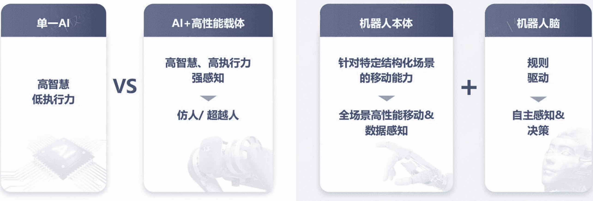
（对比分析）：
- 单一AI：高智慧、低执行力，针对特定结构化场景的移动能力。
- AI+高智能载体：高智慧、高执行力、强感知，全景高性能移动与数据感知，自主感知与决策，真正实现通用智能机器人。

## 1.2 头部玩家推动AI+机器人前沿创新，移动智能AI时代进入爆发前夜
海外玩家同步探索，技术场景丰富：
- 顺畅人机交互：模仿人类动作和情感。

- 将ChatGPT与Google语音合成技术接入Spot，研究人员可以通过语音交互查询巡检数据，提高巡检效率及准确性。
- 通过机器人收集数据，完善模型训练，为机器人提供图像、文本到视频内容生成能力，打造多功能服务型机器人。
- OpenAI + 1X (投资$23.5M)。

宇树科技领先进行AI布局，推动AI与硬件能力深度耦合（语音交互、强化学习算法、深度学习框架、AI决策）。
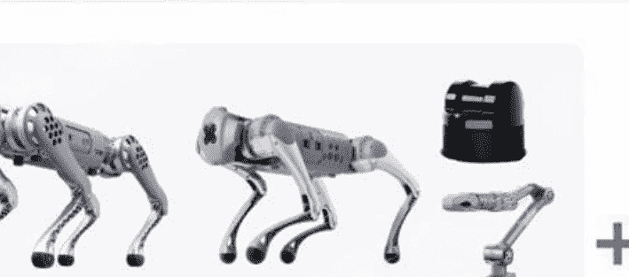

## 1.3 高性能移动机器人突破传统瓶颈，推动机器人全场景落地
高性能移动机器人本质是灵活、通用的平台级终端（足式、轮式、履带式）。
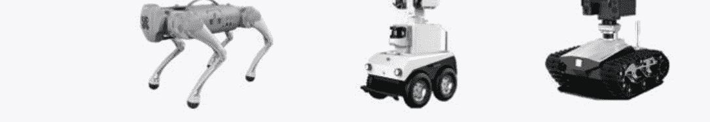
- 全地形能力 ★★★★
- 轻量化结构紧凑度 ★★★
- 性价比 ★★★
- 灵活度及拓展性 ★★★
- 人机交互友好度 ★★★
- 现实环境适应性 ★

## 1.4 基于高性能移动能力的智能机器人可渗透千亿市场
高度灵活性与交互性在ToB与ToC领域找到交叉点：
| 场景 | 方案类型 | 市场规模 (RMB) |
| :--- | :--- | :--- |
| 巡检、安防 | 复杂地形最优方案 | 438亿 |
| 特种、救援 | 恶劣工况最优方案 | 700亿 |
| 科技、科研、航空 | 多场景最优解决方案 | 3000亿 |
| 配送、服务、医疗 | 场景最优解决方案 | 1500亿 |
| 太空 | 探索市场 | 375亿 |
| 家居 | 新一代智能终端 | 5000亿 |
| 养老 | 潜在市场 | 18亿 |

## 1.5 行业即将爆发期，头部企业推动产业创新，引领万亿新兴市场
| 演进阶段 | 描述 | 市场空间 |
| :--- | :--- | :--- |
| 1.0 四足机器人渗透率领先 | 部分核心需求场景、极客消费 | 3000亿 |
| 2.0 成本下降+产品成熟 | 四足机器人加速渗透、人形初步商业化 | 1500-2100亿 |
| 3.0 平台级智能终端 | 深度融入生产和生活 | 万亿级 |

# 02 宇树科技：定义实际场景规模化验证的领导者
掌握核心产业链，强产品定义能力。

## 2.1 全产业链自研自产，引领高性能移动机器人产业的创新和规模化落地
- 硬件：90%核心零部件及本体结构全自主研发。
- 感知：自研激光雷达、视觉及SLAM算法持续迭代，优化性价比。
- 决策：细化零散场景业务逻辑，导航精准避障，提升智能化。
- 控制：提升运动速度及步态平衡，执行更具动性。

## 2.2 宇树科技：领先的高性能移动机器人企业，打造新一代智能终端平台
- 机器人产品：消费级Go1、工业级B1 Aliengo、健身泵PUMP。
- 零部件：机械臂、激光雷达、电机系列。
- 应用软件：移动端APP (iOS & Android)、PC端中央控平台，支持图形化编程。
- 决策：智能导航规划、ISS智能跟随、警报系统、业务逻辑开发、云端OTA升级。
- 感知：高视觉算法、3D视觉雷达及SLAM算法、人体监测|视觉识别。
- 控制：高动态运动、急停保护。

## 2.8 投入人形机器人研发，定义全球领先的领航产品

Unitree

### AI能力
- 精准感知决策

### 预计年内发布
- 性能优于同行的高性价比比人形机器人
- 超越人体运动能力，体积紧凑
- 高性能机械臂
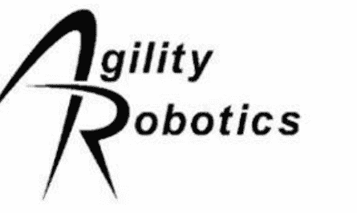
- 灵巧机械手（机械手尚研发规划中）
- 累计融资：$200.2M
- 双足/轮足：全场景高速移动能力

## 2.9 厚积薄发、四足机器人积淀为新产品提供扎实的领先优势

Unitree Robotics

### 01 高性能电机、减速器（成本占比>50%）
- 自研动力系统：大扭矩、轻化
- 提供双足高自由度、高精度传动

### 02 多维感知传感器
- 自研雷达：多传感器融合能力
- 提供高性能感知，保障运动及执行能力
- 深厚积淀，多项技术可复用

### 03 多重算法赋
- 感知算法：提供视觉采集和训练的强可迁移性
- 运动算法：加速人型节能、平衡性、稳定性等技术实现

### 04 丰富数据闭环
- 积累场景数据和功能验证，领先赛道领先友
- 更快速打磨优化可落地产品
- 实际场景中已经过商业化、规模化验证

### 05 供应链+渠道建设
- 经历规模化量产，渠道搭建成熟
- 客群高度重合，具备快速爆发的扎实基础

## 2.10 全球化布局，品牌价值+渠道搭建实现绝对头部

Unitree Robotics

### 1000+位全球客户及合作伙伴
- 国内：海外 1:1
- 数万台累计出货量
- 70%+ 市占率
- 20+ 国家地区

### 直销+代理并行模式
- 线上渠道：Unitree Amazon、天猫、宇树自建站
- 行业代理：到款发货，多行业落地

### 性能与价格区分
- 建立不同价格带，满足不同C端及行业用户需求
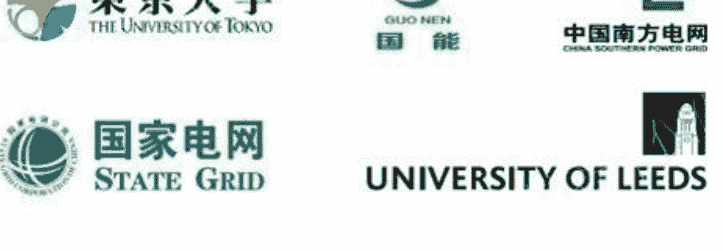

## 2.11 找最佳切入点，以最优路径引领市场

### 清晰GO TO MARKET 路径
- 行业影响力+产品口碑实现商业领先

### 全场景+新终端
- 科技+科研：快速站头部
- 产品持续创新：优先推动AI+机器人，搭建生态平台
- 引领前沿技术：打造行业影响力，全链条规模优势显著

### 打造行业标杆客户
- 树立科技、巡检、特种等行业标杆客户
- 快速推动行业复制
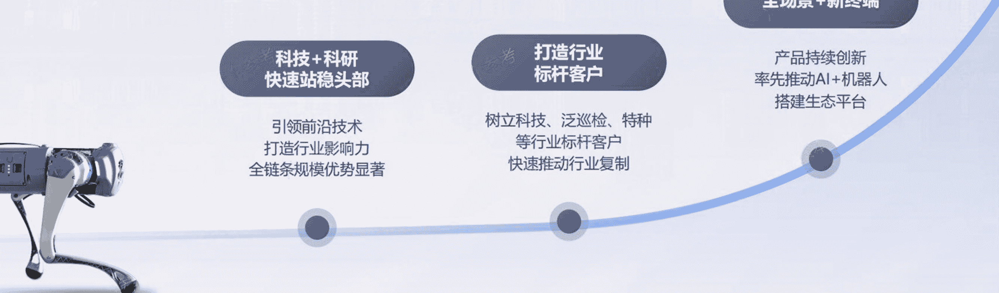

## 2.12 显著优势积累全方位壁垒 构建高性能移动机器人行业的竞争分水岭

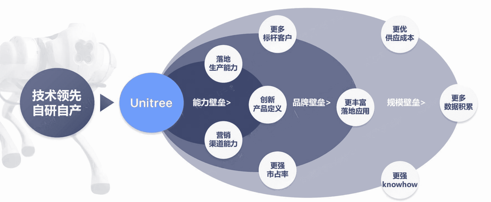

## 2.13 业绩高速爆发，且持续盈利，产品价值高、议价能力强

过去3年收入情况

- 毛利率水平：>50%
- 4年连续盈利
- 未来销售预期：预计可持续2X增长趋势（2020, 2021, 2022）

## 2.14 掌控核心产业链+产品定义，以移动时代新终端为胜出之路

### 掌控核心产业链+产品定义
- Performance-Cost：极致平衡
- 定义全新交互方式（触摸屏、人脸）
- 自研芯片、操作系统
- 定义极致出行需求，打造爆款
- 高毛利水平、高市场占有率的行业绝对头部

### 未来会成为什么样的移动机器人？
- 愿景：从PC、手机到通用智能平台
- 渗透一代场景：生活、工作方式完全融入全场景
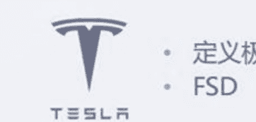

## 2.15 唯一具备快速研发与落地能力的创新团队

Unitree Robotics

| 姓名 | 职位 | 背景 | 经验 |
| :--- | :--- | :--- | :--- |
| 王兴 | CEO&CTO | 浙江大学机械与自动化硕士 | 10年以上机器人研发经验，全球领先专家 |
| 杨知雨 | 机械负责人 | 南开大学化学士 | 近10年机器人算法开发及运动控制 |
| 陈立 | 销售总监 | 上海大学精密机械硕士 | 曾任海康威视销售经理，丰富国内外渠道对接 |
| 王枫 | 财务总监 | 南京财经学士 | 曾任敏实集团财务经理，超10年财务管理 |
| 张阳光 | 高级工程师 | 上海大学机械工程硕士 | 80+机器人相关专利 |

- 团队人数：200+
- 研发占比：~40%
- 30占比：64%
- 专利数量：150+
- 2021年维科科技年度新人人物
- 2020年湖新锐创业领袖

# 发展历程

### 2017
2017.09 独立研发电机、驱动及主控、整体机械结构及全新的控制系统。较于原型机，尺寸比例更合理、性能增强、运动稳定性更强。

### 2020
2020.01 发布全新超高性价比四足酷玩机器人A1，小巧能活、爆发力强、最大持续室外速度可达3.3m/s，是国内近似最快、最稳定的中小型四足机器人。

### 2022
2022.02《元宵晚会》“泰哥”亮相
2022.04 推出PUMP健身机器人，其核心动力源自机器人关节技术，开启随时随地、高效健身模式。

### 2013-2016
硕士期间，CEO王兴独立开发了国外首无机驱动的高性能四足机器人XDog，开了全球低成本高性能四足机器人方案的技术先驱；2016年，创立宇树科技。

### 2019
发布Aliengo四足机器人，定位行业高性能四足机器人，采用了全新的动力系统，更轻量的集成，一体化机身设计。

### 2021
2021.06，发布仿生机器人Go1，以其低价和卓越的感知运动能力，成为人类历史上首款真正走进大众生活的移动机器人。

### 2023
2023.04 发布仿生4D激光雷达L1，具有全向广角扫描能力，小巧运行稳定，赋予人形机器人等产品。升级版&行业版。
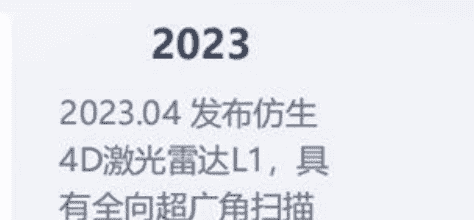

# 友商对比

| 品牌 | Unitree | Boston Dynamics | Agility Robotics | DEEP Robotics | ANYbot |
| :--- | :--- | :--- | :--- | :--- | :--- |
| 成立时间 | 2016年 | 1992年 | 2015年 | 2017年 | 2019年 |
| 年出货量 | 数千台 | 小数百台 | 百台 | 小数百台 | 小数百台 |
| 产业链能力 | 全链自研 | 部分外采 | 部分自研 | 核心外采 | 核心外采 |
| 运动性能 | 优 | 优 | 优 | 一般 | 一般 |
| 性价比 | 高 | 低 | 低 | 中 | - |
| 长期研发实力 | 强 | 强 | 强 | 一般 | 一般 |
| 行业布局 | B端+C端 | 研为主 | B端为主 | B端为主 | C端为主 |

# 影响力

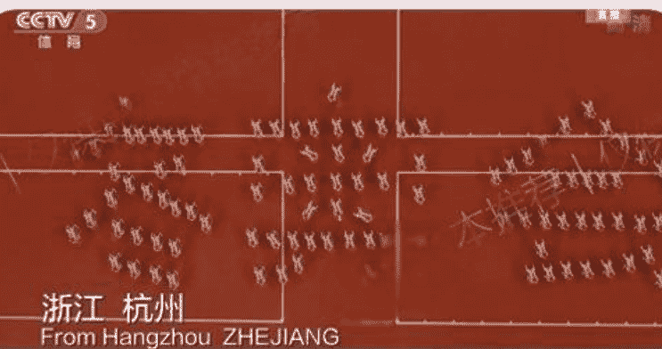

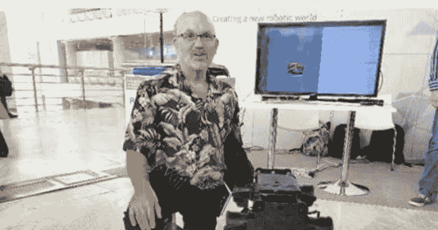
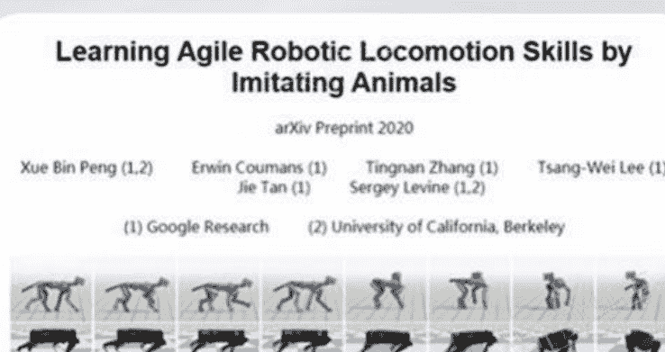

# 行业驱动政策
政策层面，高性能移动机器人相关产业利好不断。在技术、政策和资本的推动下，迎来产业变革时刻。

| 时间 | 政策法规 | 部门 | 主要内容 |
| :--- | :--- | :--- | :--- |
| 2021年3月 | 《中华人民共和国经济和社会发展十四五规划和2035年远景目标》 | 国务院 | 加强矿山深部开采与重大灾害防治等领域先进技术创新，推进危险岗位替代 |
| 2021年12月 | 《十四五》机器人产业规划 | 工信部等15部门 | 力争到2025年，机器人产业业务收入增长超过200%，形成具有国际竞争力的领军企业及一批创新领先、成长性的种子企业“小巨人”，建立3-5个国际影响力的产业集群 |
| 2022年7月 | 《十四五》国家综合防灾战略规划 | 中央人民政府 | 强化智能化抢救机器人、远距离遏洪技术、深水防汛、高源机械技术、高复杂地形大型空域中加强救援需求的研制与应用推广 |
| 2023年3月 | 《机器人+》行动实施方案 | 工信部等17部门 | 到2025年，机器人产业应用密度接近2020年真实值，机器人、特种机器人应用广度和深度显著提升，聚焦10大重点领域，突破100种以上机器人创新应用技术及解决方案，推进万批高技术水平、创新应用模式和显著成效的机器人典型应用场景，打造一批“机器人+”行业标准，建设一批应用中心和试点中心 |
| 2023年3月 | 《国家能源局关于加快推进能源数字化发展的若干意见》 | 国家能源局 | 以数字化智能化电网支撑新型电力系统建设 |
| 2023年4月 | 《北京市机器人产业创新发展方案（2023-2025年）》（征求意见）》 | 工信部、北京市信息化局 | 发展机器人“1+4”产品体系，加速布局人形机器人研发与应用，以人工智能为基本路线和核心基础设施，支撑人形机器人建模、控制系统、开源芯片、仿真构件等研发和应用，解决市场化智能化需求的迫切需求 |

资料来源：国务院、工信部、科技部等部门，中关智友研究院治理经理

# START YOUR FINANCE

起点财经，网罗天下报告
