# 另类投资基金如何把握全新机遇?

2024年度安永全球另类投资基金调查报告

The better the question.
The better the answer.
The better the world works.

EY安永
Shape the future
with confidence
聚信心 聚未来

# 扫码加入 知识星球TOP 免费资源群

免费

公众号:知识星球TOP

- 每日免费获取高价值资源
- 可提供各类资源搜索服务

价值

微信号:jntsg8

| 热门付费文章 | 各行各业报告 |
| :--- | :--- |
| 精选图书资源 | 副业赚钱方法 |
| 职场实用资源 | AI政经自媒体 |

及时

微信号:jntsg2

专注

分享资料仅供个人学习，请及时删除，切勿商用传播

# 目录

第一部分 摘要

第二部分 背景和调查方法

第三部分 行业趋势

第四部分 获取私人资本：改变投资者基础

第五部分 产品与策略：多元化制胜

第六部分 AI、技术和数据：促进加速增长

第七部分 未来前景

第八部分 主要联系人

# 安永另类投资基金行业主管辞

2022年度《全球另类基金投资报告》发布以来，另类基金行业对于整个世界都发生了巨大变化。过去两年，地缘紧张局势加剧，中东冲突升级，通胀加剧，利率走高，生成式人工智能（GenAI）快速发展。

宏观环境如此波动，另类投资（包括私募（PE）、信贷、基础设施、房地产、大宗商品、对冲基金和数字资产）依然保持增长势头。另类基金规模（AUM）从2021年的13.3万亿美元增长到2024年的17.6万亿美元。

在规模不断扩大的基础上，另类基金行业还趋成熟和多元化，与传统金融分行业之间的界限逐渐模糊。此外，我们对400多名另类投资基金管理人和委托管理的机构投资者（“背景”和调查方法部分）的调查结果显示，另类投资基金行业将继续维持快速增长。根据预测，截至2029年，全球另类投资基金行业资产规模可能扩大到29.2万亿美元。

另类基金管理人和投资者是行业的两大组成部分。希望我们将本报告作为一面镜子，可以看清当前的行业发展，同时审视变革的影响，发现未来的挑战和机遇，探索可能的因素。

本报告汇总了行业趋势，研究了行业的三大战略重点，最后预测了另类未来可能面临的机遇和挑战。

此次机会，我们感谢400多位参与调查的行业人士，感谢他们付出的时间和提供的数据。随着飞速发展的另类投资基金行业的重要性不断提高，我们希望本报告能够在众多参与者和读者之间引发有成果的讨论。

# 《养老险全球投资基金调查报告》

摘要
最新发布的《养老全球投资基金》显示，行业表现、成熟度和发展速度都达到了空前水平。由于美国、欧洲和亚洲地区投资者满意度较高，且另类基金管理人采取了积极的增长计划，基金表现稳健健。

与此同时，行业表现将保持乐观。另类基金管理人及投资者预计，未来行业将继续持续增长，且表现可圈。基础设施、私募股权和二级市场都是最具有未来前景的类别。

本次调查的另一个亮点是，投资者与行业在很大程度上非常活跃，但限制增长的门槛依然存在，需要加强和强化，通过产品化来加强行业。然而，许多另类基金管理人预计市场将表现出更深层次的。

多元化是另一个重要的增长因素，许多另类基金管理人积极寻找投资选择，锐进入军事等热门市场，或领域化新趋势。但尚未通过多元化发展而非复杂因素，仅依赖创造力，投资者和参与的战略还不够。

关于行业模式和发展趋势，人工智能（AI）无疑是一个不断的话题。我们需要密切关注，相关因素都在快速迭代。很明显，如何使用AI，许多问题亟待解决。针对不同情况，另类基金管理人和投资者的预期存在差异。数据、支持是成功转型的关键。随着另类基金管理人和投资者实现增长，若干主题反映了我们在研究之中，包括如何制定策略以应对挑战：重新配置投资、如何扩展市场、人才、提高透明度和可靠性。在行业处于一个均衡的环境中，这些因素导致了重要——使得我们获得了新的机遇，未来，跨界的发展将进一步推进，竞争压力减轻，通过策略整合来实现转型。在这种不变的环境中生存和发展，基金需要保持持续特征来应对突破。

根据调研结果，参与者可采取行动包括：

另类基金
- 投资者教育：推广参与和治理的有效方法，建立信任。
- 利用AI：全方位关注需求，技术、数据方面。
- 通过产品化进行改进：针对性的差异化，理想的回报。
- 增强韧性：运营业务、合规和投资者类型增加，但增强韧性。
- 积极寻找：与另类基金管理人发现增长机遇，高标准。
- 基金创新：灵活配置，关注基础设施和二级市场等增长领域，新工具。
- 引入AI和技术：与另类基金管理人讨论份额，寻求更好的回报和服务，及时实施。

# 第二部分 背景和调查方法

安永团队与市场合作开展了一项广泛调查，汇总了北美、欧洲及亚洲地区另类基金经理（简称“基金经理”）及其机构投资者（简称“投资者”）的观点和意见。

如前文所述，我们讨论的另类投资包括另类资产（如私募股权、私人贷、房地产、实体资产、大宗商品、对冲基金）和新兴投资（如数字资产和加密货币）。

我们的研究旨在了解另类基金经理和投资者对当前和未来发展、资产配置、资本筹集、投资策略、运营、人才、基金费用、管理费及其他主题的看法。

2024年8月至10月，调查了：

- 224家另类投资基金管理人、私募股权、对冲基金、信托基金和另类部门
- 200家机构投资者，包括养老基金、银行、财富管理公司、保险公司、家族办公室、母基金 (FOF)、主权财富基金和基金会

## 全球共计424家受访

## 另类投资基金管理人：公司或部门

| 合计 | 224 |
| :--- | :--- |
| 按基金类型划分 | 受访数量 |
| 对冲基金管理人 | 53 |
| 私募股权管理人 | 78 |
| 大型机构的另类投资基金部门 | 36 |
| 信基金管理人 | 13 |
| 其他 | 44 |

### 资产总规模

| 合计 | 224 |
| :--- | :--- |
| 按资产规模划分 | 受访数量 |
| 100亿美元以上 | 58 |
| 20亿至100亿美元 | 44 |
| 20亿美元以下 | 122 |

### 按地理位置受访统计

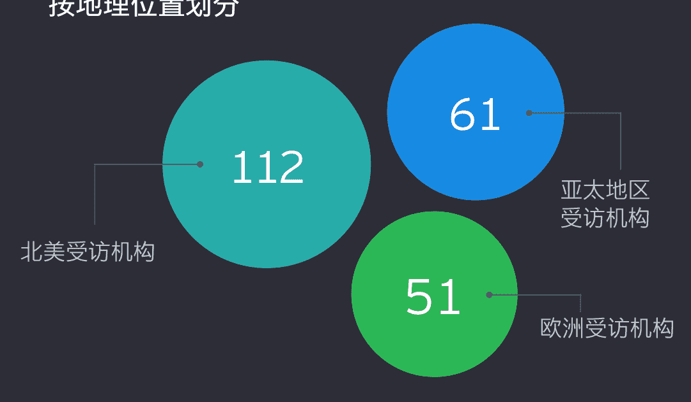

### 机构投资者

### 资产总规模

| 合计 | 200 |
| :--- | :--- |
| 按基金类型划分 | 受访数量 |
| 养老基金 | 16 |
| 主权财富基金 | 2 |
| 保险投资 | 18 |
| 家族办公室 | 25 |
| 母基金 | 5 |
| 银行或财富管理公司 | 80 |
| 其他资产管理公司 | 54 |

| 合计 | 200 |
| :--- | :--- |
| By AUM | 受访数量 |
| 100亿美元以上 | 119 |
| 20亿至100亿美元 | 35 |
| 20亿美元以下 | 46 |

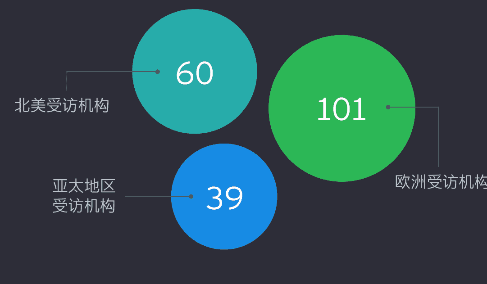

# 第三部分

## 行业趋势

## 2024年度全球另类资产基金调查报告

### 另类投资基金管理人

- 2018年至2023年，全球另类资产总规模稳健增长，到2024年底达19.5万亿美元，主要受私募市场等扩张私募股权和债推动。
- 展望未来，全球另类市场有望在2029年达到29万亿美元。驱动因素包括私募市场的快速扩大、投资者对多元化配置的需求。此外，另类化和技术的应用使得投资更容易，为投资者创造更多机会。

2023年另类资产延续增长，为私募债和二级市场投资者提供了更多机会。按类别的另类资产规模（单位：万亿美元）2018年至2029年预测）（单位：万亿美元）：

| 类别 | 2018 | 2019 | 2020 | 2021 | 2022 | 2023 | 2024 (预测) | 2025 (预测) | 2026 (预测) | 2027 (预测) | 2028 (预测) | 2029 (预测) |
| :--- | :--- | :--- | :--- | :--- | :--- | :--- | :--- | :--- | :--- | :--- | :--- | :--- |
| 私募股权 | 5.8 | | | | | | 12.0 | | | | | | |
| 对冲基金 | 4.5 | | | | | | 5.7 | | | | | | |
| 风险投资 | 1.9 | | | | | | 3.6 | | | | | | |
| 房地产 | | | | | | | 2.7 | | | | | | |
| 私募债 | | | | | | | 1.5 | 2.6 | | | | | |
| 基础设施 | | | | | | | 2.4 | | | | | | |
| 自然资源 | | | | | | | 0.3 | | | | | | |

| 类别 | 复合增长率 |
| :--- | :--- |
| 私募股权 | 12.8% |
| 对冲基金 | 4.0% |
| 风险投资 | 11.7% |
| 房地产 | 8.7% |
| 私募债 | 9.9% |
| 基础设施 | 10.8% |
| 自然资源 | 4.1% |

数据来源：普勤；2029年另类资产展望》(Future of Alternatives Private Markets)

### 2024年度全球另类投资基金调查报告

### 投资者对另类资产的整体表现满意度与2023年相比变化不大，但多数投资者能够指出需要改进的领域

- 调查结果显示，认为另类投资在2023年和2024年上半年的业绩尚符合或超过预期机构投资者相比无差异。
- 2023年，投资者对信类基金、二级市场基金和权益基金的表现较为满意。而房地产和私募投资的满意度相对较低，主要是由于资产表现和基金收益受限影响。
- 另类基金的表现有所波动，但2024年上半年的满意度和2023年相似。二级市场基金和权益基金的表现依旧。同时，对加密货币和数字资产的业绩满意度有所提高。

> 在公司的组合中，以下资产类别的表现（即回报率）与预期相同如何？按1至5分，1代表显著低于预期；5代表显著高于预期

| | 2023年 | 2024上半年 |
| :--- | :--- | :--- |
| 私募股权 | 32% | 44% | 22% | 2% | 31% | 48% | 17% |
| 信类基金(含私募投资) | 47% | 35% | 16% | 2% | 32% | 50% | 15% | 3% |
| 实物资产和基础设施 | 32% | 44% | 24% | | 28% | 47% | 22% | 3% |
| 房地产 | 21% | 30% | 49% | | 18% | 38% | 41% | 3% |
| 风险投资 | 13% | 43% | 37% | 7% | 12% | 49% | 31% | 8% |
| FOF | 29% | 43% | 24% | 4% | 26% | 51% | 17% | 6% |
| 二级市场基金 | 38% | 34% | 23% | 5% | 41% | 38% | 13% | 8% |
| 对冲基金-权益类 | 42% | 35% | 21% | 2% | 41% | 35% | 20% | 4% |
| 对冲基金-全球宏观 | 25% | 55% | 16% | 4% | 28% | 49% | 16% | 7% |
| 对冲基金-多策略 | 37% | 44% | 17% | 2% | 32% | 44% | 18% | 6% |
| 虚拟/数字/加密资产 | 32% | 32% | 30% | 6% | 36% | 32% | 24% | 6% |
| 其他 | 39% | 42% | 8% | 11% | 36% | 33% | 14% | 7% |

- 超过预期 | 符合预期 | 低于预期

### 2024年度全球另类投资基金调查报告 投资者更加青睐基础设施、私募股权、二级市场和权益对冲基金

- 从均值看，投资者对另类配置集中在私募股权（22%）、其房地产（16%）、权益基金（14%）。
- 安永调查显示，投资者对实体资产和私募股权配置较为稳定。未来三年，投资者有50%的计划增加基础设施投资，仅10%的计划减少，这也反映了全球范围内基础设施的需求加强。
- 多数投资者预计配置发生大幅变化。从另类投资基金配置模型来看，以下资产类别的占比情况如何？

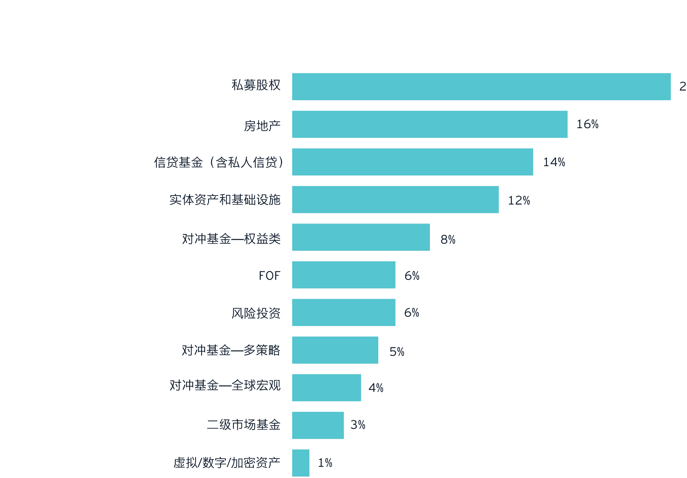

### 未来三年，在以下资产类别中，贵公司计划增加、减少还是维持配置？

| 增加配置 | 减少配置 | 保持不变 | 不清晰 |
| :--- | :--- | :--- | :--- |
| 私募股权 | 49% | 10% | 40% | 1% |
| 信贷基金（含私人信贷） | 43% | 14% | 40% | 3% |
| 实体资产和基础设施 | 50% | 8% | 37% | 5% |
| 房地产 | 33% | 25% | 40% | 2% |
| 风险投资 | 26% | 26% | 44% | 4% |
| FOF | 39% | | 41% | 3% |
| 二级市场基金 | 43% | 16% | 36% | 5% |
| 对冲基金—权益类 | 42% | | 38% | 2% |
| 对冲基金—全球宏观 | 29% | 15% | 51% | 5% |
| 对冲基金—多策略 | 33% | 11% | 52% | |
| 虚拟/数字/加密资产 | 43% | 14% | 30% | 13% |
| 其他 | 19% | 17% | 53% | 1% |

### 各类投资基金经理关注的优先事项包括增长、技术和人才

- 全球各地的投资基金经理将投资者视为首要的增长目标，认为他们的资金是未来三年的重心，这在亚洲地区的基金公司尤为如此。传统管理公司认为此类基金将增加富裕客户的积极，近期对财富管理的分析也证实了这一点。
- 丰富产品和获客服务是基金公司排名第一位的优先事项，而且是欧洲地区基金排名第三位的关键目标，欧洲地区同样高度重视这一项。
- 人才管理和运营模式可扩展性是基金公司五大优先事项，其中亚洲地区基金尤为重视人才管理。

### 获得高净值客户的资金将成为最重要的战略优先事项

问题 未来两年，贵公司排名前三位的战略优先事项是什么？

| 获得私人客户资金（家庭客户/高净值客户/HNW客户） | 32% |
| 产品和规模扩展 | 29% |
| 利用AI和机器学习 | 27% |
| 人才管理 | 26% |
| 运营模式可扩展性 | 25% |
| 技术和数据转型 | 21% |
| 成本管理与合理化 | 19% |
| 任期计划和管理公司基金交易 | 16% |
| 客户体验和报告 | 16% |
| 投资管理运营或财务规划和分析 | 15% |
| 加大影响力亚洲投资公司及其业绩评估 | 13% |
| 地域性扩张，从其他国家或地区获取资金来源 | 12% |
| 获得客户成本（以大筹小策略） | 11% |

- 增加配置 | 8%
- 减少配置 | 17%
- 保持不变 | 53%

## 2024年亚洲全球养老投资基金调查报告

这些趋势反映了人们对另类基金的回报和多样化的需求。近年来，基金管理人市场开始向大众化，美国、欧洲、中国、中东和亚洲日益增长。最新发展趋势包括：

- 传统基金管理人发行另类基金管理，并公募以收购收益增多
- 越来越多另类基金管理人管理公司创建另类基金，提供流动性，如间隔基金（Interval Fund）或业务发展基金（BDC）
- 第三方投资平台规模发展

### 利用跨市场关系，让另类基金解决投资者面临的解决方案

然而，需求增加，引起了特别关注。例如公募另类基金（ELAF）新型的募基金有助于降低投资门槛。另一方面，过去的变动和收益分配限制了一些机构增加另类基金配置的能力。

即使在未来几年，收益分配仍有望增长，但竞争的激烈意味着基金公司仍需竭力获得更多新投资者。

### 新投资者、新挑战和新解决方案

基金公司希望打破个人投资者另类基金的门槛，吸引高净值客户，并非仅募。在基金公司计划以多样化的投资策略（参与产品与风险管理），风险也可能吸引资本的风险。

### 问题 公募客户如何对某些（来自各种结构的）资产类别定位？

| 类别 | 占比 |
| --- | --- |
| 私募基金 | 37% |
| 信贷基金（含信托） | 28% |
| 房地产 | 25% |
| 风险投资 | 22% |
| 实体资产和基础设施 | 21% |
| FOF | 19% |
| 对冲基金—一类基金 | 19% |
| 虚构/数字资产 | 14% |
| 对冲基金—全球型 | 14% |
| 二级市场 | 15% |
| 对冲基金—多策略 | 12% |

基金公司转型专业化涉及一系列适用性，投资者可以与其教育的基金投资在合适。我们的调查显示，48%的另类基金管理人具有流动活性，这一发现也体现在一些投资者难以以主动投资信托基金（REIT）和在风险上（46%），以及参数、流程和术语不灵活（36%）。

欧洲投资者认为，减少标准的参数、流程和术语（51%）流动活性（41%）可以让更多进入，而亚洲地区的基金公司被认为风险限制（46%），以及参数、流程和术语不灵活（36%）。

这些发现涵盖了考虑的类别、投资结构和基金工具的适用性之必要。发现基金公司将其推销给新客户时，另类基金管理人需要更好地选择策略、结构和功能。如果另类基金管理人想增加与投资者的互动，需要加强客户教育，这不是投资者本身的问题，还将另类基金引入招募投资者，以解决顾问的顾虑。

领先的基金公司已经出版了客户偏好信息，确保投资者的背景以分类另类基金的关键特征；例如，在推销之前进行筛选，并在合适的时候保持沟通。一些可能无法获得客户。一些另类基金公司正在建立学术术语，并与其他基金公司合作，以培养投资者的认知和理解，这种趋势可能将加速。

## 获得客户和高值客户资金的可扩展性与初始关注事项

> 公司在获得客户、高值和超高值投资者资金时或关于其可扩展性，最关注的问题有哪些呢？

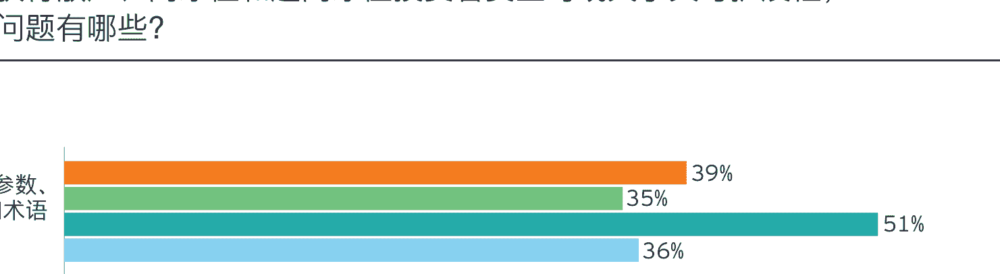
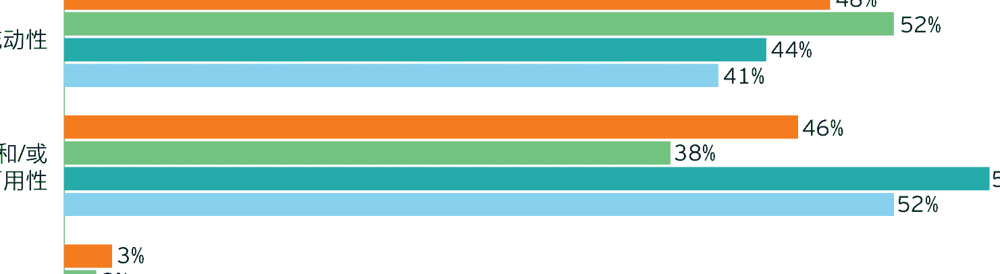

## 2024年安度全球投资基金调查报告

### 什么样的投资者需要，投入与回报是否正确？

归结底，获取个人投资者的最大障碍可能在于底层。对于更多与专业投资者来说，这不可避免地面临升级、管理、合规报告等压力。对于公募基金管理人来说，巨大的挑战可能导致影响高净值、高净值和散户投资者，难以做到微盈利。

- 大多数投资者希望高净值和高净值客户的基金公司能够直接通过渠道进行互动，而基金管理人认为通过募资开发合作伙伴是募集资金的最佳方式。

- 基金公司认为通过直接渠道接触高净值和高净值客户（如银行平台和平台渠道）的重要性，这与我们需要通过内部团队或合作伙伴合作来扩展业务规模的强迫需要最好进行调整。

- 令人惊讶的是，对于高净值和高净值客户，更多基金公司认为应该计划减少“大量”投资或不要投资，尽量在客户方面，散户/大众市场投资者受到关注，但大多数基金公司（40%）计划对该市场不投资，27%的受访机构计划要少量投资”。

## 超高净值和高净值投资者在当前和未来都是最受欢迎的目标客户群，主要通过直接渠道获取

### 问题 贵公司目前如何获取客户？

### 问题 贵公司未来1至2年内，计划如何获取客户？

| 直接获取 | 66% | 60% |
| --- | --- | --- |
| 间接获取（如银行平台） | 31% | 58% |
| 数字化/金融科技 | 33% | 31% |
| 分享咨询关系 | 16% | 34% |
| 其他 | 21% | 27% |
| 未提及/计划获取 | 19% | 18% |

| 通过购买/保险 | 16% | 17% |
| --- | --- |
| 分享咨询关系 | 25% | 22% |
| 未提及/计划获取 | 13% | 16% |
| | 39% | 43% |

## 投资潜力最大的领域

### 问题 为了抓住机会，贵公司计划在以下领域投资？

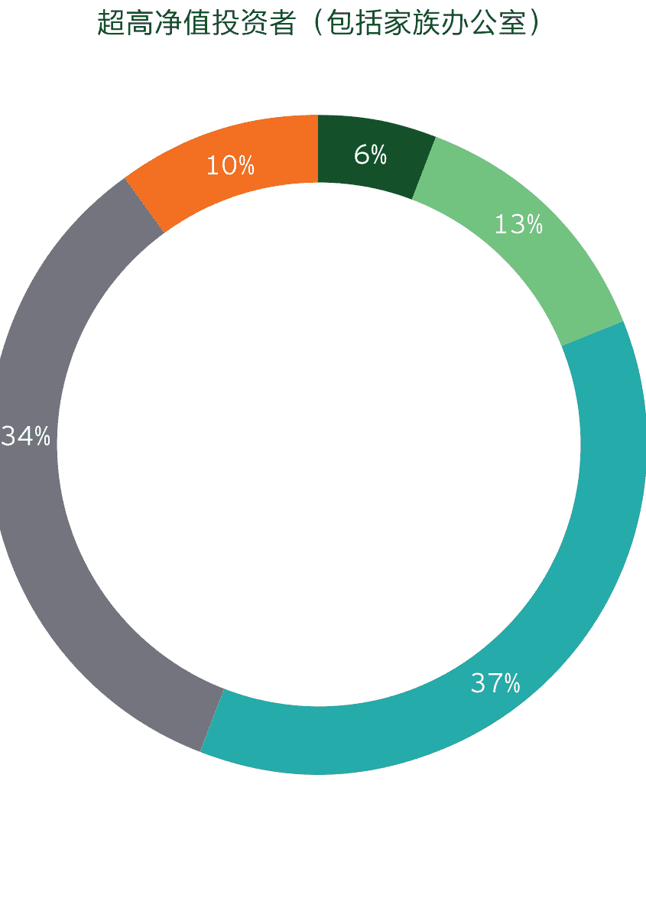
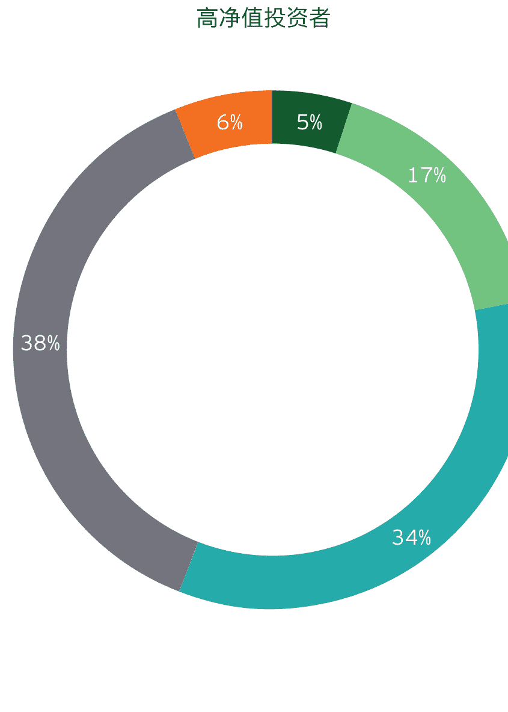
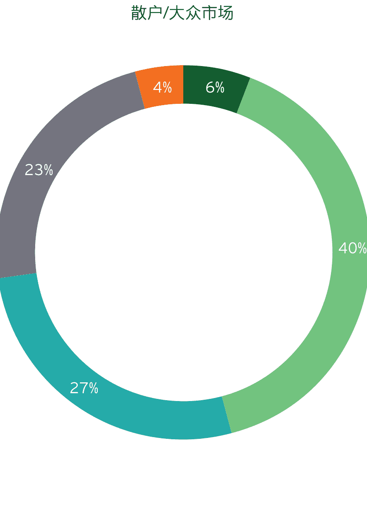

- 少量
- 大量
- 不确定

## 2024年亚洲全球投资基金报告

这些若具有稳健性，另类基金管理更有可能在相当长时间内持续增长。其实做到净值、净值持续增长，是一个难题，为了维持竞争力，基金公司可能需要在以下方面做出改变：

**品牌建设与营销**，建立客户需要更加品牌投入、广告宣传等手段。尽管如此，将品牌建设视为主要事项，基金公司还相对较少开展营销活动等，基金公司更倾向于通过募资策略或合作伙伴来集。问题：为了募集资金，基金公司计划在未来两年内投资哪些项目？

**客户管理**，为了精准把握投资者，需要通过合作伙伴合作获取客户，以扩大客户规模。知识和服务面临激烈竞争。

**数字化与转型**，随着行业自动化程度加大，通过外部合作伙伴活跃或AI实现客户互动产生重大影响。这一过程可能导致大型基金公司在转型、理念和目标上出现差异，募资积极性和投入意愿产生差异。

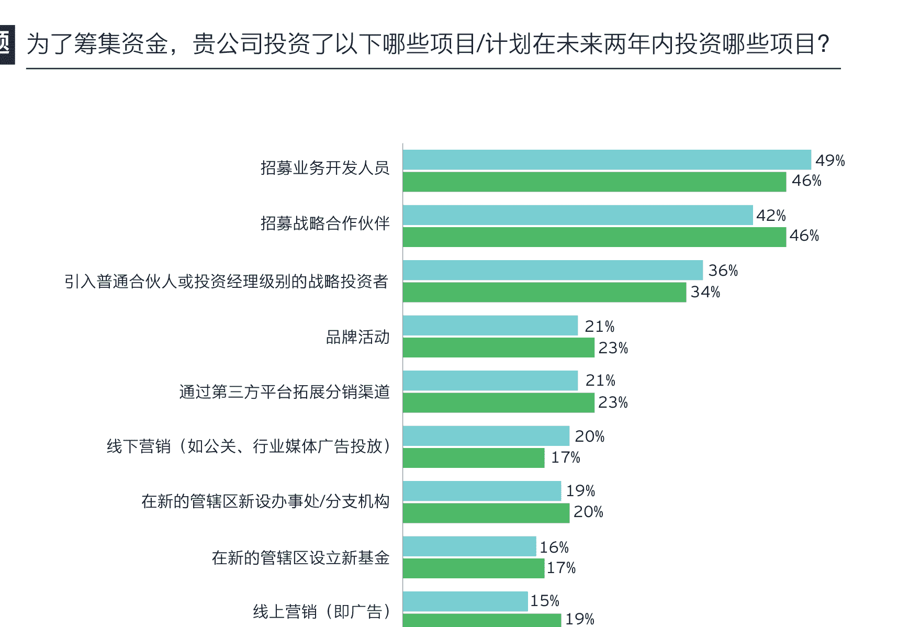

**运营模式**，这类管理公司若要通过更多渠道更高效地向投资者群体提供服务，满足其多元化需求，将需要不同的工作方式。正如我们在“AI、技术和数据”一节所讨论的，新基金公司可能会面临生存的压力：47%的投资者向AI可能会帮助客户服务的多元化，基金管理人认为，客户未来仍倾向于人工服务。

## 2024年度安永全球另类投资基金报告

### 成功在于制定稳健策略，打造创新能力

总体而言，调查结果表明，另类基金管理人要实现显著，没有单一的成功秘诀。尽管大型基金公司在品牌、预算和规模方面具备优势，但若不彻底改变经营方式，他们也不可能实现根本性的变革。

行业的发展或许是降低门槛，但这并不能确保另类基金管理人学会取得成功。基础的成功是选择稀缺最高的净值、高净值或产品，还需着手扩大增长基础，均需要深入钻研。如获取高质量的投资者经验，基金公司需要在技术、人才、透明度和内在方面打造强大的能力，实现各能力均衡发展。

另类基金管理人应首先考虑以下问题：想要什么样的客户？希望吸引什么样的市场群体？为其提供什么产品？然后评估其相对优势和劣势，取得成功需依靠的能力，以及获得这些能力的内部和外部选择。

## 产品与策略：以多元化制胜

- 许多多类投资基金经理人和机构投资者将多元化视为一个关键增长引擎。
- 随着市场环境日益复杂，创新和效率成为有效扩大产品范围的关键。
- 另类投资基金需要制定综合投资策略，避免重复碎片化，才能实现多元化。
- 私人信贷领域的快速发展，实现多元化有多种方式，而这些方式在促进业务增长方面具有较大的潜力。

可采取以下行动：

另类投资基金管理人
- 结合投资者需求和自身专业优势，打造与众不同的产品

机构投资者
- 从投资组合多元化中寻找机遇，包括新资产和投资策略

## 基金管理人和投资者将多数多元化视为增长引擎

另类基金管理人预计，未来两年，另类投资基金类别的总体投资者将增长22%。投资者对另类投资基金行业的未来持乐观，近70%的投资者预计行业增长将延续或改进。

> 问题 与去年相比，贵公司如何评价另类投资基金行业的现状？

- 大幅增长：另类基金管理人的业绩提前，与有限合伙人进行利益的情况。
- 小幅增长：行业稳定将保持相同轨迹。
- 大幅增长：另类基金管理人业绩持续增长，利益持续改善，为行业扩张创造条件不明确。

## 投资潜力最大的领域

### 问题 为了抓住机会，贵公司计划在以下领域投资多少？

- 少量
- 大量
- 不确定

## 2024年亚洲全球投资基金报告

这些若具有稳健性，另类基金管理更有可能在相当长时间内持续增长。其实做到净值、净值持续增长，是一个难题，为了维持竞争力，基金公司可能需要在以下方面做出改变：

**品牌建设与营销**，建立客户需要更加品牌投入、广告宣传等手段。尽管如此，将品牌建设视为主要事项，基金公司还相对较少开展营销活动等，基金公司更倾向于通过募资策略或合作伙伴来集资。问题：为了募集资金，基金公司计划在未来两年内投资哪些项目？

**客户管理**，为了精准把握投资者，需要通过合作伙伴合作获取客户，以扩大客户规模。知识和服务面临激烈竞争。

**数字化与转型**，随着行业自动化程度加大，通过外部合作伙伴活跃或AI实现客户互动产生重大影响。这一过程可能导致大型基金公司在转型、理念和目标上出现差异，募资积极性和投入意愿产生差异。

**运营模式**，这类管理公司若要通过更多渠道更高效地向投资者群体提供服务，满足其多元化需求，将需要不同的工作方式。正如我们在“AI、技术和数据”一节所讨论的，新基金公司可能会面临生存的压力：47%的投资者向AI可能会帮助客户服务的多元化，基金管理人认为，客户未来仍倾向于人工服务。

## 2024年度安永另类投资基金报告

### 成功在于制定稳健策略，打造创新能力

总体而言，调查结果表明，另类基金管理人要实现显著的扩大，没有单一的成功秘诀。尽管大型基金公司在品牌、预算和规模方面具备优势，但若不彻底改变经营方式，他们也不可能实现根本性的变革。

行业的发展方向或许是降低门槛，但这并不能确保另类基金管理人学会取得成功。基础的成功是选择稀缺最高的净值、高净值或产品，还需着手扩大增长基础，均需要深入钻研。如获取高质量的投资者经验，基金公司需要在技术、人才、透明度和内在方面打造强大的能力，实现各能力均衡发展。

另类基金管理人应首先考虑以下问题：想要什么样的客户？希望吸引什么样的市场群体？为其提供什么产品？然后评估其相对优势和劣势，取得成功依靠依靠，以及获得这些能力的内部和外部选择。

## 产品与策略：以多元化制胜

- 许多多类投资基金经理人和机构投资者将多元化视为一个关键增长引擎。
- 随着市场环境日益复杂，创新和效率成为有效扩大产品范围的关键。
- 另类投资基金需要制定综合投资策略，避免重复碎片化，才能实现多元化。
- 私人信贷领域的快速发展，实现多元化有多种方式，而这些方式在促进业务增长方面具有较大的潜力。

可采取以下行动：

另类投资基金管理人
- 结合投资者需求和自身专业优势，打造与众不同的产品

机构投资者
- 从投资组合多元化中寻找机遇，包括新资产和投资策略

## 基金管理人和投资者将多数多元化视为增长引擎

另类基金管理人预计，未来两年，另类投资基金类别的总体投资者将增长22%。投资者对另类投资基金行业的未来持乐观态度，近70%的投资者预计行业增长将延续或改进。

> 问题 与去年相比，贵公司如何评价另类投资基金行业的现状？

- 大幅增长：另类基金管理人的业绩提前，与有限合伙人进行利益的情况。
- 小幅增长：行业稳定将保持相同轨迹。
- 大幅增长：另类基金管理人业绩持续增长，利益持续改善，为行业扩张创造条件不明确。

全球大多数另类投资基金经理 (50%) 致力于投资策略。其中，亚洲地区另类投资基金的需求明显高，其次是位于欧洲的基金公司 (1%)。而北美地区另类投资基金接近两大巨头，45%的受访机构表示专注于策略多元化，而44%的受访机构表示专注于特定策略。

> 总体而言，贵公司倾向于策略多元化还是采用特定策略？

- 投资策略多元化
- 特定项策略
- 两者不是

| 7% | 28% | 32% | 18% | 13% | 2% |

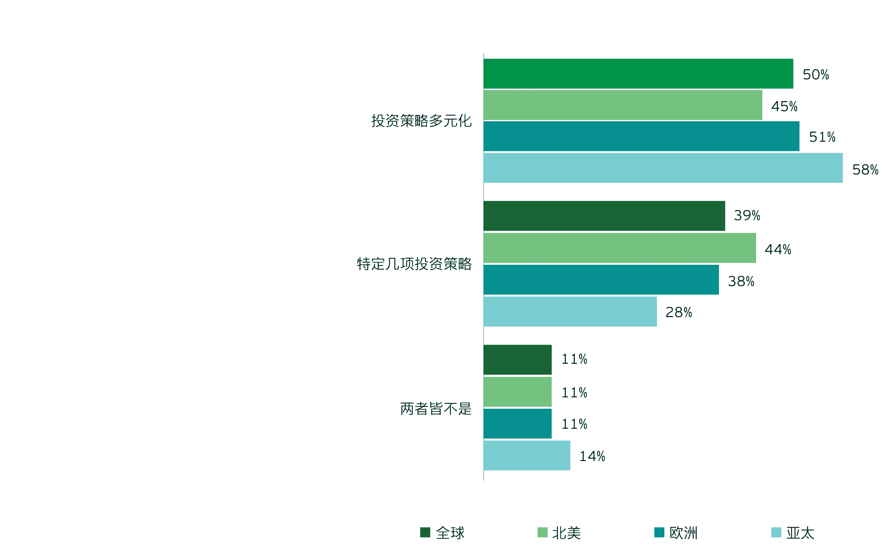

## 2024年度亚洲全球投资基金报告

投资者对于另类基金采用多元化策略的情况，61%的受访机构表示愿意提供更多策略。此外，67%的受访投资者表示，至少会考虑核心领域之外的新基金结构或资产类别，但近三分之一的投资者表示不可进行此类。据此，另类基金管理人应注意，仅采用多元化策略不能增加收益。另类管理人需要深厚的专业储备，提供差异化的方案。

### 问题 贵公司认为，另类基金管理人将致力于策略多元化还是专注于特定策略？

### 问题 如果贵公司当前的另类基金管理人将致力于策略多元化，贵公司向核心领域之外的新基金结构或投资的可能性有多大？

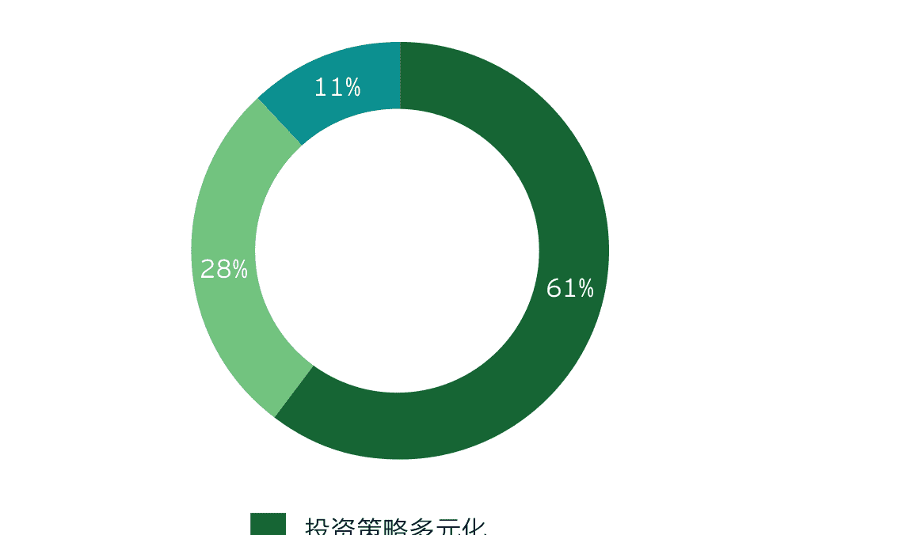

- 投资策略多元化
- 特定策略
- 两者不是

- 极可能
- 有可能
- 考虑，但不确定
- 较低
- 不可能，倾向于擅长其策略的基金管理人合作
- 不明确

## 2024年度全球权益投资基金报告

在我们的调研的背景下，目前基金公司广泛提供的其他类别主要为募型（55%）和债权/私募债券（46%），其次为非不动产类（41%）和对冲基金（40%）。基础设施和不动产类列入关注领域（39%，反映出这一类别的重要性在增加，而这一趋势在北美和澳洲等地尤为明显。展望未来，随着基金管理人拥有更多样的资产类别和投资策略，多元化计划将有助于更均衡的分布，涵盖风险资本、非发展的类别等。

多元化并非非发展的趋势，基金管理人通过并购、合资以及联合投资等不断增加新产品和范围，还是传统的资产管理公司为各类投资基金开展的“一站式服务”——这一趋势前景广阔。

### 私募股权顶级投资类别排行榜，多元化对行业增长

在贵公司的所有基金结构和产品中，以下资产类别目前在提供和计划在未来一至两年内提供的：

| 目前正提供 | 55% | 在未来一至两年内提供 | 14% |
| --- | --- | --- | --- |
| 私募股权 | | 私募股权 | 14% |
| 债权（含私募债权） | 46% | 债权（含私募债权） | 14% |
| 实物资产和基础设施 | 39% | 实物资产和基础设施 | 13% |
| 不动产 | 41% | 不动产 | 13% |
| 风险资本 | 35% | 风险资本 | 18% |
| FOF | 33% | FOF | 12% |
| 二级市场基金 | 27% | 二级市场基金 | 14% |
| 对冲基金-权益类 | 40% | 对冲基金-权益类 | 13% |
| 对冲基金-全球宏观 | 26% | 对冲基金-全球宏观 | 17% |
| 对冲基金-多策略 | 30% | 对冲基金-多策略 | 12% |
| 虚拟/数字/加密资产 | 21% | 虚拟/数字/加密资产 | 13% |
| 其他资产 | 6% | 其他资产 | 5% |

## 2024年亚洲全球投资基金报告

### 多元化推动增长的关键在于策略明晰，而非增强韧性

无论用什么方法开发新产品，制定策略，基金经理的总体目标是设定一个与整体业绩相适应的多元化策略，与此同时，这一必须通过一个合适的运营模式，该模式能够协调前台后台的各项活动。39%的投资经理承认了他们如今的选择，他们希望寻求最大程度的多元化，而非为了应对加强投资专业化可能导致的基金公司而言，对于许多投资者的投资组合日益复杂的，仍需推出更优的品种。此外，基金收购有助于完善或加强基金的特定专业领域。另类基金管理人每次推出新产品或进行组合，均须实现更广泛的战略目标。

对于大多数倾向于多元化而非专业的各类投资基金，其目标应为确定工具和新策略是否能够组成一个和谐的整体，同时多元化相关细节能够：

- 强化和加强现有专业领域
- 充分利用创新和技术发展
- 强化品牌、文化和声誉

在“聚焦私募信贷”部分，我们探讨了如何基于私募信贷市场的持续发展另类基金经理和投资者在多元化方面的挑战和潜在优势。

## 2024年度全球私募投资基金报告

### 聚焦私募信投资

在本报告中，我们将私信非银行机构的私募投资表现。在亚洲，私信基金规模从2020年的2,420亿美元增长到2023年的2,420亿美元。由于私募信市场的持续发展，另信信投资者投资者投资者的。。尽管如此，私募信管理的专业，至关重要。

- 风险性：私募信管理的的，，，，7%的投资者。
- 风险性：私募信策略将追求高收益、高风险，可能使得无法获得更高的收益。
- 风险性：私募信管理的空间带来有限。
- 风险性：私募信的募募，，，化配置的投资者。
- 风险性：私募信的的产生的影响。
- 风险性：私募信的的募，，，多元化，投资者的支持。

### 相关考虑事项：在某些市场市场私募私募市场是火的的，但模糊模糊了某些私募基金策略和中募基金之间的界限？

- 在投资者配置期间，多元化配置的价值被期望（57%的受访者显示，希望在2026年以前有所回报），但表现出伏不齐，这可能需要第二类配置或通过投资者的支持。

- 推出产品创新，基金发行以吸引另类基金经理和投资者（获得预期）。另一方面，基金能够展现更多另类基金经理的运作规模。未来将与更多基金公司合作，计划与更少基金公司合作

- 多元化与创新，基金发行或购买新基金另类基金经理引入另类资产（如另类基金）、新募基金（如直投行业）、私募基金（如私募基金或量化基金）。调查结果显示，增长；基金配置将增长，在未来两年内，二级市场基金配置增长到19%。

大型基金管理公司和另类基金经理近期推出的产品包括，以及为私人市场提供制度化解决方案的二级市场。

# AI、技术和数据：促进加速增长

- 在提升效率和可扩展性方面，现有技术和数据基础设施往往存在不足，仍需要大量人工干预，这是基金公司的一个顽疾。
- 技术投资不断增长且日益多元，基金公司特别重视AI的变革潜能，但他们的AI发展成熟度水平存在差异。
- 另类基金管理人和机构投资者对AI的角色和应用仍持慎重。
- 充分发挥AI的潜力，需要技术、数据、人才和投资者支持的协同配合。

可考虑采取以下行动：

### 另类基金管理人
- 与投资者积极沟通，探讨AI的部署与开发。

### 机构投资者
- 了解技术如何提升投资业绩和优化客户互动。

## 另类投资基金管理人对现有的技术和数据基础深感不满意

为了实现长期增长，另类基金经理需要能够适应日益增长的产品和策略的多元化。新类型的基金与财富管理、金融科技的运营模式，需要更加灵活且模块可扩展以满足管理人的各项需求。

然而，现有的技术基础尚无法满足许多投资基金管理人所要求的活性、高效性和可扩展性，基金经理在执行过程中正在努力改进这种状况。

不同基金公司和职部门之间的自动化水平参差不齐，落后者仍完全没有自动化，但有19%的基金经理仍完全依赖人工操作。在支持投资决策方面，依赖人工的基金公司比例升至36%。

因此，大多数基金公司表示现有基础设施不能满足其需求，也指出，这些系统需要加强升级或人工干预（前沿55%，台中54%，后期60%）。另有10%的受访机构表示，当前系统能够满足其需求，而只有27%的公司已完成了完全集成的系统，实现了实时报告与决策。

## 基金管理人报告，当前技术和基础设施无法满足需求，存在缺口。

- 问题 如何评价公司的综合技术能力？

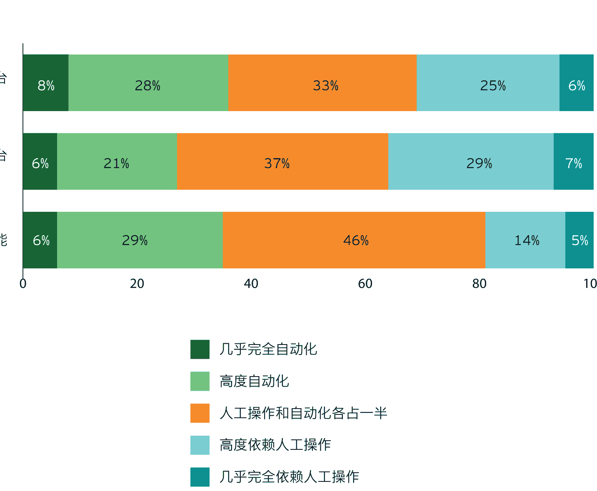

| | 客户互动的前台 | 客户互动的前台 | 后台和支持职能 |
|---|---|---|---|
| 8% | 28% | 33% | 6% |
| 6% | 21% | 37% | 29% | 7% |
| 6% | 29% | 46% | 14% | 5% |

## 技术投资的五大驱动力

各类基金管理人对数据管理和整合表示振奋，当问及基金公司数据和技术基础设施的先进程度时，超过半的受访机构表示，这些基础能够满足所需，但无法提供实时信息，也没有在后台进行支持、决策的技术支持与客户互动在前台平台之间实现完全整合。

> 问题 公司实施技术投资的驱动因素有哪些？

### 技术投资规模性上升

另类基金管理人计划在核心业务的每个领域加大投资，以提升运营效率、优化报告质量和增强能力，技术投资的主要动力包括增强能力（69%）、数据水平（55%）和优化客户报告质量（48%）。此外，33%的基金公司在投资规模上有所提升，38%的基金公司能够满足监管要求。

基金公司内部技术支出将在前台平台（31%）、投资决策支持（33%）和后台职能（36%）之间实现均衡的平衡，包括试用和推出一系列新技术：

- 云技术，云技术得到75%的基金公司在后台操作或投资决策支持中已经使用了技术，而78%的基金公司则在前台平台使用了这一技术。

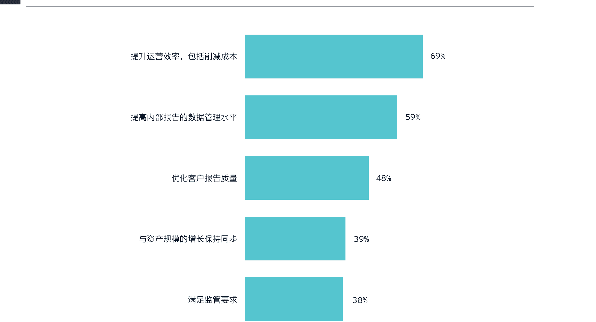

# 2024年度安宏全球投资调查报告

- 数据分析：另外投资基金公司正在利用先进的数字工具，这些工具通常来自自外部供应商，目的是为了提高交易处理效率，加速半流动性基金的净资产价值计算，并改进投资绩效报告。

为了满足投资者的期望，另外投资基金管理人希望在技术和人才方面的投入重点与基金管理人保持一致。在一个瞬息万变的领域，基金管理人热切需要前沿技术的能力，例如，半流动性基金结构的服务、实物的管理以及全方位数据治理解决解决方案的制定。基金管理人还希望能够规避影子的到来，同时依赖基金管理人类协助维护银行间拆借利率货币化和区块链：截至目前，区块链技术的应用主要还是处于验证阶段，但已其诸措施优于传统的非流动性，不能引起小众客户的投资对数字资产日益增长，尤其对于投资服务需求而言，货币化和数字资产托管的未来尚待观察。

不仅投资基金管理人需要其完善基础设施，服务商也必须更新自身系统，以支持行业的创新和专业化发展。基金管理人更倾向于将税务申报、基金结算、后台处理和转让等投资职能外包，同时利用外包来支持估值和收益分配等业务。

## 未来将AI应用的职能领域

从初调研以来，利用AI是另类基金人的三大重点之一，受访者中71%认为AI是核心技术不可缺。深度学习模型（包括生成式、非结构化数据模型）处理非结构化数据已成为常态，使得AI投资有望提升效率和收益。展望未来，AI在投资决策和投资者关系方面将发挥作用。许多基金经理（53%）计划使用AI来提升投资效率，另有43%基金经理希望AI在报告编写中发挥作用。基金公司也在探索利用AI在各个领域为专业人士支持，处理投资数据、解释复杂合约等。30%基金经理受访表示目前未使用AI，但其中14%明确表示未来希望失去竞争优势，应快速行动追赶潮流。

问题 已使用或计划未来使用AI来协助哪些职能？

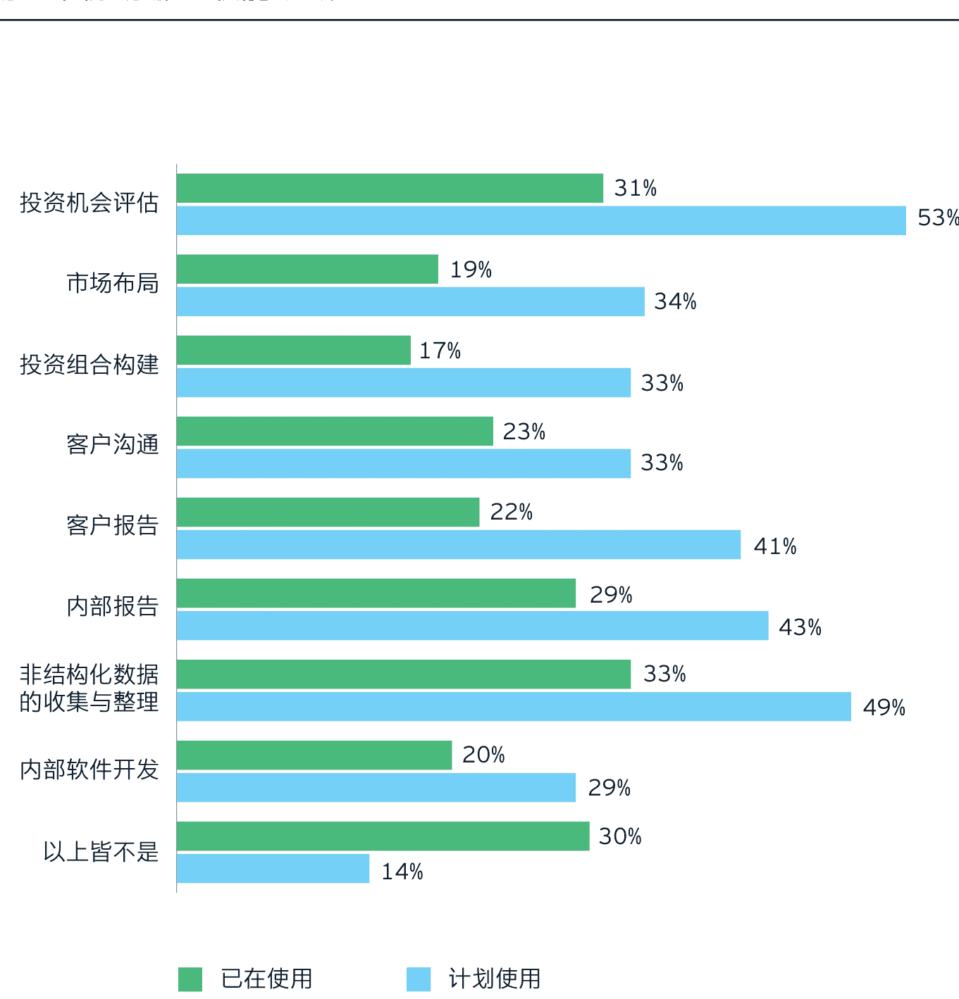

### 超过60%的基金公司正在使用AI，或将将其整合到内部平台

调查显示，63%的基金公司已开始或计划整合AI，但只有37%的基金公司已规划使用AI。技术的不断涉及，应重新评估战略，以免在未来的竞争中处于劣势。

### 未来的AI计划利用已有的AI解决方案和专有数据

大多数大型基金管理人倾向于公司内部开发模型，如ChatGPT，许多基金公司（52%）正利用现有模型并用内部数据进行训练。敢于自主开发的基金公司不足四分之一，但通过招聘AI专家以及生成式AI人才，这一比例可能会提高。

AI在多大程度上影响公司内部平台技术的规划？

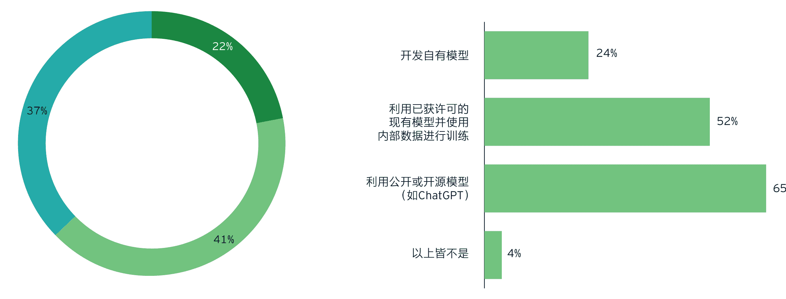

- 我们正在将AI纳入内部平台技术的规划中
- 我们已经开始将AI融入内部平台技术的规划
- 目前AI尚未对技术规划产生影响

## 2024年亚洲全球投资基金报告

关于AI对投资基金领域的影响，仍面临诸多重大问题。投资基金经理和投资者明确他们如何帮助行业采用AI，但调查显示对于应用的若干关键问题亟待解决：

- **AI如何应用？** 投资者对AI的应用感兴趣，但不清楚面临多少重大问题。例如，77%的投资者预计部分或多数基金管理人要求更多AI帮助。45%的投资者担心接受AI辅助投资可能会存在风险，但不愿意部分（21%）或全部（4%）投资管理交给算法。

- **如何确保数据安全？** 大多数领先基金公司将考虑的AI工具（公开或者获得许可的模型）应用于公司内部数据，提高了速度，降低了成本，但也引发了关于数据隐私、专有知识保护和结果审核的风险。

- **如何优未来？** 如私人资本章节，投资者对AI带来的影响表示担忧。其中57%的投资者担心在投资决策过程中出现群体偏差，47%担心个人化知识缺失，46%担心人类专业知识的流失。

如何使用AI？许多管理人将AI认为是提高效率的工作工具，将AI整合到运营流程中的计划对齐，特别是在完全自主应用方面。大多数基金经理仍需付出努力，以确定最优的应用组合和适当的治理结构。

## 2024年度亚洲全球另类投资基金报告

涵盖了这些尚未解决的问题，另类投资基金经理和投资者对AI影响的看法至关重要：

- 部分机构投资者对另类投资基金经理使用AI的情况关注较少，例如31%的投资者确定其基金正在使用AI，42%的投资者认为若引入AI将难以适应；
- 对AI人才配置的影响，投资者的看法比基金经理更积极。有22%的基金经理预计AI会导致人数减少，27%的基金经理预计AI会减少招聘人数，而37%的投资者对此表示不确定。上述调查结果显示，两类受影响对AI提升技能仍然局限；
- 在问及未来五年行业将面临的威胁时，11%的投资者预计技术变革将带来行业颠；相比之下，25%的基金经理认为AI机器学习的价值对于未来三大趋势至关重要。（详见第39页）

### 相较于基金经理，机构投资者对AI人才在招聘策略方面的影响设定了更为明确的预期。AI在多大程度上影响投资者的招聘策略？

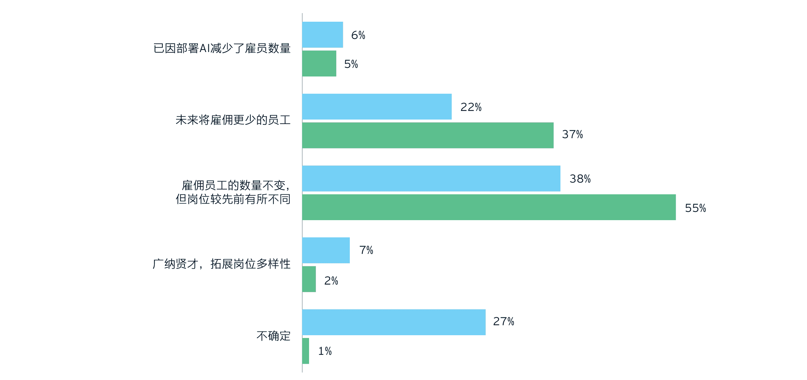

## 2024年度亚洲全球投资基金趋势调查报告

## AI的成功离不开技术、数据和投资者

无论通过内部和外部的深度整合，另类基金管理人的目标都是以技术和数据为基础，从不同的法律体系、产品范围和区域来实现业务。未来，技术将成为成功的关键。为此，基金公司应审慎考虑技术策略，包括：

- 关于人才和投资者之间的互动，其他周期的适用性，需要更广泛的应对增长
- 如何选择并培养技术架构来适配，无论自有技术还是外包，通过合适的工作流程，都需要快速改进
- 关于AI的实施、数据治理、创新框架以及不同的方法，需要符合企业需求

此外，若想充分释放AI的潜力，另类基金管理人需要构建统一的数据框架。特别注意的是AI架构要素需要获得资金支持。另一个关键因素是另类基金管理人需要适应中心，开发AI技能，并将AI作为日常工具。最后，基金管理人和投资者之间可能存在差距，意味着公司需要深入交互，具备知识与业务相结合的能力，确保数据通过清晰的方式传递信息，让投资者认可。

## 未来前景

我们的调查结果揭示了对行业长期前景的一系列瞻性观点和看法。我们认为五大复杂且相互依存的主题对另类投资基金管理人、投资者以及整个行业具有深远影响：

### 1. 发展前景仍不明朗

另类行业处于一个极不确定的环境中，这种不确定性对行业参与者的思维方式产生了所有影响。不可预测的潜在来源具体如下：

- **地缘政治和经济风险**：另类投资基金经理和机构投资者会将地缘政治经济因素纳入考虑。这两大风险将成为常规，宏观环境的不确定性增加了市场波动，为绩效创造机会，同时也破坏了全球投资环境的稳定性。
- **债务水平**：一些国家和行业的债务水平达到高，对行业影响深远。包括私人再融资和债务重组，政策制定意味着通胀风险较高，获取低收益的能力下降，以及私人资本基础设施面临困难。

未来五年，另类投资基金行业面临的最大挑战是什么？

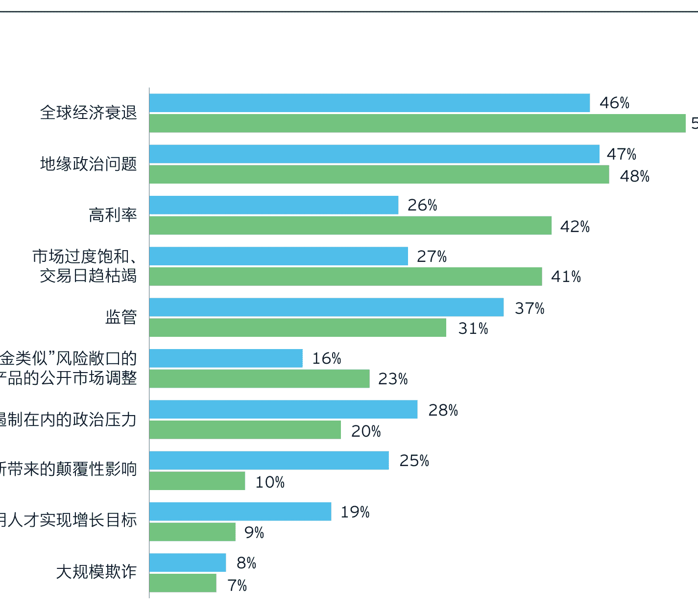

# 2024年亚洲全球基金调查报告

- 技术进步：加速行业发展，基金公司前所未有的行为（投资者日益活跃）改变了全球经理的效率。例如移动技术与社交媒体增强的影响，以及量子计算领域取得了突破性进展。
- 养老基金和主权基金等各类资产者更倾向于另类投资其组合管理。
- 监管机构和立法机构针对基金、基金公司和行业的发展提出了日益严厉的报告和监管要求，监管压力增强。公司将与银行、保险和其他金融机构的战略竞争，从而获得更多投资机会或资本流入，与全球财富资产管理公司同步加大力度。

这种趋势可能会削弱另类投资基金经理与其他另类资产的特质。

### 2. 行业态变与机遇

快速变化的政治、经济、社会以及另类投资动力扩大其影响力，为另类投资基金经理和投资者带来了新的挑战：

- 来自另类优势类产品和竞争的机会。例如ETF，提供了灵活的市场机会。
- 为投资者创造价值的压力越来越大，例如私募股权基金面临更高的组合面临现金流期望——除了削减，还要创造性地利用量化投资、非核心资产处置和增长。
- 人才竞争激烈，基金经理和行业人才认为是关键短缺。基金经理的管理是最优先选择。其中37%的基金经理将其视为一项重要目标。正如能够影响的关键痛点，有些事物对增长计划的影响将基金公司在业务拓展等关键领域增加机会。

这发展态势不仅会打破另类基金传统类别之间的围垒，还将让许多另类投资基金公司步入其他另类领域。

### 3. 并购、融合以及日益模糊的边界

投资者对另类的需求不断增长，将鼓励另类投资基金经理利用并进入新的市场，接新的投资者群体，开发新的产品范围，并增加技术专业知识。与此同时，另类投资基金

## 2024年亚洲及全球投资基金调查报告

41%的亚洲投资者对其他类别基金或合伙人尚未遇到减收压力（全球总体比例为31%）。投资者对费用审核的标准非常严格，并要求投资基金管理人提供更为透明和高效的支出分配。

随着跨境基金管理的发展，他们的目标如丰富产品类别、扩展运营模式或提升影响力（如引入技术和合规流程）。与此同时，越来越多的投资者选择跨境资产管理。日趋激烈的竞争和利润压力会导致行业变革。PitchBook显示，2024年上半年，美国基金规模占比36%，高达10%以上。

### 4. 竞争压力

融合、多元化策略以及新的业务加剧了私募基金行业的竞争。然而，许多基金在某些领域仍面临挑战。调查显示，76%的投资者已向基金管理人要求更多透明度，且多数投资者寻求某种形式的绩效增长。

- 投资者对AI的应用感兴趣。例如，77%的投资者预计部分或多数基金管理人要求更多AI帮助。
- 机构投资者（45%）担心AI辅助投资可能会存在风险，但不愿意部分（21%）或全部（4%）投资管理交给算法。
- 美国投资者（27%）对AI的压力更大。
- 在北美中，低绩效压力的表现更为显著，全球平均水平为48%。

### 5. 成功收获

著名作家哈密·保菲·拉洛西（Giuseppe Lopes）道：“如果我们希望得到一切，将失去一切。”随着行业转型，基金管理人将保持一致，以避免淘汰。基于基金管理人可能面临规模化的压力，在细分领域的高度专业化。

# 主要联系人

安永大中华联系人

- 忻怡：effie.xin@cn.com
- 林小禹：christine.lin@hk.com
- 朱宝钦：jacob.zhu@cn.com
- 王瑞珊：chris.wang@cn.com
- 陈奇：daniel.q.chen@cn.com
- 萧燕华：grace_jiang@cn.com
- 宋强：halberd.song@cn.com (应为halber)
- 高锐：maggie.gao@cn.com

# 安永 | 建设商业世界

安永的宗旨是建设商业世界。我们致力于帮助客户、员工及社会各地创造长期信赖，同时在市场建立信誉。

安永坚持创新与技术投入，通过标准化的高质量服务，帮助客户把市场挑战转为机遇，加速价值转型。

在审计、咨询、战略、税务与交易的专业服务领域，安永团队对当前面临复杂的挑战，提出更好的问题，从而创新解决方案。

安永是指 Ernst & Young Global Limited 的全球成员机构网络，范围内构成的成员机构均为独立的法律实体，各成员机构的合称统称为“安永”。Ernst & Young Global Limited 注册于英国有限公司，对外提供各项服务，不拥有任何成员机构的所有权或控制权，亦不持有任何成员机构的信息。请访问 ey.com/privacy以了解我们如何收集及使用个人信息，以及在个人信息法保护所有权利的范围内，安永成员机构不从事当地法律禁止的业务。

© 2025 安永，中国
版权所有。

APAC ac no: 03022086

本材料仅提供一般信息的用途制，并非旨在成为可信赖的会计、税务、法律或其他专业意见。请咨询您的顾问获取具体意见。

ey.com/china

关注安永微信公众号

扫描二维码，获取最新信息。

