# 2024年新能源市场年度竞争报告

【 2025年1月 】

商业平台中心 行业研究组

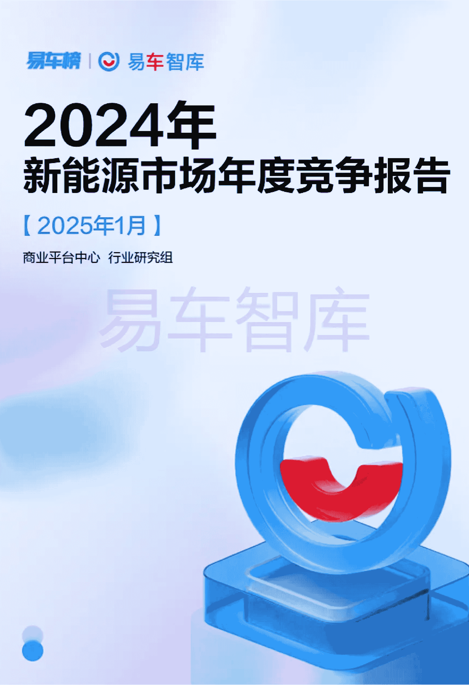

## 免费 价值 及时 专注
### 扫码加入 知识星球TOP免费资源群

- 每日免费获取有价值资源
- 可提供各类资源搜索服务

| 热门付费文章 | 各行行业报告 |
| :--- | :--- |
| 精选图书资源 | 副业赚钱方法 |
| 职场实用资源 | AI政经自媒体 |

公众号: 知识星球TOP 微信信号: jntsg8 微信: jntsg2

分享资料仅供个人学习，请及时删除，切勿商用传播

## 数据说明
### 数据来源说明

- 对比次数：来自用户PK选车行为，为保证对比准确性，范围选取当月有对比行为的新能源车系与竞品的对比行为，细分市场、动力类别、品牌阵营等的对比次数从车系对比次数汇总得到。

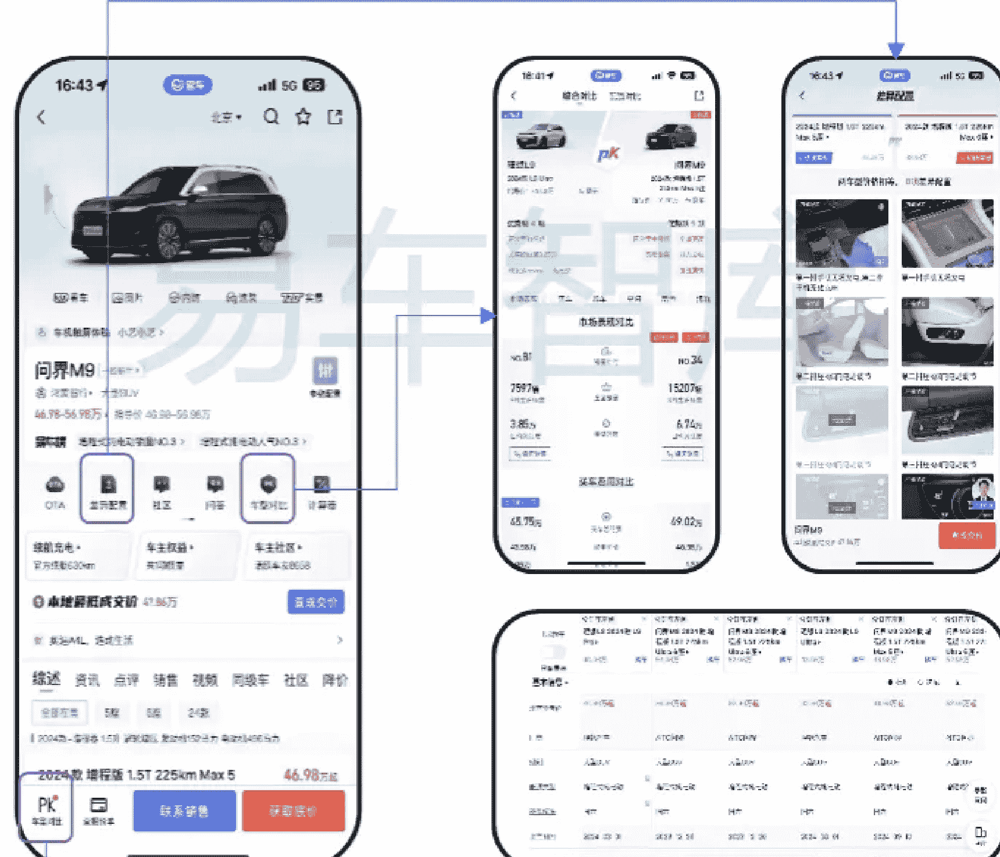

## 模型说明
### 数据基础指标说明

- 竞争份额：对本细分市场、品牌或车系对比分流的竞品所属市场、品牌或车系的对比次数份额。
- 系成交价：按车系各版本销量占比加权平均后的成交价格，车系终端成交价格来源于易车主用户上传成交价格，覆盖市场零售量约20%。
- 成交区：按市场月平均成交价格分组汇总得到。

### 车系竞争指数模型

- 为分析某细分市场中，不同产品的标杆程度，即用户选车时最常对比的产品，我们以用户对对比行为为基础，拟合了车系竞争指数。算法为某细分市场中本品占其余所有有竞品的对比次数份额的权重，并为便于解读和排序使用，在结果基础上上乘以100。
- 此算法相对于直接以市场份额作为标杆更好，主要的特点为竞争强度中所有产品平权，客观评价哪些车系与领先多款竞品产生竞争关系。

> 竞争指数计算举例（新能源20-30万对比TOP10竞争圈，2024年11月）

# 理想L6, 产品标杆度=181 | Model Y, 产品标杆度=157

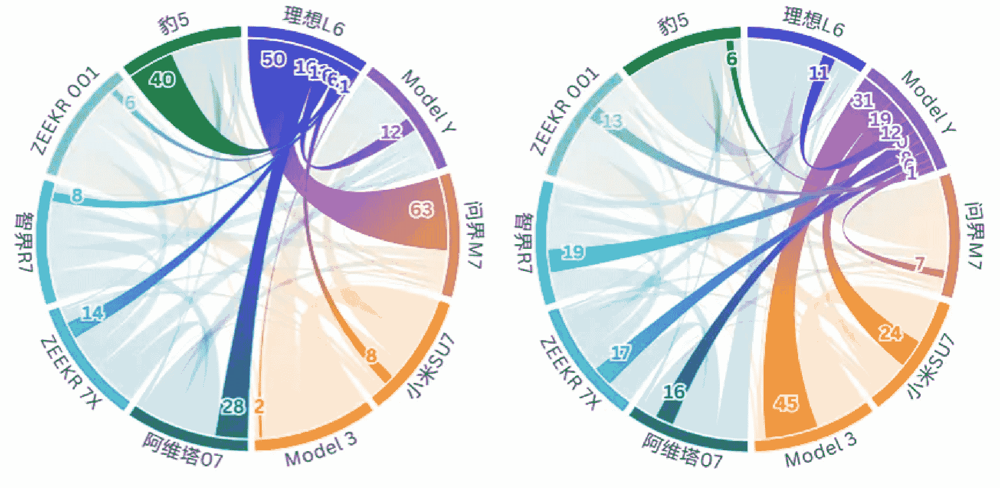

## 品牌阵营
### 品牌分类规则

- 根据品牌国别、价格定位、股权结构、产品和解决方案主要提供方等多种因素划分。

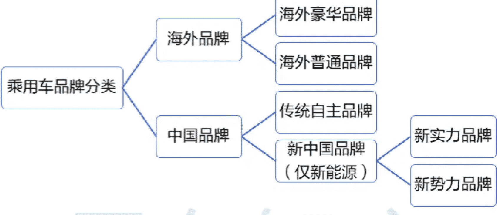

- 海外品牌：按品牌定位分为海外豪华和海外普通，特斯拉属于海外豪华，贵等被国内车企购的海外品牌依然属于海外。
- 传统自主品牌：新能源转型前已存在且有燃油产品的中国品牌。
- 新实力品牌：传统自主品牌转型化或深度参与并主导建立的新能源品牌。
- 新势力品牌：此前无造车经验，独立建立或提供主要要素商业模式及解决方案（如互联网造车）的中国新能源品牌。

### 主要品牌分类

| 类别 | | |
| :--- | :--- | :--- |
| 海外豪华品牌 | | |
| 海外普通品牌 | | |
| 传统自主品牌 | | |
| 中国新势力品牌 | | |
| 中国新实力品牌 | | |

## 新能源市场2024年竞争
### 级别、竞争格局

- 15万以下级别份额提升，同比23年变化较小。
- 15万以下车型对比次数增多，超过五分之一，竞争份额明显。

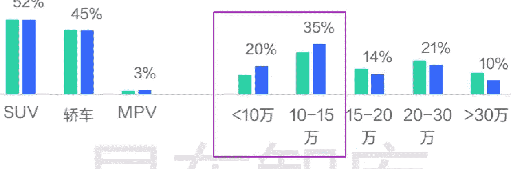

- 15万以下车型对比次数增多，对比23年24年份额。

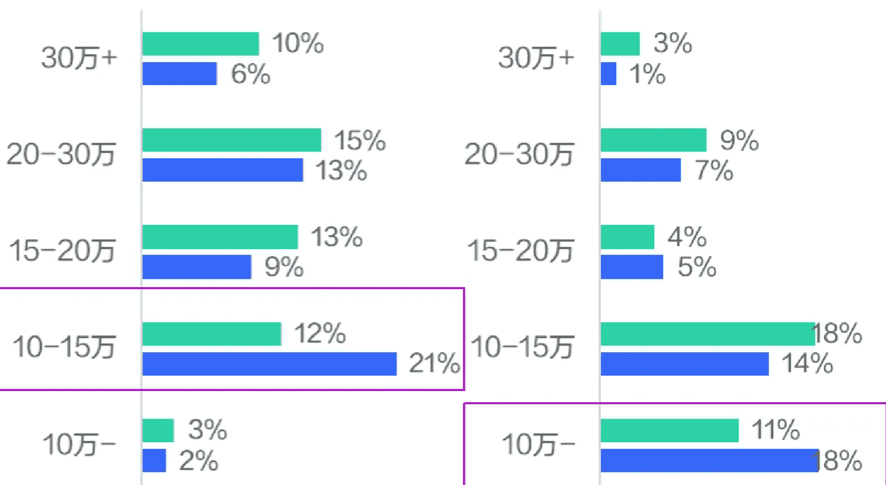

## 新能源市场品牌阵营格局

- 海外品牌被新实力和新势力进一步瓜分，只剩不到。
- 新实力与传统自主、新势力之间的竞争加深。

| 年份 | 传统自主 | 海外品牌 | 新势力 |
| :--- | :--- | :--- | :--- |
| 2023 | 53% | 17% | 14% |
| 2024 | 54% | 9% | 17% | 

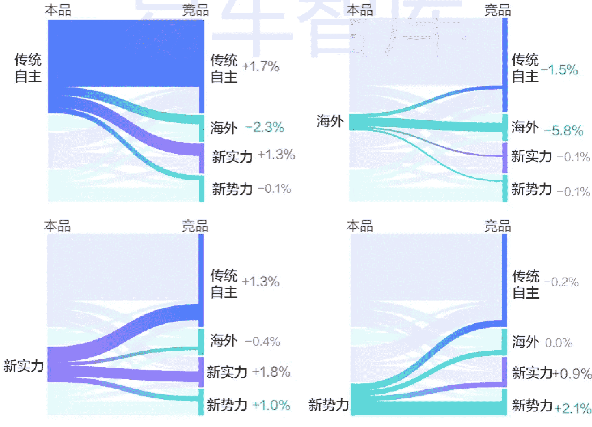

## 市场竞争格局

## SUV市场

- 中低价头部品牌竞争减弱，高价向头部集中。
- 20万以下车型头部品牌缩减，但集中在个别品牌。
- 20万以上高端车型中，竞争主要集中在理想和。

| 品牌 | 头部份额 | 外部份额 |
| :--- | :--- | :--- |
| 吉利几何 | 32% | -7% |
| 五祺汽车 | 27% | +27% |
| 广域汽车 | 13% | -15% |
| 比亚迪 | 10% | +10% |
| 宝骏 | 10% | +3% |

| 品牌 | 头部份额 | 外部份额 |
| :--- | :--- | :--- |
| 比亚迪 | 40% | -13% |
| 吉利银河 | 10% | +10% |
| 奇瑞 | 6% | +3% |
| 埃安 | 5% | -8% |
| 零域汽车 | 4% | +4% |

| 品牌 | 头部份额 | 外部份额 |
| :--- | :--- | :--- |
| 比亚迪 | 32% | -8% |
| 哈弗 | 12% | 0% |
| 零域汽车 | 12% | +6% |
| 捷途 | 10% | +10% |
| 深蓝汽车 | 9% | +1% |

| 品牌 | 头部份额 | 外部份额 |
| :--- | :--- | :--- |
| 鸿智行 | 18% | +6% |
| 理想汽车 | 11% | +11% |
| 特斯拉 | 9% | -6% |
| 强越 | 7% | +4% |
| 比亚迪 | 6% | -19% |

| 品牌 | 头部份额 | 外部份额 |
| :--- | :--- | :--- |
| 理想汽车 | 46% | +2% |
| 鸿智行 | 13% | +13% |
| 坦克 | 13% | +10% |
| 启界 | 8% | 0% |
| 斯界 | 2% | +96% |

- 趋势说明：分市场车型、头部品牌的市占份额对比市场份额的变化，包含头部车型与与其市场车型产出的对比行为。
- 数据来源：易内部

### SUV市场型竞争格局

- SUV-10万以下车型较少，主要集中在吉利几何、哪吒、五菱。
- 10万以下车型TOP10竞争中主要是比亚迪。

| 车型 | 竞争指数 |
| :--- | :--- |
| 吉利几何 | 490 |
| 哪吒 | 216 |
| 五菱 | 136 |
| 宝骏悦越 | 128 |
| 纳米 | 114 |
| 宝骏悦越 | 90 |
| 东亚网 | 71 |
| 元Pro | 63 |
| 哪吒V | 24 |

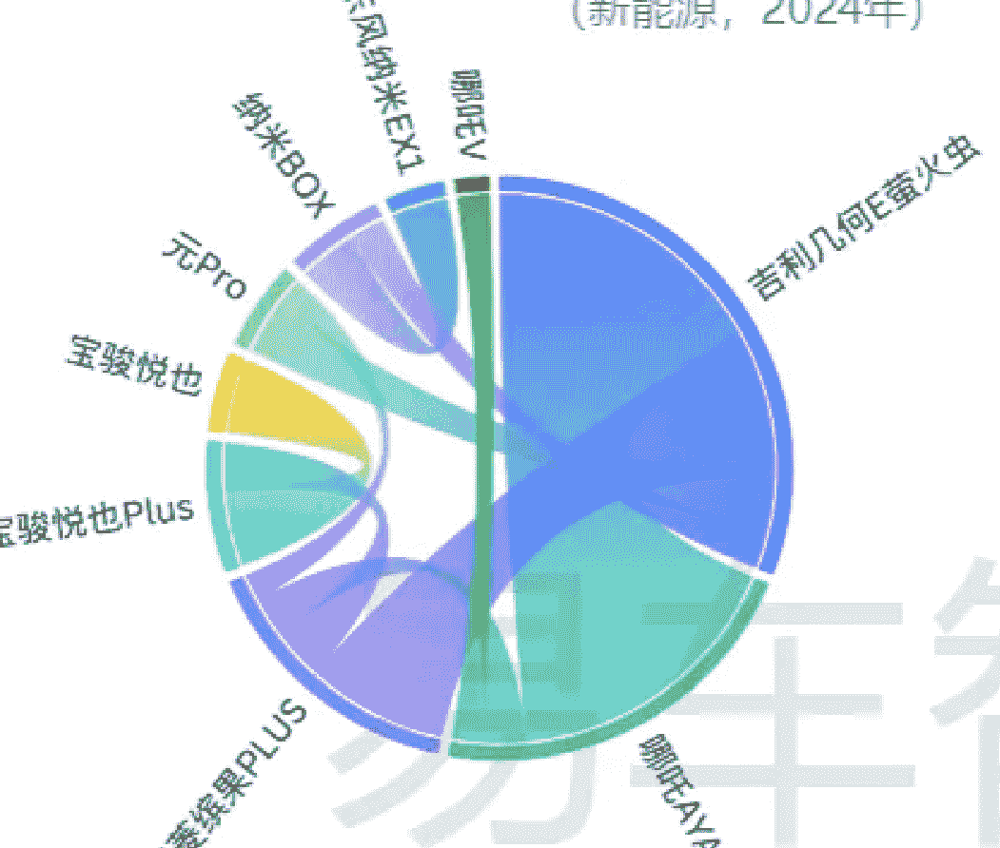

- 10-15万车型TOP10竞争中。

| 车型 | 竞争指数 |
| :--- | :--- |
| 宋PLUS | 776 |
| 元PLUS | 562 |
| 宋Pro | 474 |
| 银河E5 | 304 |
| 银河L7 | 299 |
| AION Y | 267 |
| 长安Q05 | 221 |
| 零跑C10 | 208 |
| 零跑C11 | 143 |
| 元UP | 131 |
| ID.4ZZ | 116 |
| ID.4 X | 107 |

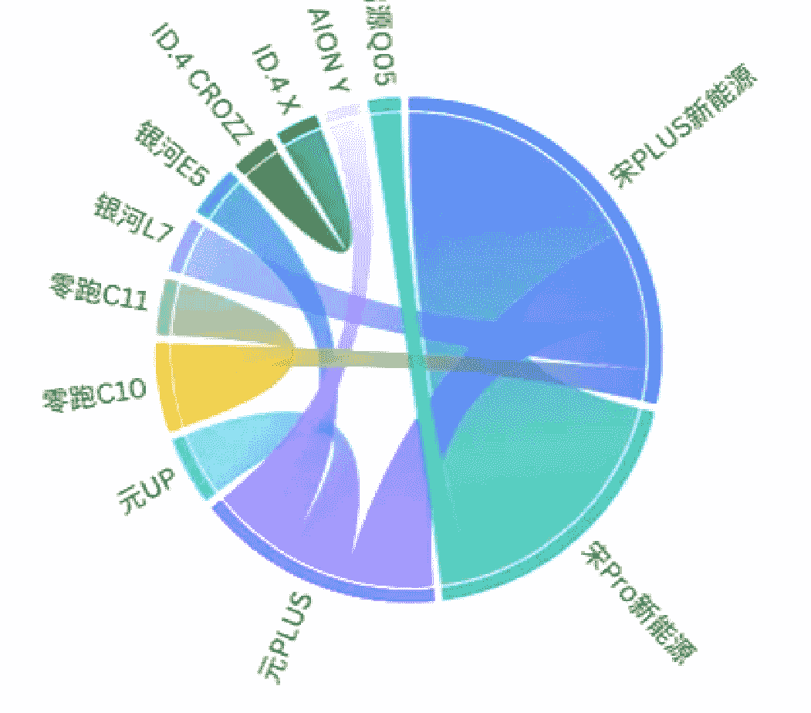

### SUV市场格局

- 15-20万型竞争活跃。
- 20-30万型中，Model Y竞争指数排名第二，稍弱。

| 车型 | 竞争指数 |
| :--- | :--- |
| 唐新 | 602 |
| 深蓝S07 | 437 |
| 别克E5 | 420 |
| 哈龙PHEV | 321 |
| 零跑C16 | 245 |
| 捷山海T2 | 223 |
| 零跑C11 | 143 |
| 宋DM-i | 138 |
| 捷途山海9 | 125 |
| 别克E4 | 105 |
| em008 | 99 |
| 护卫舰07 | 96 |
| 哈二代大PHEV | 89 |

| 车型 | 竞争指数 |
| :--- | :--- |
| 问界M7 | 569 |
| Model Y | 566 |
| 理想L6 | 403 |
| 元5 | 240 |
| 问界M5 | 237 |
| 坦克400新能源 | 191 |
| 魏麟蓝山 | 191 |
| 星纪ET | 178 |
| 智界R7 | 80 |

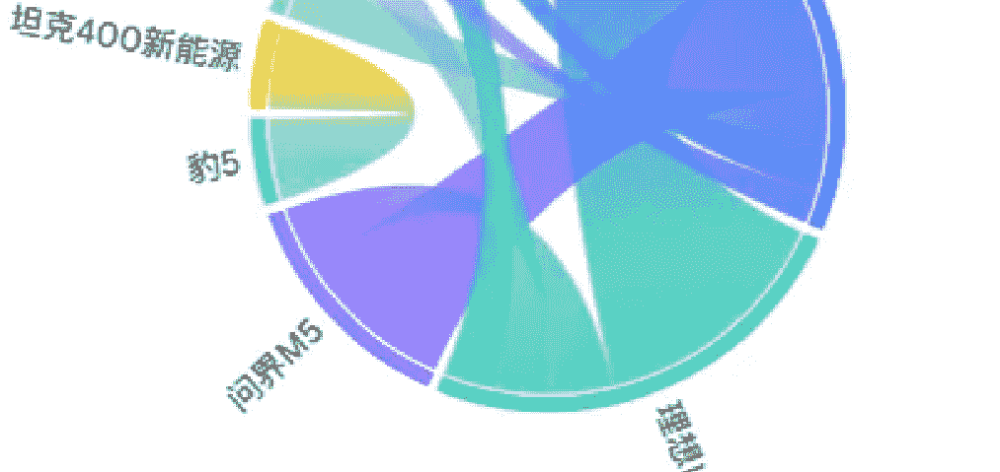

### SUV市场车型竞争格局

- SUV-30万以上车型，TOP10竞争组中，理想车型存在最强，但主要是品牌内部竞争。
- 细分市场全车型中，问界M9竞争最强，最具标杆意义。

| 车型 | 竞争指数 |
| :--- | :--- |
| 问界M9 | 583 |
| 理想L9 | 451 |
| 蔚来ES6 | 351 |
| 坦克700新能源 | 346 |
| 理想L7 | 288 |
| 理想L8 | 285 |
| 坦克500新能源 | 188 |
| 蔚来ES8 | 117 |
| 蔚来EC6 | 114 |

## 轿车市场格局

- 20万以下车型中，比亚迪份额直接。
- 20-30万车型中，主要是其他品牌的竞争。

| 品牌份额 | 品牌 | 外部份额 |
| :--- | :--- | :--- |
| 2024 vs 2023 | 比亚迪 | 47% + 25% = 100% |
| 10万以下 | 比亚迪 | 78% |
| 五华汽车 | 比亚迪 | 90% |
| 吉利汽车 | 比亚迪 | 38% |
| 长安启迪 | 比亚迪 | 84% |
| 10-15万 | 比亚迪 | 45% - 13% = 48% |
| 长安启迪 | 比亚迪 | 97% |
| 吉利银河 | 比亚迪 | 77% |
| 深蓝汽车 | 比亚迪 | 66% |
| 奇瑞 | 比亚迪 | 77% |
| 15-20万 | 比亚迪 | 64% + 63% = 53% |
| 吉利银河 | 比亚迪 | 72% |
| 领克 | 比亚迪 | 74% |
| 大众 | 比亚迪 | 75% |
| 碑沃汽车 | 比亚迪 | 87% |
| 20-30万 | 小米汽车 | 29% + 29% = 78% |
| 理想汽车 | 小米汽车 | 70% |
| 特斯拉 | 小米汽车 | 84% |
| 鸿智行 | 小米汽车 | 45% |
| 30万以上 | 秀龙 | 54% |
| 阿维迪 | 秀龙 | 73% |
| 宝马 | 秀龙 | 61% |
| 鸿智行 | 秀龙 | 88% |
| 保捷 | 秀龙 | 88% |

# 轿车市场车型竞争格局

- 10万以下车型比SUV同价区间选择更多，TOP竞争组中玩家更多。
- 10-15万车型中，除了秦L和海豹06之间的竞争份额超高，其余竞争组及各车型的竞争指数较为均衡。

| 车型 | 竞争指数 |
| :--- | :--- |
| 海豹 | 577 |
| 鸿界 | 533 |
| 秦L | 418 |
| 宋PLUS | 390 |
| 长海L6 | 338 |
| 宝骏悦越 | 250 |
| 纳米 | 201 |
| 宝骏悦越 | 140 |
| 东亚网 | 117 |
| 元Pro | 92 |
| 哪吒 | 69 |

# 轿车市场车型竞争格局

轿车-30万以上车型中，TOP竞争组最具多元化，竞争指数差距小，细分市场标杆弱化。

## 轿车-30万以上车型TOP10竞争组
(新能源，2024年)

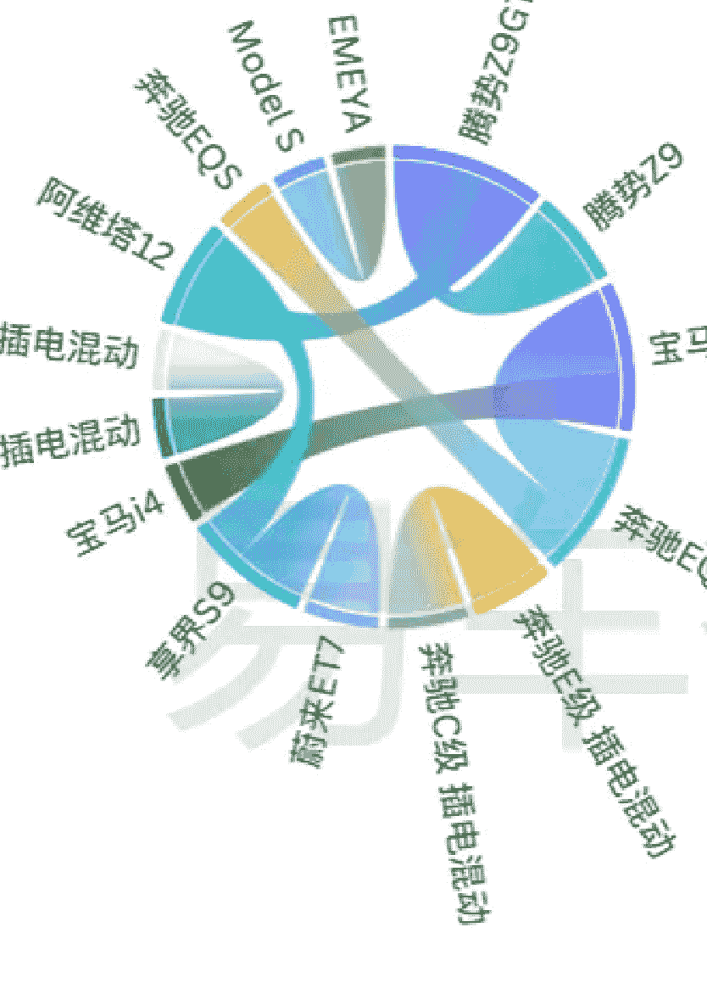

| 车型 | 竞争指数 |
| 阿维塔12 | 292 |
| 宝马i5 | 251 |
| Model S | 204 |
| 奔驰EQE | 184 |
| 腾势Z9GT | 177 |
| 奔驰C级插混 | 166 |
| 沃尔沃S90插混 | 156 |
| 奔驰E级插混 | 155 |
| 蔚来ET7 | 146 |
| 奔驰S | 134 |
| 沃尔沃S60插混 | 134 |
| 享界S9 | 130 |
| Model E | 126 |
| 宝马i4 | 64 |
| 腾势D9 | 62 |

注：左侧图TOP10竞争组为此处市场车型中对比次数最多的10组，右侧表展示TOP10竞争组中包含的车型，竞争指数是以分市场整体车型计算。关注智库公众号。

## SUV市场
30万以上
20万-30万
15万-20万
10万

## 轿车市场
30万以上
20万-30万
15万-20万
10万

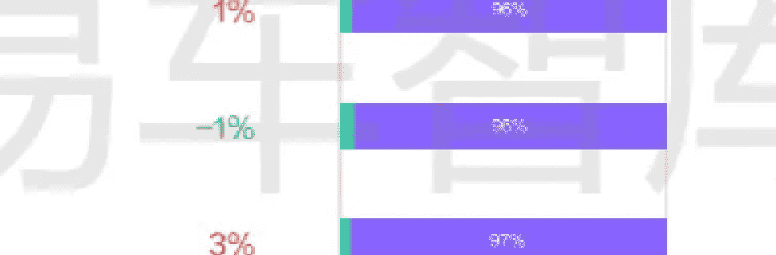

## MPV市场
30万以上
20万-30万
15万-20万
10万

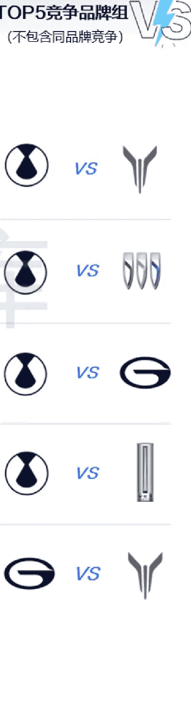

## MPV市场竞争格局
2024年MPV市场，由于腾势、传祺E8、岚图梦想家等品牌的加入，细分市场竞争更加激烈。

| 品牌 | 份额 | TOP5竞争占比 |
|---|---|---|
| 腾势 | 21% | |
| 广汽 | 19% | |
| 广汽 | 14% | |
| 别克 | 8% | |
| 极氪 | 7% | |
| 理想 | 5% | |
| 小理想 | 4% | |
| 上汽 | 4% | |
| 江瑞 | 3% | |
| 比亚迪 | 3% | |
| 红旗 | 2% | |
| 理想 | 2% | |
| 沃尔沃 | 1% | |

竞争份额：细分市场内某品牌产生的占比，竞争指数定义在细分市场内。

## MPV市场竞争格局
MPV车型较少，TOP竞争组中，竞争指数较高的是腾势D9、传祺E8新能源、岚图梦想家。

## MPV车型TOP10竞争组
(新能源，2024年)

| 车型 | 竞争指数 |
|---|---|
| 腾势D9 | 444 |
| 传祺E8新能源 | 337 |
| 岚图梦想家 | 331 |
| ZEEKR 009 | 189 |
| 小鹏X9 | 158 |
| 传祺E9 | 123 |
| 别克GL8插混 | 95 |
| 魏牌高山 | 85 |
