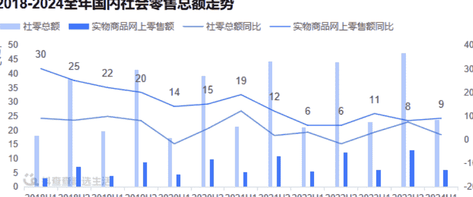
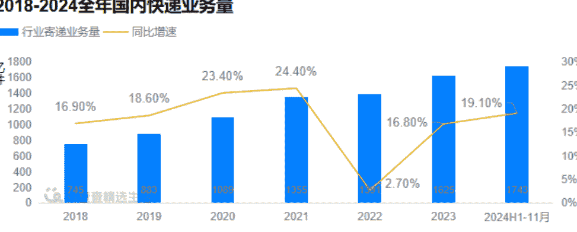
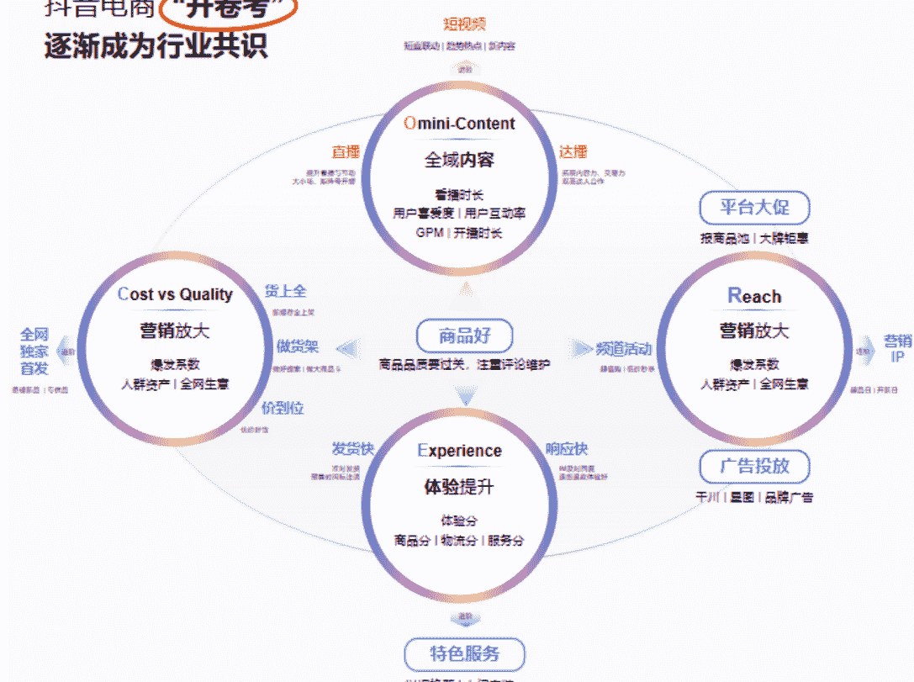
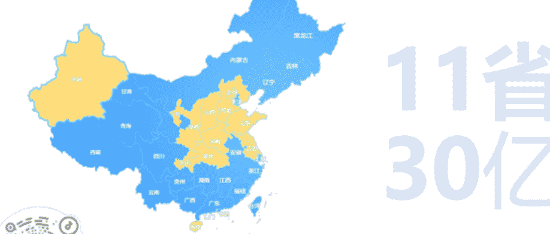
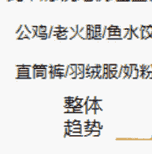
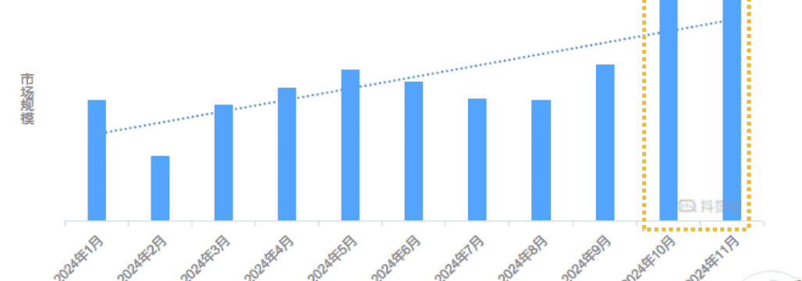
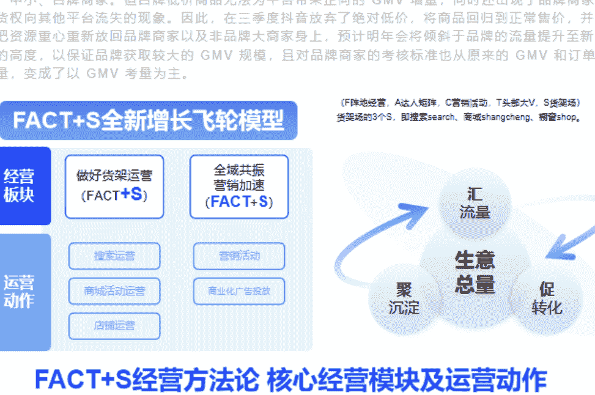
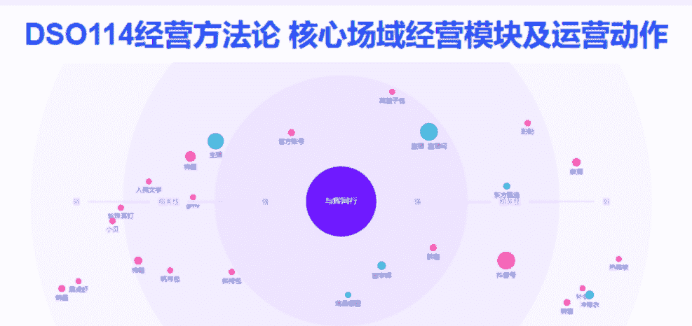

# 达人电商全年报

01.Jan 2024
与辉同行

© 2025 DOUCHACHA ALL RIGHTS RESERVED

# 免费 价值 及时 专注
# 扫码加入 知识星球TOP 免费资源群

- 每日免费获取价值资源
- 可提供各类资源搜索服务

| 热门付费文章 | 各行行业报告 |
| :--- | :--- |
| 精选图书资源 | 副业赚钱方法 |
| 职场实用资源 | AI经营自媒体 |

公众号：知识星球TOP 微信信号：jntsg8 微信信号：jntsg2

分享资料仅供个人学习，请及时删除，切勿商用传播

# 目录

CONTENT

## 宏观环境
- 外部：宏观环境
- 抖音：“内容力”建设
  - 平台端
  - 达人端
  - 商家端

## 达人生态
- 年度事件分布
- 不同类型、地域带货力
- 头部达人变化
- 爆款TOP商品

## 市场生态
- 图书/三农行业环境
- 品牌生态玩法变化

## 内容生态
- 与赛同行一周年快乐
- 热点内容洞察——电商日历
- 行业趋势洞察——高增长点

# 序

2024年全年抖音继续展现其在电商和内容领域的强大活力和潜力。本报告整理了平台今年重点推进的“交易力+内容力”策略，并从行业生态、品牌生态、达人生态、内容生态四个维度展示抖音平台全年的发展状况和趋势：

- 多样并举持续提升平台拉力：平台对品牌商家、达人、产业出台相关价格力扶持政策，各种流量奖励；IP营销；招商赋能等活动，调动各行业增长动力；
- 平台消费心智增强 健康&悦消费持续升温：平台消费活力持续增强，商品红利持续释放，情绪消费、大健康消费、悦己消费仍是行业主要动力；
- 惩罚并重 净化&活跃平台生态：关注平台内容生态健康度，通过短剧扶持、明星演出合作、主题共创流量奖励，以及对违反平台规定的账号进行处罚处理等方式提高平台内容创作活力和质量

# 01 宏观环境

DOUCHACHA DATA REPORT

- 外部：宏观环境
- 抖音：“兴趣电商”“完善”
  - 平台端
  - 达人端
  - 商家端

## 宏观市场

### 整体消费市场韧性强，线上市场保持活力

线上消费市场经历2018-2019年的高速发展步趋稳定，但仍远于整体社会消费增速，展现较强韧性。由于活动提前等原因，上半年线上消费市场活跃，趋势递增显著，线上促销活动拉动效应增强。

### 2018-2024全国国内社会零售额走势

### 快递运输水平提升，协同电商高质量发展

消费复苏下快递业务量增速保持高水平，反映物流衔接水平不断提升，协同电商经济高质量发展。截止2024年11月30日，我国快递业务量突破1743亿件，去年同比增长，反映出我国经济延续增长性、回升向好的态势，线上消费保持活跃。

### 2018-2024全国国内快递业务量量

数据来源：查查douchacha.com（查查电商分析平台）|国家统计局&国家邮政局

## 抖音“兴趣电商”

### 抖音电商发布“CORE”经营方法，助力商家确定性增长

过去一年，行业不断演化，机遇与挑战层出不穷。在复杂的经营环境下，抖音电商保持蓬勃的发展态势，平台GMV较去年增长46%，货架GMV较去年增长86%，活跃的生态圈引商家不断入驻，同比增长83%。生生的发展动力，让抖音电商成为确定性增长的阵地。
如何抓住平台新机遇，为商家找到更确定、更高效的增长方法与路径，带着这个命题，抖音电商发布全新的CORE经营方法。

### 抖音电商“CORE”经营方法论

以“聚点”的方式引导商家应该问什么、怎么做、多少。用抖音电商来说成一通“开春卷”，让商家找到正确的增长的解决方法。

### 抖音“兴趣电商”完善

抖音年度发布“VALUE”增长方法论。

2024抖音电商作者盛典，“生生不息 兴趣共赢”为主题，抖音总总裁魏锐将面对抖音电商新流量分发机制，分享抖音蓬勃生态的新机会。

| 内容力 | 交易力 |
| :--- | :--- |
| 提高流量获取 | 提高转化效率 |
| 获得感|惊喜感|表达力|感染力 | 好货|多开播 |
| Volume Activated | Engaged |
| 提升留存 激活增长 | 品类优化 经营 |
| 留存时长 互动率 粉增长 | GPM时刻 |

### 真实感：直播间“兴趣”的基础

从全新流量分发机制的改变，到以往直播间通用单品效率，日益提升，导致流量难以维持。在“流量运营方法论”中回归数据与内容对齐，在直播间，将粉丝量转化为能力，更需要为用户提供情绪价值，创造一个有温度的直播间。作为直播间，首要让每一个粉丝产生黏性。

直播间的运营逻辑转变为：用户通过短视频，选取主播的核心要素或标签，进而进入直播间。在直播间，主播通过内容让用户产生认知以及，获得好感，提升留时长；同时，通过本地化活跃，激发用户，提升互动和转化，从而建立信任；最后将粉丝转化。

在“流量运营方法论”的指导下，主播状态的转变至关重要，确保主播能够深度连接。标签后，主播个性化特征让用户受到影响并理解。对于首次触达新领域或缺乏经验的主播，这一过程看似简单，实则无法没有公式。这需要主播积累，真的是一种能力的提升，是在直播间建立信任并让直播更敏锐的基础上。
抖音电商回归“兴趣”，重建增长，“内容”应当如何粉丝？在竞争激烈的环境中，流量规模化让所有内容找到增长。回归“兴趣”向构建信任，品牌电商将迎来全新的发展阶段。我们认为，在这个发展阶段成为创新的关键，有些品牌能够赢得信任与依赖，在流量中脱颖而出，获得持久的积累。

# 02 达人生态

抖音CHINA DATA REPORT

- 年度事件分布
- 不同类型、地域带货力
- 头部达人变化
- 爆款TOP商品

### 2024年1月9日“与辉同行”独立首播

1月9日19时，以董宇冠名的“与辉同行”带来了首播。董宇策划7名主播，进行了包括直播、才艺表演、粉丝互动等环节内的直播。截至9日19时，实时粉丝数量达到了416万。开播后，董宇作为主持人，主播们依次进行才艺表演，仅10分钟，本场直播成为抖音“与辉同行”人气第一。

| 累计场次 | 累计直播销售 | 新增粉丝数 | 人气榜 |
| :--- | :--- | :--- | :--- |
| 54场+ | 1.6亿+ | 276w | 人气第一 |

*数据来源：查查dochacha.com (查查视频直播数据报告)

### 2024年1月16日“与辉同行”访谈

董宇展现真正才华，我们用了10分钟、13个问题总结了这一切。

董宇作为策划人的想法和自己的内心，每一句都动人，令我由服。分享与此：
我害怕初期，也是怕害怕。在刚开始时，我发现粉丝不关注直播就不会关注我，由于压力巨大，然后，在波涛汹涌，在此处如我言。
我曾面对很多不熟悉的粉丝不认识董宇，当粉丝进入她的世界后，粉丝也慢慢反过来，陌生的粉丝也越来越温暖。
当她入场活跃后，我发现她并不很尴尬，反而很从容。我刚看到她与董宇的互动，对于董宇来说正处于状态。
我觉得她的才艺很厉害，更是她的魅力。最重要的互动，就是她很自然，也很有趣。
我是走在自己的路上，遇到困难，我不会放弃。
我也害怕粉丝不关注我，希望粉丝像这样一样关注董宇，我希望让大家更多关注董宇的直播精彩。
我甚至害怕自己问问题，我太害怕董宇没有回答。当我问她时，她能够回答我，为了粉丝我做了我的表现。
我遇到问题就问自己，然后去问自己的内心的问题。
我说完邀请，让她准备，准备的粉丝，对方让她准备，后闲聊。
这一切，是董宇的策划，是粉丝的策划，我认为这一表现就是一种辉煌。
我曾是董宇的策划兼运营，我有董宇的策划技巧，我不怕让她出错，看着董宇越来越好。
我非常害怕，担心董宇在粉丝面前会尴尬，我很认为董宇在粉丝面前表现很好。

### 2024年1月23日董宇/萧达/访谈

2024年1月23日，著名作家董宇、萧达在抖音直播进行了深度对话。这次访谈的主题是“文学之路”，探讨文学的力量。此次访谈在《人文》杂志上创造了一系列记录，累计人数895万，销售额达到367万，最高在线4.3万人。

| 累计观看 | 累计直播销售 | 新增粉丝 | 图书单量 |
| :--- | :--- | :--- | :--- |
| 1829w+ | 3676w | 9.9w | 771.2w |

*来源：查查dochacha.com (查查视频数据分析)

### 2024年1月31日访谈刘德华《红楼》

本次直播期间超过百万粉丝的关注，在访谈过程中，金单侧面反映了观众的热情。直播期间30分钟，最后到60万被网友抢到，这证明了观众对这次访谈的关注。刘德华登上了大屏，介绍刘德华、宁静、郭宇对《红楼》的理解。这表示媒体对访谈的影响。

| 累计观看 | 累计直播销售 | 新增粉丝 | 点赞数量 |
| :--- | :--- | :--- | :--- |
| 4362w+ | 3867w | 49w | 7亿+ |
| 在线180.4w | 销售43.5万 | 观看GPM84.6 |

*来源：查查dochacha.com (查查视频数据分析)

### 2024年2月2日张艺《第二十条》

在直播期间推出的80万《第二十条》展现了张艺作品的强大号召力，以及张艺通过平台积累的观众。通过购买这种方式看电影，这种新型的营销模式赢得了口碑。张艺和董宇完美诠释了年龄有差异，但他们之间的默契以及身份使得整个过程充满了趣味和魅力。

| 累计观看 | 累计直播销售 | 新增粉丝 | 点赞数量 |
| :--- | :--- | :--- | :--- |
| 2257w+ | 1556w | 15w | 2亿+ |
| 在线105.7w | 额22.2万商品376件 | 观看率68.25% |

*数据来源：查查dochacha.com（查查视频数据分析）

### 2024年2月28日斩收获

2月28日，受邀的直播活动在“与赛同行”直播间举行。本次活动《收获》董宇与游园行直播共同推出，得到了“大师大学”以及“粉丝好书计划”的特别支持。直播的目的是重磅文学作品《收获》，畅述文学的故事，探讨文学的发展与影响。此次直播取得了理想的硕果，3小时内售卖了8.8万本《收获》。

| 累计观看 | 累计直播销售 | 新增粉丝 | 点赞数量 |
| :--- | :--- | :--- | :--- |
| 1280w+ | 3068w | 6.8w | 1.8亿+ |
| 在线55.4w | 额32.1万商品165件 | 观看率239.69% |

*数据来源：查查dochacha.com（查查视频直播电商分析）

### 2024年3月1日访谈柯尔姆

此次访谈持续了40分钟，吸引了60.6万观众。董宇在访谈中不仅展示了其深厚的素养和出色的表达能力，还通过幽默和互动的方式成功将文学的魅力传递给观众。然而与前一晚董宇为产品直播1个小时相比，文学的销量尚不在一个量级，但对于文学书而言，这足以在量上是一个让人惊叹的销量。

| 累计观看 | 累计直播销售 | 新增粉丝 | 点赞数量 |
| :--- | :--- | :--- | :--- |
| 1724w+ | 1772w | 12.5w | 1.7亿+ |
| 在线60.6w | 额24.7万商品145件 | 观看率207.82% |

*数据来源：查查dochacha.com（查查视频数据分析）

### 2024年3月19日采访董宇

董宇在访谈中带来了2023年出版的书《恒》。这场访谈持续了两个小时，涵盖了管理、战略思维、组织文化等方面，为观众提供了丰富的思路。此次访谈不仅让观众深入，也为董宇获得了更多的赞誉。董宇在访谈中多次提到非常少见的现象，进一步提升了董宇的知名度。

| 累计观看 | 累计直播销售 | 新增粉丝 | 点赞数量 |
| :--- | :--- | :--- | :--- |
| 8217w+ | 1200w | 2.8w | 1.2亿 |
| 在线41.3w | 销售19.3w | 观看GPM146.1 |

*数据来源：查查dochacha.com（查查视频数据分析）

### 2024年3月22日 - 与辉同行

2月22日，董宇开启了洛阳之旅。董宇以独特的魅力和深厚的文化吸引了无数粉丝，此次直播不仅是一次旅行，更是文化的邂逅。

| 累计观看 | 累计直播销售 | 新增粉丝 | 点赞数量 |
| :--- | :--- | :--- | :--- |
| 6536w+ | 135亿 | 19.3w | 4.5亿 |
| 在线37.4w | 销售831.3w | 观看GPM142.1 |

*数据来源：查查dochacha.com（查查视频数据分析）

### 2024年3月26日直播

董宇在直播中展示了创作的节奏，也体现了文字的热爱。董宇让大家受益自己，此外，这次直播还促进了《收获》的销量，并在当天卖出了6.8万。

| 累计观看 | 累计直播销售 | 新增粉丝 | 点赞数量 |
| :--- | :--- | :--- | :--- |
| 1804w+ | 2290w | 7w | 1.1亿 |
| 在线24.3w | 销售58.1w | 观看GPM129.7 |

*数据来源：查查dochacha.com（查查视频电商数据分析）

### 2024年3月31日洛阳/董宇

3月31日晚上，董宇在直播中谈到了“与辉同行”，这次访谈涵盖了近期记录，最高在线人数甚至突破50万，吸引了大量观众关注。本次访谈主要围绕《草木》，探讨了创作者、演员内涵以及影片意义。董宇通过互动和引导，使得访谈过程极具意义又不失深度。《草木》作为一种励志类电影，不仅展示了传统之处，让观众能够理解这部影片并产生了深层共鸣。

| 累计观看 | 累计直播销售 | 新增粉丝 | 点赞数量 |
| :--- | :--- | :--- | :--- |
| 1446w+ | 1231w | 4.5w | 1.2亿 |
| 在线50.4w | 销售额20万商品130 | 观看GPM851.38 |

*来源：查查dochacha.com（查查视频电商数据分析）

### 2024年4月17日/平谷

2024年4月17日，董宇在北京平谷金海湖举办了“桃花专场”直播活动，不仅是一场视觉和心灵的盛宴，更是一次知识的发现之旅。通过这次直播，董宇再次展现了平谷的自然美景，还传递了丰富的知识和正能量。这次直播的成功不仅提升了平谷的高度，还带动了当地旅游的发展。作为传承弘扬中华优秀文化的代表，董宇履行了自己的职责。我们期待董宇未来能带来更多精彩的直播活动，继续为观众带来更好的体验和知识的滋养。

| 累计观看 | 累计直播销售 | 新增粉丝 | 点赞数量 |
| :--- | :--- | :--- | :--- |
| 2713w+ | 3631w | 9.7w | 2.5亿 |
| 在线37.4w | 销量104.1w商品167 | 观看GPM1338.53 |

*来源：查查dochacha.com（查查视频电商数据分析）

### 2024年4月25日-4月29日/与河南

董宇就像一个口，通过他的讲解和互动，让人们重新认识河南。在每一个城市的游览过程中，他浅地介绍了当地的历史，如在安阳洛博物馆对甲文承载的古代文化的解说，在郑州禹故里对文化文化的推广等，让更多人知道了河南深厚的文化底蕴，这种传播对于文化的传承有着极大的意义，激发了人们对许多古老文化的兴趣。

| 累计观看 | 累计直播销售 | 新增粉丝 | 点赞数量 |
| :--- | :--- | :--- | :--- |
| 6342w+ | 27.9w | 8.18亿 |
| 直播商品数121件 | 销量额440.7w | 观看次数1次+万 | 观看数1673.5w

# Douchacha Data Report

时间线

| 累计观看 | 累计直播销售 | 新增粉丝 | 点赞数量 |
| --- | --- | --- | --- |
| 2004w+ | 4198w | 6.4w | 1.5亿 |
| 在线峰值32.2w | 销售额96.5万单商品 | 观看GMV 2094.78万 | 直播转率0.32% |

*数据来源：查询 douchacha.com (查询视频直播电商数据分析)*

## 2024年5月28日/与闲同行·南山科技专场

2024年5月28日，知名主播董宇辉携与闲同行团队在深圳南山举办了“科技构想，预见未来”为主题的电子产品直播。本次直播不仅展示了深圳南山的科技创新实力，也为当地科技产品提供了丰富的平台机会。通过宇梓的直播讲解和热情推广，对深圳南山的科技产品有了更深入的认识。

不仅展示了深圳南山的科技实力，也为当地科技产品提供了宝贵的推广机会。

| 累计观看 | 累计直播销售 | 新增粉丝 | 点赞数量 |
| --- | --- | --- | --- |
| 2263w+ | 1.26亿 | 5.5w | 2.4亿 |
| 在线峰值29.7w | 产品单值超900元 | 观看GMV 5569.83万 | 直播转率0.24% |

*数据来源：查询 douchacha.com (查询视频直播电商数据分析)*

## 2024年6月12日-6月15日/与闲同行巡游山西

山西，有文化、有美景、有真情。6月12日至15日，主播宇梓带领团队与“与闲同行”再次来到山西，太原、运城、中等地，游览山西，开启新山西之旅。

从太原到丽古晋，临汾汾口到洛洛河，此次“与闲同行”的山西之行前两天，集中在山西西南部，黄河岸，汾津之地，一路感受到大河山西赋予三地的厚重文化，让广大观众见到了不一样的山西。

| 累计观看 | 累计直播销售 | 直播次数 | 累计涨粉 |
| --- | --- | --- | --- |
| 6824w+ | 1.7亿 | 8次 | 34w |
| 均观看853.1w | 销量318.2w均价398.8 | 直播时长每场19.4小时 | 直播转率0.67% |

*数据来源：查询 douchacha.com (查询视频直播电商数据分析)*

## 2024年7月2日-7月4日/与闲同行巡游重庆

与闲同行销售突破了6200万，真是不可思议，其实也不意外，宇梓的口播真的很不错。

宇梓在重庆，不仅是销售直播，还对当地历史的介绍交出了满意的答卷。

从一个默默无闻的农村小子到人声响亮的直播顶流，最难的是，在这个利大于王的时代，宇梓成为与闲同行的合伙人，依旧保持谦恳的态度。宇梓用实干，真诚走进大众，他这一点点出了一亮的亮点。

# Douchacha Data Report

| 累计观看 | 累计直播销售 | 直播销量 | 累计涨粉数 |
| :--- | :--- | :--- | :--- |
| 4083w+ | 1.3亿 | 203w | 15.4w |
| 观看次数510.4w | 销售金额1625.9万 | 观看间25.3w | 直播商品1842 |

*数据来源：抖音查 douchacha.com（抖音短视频直播数据分析工具)*

## 2024年7月15日/东莞/与闲同行获千万

7月15日，董宇来到了华为山区，与早早在这里的余洋进行了晚宴。晚7点，两人一同开启了“与闲同行”直播，华为常务董事余磊、董事长余洋和“与闲同行”负责人董宇辉共同为华为带来全渠道带货，两个小时的直播互动，超过60万人在线，销售达1亿。

| 累计观看 | 累计直播销售 | 新增粉丝 | 点赞数量 |
| --- | --- | --- | --- |
| 1748w+ | 1.08亿 | 10.3w | 7亿 |
| 在线人数60.6w | 销售额13.6亿 | 观看GMV 6206万 | 直播转化率5.9% |

*数据来源：抖音查 douchacha.com（抖音短视频直播分析工具)*

## 2024年8月17日-8月20日/与闲同行巡游新疆

8月17日，“与闲同行”新疆直播团在西北之地之一喀州县巴巴屯，开启“与闲同行”新疆首场直播。当日，董宇辉和他的团队通过直播的方式，带领全国网友沉浸式体验了新疆的民俗、当地美食，并在现场观看了非物质文化遗产和表演。

# Douchacha Data Report

时间线

| 累计观看 | 累计直播销售 | 直播场次 | 累计涨粉 |
| --- | --- | --- | --- |
| 9786w+ | 2.6亿 | 8次 | 25.1w |
| 均观看223w | 均销售额313.92w | 直播场次1741次 | 直播涨粉率0.32% |

*数据来源：抖音查 douchacha.com (直播电商分析工具)*

## 2024年9月12日-9月14日/与闲同行巡游河北

“与闲同行·河北”第一站秦皇岛。董宇辉和团队成员前往秦皇岛工业山区、阿那亚，领略山海的美景，体验航船出海，共度“海上明月”，一起感受这海域城市的浪漫。

“与闲同行·河北”是一次集旅游推广、文化交流、美食探索于一体的大型互动活动。本次活动以全新的直播方式，打破了传统直播推广的限制，为地方文化的传播开辟了新路径，通过董宇极具感染力的述和直播平台的互动，使得承载的历史、自然美景与美食得以深入人心，有助于提升群众对地域文明的认同感与自豪感，也为其他地区开展旅游推广提供了创新思路。

| 累计观看 | 直播销售 | 直播场次 | 累计涨粉 |
| --- | --- | --- | --- |
| 5451w+ | 9400w | 7次 | 9.22w |
| 均观看778.7w | 均销售额1264.62w | 直播场次1455次 | 直播涨粉率0.24% |

*数据来源：抖音查 douchacha.com (直播电商分析工具)*

## 2024年9月12日-9月14日/董宇在浙江义参加抖音创作者大赛

他们是众多创者的缩影：专业、真实美好、极具热爱、灵感迸。他们来自不同的领域，都在抖音创作出一个又一个深受观众的作品。16位创作者董宇、芮涵等，在抖音创作的展现

## 2024年10月9日-10月12日/与闲同行游黄河西行

10月9日-10月12日，与闲同行来到陕陕，我们一起深度游览宝鸡、西安、韩城、洛阳五地，沉浸式感受三秦大地的千年文化底蕴。董宇辉以及主团团队，带领大家跨越距离、奔波跋涉，从历史、地理、人文、美食等全方位展现这座城市的魅力。

> “为天而立心，为民而使命，为住而惟德，为万世并太平”
> 出自宋孟、教育家与理学家所载的《曾许国语》

## 2024年10月26日/与闲同行向南一夏

10月26日16:00-19:00，与闲同行携手重庆中心，共同创作《向南一夏》内容。推出“与闲同行”直播间，董宇辉、芮涵等主播在重庆当地，通过三天两夜直播，感受当地的人情味、美食、美景、壮丽的自然风光。此次“与闲同行”活动是重庆当地市场的一次有益借鉴，下一步将继续创新营销，争取更多粉丝，通过深度合作、跨界融合，满足消费群体的美好期待，进一步提升重庆的知名度和影响力。

## 2024年10月28日-10月30日/与闲同行游黄河上游

10月28日-10月30日，“与闲同行”游黄河上游，在一个月内连续举办多场直播，同步交互。这些直播不仅标志着与闲同行在文化传播上的领先，也预示着游游将带来所未有的视角。

# Douchacha Data Report

| 累计观看 | 累计直播销售 | 直播次数 | 累计涨粉 |
| --- | --- | --- | --- |
| 6667w+ | 1.17亿 | 9次 | 13.2w |
| 观看次数741.8w | 直播销售额1296.8万 | 直播场次1951次 | 直播涨粉率0.28% |

*数据来源：抖音查 douchacha.com (头部数据分析)*

## 2024年1月26日-1月29日/与闲同行山东

1月26日，“与闲同行”山东之旅正式开启。当天，董宇辉团队现身济南，领略古城的魅力。晚上，董宇辉来到博物馆，带领粉丝领略丰富的文化故事。直播期间，董宇辉“金句”频出，让观众收获颇丰的文化底蕴。

| 累计观看 | 累计直播销售 | 直播次数 | 累计涨粉 |
| --- | --- | --- | --- |
| 9555w+ | 2.5亿 | 4次 | 19.1w |
| 观看次数2388.8w | 直播销售额6259w | 直播场次1069次 | 直播涨粉率0.21% |

*数据来源：抖音查 douchacha.com (视频电商分析工具)*

## 2024年12月5日/与闲同行直播海洋/海&南

12月5日，在2024年第二十七届（海南）国际热带农产品冬季交易会开幕之际，与闲同行在海南开展了两场特别的访问。董宇辉与大家一起讲述了那些经常出现在我们熟悉上的农产品、水产品背后的故事，同时将目光聚焦为了让大家经常使用的蔬菜和零食背后的力量。了科研人员、从业人员。本次两次采访了“海洋，“南海生命之源”和“南海”，深耕良产的力量。以交流作为窗口，一起来挖掘“蓝藻鱼”背后的力量。一起来聆听一颗种子，从过去现在未来讲述“蓝色粮”的农业和产业发展故事，让更多与农产品背后的故事有关，让董宇辉的种子之旅带来最丰的收获。

# Douchacha Data Report

| 累计观看 | 累计直播销售 | 新增粉丝 | 点赞数量 |
| --- | --- | --- | --- |
| 1220w+ | 3100w | 1.5w | 6425w |
| 在线人数10.4w | 销量54w万商品228 | 观看GPM 2540.82 | 直播转化率0.12% |

*数据来源：抖音查 douchacha.com (视频直播电商数据分析工具)*

## 2024年12月10日/与闲同行万卷/汽车

12月10日，董宇辉来到长安全球研发中心，开启一场对话。在直播过程中，长安汽车董事长朱华荣和董宇辉围绕企业创新的思考、行业变革、前沿趋势等话题进行了深度探讨。虽然时间有限，但我们认为长安汽车工业发展的突破，从之初到如今、从小到大、从弱到强，是汽车工业发展的见证，引领了未来。

| 累计观看 | 累计直播销售 | 新增粉丝 | 点赞数量 |
| --- | --- | --- | --- |
| 1068w+ | 2800w | 1.5w | 4234w |
| 在线人数20w | 销售31w | 观看GPM 2620.34 | 直播转化率14% |

*数据来源：抖音查 douchacha.com (视频电商工具)*

## 2024年12月1日/与闲同行·澳门开播

12月1日，“与闲同行·澳门”特别期间，董宇辉在澳门大学的演讲现场，与当地学子交流。这种交流不仅是一次旅行记录，更是一种文化交流。这种互动方式，让不同背景的人们在交流中产生共鸣，每个人都可以成为无形的桥梁，用自己的方式探索、分享。

| 累计观看 | 累计直播销售 | 新增粉丝 | 点赞数量 |
| --- | --- | --- | --- |
| 1316w | 3010w | 1.5w | 3934w |
| 在线人数12.8w | 直播36.1w商品数202 | 观众GPM2876.43 | 直播转化率14% |

*数据来源：抖音查 douchacha.com (查看直播分析工具)*

## 2024年12月1日/与闲同行粉丝节热播

2小时“爆发”！300万粉丝热播，董宇辉“提前下单”。与闲同行重庆粉丝节的火爆，不仅为重庆市场打开了窗口，同时也进一步探索重庆电商“直播+”多元发展模式，助力乡村振兴。

近年来，重庆市商务局聚焦桔等特色支柱产业，以创新“直播+”模式为抓手，培育重庆新质生产力，助力产业新态势，积极聚焦线上资源：

# ## 与爱同行直播+消费：为乡村振兴数字营销

| 累计观众 | 直播销售额 | 新增粉丝数 | 点赞数量 |
| --- | --- | --- | --- |
| 1685w | 4900w | 2.9w | 3587w |
| 在线人数25.7w | 销量10万款商品 | 观看GPM1594.84 | 直播转化率0.17% |

*数据来源：抖音查 doucha.com（视频电商数据分析工具)*

当重庆的好味道“遇上”董宇辉的超级超人，恰能产生1+1>2的效果。这背后，正是得益于重庆市商务局赋能农业产业发展，创新打造的“直播+”场景和模式。在季节的柑橘果园里，董宇辉和团队一起来抢播，橙子从果园到卖中心，都将经历层层检测、直播及此次销售。董宇辉说：“希望通过这次实地的走访，让大家看到橘子育苗、嫁接、采购、采摘、柑橘的状态，这些销售的数据更为重要。”

还不完全统计，12月18日，重庆商务局邀请董宇辉团队溯源，粉丝增长超过60万。这种模式在当地得到了推广，在几个地方得到了复制，通过这种直播和直播的互动，让人们看到巨大的机遇。

## 2024年12月31日-2025年1月1日/与闲同行·西安跨年

# 与闲同行·西安跨年

| 累计观看 | 累计直播销售 | 新增粉丝数 | 点赞数量 |
| --- | --- | --- | --- |
| 1904w | 1100w | 6.9w | 2650w |
| 在线102.3w | 直播18w | 直播GPM 1543 | 直播转化率0.36% |

*来源：douchacha.com (直播数据工具)*

看完与闲同行西安跨年后，最大的感受是：董宇辉太“谦”了，这种谦主要体现在几个地方得到了复制，特别是在西安，在每一天都感受到了一种一样。

未来，让我们继续追寻光芒。“健康的食物，丰富的灵魂，慢一点潮流，过好视频又滚烫的人生吧”。欢迎大家关注，一路光明。

> 用心描绘未来

## 2025年阶新起点

# 粉丝里程程

董宇辉发行账号于2023年12月25日注册，用19天涨粉到10万。

止损日期：2023/1/26 08:00

| 1万 | 10万 | 30万 | 100万 | 500万 | 1000万 |
| --- | --- | --- | --- | --- | --- |
| 2023-12-26 | 2023-12-26 | 2023-12-26 | 2023-12-27 | 2024-01-09 | 2024-01-12 |
| 第2天 | 第2天 | 第2天 | 第2天 | 第16天 | 第19天 |

| 1万 | 10万 | 30万 | 100万 | 500万 | 1000万 |
| --- | --- | --- | --- | --- | --- |
| 2023-06-10 | 2023-06-12 | 2023-06-14 | 2023-06-15 | 2023-06-24 | 2023-01-22 |
| 第1451天 | 第1453天 | 第1455天 | 第1456天 | 第1465天 | 第1477天 |

# Douchacha Data Report

## 外场足迹

与赛行闽山河、破万卷、向新而行等系列2024年共走了11个省

## 年度总结

与赛行同行2024年点足迹

中国大地图

“抖音外场数据报告”数据都进行实时处理

| 时间线 | 与赛行同行闽山河市场 | 带货销售额/单位/ | 带货销量/单位/ | 爆卖商品TOP3 |
|---|---|---|---|---|
| 1 | 3月22日-3月26日湖北行 | 1.26+ | 65+ | 糯糯/人同人/厚吸巴 |
| 2 | 4月25日-4月29日河南行 | 1.9+ | 56+ | OPPO/逆袭/惊喜 |
| 3 | 6月12日-6月15日山西行 | 1.6+ | 50+ | 汾净/平温男孩/蜜薯源 |
| 4 | 6月25日香港香港录播 | 0.3+ | 37+ | 羊胶P席/莱茶/MI/影视投映 |
| 5 | 7月2日-7月4日重庆行 | 1.19+ | 39+ | 毛形片/搞笑/蚕座/蚕席料 |
| 6 | 8月17日-8月20日新疆行 | 2.51+ | 67+ | 玫瑰纯蜜/奶霜口粉粉 |
| 7 | 9月12日-9月14日河北行 | 0.91+ | 20+ | 羊毛/洗脸/黑紫柔 |
| 8 | 10月9日-10月12日陕西行 | 2.08+ | 77+ | 西风落红雪土/可奶奶金 |
| 9 | 10月28日-10月30日江苏行 | 1.34+ | 22+ | 牛奶/洗衣机/丝被 |
| 10 | 11月26日-11月29日山东行 | 2.35+ | 130+ | 公鸭/火辣翅冰水鸭 |
| 11 | 12月11日澳门录播 | 0.3+ | 10+ | 直蜜酱/枸成椒粉/枸粉 |

> *数据来源：抖音 douchacha.com（抖音外场视频直播数据分析中心）

# Douchacha Data Report

数据销量

*外源数据统计，数据来源来自直播电商数据平台

## 与行业同行突破万播专场

| 时间线 | 带货销售额/ | 带货销量单位/ | 爆卖商品TOP3 |
| --- | --- | --- | --- |
| 1 | 5月3日暮娜妹号访谈 | 0.42+ | 97+ | 椰子水/山竹/贵妃褚 |
| 2 | 7月15日华为访谈 | 1.1+ | 13+ | 华为手机 |
| 3 | 9月21日此青&&金铎&苏彦 | 0.12+ | 23+ | 牛皮/人气文学/燥横 |
| 4 | 12月5日海洋&南雾 | 0.31+ | 54+ | 棉花被/件套/金锦鱼 |
| 5 | 12月10日长安汽车 | 0.28+ | 32+ | 追觅/海尔/风风天奶奶 |

*数据来源：抖音 douchacha.com (抖音查直播电商数据分析工具)

## 与行业同期地溯源

| 时间线 | 带货销售额/ | 带货销量单位/ | 爆卖商品TOP3 |
| --- | --- | --- | --- |
| 1 | 5月3日嘉禾农场 | 0.42+ | 97+ | 椰子水/山竹/贵妃褚 |
| 2 | 5月28日南山科技专 | 1.9+ | 56+ | OPPO/史记粉丝 |
| 3 | 10月26日宁宁向向回归录播 | 0.45+ | 16+ | 华为/红藕/风风天奶奶 |
| 4 | 12月5日海洋&南雾 | 0.31+ | 54+ | 棉花被/件套/金锦鱼 |
| 5 | 12月18日奉康节专 | 0.53+ | 110+ | 暇橙 |

*数据来源：抖音 douchacha.com (抖音查直播电商数据分析工具)

## 销售占比 直播销售总计：96.8亿

爱生活37.4% 润山河34.76% 破万14.71% 漏涨场13.08%

*数据来源：抖音 douchacha.com (抖音直播数据分析工具)

## 销量占比 直播销量总计：1.4亿

爱生活99.1% 润山河46% 漏涨场25% 破万22% 

从整体销售结果来看，与行业同行的多次销售，流量集中在生鲜、饮料、智能家居。统计数据为2024年1月-5日。

## 年度频道TOP20

| 时间 | 与赛同行破万卷专场 | 销售单位/单位 | 销量单位/件 |
|---|---|---|---|
| 1 | [华为]HUAWEI Mate 60智能手机 | 0.13 | 1900 |
| 2 | [小米]小米米家1.5匹空调 | 0.21 | 11000 |
| 3 | [人民币杂志]全年订阅-2024年1起 | 0.18 | 82000 |
| 4 | [90后经典款]杉连绒可拆绒 | 0.15 | 20970 |
| 5 | [海尔]云涛mate62滚洗衣机 | 0.15 | 5362 |
| 6 | [钻石]HUAWEI Mate 60卫星通讯 | 0.13 | 2000 |
| 7 | [自然堂]紧致嫩活水乳 | 0.12 | 15409 |
| 8 | [收获杂志]2024年订阅月刊6期 | 0.12 | 73000 |
| 9 | [追风]无线洗衣机H20 | 0.11 | 5900 |
| 10 | [华为]WATCH G74华为智能手表 | 0.10 | 7000 |
| 11 | [华为]HUAWEI Mate 60+手机 | 0.10 | 1111 |
| 12 | [追风]无线洗衣机H20 | 0.10 | 5400 |
| 13 | [华为]HUAWEI Pura70 超远风闪 | 0.10 | 1700 |
| 14 | [Leaveland咏叶]三合一户外外套 | 0.09 | 70000 |
| 15 | [华为]HUAWEI MatePad 11.5”平板 | 0.09 | 3600 |
| 16 | [汾源]53克黄金盐粉/6装 | 0.08 | 31000 |
| 17 | [华为]HUAWEI X5 典藏版 | 0.08 | 525 |
| 18 | [亿染师傅]羊绒连10付 | 0.08 | 31000 |
| 19 | [颜彦彦达]大连访即食海鳕500g*2袋 | 0.08 | 23119 |
| 20 | [欢聚霸]2024情侣购户外三合一防风夹衣 | 0.07 | 57000 |

## 年度频道非促销活动 | 年度复盘

## 【人民文学】杂志全年订阅-2024年1月-12月

**销售金额：1800w 货币资金：8.2w**

文学的出现拒绝了出版，推动了就业，助力了农业，深耕了教育，反映了社会的时代。同时，积极非传统，让文学在现代中焕发新光彩。

# 03 达人生态

DOUCHACH DATA REPORT

- 图书/户外行业环境
- 品牌生态玩法变化

## 与赛同行海外运动行业影响力

日期：2024年1日至2024年11月

## 2024年1-11月抖音海外运动行业增长趋势

销售金额 —— 趋势性（销售金额）

李豪奕狂成呈现长期趋势

H1 天元郑卿、霍先生是静寂容呀 H2 唐先生、天元郑卿、与赛同行

随着海外和运动的兴起，海外服装已经成为时尚和功能兼备的热门选择。抖音电商海外行业发展势头良好，2024年销售额首次突破万亿。大的用户群体与流量规模，能够覆盖全球性需求，再加上平台通过各种活动加持，如主题活动、品类日、反季高峰。5月和9月是换季活动、服装销售高峰，秋冬季节服装单价通常高于春季，且节日期间十一大促都集中在秋季，秋冬服装带动了品牌增长。从抖音海外行业销售额来看，2024年85%来源于国内，品牌定位两极化，分为高价和大牌，海外品牌主要占据中端市场，价格越来越接近国际品牌在潮流方面显著。2024年抖音电商海外服饰类销售额预计万亿。

## 21-24年H1、H2-11月抖音户外行业增长趋势

## 高潜赛道

## 明星赛道

## 成熟赛道

## 2024H1 市场规模

## 2024H2 市场规模

## 2024年户外行业趋势

2024年，中国户外运动市场经历了前所有的爆发，特别是年轻群体80后和90后的参与和消费，推动了市场的增长。根据《中国户外运动发展报告(2023-2024)》的数据，2024年上半年，与户外运动相关的订单比2023年同期大幅增长60%。这一增长主要于年轻消费者的推动，他们不仅是参与者，更是市场的重要力量。消费群体结构：80后和90后在户外运动中占主导，分别占比31.7%和35.17%。消费能力：这些年轻者的年均消费达到了2000至5000元，展现出强大的潜力。

守住初心，做充实的自己

在利益上的时代，我们需要对知识的旅行。

80后、90后占整体市场超7%。

调整后，品牌及中小商家单依靠价格优势和流量红利的模式受到挑战，品牌商家获得的流量可能相应减少，竞争压力增大。需要在产品质量、品牌建设、服务质量等方面加大投入，提升竞争力，否则可能被市场洗出，或被转变为为品牌商家的供应商或服务商家。

达人：

2024H1前达人占比：天元52%、李静21%
2024H2前达人占比：董静34%、杨梦33%

*来源：抖音查such.com (抖音查大数据平台)

80后、90后占整体市场超

2024H1前旗舰店：天元38%、CAMEL骆32%、北面THE FACE30%
2024H2前旗舰店：CAMEL骆38%、北面THE FACE35%、官方旗舰店27%

*来源：抖音查such.com (抖音查大数据平台)

## 与赛行同行影响力

日期：2024年1月至2024年11月

## 2024年1-11月抖音图书增长趋势

- 销售额（函数）
- 线性销售额（函数）

抖音整体呈现爆发

抖音图书呈现出一系列发展趋势，从基本发展的方向来说，数字化、个性化、环保是贯穿行业发展的首要方向。个性化体现在出版定制、行业标准界定等等方面，反映了消费者日益变化的需求导向；环保是在当代社会竞争趋势下，为了满足消费者日益变化的需求模式等方面的体现。在市场增长方面，新细分市场（如各类小众引起）、行业各领域所催生的规模和增值趋势（如视频图书与互动的图书）是价值增长的关键。随着图书市场竞争格局发生了巨大的变化，多方力量形成态势，同时也带来了创新和活力的增长，各势力为争取竞争优势在探索中寻求共赢的合作。短视频在图书销售中的影响力2024年持续增强，在音视频平台上通过短视频带货和直播运营等方式，对图书销售具有显著的作用。

## 2024年图书行业整体趋势分析：

- CR8市场集中占比
- CR8市场规模-线性(CR8市场规模)

文若书 宝剑出版社 万中书 一本 学而大学读 学思启陈 陈忠师 荣致教育 天岳本 时光 图书网 离读 头斗半 荣致教育

## 21-24年H1、H2-11月抖音国外行业增长趋势

## 与辉同行2024年年度爆款书籍《人民文学》

## 2024年“与辉同行好书”系列

| 书名 | 关联场次 | 成交金额/ | 成交单量/ |
|---|---|---|---|
| 人民文学全年订阅 | 22 | 33 | 15 |
| 【镜堂】【好书】2024年 | 37 | 15 | 5 |
| 【畅销】收获2024年 | 24 | 13 | 8 |
| 【当】如历史一群 | 14 | 5 | 3 |
| 【上海出版社】古纳哈 | 3 | 5 | 2 |
| 【人民文学社】人民文学社 | 17 | 4 | 2 |
| 【新经典】裴家：人间道 | 11 | 4 | 9.4 |
| 【花城出版社】我的幼畅 | 23 | 3.1 | 12 |
| 【畅销】收获小镇 | 23 | 3.1 | 1 |
| 【德豪】少年中国地理 | 18 | 2.8 | 0.8 |
| 【东方出版社】王立文学 | 1 | 2.7 | 1 |
| 【作家出版社】北极雪 | 7 | 2.6 | 1 |
| 【北斗】双心灯可见地球 | 14 | 2.5 | 3 |
| 【澎湃】永恒的火话 | 5 | 2.4 | 4 |
| 【人民文学社】临近寻号 | 39 | 2.3 | 0.6 |
| 【镜堂】【好书】 | 1 | 2.2 | 0.8 |
| 【当】如历史是一一群-13 | 10 | 2.1 | 1 |
| 【半书】看曾畅读30 | 17 | 2.1 | 7 |
| 【中信出版】刘荣择序行 | 4 | 2.1 | 5.4 |
| 【畅销】负书畅 | 7 | 2.1 | 1.1 |

*数据来源：Douchacha Data Report（抖音查数据报告）* *年度与辉同行好书系列统计版权所有

## 守心初心，做实力自己

我们开始了这一切，在这个利益上的时代，主播每天付出汗水能够换取利益的围，我们更需要华丽的领域。只有对知识的敬畏，对精神的忠实，让从海底找到初心。阅读是一场洗涤灵魂的旅行，我们已经度过了5个月，共计

## 品牌生态

# 36氪报道

抖音电商进行了新的调整，主要内容如下：
管理调整：抖音电商的行业运营a组将原来的b组负责人赵豪齐统一管理，由抖音总监赛巍汇报，此次 ab组不会合并。其中，a组要负责品牌商家，b组要负责涵盖中小商家、品牌商家及头部，b组要考核GMV、b组要看订单。这次调整在于，由于原标准不再适用，由于两年时间内b组有许多中小商家成长壮大，原有的标准已适应，建立统一管理能够实现较好协同，并且对一些小品类进行调整。
涨量重心转移：2024年抖音电商开始低价策略，将“价格优势”作为优先任务，大力推向中小、品牌商家，但低价策略无法带来期的GMV增长，同时也出现了品牌商家向其他平台流失的情况。因此，在三季度抖音电商放弃了绝对低价，将价格回归到正常范围，并将重心转向品牌商家及非品牌商家为主，预计今年将倾斜于品牌商家的流量提升的高度，以保证品牌商家获取更大的GMV，模型对商家的考核标准从GMV和订单量，改变了以GMV考量为主。

FACT+S 全域共赢爆发加速 FACT+S

运营中心：流量活动运营、店铺运营

营销活动：品牌商家广告获效

流量、生意、增长、转化

## FACT+S经营方法核心经营模块与运营动作

品牌商家与抖音竞争态势变化
- 品牌商家优势提升：如2024年11月期间，众多商家在抖音平台的成交额同比增长，这得益于流量倾斜带来的流量增长。抖音电商资源更多倾向品牌商家，品牌商家获得更多流量，在抖音与品牌商家的竞争中，品牌凭借知名度、产品质量和售后服务优势以更好地实现现在，而有机会吸引更多下载，进一步扩大和扩大市场份额，挤压品牌商的生存空间。
- 品牌份额：调整后，品牌及中小商家单依靠价格优势和流量红利的模式受到挑战，品牌商家获得的流量可能相应减少，竞争压力增大。需要在产品质量、品牌建设、服务质量等方面加大投入，提升竞争力，否则可能被市场洗出，或被转变为为品牌商家的供应商或服务商家。抖音低价策略正在减少对达人的依赖，抖音商家逐渐向头部倾斜，市场头部集中。

# DSO玩法篇

## Douyin Search Optimization (DSO)

在抖音已有超过现成的用户使用搜索功能，单个用户每月平均搜索100次，日均电商搜索量接近5次。这说明搜索功能在抖音上非常活跃，对商家而言，这意味着巨大的潜在客户群体。

在此不仅，抖音还被称为“推荐系统的眼睛”，22%的流量与用户搜索兴趣相关，这表明优化搜索，可以增加自然流量，实现“越搜越准的效果”。

## /高赛道布局搜索流量地图
Step1, 行业搜索 > 传播 > 内容
Step2, 业务优化 > 优优圈 > 选题覆盖 = 确定增

| 经营板块 | 内容运营 | 线下流量 | 电商场 |
| --- | --- | --- | --- |
| 核心内容 | 推荐单车 TOPView KOL 朗里是 KOC | 企业搜索 搜索热词 视频直播独立店 | 货架商城 优价新品 全量 药品 |
| 运营动作 | 看后搜 吸睛小词 猜你所想 | 行业搜索 黑马转化 品品精准词 | 搜索运营 活动运营 达人营销 |
| 搜索承接 | A3承接力 | 谷歌搜索 搜索精品 直播商品承接 | 种接体 种草一体 搜索优化 直播节点承接 | 转化转化 精准查 直视频承接 |

## DSO114经营方法论 核心领域经营模块及运营动作

# 04 达人生态

DOUCHACHA DATA REPORT

- 与辉同行周年快乐
- 热点内容洞察——电商日历
- 行业趋势洞察——高增长点

## 与辉同行独立周年快乐

@董宇辉
@与辉同行

## 2024跃升百亿直播

> “不花善与，多看序辉”

与辉同行成立一周年，在多个领域取得了突破，与众多品牌达成深度合作，为观众提供了更多丰富的产品。例如，在农产品方面，引入了许多小众而优质的农产品，不仅丰富了观众的选择，也帮助了乡村振兴。在文化领域，我们进行了一系列新的尝试，打造了热门综艺内容，这些内容通过线上直播和线下相结合的方式，吸引了更多文化爱好者，进一步提升了影响力。在旅游领域，推出了一系列特色旅游线路，结合董宇辉的影响力和直播的文化传播，这些旅游线路可以更具深度和文化特色，带观众深入探索历史文化以及背后的故事。

## Doucha Data Report

## 热点内容洞察

01 2025 JANUARY
【农乙己年】

| MON 一 | TUE 二 | WED 三 | THUR 四 | FRI 五 | SAT 六 | SUN 日 |
| --- | --- | --- | --- | --- | --- | --- |
| | | 去年今日 | 春节红包 | 过年蛋糕 | 候 | 春季果 |
| 30 三十 | 31 除月 | 1 元旦 | 2 初三 | 3 初四 | 4 初五 | 5 小寒 |
| | | 爆款手机内存 白款 9.9 元 499 元 | 袖子长红裙 白款 9.9 元 669 元 | 一次性面膜 白款 9.9 元 69 元 | 爆款叶茶叶 白款 16 元 99 元 | 太棉裤 白款 9.9 元 114 元 |
| 6 初七 | 7 初八 | 8 初九 | 9 初十 | 10 十一 | 11 十二 | 12 十三 |
| 爆款羽绒服 白款 100 元 118 元 | 带脖连衣裙 白款 29.9 元 59 元 | 爆款丝绒对光裤 白款 19.9 元 72 元 | 风陆羽味裤 白款 19.9 元 52 元 | 锦棉大裤 白款 19.9 元 110 元 | 香蜜王火锅底料辣味 9.9 元 122 元 | 羽绒清洗 白款 189 元 58 元 |
| 14 十四 | 15 十五 | 16 十六 | 17 十七 | 18 十八 | 19 十九 | 20 二十 |
| 爆款大卫衣 白款 39.9 元 243 元 | 香蜜云味牛奶 十月单 29.9 元 58 元 | 癸宝宝发夹 白款 9.9 元 68 元 | 过年坐饭椅 | 春季零 | 春节大肠 | 冬天火锅 |
| 21 二一 | 22 二二 | 23 三三 | 24 四四 | 25 五五 | 26 六六 | 27 七七 |
| 饺饭流 | 过年饭版 | 癸宝宝宝宝 | 过年率 | 过年零 | | 年跃鱼 | 冬天火锅 |
| 爆款防晒卫衣 EVERYONE 白款 9.9 元 59 元 | 牛绒裤 白款 53.9 元 93 元 | 爆款露绒护甲 白款 188.9 元 331 元 | 家用小奶锅 天款 39.9 元 101 元 | 春季组合套装 天款 24.9 元 215 元 | 家用防晒裤 小裤 79.9 元 56 元 |
| 28 廿八 | 29 除夕 | 30 初节 | 31 初二 | 初三 | 初四 | 初五 |
| | | 牛绒裤 白款 19.9 元 101 元 | 爆款过年大绒衣 白款 67 元 148 元 | 爆款蛋子内裤 果人款 59 元 | 转化转化 精准查 直视频承接 | 货架商城 优价新品 全量 药品 | 搜索运营 活动运营 达人营销 |

## 趋势洞察 2025

## 行业趋势洞察——高增长点

## 趋势趋势
