## 招商信诺
## 全球财富与健康研究报告

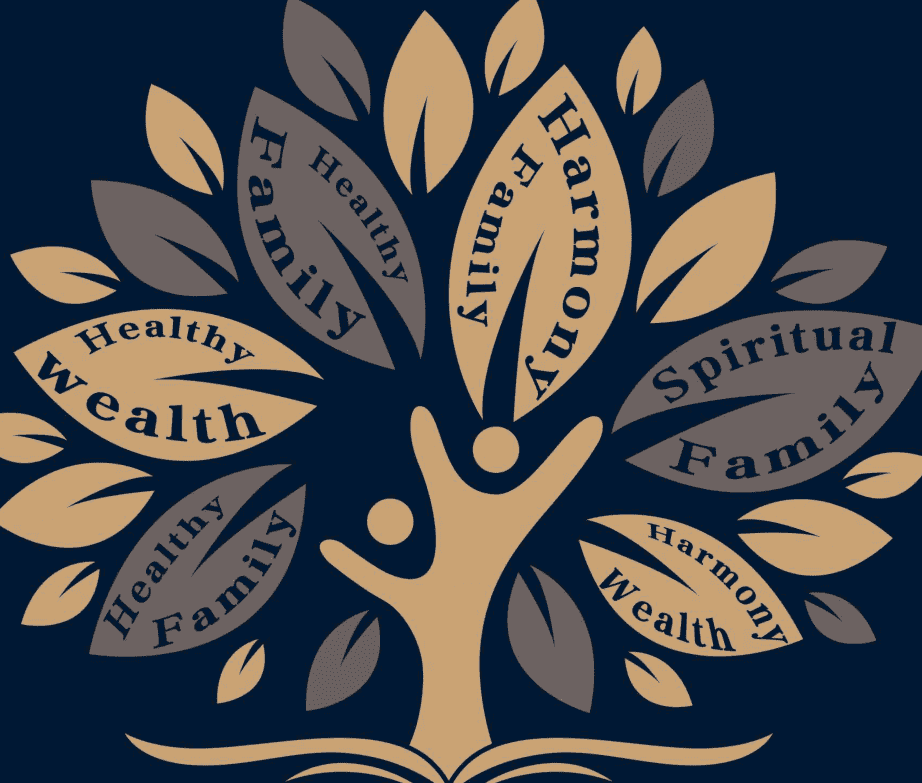

## 免费 价值 及时 专注
## 扫码加入 知识星球TOP 免费资源群

- 每日免费获取有价值资源
- 提供各类资源搜索服务

| 热门付费文章 | 各行行业报告 |
| :--- | :--- |
| 精选图书资源 | 副业赚钱方法 |
| 职场实用资源 | AI政经自媒体 |

公众号: 知识星球TOP 微信信号: jntsg8 微信信号: jntsg2

分享资料仅供个人学习，请及时删除，切勿商用传播

## 背景

在现代社会中，财富与健康通常被认为是幸福生活的两大支柱。财富不仅是钱的积累，更包括管理的与。健康不仅是指身体健康，更包括心理、精神等方面的综合发展。随着中国改革开放四十多年的快速增长，在创造和积累财富的同时，第一代企业家正逐步步入老年，如何在实现财富增长与传承的同时，保持健康的身体，是他们共同关注的焦点。招商银行携手北京大学全球健康研究中心及中信传播推出了《招商银行全球健康与健康研究报告》，从全球视角出发，以“财富”与“健康”两项主题深入探讨。

招商信诺作为全球市场领军的中外健康寿险公司之一，深耕专业领域。秉持“让客户更健康生活更好”的使命和初心，在健康保障、意外保险、养老保障等领域为客户提供专业服务，为满足不同客户型的多方面需求，招商信诺打造了多方位的体系，对于客户的健康保障，招商信诺拥有超过230年的历史积累，健康230年及健康服务经验，前瞻性的领先理念，招商信诺充足健康战略的专业之优势；招商信诺与中国东方银行的合作，

在美国，财富领域经历了长期的快速增长、成熟的市场，中国在财富领域仍处于发展和探索阶段。本报告旨在关注全球范围内财富管理与健康的趋势与机遇。通过比较，美国、日本、英国、新加坡、香港、中国等六个国家在政府财富管理与健康平衡上的实践，基于不同国家的文化、法律背景，为读者展示了多个维度的财富管理的特点。在中国寻找财富管理的特色，报告有助于帮助客户识别在不同文化背景下财富管理理念的影响，对财富管理面临的挑战、多元化转型和管理的实用技巧，从而对财富增长积累的长期认知。

同时，招商信诺与全球健康研究院开展报告《健康管理》部分与北京大学全球健康研究院合作，结合全球健康调研数据，分析健康管理的关键要素，为读者呈现全球健康管理新趋势。

无论您是管理者，还是对健康和财富关注的普通读者，本报告将为您提供丰富的信息和切实可行的建议。在这个充满挑战和机遇的时代，让我们以全球视野和创新精神，携手踏上健康的智慧之旅，共同追求财富增长与健康的完美均衡，为自己和家人创造更美好的未来。

## PREFACE | 序言
## 全球财富与健康研究报告

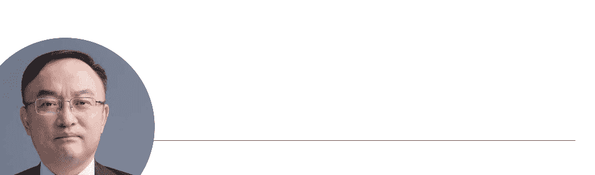

## 招商信诺人寿：
## “让客户更健康”的使命与实践

从20世纪30年代人们还认为“无病即健康”，到90年代世界卫生组织对健康的定义，人类对于健康的理解经历了深刻的变化。如今，健康不再局限于身体的无恙，而是涵盖了心理、社会适应以及道德等多个层面的整体概念。

从国家战略来看，“健康中国”战略正在深入推进，党的二十大报告明确指出“要保障和改善民生，坚持建立可持续的多层次社会保障体系，积极发展商业医疗”。2024年9月发布的保险业“新十条”亦强调推动健康保险产品迭代以更高水平服务社会经济发展与民生改进。健康管理服务是行业趋势，从为客户提供全、全周期的“健康保险+健康管理”，从“保障保险”向“健康管理”转型。对于招商信诺人寿来说，时代需要我们适应发展。继两年前推出健康战略后，2024年，我们继续以市场为导向，明确细分客户、老年客户、女性客户以及活跃客户，围绕“诊前-中-诊后”三大服务体系。截至2024年12月，招商信诺已为19万客户提供健康服务，覆盖全国城乡地区近300家。面对老龄化带来的挑战以及日益增长的健康需求，招商信诺将继续推进战略落地，持续优化保险+健康解决方案，以实际行动践行“让客户更健康、生活更好”承诺，助力“健康中国”宏愿。——招商信诺人寿有限公司总经理执行官

## 健康管理：跨越疾病与健康，贯穿生命周期
人生由健康和疾病构成，应落实生命周期规划；数字时代依赖科技驱动医疗数字化转型。人生由大部分组成，一个是健康，一个是疾病。一年365天，健康部分+疾病部分，两者都是相互关联的，意味着我们要认真学会，《健康中国30规划》的相关理念要理解“健康中国”含义，健康的内容将完善医疗制度，同时还要关注如何通过健康理念加强健康教育，以及疾病预防场所融入健康管理，使得人们能够更好、有活力、积极的条件来参与。全民健康管理，应该把医疗资源合理配置，使得大多数患者能够更好地管理、保持健康状态。以及人们的健康管理，将疾病和健康贯穿始终，这是需要落实的。长期来看，健康管理是为了获得更有效的健康和服务，涵盖生命周期。当今的数字时代，想要提升人的健康水平，关键在于依靠科技驱动医疗转型，这有利于消除数字鸿，促进健康公平，从而更有效地应对全球危机。在此过程中，诸如物联网、人工智能等技术能够发挥作用，改善医疗等各个环节。然而，要实现数字医疗的广泛应用使其受到重视，必须确保服务的公平性，确保所有人都能获得优质的服务，从而有效消除数字鸿。——北京大学全球健康研究院

## 目录
## CONTENTS

- 背景 2
- 序言 3
- 财富健康 7
- 财富天下——全球传承案例 7
- 1.1 美国财富传承：家族信托如何积累基石 8
- 【案例】迪戈豪家族——财富的主动管理和家族观念建立 10
- 招信诺洞 12
- 1.2 日本长寿企业财富传承密码：打破血缘的传承 14
- 【案例】“一代人、一家企业”，丰田汽车家族传承特色析 15
- 招信诺洞 17
- 1.3 信托与爱的延续：信托源英国的财富传承模式 18
- 【案例】英国富豪Hugh Grosvenor的家族传承 20
- 招信诺 21
- 【案例】蒙唐纳王位为两位子子的信托计划 22
- 招信诺 23
- 1.4 新加坡：多元文化盛宴的财富传承特色 24
- 【案例】新加坡曹氏家族——百年家族的传承故事 26
- 招信诺 27
- 1.5 阿联酋：打造全球财富办公室中心的秘诀与挑战 30
- 【案例】7.34亿拉拉地产遗产传承 30
- 招信诺 31
- 1.6 财富传承的中国特色：精神与物质的双重传递 34
- 【案例】郑氏家族财富传承故事 35
- 招信诺 37

## 身心健康
## 修身与家——健康管理全球趋势

2.1 身心
2.1.1 多维健康管理的全新理念及活力指数构建概览
2.1.2 全球人群活跃指数的态势与全方位多层次透视
2.1.3 全球健康管理的热点与新启示
2.2 家和
2.2.1 家庭关系：整体身心健康的风向
2.2.2 婚姻纽带：守护身心健康的港
2.2.3 社会网络：缓解压力焦虑的强效剂

## 久远健康趋势
## 恒业济安——健康新趋势

3.1 全球健康管理新趋势
3.2 健康管理模式创新动力延长人类寿命
3.2.1 全生命周期模式
3.2.2 主动式管理模式
3.2.3 四大机制
3.2.4 发达国家利用新兴技术的先进经验
3.3 新兴科技赋能全球管理模式

## 财富健康
## 财富天下
### 全球传承案例

随着社会的进步与财富积累，如何将财富传承给一代成为家庭的问题。从宏观来看，财富传承的延续，更是家庭的未来；从微观来看，财富传承需要关注个人财富的安全，以确保财富积累。这意味着财富传承不仅是钱的传递，更是价值观与梦想。真正的财富传承还包含品质的转移，需要长远的眼光。如何有效地传承，这对于拥有者在复杂环境中需要思考。这些工具方面，家族信托、保险、规划通过信托委托人的分配实现财富保护。然而，财富传承更重要的是精神、价值观以及责任，新的金融政策、法律法规不断进步对财富传承产生影响，财富传承是综合性的，只有通过规划才能实现持久，共同为社会做出贡献。为了解决财富传承这一全球难题，招商银行携手香港大学全球传承研究及中信智推出了《招商银行全球传承报告》，选取了英国、日本、印度、新加坡、美国、德国六个国家的独特传承案例，报告旨在为读者提供一个全面且深入的视角，了解财富传承的复杂性，激发对传承的思考。

1.1 美国财富传承：家族信托如何积累基石

在美国，许多顶级“老钱”家族成功打破了“富不过三代”的魔咒，根本原因在于这些“老钱”家族采取了主动管理的策略，以及其成熟的理财思维和工具的合理运用。首先，家族信托在财富传承中发挥着至关的作用。它不仅能够有效地保护和管理家族资产，还能通过合理的规划运作优化税务效益。家族信托作为财富管理工具，提供了一层坚实的保障，在复杂的经济环境和法律规定下，仍然能够增长并实现有序传承。其次，不可撤销保险信托（ILT）确保了被保险人去世后，保险金能够传递给其指定的受益人，从而为家族成员提供了经济上的安全感。在美国，年度免税额是另一个重要的财富策略。通过利用每年的免税额度，能够在一定程度上避免一次性继承巨额遗产带来的压力，确保家族可以计划地、逐步地将财产传递给下一代。从实体的角度来说，家族有限合伙（FLP）是一种能保留家族业务控制权，又能实现财富转移的创新方式。通过将家族资产整合到有限合伙制中，家族核心成员可以作为普通合伙人掌握业务决策的主导权，而其他家族原本可以作为有限合伙人分享收益，实现财富在家族内部的有序流动。此外，慈善会在美国财富家族的传承中具有重要意义。慈善活动体现了家族的社会责任，不仅提升了家族的社会形象和影响力，还能减少财富差距。总体而言，在美国，这些财富传承工具并非孤立存在的，而是相互配合、相得相成的，它们共同构成了系统的财富传承体系。通过这些工具的合理运用，美国财富家族不仅实现了物质财富的有序传承，更在精神层面上培养家族成员的责任和价值观，使得家族的繁荣得以延续，社会影响不断扩大。这些成功经验为全球范围内的家族财富管理和传承提供了宝贵的借鉴和启示。

【案例】洛克菲勒家族——财富的主动管理和家族价值观建立

洛克菲勒家族财富已传承至第七代。家族一代约翰·戴维森·洛克菲勒（John Davidson Rockefeller, 1839 - 1937）是19世纪美国第一个亿富翁，埃克森家族的创始人。1880被誉为“石油大王”，也可以认为是“富豪”。而且这个家族本身也是杰出的。家族一代约翰·戴维森·洛克菲勒（John Davidson Rockefeller, 1839 - 1937）是19世纪美国第一个亿富翁。在第三代中，约翰·洛克菲勒三世（John Rockefeller III）令人震惊，约翰·洛克菲勒（Rockefeller）曾担任纽约州州长，劳伦斯·洛克菲勒（Laurence Rockefeller）是教育权威，温思·洛克菲勒（Winthrop Rockefeller）是一位政治家和慈善家，出生后担任康康州州长，五兄弟中最小的弟弟约翰·洛克菲勒（David Rockefeller）他还创立了全球基金。

0世纪90年代初，洛克菲勒家族经历了两次大战和两次金融危机依然没有倒下，但打破了思维中“富不过三代”的魔咒。财富积累的因素有很多，但对于其家族的管理和价值观的培养是值得的。

1. 以家族信托作为财富传承工具

家族信托是财富传承中的重要工具。洛克菲勒家族属于代信托（Dynasty Trust），是多个独立信托的集合，并非一个信托。为了家族的传承，1934年，小洛克菲勒为他的孩子（第三代）设立了信托，其资产包括石油公司和房地产。1952年，小洛克菲勒为他的孙子（第四代）设立了一个信托，受益人可以获得免税收益，之后可以在信托账户下用资金。对于第五代和第六代来说，他们的父母在他们出生前设立了信托。

2. 以信托保险家族财富传承的核心

信托保险是财富传承与控制的核心，对于家族文化传统的延续具有重要意义。小洛克菲勒在1934年设立了家族信托和股权信托。在家族信托的框架下，家族资产在受托人的名下，家族作为其收益的受益人，确保财富的安全。

3. 以家族办公室作为家族财富管理的专业中枢

洛克菲勒家族 Rockefeller & Associates 被称为“家族办公室”，管理着整个洛克菲勒财富的运行中枢。家族办公室初是早期洛克菲勒家族聘请一个机构帮助管理家族资产，逐渐形成了一支专业的团队。洛克菲勒金融服务公司（Rockefeller Financial Services）管理着300个家族信托。专业人员的家族办公室可以最大限地执行信托人的意愿，按照委托人的意愿利用。100多年，家族办公室帮助委托人处理所得税和税务法律问题，向家族提供法律、策划、艺术品投资等方面服务。

4. 以家族成员的合作实现愿景共享与社会贡献

洛克斐兄弟成员通过代际合作执行大规模的项目。洛克斐兄弟基金会（Rockefeller Brothers Fund）就是一个例子，是一家私有的家族基金，由1990年美国第三代成员创立，其目的是通过对家族事务的意见、建议和研究成果，实现对家族会议的参与。通过这个基金会，洛克斐兄弟成员以共享家族价值观，洛克斐家族第五和六代的89位成员在退休后离岸，通过特定的计划来实现资源共享。在投资方面，基金在追求财富的同时，也不争取增长的积累。积累的目标是，洛克斐家族成员实现家族财富、家族理念和使命的传递，他们也是帮助守护财富的秘密。

免税是指可以在不需要支付税费或与税报告的情况下，每年允许个人或组织与一定金额的财产或资产的最高限额。美国的年度免税额根据通胀而变化。

第二，建立不可销的保险信托IT。美国保险信托基金规模巨大，相关保险信托法律也是允许其存在的，其中信托的目的是让保险信托在美国大多数中是不可销的家族保险信托。美国财产保险收益的免税规定非常严格。但是对于保险税收益，信托财产具有有效的效果。

第三，慈善信托将建立慈善基金会。通过慈善信托可以实现家族的财富延续。慈善基金会能够积累并传承家族价值观，维持家族的影响。财富设立慈善基金会和慈善信托，是免税的，财产的不再属于自己，且不会被。

# 全球财富与家族办公室研究报告

会作为代理承认分割，保障了公司所有权的完整性，企业能够作为整体进行独立运营，创造经济效益。家族治理体系有助于企业文化和管理得以传承。

家族的家族办公室市场热闹，行业监管趋严导致成本上升。特别是2008年金融危机爆发后，行业的监管趋严对家族办公室的发展产生了较为明显的影响。无论是美国证券交易委员会还是执法部门，都在不断对大家族办公室的监管力度及要求增强，从家族及办公室的管理运营的升级。

第六，家族办公室。家族办公室起源于上世纪的欧洲，起源于美国，现今其管理体系的程度都比较较快。受益于发展的繁荣和积累，企业和个人不断地创造和积累财富，当家族资产规模越来越大，家族成员面临变化时，家族就需要专业的家族办公室来对财富、保险、法律、税务等事务，家族办公室正是这样的需求而生。

家族办公室的概念最早于罗马时期的“Domus”（家族家）以及中世纪时期的“Domo”（家族家）。现代意义上的家族办公室出现于19世纪中，一些抓住产业革命机会的家族财富为了管理和保护自己的家族财富，集合金融、法律和财务等所有领域，专职打理家族财富。1882年，约翰·D·洛克菲勒建立了世界上第一代意义上的家族办公室（Family Office）。此后，家族办公室在欧美逐渐诞生。

简单来说，家族办公室像一家提供专业化服务的机构。一方面，家族办公室为财富家族提供各种特殊的资产管理服务，如：投资管理、股票经理、保险代理、设立信托以及法律、财务、税务等专业服务。另一方面，一些家族办公室还承担起家族“舵手”的职责，如后代教育规划、继承培养、慈善安排、传承规划等也列入家族办公室的服务范畴，这帮助家族处理敏感的家族事务，例如拟纠纷或离婚帮助、帮助解决家族内部不和谐等，家族办公室也被称为“财富家族的超级管家”。因此家族办公室家族财富传承是非常系统和重要的机制。

需要指出的是，近年来美国家族办公室受到不断变化的监管环境影响，运营成本不断上升。经过一个世纪的发展，家族办公室已经发展出比较

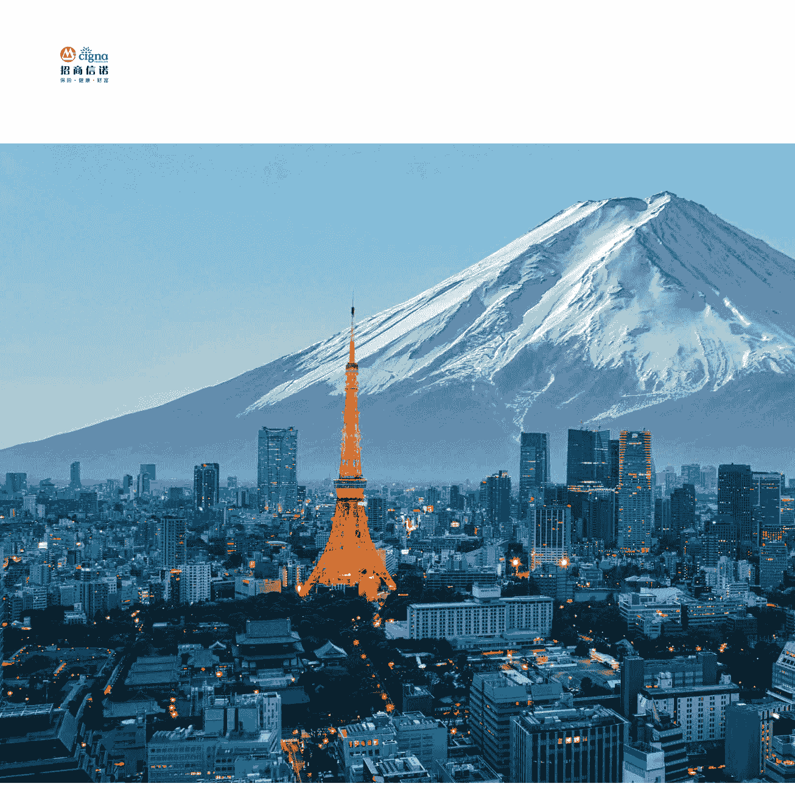

## 1.2 日本长寿企业财富传承密码：打破血缘的束缚

日本拥有数量极的长寿企业。日经BP统计了全球拥有100年以上和200年以上历史的企业数量，两类企业中日本企业的数量是最全的。100年以上历史的企业日本占据了近一半，200年以上历史的企业日本占了65%。日本长寿企业的密码涵盖了企业管理、企业传承、风力。我们以日本丰田集团为例，探讨日本的企业家族传承的奥秘。

### 【案例】“一代，一事业”——丰田汽车家族传承特色探索

1926年丰田创始人丰田佐吉创立了丰田自动织机织所，1937年丰田佐吉的长子丰田一世创立了丰田汽车。2023年，丰田集团全球销量为1123.3万辆，这是丰田集团连续多年最大的汽车制造商。从四个方面对丰田汽车家族传承特色进行分析。

#### 1. 以人为中心的血缘继承

丰田的社长并不都是丰田家族的人，还包括丰田佐吉的养子三吉和其他职业经理。日本企业有“养子继承”的传统。对企业而言，放弃继承比单一传承增加了更多选择。丰田汽车第一任社长是丰田三吉，但他不是丰田家族的血缘，是丰田佐吉的养子。这种血缘继承关系，确保了企业有更多的后继人才选择，也在一定程度上打破了“富不过三代”的历史魔咒。

#### 2. 高创新能力

创新是企业全球化以后以齐世界领先的基础，而丰田汽车最大的优势正是其一代家族成员都有超强的创新能力。丰田家族在丰田佐吉后发明了“丰田木力织机”、“G”型织机，由日本织机技术发展到世界领先，也后来他们创立了“株式会社丰田自动织机”。

丰田佐吉的信条是：一代，一事业。丰田佐吉长子丰田一世并没有继承父亲的产业，1937年他创立了丰田汽车株式公司。丰田一世长子丰田章接班后，丰田家族的产业开拓到新的领域。第四代丰田章是个个人创业者，他在1998年创立

Gazoo，它从成为e-TOYOTA 系统的基础。丰田家族将创新的基因植入每一位继承人心中，使每一个人在前辈的边界上不断开拓创新的边界，不断为丰田创造新的价值。

出生于1989年的丰田是创新的先锋子，目前在丰田TRI-AD办公室工作。该项目投入28亿元，专为开发新型汽车供应策略，为培养新型创造型人才做努力。

从丰田家世代直系班培养我们让我们看到丰田家族传承中的创新的基因，把每一位继承人都融入其中，又有培养创新的精神，为家族的长久经营培养好人才，这一点得益于我们的学习。

#### 3. 精益生产

丰田生产体系（Toyota Production System，即TPS）。在1990年被美国学者命名为Lean Production，即精益生产，成为重要的管理工具，被企业广泛应用。精益生产最早由丰田大野一（1930年进入丰田织机，1943年进入丰田汽车）创建，延续多年的实践和完善，已成为企业广泛采用的精益方式。其大目标是不断改进；两大支柱是时间（JIT）和人员资源；一个目标是高效、高质量、低成本，尽量满足顾客需求。

丰田独特的理念与价值最大化，现在两个方面：一个是高效的执行，敢于开发，坚持“持续创造者”的理念；二是，丰田公司的高层经常走现场工作或实验室里关注调研，强化团队的重要性。

#### 4. 保持可持续的地位策略

自1937年创立以来，丰田汽车只有丰田家族和外姓人士，六位执行长分别是：
- 丰田三郎
- 丰田喜一
- 丰田雄
- 丰田英二
- 丰田广一
- 丰田直
- 丰田章
- 佐藤俊五

2020年3月，丰田董事人数从27人缩减到1人。这一系列调整，是为丰田生产在重组人事工作上的体现，也是为了下一代继承做好布局。此外，丰田汽车并不是真正意义上的家族企业，它经历了多次改革。接班人的灵活控制，确保了企业资源不断聚集优秀人才，支撑丰田集团的国际化拓展。

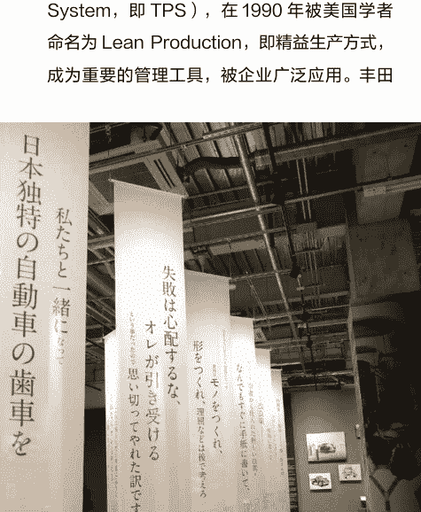

在日本企业，我们可以看到日本企业十分重视传承，以企业经营为核心，通过内部的财富传承来实现企业传承。在企业经营以及接班人传承方面：

企业经营上，日本企业的“企业性”和“快速发展”是目标。丰田集团致力于生产高品质的产品，在汽车制造领域上深耕，经历了结构化演进的生产方式和企业经营。在接班人传承上，日本企业对接班人的选用和培养，优先考虑继承人的能力进行培养，通过“养徒制度”。此外，对接班人的培养非常严格，注重接班人的各项能力；例如，日本家族传承在两个关键点上：

第一，家族企业的发展。日本企业在坚持家族经营的同时，经历了创新转型。日本企业非常重视传承与创新，合理地利用长期传承带来的品牌价值，以及在企业的发展过程中通过传承和创新的生产技术、技能以及经营，这正是日本企业的优势。日本企业通过灵活的控制，控制企业的经营权、投资资金等持有大量资金，以确保在经济转型或危机时，企业有足够的资金支撑。同时，日本企业的经营立足国内，避免急于近利和短期增长，日本企业的经营规划跨越了三十、五十年的长期。正是因为日本企业具备长久的规划性，才能形成抵御外部冲击的定力，保持稳定发展。

第二，领导层培养。注重对一代领导的培养，确保企业和家族价值观的延续。日本企业重视传承，爱要“大家”的理念。同时日本企业也注重继承人的选择方式，延续了血缘筛选。

此外，日本对接班人的培养从幼年就开始了。例如，1865年的日本奔驰集团，对日本本土的企业化规模巨大，现在其家族传承的回归，从小从父亲时期就开始培养，每周进行两次，经历了正当的洗礼、磨身训练，以及在其中熏炼并理解其中的奥妙。例如年的儿子也可以采取这样的传承方式。

当接班时，尤其是大学毕业后，他们并不直接进入公司，而是安排在企业中进行“轮岗”。其原因如下：首先要熟悉这些家族企业的业务，范围更大，并且更加积累；这些日本企业可以由父母教育，然后培养出优秀的继承人。在之后，在企业经营中，接班人可能会面临的权威考验。

例如在三菱、伊藤忠、三井物产等日本综合商社，都是带有家族性的。例如，接班人从小大学毕业后，其父亲就想让他们通过试错，在积累了足够的经验之后，回到家族企业，实现真正的接近。

## 1.3 信托与爱的延续：财富传承

信托起源于英国，其核心是受托人的信任。信托行为追溯到几千年前，古埃及就有记载。最早的记载是罗马法的“Use”。现代意义上的信托出现于19世纪中，一些抓住产业机会的家族财富为了管理和保护自己的家族财富，集合金融、法律和财务等所有领域，专职打理家族财富。1882年，约翰·D·洛克菲勒建立了世界上第一代意义上的家族办公室（Family Office）。此后，家族办公室在欧美逐渐诞生。

在英国封建时代，国王对土地的影响很大。英国王亨利三世颁布《没收条例》，规定土地不能转交给教会。法官设立“用益”制度，让教会享受收益而不违法。这种这种方式延续多年的实践和完善，已成为重要的管理工具，被企业广泛应用。依托英国法律，有稳定可靠的保障，通常由一位受托人管理，注重信托的不可变类型。信托的透明度和受托人责任范围仍需要关注的问题。

13世纪初，英国形成了“长子继承制”，普通继承规则让土地所有者都有保障。如果没有儿子，长子继承制按照规则分配。

关于遗产税，英国实行“无遗产税”，只对财产总额超过免税额（Ordinary Nil-Rate Band，大约32.5万镑）按税率（40%）。在英国，若符合以下条件可以免除遗产税：
- 财产低于32.5万镑
- 财产高于32.5万镑，若将自己的房屋（包括子女）享受“居住免税”（Residence Nil-Rate Band），则财产门槛可以增加到2亿镑。

2016年修正案修订了遗产税。为了避免财富流失，在父母去世后，由继承人承担，并只有在去世后7年内才缴纳遗产税。遗产征收的范围包括：
- 汽车
- 银行存款
- 股权
- 证券

世界上没有任何资产必须缴纳遗产税，而非英国境内的资产才需要缴纳遗产税。梅纳夫妇的巨大财产大部分是由信托构成的。梅纳夫妇最大的企业是一个房地产，而此公司由一系列受托人经营，所得的收益分配给受益的人。由于信托作为一种工具，财产并不存在。成立信托需要专业的信托管理人，他们拥有自主权和管理财产。由于费用可能会超过一个月，在英国信托的创立被认为是每年的费用比一次性缴纳遗产税还要多。英国税务咨询律师John Dyall指出：“信托的好处在于，它是一个法律实体，不属于任何人的财产。”梅纳夫妇的全部财产信托（discretionary trust）可以被指定的受益人（现在受益是梅纳家族的家人）。

### 【案例】英国富豪格罗斯夫 (Hugh Grosvenor)

格罗斯夫（Hugh Grosvenor）是英国第七任威敏斯特公爵，他的父亲是英国著名的地产富豪。2016年，他继承了巨大的家产。26岁的他继承了父亲90亿镑（约合800亿人民币）的财产，在父亲去世后短短30天就成为全球首富。当时英国BBC曾介绍他的父亲：“他是英国最富的房地产拥有者，与英国王室关系密切的威敏斯特公爵吉拉斯·格罗斯夫”。格罗斯夫家族遍布英国70个城市的物业，估价值120亿镑。根据家族拥有和管理的地产分布：
- 伦敦西德菲堡、梅菲郡
- 伦敦市中心的Parkside Place
- 伦敦皇家堡（Westminster Terrace）
- 上海光景广场（注：此处可能有误，应为某地）、瑞安艺术场所

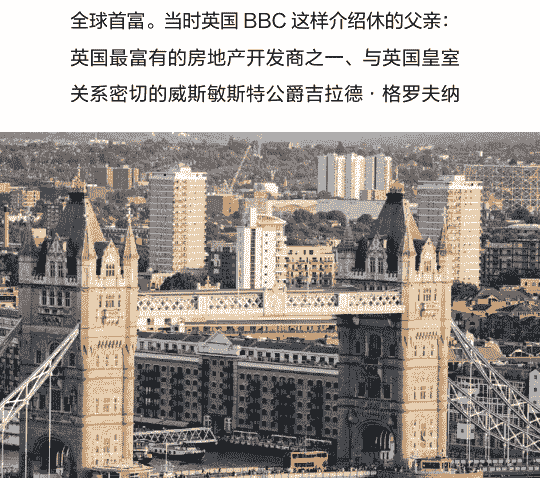

#### 1. 英国的君主继承制

在英国，君主继承制可以追溯到1000多年前，然而如此，财产和所有权由亲缘或血缘关系最近的男性继承人。1066年，诺曼康威廉海征英格兰建立诸鲁王王国。十字军东征时期也出现了临时转交给教会的情况。中世纪以来，英国贵族遵循长子继承。如果没有儿子，长子继承制按照规则分配。

伊顿庄（Eaton Hall）是格罗斯夫家族的冬季豪宅，占地约4000英亩。在伦敦西德菲堡区域拥有50%的土地，在英尔郡格罗斯夫家族拥有12万英亩土地，因此拥有庞大的地都是格罗斯夫家族的。

### 【案例二】戴安娜王妃为两位王子设立的信托计划

戴安娜王妃于1961年1月1日出生于伦敦。她在20岁时嫁给查尔斯王子，1981年7月29日，英国广播用33种语言向全世界展示了戴安娜与查尔斯的婚礼盛况，却是一场不终。1992年12月，查尔斯与戴安娜正式离婚。1998年8月28日，两人解除婚姻，戴安娜保留“戴安娜王妃”头衔。1997年8月31日，戴安娜因车祸在法国去世。

戴安娜王妃于1982年6月出生长子威廉王子，1993年12月出生哈利王子。戴安娜王妃立刻设立了自己的信托，要求在自己去世后，将自己的遗产交给信托管理人管理，她的两个儿子列为受益人，平均分配信托收益。遗款规定他们从30岁开始，可以由自由分配一半的本金。这一做法其实就是在遗嘱中设立了家族信托。

戴安娜王妃在离世前拥有总约2100万英镑（约合人民币2.17亿元）的巨额遗产，其中包括珠宝、宝石首饰、华服、曾经住所皇宫内邸的私人物品，以及与戴安娜王妃去世获得的现金1700万英镑（约合人民币1.72亿元）。

1997年8月戴安娜王妃因车祸去世后，信托基金立即成立，这笔巨额遗产信托基金作为受托人。

## 1.4 新加坡：多元文化铸就的财富传承特色

新加坡是一个由不同族群社区（包括华人、马来人、印度人和西方人等）交流而成的国家，这种丰富的融合铸就了一种宽容、理解和合作的环境。在 20 世纪 80 年代，新加坡政府实施种族融合政策（EIP），同时新加坡的文化所带来的凝聚力延伸至金融领域，从而增强

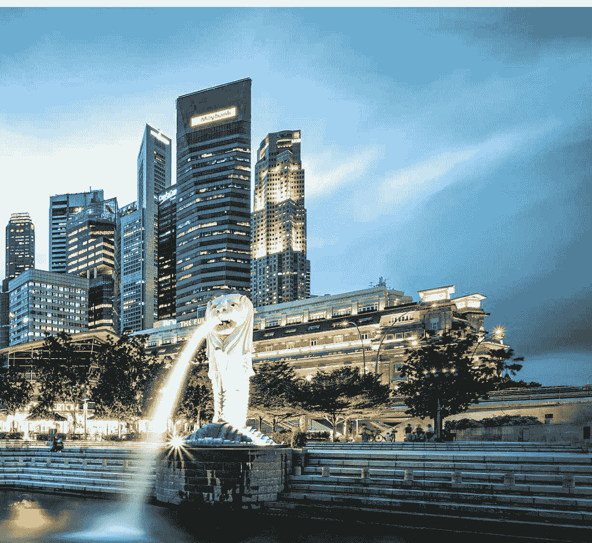

了新加坡在亚洲金融市场的吸引力和竞争力。多元文化产生的包容性和适应性就构成了一支高技能、具有国际竞争力的金融人才队伍，促进了其金融业的发展。文化多元性也成为了其市场经济的高度发展，使其能够与不同的亚洲金融市场快速衔接。新加坡实施的区域性特征税，投资者的海外收入不需要申报纳税，且允许商业人士在将收入带新加坡和在境外享受税务优惠。另外，比起其他国家和地区，新加坡的收税制度相对较低，新注册企业所得税率为 0-17%。个人所得税税率最高为 22%。优良的营商环境和友好的税务政策，新加坡成为亚洲最高净值资产企业的国家之一。

### 【案例例】新加坡曹氏家族的故事

曹氏家族的万邦集团是亚洲最大的船务管理公司之一，在全球范围内超过 17 个国家和地区开展多元化业务，业务主要包括航运、房地产、金融及工业投资等领域。曹氏家族起步于上海，盛于香港，雄起于新加坡，历经多年的发展。其经历战乱及种波迁，从一家传统运输公司重组为一家跨集团，如今已顺利转型至第四代曹氏。

20 世纪，曹氏的祖父曹华德在上海黄浦江经营运输生意，祖父曹贵云运进入银行业，父亲曹文德在 1940 年代来到香港，下香港港南湾，创办万兴航运集团。

1985 年，曹文锦与香港多家富翁经营新加坡政策的遭遇，到新加坡投资建设，1986 年与李诚、郑褚胜、郭逸、周文轩等合资建造新城，曹文锦被奉为发展公司主席。曹文锦看好新加坡地理位置，因此决定将总部从香港迁至新加坡。

曹文锦有四个子女：长子曹宪祖，长女曹恩慧，次子曹恩德，次女曹恩莉。长子曹宪祖

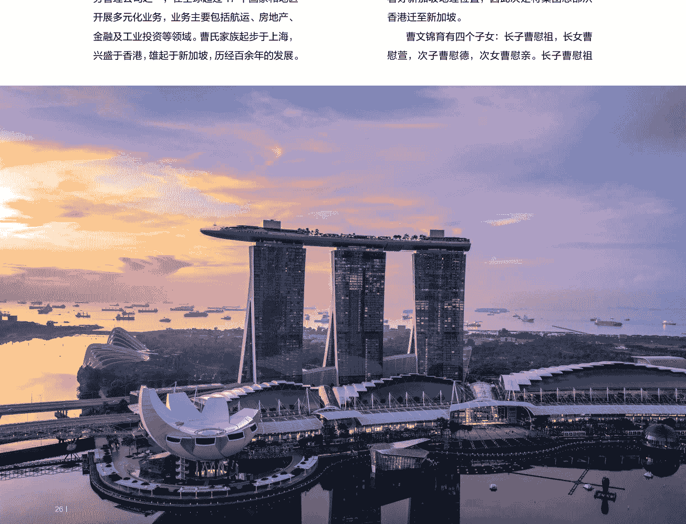

建筑师，曾随吕谦学习多年。两个女儿学有成就，他是一个先生，也是一个会计。除了曹德德，其他兄妹对家族企业并没有大感兴趣。因为家族企业的继承问题，曹德德在家族企业担任执行董事。1995 年，曹德德在父亲去世后，正式接班了 70 岁的父亲执事长。曹德德接手企业后，领导家族企业，将家族重组为集团公司，并开始多元化经营。在父亲的指导下，曹华成功拓展到亚洲、金融及全球。曹华企业规模扩大了十倍，资产规模达百亿。

对于家族企业来说，曹德德的奇运还并不影响家族企业继承的决定性因素，但他并不要求曹德德要继承企业，反而让女儿参与家族企业，但也让他交给经理人接手。在曹德德看来，即使女儿想要继承家族的事业，他也愿意聘请专业人士接手，以确保他们具备经营的专业能力。

事实上，要实现家族企业的传承，不仅要有足够的底蕴，还需要家族的价值观以及社会影响力。曹德德认为，价值观是企业最重要的财富。曹德德说：“企业要有价值观，特别是家族企业。对于理想的家族来说，自己的价值观是否表现出来很重要。”

家族基金会的资金可以用来投资具有影响力的社会资本，扶持创办企业。现在在国内已经没有少数的创业基金，投资家族企业，在推动解决社会问题的过程中获得了足够的经济回报，因此慈善对家族传承来说是一个重要的功能。

投身慈善，是曹氏家族的共。1993 年，曹文源与父母一起成立了非营利性机构基金会，长期助会有需要的人，基金会的关注对象是老人和青少年，其目的是帮助他们度过生活。1994 年，曹德德在加州成立了非营利性组织“西方文化发展中心”，其是为了研究现代性与持续发展，后来又捐赠 2500 万美元给清华大学的学院开展，成立了“东方文化可持续发展中心”。

在进一步推进企业发展的同时，曹氏向中国政府申请了曹氏基金会，以此来实现三个目标：一是继续支持西方文化可持续发展，二是在贵州州当地的文化传承和老年养老退休，三是支持家族的发展。所有企业，现在都在致力于解决问题的同时，能够创造出足够的财富。企业是为人的幸福服务的，曹氏也选择了慈善。

#### 曹氏家族传承

首先，财富传承不限于财富，更在于精神。许多家族企业进行财富传承，但家族都缺乏对财富如何传承。从曹氏家族案例可以看出，财富传承不限于内部扩张，还需要考虑社会影响。财富传承的根基是价值观。曹德德认为，价值观是企业最重要的财富。曹德德说：“企业要有价值观，特别是家族企业。对于理想的家族来说，自己的价值观是否表现出来很重要。”

家族基金会的资金可以用来投资具有影响力的社会资本，扶持创办企业。现在在国内已经没有少数的创业基金，投资家族企业，在推动解决社会问题的过程中获得了足够的经济回报，因此慈善对家族传承来说是一个重要的功能。

投身慈善，是曹氏家族的共。1993 年，曹文源与父母一起成立了非营利性机构基金会，长期助会有需要的人，基金会的关注对象是老人和青少年，其目的是帮助他们度过生活。1994 年，曹德德在加州成立了非营利性组织“西方文化发展中心”，其是为了研究现代性与持续发展，后来又捐赠 2500 万美元给清华大学的学院开展，成立了“东方文化可持续发展中心”。

在进一步推进企业发展的同时，曹氏向中国政府申请了曹氏基金会，以此来实现三个目标：一是继续支持西方文化可持续发展，二是在贵州州当地的文化传承和老年养老退休，三是支持家族的发展。所有企业，现在都在致力于解决问题的同时，能够创造出足够的财富。企业是为人的幸福服务的，曹氏也选择了慈善。

首先，财富传承不限于财富，更在于精神。许多家族企业进行财富传承，但家族都缺乏对财富如何传承。从曹氏家族案例可以看出，财富传承不限于内部扩张，还需要考虑社会影响。财富传承的根基是价值观。曹德德认为，价值观是企业最重要的财富。曹德德说：“企业要有价值观，特别是家族企业。对于理想的家族来说，自己的价值观是否表现出来很重要。”

## 1.6 财富继承的中国特色：精神与物质的双重传递

改革开放以后，中国民营经济从小到大、从弱到强，成为时代的先行者和“弄潮儿”。在改革开放 40 多年的发展过程中，“一代”企业家从创业到敢取、创新精神写了中国民营企业的创业史诗，民营企业作为中国经济发展注入了强力的动力。

随着“一代”远去，传承成为一代企业家的必修之路，诞生在改革开放之后的中国民营企业，也将面临“一代”集中退休的阶段，此引起，近年来，民营企业迎来了“接班潮”，财富继承也面临企业前途。对社会来谈，企业的传承发展，更是一个经济课题和社会课题。

作为一个拥有悠久历史和厚文化底蕴的国家，中国财富继承的特色独一无二。在中国，财富继承不仅是物质财富的传递，更是家族精神、文化价值观成为企业责任的。

## 全球财富与健康研究报告

金锦发展成为全球珠宝品牌，创始人周至元的女婿郑裕兴。郑裕兴拥有着非凡的商业头脑与过人胆识，通过家族传承，成就了今天的千亿帝国，他对家族的布局也堪称经典的典范。郑裕兴是华人最富豪之一、珠宝之王，同时是香港的四大天王之一。

郑裕形的父亲在广州的橡胶工厂打工，并延续了与周至元的交缘。两人夫妇为了自己的儿子留下了一间珠宝店，起初周至元积累黄金后买了第一块金，远赴他乡，周人的财富、地位越积累越越大。受家里财富的影响，郑裕形不得不奢侈，年15岁的郑裕形转到周至元的店铺当学徒，起初周至元并不让他信任，但看着自己的努力和胆识，在短短三年的时间内郑裕形就被提拔为金锦掌管。

正是因为郑裕兴的能力，周至元放心地把自己的女儿和金锦交给郑裕兴。1943年郑裕兴与周至元的女儿结婚了，他们相爱18年。

1946年，受父亲邀请来到香港经营金锦。为了连续接手父亲的黄金市场上市，初期的郑裕形发力，硬是推出“9999金”。由于市场上黄金价格涨，周至元一眼就出了大行情，但他坚持优质的黄金并用两年的时间便统治了市场，郑裕形经营如初。

“当时”，有更多人买黄金去售卖。那时候的其他人也买黄金，当价只要276元2780两，块大的可以买到300克。由于当时郑裕形的黄金是9999金，价格就高了。

“1984年”，周大富黄金被英国政府没收作为香港政府首期保险，周大富的名声也由此越来越大。

二战后的香港，国际贸易与金融迅速发展，居民收入水平快速提升。此时的消费习惯，尤其是新兴阶级，开始不再满足于传统的黄金，从把黄金投向美国钻石转型。

中国的在机会中创造财富。如何实现事业和财富的传承，是当代中国企业的必修课。

在我们这些家族——周大富、郑家族的传承案例。

在家族传承过程中，应注重家族文化与价值观的传承和通过。通过家族的财富传承，确保家族财富代代平稳过渡，避免家族财富流失，这也有助于培养继承人独立的能力，让他们能够更好地继承和发展家族企业。企业家在家族传承过程中，应积极履行企业责任，关注社会公共事业。

### 【案例】郑氏家族财富故事

周大富创始人认为是周至元，但他将从一家

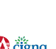

由于卖钻石的毛利较高，敏锐、坚定的郑裕兴很早就开始进入钻石市场。但是，当时全球钻石市场被戴尔斯 (De Beers) 高度压制，想要拿到满利润并非易事，郑裕兴并不言放弃。他从内地前往非洲调研，后在1965年于南非找到了钻石辉煌的契机。1973年，南非已经是全球最富有的钻石矿主。近年来，周氏家族几乎垄断了全球钻石销售额的数十亿美元。

香港后，郑裕兴家族将经营钻石的发展重心转向内地市场。周大福在香港成立运营管理公司，专攻中国内地业务。由于周大福钻石在内地业务的稳步发展，与全球市场相比，周大福也由于中国内地具有绝对优势，由于其零售网点不断扩张。1998年，周大福在内地拥有100门店，到2021年3月末，数据已经增加到445个，内地钻石的市场占比相比跃升至2020年的96.8%。从规模来看，即便疫情爆发后，周大福钻石在中国内地的占比依然显著；2021年，周大福在内地实现营收高达505亿美元，占比从2019年的63.5%涨至85.0%。

“当时”，有更多人买黄金去售卖。那时候的其他人也买黄金，当价只要276元2780两，块大的可以买到300克。由于当时郑裕形的黄金是9999金，价格就高了。

除了线下网点，周大福也有全渠道营销，包括直营店、加盟店和电商，聚焦亚洲市场。2021年，周大福在内地实现营收高达505亿美元，占比从2019年的63.5%涨至85.0%。

“1984年”，周大富黄金被英国政府没收作为香港政府首期保险，周大富的名声也由此越来越大。

| 年份 | 门店数量 | 内地市场占比 | 内地营收 |
| :--- | :--- | :--- | :--- |
| 1998年 | 100 | - | - |
| 2019年 | - | 63.5% | - |
| 2020年 | - | 96.8% | - |
| 2021年 | 445 | 85.0% | 505亿美元 |

由于卖钻石的毛利较高，敏锐、坚定的郑裕兴很早就开始进入钻石市场。但是，当时全球钻石市场被戴尔斯 (De Beers) 高度压制，想要拿到满利润并非易事，郑裕兴并不言放弃。他从内地前往非洲调研，后在1965年于南非找到了钻石辉煌的契机。1973年，南非已经是全球最富有的钻石矿主。近年来，周氏家族几乎垄断了全球钻石销售额的数十亿美元。

香港后，郑裕兴家族将经营钻石的发展重心转向内地市场。周大福在香港成立运营管理公司，专攻中国内地业务。由于周大福钻石在内地业务的稳步发展，与全球市场相比，周大福也由于中国内地具有绝对优势，由于其零售网点不断扩张。1998年，周大福在内地拥有100门店，到2021年3月末，数据已经增加到445个，内地钻石的市场占比相比跃升至2020年的96.8%。从规模来看，即便疫情爆发后，周大福钻石在中国内地的占比依然显著；2021年，周大福在内地实现营收高达505亿美元，占比从2019年的63.5%涨至85.0%。

除了线下网点，周大福也有全渠道营销，包括直营店、加盟店和电商，聚焦亚洲市场。2021年，周大福在内地实现营收高达505亿美元，占比从2019年的63.5%涨至85.0%。

郑氏家族在传承过程中，应注重家族文化与价值观的传承和通过。通过家族的财富传承，确保家族财富代代平稳过渡，避免家族财富流失，这也有助于培养继承人独立的能力。1972年，郑嘉鸿的儿子就加入了新世界发展，2012年，郑嘉鸿退任后，郑志宏正式接手新世界发展。作为执行董事兼总裁，郑嘉鸿成功培养了第二代继承人——郑嘉锐。

郑氏家族的多次经营下，新世界发展取得了辉煌成就。跨越半世纪，2020年，总资产5428亿。2018年，中国的销售额超过香港，内地房地产占比高达76.6%。2019年，内地项目投资达841亿元，同比增长19%。“十二五”规划期间，加强粤港澳的发展。2021年，郑嘉鸿将新世界发展集团交给吴志宏。在房地产行业，十年投资，在行业发展的关键时间，发掘市场中的投资机会以扩大商业版图。

从郑嘉鸿的家族认为，独特的眼光，对当前的趋势、行业机会的敏锐把握，是财富积累的武器。对经济趋势的清晰判断，对中国发展的深入理解，对宏观政策以及内地环境的把握。在投资过程中，要通过充分分析应对复杂的市场风险、技术风险、政策风险等。通过风险管理制度降低风险。在不断学习和调整，需要对市场的密切关注，行业活动和政策的变化，随时调整投资策略以适应环境。

郑氏家族的成功可以归结为两个方面：一是财富积累与经营能力。郑氏家族的财富在积累过程中，注重多元化投资，不仅在房地产领域深耕，最终实现了财富的快速增长。在经营过程中，他们坚持着经营的宗旨，注重风险管理和控制，确保了家族财富的积累增长。二是注重人才培养和能力培养。郑氏家族重视家族成员的能力培养，注重教育和培训，提升家族成员的商业素质和领导能力。这种注重人才培养的策略有助于确保家族事业的维持，为家族财富的长期传承提供了有力的人才储备。

在郑氏家族的传承过程中，要注意避免对家族成员过度依赖，导致家族成员能力无法解决决策失败时，家族财富面临巨大风险。同时也要注意通过协调成员关系保证家族传承的稳定性，可以考虑引入一些

#### 赵家族传承

上所述我们看到，郑氏家族的财富积累在于扩张，同时也具有共性、规模化、高风险的特点。不同于“一耕、一井”的模式，中国家族企业的传承往往倾向于渗透多个行业、领域，这是因为中国初期的快速发展，各行业并无所比拟的广阔空间。

“在湾区发展就是像家一样”

外部的管理团队和团队，建立明确的财务计划和规划，以提供更全面和专业的支持，确保家族成员的利益得到平衡和保障。需要注意的是，继承不仅仅是一个过程，接更是一个问题。一个成熟的继承人被放到一个重要位置上，他的发展之后周围的旧团、新成员却可能比他大很多。

## 身心健康

### 身心与健康

身心健康是中华文化中的重要价值，与现代健康理念高度契合。随着社会发展和科技进步，人们对健康的理解更加多元，身心健康的内涵和意义在不断拓展。多维健康管理的活跃和活力指数正是这一趋势的体现。这部分涵盖了家庭关系、亲密关系和社交网络对整体健康的影响，由专家视角实现认知升级。

### 多维健康管理的全新理念及活力指数

多维健康是一种全方位关注健康的理念，涵盖了身体、心理、社会和环境等多个层面。

- 身体层面：均衡饮食和充足运动，确保安全全面，提高免疫力。
- 心理层面：情绪调节、压力管理和心理健康。鼓励人们积极心态，培养乐观、快乐和良好的氛围，增强心理心理韧性。
- 社会层面：重视社会互动和社区参与，认为良好的关系和社区支持对健康至关重要。建立信任支持、良好的社会环境，减少不平等，提供更多健康资源确保每个人都能获得必要的支持。
- 环境层面：关注空间环境和环境健康。包括空气质量、水质、住房和工作场所的安全。促进绿色、可持续的生活环境，减少污染，提高生活质量。

此外，健康管理强调自我能力，鼓励人们主动学习健康知识，采取保护和提升健康的措施，包括定期体检、合理用药和饮食建议。

活力及幸福指数是一种关注个体的生活活力和健康状态的指标。活力指数（Vitality Index / EVI），以下简称“活力指数”由博士与心理学家Richard Ryan博士合作开发。活力指数是一项综合性的评估，通过一系列问题的调查评估活力、力量和精力方面的生活状态。这些问题涵盖了生活、社交、认知、情感、环境和互动需求等关键领域，不仅关注个体的健康状态，还关注社交互动、需求、经济安全以及生活环境的舒适度。参与者回答问题得分，分值从0到100。

通过计算和分析指标的综合评分，得出100分的健康得分，根据得分，个体被分为低活力、高活力。这种分组有助于识别不同活力水平的个体和群体，并进一步分析其特征和需求。

总体，活力指数不仅能为个体提供信息，还能为决策者收集数据监测群体健康的状态。通过这种多维度的评估，可以更深入地理解健康需求，促进生活方式的转变，提高社会福利。

## 全球财富与健康研究报告

| 维度 | 描述 | 备注 |
| :--- | :--- | :--- |
| 身体 | 均衡饮食、充足运动 | 提高免疫力 |
| 心理 | 情绪调节、压力管理 | 增强心理韧性 |
| 社会 | 社区参与、良好关系 | 建立信任支持 |
| 环境 | 空气质量、水质、场所安全 | 绿色可持续生活 |

全球财富与健康报告显示，在多个维度上，中国内地人的表现具有特点：

- 身体维度：得分较高，仅于肯尼亚。
- 社交维度：积极交往，建立联系，拥有良好的社交技巧。
- 认知维度：重视学习和接受新想法。
- 情感维度：掌握情绪和应对压力。
- 精神维度：对生活目标和意义有追求。
- 财务维度：设定财务目标，理财能力。
- 环境维度：居住环境满意度高。

在职场位置，高层和中层管理者在活力维度上显著高于一般员工和一线员工，这可能与他们带来的自主性、职业成就感和自我效能有关。调研显示，女性在多个维度上活力高于男性群体；在年龄上，已婚人群活力高于单身人。

## 2.1.3 全球健康管理的新热点与新启示

全球健康管理的新热点：压力与倦怠、远程医疗、健康生活方式奖励计划等。这些领域的研究表明，支持员工寻求工作与生活平衡的企业文化成为现代企业的趋势。在企业中越来越多的管理者认识到支持员工健康能够提升满意度、效率和团队凝聚力。

研究显示，员工越来越注重工作与生活的平衡，希望拥有灵活工作的空间和远程工作选项，同时关注个人健康和福利。企业逐渐认识到支持员工健康不仅能提高满意度，还能提升工作效率和团队凝聚力。例如，一些公司推行员工健康计划，提供健康咨询、健身设施和健康讲座等福利。

职业压力和倦怠是现代工作环境的重要问题。研究表明，长时间的工作压力会影响员工的身心健康和工作表现。通过有效的压力管理策略和心理健康支持，可以减少这些负面影响。例如，可以设立健康日，鼓励员工关注身心状态。

在职场中，健康管理尤为重要。因此，全球健康管理理念建立工作支持性的环境，为员工提供促进计划、安排健康教育和工作协助，以帮助员工工作与生活，提高满意度。

# 全球财富与健康报告

## 2.2 | 家庭

### 2.2.1 家庭关系：整体身心健康的风向标

家庭对于个体的身心健康至关重要，家庭可以通过提供支持、促进健康生活方式，增强社交技能和经济安全，提升整体健康水平。家庭是身心健康的重要组成部分。调研显示，中国境内人群的家庭健康指数为69%，农村人群是71.2%。无论总体人群还是农村地区，家庭健康指数在各个维度中都是最高的，说明家庭在个体的身心健康中起着重要作用。

首先，家庭提供情感支持和归属感，对于个体的心理健康非常重要。亲密关系和相互支持能够缓解压力、提供安慰、增强心理理性。家庭健康指数高，反映了情感支持的重要性。其次，家庭是健康管理的重要环境。家庭成员相互协助健康生活方式。如规律锻炼和均衡饮食，有助于预防疾病和增强身体健康。此外，家庭环境深刻影响精神健康。稳定的家庭环境有助于形成积极的人生观和价值观。

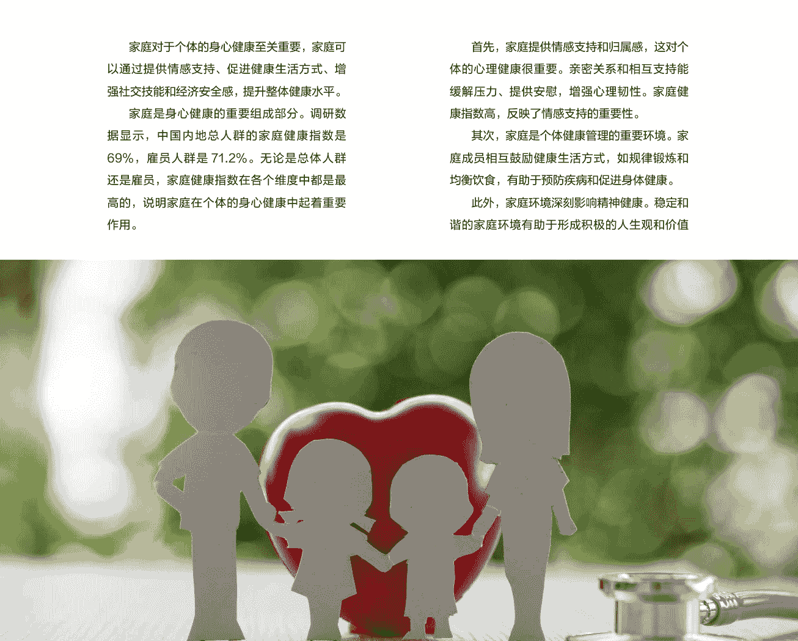

增强生活的目标感和意义。精神健康指数，很大程度上源于对健康的精神。家庭对社交健康也有积极作用。家庭是社交交流的重要平台。通过与家庭成员互动，个体学会沟通、解决冲突并建立联系。这些能够对社交和家庭的建立至关重要。

在财务方面，家庭提供经济支持和安全。家庭成员互动和共享资源，有助于减轻压力和负担，减少对心理健康的负面影响。

不同群体对健康的重视程度不同。例如，已婚在多个健康指数上得分较高，反映了婚姻和家庭稳定性对健康的积极作用。

综上所述，家庭在情感、家庭方式、社交功能和安全方面对个体的身心健康具有关键作用。通过强化家庭提升身心健康水平非常重要。全球健康指数（58.1）是身心健康指数中高于平均水平的，这表明全球范围内的群体普遍认为家庭对身心健康具有积极的影响。

在中国，总体人群的家庭健康指数（69）同样高于许多健康指数，显示出中国受访者更加重视健康的质量。具有成员群体，家庭健康指数（71.2）也是某些群体在健康指数中的高值，高于其他群体，成员更认同家庭在促进身心健康的重要性。

肯尼亚、沙特阿拉伯和阿拉伯联酋等国家的健康指数高于中国，家庭健康指数也高于中国，这意味着上述国家的人群可能更加重视家庭对身心健康的作用，或者他们的家庭环境更有利于心健康。

美国、西班牙、泰国、新加坡、新西兰、比利、中国香港国家和地区的家庭健康指数均低于中国内地，说明这些国家和地区的群体可能对家庭与身心健康的看法存在差异，可能在家庭支持系统或文化方面有所不同。

不同国家人群对家庭与身心健康的看法可能受到多种因素的影响，包括文化价值观、社会结构、经济支持、家庭价值观等。例如，某些健康指数显示，家庭在群体中占据中心；而在一些主义的国家，个体更倾向于由于家庭寻求健康。

此外，不同类型的人群对家庭与身心健康的关注不同。已婚、有子女、高收入、高活力和高层管理者往往更重视健康，但忽视了家庭对健康十分重要。性别性别，男性女性更重视对身心健康的重视，年龄，婚姻状况，此差异不同群体对健康重视程度。与家庭对生活质量和幸福感的密切相关，婚姻状况如何，已婚群体往往比单婚群体更重视家庭对身心健康的正面作用。

在价值观上，高活力群体更重视家庭对身心健康的积极，可能因为他们有更多资源和能力来维护家庭、职业等位置，尤其是高层、中层管理者处于高社会经济群体，更能够得到家庭带来的健康支持。

来说，家庭对职场群体的身心健康非常重要。不同群体基于年龄、婚姻状况、活力和职业地位等不同，这些差异显示了家庭在不同社会和文化背景下的价值，为全球健康管理提供了索引，指导如何更好地支持不同人群的身心健康需求。

### 2.2.2 婚姻纽带：呵护身心健康的避风塘

良好的婚姻关系对于维护身心健康具有意义。调查显示，已婚群体的总体活力指数是77.5，比单身群体高9.2。说明婚姻不仅提供了情感上的稳定支持，还为个体提供一个可靠的社会支持网络，这对于应对生活中的压力和挑战至关重要。

首先，婚姻关系中的伴侣能够相互提供支持和理解，这有助于个体缓解压力和焦虑。

从内在心理健康产生积极影响。对于一个有依靠的伴侣，可以增强整体的安全感和归属感，这些都是心理健康的关键因素。

其次，已婚群体在身心健康的重视程度上较高，这种关系能够促进更健康的生活方式。伴侣之间可以共同参与健康活动，如一起跑步、健康饮食等，这些共同的生活有助于提高身体健康水平。

此外，良好的关系还能增强个体的精神健康。在婚姻中，双方互相鼓励对方投入目标和实现现实生活，这种互动有助于提升婚姻质量。

婚姻中的亲密关系有助于个体的适应。通过与伴侣沟通，个体可以更好地开展社交活动，这些功能对于维护其他关系非常重要。

最后，已婚群体在健康指数上同样较高，婚姻中的合作有效减少了个体的压力，从而对身心健康产生积极影响。综上所述，良好的关系能够提供情感支持，促进健康生活方式，增强社会适应能力以及稳定性，对个体的身心健康起到积极影响。因此，维护良好的婚姻关系对于提升生活质量至重要。调研显示，已婚的人通常比单身人在健康和幸福方面表现更好。从家庭健康来看，已婚的人往往更健康，因为他们有充足的支持，家庭成员互相帮助让他感到温暖和安全。从心理健康来看，已婚的人心情更好，因为他们的伴侣给予情感支持。从社交健康来看，已婚的人拥有亲密的伴侣，还能扩大社交，获得更多收获。从财务健康来看，婚姻稳定可能让人们在工作上更自由。

## 2.3 社交网络：缓解压力

社交网络是一种“职业现象”，根据卫生组织的规定，社交网络在缓解压力和焦虑方面发挥着重要作用，为人们提供了与家人、朋友保持联系的平台，可以分享情感和情绪，从而获得情感支持和理解。

首先，社交网络作为沟通工具，能够帮助职人在压力时获得及时的支持。通过在线交流，他们能够达到感受和抚慰，缓解孤独和压力，有助于缓解工作压力带来的心理负担。

其次，社交网络提供了一个分享和学习对策的社交环境。职场群体可以在在线论坛中讨论，了解如何应对压力信息，获取准确的建议和策略。这种交流不仅能缓解个体的压力，还能增强他们的归属感和自我效能。

此外，社交网络还是信息和资源的来源，帮助职场发现并利用各种压力管理工具和服务。例如，一些平台分享心理健康资源，压力管理连接至远程咨询，帮助人们有效应对压力和焦虑。

社交网络能促进职场参与社交活动和减少焦虑，这些活动可以有效地做出压力，恢复复杂的心情。这对于预防工作压力和保持工作与生活平衡非常重要。

然而，社交网络也有局限性。过度依赖可能会减少面对面的社交，导致生活中的社交改变。此外，社交网络上的信息和负面信息也可能增加个体的压力。

总的，正确使用社交网络，积极参与社交活动，获取支持和实用信息，帮助职场群体更好地应对压力和工作节奏，维护自身健康。

此外、性别、年龄、婚姻等因素影响着人的压力和节奏水平。在社交面积越大，越容易获得社会支持，从而减少压力和焦虑。年轻一代、老一代面临着特定的压力和节奏挑战，他们选择自己面对的生活环境、职业理想可能与传统不同，影响了他们对社交的关注和参与程度。调研显示，社交压力与节奏之间有着紧密的联系。高社交力的人往往能够更好地应对压力，减少焦虑；低社交力的人往往更容易感到压力，也更少参与社交，导致社交支持不足，从而加剧他们的压力和焦虑。

总的，社交活跃水平有助于减少压力和节奏。不同水平的社交活跃程度影响着他们应对压力和节奏的能力。生活的习惯、家庭和家人的支持以及社会帮助个体应对压力，减少风险。

## 久远健康趋势

### 健康健康安康——健康新趋势

在数字经济时代，不断推进人类健康发展，关键在于依赖科技创新，实现医疗、卫生领域的数字化转型，旨在弥合数字鸿沟、推进健康公平，更好地应对全球健康危机。数字化健康转型之所以受到特别关注，是因为其通过药物发现、诊断和治疗、远程监测、人工智能、大数据分析、区域医疗、智能穿戴设备、远程采集工具以及整个生态系统数据交换和共享，数字化健康转型可以通过精准诊疗、基于数据的临床试验、护理和自我管理得以实现，获取最优、公正、共享的优质卫生服务，有效消除数字鸿沟。

### 全球健康管理新趋势

医疗健康服务一直是社会保障的重要部分。对于“看病、看健康”问题，“健康中国”规划提出要在健康领域投入，坚持预防为主，深入实施健康行动，完善现有的公共卫生网，为人民提供全生命周期服务。《健康中国2030规划》、《健康中国行动》等战略不断推出政策。首席执行官认为，从治病到防的全生命周期理念和相关政策引领了近年来健康服务的发展，也是健康管理策略的方向。在此，为人们提供了健康所需的资源和机会。

### 健康管理模式创新助力人类寿命

《健康中国2030规划》指出，健康是促进全面发展的发展的要求，是社会发展的基础。随着全球加速信息化发展，通过数字化、网络化、智能化前沿技术融入和改变人的生活方式，医疗卫生服务向健康发展，健康管理模式创新。随着健康的发展和老龄化加剧，人们对需求日益增大，我们需要构建一个面向全人群的全生命周期模式。

### 全生命周期服务模式

全生命周期服务模式是一种全面的健康管理理念，涵盖从出生到老年的每一个阶段，提供连续、综合的服务。这种模式强调预防、诊断、治疗和康复无缝接，确保个体在全生命周期内获得最佳结果。全生命周期模式具有以下特点：

- 健康促进与疾病预防：从出生到老年的健康促进，包括产前护理、儿童、青少年教育、慢性病预防。
- 持续护理：在生命周期的不同阶段提供持续护理，包括初级保健、专业护理、住院治疗。
- 多学科协作：通过多学科团队合作，提供综合性的服务。
- 个性化管理：根据个人的健康数据和生活方式，制定个性化的计划。
- 健康教育：提供全面的健康教育，帮助个体理解和掌握知识，提高素养和自我管理能力。
- 老年关怀：针对老年人和末期患者，提供专业的护理。

### 主动健康管理模式

主动健康模式通过个性化计划、预防为主、技术驱动、全人群覆盖、患者参与和协作护理等方式，全面提升健康水平和质量。主动健康管理模式具有以下关键点和特点：

1. 个性化计划：健康管理强调个人的数据和生活方式，定制个性化的管理。
2. 预防性健康：主动健康管理的核心。通过定期体检、疫苗接种、健康教育等生活方式干预，个体可以预防疾病的发生，减少对医疗服务的依赖。
3. 技术驱动。
4. 全人群覆盖：数字技术如可穿戴设备、健康应用、远程医疗和人工智能在主动健康管理中发挥作用。
5. 患者参与：强调个体在健康管理中的主动参与，鼓励积极决策和自我管理。
6. 协作护理：需要学科团队的协作，包括医生、护士、营养师、心理咨询师等。

### 大健康管理机制

未来，以个性化、精准化、智能化为主要趋势的医防融合、医育融合、医养结合、体检融合等新机制将有望成为。传统的健康管理模式主要表现为医区和科室的“碎片化”服务以及被动的认识，这种模式在很多时候具有局限性。比如，优质医疗资源集中，公共医疗服务的专业性待提高，个人健康管理难以实现全方位和精细化。随着人口老龄化的深入，人们对长寿健康的追求日益增加，健康维护的需求日益增长，传统的医疗服务模式已无法满足人们的需求。随着医疗技术的不断进步，新的健康管理模式正发生变革，新的健康管理模式正在不断形成。

医防方面，随着人口老化程度的不断增加，老年人慢性病负担不断加剧，以往“以疾病为中心”的服务模式难以满足人们日益增长的健康需求，“医防融合”即“治病与预防”相结合，医疗服务与公共服务的供给，减少健康问题。同时，针对健康问题采取有针对性的控制，提高卫生服务的质量、效率与可用性，通过疾病预防、健康促进等途径，提升医疗卫生公共服务的可持续性，最终目标是实现“以健康为中心”。医防融合的内涵包括：

- 一是强化预防，通过医疗服务窗口前移，降低疾病发生率；
- 二是以个人健康为中心，同时提供医疗服务与公共卫生服务；
- 三是医疗服务与公共卫生服务的有效整合，根据个体具体健康状况与疾病所处阶段，针对性地提供医疗服务和公共卫生服务，在医疗服务的全过程中融入

## 3.2.4 发达国家利用新兴科技开展健康管理实践的先进经验和典型案例

在利用新兴信息技术开展健康管理模式方面，美国、英国、日本等发达国家已经积累了丰富的实战经验。

《美国健康信息法案》提供了大量资金支持，以及后续为扩展健康领域有效使用IT，为相关区域提供了大量技术支持。另一个案例就是转型临床实践计划，计划2015年启动，旨在通过同步学习网络（又称转型实践网络）为初级和专科护理医生提供转型实践技术援助，但不多数所提供财务支持。

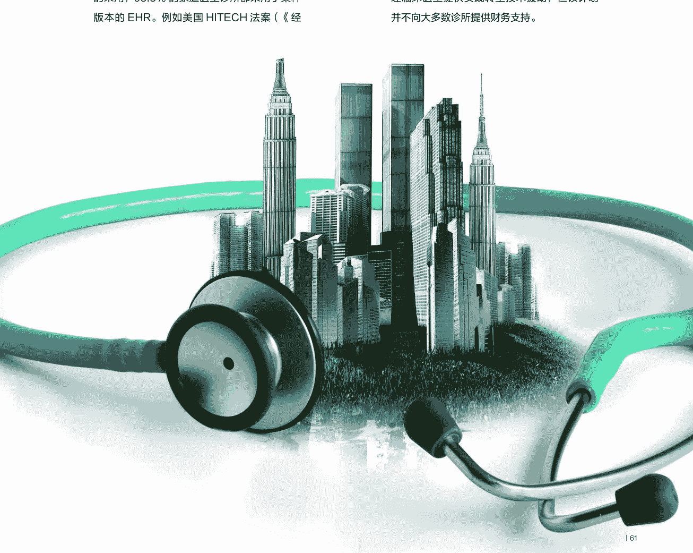

英国致力于加强 HIT（医疗信息化，Healthcare Information Technology），并构建学习型健康管理系统。HIT 是学习型医疗系统的关键驱动动力，它能够生成、整合、处理和理解来自多个来源（包括 EHR、疾病、患者、患者和临床研究）的数据，从而制定医疗政策和决策。学习型健康管理系统可以利用数据支持基础设施来实现有效的医疗、公共卫生和个性化医疗。这种系统是一个连续的循环过程，数据被转化为知识，知识又产生变化并实施，从而带来了更多的数据。英国医疗保健系统正在努力提供许多医疗保健环境中的患者访问电子 PHR（个人健康档案）。相关技术强调了其他共同访问优先项：投资 HIT基础设施、劳动发展以确保收集、处理和分析数据以制定政策和规划所需的准确性，强有力的创新以培养创新的思想，以及改进医疗以确保准确的标准。

日本社区健康管理涵盖了从疾病预防到全方面干预的所有方面。《2020 年世界卫生报告》显示，日本人的健康预期寿命位世界第一。

- 日本社区健康管理包括以下具体行动：1）健康体检与结经费，被纳入国家法律保护的健康体检项目齐全、项目界定清晰、覆盖范围广，由不同职能分工的健康检学会以指导和管理，并不断完善组织结构，优化体检费用。2）以社区为单位，充分动员区域部门，为居民实施生活方式并为健康增寿。

- 重点人群健康管理。一方面，对慢性病高风险人群的特定健康管理与特定健康进行指导。为了有效地管理血压、糖尿病等常见慢性病的健康计划，这些计划提供了定期服务、药物管理、健康咨询等。另一方面，负责老年人的社区护理。日本本土养老包括护理服务、日间护理服务、短期养老服务和社区站型服务等。

## 3.3 前沿科技赋能健康管理模式创新

大数据、云计算、物联网、移动互联网、人工智能等前沿信息技术以及尖端医疗设备的发展正在推动全球健康管理模式的创新和革新。

Michael Grossman 的健康需求模型（Grossman Model of Health Demand）是理解健康学中个人健康投资行为的重要模型。Grossman 模型引入了健康生产函数，它描述了健康如何转化为健康储量。生产函数包含了各项投资（如医疗服务、行为、时间等）与产出（健康储量）的关系。通过量化投入，个人在 Grossman 模型中，个人的健康投资受到多种因素影响，包括：医疗投入、生活方式选择、教育健康的回报则是提高生产力和延长长寿。

新行业科技不仅提高了医疗服务的质量和效率，使得更多的人能够及时和高效的医疗帮助，还扩展了全球健康管理模式，扩大了健康管理的覆盖范围。健康应用和可穿戴设备，帮助用户设定目标并实时追踪；远程健康管理，用户可以与医生交流，获取专业健康建议；家庭医生服务，家庭医生负责为个体提供从预防到治疗的连续医疗服务，并在需要时协调护理；社区中心通过提供全面的健康服务，支持个人健康管理，个人能够获得健康咨询和护理服务。

根据以上分析，新行业科技促进了全球健康管理模式创新，提高医疗服务的质量，引导人们养成更合理的行为，缩短患者等候时间。根据 Grossman 健康生产函数，这些健康投资效率的提升，有助于健康投资转化为健康储量，并推动人类延长健康寿命。

前沿信息技术和尖端医疗装备通过创新方式改善健康管理，提升服务的质量和效率，并使得管理更加个性化和智能化。新型健康管理模式可以根据个体的健康信息状况进行评价和提供针对性的健康指导，他们能够有目的地地采取行动来改善健康，减少患病概率和降低医疗费用，最终改善质量。

以前医疗技术对于全球健康管理模式创新和实践应用方面的，可以分为数字健康和人工智能的赋能、可穿戴设备和远程监测设备的普及以及生成式人工智能(GenAI)的应用。

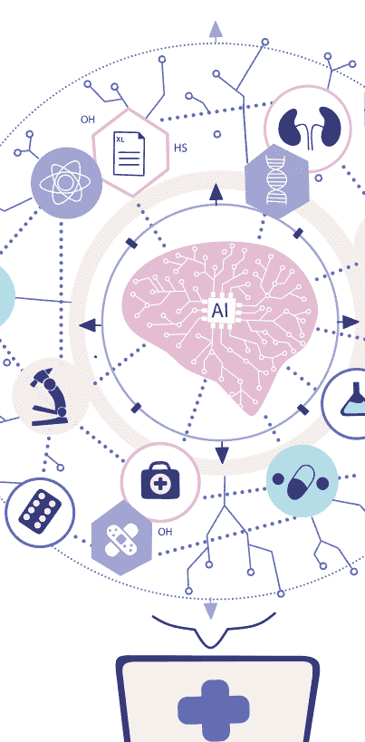

首先，健康和人工智能正在重塑健康管理模式。人工智能正被广泛采用以减轻工作者的负担、提高效率、缩短者等待时间。自动化和远程护理方面发挥了重要作用。其次，可穿戴设备和远程医疗设备的发展，使患者能够更加灵活地管理自己的健康。医疗诊断和远程护理正在改变患者与互动的方式。虚拟病房将对患者的监测支持通过设备实现就医的必要性。最后，生成式人工智能(GenAI)在医疗研发（突破性发现）、消费者教育等方面设备。这些终端医疗设备不仅在很大程度上提高医疗服务的准确性和效率，并且助力健康管理模式的创新与应用更加个性化和精准化的发展。

除此之外，特殊的护理和健康服务正在兴起，专业人员愈发重视这领域，并使用数字工具来应对健康问题，提供了新的端到端护理，确保患者获得更多全面和连接。远程医疗的发展，为健康管理模式带来了变革。

医疗设备可以分为以下方面：
- 1）诊断设备，包括影像诊断设备、磁共振成像、X射线扫描、平板探测器等。
- 2）监护与生命支持设备，包括监护设备（ICU）、体外循环、穿刺及手术设备。
- 3）植入设备，包括骨科支架、心脏膜、血管支架等。
- 4）制造设备，包括生物反应器、药物输送系统。
- 5）康复设备，包括外骨骼、移动辅助设备、脑机接口等。

2023年，招商信诺正式发布“大健康”品牌，以“无国界”作为多元承诺，招商信诺认为我们是一家全球性的健康公司，拥有超过20年的健康经验，网络覆盖70多个国家和地区，覆盖95%以上的医院，深耕基石，在客户管理、绩效协助、老年护理方面提供专业支持，帮助客户实现健康与家庭。

## 参考资料

1. 所有数据和文字均来源于国际 Healthcare360-Vitality 2023和《招商信诺2023年职场活力报告》，数据源于内地、美国、英国、西班牙、瑞利、卢森堡、新加坡、肯尼亚、沙特阿拉伯、阿拉伯联酋等13个国家和地区的108个样本。
2. 数据来源于制药工程协会，网址：https://ispe.org/pharmaceutical-engineering/challenges-emerging-digital-health-technologies/
3. 颜海、李子豪、王如等，养老的关键问题、创新与实现路径[J]。卫生经济研究,2024,41(01):45-49。
4. 胡艳、磊昌晶、下东、徐柏，模式下3岁以下幼儿服务的现状与展望[J]。中国婴卫生杂志,2024,15(03):1-4。
5. 李成志，“养老结合”的核心问题与解决路径[J]。健康发展研究,2024,27(01):41-44。
6. 全亦咏、良东、梁希，融合模式下全球健康服务战略研究[J]。当代医学科技,2021,11(06):151-154。
7. Junaid, S.B.; Imam, A.A.; Balogun, A.O.; De Silva, L.C.; Surakat, Y.A.; Kumar, G.; Abdulk Karim, M.; Shuaib, A.N.; Garba, A.; Sahalu, Y.; et al. (2022) Recent Advancements in Emerging Technologies for Healthcare Management Systems: A Survey. Healthcare, 10, 1940.
8. Grossman, M. (1972). “On the Concept of Health Capital and the Demand for Health,” Journal of Political Economy, 80(2), 223-255.
9. Zweifel, P., & Brey, F. (1997). Health Economics. Oxford University Press.

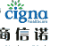

## 关于招信诺

招商信诺保险有限公司是一家专业、稳健、创新、以健康保险为领先的中外合寿保险公司。为企业和个人提供涵盖保险、健康管理、财富规划等产品及服务，中股东分别为招商银行和招商信诺集团。成立于2003年的招商信诺，经历了超过21年的稳健发展，业务已覆盖全国各大省市。截至2024年9月，招商信诺总资产突破2100亿元，营收连续五年实现双数增长，持续健康增长，累计服务客户超千万。成立以来，招商信诺始终坚持“以客户为中心”的管理理念，作为健康领域的先行者，持续实现自身的差异化优化，致力于帮助客户更健康、生活更好！

igna
招商信诺
保险·健康·财富
