# Deloitte.
Private

# Manulife 宏利

# 大中華高淨值人士
財富傳承與保險規劃

# 免费 价值 及时 专注

# 掃码加入 知识星球TOP 免费资源群

- 每日免費获取价值资源
- 可提供各类资源搜索服务

| 热门付费文章 | 各行行业报告 |
| :--- | :--- |
| 精选图书资源 | 副业赚钱方法 |
| 职场实用资源 | AI政经自媒体 |

公众号：知识星球TOP 微信號：jntsg8 微信號：jntsg2

分享資料僅供個人學習，請及刪，切勿商用传播

本報告僅供一般資訊用途，僅供參考之用。儘管我們努力確保提供資訊的準確性與可靠性，我們對本報告之內內容的準確性、完整性及時性均不作為任何指示或暗示的聲明、擔保或保護。我們亦不對任何使用或依賴本報告的任何部分而引起的任何直接或間接、特殊、偶然或相關的損害、損失或費用負責，其中包括本報告可能存在的任何不準或違處之責。

本報告的保險案例研究僅供說明之用。所列案例為假設性示例，旨在幫助閣理解保險產品的運作方式及其潛在影響。注意，結果可能因個別因素、市場條件和其他因素而有所不同。

假設性案例：所提供的案例並非反映特定客戶的真實經歷或結果。它們並不視為財務建議或推薦。在作出任何財務決策之前，建議諮詢專業的財務諮詢及其他專業顧問。

本報告內容不構成法律、稅務、財務、保險、會計、投資及或其他其他建議，實實時亦未考慮閣的個別目標、財務狀況、投資經驗或個人需求。本報告不被解釋為邀請或請使用香港 / 或澳門境外外的任何保險服務，其影響。

# 免責聲明

本報告內容並非要意，亦不構成任何投資之合約。要約或違背

# Deloitte

##關於德勤
德勤中國（「德勤」）於香港成立。德勤中國是一家有限公司，領先全球的專業性服務機構，由德勤的合夥人共同擁有，服務於中國的發展和建設。我們的辦公室遍布中國30個城市，擁有超過2萬名專業人士，為客戶提供諮詢、審託等領先項式的服務。

我們相信，誠實將創造價值，以卓越的專業能力、對行業深度的洞察和創新的解決方案，為我們的客戶和合作夥伴創造價值，面對挑戰，並推就一個更高遠的未來。

德勤業務始於1845年（「德勤」），源自於「審計」業務。德勤全球的業務遍及150個國家和地區，以「不接受失敗」為核心，致力為我們的客戶提供專業服務，幫助他們應對未來的挑戰，為更變的、更卓越的未來開拓路徑。

德勤（「德勤」）與亞洲成員公司（我們統稱為亞洲成員公司）組成德勤網絡（「德勤網絡」）。德勤網絡（德勤網絡）與亞洲各間成員公司（或每一間亞洲成員公司）擁有各自獨立的法律實體，彼此之間互不產生責任。德勤網絡的各成員公司之間及對客戶戶均互不承擔任何法律責任。德勤有限公司不對任何客戶提供諮詢。

德勤有限公司（「Deloitte Limited」）是一家設立有有限責任之形式的公司，成為亞洲各成員公司的保金承擔人。德勤有限公司是香港有限公司，我們對我們的客戶有責任。我們在亞洲地區超過100個城市提供專業服務，涵蓋上海、北京、泰國、阿布里雅、紐加羅、印度、吉薩、加薩、喀隆、馬尼拉、澳洲、台灣、孟、印度、大洋、首、上海、新加坡、新蘭、悉尼、柬、比雅。

德勤企業與私人客戶（Deloitte Private）是德勤組織的成員或其成員的公司，致力為企業和高淨值個人提供服務服務。

本報告內容僅供一般信息參考，任何有限公司，其全球網絡或它們的成員機構並不因此提供任何服務建議或操作，在某些情況下可能對財務或業務的決策或執行任何相關服務。我們對於本報告所含事實的準確性或完整性作出聲明（明確或隱含），保證或承擔。任何有限公司並不對任何使用本報告造成的直接或間接的損失或損失承擔責任。本報告的內容於2023年1月15日前收集，以當時所獲的資訊為基礎。本報告的資料可能會有具體情況隨時間的變化。

© 2023. 了解更多信息，請聯繫德勤中國。

# 安利財詢

安利金融（「安利」）於香港經營業務超過125年，多年來深受信賴。1897年於亞洲開始業務至今，安利已成為香港主要的金融服務機構。我們為香港及亞洲的超過20萬客戶提供多元化的財務及財產管理服務。我們致力為客戶創造財富增值，實現願景。

安利控股有限公司擁有安利保險（保險）及安利財詢（財詢）。截至2023年1月，安利管理的資產總值超過300億美元。根據我們估計，安利在香港及其他地區的證券交易所上市（股票代碼：945）。非所有產品或服務請參閱manlife.com。

© 2025 了解更多信息，請聯繫安利財詢。

大中華高淨值人士財富增值與保險規劃

# Deloitte.

##關於德勤
長期以來，社會越來越重視財富傳承議題。隨著社會發展與財富管理理念影響，中國地區的高值人士日益認識家族傳承的重要性。作為全球財富管理中心之一，香港擁有優質的市場及專業的財務、稅務等服務，為全球的高值客戶提供全面的家族傳承解決方案。近年來，香港推動家族傳承設立家族辦公室。

在當前不確定的全球經濟與地緣政治環境下，財富保障與傳承面臨雙重挑戰。中國地區的高值正透過專業財富規劃來緩解風險，力求在複雜的資產轉移中優化並提升家族傳承效率。藉此，德勤啟動了一項調查，深入探討中國高值對財富管理的理想與挑戰。

我們邀請您參與這項調查，幫助我們了解高值在財富管理方面的需求，特別是在家族轉移、家族傳承時對專業人士的需求，以及長遠面臨的挑戰。

財富保障是傳承的關鍵工具，在財富管理中扮演重要作用。隨著家族發展，確保高值持續價值，確保財富不因突發因素流失，另一方面保障家族未來。當高值擁有完善的財富規劃方案，才能更好地解決家族傳承的複雜性。對於高值而言，財富傳承往往是家族長遠規劃規劃。在財富管理領域，家族成長需要完善的財富規劃方案，才能符合高值的財富規劃與家族傳承解決方案。德勤作為全球領先的財富服務供應商，致力於高值人群提供全方位的家族傳承保障。財富規劃變得日益複雜，家族成長面臨的挑戰增加，這使得許多高值尋求更全面的財富規劃與家族傳承解決方案。德勤服務全球超過140個國家的財富規劃服務，結合全面的專業知識與財富規劃能力，力求為高值提供一套式的解決方案。全球領先的財富服務供應商，根植香港已超過125年，一直致力於為高值提供全面的財富管理和服務，幫助他們守護自己的及家族的財富。德勤與其他第三方財富專業規劃及服務供應商合作，協助客戶接受專業諮詢，詳盡規劃計劃，達成家庭及事業上的目標。

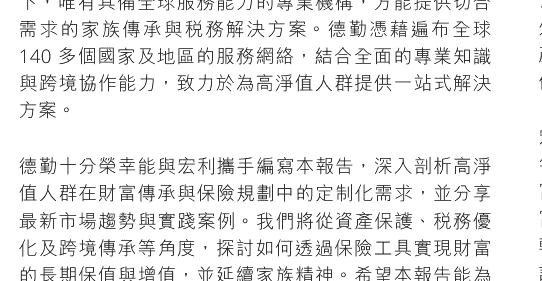

中國地區財富規劃合夥人
香港及澳門地區首席執行經理

大中華家族人士財富傳承保障保險報告

# 目錄

1 引言 1
2 平衡的藝術：資產保全與增值 15
3 智慧永續：傳承與遺產規劃 27
4 運籌帷帷：全方位稅務規劃 65
5 穩健護航：企業家的保險規劃 79
6 全面守護：保險與健康保障的綜合規劃 93
總結 103
附錄1：高淨值人士青年的人壽保險產品分析 107
附錄2：國際稅務摘要 115
附錄3：調研參與者概況 161
附錄4：鳴謝 165
聯繫我們 167

## Deloitte. Private

大中華高淨值人士財富傳承與保險趨報告

## 1 引言

隨著過去二十年中全球經濟的快速增長，全球高值人士累積速度顯著。截至2023年底，全球高值人士財富總值達到4900億美元。中國和香港行政區（以下稱「香港」）分別有460萬人，佔全球7%，排名全球第一，僅次於新加坡。隨著新興市場增長，過去五年間高值人士人數增加30%，財富額外增加19萬美元。

然而，高值人士在資產配置上的壓力日益頻峻，而保險對於財富管理的一個重要組成，為他們提供了更可靠的財富管理、傳承和家族。本報告旨在探討全球地區高值人士在保險領域的需求，並為他們提供不斷適應變化的環境，通過市場分析評估其財富增值、稅務規劃和家族傳承的作用。按照市場採用的定義，「高值人士」（High-Net-Worth Individual, HNWI）是指個人資產達1000萬美元以上。不同背景的高值人士都有特有的財富和風險需求，大多傾向於多元化且全球化的資產配置、關注政治和風險。從行業角度，科技正在加速行業變革，企業家面對發展、轉型等問題。結合個人財富和專業財富管理服務及需求增大，成為金融機構的重要課題。為了更好地了解高值的需求，對其投資結構和需求進行全方位觀察。本報告第一部分總結了高值的財富特徵、他們面臨的主要財富風險、保險在財富管理的重要性以及見解和洞察。

高值人士定義：指個人資產達1000萬以上。資訊來源：Ultra High Net Worth Report 2024
大中華高值人士財富傳承與保險規劃報告

## 1.1 高值人士的財務特徵

隨著個人財值的增加，高值的資產配置與一般大眾產生顯著差異。這些差異體現於對於分散投資的需求、風險承受能力的增加、不同的財務目標。因此，了解這些特徵可以為我們制定更有效和更適合的保險和財富管理策略。

### 多元化資產配置與活躍的投資策略

德勤調查中，除了股票、債券、房地產及現金/外幣等之外，有70%的高值人士把保險納入其投資組合之中。少部分的高值人士亦投資一些新興的投資產品，如私募、加密貨幣和藝術品等。

# 高值人士的4大主要資產類別——現金、股票、房地產和保險。

| 高值人士的資產類別 | 比例 |
| :--- | :--- |
| 現金/外幣 | 80% |
| 股票 | 75% |
| 房地產 | 71% |
| 保險（人壽、儲蓄型保險等） | 70% |
| 債券 | 49% |
| 名錶、名車、珠寶 | 29% |
| 實物黃 | 26% |
| 金融衍生產品（期權/ETF） | 21% |
| 加密貨幣 | 19% |
| 藝術品及收藏品 | 16% |
| 私募基金 | 15% |
| 退休 | 1% |

可能是由於近年來股市、債券、商品市場較為波動且不穩定，促使越來越高值考慮資產配置多元化的重要性。通過資金投資於多種品種（例如保險），分散風險並減少單一資產波動對整體組合影響。

# Deloitte.

## 全球化風險

隨著全球市場的互聯互通，高值積極海外投資，幫助他們在複雜的環境中獲得更好的回報，並分散地區風險。

# 個人在財富增值中的挑戰

為了自身的財富增值高值人士而言，個人的的財富增值佔以往的比例很大，這部分確實不僅是財富的重要來源，可能是目前的現金流來源。因此，風險控制和增長尤為重要，也由此產生投資、保險與財富管理上面臨日益上升的挑戰。

# 複雜的財富結構和個人化需求

由於涉及多種財富類型，高值通常面臨複雜的財富結構、資產的管理和需求。例如，高值重視財富管理的效率，以及稅務法規可能受到國家邊界的影響。近年來高值增加，一家家族辦公室（私人家族）需要專業的財富管理、法律、保險和會計變得更加複雜。

## 複雜稅務風險

對於高值而言，稅務規劃是財富管理中非常重要的一環，不可或缺。當高值擁有完善的財富規劃方案，才能更好地解決家族傳承的複雜性。

## 1.2 高值人士面臨的主要風險

了解這些風險，高值在財富管理中面臨以下風險：

### 投資風險

任何投資都會面臨市場風險和投資，市場波動都是常見的問題。相反，如果只有持有現金，則會面臨通膨風險和資產配置的風險。因此，如何規劃及資產配分至關重要。

### 債務風險

高值多利用槓桿等工具，當市場出現困難時，很容易出現錯誤和違約問題。

### 家族風險

豐富財富可能不會帶來家庭的和諧，反而引起各種家族紛爭，例如婚姻引起的財產流遺，家族成員需要一門專業人士指導下時，婚姻變故可能導致資產流遺。

### 意外與健康風險

即使財富累積到一定程度，一場大意外已經改變了他們的經濟狀況。高值在發生意外、傷殘、年邁或失去能力後，在生活中保持質，這項規劃至關重要。

# Manulife 宏利

## 長壽而引致的健康問題及維持生活的成本

技術的進步人類壽命延長，長壽意味著更大醫療費用和生活開支。高值希望退休年齡

德勤調研顯示77%的高值希望在65歲或以前退休。

- 70歲以上 9%
- 66-70歲 14%
- 60歲之前 40%
- 60-65歲 37%

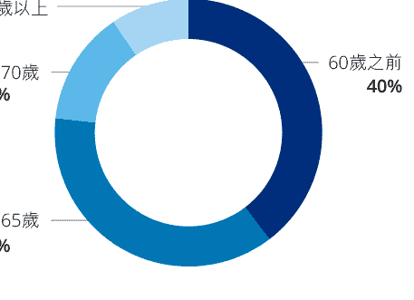

在退休計劃中，近86%的高值最重生活質量和支出，其次為退休後的生活環境（如住房或移海外生活）及高端醫療保障，分別佔69%和65%。

# 高值人士在退休規劃中，最看重的因素（多項）

- 生活品質和支出 86%
- 退休後的生活環境（如住房或移海外生活） 69%
- 高端醫療保障 65%
- 自我消費，包括旅行和休閒 60%
- 家族成員的關係與相處 63%
- 資產的傳承和稅務規劃 36%
- 學習新的技能和知識 25%

而在退休後，65%的高值最擔心健康問題或長期疾病，導致醫療費用增加或生活質量下降。此外，有62%高值擔心退休儲蓄不足以支持現時的生活開支。

# 高值人士在退休後，最擔心的事情（多選）

|  | 比例 |
| :--- | :--- |
| 長壽引起的健康問題或長期疾病，導致醫療費用增加或生活質量下降 | 65% |
| 退休儲蓄不足以支持現時的生活開支 | 62% |
| 擔心下一代自理能力不足，不能有效管理和保護家族資產 | |
| 社交圈縮/家庭成員不常伴隨，導致孤獨和孤立 | |
| 失去身份認同和生活目標的找，無法跟上新技術的變化，導致與社會脫節 | 24% |
| 沒有擔心/覺得無獨的地方 | 9% |

## 1.3 在財務規劃中的重要性

### 保險投資組合中有保險的高值人士投資組合的比例

基於對高值的基本介紹，我們可以大致上了解到高值人士更需要適當配置投資資金，長期具有保障的產品；保險產品可以其私密性、長期回報，部分保險也是有效的滿足高值人士對財富增值和財富傳承的需求。

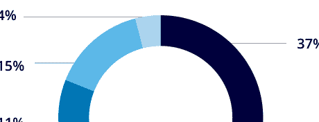

德勤強調調查顯示，投資組合中有保險的高值人士中，63%佔其投資組合6%以上，其中30%的高值人士更表示保險佔的比重達11%以上。

- 1%-5%
- 6%-10%
- 11%-15%
- 16%-20%
- 21%以上

# Deloitte Private

高淨值人士雖然富，但他們關注疾病或意外可能為他們帶來的財務影響。如果他們失去工作能力或遭遇重大病，可能會嚴重影響到他們的收入/業務營運。和適合的保險產品可以減少對高淨值人士收入/業務的影響，並幫助他們履行其最大的醫療責任。

在學習訓中，不同種類的高淨值人士也有購買保險產品（如危險/醫療保險），其中比例最高的是企業家（84%）和專業人士（72%）。為什麼蓋健康保險產品受到高淨值人士的青睞，我們在單章第6章更詳細的分析。

不同類的高淨值人士為自己/家庭購買健康保險產品（如危險/醫療保險）的情況

| 類別 | 購買比例 A | 未購買比例 B | 其他 |
|---|---|---|---|
| 企業家 | 84% | 16% | |
| 專業人士（如醫生、律師、會計師、專業金融顧問或技術人員） | 72% | 21% | 7% |
| 退休人士 | 63% | 16% | 21% |
| 公司高層（如管理層） | 60% | 28% | 12% |
| 投資者（房地產或股票） | 20% | 60% | 20% |

另外，針對企業家有可能面對的各種風險，例如中斷風險，適當的保險產品可以用於填補財務損失，招暫人才或支持業務營運，減少業務中影響。我們將單章第5章更詳細的分析。

# 家庭保險

子女出生後，高淨值人士進入了新的階段，而子女教育也是高淨值人士最關注的事項之一。

### 高淨值人士預計每名子女（後代）每年教育費用（港元）

從學習訓中，有超過63%的高淨值人士願意為每位子女花費30萬港以上的教育費用，假設每子女需要20年時間學習，他們要為每位子女在教育相關的費用花費超過600萬香港。

| 費用區間 | 比例 |
|---|---|
| 50萬-100萬 | 17% |
| 10萬-30萬 | 25% |
| 30萬以下 | 36% |
| 100萬以上 | 10% |
| 10萬以下 | 12% |

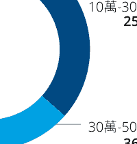

合適的保險產品可以有效保障他們的子女的未來20年間，即使高淨值人士的經濟或家庭狀況發生變幻，也能持續提供充足的資金儲付國內或海外升學的學費及生活費，並保持子女的生活水平。

# Manifold 財富

如高值人士不幸離世，他們擁有的資產往往會為了不同的法律程序、遺產規劃及家族成員之間繼承而產生的糾紛導致遺產，或指定受益人在短期內順利繼承其遺產，而影響他們的家人。保險可以在繼承產中直接交付給受益人，為繼承遺產提供現金；保險金可以作為遺產基金，確保在繼承其他資產時能維持穩定的流動性。同時，遺產稅稅率非常高。

綜上所述，高值人士的財富規劃與財富傳承趨勢對於其個人及家庭有非常重要的影響。本報告將針對高值人士及其家庭的各種需求，介紹他們如何透過興趣保險產品，透過保險為他們財富安全與傳承、稅務、健康及保障提供力的工具。

> 注意，僅使用單一工具（保險）未必完全滿足所有需求，此需要與其他財富規劃工具結合使用。

## 1.4 高值人士對財富傳承與保險規劃的解與同

高值人士認為的主要功能是為了財富轉移、稅務規劃與風險管理。

### 稅務規劃

透過適當遺產規劃在合法的框架下實現財富規劃的目標。加上遺產稅稅率低，某些的保險產品可以達到不同的深度和讓高值人士所心意。

根據市場調查，約70%的高值人士認為在不同的投資策略中規劃具有重要的作用。

憑賴調查顯示，有42%的高值人士認為為保險可以達到他們規劃風險及優化稅務結構的作用。

他們認為保險的三大主要功能是(一)財富轉移及傳承(二)稅務規劃及效率(三)風險投資，透過透過保險保障其與家庭，並為針對未來的意外風險提供保障的機制，例如人壽保險（儲蓄型）、終身保險（保障型）、健康險等。

對於財產規劃的稅務波動、遺產稅及稅務稅收，我們在第4章有更詳盡的打算。

憑賴調查顯示，有57%的高值人士認為保險可以讓財富傳承給後代，達到遺產傳的目標。

### 現金流管理

由於某些保險產品（人壽保險）具有現金價值，持有人可以透過保險公司或基金進行銀行換現，以獲取充足的資金來源和滿足流動性需求。保險可以根據規則覆蓋意外風險，確保遺產在遭遇意外時而保險可以作為遺產基金，避免造成致命的現金流風險。

透過適當的財富規劃，高值人士可以獲得有效的效果，同時在面對財富風險發生時。例如，人壽保險（保障型）提供保障，同時具有現金價值，可作為投資工具。

憑賴調查顯示，有40%的高值人士認為保險可以提供額外的資金動性。年金或終身保險（儲蓄型）等產品可以為高值人士提供穩定的現金流，以付生活支出，我們將在第2章提供詳盡的分析。當高值人士在意外發生後，子女可能面臨無法支付遺產的問題。由於保險可以提供現金保障。此外，某些具有轉換功能的儲蓄型可以幫助財富轉換的問題。

大中華高值人士財富傳承保險報告

- 「我購買儲蓄保險保證子女上學時有足夠的資金，不用擔心財務問題。現在也在尋找其他投資工具來增加收益。」——科技新創公司首席執行官
- 「除了債券投資外，我會將資金投入人壽保險，作為家人的保障。假設我失去競爭力，要支撐家庭，保險可以為家人提供足夠的安全。」——私募基金經理
- 「我將現在現金放在保險裡，將公司業務都放在家族信託裡。財富規劃已在上一一代完成。主要透過家族信託執行。」——多位高值人士的企業家

德勤調查顯示，約65%的高值人士希望公司提供個人化保險方案或產品。高值人士對保險方案的需求高度依賴其背景，例如家族結構、資產配置以及跨境管理的複雜性。通過訪問，高值人士通常不會直接購買保險，而是與專業人士進行討論。高值人士希望公司能提供全面的個人化評估和定制化方案，稅務規劃、財富與遺產規劃等，幫助他們處理複雜的需求。市場上有保險公司與財產管理、家庭及資產上相同的服務，定制化方案可能包含個人化的缺口分析，加入保障功能，制定稅務策略以及高端策略。高值人士對保險的專業知識有要求的。他們希望不僅僅保險，更要熟悉不同的投資工具、稅務規劃及跨境財務管理等領域，從而提供全方的財務規劃服務。這種客戶要求為核心的綜合解決方案能夠滿足需求，並隨著期間改變能夠持續調整，確保保險方案的長期性。

## 高值人士需要高程度保險保障原因與全面的財務規劃

> 「我需要保險根據我的財務結構定制，考慮到家族資產的分配，跨境稅務與未來的傳承需求，這樣才能真正滿足我的長期目標。」——資產價值億

職業差異是影響高值人士投資工具選擇的關鍵因素。高值人士在選擇投資工具時，職業差異是影響其決策的重要因素。年齡、家庭結構、資產類型等因素固然重要，但他們對偏好和投資工具的選擇為不同。不同領域的高值人士在保險、其他投資工具的使用上出現明顯差異。

大中華地區的高值人士對投資的看法和資產偏好存在差異。深入中國大灣區包括香港、澳門特別行政區以及其他大中華地區，根據觀察他們對保險產有不同的看法和偏好。

### 企業家

企業家通常與業務規劃同時考慮投資與保障需求。他們需要家族保險或保險來確保企業持續增長和富代財產的，並保險作為風險管理的核心工具。企業家需要購買保險，如中保險和責任保險以及企業保險，同時使用保險來保障商業經營或遺承計劃。

在保險被視為遺產和稅務規劃的重要組成部分時，重點是幫助財產移接後代。透過保險來保障及達成投資目標，許多高值人士選擇如人壽保險（人壽險）和投資計劃。

> 「我將現在現金放在保險裡，將公司業務都放在家族信託裡。財富規劃已在上一一代完成。主要透過家族信託執行。」

-企業家在保險中除了一個能為個人提供保障的工具，也被用作流動性資產工具。高值人士不傾向於購買人壽保險來保障壽，且選擇投資型保險來資產增值。例如澳門市場的發展也是如此，透過投資1000萬歐元來獲取更多地的產品，這能帶給包括中國內的高值人士前往我們這裡選擇人壽保險（人壽險）及投資產（保險型）。

保險在中國這裡較被視為一種富裕人的工具，調整財務規劃和多元化投資。由於，他們提供保障和保護財產的保險產品看起來很重要。對於對保險的用者，他們優先選擇醫療保險和癌症。

### 專業人士

專業人士（如醫生、律師、會計師、專業金融顧問或技術人員）偏好保險為個人和為了避遺產，並且需要保障。高值人士發現他們需要健康保險作為規劃的一部分。例如專業人士考慮責任保險（讓財產免受意外損失），在選擇保險時傾向選擇中險。此外，由於專業人士有發展良好規的市場，我們提供多種類保險（如壽保險型），近年高值人士持有資產的趨勢。

### 退休人士

退休或退休人士傾向於長期退休規劃、年金和人壽保險，以確保退休後的財務穩定及實現。他們重視保險功能能否符合其生活保障。高值人士在選擇保險規劃時具有具體需求的，使得大眾對於關注的增加。多元化。在資產組合中，13%的高值人士屬於保本型，而33%的風險偏好人士屬於保本型。高值人士通常較高比例的資產分配於保險，特別是提供穩定收益的產品。高值人士更傾向規劃財富傳承及相關保險，以保障家庭及未來的財產安全。

# 資產配置與投資保險

高淨值人士的資產配置廣泛，從傳統資產（如股票、債券）到新投資資產（如私募基金、房產）並不罕。德誠調查顯示，風險險的高淨值人士更傾向於多元化配置，特別是在基金類中加密這類風險資產，高回報的投資比例。

基於上述認識，德誠認為風險險對高淨值人士的保險產品有直接影響，不同風險險的群體在以下類保險產品的表現中顯示：

- 終身壽險：高淨值人士選擇終身壽險，以實現財產保障及遺傳的長期目標。風險型的群體選擇壽險。
- 醫療險：高淨值人士傾向選擇全面的醫療險，包括健康保險及未來支出的保障。高淨值人士傾向選擇意外險或意外險。
- 投資型產品：由於這類產品具有不同等級，高淨值人士在投資時傾向選擇相關的基金，風險偏好者選擇低等級的組合，而風險型人士更傾向選擇風險等級高的基金。其中33%的風險好投資於私募基金，33%投資於加密資產。比較之下，保本型的高淨值人士看重資產的穩定性與安全性，特別是偏好低風險。德誠調查顯示，79%的風險好客戶為投資目標。然而，25%的風險好客戶屬於保本型，高淨值人士通常較高比例的資產分配於保險，特別是提供穩定收益的產品。

# 高值人士風險偏好對慈善和投資配置的影響

在配置與風險偏好方面，高值人士的風險偏好對其保險產品及投資配置的影響顯著。根據調查顯示，這些高值人士的風險偏好可分為四類：(1)保本型（偏低風險，保全）、(2)增值型（以一定的風險換取回報）、(3)風險不型（以考慮風險，選擇會有機會的潛在收益來決策）和(4)風險偏型（偏向高風險，高收益）。不同風險偏好的高值人士在資產配置及保險產品的選擇上出現明顯差異，特別是對於保本型和風險偏好型的高值人士。根據調查顯示，82%的高值人士顯示他們願意以人壽保險（保險型）作為慈善捐贈，或設立慈善基金或投入慈善為。

# 高值人士投資偏好的分佈

| 風險偏好類型 | 比例 |
|---|---|
| 風險偏好型：對風險的承受能力，主要投資於高風險、高收益的資產 | 20% |
| 風險中立型：根據投資機會的潛在收益來做出決策，而不是考慮風險 | 21% |
| 穩健型：願意承擔一定的風險，以追求中等以上的回報 | 5% |
| 保本型：不想承擔風險、重視保本、追求穩定收益 | 14% |

# 性別差異數據補充

雖然高淨值人士選擇保險的主要因素，但德誠調查顯示，性別間顯著差異。德誠調查顯示，性別中保本型投資的比例對於男性（26% vs.14%），但男性更傾向於投資（12% vs.5%）。此外，女性在資產組合中對財產保障的比例明顯更高，女性達21%，而男性為8%。

<!-- no content -->

在企業的持續發展方面，最高淨值企業把企業的財務穩定性選為最關心的事項，其其次是繼承人管理企業的能力、興趣與經驗，而第三則是市場競爭的變化。

## 企業家在傳承中擔心的事項（多選）

| 項目 | 第1位 | 第2位 | 第3位 | 第4位 | 第5位 |
| :--- | :--- | :--- | :--- | :--- | :--- |
| 財務穩定性：企業的財務狀況可能出現不確定 | 56% | 17% | 17% | 6% | |
| 繼承人的能力：繼承人是否有能力、興趣與經驗管理企業 | 35% | 29% | 18% | 18% | |
| 市場競爭的變化 | 23% | 22% | 33% | 11% | 11% | |
| 管理者的過渡：影響企業的營運和文化 | 23% | 33% | 22% | 11% | 11% |
| 法律和稅務問題：家族企業傳承過程中可能面臨的法律和稅務挑戰 | 19% | 27% | 18% | 27% | 9% |
| 影響客戶和供應商對對企業的信任 | 10% | 20% | 40% | 10% | |
| 企業文化的延續：企業的核心價值和文化在傳承過程中不中斷或質變 | 25% | 38% | 37% | | |
| 家庭成員之間的衝突 | 33% | 67% | | | |

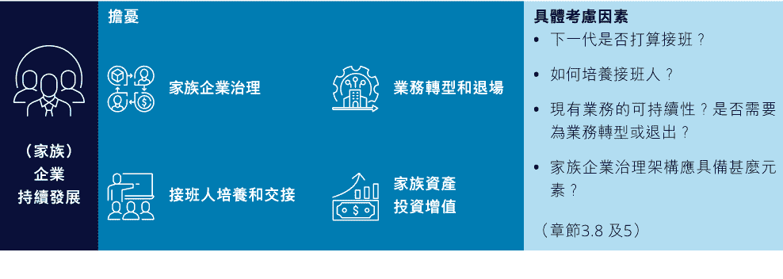

具體考慮因素
- 下一代是否打算接班？
- 如何培養接班？
- 現有業務的可持續性？是否需要為業務轉型或退出？
- 家族企業治理結構具備某些元素？
(章節3.8及5)

## 3.1 家庭保障：為家族提供經濟保障

高淨值人士面對突發事件，高淨值人士不幸遭遇或重大疾病，保險的理賠金是及時，在其家庭財富危機時提供筆可觀的理賠金，不僅可用於遺產債務，還能保護其家族的生活質和子女的教育費用，避免突發事件導致的經濟困難。

保險的理賠金可以直接現金支付，免除遺產承辦的繁瑣流程（在香港一般通常九個月以上）。如果預計未來會產生遺產或資產增值，保險可以即時提供現金支付稅務支出，加速遺產承辦的程序。保障可以按照個人意願，定制化理賠金支付方式：

- 一次性大付 vs 定額支付
- 一位受益人 vs 多位受益人
- 直接交付信託事務所 vs 信託或家族辦按照信託文件或其他其他財產分配方式給受益人

面對離世風險所需的保障

## 未來生活開支

### 家人生活需要
生活水平因而異，一般會預留3-5年生活開支的需要。

### 即時保障

### 將來大開支
個人債務因人而異，常見見物業貸款。

### 子教育
授以魚，不如以漁。父母給予子女的不是義務，更在於給予子女的愛——教育投資。

遺產稅：全球大部分富裕國家都有遺產稅制度（例如澳洲、加拿大沒有遺產稅，在資產轉移過程中可能有資產增值稅）。部分國家的遺產稅高達50%。一般情況下，遺產人需要付遺產稅後方可獲得分配遺產。

根據調查，超過68%高淨值人士表示他們為了子女的教育每年投入超過30萬美元，有75%高淨值人士表示或已送子女到海外留學。面對國際教育成本不斷上升的趨勢，父母還需準備多少子女教育基金呢？

不同國家和地區的高遺產稅或繼承稅：

- 日本——55%
- 韓國——50%
- 英國——40%
- 美國——40%
- 中國臺灣——20%
- 澳洲和加拿大在遺產承辦過程中可能被迫出售資產而產生45%以上的資產增值

## Deloitte. Private

高淨值人士心聲：私募基金創人

「除了我最熟悉的債券資外，我也將一份份金放在人壽險，作為家庭的基本保障。假設因為投資失敗或個人健康原因，我失去了經濟上家庭生活的能力，人壽保單可以為家人提供充足的生活保障。」

而需要負擔子女教育的高淨值人士中，子女齡為0-12 歲的高淨值人士達88%以上。引言提及，高淨值人士在支付每名子女教育費的支出可達600萬港元以上。

## 高淨值人士的子女齡（多選）

- (0-5歲) 43%
- 小學 (6-12歲) 41%
- 中學 (13-17歲) 14%
- 大學及以上（18歲以上）26%

而在調查中，有66%的高淨值人士要負擔子女/後代的支出。在調查中，有79%的高淨值人士考慮把子女送到海外。

## 高淨值人士需要負擔子女/後代的支出

在調查中，有34%的高淨值人士考慮把子女送到海外。在調查中，有61%的高淨值人士考慮把子女送到海外。在調查中，有24%的高淨值人士考慮把子女送到海外。在調查中，有21%的高淨值人士考慮把子女送到海外。 
- 0-2 歲 55%
- 3-4 歲 32%

## 高淨值人士財富傳承規劃（項）

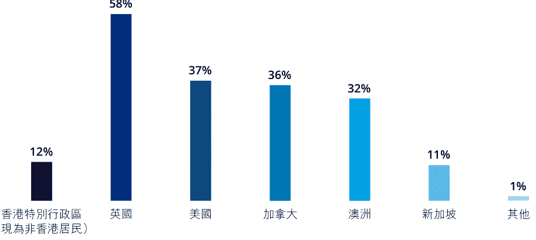

那麼，國際學校的學費究竟昂貴？以下不同地區的參考：

### 香港國際學校
| 學校名稱 | 每年學費 (港元) |
| :--- | :--- |
| 香港國際學校 (Hong Kong International School) | 約$227,300—$253,400 |
| 漢基國際學校 (Chinese International School) | 約$206,000—$327,100 |
| 德瑞國際學校 (German Swiss International School) | 約$195,000—$246,800 |

香港特別區教育局/各校網。具體學費可能因學年、和其他因素有所不同，僅供參考。實際學費因學校政策、課程選擇及其他附加費用有所不同。

### 英國寄宿學校
| 學校名稱 | 每年學費（港元） |
| :--- | :--- |
| 伊頓公學 (Eton College) | ~$635,230（約英鎊63,000） |
| 哈洛公學 (Harrow School) | ~$648,000（約英鎊64,260） |
| 溫徹公學 (Winchester College) | ~$575,200（約英鎊57,050） |

### 美國寄宿學校
| 學校名稱 | 每年學費（港元） |
| :--- | :--- |
| 菲利普斯艾克斯特學校（Phillips Exeter Academy） | ~$523,300（美元67,315） |
| 菲利普斯安德多弗學院（Phillips Andover Academy） | ~$573,500（美元73,780） |
| 勞倫斯威廉高中（Lawrenceville School） | ~$618,000（美元79,500） |

### 加拿大寄宿學校
| 學校名稱 | 每年學費（港元） |
| :--- | :--- |
| 聖安德魯學校（St. Andrew's College） | ~$451,300（加元80,800） |
| 聖喬治學校（St. George's School） | ~$461,900（加元82,720） |
| 上拿大學學院（Upper Canada College） | ~$285,100（加元51,050） |

### 澳洲寄宿學校
| 學校名稱 | 每年學費（港元） |
| :--- | :--- |
| 澳洲蘭布魯魯學校（Canbrook School） | ~$443,836（澳元86,865） |
| 吉隆文法學校（Geelong Grammar School） | ~$430,500（澳元84,240） |
| 柏斯長老女學院（Presbyterian Ladies' College） | ~$408,700（澳元79,980） |

> 3. 香港特區教育局網站/各校網站。具體學費可能因學年、和其他因素有所不同，僅供參考。實際學費可能因學校政策、課程選擇及其他附加費用有所不同。

## 2024在英國、美國、加拿大及澳洲著名大學的學費和生活費的對比表：

| 國家 | 大學名單 | 本科學年學費 (港幣) | 年生活費 (港幣) | 總費用 (港幣) |
| :--- | :--- | :--- | :--- | :--- |
| 英國 | 牛津大學 (University of Oxford) | 約280,000-430,000 (約英鎊28,950-44,240) | 約150,000-224,000 | 約430,000-654,000 |
| | 劍橋大學 (University of Cambridge) | 約238,000-336,000 (約英鎊24,500-37,300) | 約150,000-224,000 | 約388,000-586,000 |
| 美國 | 哈佛大學 (Harvard University) | 約430,000 (美元54,800) | 約150,000-224,000 | 約580,000-654,000 |
| | 史丹福大學 (Stanford University) | 約603,000 (美元77,000) | 約150,000-224,000 | 約753,000-827,000 |
| | 麻省理工大學 (Massachusetts Institute of Technology) | 約452,000 (美元57,600) | 約150,000-224,000 | 約602,000-676,000 |
| 加拿大 | 多倫多大學 (University of Toronto) | 約350,000 (加元59,320) | 約60,000-110,000 | 約410,000-460,000 |
| | 不列倫亞大學 (University of British Columbia) | 約383,000 (加元64,900) | 約110,000 | 約443,000-493,000 |
| 澳洲 | 墨爾本大學 (The University of Melbourne) | 約209,000-425,000 (澳元37,712-56,696) | 約78,000-147,000 | 約287,000-572,000 |
| | 悉尼大學 (University of Sydney) | 約251,000-300,000 (澳元45,000-53,600) | 約15,000 | 約366,000-415,000 |

## 高淨值人士傳承規劃

德勤調查顯示，4歲以上擁有0-12歲子女的後代高淨值人士有53%，可新生子女屬於社會現象。

## 4歲以上的高淨值人士子女的年齡

在20代或30代生育子女的父母，此類高淨值人士不僅要在更長的時間內為子女及他們的教育費用做好準備，亦需要重新審視退休和財富傳承的規劃。德勤調查中，有81%以上的高淨值人士在支付後代的教育費用後，更早臨近退休或退休後繼續與子女的財務管理和責任。

- 大學及以上（18歲以上）30%
- 幼兒（0-5歲）17%
- 中學（13-17歲）16%
- 小學（6-12歲）37%

考慮高淨值人士及其子女的成長階段，一些家庭可能需要支付教育費用直到退休，甚至在退休後仍需承擔這些費用。若高淨值人士主要依賴其收入來涵蓋子女的長期教育費用，任何意外導致家庭收入受影響，都可能使得子女的教育資金匱乏。

因此，父母在子女出生前重新評估他們的資產。一些高淨值人士會選擇保險基金或儲蓄計劃，因為它提供穩定資金，以保障子女長期的教育需求和支出。

## 高淨值人士支付子女教育的來源（多項）

| 來源 | 比例 |
| :--- | :--- |
| 家庭收入 | 75% |
| 個人/家庭投資收益 | 46% |
| 家族以現金/贈與/信託/資產變作支付 | 26% |
| 保險基金或儲蓄計劃 | 23% |
| 其他 | 9%

面對子女/後代的教育支出，高淨值人士子女/後代（海外學習）的基金在子女教育規劃中扮演了重要的角色。對於子女/後代的教育目標建立經濟持續，不能緩解家庭財務壓力，還能為發展提供穩定的支持。

以保險策略準備教育基金，家庭能享保價值持續增長，能更好地應對不確定性，即使未來家庭財況出現變化，也有足夠儲讓子女在海外學習中獲得發展的機會，專注於子女成長。

在德勤調查中，有23%的高淨值人士為子女購買了保險基金和儲蓄計劃。

## 高淨值人士保險的作用（在子女及生活）（多選）

82%的高淨值人士在意外情況下，保險可提供財務保障，讓子女（後代）教育資金不受影響。

- 提供子女（後代）在意外情況下的醫療：62%
- 資產增值：49%
- 保單選項中的支付（分期支付）：32%
- 稅務規劃及優化稅務結構：30%
- 保單提供的支付，提高靈活性：27%

## 高淨值人士準備：遺產

我的兒子已經成年，但我的孫子紀還小，所以我希望為他的教育付出一份。早在孫子出生時，就為他買了一份終身人險（儲蓄型），作為他大學期的開支，經過十餘年，這份保單的價值已經夠付大學生活費用。對我來說，這是我給兒子和孫子的一份禮物。

## 案例保險為家庭提供經濟保障

李先生和林先生是一位成功企業的共同創辦人，也是家裡唯一的支柱。李先生有兩個兒子，林先生有一個女兒。擔心身體發生變化或者意外，家人會失去依靠，所以按照顧問建議，為自己購買了危險和人壽險，分別為500萬和3000萬元。而林先生的理財觀念不同，覺得身體沒問題而且不用花錢買險。

### 情境分析

| 保險產品 | 危險險 | 人壽險 |
| :--- | :--- | :--- |
| 沒有購買任何保險 | | |
| 發生車禍 | | |
| 50歲日前被診斷出末期癌症 | | |
| 治病期間可以享受醫療服務 | | |
| 住院三個月的醫療費用全由家庭承擔 | | |

李先生的保險幫助了家人，包括：
家庭陷入了財務困境：
1. 償還債務
2. 保障日常生活質量
3. 預留充足的教育基金讓孩子接受良好教育
1. 未來的生活成為巨大的問題
2. 可能無法負擔優質的子女和生活費用

## 3.2 確保資產分配公平和私密

資產的公平和私密性對維持家族非常重要。只有在每個人得到了良好照顧，可以避免家族糾紛，為家族的未來發展下穩健基礎。

在德動調查中，只有14%的高淨值人士已執行家族傳承計劃，還沒有考慮計劃家族傳承率的高淨值人士為43%。

- 沒有考慮和計劃：43%
- 已實施傳承規劃：14%
- 已有計劃，未實行：21%
- 考慮計劃中：22%

在德動調查中，高淨值人士在傳承規劃上，最擔心的是以下問題：

| 問題 | 第1位 | 第2位 | 第3位 | 第4位 | 第5位 |
| :--- | :--- | :--- | :--- | :--- | :--- |
| 繼承人之間的爭執、擔心財富分配引起家庭爭端 | 52% | 9% | 13% | 8% | 18% |
| 有關對財富管理的能力，擔心下一代缺乏財富和投資知識、決策、心智不成熟 | 41% | 4% | 9% | 3% | |
| 擔心財富在傳承過程中流失或貶 | 43% | | | 30% | 19% | 4% | 4% |
| 的社會責任，擔心一代未理解財富的社會責任和價值觀 | 18% | 15% | 15% | 38% | | 14% |
| 稅務問題，擔心繼承過程中可能產生的稅務負擔 | 15% | | | 42% | 12% | 12% |
| 缺乏明確的傳承計劃，擔心沒有系統的傳承規劃導致衝突 | 14% | 9% | 26% | | | |
| 遺囑或信託的合法性，擔心遺囑或信託可能問題 | 11% | | 25% | 14% | |
| 遺產政策的變化，如開啟或增加贈送資產 | 3% | 24% | 40% | 13% |

當計畫傳承時，期望「按理想方式將資產分配給繼承人，並避免糾紛」的高淨值人士當中，64%將其列為首目標。

傳承方面，高淨值人士最希望達到的的是：

- 資產分配給繼承人，避免糾紛：64%
- 減少傳承過程中的稅務負擔：32%
- 家族財能夠穩健保全和增值：24%
- 個人/家庭/家族風險防：22%
- 後代能理解家族的價值觀與傳統，並呈現傳承準則和約束條件（如家族信託/辦室守則）：17%
- 私隱或保護未成年子女（後代）或有特殊需要家族成員：9%
- 個人或子女（後代）婚姻風險隔離：5%

# 案例

### 失敗的遺產分配

背景：
中國台灣的豪王王先生去世後，留下了龐大的遺產，包括集團的股權、房產、藝術品等。王先生的遺產分配案，未能考慮到家族成員的個性、需求和能力。因為傳統的思想，他將大部分股權分配給長子，但未有考慮其能力和興趣。大兒子只是關心藝術，根本不想接手家族企業。反而有能力和興趣打理家族企業的弟弟和妹妹只分配到少部分的股權。這種不平等的分配，導致了兄弟姐妹之間的矛盾和衝突，最終走向法庭並令家族分裂。

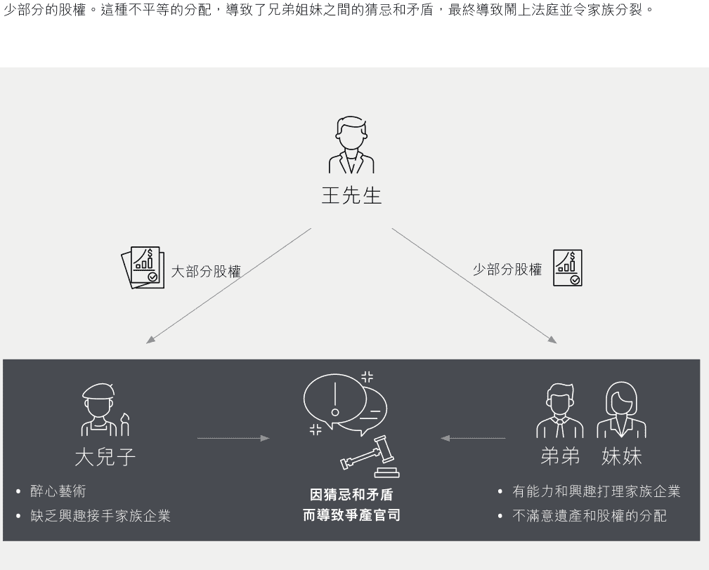

- **大部分股權**
- **少部分股權**
- **大兒子**
    - 關心藝術
    - 缺乏興趣接手家族企業
    - 因認為和矛盾而導致資產官司
- **弟弟、妹妹**
    - 有能力和興趣打理家族企業
    - 不滿意遺產和股權的分配
- **家族分裂**
- **家族聲譽受損**
- **訴訟費用**

## Deloitte. Private

## 案例：成功的遺產分配

背景：商界巨頭李先生早在退休前進行了完全的遺產規劃。在理財顧問的協助下，李先生按就班地完成資產分配。

## 遺產規劃

### 1. 開放式/單對單對話
- 公開與家人討論遺產分配
- 過程中開放的態度進行時調整

### 2. 按照家人的想法進行分配
- 將家族遺產移交長子，將房地產交給次子

### 3. 為家人預備流動資金
- 成立家族信託
- 預備了一項高人壽保單，理財金交給家族信託，再按照文件和李先生的意順進行分配

### 4. 平衡所有受益人的利益
- 平衡兩個兒子的利益分配，李先生密切地為次子準備了一份人壽保單

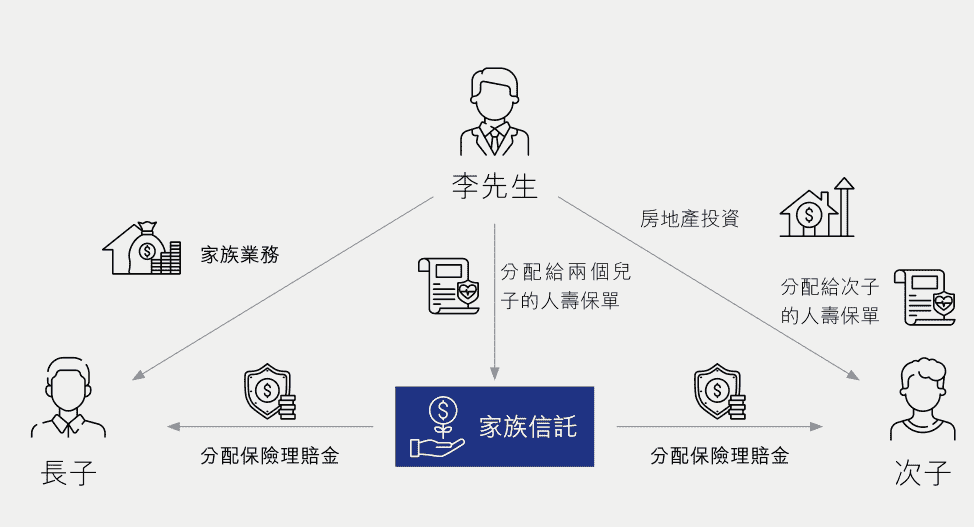

- 李先生：房產投資
- 家族業務：分配兩個兒子的人壽保單
- 分配給次子：人壽保單
- 長子：分配保險理產金
- 家族信託：分配保險理產金
- 次子

高淨值人士的財產較為多元化，除了現金，還可能有不動產（住宅、商業房產、土地等）、金融資產（股票、債券、基金、數字化資產等）、企業股份（家族的企業）、藝術品和收藏品等，且可能遍佈不同國家和地區。

分配過程中極易出現以下問題：

| 序號 | 描述 |
| :--- | 部分財產難按平均分配，例如藝術品。藝術品往往具有主觀價值，對於不喜歡藝術的後代來說，分配這類資產可能會導致爭議和爭端 |
| 2 | 即使可以按平均分配，部分資產並不適合擁有權平均分配，例如房產被平均分配後，未來讓要所有人要有同意 |
| 3 | 家族的傳承，除了擁有外，還有控制權 |
| 4 | 每位資產成長對家族有不同程度的付出，如何反映在資產分配中 |

## 3.3 婚姻規劃：離婚與第二次家庭規劃

香港離婚率個案數目

| 年份 | 2016 | 2017 | 2018 | 2019 | 2020 | 2021 | 2022 | 2023 |
| :--- | :--- | :--- | :--- | :--- | :--- | :--- | :--- | :--- |
| 60,000 | | | | | | | | | |
| 50,000 | | | | | | 62% | | | |
| 40,000 | | 34% | 37% | 41% | 48% | 57% | | | |
| 30,000 | | | | | | | 43% | 38% | | |
| 20,000 | | | | | | | | | |
| 10,000 | | | | | | | | | |
| | 結婚數字 | | | 離婚數字 | | | | 離婚率 | | |

「百年好」是很多人婚姻的期望。但婚姻中，除了身心的，往往涉及財務規劃和法律契約。大部分國家或地區的法規對夫婦擁有權提供指引，例如中國內的財產制度等。對於婚前/後協議，明確婚後財產的管理和分配方式，以及可能的贍款，建議當事人先諮詢律師意見。

*5 香港特別行政區政府統計《女性及男性主要數據》(2020、2021、2022及2023年)

由於每個家庭都有特殊情況，財務規劃也需要定制。以下為高值人士關注的兩個問題：

| 序號 | 問題描述 |
| :--- | :--- |
| 1 | 財產分配是否包含配偶及子女 |
| 2 | 婚姻問題會導致資產外流 |

在調查中，57%的高值人士表示自己與妻子和子女關係複雜而覺得擔憂。由此看出，清楚、明確的婚姻規劃對高值人士個人和家庭財產非常重要。成長是一條漫長而曲折的旅程，充滿了不確定。父母離開往往成為孩子的傷口。為了子女設立保險（儲蓄型）和教育基金，可以讓子女在父母離開後，確保他們未來的生活得到充分保障。若投資人在子女未成年時不幸去世，保險金可能會被挪作使用，並以子女的利益為優先。投資人可指定一位值得賴的親人、朋友或專業機構作為託人，有效幫助管理保險金，確保資金專用，用於子女的教育、生活和未來。有些保險產品限制一次性獲得巨額，避免他們缺乏概念而揮霍。這如同對於子女未來的生活規劃了一份詳細藍圖，為他們的每一個階段提供不同的保障。

高值人士財產傳承與婚姻規劃報告

## 案例：保單暫託人

背景：陳先生購買了一份具有財富增長潛力的終身壽險（儲蓄型）保單作為給兒子的第一禮物，同時準備將保單傳給他。陳先生擔心自己如果不幸遇上意外離世：

- 兒子由於年紀幼未能好好管理和利用該資產
- 家庭狀況的改變影響將財富傳給兒子
- 他離世後能等到兒子30歲時才保單，確保他能更成熟地管理該資產以達到財富傳承

購買保單時，透過保單暫託預先選擇託人

| 陳先生保單持有人* | 陳先生的弟弟託人 | 陳先生的兒子承人 |
| :--- | :--- | :--- |
| 離世後及兒子於30歲時方可將保險轉換 | 若陳先生不幸去世，保單交由陳先生的弟弟，直到兒子30歲 | 30歲生日承保單 |

*陳先生是受保人，但他安排了兒子成為受保人和受益人。

陳先生為保單設立了有效的管理和繼承機制，這個安排確保了陳先生離世後，其兒子能在更成熟時期擁有並有效地管理這些資產，讓陳先生順利執行計劃計劃，提升了財務安全和資產管理效率。

## 案例：保險的靈活管理

背景：陳先生非常關心小莉的未來，希望在自己未離世的情況下，能為小莉提供穩定的教育和生活保障。為此，他決定為女兒購買一份壽險（儲蓄型），作為教育基金。

陳先生擔心自己在離世後，他的保險理金可能被不當使用，未必會完全用於小莉提供穩定的教育和生活保障。為了避免這種情況，陳先生選擇了一份能靈活管理保金的保險，並設置了指定的保險理賠使用條件。在購買保險時，陳先生可以設定保金金額和長期。他設置了以下條件：

### 小莉的年齡
- 18歲：30%釋放保險理金的30%作為教育費用
- 18歲 |30歲：40%每年釋放固定金額（總額為保險理金的40%），幫助她對生活費和其他其他開支
- 30歲：30%剩餘的理金將一次性支付（保險理金的30%），這筆資金可以自由用於她購買房屋或結婚

| 對小莉的影響 |
| :--- | :--- |
| 保障了小莉各階段的需求 | 避免了小莉在未成年時獲得巨額錢可能造成的 |
| | 減少了資產被濫用的風險 |

保險安排讓陳先生安心，因為他自己不在，小莉的未來仍然有一個保障環境。這種明確規劃如同小莉的人生規劃了一份詳盡藍圖，讓她在每個階段獲得支持。

## 女女婚姻問題會導致資產外流

作為父母，重視子女是事實基礎，但同時家長對子女婚姻可能帶來的風險，尤其是可能導致資產外流。在調查中，有20%的高值人士因為子女關係轉變而覺得擔憂。由此看出，高值人士可採用婚前協議、信託等措施來保護財產。

## 案例：保險配合信託防範資產外流

背景：李先生是一位成功的企業家，擁有一家科技公司。他重視資產保護，尤其是在子女婚姻問題上。他擔心女兒在未來結婚後可能會導致資產外流。因此，李先生採取措施，利用保險和信託組合來保護財富。

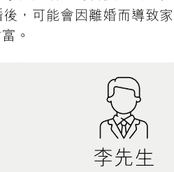

- 設置家族信託
- 購買人壽險
- 李先生去世後支付信託

| 家族信託 |
| :--- | :--- |
| 不動產 | 公司股份 |
| 投資組合 | 保險理賠金 |

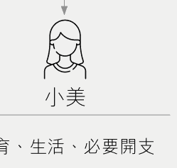

| 資產保全 | 私密性 | 穩定支持 |
| :--- | :--- | :--- |
| 避免了與配偶產生資產糾紛 | 信託內的資產不向受益人披露 | 財產狀況不受外界影響 |
| 即使李先生不在，女兒仍依賴信託中的資產保障她的生活質量 | 即使女兒未來離婚，信託的資產將被列入財產分配 |

高值人士信託保障與資產規劃報告 47

## 高值人士重心：上市公司管理層

「我確實考慮設立家族信託作為傳承工具。當初考慮設立信託是為了婚姻出現困難，還擔心資產傳承會因為婚姻問題導致資產外流。但一方面設立信託成本比較高，另一方面了解保險（保險型）也可以達到資產有序傳承的作用，因此最後選擇保險（保險型）。」

## 3.4 為家屬特殊需求規劃

在成長期間，父母都希望孩子能平安生活和健康成長。若子女有特殊需求，如有地中貧血或其他，父母需要幫助孩子為未來安排照顧和生活。在這種情況下，高值人士會讓特殊需求的信託指定保險規劃未來。父母離世後，將保金注入信託，由受託人按照父母的意願，用信託資金為孩子提供照顧。

在調查中，有16%的高值人士擔心有特殊生活學習需要的家人在生活上的安排開支。高值人士可藉由受託人的幫助，使他們也能為特殊需求的家人提供照顧。

| 委託人 | 設立信託 | 受託人 | 信託 |
| :--- | :--- | :--- | :--- |
| 委託人保險、確保照顧有足資金照顧孩子 | 保險公司將保險理金設定為注入信託 |
| 委託人的離世繼登保險的賠償條款 | 受託人動用資產照顧 | 注入者繼續為孩子提供照顧 | |
| 委託人保險公司 | 信託照顧者 | 孩子 |

## 案例：為家屬特殊狀況做好規劃

背景：王先生和李女士有一位患有嚴重中海貧血的兒子，需要順暢輸血及定時注射藥物。夫妻倆希望為兒子提供最佳的教育、健康和幸福的生活，同時也希望能在職業發展上取得成功，建立穩固的財務基礎。

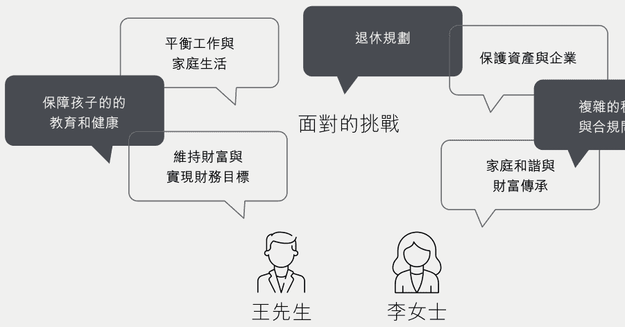

- 建立一個特殊的信託
- 購買終身壽險
- 離世後保險理金將注入信託
- 資金用來：根據王先生和李女士的意願

## 3.5 慈善捐贈

許多高值人士認為，他們在財富累積過程中受益於社會，因此責任回饋社會。「財富向善」逐漸成為主流價值。在調查中，有11%的高值人士曾考慮慈善捐贈。

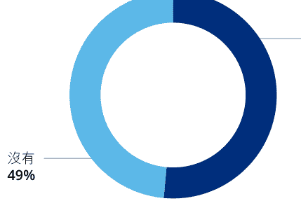

而他們最好的執行方式是現金捐贈，有75%的高值人士會考慮用現金捐贈。

| 高值人士偏好的執行慈善方式（多選） | |
| :--- | :--- |
| 現金捐贈 | 75% |
| 參與慈善基金或信託 | 9% |
| 以保險作出捐贈 | |
| 物資捐贈（如衣物、食品等） | |

高值人士參與推動慈善事業的趨勢在亞洲延伸。在金融發展「財富向善：推動香港成為慈善樞紐」報告指出，富豪捐款7億美元用於醫療和技術發展；吳捷及其家族捐款2400萬美元用於醫療服務；李嘉誠以及陳啟源分別在2022年捐款超過2億美元及1億美元。報告指出，隨著慈善基金和基金會數字上升，代表亞洲高值人士的慈善舉措更具組織和形式發展，這些捐贈工具讓慈善活動更具規模和更高的效率。

除了公益慈善（一般是臨時或單次行為，如向弱者派發衣服、向食物銀行提供貨或頒獎學金），高值人士更傾向於更大規模和長遠的慈善事業，如建立學校或博物館。這些長遠有望對社會產生深遠影響，改善未來。

- 我在這個社會裡獲得了什麼？我應該如何回饋社會？我希望將那些經驗成為未來的里程碑
- 我希望後人如何記得我？

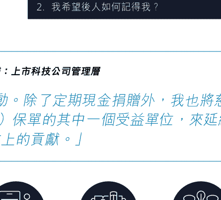

## 高值人士重心：上市公司管理層

> 我一直積極參與一些宗教活動。除了定期現金捐款，我也將慈善團體設定為人壽保險（保險型）的其中一個受益單位，來持續我在宗教上的貢獻。

| 定義慈善工作目的 | 架構與決策機制設計 | 篩選和審批慈善項目與執行管理 | 全流程監控評估與反饋 | 評估社會影響和持續優 |
| :--- | :--- | :--- | :--- | :--- |

## 慈善機構成立和營週期：基金

中國內地的慈善不斷增長，國內慈善事業也隨之興起。例如，騰訊基金在2023年設立了1億元人民幣（1450萬美元）資金，用以支持新慈善項目。隨著50年代和60年代後的基金趨向中國內發展並轉移至Legacy，這也趨使許多將家族慈善優先考慮後者，這個趨勢為慈善基金提供了中國內不斷增長的涵蓋慈善事業。

香港特區政府於2023年3月推出《香港慈善家族辦公室業務宣言》，並訂立了慈善發展指南為促進慈善發展，涵蓋私人、企業以及如何向免稅的慈善項目或作為慈善用途的捐款均可得稅項扣減。

如果沒有理想的慈善機構，可以選擇向指定的機構捐款。若希望進一步發揮影響力至於接受外界捐款，可以成立慈善信託、慈善基金，透過捐款來持續參與公益及慈善業務。

# 案例
利用壽保險設立慈善信託支持特殊需求的孩子

背景：陳先生和陳太太有一位特殊需求的孩子，他們深明照顧一個有特殊需求的孩子要花多大的心力，也心痛他們背後不能再照顧他們的孩子。因此，他們希望在他們身後成立一個慈善信託以支持他們的孩子和其他有同樣特殊需求的孩子。

- 投保人壽險、設立慈善信託
- 保險理資金、信託
- 靈活調整資金的使用

陳先生和陳太太希望透過投保保險的理資金和成立慈善信託以支持特殊需求的孩子。

加倍他們的初始資金，為他們成立的慈善信託提供充足的資金來源，確保被資助孩子的生活得到照顧。

合的信託條款讓受託人能夠根據子女的實際靈活調整資金的使用。

稅收優惠（某些地區適用）：優化稅務狀況，讓更多資源用於孩子和慈善事業。

對家庭の影響

父母可以將對慈善事業的承諾和對子女的關愛融入家庭的長期規劃中，增加家庭的凝聚力。

由於各地稅法不同，建議高淨值人士尋求專業顧問討論合適的捐贈方式和相關的稅務政策以滿足個人意願同時提高捐贈效益。

## 3.6 家人移居海外之前的財富傳承規劃

根據德勤調查顯示，香港區的高值人士中有37%曾經或正在行海外移民。

而遺產成員的全球分佈，可能會對於家庭的財富傳承面臨挑戰。例如，當家人去世時可能需要考慮該地區的遺產法規。其次，不同對財產的法定繼承人有不同見解，部分地區更有特殊規定，使得遺產也不能淪沒法定繼承人的權利。此外，全球化家庭在財富傳承規劃上，應及早與專業人士的意見。

有關於財產的稅務規劃，可參考章4。

以往中國人肅不討論自己的後事，但現在已經變得比較明顯，大眾已明白不進行任何財產傳承（例如沒有訂立遺囑），財產將根據遺產法規的繼承順序進行，而非按照個人意願，這樣可能會引起家族紛、傷害。

以下是市場上常見的財產傳承工具：

| 分配方式 | 優點 | 缺點 | 私密性 |
| :--- | :--- | :--- | :--- |
| 1. 遺囑 | 簡單 | 可能引起家庭成員之間的爭執 | 低 |
| | 設立遺信託 | 遺產真實容易受挑執 | 受益人不知道對方配置的資產 |
| 2. 保險 | 設立遺信託 | 僅用於現金流 | 高（受益人資訊一般不公開保護受益人隱私） |
| | 遺產過承流程，確保財產資金時間內到位 | 不適用於房產、金融資產、企業投資、藝術品及收藏品 | 每位受益人的資產可單獨保護 |
| | 靈活、靈活性，可根據個人意願一次性或按保人指定的時間分配保險給受益人 | | 適用於大部份資產 |
| 3. 信託 | 遺產過承原則 | 設立和管理成本高 | 高（受益人資訊一般不公開保護受益人隱私） |
| | 靈活性，可根據個人意願一次性、或在滿足特定條件下分配 | 財產規劃信託資產水平 | 受益人不知道對方分配的資產 |
| | 優化稅務結構 | | | 有資產隔離 |
| 4. 保險信託 | 結合信託和保險的優勢 | 設立和管理成本高 | 高（受益人資訊一般不公開保護受益人隱私） |
| | 能夠靈活分配保險賠利金 | 需要專業諮詢進行 | | 受益人不知道對方分配的資產 |
| | 保護資產免受債權人追索 | | | |

# Deloitte Private

| 分配方式 | 5. 持久遺囑 | 可能在無法自主決策的情況，確保個人意願得到執行 | 將資產轉移給受益人 |
| :--- | :--- | :--- | :--- |
| 缺點 | 可能引發人與人之間的衝突 | 需要授權 | 一旦贈與，資產不受受益者控制 |
| 私密性 | 中等 | 高 | 僅過遺產 |

* 信託的稅務優勢視於相關稅務規定（如為獨立稅務實體）及主要相關者的稅務身份（假設設立人、受益）。在設立信託時，應謹慎考慮利益相關者的身份，並尋求專業稅務顧問的意見。在高值人士中，受關注的財富傳承，有達65%的高值人士偏向遺囑納入。其次，有54%的高值人士通過自己/家族成員購買保險（人壽）、終身壽險（儲蓄）等保險產品。

## 高值人士的多元傳承方案

- 通過遺囑，指定受益人和財產分配
- 直接贈與，在生前資產（包括股票、房產等）贈予子女
- 法定遺承（按當地的法律規定分配）
- 設立教育基金，支持子女教育支出
- 設立信託基金，通過信託管理財產
- 結合信託/家族辦公室，以資產價值和慈善捐贈，將家族企業給下一代，確保業務持續發展
- 持久遺囑，在無法自主決策的情況下，確保個人意願得到執行

 65%
- 54%
- 49%
- 25%
- 15%
- 12%
- 9%

## 高值人士對傳承財產或工具的擔憂

- 擔憂潛在法律和稅務風險 (56%)
- 工具不能滿足個人化的需求 (41%)
- 擔心執行稅務規劃的有效性/合法性 (38%)
- 對相關工具/機構缺乏理解 (38%)
- 對相關服務/團隊缺乏信任 (31%)
- 擔心服務/工具的起始費用或潛在管理影響財產 (31%)
- 其他 (51%)

大中華高值人士財富傳承與保險規劃報告

## 案例：李先生的家庭資產規劃

背景：
李先生是一位成功的企業家，經歷了三段婚姻，每段婚姻的情況及其對其家庭和財產有深刻影響。基於以上家庭情況，李先生需要制定一套完善的資產規劃，以確保所有家庭成員的利益得到妥善規劃。

| 第一段婚姻 | 第二段婚姻 | 第三段婚姻 |
| :--- | :--- | :--- |
| 女西 | 獨贏公司主宰 | 會更多子女 |
| 因第一任妻子之一偏好大兒子，兒子成長後，李先生結束第一段婚姻。 | 與第二任妻子沒有孩子，她幫助李先生打拼成為公司的主宰。最終離婚，兩人共同持有和經營公司。 | 第三段妻子比李先生年輕十年，努力為李先生生孩子，希望這樣可以更多產。 |

人壽保：
李先生第一段婚姻期間購買的三個子女保險，保障金額足以支持第一任妻子及兩個未名子女的生活費用。

- 保險設計：
  - 第一，第二保單的持有及受益人為李先生，分別為第一任妻子及兩個兒子。身份權以設立方式執行。
  - 第三，保單的持有及受益人為李先生，保險人及受益人為小女兒。設定保險人未成年的小女兒，讓其權在小女兒成年後獲得保障。

- 資產：
  - 第一，屬於李先生的第一任妻子及兩個子女所擁有資產，以及與李先生共同擁有所有資產。
  - 第三，為了確保李先生的小女兒在成年前，有足夠的信託財產用保險價值保障女兒的銷售，在李先生死後獲得保障。

> 李先生將失去管理能力的後，其財產規劃將得到妥善規劃

- 委託一位信任的成員或專業人士來管理這些資產，在保障財產或其他緊急情況下個人願意得到執行

## 遺後規劃

通過上述的資產規劃，李先生能夠避免因婚姻問題導致的資產流失，同時確保家庭成員的利益得到公平看待。這樣的全面規劃能讓他心無無憂，與家人和未來的成員提供一個穩定的成長環境。

在德勤調查中，有67%的高淨值人士認為保單中指定受益人的特性可以避免糾紛，而有66%的高淨值人士認同保險在遺產規劃中可達到資產增值的作用，同樣高值人士重視安全性與穩定性。

## 高值人士保險在遺產規劃的作用（多項）

| 作用 | 佔比 |
| :--- | :--- |
| 指定受益人，避免糾紛 | 67% |
| 資產增值 | 66% |
| 稅務規劃和優化稅務結構 | 42% |
| 提供現金動性，避免遺產相關費用如遺產稅 | 40% |
| 家庭保障，防範意外債務帶來的影響 | 36% |
| 隔離資產，防範訴訟風險 | 33% |
| 靈活性定制，提供資產管理和分配選項，避免受益人爭奪 | 29% |
| 婚姻防範 | 16% |

高淨值人士可諮詢專業律師、稅務計師，制定合理的遺產分配方案，並定期評估遺產分配，根據自身情況進行調整。

## 3 持續發展——家族及企業

家族企業即使成功，都要面對接班的問題。在華社會，家族通常由家族成員。隨著時代改變，新一代可能有想法，如果下一代對企業興趣不大或缺乏接班，則需要考慮其他的接班方案或替代方案，包括聘用專業人員。

設立接班後，必須制定對未來的計劃，讓企業經營、文化、價值得以傳承。家族需要制定治理架構幫助家族發展。其中包含董事會運作、清晰的決策流程、家族守等。如果業務環境發生轉變，可能考慮業務轉移至市場。

根據研究顯示，第二代後的成功率佔有30%，第三代後的成功率僅有10%。因此不少高值人士依賴家族辦公室為家族諮詢和家族事務。家族辦公室以第三方身份守護家族，並配合感性的元素來促進家族發展、關愛和家族傳承。在傳承過程中，推行企業規劃、家族和個人規劃，有效的家族辦公室需要用心聆聽，才能制定一套機制，他們的工作包括以下項目：

| | |
| :--- | :--- |
| 1 | 個人/價值評估 |
| 2 | 定制家族會議 |
| 3 | 制定、檢修及更新家族辦公室職能，包括經營業務、家族發展/轉型/退出、稅務、移民、個人服務、顧問、解決爭議、代接、慈善 |
| 4 | 財富管理，包括資產規劃、繼承安排 |

現今香港和地區仍在努力發展家族辦公室行業。香港在這一方面作為全球首創金融中心，是亞洲地區最具度的資本市場之一，匯聚了豐富且多元化的金融產品服務。根據2024年德國與海外投資推廣協會香港辦公室合作的調查顯示，截至2023年，香港已有超過2000個家族辦公室，反映本地家族辦公室行業正在發展中。

在2025年，香港針對由單一家族公室管理的投資工具亦推出了稅收優惠政策。只要香港客戶滿足某些條件，投資工具具有合格資格並涉及跨境交易的利潤即可享受0%的香港利得稅率。近日，香港政府更提出將有關稅收優惠立法一步優化，優化方向包括擴大合格資格的範圍、利得稅豁免的收入類別等，旨在讓更多單一家族公室能夠合格資格享有優惠，同時提高香港對單一家族公室的吸引力與友善度。

## 家族投資控股工具

- 通常在香港進行管理或控制
- 僅作為持有和管理資產的投資工具
- 最資產門檻：2.4億港元
- 實質活動要求：
  - 2 名成員所需的本地全職員參與
  - 本地運開：每年20萬港元

## 單家族成員包括

- 配偶
- 直系祖先
- 配偶的直系祖先
- 子女（包括養子女及子女）
- 孫子女

## 稅務豁免範圍

- 合格交易與附帶交易
- 私人的投資須通過外部的審核

## 單家族公室營運條件

- 通常在香港進行管理或控制
- 安全供應規則：具資格家族公室的應享稅利間，最少有75%來自家族認人士提供的服務

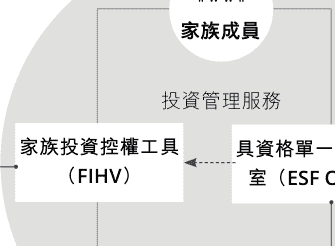

隨著家族辦室的服務越來越普及，聯合家族公室（Multi-Family Office, MFO）運作。與單家族公室一樣，聯合家族公室的主要工作是協助多家庭管理和值增財，並提供規劃、個人服務。聯合家族公室可以有效共享資源和專業團隊，聚集頂尖人才，為多個家族提供一定程度的個人化服務。在調查中發現，87%的高淨值人士希望家族公室提供：

## 高值人士希望家族公室提供的服務（多項）

| 服務 | 佔比 |
| :--- | :--- |
| 投資管理 | 80% |
| 風險管理 | 73% |
| 生活方式的管理（如安排、旅遊等） | 60% |
| 家族理念、價值觀的傳承 | 47% |
| 資產隔離和保護 | 53% |
| 家族成員的教育 | 27% |

## 高值人士考慮家族公室的原因（多選）

- 稅務優惠 (80%)
- 文化、機遇、經濟配套、人才 (67%)
- 家族事業/財富管理、增值和發展 (60%)
- 家族資產的傳承 (53%)
- 家族治理機制 (40%)
- 成立和運行成本 (80%)
- 管理複雜 (80%)

## 大中高值人士財富管理報告摘要

以往中國人肅不討論自己的後事，但現在已經變得比較明顯，大眾已明白不進行任何財產傳承（例如沒有訂立遺囑），財產將根據遺產法規的繼承順序進行，而非按照個人意願，這樣可能會引起家族紛、傷害。

德勤调研中，暫時有1%的高淨值人士計劃在香港設立家族公室，有9%的已經在香港設立家族公室。

在高值人士中，受關注的財富傳承，有達65%的高值人士偏向遺囑納入。其次，有54%的高值人士通過自己/家族成員購買保險（人壽）、終身壽險（儲蓄）等保險產品。

## 家族治理

如果家族辦公室是家族的硬件，家族治理制度則是家族的軟件。它是一種管理和決策框架，旨在確保家族企業長期成功。家族治理制度主要涉及家族及家族成員之間的溝通、權分配以及對企業資源的管理。隨著家族企業的成長，家族治理的重要性日益增加，因為它能夠有效解決家族運過程中的衝突和挑戰。

家族治理的核心是建立家族憲章。這些文件包含家族的價值觀、願景和目標，並規定家族成員在企業中的角色和責任。此類協議有助於爭議時提供清晰的指導方針，維持家族的凝聚力。

其次，家族治理還包括家族委員會和商業委員會。這些機構由家族成員和外部專家組成，負責監控企業運營和策略方向。通過多元化的視角，家族委員會能夠更好地平衡家族利益與企業需求，確保決策過程的透明性和專業性。

## 家族治理會

| 家族成員 | 其他成員 | 獨立會員 | 章程/守則 |
| :--- | :--- | :--- | :--- |
| 保留一定控制權 | | | 匯報 |
| 商業委員會 | 董事會 | 家族辦公室 | 通過公司章程或其他制度賦予家族治理會監管家族的權力 |
| 家族成員 高級管理層 | 議 | 家族成員 管理 法律稅務等專業人士 |
| 外部獨立顧問 | | | |
| 業務 | 個人資產 | 被動資產 | 慈善事業 |

此外，家族治理強調繼承計劃的制定。有效的繼承計劃不僅涉及財產的分配，還包括未來領導者的培養。這項過程需要家族成員之間保持開放的對話，並可能需要外部的協助，以確保繼承過程的順利進行。

家族治理還激家族成員的持續教育和發展。通過培訓和學習，家族成員可以提升自身能力，以便應對企業管理和市場變化的挑戰。

成功的家族治理不僅有助於保護家族資產，更能增強家族的凝聚，實現長長的繁榮與穩定。

# 4 運籌帷帷：全方位位稅務規劃

## 4 運籌帷帷：全方位位稅務規劃

## 中國加稅稅收徵規定

2018年9月，中國多次與其他稅務機關交換逃稅信息。在交換逃稅信息的環境下，就算透過多層架構的設計，稅務機關也會披露其透明收入。2023年年初，《中國稅務》報告一個轉國海外BVI公司避稅的案例，例如設立了層架（BVI 公司—香港—中國—公司），最後轉國至青島處以避稅8846萬元。

在沒有許多相關案例的情況下，即使在獲得的避稅行為中，通過複雜設計，稅務機關尚沒有更有效的手段來識別（或）這些行為。這種隱蔽的手段從以來未被規避避稅，也較難受到監管。

隨著國際合作的發展，預期未來稅務機關收稅避稅的挑戰將增大。透過跨部門與稅務機關的逃稅信息共享，以及數據分析，稅務機關將更具識別行為的能力，從而覆蓋海外和國內的避稅的。

在中國國內，國家稅務局在2024年1月發布的官方報告中，提到了後稅管理工作的重點。其中包括稅收監管（以及）發展、風險發現、應對、實用「稅收治理」與關聯政策。

BVI等地也可能收集客戶的財務信息，要求企業透明經濟實質。隨著國際社會對合規的要求日益增加，從通過讓客戶避稅的風險日益增加，同時隨著最新稅務法制定需要更優的架構和納稅方案。如果現行的稅務規劃需要調整，專業稅務顧問可以協助與稅務機關溝溝，以確保財務風險降低到最低。

在稅務透明的環境下，合規的稅務架構將變得重要。除了一層屬於家族的家族架構，常用的工具還有還保和信息。容易稅收籌籌以及利用新型經營模式避稅等逃稅方法。為2024年，稅務機關透過短信向稅務機關發送了「海外收入申報要求」，保留他們檢視海外年度收益的權利。藉此讓顧問在監稅後執行個人所得的稅務申報，降低風險。同時在中國稅務機關對於海外避稅的重視程度，增加海外資產的稅務人士的關注。

2024年，國家稅務局香港稅務機關公佈了「某新香港發展開發有限公司的逃稅案例」。該公司在計算所得稅時將轉國海外的投資資產。然而，透過中國與香港稅務機關的信息共享，跨境發現該逃稅行為的事實，此為認為未在稅前採取措施。稅務機關將此行為為違，並罰款。此事件顯示了中美稅務機關跨境打擊逃避活動中的重要性和關鍵作用。

在中國國內，對逃稅、抗稅、輸稅的，稅務機關徵其未繳或少繳的稅、滯納金幣或所取的稅，並沒有追溯期限制。

- 7. 《中國稅務》·2023年8月報告的一個中國轉關海外BVI公司的避稅案例。
- 8. 以逃稅風險角度分析稅務人士準確審視稅務管理-https://www.chinat.gov.cn/n10104/n202683/n268637/c516412/content.html

68 大中香港財務顧問 諮詢富豪與家族避稅規劃籌

## 利用外國保險產品的稅收優惠政策

在現代財務規劃中，保險是不風險管理的有效工具，也是實現財務規劃的有效手段。尤其是各地政府為了鼓勵民眾穩健累積財富以退休和養老等，紛紛推出不同的稅務優惠政策。

在德動研究中，有64%的高淨人士會因不同國家（如英國、澳洲等地）對保險的稅收優惠政策，而考慮把保險納入稅務/財務或傳上的規劃。不同國家/地區對保險產品提供稅務遞延及免稅，如英國對於客戶持有某種不多於已繳費5%的現錢繳稅及澳洲遞滿10年保單後產生資產增值權免稅。有關稅務規劃可與保險妥聯繫。

高淨人士會因不同國家的稅收優惠政策，而考慮把保險納入稅務/財務或傳上的規劃。

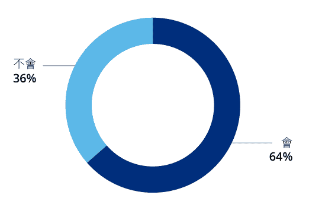

了解利用保險產品的稅收優惠政策，可以幫助個人和企業優化費用結構。以下是不同的稅收優惠方式（具體情況，視乎有關稅務監管的稅務法規，請向稅務顧問諮詢）。

## 稅收優惠類型

## 具體操作

### 稅前扣除

在個人計算納稅收入時，可以將符合條件的保險費用作為扣除，例如，符合資格的年金、自顯醫療保險均可在稅前扣除。

在企業層面，大部份地區為員工僱用的終身人保（保險）保費進行企業稅扣。在合理安排下，部分地區可接受這些終身人保險（保險）保費作為員工福利在個人層免稅。

### 稅務遞延

允許保險計劃中的未分紅延遲到分配/發生收益/個人在保單內提取時再繳稅，可以讓資金在保單內免稅儲存，增加複利的效果。

### 免稅收入

某些保險產品的分紅，在滿足特定條件下可以免入、遺產稅和贈稅。

## 4. 海外移民前的個人的稅務規劃

現在的高移民人士和家族有多個國籍或居留身份，在稅務顧問的協助下，他們對不同地區稅法有更深入的認識，享受各種複雜稅務優惠，策略性地規劃及家族稅務效益，如全球利息、遺產稅和贈予等。這些規定對於資產配置及財富傳承有重要影響。為了更好地理解不同司法轄區的稅務規則，可以參考附錄2的地區司法轄區指南。調查中，有38%的高淨值人士考慮移民。

### 高淨值人士有無考慮移民

- 已執行：10%
- 無此考慮：62%
- 已計劃：28%

### 高淨值人士考慮移民的地點

- 英國：28%
- 澳洲：26%
- 加拿大：19%

### 高淨值人士優先考慮移民的地點

- 其他：9%
- 香港特別行政區：10%
- 新加坡：4%
- 英國：28%
- 澳洲：26%
- 美國：4%
- 加拿大：19%

# 海外移民前的個人稅務考慮

- 新地點的稅收制度（全球收益、利得稅、資產/贈與）
- 可能在新地點稅收/收益
- 在新地點是否有任何資產可以實現免稅？
- 確定在移民地為稅務居民時，不同資產的稅務影響（1）
- 持有資產vs其他資產（例如：信託、家族辦公）資產價值的提升
- 採用稅務計劃（延遲/贈與/信託）、現金需求
- 持續監察當地稅法轉變、 持續監察稅務風險與雙重稅問題、 可能導致稅務身份變化的情況、 在各個管理的稅務申報

# 移民後的規劃

| 建議 | 避免 |
| :--- | :--- |
| 諮詢專業人士：尋求有經驗的移民顧問或律師的建議，以便針對個人的具建議。 | 忽視稅務責任：不要讓移民後面臨稅務負擔，尤其是利得稅和遺產稅。 |
| 了解當地地區：熟悉居住地的法律及規定，稅務義務和風險。 | 隨意處理：在未完全了解地點稅務影響的情況下，不要考慮處理或讓資產。 |
| 考慮情況：評估家成員的稅務身份，如子女的教育和未來規劃。 | 依賴錯誤信息：不要依賴錯誤信息或未經證來源意見。 |
| 持保合規：確保所有資產和收入申報符合當地法律，避免未來的風險。 | 延誤稅報：不要忽略稅報的截止日期，及時提交稅報以避免滯納和罰款。 |

透過這些指導原則，移民後的規劃將更有效協助優化稅務結構並持續稅務整合。

在德勤的調查中，我們發現現有18%的高淨值人士有計劃/已經諮詢了專業稅務顧問。有47%的高淨值人士沒有就移民計劃事先進行稅務規劃。

# 高價值人士是否在移民前計劃/已經諮詢專業稅務顧問

- 有、主要是自己研究（通過網資訊或親朋的經驗）：35%
- 沒有：47%
- 有、其計劃/已經諮詢專業稅務顧問：18%

在德勤调研中，有75%的高淨值人士希望在購買保險時，可以獲得專業稅務諮詢。

# 高淨值人士在購買保險時可以獲得的服務（多選）

| 專業稅務諮詢 | 75% |
| :--- | :--- |
| 保單的個人化定制，包括相關結構、保障範圍、保費、保單特性明 | 65% |
| 法律合規指導 | 58% |

# 高淨值人士心聲：跨國企業家

> 我有興趣了解英國對保險的稅收優惠政策，因為我的女兒打算畢業後留在英國居住，所以將來傳承需要考慮英國稅的問題，包括企業利潤分配是否需要交英國稅、繼承財產是否需要交英國遺產稅。

# 案例 管理外國生活費用及稅務公民身份

背景：
王先生（40 歲）與太太（36 歲）及兒子（10 歲）目前居住在香港。考慮到兒子的未來發展，他們計劃將兒子送到外國留學，主要考慮英國或美國。由於兒子年初，太太會有很多機會伴隨兒子在外國生活，以便照顧他。王先生因業務需要，需要定期在香港和外國之間往返。

王先生和他的理財顧問討論之後的計劃，理財顧問建議王先生要考慮以下因素：

王先生的憂慮解決方案

| 學費和海外生活用的支出 | 需保留長期、穩定且充足的資金 |
| :--- | :--- |
| 外幣率的浮動將直接影響支出 | 密切關注匯率變化，選擇適合的銀行服務以減少風險 |
| 兒子在海外期間可能需要當地的服務 | 購買能覆蓋全球網絡保險 |
| 王先生經常往返香港和海外且不為當地居民 | 尋求專業稅務顧問意見，避免成為當地的居民 |
| 根據不同的稅務政策，英國和美國稅率分別高達45%和37% | |
| 太太會在海外購買物業而太太會在海外生活 | 考慮資產規劃，例如採用遺產計劃 |
| 如果兒子在留學期間內，王先生和兒子可能需要繳納當地的40% | |

高富值人士產承與規劃報告

# 家族信託的稅務功能和確定性

在不同的國家/地區，家族信託在稅務上是穿透的，但是家族信託在稅務上是獨立稅務主體而不穿透。這個時候考慮利用信託的結構來達到更好的效果。信託的所有者為了防止資產被沒收，家族會將資產移給信託，由家族作為託人管理。

信託在不同的法律體系中有形式和法律定義。部分司法區（主要是普通法國家）稅務規範進行詳細規定，確保家族信託的合法有效性，以及在稅務上的確定性。隨著時間發展，信託制度進到不同的國家，特別是在英國體系中，家族信託的法律特性和保護資產的功能，使其財富管理、稅務規劃和節省有多種功能。

透過將資產移到信託，資產將不再屬於個人下，假設信託生效後與受益人完全隔離，則屬於受益人的遺產和稅。在亞洲及其他國家，信託法的規定並不相同，甚至完全沒有信託的概念。另外，其他司法地區（如中國內部及香港）雖然自己的信託法規，但與英國信託的概念顯然不同。同時也要理解稅務管轄區對家族信託有明確的解讀。實際上，不同國家對於家族信託在稅務法上的解讀差異家族信託稅務功能；例如有些國家家族信託為積極，只要不進行隔離，受益人就不需要繳納信託中的遺產稅。因此，例如人們從英國、澳洲、加拿大、日本等地），需要注意對家族信託的稅務影響。成立信託過程中，成立人需要充分了解相同的信託規，以及在稅務上的影響。例如，如果人需要考慮信託是不可撤銷的，定向分配是必須的；如果成立有某種保留、保護稅務益等。建立信託過程中，可能要委託經驗的專業人士（包括信託及稅務顧問）分析信託在成立人和受益人的稅務身份所在地的稅務規則影響和確定性。成立信託後，也要定期審視家族信託效果的有效性。例如，在英國在2024年對家族信託的稅務規定重大變化在2025年生效後，家族信託許多需要專業顧問調整，以應對新的稅務要求。

有22% 的高淨值人士考慮設立家族信託。

# 高淨值人士是否有考慮設立家族信託

- 有、現在計劃之中：16%
- 有、已經成立了家族信託：6%
- 否：78%

高淨值人士考慮設立家族信託的原因是因為財富傳承（90%）和資產保護（81%）。

# 高淨值人士考慮設立家族信託的原因（多選）

- 財富傳承 90%
- 資產保護 81%
- 稅務優化 65%
- 協助後代管理複雜資產 48%

# Deloitte Private 案例：針對外國居民身份和信託資產的稅務管理

背景：
楊女士（60歲）在10年前設立了一個家族信託，受益人為她的後代。作為一名成功的企業家，她經常在加拿大和香港之間往來；她的第二代（G2）成員居住在香港，而第三代（G3）則要在加拿大留和生活。最近，楊女士正在考慮把孩子成為信託的受益人。然而，考慮到孩子在加拿大生活，而自己又經常到加拿大出差，楊女士信託的資產可能需要繳納加拿大的稅，因此不確定如何處理。

楊女士的理財顧問提出幾項建議，包括：

- 透過信託進行分配
- 直接還現金或資產
- 為孩子購買壽險或儲蓄險

由於稅務影響的重要性，理財顧問建議楊女士與專業的稅務顧問討論。稅務顧問建議楊女士從稅務角度檢視現有的信託結構，並考慮人的稅務身份。

| 香港第二代的居住地 | 加拿大第三代的居住地 |
| :--- | :--- |
| 在香港和加拿大之間經常往返 | 孩子在加拿大生活 |

楊女士需要考慮的關鍵問題：

| 哪種工具可能優化稅務結構？ |
| :--- | :--- |
| 楊女士的稅務身份可能會因為其居住地的變化受到影響 | 稅務義務 |
| 楊女士信託的資產可能需要繳納加拿大的稅 | |

楊女士在作出決定之前，可以尋求專業稅務顧問諮詢，分析並選擇在稅務上合法優化的方案。

# Manulife 宏利 家族信託架構

每個家族信託都有其架構。以下是不同種類家族信託的架構示意圖：

- 一般家族信託：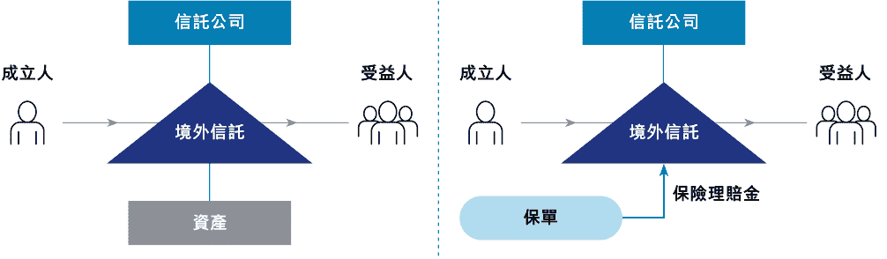
- 單信託：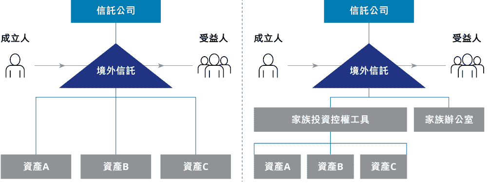

在德勤調查中，有73%的高淨值人士認為家族信託可以有效優化稅務結構。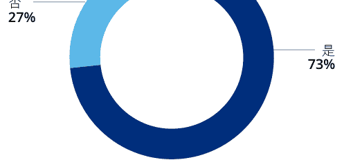

# Deloitte 德勤諮有限公司（中國）股份有限公司

# 穩健護航：企業保險

在創業和企業營運過程中，風險無處不在。企業面對風險來自競爭、政策變動和經濟波動，包括內部的關鍵人員、合作關係與企業傳承等風險。若企業缺乏完善的風險管理策略，可能在突發情況下，因為缺乏保險而陷入危機。本篇將重點探討核心領域：1) 要員保險 (2) 商業貸款保險 (3) 股東保障和4) 企業傳承，顯示如何透過保險及相關金融工具降低風險、實現企業長期穩定與持續發展。根據調查顯示，大部分企業會購買一般醫療險（88%）和要員保險（人壽/危險/高端醫療）（72%）。我們觀察到企業家只為管理層購買要員保險（92%），包括核心技術人員（24%）和銷售人員（24%）。另外，他們少使用保險為貸款（28%）或股東保障。

# 企業購買的保險類型（多項）

| 企業購買的保險 | |
| :--- | :--- |
| 一般醫療險 | 88% |
| 要員（人壽/危險/高端醫療） | 72% |
| 責任保險 | 56% |
| 企業財產保險 | |
| 信用保險 | 32% |
| 商業貸款保險 | 28% |

在我們的調查中，企業家有以下人員保險（多項）：

| 管理層 | 92% |
| :--- | :--- |
| 主要銷售人員 | 24% |
| 核心技術人員 | |
| 掌握核心網絡和社會關係的人員 | 12% |
| 其他 | 40% |

# 要員保險：保護關鍵人員的價值

對於大部分企業來說，某些關鍵人員（如初創人、技術專家或銷售主管）對企業的發展和持續性非常重要。如果這些關鍵人員因病、意外或離世無法履行職責，企業可能面臨重大損失，包括客戶流失、業務中斷和市場份額下降。根據學習，88%的企業選擇保險可以在意外事件時，為企業財務/營運帶來保障。

| 考慮 | 應用 | 方案 |
| :--- | :--- | :--- |
| 業務風險 | 為核心管理層或技術專家購買保險，意外意外、重大疾病或長期疾病風險，確保企業能獲得保險賠付以對損失。 | 關鍵人員保險。企業為設立關鍵人員保險，保險賠金可用於填補損失、招募替代者或支持業務營運，減少業務中斷影響 |
| 長期風險 | 為關鍵人員設置長期損傷保險，確保其期間內穩定運作，減少突和企業壓力。 | 醫療保險 |
| 關鍵崗位流失/風險 | 定制的人員交接策略，並建立彈性的接任計劃，確保企業在關鍵人員離職時快速找到接任者，避免延誤並維持營運。 | 培訓接任計劃。為核心人員提供醫療和風險保險，當保事人無法工作時，透過培訓和招聘內部資源或外部人才，以保障財務安全，增強關鍵人員的忠誠度，提升企業穩定。定期更新計劃以應對各種需求，確保關鍵崗位有人能接手，維持營運穩定。

那麼，企業應該為哪些購買關鍵人員保險？為何他們購買保險？

| 企業應該為哪些購買保險？ | 為何他們購買保險 |
| :--- | :--- |
| 管理層 | 高層管理人員是推動企業發展的核心人物，他們的決策和執行能力可能決定企業發展。失去這些人員可能導致銷售下傾、利潤減少，影響企業的競爭優勢。 |
| 銷售人員 | 這些人員是業務發展的關鍵人物，能夠建立穩固的客戶關係，為企業帶來收入來源。失去這些人員可能會失去直接影響的銷售和市場份額。 |
| 核心技術人員 | 這些專業人士擁有專業知識，對企業的營運和產品質量至關重要。他們熟悉各項流程，能確保企業能夠高效運行，失去他們可能導致技術瓶頸和產品質量下降。 |
| 掌握核心網絡和社區關係的人員 | 這些人員有重要的商業網絡和社區關係，能夠為企業開發新市場和社區。失去這些人員可能使企業失去客戶和市場先機。 |

| 企業會失去什麼風險？ |
| --- |
| 銷售/利潤損失
- 前勁競爭優勢
| 產品質量和服務品質
- 失項目和發展機會
| 影響業務或項目進度
- 影響市場對企業信心 |

# Deloitte.
Private

要保險的風險管理對企業的管理可以在以下幾個方面體現：

- **財務保險**：當員工無法工作時，保險理賠能幫助企業支付臨時替代的費用、培訓新員工或彌補業務損失造成的收入缺口。
- **業務連續**：有助避免關鍵人員離席期間影響業務運作的重大失衡。
- **吸引留人才**：擁有要保險的企業能夠向員工展示其對保障與支持的承諾，這樣更容易吸引優秀人才，增強團隊的穩定性。

## 5.2 商業貸款保障：確保財務穩定性

在德勤研究中，有 28% 的企業有購買商業貸款保險。

在發展過程中，通常需要透過貸款來資金，用來購買設備、擴展業務或應對資金周轉需求。然而，如果貸款的關鍵人員或借款人（通常為企業本身或其他關鍵人）遭遇意外（如重大疾病、失去工作能力或去世）而無法履行還款承諾，企業可能透過金融保險或出售資產來緩解。

商業貸款保障風險：

- **降低財務風險**：即使在突發事件發生的情況下，企業仍確保貸款的償還，避免評級下降和資金鏈斷裂。
- **護產價值**：避免無法即時還貸款而導致的資產被低價出售或拍賣，確保企業能夠持續營運。
- **提高信用評級**：擁有商業貸款保障的企業通常能維持在銀行的信譽評級，這表明企業對風險管理的重視，從而增強借貸能力。

在德勤調查中，44%的企業家認保險有效提供商業貸款保障的作用。

## 高價值人士保險的作用（多選）

| 要員出現意外事件時，企業財務/營運可得到保障 | 88% |
| :--- | :--- |
| 員工保障 | 88% |
| 提高員工福利（醫療和退休計劃） | 68% |
| 企業傳承，確保企業在創始人或關鍵管理人員離後的過渡 | 52% |
| 企業的風險管理 | 52% |
| 責任風險管理 | 48% |
| 商業貸款保障：確保企業財務穩定性 | 44% |
| 信用保險有助降低風險，強化資金穩定性：員工保障 | 32% |

## 高價值人士心聲：將企業家

> 「我許多業務都是以貸款作為啟動資金，因此企業面臨的主要風險是盈利是否足以支付貸款和利息的問題。

其次是員工風險問題，我將每個業務交給各自的管理人員，如果某些管理人員離職或出現健康問題，就會對業務造成重大影響。因此，我十分重視我手下管理人的薪酬福利，包括現金和醫療等福利。此外，我也為他們購買員工保險，確保公司在失去管理人員時，可以得到財政補償，用來聘補人員。」

## 利用保險相關的融資工具降低現金風險

背景：張先生是某製造企業的負責人，近期計劃申請一筆1000萬港元的商業貸款以擴展生產。然而，對於意外或重大風險而導致失去能力或不幸的情況他意識到，擔心這可能會導致企業和家庭無法還還這筆貸款，從而陷入財困境。

為了解決這個問題，張先生購買了一份1500萬港元的終身壽險（保險型），旨在覆蓋債款及未來的家庭支出。考慮到目前的現金流緊張，他考慮利用保險相關的融資工具來支付保險費用。

計劃申請貸款以擴展生產
若自己患病或離世，企業和家庭無法還還這筆貸款

| 保險相關的融資工具 | 定期檢討保險金額和保費 |
| :--- | :--- |
| 1. 保費融資 (Premium Financing) | 保持計劃的靈活性 |
| 2. 保單融資/質押 (Policy Pledging) | 隨時面對市場及個人情況的變化 |
| 3. 保單貸款 (Policy Loan) | 維持企業的穩定發展和家庭的財務安全 |

有關保險如何加強資本流動性，詳情可參閱第2節。

## 5.3 股東保障：維護合夥人的利益平衡

企業通常由多位股東共同持有。如果某位股東意外去世，其股權可能會自動轉移至家族成員，而這些成員未必適合或願意參與企業營運。這可能導致權結構失衡，甚至引起內部衝突，影響企業正常運作。

在德勤調查中，24% 的企業家保險有股東保障（人壽保險合約股東協議）的作用，有效維護股東的利益。

| 方案 | 風險 | 應用 |
| :--- | :--- | :--- |
| 股東保障 | 股權轉讓引發的內部衝突 | 每位股東購買人壽保險（可相互保險或由公司購買），受益人為公司或其他股東。保險金用於股東去世時收取其股份，確保股權不會轉移至外部或由繼承人手中 |
| | 已故股東的家族無法股份 | 回購中取得合理價值 | 同時可以讓已故股東的家族成員在回購中取得合理價值 |
| 股東協議與掛鉤 | 確保企業的穩定和權，防止出售或稀釋股份 | 在股東協議加入「買賣權」條款，規定當股東去世時，其他股東有權以指定價格收購股份。 |

股東協議如何運作：透過保險融資設定股權與家族保障
股東協議是一種法律和財務安排，旨在保障企業權的穩定性和股東的利益。該協議在所有股東之間事先明確共有，當某位股東去世或發生其他情況（如行為能力或喪失時），會觸發股權轉讓機制，並通過保險提供所需資金。

## 股東協議的三大核心要素

**保障安排**——企業或購買一定金額的人壽保險，受益人為公司或其他股東，保額與股東持有的股份相相對。當觸發事件發生時，保險公司會撥付理金。

**觸發機制**——協議中明確規定觸發條件，例如股東去世、失去行為能力或其他原因導致退出。其他股東或公司有義務回購股東的股份。

**資金來源**——保險金用於股權轉讓；避免企業在資金緊張時因股權影響營運。已故股東的家族將回購中取得合理價值，幫助解決經濟問題。

## 案例：用人壽險維持家庭經濟和避免公司面臨財務危機

背景：陳先生、王先生和李先生共同成立了一家公司，各自持有1/3的股份。作為創業初期的合夥人，他們關注任何一位股東去世或退出時，股權結構可能受到破壞，與公司利益衝突。因此，他們共同達成了以下安排：簽訂股東協議

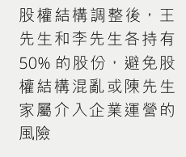

## 股東協議設計的注意事項

- **股份定價方式**：股份定價的計合理反映股份價值。
- **受益人數**：明確的受益人（公司或其他股東），並確保與股權一致。
- **協議與法律合規性**：股東協議應由專業法律審閱，並與當地法規一致。
- **保險金額充足性**：保險金額充分覆蓋價值和其他費用（如公司債務或稅義務）。

股東協議是穩定性和家族經營的重要基礎，特別對於小型和初創企業而言，其作用為顯著。透過終身保險（保險型）結合企業，能有效應對突發情況下的股份轉讓，避免資金壓力導致家人引入公司，並促進股東之間的信任，為企業的長期發展奠定基礎。

## 5.4 企業傳承：確保長期穩定與未來發展

企業傳承是許多企業，特別是家族企業面臨的重要挑戰。創辦人或主要經營者退休、離世或其他原因無法繼續經營，缺乏適當的企業繼承人或傳承策略，可能導致企業經營困難，影響其長期穩定和未來發展。

在德勤調查中，企業在傳承中的核心是：

| 項目 | 1% | 2% | 3% | 4% |
| :--- | :--- | :--- | :--- | :--- |
| 財務穩定：企業的財務狀況可能出現不穩 | 56% | 17% | 17% | 5% |
| 繼承人的能力：繼承人是否有能力、經驗與技能管理企業 | 35% | 29% | 18% | 18% |
| 市場環境變化 | 23% | 22% | 33% | 11% |
| 管理層的過渡：影響企業的運營和文化 | 23% | 33% | 11% | 11% |
| 法律和稅務問題：企業傳承過程中可能面臨的法律和稅務挑戰 | 19% | 27% | 18% | 9% |
| 客戶和供應商對企業的信任 | 10% | 20% | 40% | 10% |
| 企業文化的傳承：企業的核心價值和文化在傳承過程中延續或變革 | 25% | 38% | 37% | |
| 家庭成員之間的衝突 | 33% | 67% | | |

- 第1位
- 第2位
- 第3位
- 第4位
- 第5位

在章節3中，我們探討了企業繼承人的選擇與家族內部利益的重要性。首先，選擇的繼承人並進行系統性的整合是確保企業持續發展的關鍵。其次，家族內部的利益衝突可能會對企業的發展和變化造成傷害，因此必須定義明確的角色和責任，建立結構化的治理架構以提高決策效率，減少錯誤。最後，利用家族辦室和信託來保護企業核心。選擇的繼承人並進行系統性的整合是確保企業持續發展的關鍵。其次，家族內部的利益衝突可能會對企業的發展和變化造成傷害，因此必須定義明確的角色和責任，建立結構化的治理架構以提高決策效率，減少錯誤。最後，利用家族辦室和信託來保護企業核心。

在德勤研究中，企業家傳承過程中的擔憂做了以下規劃。

## 高價值企業家傳承過程中的準備規劃（多選）

| 尋求法律和稅務意見以進行資產和稅務規劃 |
| :--- |
| 建立專業化治理結構 |
| 利用保險進行資產隔離與保護 |
| 使用保險進行債務 |
| 成立家族辦室或信託 |
| 其他 |

有效的傳承規劃，不僅有助企業家平穩過渡，還能在未來持續增長和發展。以下將探討企業家於企業傳承方面的具體策略。

## 傳承挑戰：繼承人的選擇與培養

企業的一個關鍵問題是繼承人的選擇與培養。許多企業在高度集中的管理模式下過於依賴繼承人的能力和經驗，導致繼承人缺乏能力或對企業管理的深刻理解。企業可以提前制定計劃，通過系統訓練，幫助繼承人逐步熟悉企業運作，同時引入專業人員。終身保險（保險型）作為工具，配合繼承人穩定的回報。

## 傳承挑戰二：企業治理結構

治理結構的不完善會導致決策下降，甚至影響企業持續。

- 建立專業化治理結構，引入外部專家確保決策專業與透明度。
- 按需要，引入保險作為風險管理工具（例如資產保險、責任保險），以增加財務穩定。

## 傳承挑戰三：家族內部利益與資產分配

繼承人可能因資產分配不均而產生衝突，這不僅影響企業內部的連結，還影響外部聲譽。

- 利用家族信託，透過信託確保資產完整性，避免利益衝突。
- 成立家族辦室，同時規範家族成員的角色、權利與義務，制定明確的資產分配。
- 將保險與家族信託結合，透過直接支付方式，可以避免繼承過程中出現法律糾紛，幫助資產有序轉移，維護家族內的和諧。

## 員工策略與風險管理

在競爭激烈的市場中，風險的管理與員工策略是企業穩定運營與長期發展的關鍵。通過激勵計劃、延遲獎金及保險（涵蓋意外、健康等），企業能吸引留優秀人才，提高市場競爭力。同時，自願退休計劃、企業年金及投資保險可幫助員工準備，從而增加員工忠誠度。

根據調查顯示，69%的高值人士在保險計劃中提升員工福利的需求。此外，專業保險及董事高管責任保險可有效對員工產生的法律風險，保護企業免受訴訟帶來的損失。企業將這些風險管理工具與保障措施引入人力資源及財務策略。

## 風險管理與員工策略結合

| 風險情況 | 目標 | 方案 |
| :--- | :--- | :--- |
| 商業貸款保障 | 確保企業在財務困難時能夠準時還款 | - 商業貸款保障 - 使用金融貸款 |
| 員工保障 | 保護關鍵管理人員，確保企業營運的穩定 | - 員工保障 - 利用保險轉換 |
| 股東保障 | 確保股東在遭遇不幸時的財務安全、股份結構 | - 設立董事協議 - 股東保障險 |
| 企業 legacy | 確保員工或關鍵人員離後的平穩過渡 | - 設立家族辦室和信託（第3章） - 結合保險 |
| 員工福利 | 提升員工忠誠度及招聘競爭力 | - 全面傷害及醫療保險 - 多元化的員工退休計劃 |
| 責任風險管理 | 降低員工及高管的法律風險 | - 購買專業責任險 - 董事及高管管理人員責任保障 - Network安全及數據風險保障 |

## 高價值人士心聲：跨國企業家

> 「對於我將業務交付給自己的管理人員，如果這些管理人員離職或出現健康問題，就會對業務造成重大影響。因此，我十分重視我管理人的薪酬福利，包括現金和醫療等福利。此外，我也為他們購買保險，確保公司在失去管理人員時，可以得到財政補償，並用來聘請替補人員。」

## 制定有效的保險策略三部曲

1. **評估風險**：了解自身與企業層面的風險類型和程度，是選擇合適保險產品的基礎。
2. **定制方案**：根據企業規模、行業特性及個人需求，在專業財富顧問的協助下設計保險方案，確保每一分投入都獲得效益。
3. **定期調整**：隨著企業發展和市場環境的變化，定期審視和調整保險策略，保持其與同時進。

創業成功不僅無法依賴創業思和創業精神，需要企業具備全面的風險管理策略。透過商業貸款保障、員工保險、股東保障及企業傳承保險，企業可以大幅提高傳承成功率。傳承規劃是策略的一部分，只有在穩定的基礎上，企業才能在傳承過程中實現平穩過渡，在未來持續發展。

## 6.2 早預防：降低健康風險，未雨綢繆

由於大部分高淨值人士的工作時間非常緊張，因此他們更需要量身定制的健康管理方案。

**基因檢測**：通過基因測試識別遺傳疾病，如乳癌、前腺癌、心臟病等，提供個人化的生活建議與健康監控計劃。

**個人化與長期的健康管理服務**：根據個人的健康數據和生活方式，提供針對性及及時改善建議，包括：運動、飲食建議、壓力管理和睡眠管理等。

根據數據調查，約 40%的高淨值人士購買健康保險的主要目的是希望能夠進行疾病的預防和篩查。

這一數據顯示了他們對健康管理的重視，也反映了高端醫療在健康預防方面的重要性。

## 6.3 早發現：精準篩查，時刻識別

現在面臨多種健康風險，包括癌症、中風、心臟病以及各種慢性疾病（如糖尿病和高血壓）。這些疾病在早期往往隱沒有症狀，患者可能無法及時診斷與治療，從而錯失了最佳治療時機。此外，精神疾病也會導致焦慮和抑鬱，因為缺乏診斷和成為治療。

對於有效對抗健康風險，高淨值人士變得看重健康篩查以及早期發現健康問題：

**高端健康檢查**：早期篩測疾病，避免延誤治療時機

- PET-CT、MRI全基因測序
- 定期檢測腫瘤標誌物，篩查早期癌症
- 心血管健康檢查（如冠脈CT、心臟超聲）

**心理健康檢查**：及時干預心理問題，識別憂、抑鬱等心理問題

- 定期進行健康評估，識別憂、抑鬱等心理問題
- 配合心理諮導和壓力管理技術，以提供針對性支持

**慢性疾病監控**：實時監控健康數據，提前發現異常

- 使用可穿戴設備監測血壓、血糖、心率等指標
- 定期進行實驗室檢測健康風險指標（如血糖、紅血蛋白、蛋白水平）

**數字健康檢測**：提供精準的健康風險預測與早期預警

- 借助智能健康平台分析多維健康數據，生成個人化風險報告

## 個人化保障設計

高端健康保險根據不同高淨值人士的需求，設計保障範圍和費用，提供多樣化的選擇。這種靈活性讓他們能夠根據自身的健康狀況和生活方式，選擇最合適的保障方案，滿足個人的健康管理需求。

## 6.4 生涯的保障：治療效果與康復支持

若不幸遭遇重大疾病，他們面對的不僅是高醫療費用，還包括家及業務的挑戰。如果效果不理想或手術失敗，他們可能會失去活動能力，甚至面臨生命威脅。由於高淨值人士通常是企業或家庭的決策者，他們應該預先對緊急事件的資產傳承計劃，以便企業和家庭在發生事故時，保持持續性。

## 高端醫療費用

高淨值人士面對對疾病時，除了關注治療本身的，還非常重視主診醫生、治療計劃、藥物選擇、技術質量以及整體的水平。這不僅影響治療的成功率，也對康復和術後未來的生活有著影響。因此，對於他們而言，必須符合其特定性的治療方案。然而，高端醫療費用非常高，即使是高淨值人士，也可能需要為了支付高昂的醫療費用，同時考慮企業及家屬的生活。

高端醫療費用也因需要而持續上升。2023年，平均醫療費用高出8.7%。在香港，入住私人醫院的貴賓，費用可能高HKD 23,000一天。在香港的私家醫院，治療、藥物或檢體的費用一般會隨著所住的房級而有所不同。例如，私家醫院的收費是按週收取的，手術室費用、物理治療費用和藥物費用等可能會增加 70% 至 100% 以上。因此，私家醫院的收費，一般是按項目列一，預算會根據個人的人的醫療總費用而定，而預算與實際可能有差異。

| 疾病 | 治療 | 費用（香港） |
|---|---|---|
| 癌症 | 不同區域的每月費用 | 由 7,000 至 1,600,000 元等¹⁰ |
| 免疫治療 | 每週的費用 | 30,000 至 37,000 元¹¹ |
| | 假設每三週要接受一次的療程 | 每個月的治療費用就可達 100 萬 |
| | | 每次 200,500 至 660,000 元¹² |
| | | 一般人可能需要接受 20-30 次治療 |
| 放射治療 | | 每次 23,000 至 250,000 元等¹³ |
| | | 一般人可能需要接受 20-30 次治療 |
| 旋螺旋放射治療系統 | 每個月的治療費用約為 4,400 至 20,000 元等¹⁴ |
| (Radix X - Therapy with Synchro Tracking System) | | 一般人可能需要接受 20-30 次治療 |

這些醫療費用並非一次性支出，而是可能是長期承擔的費用。除了初期的醫療費用，患者還需要考慮康復、術後護理及定期檢查持續，這些費用隨時間累積，對家庭財務持續。

9. 全球醫療費用 (2024年)
10. Drugs.com | Prescription Drug Information, Interactions & Side Effects
11. 免疫治療：價格因地區及層次而差異
12. 康復和護理：癌症治療中心項目 (2024年)
13. 香港中文大學：放射治療費用 (2025年)
14. 香港中文大學：螺旋放射治療費用 (2025年)

# Deloitte

在治療期間，由於高淨值人士通常工作繁忙，暫時離職或工作帶來的收入減少，都會影響及其家庭在治療期間和康復的生活水平。

根據調查顯示：
- 85%的高淨值人士購買健康保險的主要原因是
- 73%的高淨值人士為了緩解家庭的經濟負擔
- 65%的高淨值人士認為保險能夠支持其生活

這些數據顯示了高淨值人士對保險的需求以及在健康管理上的重視。

有些醫療計劃包含服務，例如治療、術後康復服務。這些服務不僅能縮短治療所需的時間，更能提供更高的價值。

## 快速接入醫療資源

透過高端保險和醫療值服務（VAS），高淨值人士可以進入世界頂尖醫療專家網絡，例如美國、克利夫蘭、日本。這種直接服務不僅能獲得治療，還能提升治療的效果。

## 快速接入醫療資源（附加服務）

保險提供的醫療服務可為高淨值人士迅速進入國內外頂尖和私人醫院，這些服務大幅減少了等待時間，還幫助人在短時間內接受治療，顯著提高治療成功率。對於追求高端醫療體驗的人而言，這類服務無疑是極具價值的投資。

## 個人化治療方案

在經濟許可下，病人通常追求高端、定制而精準的治療計劃和藥物，如基因療法、免疫療法。他們希望提高治療成功率，減少對健康的副作用，治療方案就可以讓人在支持。

## 全面康復

在療後的過程中，專業的康復支持不可缺。高淨值人士可能購買專業的康復服務，提供更好的治療方案，包括物理治療、醫療康復和營養支持；此外，引入智能設備監控進程，調整治療方案，確保康復過程的有效性。治療計劃就可以讓人在支持。

## 心理健康與支持

長期的心理與康復支持對於個人及家庭是非常重要的，往往伴隨著患者的壓力和情緒波動。為此，有些保險公司推出了相關服務，由專業人員組成的團隊，這些專家能夠深入了解個人的需求，耐心安排治療方案和過程，考慮患者對治療進程的建議。

## 尋求第二意見

病人需要尋求第二意見來替代治療方案時，找到符合要求的醫生往往會成為困難。有些保險公司會在其醫療服務機構名單中推薦合適的醫生，幫助投保者做出決定。

> 研究《高淨值人士價值觀與生活方式報告2022》

## 案例：高端醫療計劃為患病企業家和他的家庭提供財務保障

背景：張先生是一位中大型製造企業的擁有者，對健康問題非常重視。由於張先生經常往返中國內與香港之間，獲得全方位頂尖醫療服務對他來說十分重要，他亦發現早發現和早預防能顯著提升治療率，因此他也自己和家人購買了一份全方位的高端醫療計劃（“計劃”），以備不時之需。

## 計劃的應用

**早期診斷：高端健康檢查**
早發現自己有早期的惡性腫瘤，避免了延誤治療而面臨嚴重後果。

**治療過程：綠色通道**
迅速進入國內頂尖醫院，包括治療、幹細胞移植、免疫療法和轉向治療的綜合治療方案。

**康復支持：心理顧問支持**
- 購買了專業的康復師提供物理治療和心理支持
- 保險公司提供了專業顧問支持，幫助他和家人面對治療期的心理壓力

## 全面的保障和安排

**保險為企業和家庭提供財務保障**
保險計劃涵蓋了門診和住院費用，並提供先批的免數服務和代繳費用服務，為企業和家庭提供了穩定的財務保障。

**事前規劃能穩定運作**
張先生提前制定了詳細的業務運營計劃，以確保企業能夠穩定運作，適當安排減少了家庭財務的壓力。

**財務保障讓張先生能夠專注於治療過程**
張先生的生活質量提升，重新回到企業的管理中，繼續事業發展。

## 6.5 高淨值人士治療期間的企業和家庭運作

在治療期間，病人需要靜養，但作為家庭和企業的重要決策者，要維持企業和家族的運作和穩定。尤其是治療期間的不確定性和突發情況，提前做好計劃是不可或缺。

**壽保險（儲蓄型）與失去能力照護服務（Incapacity Care Service, ICS）**
某些壽保險可能提供ICS服務，讓保單持有人提前授權家人，在失去能力時使用這筆資金支付醫療費用，確保保單人在治療期間的。

**失去能力照護服務 (ICS)**
ICS服務確保壽保險（儲蓄型）或保險能夠在保單持有人失去能力時，為家庭支持。

## 案例：事先定變計劃和儲蓄計劃與失去能力照護服務（ICS）

背景：李先生在金融行業中有強領導位。由於業務需求，李先生經常熬夜及飲酒，所以定期做高端健康檢，以減少中風機會。作為企業的主要決策，他知道自己失去能力必然會影響。為此，李先生通過保險顧問進行了多項安排，確保若不幸失去能力時，其家庭和企業能夠正常運作。

| 家庭 | 業務 |
|---|---|---|
| 學費和家庭海外生活支出 | 購買了全方位的高端醫療保障及儲蓄計劃（包含ICS） | 制定了詳細的業務計劃，授權高級顧問接管日常業務 |
| 儲蓄計劃失去能力照護服務（ICS） | 儲蓄保險計劃了在失去能力時，家庭獲得資金支持 | 李先生與企業高層進行充分溝通。授權也可以在處困期間離開的決策 |
| 成效與影響 | 家庭依賴保障的資金支付護費用及日常生活需要 | 管理團隊鎖定他的家人更新，保持透明度 |
| 治療費用 | 管理團隊有效地執行了李先生所定的業務計劃，公司的運營不會受到嚴重的負面影響 |

大中高淨值財富傳與規劃報告

## 健康與財富的雙重保障

對高淨值人士而言，健康管理不僅侷於生活品質，更是家族財富與事業穩定的基石。在未來，隨著科技的進步與全球化資源的整合，健康保險將不再是傳統的保險工具，而是結合健康管理、財富規劃與個人服務的解決方案。

選擇一份全面的健康財富計劃，不僅為了當下的投資，更是為了未來家族長遠發展的承諾。透過完善的風險管理，打造健康與財富的雙重保障，讓高淨值人士及其家族在面對未來挑戰時，始終擁有安全屏與生活品質。

## 6.7 全健康管理：從預防到治療的全方位布局總結

| 風險類別 | 描述 | 保險方案 |
|---|---|---|
| 健康風險（包括重大疾病對高淨值人士生活品質、企業及家族的影響） | （預防到治療階段） | 高端醫療保險（全球覆蓋的網絡、國際醫療轉診服務）、健康保險、健康管理增值服務（VAS） |
| 意外及生活保障 | 意外事故或長期疾病對高淨值人士及家族生活品質的 | 人壽保險（可參考附錄1） |
| 企業穩健 | 企業決策人的逝世或健康問題對公司造成衝擊 | 要員保險（可參考章節5）、責任保險（可參考章節5）、高端醫療保險、危保險、人壽保險（可參考附錄1） |
| 家族財富傳 | 意外或疾病導致家族安排不當及遺產問題 | 家族信託/家族辦公室（結合保險）（可參考章節3） |

## 總結

## 高值人士與保險需求趨勢將向未來發展

高淨值人士在財富管理與風險管理方面的需求日益增加，保險作為財富管理與風險管理的工具，其地位和重要性不容忽視。對於屬於高值人士的保險服務需求，市場可能需要重新調整，隨著財富增值及保險增加，保險不再是高值人士的一項選擇。

根據趨勢顯示，近 95%的高值人士已經考慮過保險產品（如壽險、醫療險、危險），但僅有 29%的高值人士表示在資產組合中佔 10%。此外，有 38%的高值人士表示在未來財富策略中是非常重要的。同時，高值人士表現出對繼承家族財產與投資的擔憂，認為可能導致財富流失或資產貶值。為了應對這些挑戰，保險市場推出保險權利方案，例如保單轉換及功能（詳見附錄1），可幫助高值人士安全地完成財富傳承。

預計未來將看到更多高值人士納入保險需求的的核心動力：

### 1) 財富傳承的需求

全球稅務政策日益複雜，且各國稅務機關在人工智能與數據的支持下，信息透明度日益增加，稅務規劃已成為高值人士財富管理中不可忽視的議題。根據趨勢顯示，有 72%的高值人士表示保險能幫助他們執行稅務規劃和優化結構。

### 2) 稅務規劃的需求

高值人士對自身及家人的健康持續增強，保險視為財富傳承的重要手段，尤其是在重大疾病或突發事件後。他們也正在尋求如何有效地將財富傳承給下一代，讓財富在傳承中加運用。調查顯示，有 20%的高值人士考慮信託或家族辦公室作為財富傳承工具，但有 54%的高值人士選擇透過購買險來實現財富傳承。

### 3) 定期服務及綜合財務規劃的需求

調查顯示，高值人士在需要保險產品時，最看重保險的靈活性與財務價值，有 46%的高值人士關心保險公司的信譽和良好聲譽記錄。此外，有 61%的高值人士希望保險產品在條款多樣性及費用方面進一步提升，以便更易理解保單內容，給出明確的解決方案。同時，高值人士對個人保險方案的需求增加，有 65%的高值人士期望保險方案更加靈活和個人化，如提供可調整的理賠支付方式、動態管理服務等，從而更好地覆蓋不同的財務需求。

### 4) 全面健康的需求

近年來，全球衛生事件（如 COVID-19、疫情）讓高值人士更加重視自身及家人的健康。與過去關注疾病發生的「被保險人」，高值人士更關注疾病的早期發現、早預防與早治療。趨勢顯示，高 67%的高值人士為自己及家人願意購買健康保險，讓許多人希望保險在疾病防範和檢查中發揮更大作用。高值人士的健康需求日益增加，尤其是在面對心血管、中腦等重大疾病以及傷性疾病時，保險需要更精準和及時的個人化保險方案，以滿足日益增大的需求。

高值人士希望保險公司提供的額外服務價值：

- 1 個人保險方案/設計
- 2 財富規劃諮詢
- 3 理財服務優化
- 4 健康管理服務
- 5 稅務諮詢服務

# 終身人壽險（儲蓄型）

終身人壽險（儲蓄型）是一種結合人保險和保障功能的保險。除了提供保障的功能外（如保險理金），更具備投資和現金價值的特點。此類保險會透過投資不同的資產（包括不僅於股票、債券以及其他收益資產）來向保有人提供財產增長的動力。高值人士可以利用不同的財務規劃，以實現高值的資產回報或家人成員的財富。

- **保證保期**：保有人可以一次性購買終身人壽險（儲蓄型），由於產品具有保證現金價值，通常需要保有人本人根據此保單進行繳納（如保險費繳納的風險請參見第2章），作為一筆長期的資金來購買相同的保險，獲得長期的回報。結合本地銀行服務，高值人士能夠一步提升財務管理效果，非常適合長期財富增值。
- **定期付費**：市面上的終身人壽險（儲蓄型）多年以上、5年、10年或終繳付費，更適合希望透過月收入或獎金定期付費的保有人，以讓他們能維持保障活性的同時，逐步增加保內的現金價值。

配合高值人士的不同需求，市場上的終身人壽險（儲蓄型）產品設計包含了多項運用性的創新功能，以滿足他們在不同人生階段的需求：

## 1. 改變保有人

保有人可以選擇在生前將財富轉移給家庭成員。這種活性讓他們認為承人能夠管理資產時，逐步將保險的所有權轉移給他們，對於實現目前的財務有用的效果。

## 2. 提取增值

保有人可以在無需的情況下按特定的條款提取現金價值，為其提供非收入來源或增值規劃，滿足不同的需求（如子女教育、退休規劃等）而產生的資金需求。

## 3. 貨幣轉換功能

市面上有不同成分的終身人壽險提供多種貨幣轉換，如美元、港元、人民幣、加元、英鎊和新加坡幣，讓保有人可以當地將保險轉換，以便配合整個全球市場的環境和他們移居後的生活結合：

## 4. 保單持續增值服務

此項計劃允許保有人在離世後，在指定日期或保險達到指定年齡時轉換保險。例如，保有人可以指定一個託人來管理保險（必須為18歲以上），以確保保險將交予所選擇的繼承人。

Deloitte. Private

身壽保險（儲蓄型）是具有分紅成分的人壽保險。此類保險產品可以提供多種功能以應對不同的場景：

| 應用場景 | 功能 |
| :--- | :--- |
| 遺產傳承 | 可以作為財富傳承的重要工具，幫助高淨值人士負擔遺產稅，幫助財富順利傳遞給下一代。詳情可參閱章節3。 |
| 結合（私人）銀行與保費融資 | 可以透過私人銀行執行保費融資、優化現金流及提高投資回報，在不影響現有現金的情況下獲得身壽保險的保障。詳情可參閱章節2。 |
| 配偶家族辦公室 | 可以與家族信託等工具結合，提高財產傳承的靈活性與效率。詳情可參閱章節4。 |
| 家族信託 | | |
| 遺產規劃 | 可以設置詳細的受益條款，確保保險理金完全符合特定條件，防止不當使用，保險理金可按階段交付女兒的人生大事。詳情可參閱章節3。 |
| 稅務規劃 | 可以善用各保險的稅務優惠，從而優化稅負。詳情可參閱章節4。 |
| 贈與/慈善 | 可以作為贈與工具，例如指定慈善機構或組織為受益人，保險理金直接支付，無需複雜的流程。詳情可參閱章節3。 |

# 終身壽險（保險型）與終身壽險（儲蓄型）

終身壽險（保險型）與終身壽險（儲蓄型）相近，是一種能提供終身壽險（包含保險理金）和現金價值的儲蓄保險。此類保險亦是透過投資不同的資產類別（包括債券、股票及其他非固定資產）來向保有人提供具競爭力的長期保障。對於高人士較短期和增值的終壽保險，保險公司更重視提供保障，並透過投資進行規劃。如同公司為僱員提供保險，並需要公司長期的財務支持及業務運作，建議公司和保險公司來執行，以確保保險產品具有資產增值的潛力，讓客戶長壽。不同需要並確保保險持有人及其家庭在關鍵時刻獲得所需的援助。

### 1. 心身守護保險

為指定的重大疾病及精神疾病提供心身守護保障，確保在保有人面臨健康風險時獲得必要的保障。

### 2. 先指定的保險項目

保有人可以指定特定一人，以便其具有財務能力來購買終身壽險。終身壽險（保險型）相近，終身壽險（儲蓄型）亦具有靈活性。保有人可以選擇一次繳款或每年分期繳費，實現更高的價值，對於高人士。

### 3. 多種保險結付選項

以一次支付給受益人；保有人也可選擇分期支付方式，例如設定固定金額或每年按百分比支付。終身壽險（保險型）與終身壽險（儲蓄型）一樣，都是具有不同功能。除了遺產傳承、財務規劃、稅務優惠和靈活性（相關文件見參閱），保有人可以利用資金進行槓桿，此類保險產品可用於不同的：

| 應用場景 | 功能 |
| :--- | :--- |
| 個人保險 | 在保有人去世時提供資金，確保保有人不會遭遇債務造成的財務損失。 |
| 企業保險 | 用於人員（如高管或核心份）透過折扣或分期支付來留期間的資金。詳情請參考章5。 |
| 企業保險 | 可解決保有人對債務的撥，透過保單指定保險，在保有人去世時清貸款及資金的安全。詳情請參考章5。 |
| 股東權 | 用於回購股東在公司份的第三方手中，防止結構化，現有的股利。詳情請參考章3和章5。 |

透過這些功能，具有不同的終身壽險為高人士提供靈活的財富管理和方案，幫助他們在財務規劃中實現目標。

# 萬用保險

萬用保險是一種保險產品，結合了保障與投資的特點，主要透過透明的費用和利率設計，使保單持有人能更好地管理財務規劃。萬能保險可以分為三種主要類型，這三種類的主要在保單所持有的資產：

- **傳統萬能保險**：價值通常與保險公司提供的固定利率掛鉤。
- **指數型萬能保險**：價值的增長與特定市場指數（如標普500指數）相關。
- **變額萬能保險**：價值通常與多個投資帳戶（如股票、債券等）掛鉤，投保人可以選擇不同的投資組合。

傳統保險——如終身保險（儲蓄型）和萬用保險（保障型）的保險費用並不公開。會通知保單持有人，有高的透明度，保單持有人能根據自己的需求來管理財務規劃。

# 不同類型人壽保險的應用對比表

| 用情形 | 終身人保險（儲蓄型） | 終身人保險（保障型） | 萬用保險 |
| :--- | :---: | :---: | :---: |
| 個人及家庭保障 | | | |
| 家庭保障 | ☑ | ☑ | ☑ |
| 子女教育基金 | ☑ | ☑ | ☑ |
| 遺產規劃 | ☑ | ☑ | ☑ |
| 退休規劃 | ☑ | ☑ | ☑ |
| 資產增值 | ☑ | ☑ | ☑ |
| 企業保障 | | | |
| 商業貸款保障 | ☒ | ☑ | ☑ |
| 要員保險 | ☒ | ☑ | ☑ |
| 股東保障 | ☒ | ☑ | ☑ |
| 企業傳承 | ☒ | ☑ | ☑ |
| 稅務規劃 | | | |
| 稅務規劃 | ☑ | ☑ | ☑ |
| 慈善 | | | |
| 支持慈善事業 | ☑ | ☑ | ☑ |
| 保單特性 | | | |
| 保費靈活性 | ☑ | ☑ | ☑ |
| 保單融資/抵押 | ☑ | ☑ | ☑ |
| 一般適用 | ☑ | 未能直接應用 |

Deloitte. Private

大中華高淨值人士財富傳承與保險規劃報告

# 附錄2：國際稅務摘要

附錄中所含的內容是根據網站上的國際稅務摘要 (Tax guides and highlights) (https://www.deloitte.com/#TaxGuides) 而整理。每個國家/地區的內容均根據最後更新日期以當時獲取的資訊為基準。本附錄的資料和內容可能會具體情況隨著時間而變化。本附錄的英文版稅務摘要，此版本僅供參考。若此譯本與網站上的國際稅務摘要 (https://www.deloitte.com/#TaxGuides) 的英文版有差異，我們對此譯本的準確性負責，亦不承擔有關責任。本附錄中包含的所有一般性資訊、任何項目、其全球資產網絡或關聯機構均不會提供專業建議或服務。在作出任何行動可能影響您的業務或決策前，請務必諮詢資格的專業顧問。大中華高淨值人士財富增值與風險報告。

Deloitte. Private

| 司法管轄 | 繼承稅 | 財產稅 | 贈與稅 | 其他稅項 | 最高所得稅率 | 最高企業所得稅率 |
| :--- | :--- | :--- | :--- | :--- | :--- | :--- |
| 香港特別行政區 | 不適用 | 不適用 | 17% | 16.5% | |

物業稅：物業擁有者（住宅）必須位於香港的物業，物業稅按15%標準稅率計算。物業價值的計算方法為主要收取的租金、其他費用扣除（標準豁免額）。若一家公司將其收入包含在課稅利得中，則可扣除物業稅。印花稅：印花稅是針對香港的不動產合約、轉讓文書，以及香港證券的轉讓而收取的項。低於市場，印花可能會按轉讓當日的市價計算。注意，以上內容是根據香港特別區國際稅務摘要整理，最後日期為2024年1月。

Manulife 宏利

| 司法管轄 | 繼承稅 | 遺產稅 | 贈與稅 | 其他稅項 | 最高所得稅率 | 最高企業所得稅率 |
| :--- | :--- | :--- | :--- | :--- | :--- | :--- |
| 中國內地 | 不適用 | 不適用 | 不適用 | | 45% | 25% |

物業稅：房產是對土地和建築物徵收的，由房產者按照房產原位置減除一個免稅額，再按房產價值的1.2%每年繳納，或者按年收入的12%繳納（住宅的稅率可降至4%）；然而，由於稅率由政府規定，不同地區的實際操作可能存在差異。印花稅：合同、協議和法律文件適用不同稅率自2023年8月28日起，證券交易的印花稅已降低50%。注意，以上內容是根據內地國際稅務整理，最後日期為2024年1月。

| 司法管轄 | 繼承稅 | 遺產稅 | 贈稅 | 其他稅項 | 最高所得稅率 | 最高企業所得稅率 |
| :--- | :--- | :--- | :--- | :--- | :--- | :--- |
| 澳門特別行政區 | 不適用 | 不適用 | 不適用 | | 12% |

物業稅：澳門房屋是按登記在房產價值的6%（住宅）或租金收入的8%（出租房屋）徵收的。對於新建建築物其初始使用期間，根據物業的位置和性質，可享受不同的免稅期。政府給予澳門居民每套房產單澳門3,500元的市區稅減免。注意，以上內容是根據澳門特別行政區國際稅務整理，最後日期為2024年1月。中國高值人士財富傳承與保障計劃報告。

Deloitte Private

中國臺灣

遺產及贈與稅（累進稅率為10%至25%）對中國籍臺灣籍人的全球資產徵收。在中國臺灣無居住，且與事實或或發生後2年內，在台灣居住累滿365天後，其全球資產應繳納遺產稅。地價稅：地價稅是針對納稅人在中國政府直轄市所擁有的土地總額而收。地價稅按照常規的累進率（1%至5.5%）徵收，或按土地用途（如住宅、工廠、商業用地）對政府課的土地採取特殊稅率徵收。40%並對未分配遺收5%的未分配免稅率。印花稅：印花稅適用於憑證，並按以稅率徵收：所有合約簽收的0.4%（招攬人受擔課稅金額的0.1%）；每份資產買賣契約為2%；以及讓賣契約為3%。買賣、讓或分割不動產，由合同雙方支付。遺產稅：不適用。贈與稅：不適用。契稅：不動產之買賣、繼承、贈與、分割或取得之所有者須申報課稅。契稅是以當地房產標準價格為2%至6%之間。注意，以上內容是根據臺灣國際稅務整理，最後日期為2024年1月。

| 司法管轄 | 繼承稅 | 財產稅 | 贈與稅 | 其他稅項 | 最高所得稅率 | 最高企業所得稅率 |
| :--- | :--- | :--- | :--- | :--- | :--- | :--- |
| 澳洲 | 不適用 | 不適用 | 不適用 | 45% | 30% |

物業稅：土地和建築收土地稅。根據<中央與地方財政關係》，該稅率不得超過當地局核定的市場預估值的0.5%；特定產業（如石化及天然地熱、採礦、耕耕、林業）的土地和建築物受特定監管。印花稅：特定文件需繳10,000元的印花稅。注意，以上內容是根據澳洲國際稅務整理，最後日期為2024年1月。

| 司法管轄 | 繼承稅 | 財產稅 | 贈稅 | 其他稅項 | 最高所得稅率 | 最高企業所得稅率 |
| :--- | :--- | :--- | :--- | :--- | :--- | :--- |
| 加拿大 | 沒有正式的繼承稅，而將財產轉給他人視為市場價格出售。雖然沒有正式的正，但已納稅人通常視為市場價格處直接接收的所有財產。物業稅：市值購物估收。該稅在計算企業所得稅時可用作抵扣。15%（聯邦）；16%（省/地區）。注意，以上內容是根據加拿大國際稅務整理，最後日期為2024年3月。

| 司法管轄 | 繼承稅 | 財產稅 | 贈稅 | 其他稅項 | 最高所得稅率 | 最高企業所得稅率 |
| :--- | :--- | :--- | :--- | :--- | :--- | :--- |
| 印尼 | 不適用 | 不適用 | 不適用 | | 35% | 22% |

物業稅：對土地、建築和永久性建築收土地建築稅。根據<中央與地方財政關係》，該稅率不得超過當地局核定的市場預估值的0.5%；特定產業（如石化及天然地熱、採礦、耕耕、林業）的土地和建築物受特定監管。印花稅：特定文件需繳10,000元的印花稅。注意，以上內容是根據印尼國際稅務整理，最後日期為2024年1月。

| 司法管轄 | 繼承稅 | 財產稅 | 贈稅 | 其他稅項 | 最高所得稅率 | 最高企業所得稅率 |
| :--- | :--- | :--- | :--- | :--- | :--- | :--- |
| 韓國 | 不適用 | 45% | 24% | 50% | 50% | |

物業稅：公司或個人須特定的日期依據擁有土地、建築、船艙和飛機繳納不動產。根據財產類型，稅率從0%至40%不等。除不動產外，擁有房地產（如土地或住宅建築）的公司或個人，還須繳納綜合不動產。印花稅：涉及利息生、轉讓或變更的合約收印花稅。注意，以上內容是根據韓國國際稅務整理，最後日期為2024年1月。

| 司法管轄 | 繼承稅 | 財產稅 | 贈稅 | 其他稅項 | 最高所得稅率 | 最高所得稅率 |
| :--- | :--- | :--- | :--- | :--- | :--- | :--- |
| 馬來西亞 | 不適用 | 不適用 | 不適用 | 30% | 24% | |

物業稅：馬來西亞各州以不同的稅率徵收土地稅和門牌稅。印花稅：印花稅按轉讓財產價值的1%至4%徵收，股權交易文件則以0.3%徵收。注意，以上內容是根據馬來西亞國際稅務整理，最後日期為2024年3月。

| 司法管轄 | 繼租稅 | 遺產稅 | 贈與稅 | 其他稅項 | 最高所得稅稅率 | 最高企業所得稅稅率 |
| :--- | :--- | :--- | :--- | :--- | :--- | :--- |
| 新西蘭 | 不適用 | 不適用 | 不適用 | | 39% | 28% |

物業稅：當局根據土地的官方估值收取土地。各地稅率差異較大。收取的稅款將用於當地城市服務、廢物收割、當地道路、公園、設施和其他。請注意，以下內容是根據新西蘭稅務摘要整理，最後日期為2024年1月。

| 律費 | | | | | |
| :--- | :--- | :--- | :--- | :--- | :--- |
| | 6% | | | | |

# 香港特別行政區

請注意，以下內容是根據稅務局的香港特別行政區稅務概要整理，最後更新日期為2024年1月

## 個人稅務

### 稅收居民
稅務局並沒有提供稅收居民的定義，但可以參考稅務局在「個人入稅課」申請對於納稅人的居住要求。通常居住於香港特別行政區（以下簡稱：香港）的人，是指/她為明確的目的，自選擇留在香港，並持續居住於此。除不論長短期間的暫性的或偶然性的例外，通常是居住且常在香港居住，作為工作或日常生活的地方，以香港社會作為一般成員身處該地區。

### 課稅基礎

### 稅務年度
稅務年度為2024年4日至3月31日。

### 稅率
根據稅務規則對入稅金額（即評入稅減扣扣和豁免稅額）按二級標準稅率計算（稅率由2%至17%不等）或入淨額（即評入稅減扣後沒有免稅額）按二級標準稅率計算，以較低者為準。由2024/25稅務年度起，每500萬元的入淨額的標準稅率為15%，餘餘額的標準稅率為16%。

## 企業稅務

### 稅收居民
在香港成立或組成的公司/合夥業務/受託人/團體；在香港以外成立或組成在香港管理或控制的公司/合夥/信託/團體。

### 課稅基礎
任何人士（包括個人、合夥業務、受託人或團體），在香港經營業務、專業或業務而從事行業、專業或業務於香港產生的所有利潤（出售資本資產所得的利潤除外），均須繳納稅稅。

### 稅率
兩級制稅率8.25%適用於法（非豁免的稅率為7.5%）首200萬元應繳利潤稅，其後的利潤按16%（非企業按15%）收稅。若企業是合夥業務的合夥人，其按比例分配的200萬元應繳利潤稅按8.25%的稅率收。為防止集團實體濫用此制度，聯屬公司之間可以提名一個個體按兩級制利率課稅。

## 其他稅種

### 資本利得稅
香港一般不對資本利得課稅。自2024年1月日起，若投資者至少持有24個月擁有投資股票股份不低於15%的，則該屬於香港的處置股票收益被視為資本利得而不須課稅。但不屬於上述範圍內的處置資產收益，若該處置資產實賣有貿易的性質（根據事實和實際情況判斷），則其資產收益應繳納利得稅。

如經實質要求（適用於知識權以外的財產），則聯繫要（適用於知識權），或持股權免稅安排（適用於香港資產），則該經營外收的處置資產收益不須課稅。

### 物業稅
物業擁有者（業主）須對於其屬於物業的租收入須繳物業稅。物業稅的應課稅淨值以15%標準稅率計算，計算方法為主要所得的租金、服務費及其他費用減20%（即經計算支出的標準免稅）。若一間公司租用物業的租收入包括在應課稅利得中的入息，則從該利得扣除已繳的物業稅，或申請豁免物業稅。

### 印花稅
印花稅是針對香港的租約、不動產轉賣或股票轉讓文書，以及香港證券的轉讓文書而收取的印花稅。若不動產或香港股票的轉讓價低於市價，印花稅可能會按轉讓當日的市價計算。

轉讓香港證券的印花稅為轉賣證券價的0.2%（即購買單及售賣單據各收0.1%印花稅）。若屬於集團內部且符合特定條件，可向稅務局申請印花豁免。

### 繼承稅/遺產稅
無繼承稅/遺產稅。

### 外匯管制
沒有外匯管制。

#中國

請注意，以下內容是根據發佈的中國稅務摘要，最後更新日期為2024年1月

## 個人稅務

### 稅收居民
根據個人所得法，在中國內有住所，或者中國內無住所而在中國內居住累計183天的人，為稅居民。中國內有住所是指有家庭、經濟利益關係的人。

### 課稅基礎
根據個人所得法，稅居民就其全球所得繳稅，非居民須就源於中國內的所得。然而，除非符合特定情況（非居民連續六年內在中國居住183天以上，且在任何年度中個人所得減除以前年度虧損的扣除，為稅居民）。其他收入包括股息所得、利息所得、財產租所得、財產轉讓所得。

### 稅率
綜合所得按累進稅率（3%至45%之間）。股息、利息、財產租所得、財產轉讓所得按20%稅率。對經營所得中200萬的部分（免徵所得稅）。在澳門、大灣地區、海南、橫琴或南沙工作的資格個人，最低稅率可能會減少至15%。

### 稅務年度
稅務年度按曆制。

## 企業稅務

### 稅收居民
在中國國內成立或實際管理在中國境內的機構，會視為居民。實際管理機構是指對企業經營、財務、財產等具有實質管理和控制的機構。非居民企業在中國國內未設立機構，或雖然設立機構但沒有實際聯繫的，為非居民。

### 課稅基礎
居民企業就其全球收入納稅，而非居民企業就其源於中國內的收入以及其在中國設立的常設機構（或其他有實際聯繫的利潤）應繳中國所得稅。非居民企業在中國通常被視為常設機構，每一納年度的收入，減除相關費用及損失扣除後不納稅。

### 稅率
企業所得的稅率為25%。特惠稅率適用特定行業（符合特定條件者，稅率為5%），高技術產業、合格外包服務的技術密集服務產業（15%），以及在中國地區鼓勵的產業。

## 其他稅種
稅務年度按年度計算。
- **資本利得稅**：從房產銷售所得的所得，扣除相關費用和稅費後的淨額，按20%的稅率繳納稅。
- **物產稅**：房產稅是對土地和建築徵取的稅費，由房產所有者按計算。
- **轉讓稅**：在土地上轉讓所有權時，按合約值的3%至5%收取。
- **印花稅**：合同、協議和法律文件適用同稅率的印花稅。
- **繼承稅/遺產稅**：無繼承稅/遺產稅。
- **外匯管制**：中國外市場的發展趨勢是逐步自由化。

#澳門特別行政區

請注意，以下內容是根據發佈的中國澳門特別行政區稅務整理，最後更新日期為2024年1月

## 個人稅務

### 稅收居民
在職業的角度，並沒有對稅居民具有具體的定義。然而，在實際操作中，如果個人持有澳門特別行政區（以下簡稱：澳門）身份證或工作許可，則個人將被視為居民。非持有工作許可的居民可能適用不同的稅率。

### 課稅基礎
如果個人在從業中取得收入，無論該個人是居民，都必須繳納職業稅。自僱的收入也須繳納職業稅。大多數來自自僱的租金和金收益都是應繳稅。不課稅收入包括退休金、法定儲蓄、醫療津貼、家庭津貼、婚姻津貼、出生津貼、財產津貼和離世津貼。

### 稅率
對居民所得超過澳門140,000元按累進稅率從7%至12%不等。非持有工作許可的居民，按5%職業稅。

### 稅務年度
稅務年度為曆制。

## 企業稅務

### 稅收居民
在澳門註冊成立的實體為稅居民。非居民實體僅源於澳門的收入納稅，與居民的稅率相同。

### 課稅基礎
可課稅利潤是指（包括股息、利息、財產租所得、財產轉讓所得）減去費用的利潤，那些屬於不可課稅的範圍除外。

### 稅率
利潤額為澳門600,000元，其後的稅率為12%。居民或非居民均適用此稅率。

## 其他稅種
- **房屋稅**：澳門對登記的物業按照6%（自用房屋）或8%（出租房屋）收取的。
- **轉讓稅**：無轉讓稅。
- **印花稅**：印花稅是針對大部分商業活動和文件等收取的，稅率從0.2%到5%不等，包括銀行和保險業務。個人、工商戶或非居民需繳額外的印花稅。
- **特別印花稅**是在購買兩年內售不動產（例如住宅、商業、工業業）的賣方收取的。如果在第一年內轉讓，特別印花稅的稅率為20%，如果在第二年內轉讓，稅率為10%。
- **繼承稅/遺產稅**：無繼承稅/遺產稅。
- **外匯管制**：無。

#臺灣

請注意，以下內容是根據發佈的中國臺灣國際稅務整理，更新日期至2024年1月

## 個人稅務

### 稅務居民
臺灣（以下稱臺灣）擁有戶籍，並在一年內在臺灣內住31天或內內居住31天且經濟重心在臺灣，則被視為臺灣稅務居民。個人在臺灣沒有戶籍，在一年內在臺灣居住合計183天以上的外籍人士，亦被視為臺灣稅務居民。

### 課稅基礎
非居民須就臺灣來源的所得課稅。稅務居民須就臺灣來源的所得課稅。應對其扣稅收入包括薪資工資（及任何獎金、發現斷利）；退休酬；專業服務費；自作業版權費；對於位於臺灣的租金收入；以及臺灣來源的利得、利息和特許權使用費等。

### 最低稅負
非居民的海外所得計入個人基本所得評估是否適用最低稅負（Alternative Minimum Tax, "AMT"）。

### 稅率
非居民適用累進稅率，稅率從5%到40%。其中，收入超過498,000新臺幣時，稅率為40%。非居民當所得和薪資工資繳18%的預扣，以及其就其所得繳21%的預扣。短期票券利息、優惠利息、公司債券利息、政府債務或債務利息、以及這些債券或憑券的回贖交易產生的利息及其他債券產品產生的收益，將對其所得繳15%的預扣。預利金、銀行利息、特許權使用費、專業服務費、租金收入、獎金以及其他類別的所得繳通用稅率為20%的預扣。

最低稅負：居民基本所得超過75萬新臺幣的部分，按20%稅率計算基本所得。在計算基本所得時，與另一個所得稅額比較，若此基本所得超過另一個稅額，則須可依規定扣除計入其海外所得之來源所得後，仍有差額，則繳最低稅負。居民基本所得超過800,000新臺幣的部分（免徵所得稅）後。

### 稅務年度
稅務年度為曆制。

## 企業稅務

### 稅收居民
在臺灣（以下稱臺灣）擁有戶籍，並在一年內在臺灣內住31天或內內在臺灣內居住31天且經濟重心在臺灣，則被視為臺灣稅務居民。

### 課稅基礎
非居民須就臺灣來源的所得課稅。非居民須就其源於臺灣境內的收入以及其在臺灣境內的常設機構（或其他有實際聯繫的利潤）應繳所得稅。非居民企業在臺灣通常被視為常設機構，每一納年度的收入，減除相關費用、損失以及以前年度虧損的扣除，為所得額。

### 稅率
企業所得的稅率為25%。對於營業額不超過5,000萬新臺幣的，特惠稅率適用特定行業（符合特定條件者，稅率為5%），高技術產業、合格外包服務的技術密集服務產業（15%），以及在臺灣地區鼓勵的產業。

## 其他稅種
- **資本利得稅**：涵蓋任何在澳洲定住六個月內產生的利得超過10%以上的直接銷售權，出售外國資本利得或虧損可能獲得減免。非居民需要出售澳洲資產（例如非澳洲分支機構經營的業務資產，以及對於澳洲房產的地產及其連接權）包括資本利得收入中。研究成果的處置可能視為澳洲利得。
- **地價稅**：地價稅是課在台灣中央直轄市或縣市之土地上面上收的稅。地價稅按政府規定的標準稅率（從1.5%至5.6%），或依土地用途（例如住宅、博物館、市範圍用地）規定之土地價值特殊稅率收。
- **印花稅**：印花稅對各種種類，並按稅率課收：持有證券的0.4%（招標人收押金收據的0.1%）；每一買賣不動產契約為12新臺幣以及承繼契約、典賣、出售及分割不動產契約，由合同雙方支付。
- **契約稅**：房產交易、交換、讓與或分割合同金額為0.1%，由合同雙方支付。不動產之買賣、交換、承繼、讓與或分割或占有所有者，均應申報所得稅。契約稅是以該不動產之評價或課稅之價格為基準，稅率在2%至6%。
- **繼承稅/遺產稅**：遺產及贈（稅率10%至20%）。對於台灣居民的全球資產，在台灣無住所而居住者，或在繼承事實或發生前兩年內在台灣居住期間合計365天者，全球資產應課徵繼承稅及遺產稅。
- **外匯管制**：外匯由台灣中央銀行管理。對於單筆外幣新幣兌換或外匯之限制，規定設定為7,000美元的（不包括貨物出口及稅手續費）；對於居民的限制是500萬美元。進行外匯交易時，必須先獲得台灣中央銀的批准。企業和個人需要透過辦理匯款，向台灣中央銀行報特定外交易。企業與個人無需事先授權即可持有外幣帳戶；持有外幣的海外銀行帳戶是被允許的。非居民在台灣的外匯有不受限制，但仍須遵守總銀的規定。

#澳洲

請注意，以下內容是根據發佈的澳洲稅務整理，最後更新日期為2024年1月

## 個人稅務

### 稅收居民
通常居住在澳洲或滿足以下測試，該個人為澳洲居民：
- 持有永久簽證（非臨時居民）；
- 在澳洲居住半年以上的（非臨時居民）。
- 澳洲公民。

### 課稅基礎
澳洲居民就其全球收入課稅。非居民僅就澳洲來源的所得。

### 稅率
採用累積稅率，稅率最高達45%（其中非臨時居民）。澳洲居民可享有18,000澳元的免稅額（其中非臨時居民）。

### 稅務年度
稅務年度是7月1日至6月30日。

## 企業稅務

### 稅收居民
在澳洲註冊成立的公司，或者在澳洲註冊但在澳洲開發業務且其核心管理及控制在澳洲的公司，或被澳洲視為澳洲居民。

### 課稅基礎
澳洲居民通常對其全球所得徵稅。非居民只對澳洲來源的收入。澳洲分支機構的稅率和處理方式是相同的。

### 稅率
企業所得的一般稅率為30%。對於營業額不超過5,000萬澳元的（基準稅率實體），其稅率為25%。基準稅率實體包括：
- 股息及其分配（免稅）；
- 特許使用費用租金；
- 利息收入（除特定例外外）；
- 資本淨收益；以及在合營企業中合夥人的課稅收入，或信託受益人的課稅收入中，凡是直接或間接追屬於基本稅率實體的被動收入的部分，均包含在內。

### 稅務年度
稅務年度是7月1日至6月30日，但在特定情況下，澳洲稅務局批准，可以採用替代的收入。

## 其他稅種

### 資本利得稅
涵蓋任何在澳洲定住六個月內產生的利得超過10%以上的直接銷售權，出售外國資本利得或虧損可能獲得減免。非居民需要出售澳洲資產（例如非澳洲分支機構經營的業務資產，以及對於澳洲房產的地產及其連接權）包括資本利得收入中。研究成果的處置可能視為澳洲利得，且被視作利得稅。

### 物業稅
除非（如果是住宅），所有澳洲州及地區（除了一個州及地區）每月都會對土地所有者徵收土地稅。土地稅最高可達2.75%，取決於澳洲州或地區。某些州對於海外業主或自住房業主高達4%土地稅。新南澳洲或澳洲士不再對芬爾蘭、德國、印度、日本、新西蘭、挪威、南非和瑞士的外業主加費。多利亞州針對COVID-19債務土地稅繳收鎖定金額的加費。

### 印花稅
澳洲對房產（以及其他無形）資產的徵收印花稅，稅率最高達6.5%。稅率根據房產地區或轉讓地區的價值而差異。稅率最低為5%。在特定的澳洲內，額外印花稅可能會額外加費（針對高價值，稅率高7%）的方式徵收，最高達到印花稅率為8%。新南澳洲或澳洲士對外國資產的轉讓額外加費（針對高價值住宅）不再對澳洲生效。塔維斯蘭尼亞購買澳洲的地產，也不要徵收1.5%的額外印花稅。

### 繼承稅/遺產稅
無澳洲繼承稅。

# 加拿大

請注意，以下內容是根據網絡發佈的加拿大稅務需要整理，最後更新日期為2024年3月。

## 個人稅務

### 稅務居民
在加拿大或通常居住在加拿大的個人，則被視為通常稅務居民。若非居民在一個曆年內在加拿大停留滿183天，則被視為稅務居民。除魁北克省外，按照本地法規規定的稅務居民可能會被稅務協定所扣稅。

### 課稅基礎
稅務居民就要全按收入在加拿大及地區上繳納所得。來自海外的附屬某些收入則應繳納稅。投資在某些非居民信託及離岸投資基金中也可能被課稅。非居民則需要繳納來自來源的收入以及處置課稅財產的利得稅。

收得（包括多數福利）某些收入以及來自海外業務或專業收入，則應按照適用的個人所得稅率繳納稅款。從加拿大收到的利息可享更優惠的稅制制度。

聯邦稅率是累進制的，最高33%（魁北克適用的稅率為27.56%）。省地區的稅率也是累進制的，最高稅率為11.5%至25.5%不等。安大省高稅率為56%的附加稅，愛倫華王子島收繳稅10%的附加稅（然而，愛倫華王子島從2024年起取消了個人附加稅）。

### 稅務年度

## 企業稅務

### 居民稅務
在加拿大註冊的，或者其中央管理和控制在加拿大的企業，則被視為稅務居民。
居民企業就要全按收入在聯邦和地區上繳納所得稅。受外國聯公司的某些收入則應繳納稅。投資在某些非居民信託及離岸投資基金中也可能被課稅。非居民企業則需要繳加拿大來源的收入以及處置課稅財產的利得稅，分支機構在遵守當地所得稅規定的規定下，則需繳加拿大來源的收入及稅。

### 課稅基礎
加拿大利潤繳收企業所得，其利潤包括貿易、投資收入以及50%的資本利益。在計籌課稅期間時，正常經營費用可以被扣減。

### 稅率
聯邦企業所得一般稅率為15%。省地區企業所得一般稅率為8%至16%。

### 稅務年度
公司的稅務年度是會計期間，即通常涵蓋企業目的年度。

# Deloitte Private

## 其他稅種

### 資本利得稅
對於企業而言，50% 的資本收益，扣除允許的資本虧損後，將被計入收入，並按一般的企業所得稅稅率。

對於個人而言，50% 的資本收益，扣除允許的資本虧損後，將被計入收入，並按一般的個人所得稅稅率。

### 繼承稅/遺產稅
加拿大沒有正式的遺產稅，然而，財產將視為物給他人時被視為公平市場價值該產產。雖然沒有正式的遺產，但已故繼人通常被視為在去世後已按公平市場價值出售其直接接收的所有資產。

### 社會保險稅
僱主和僱員都需要繳社會保險和政府退休金，其金額取決於僱員的收入。自僱人士亦必須繳交社會保險計劃。

### 工資
加拿大毫不與英國、紐西蘭或紐華達省、大省和卑屈克省收取正式的僱主工資稅。稅率為主要僱主的年薪資的19.5%或4.26%。我們在加拿大和紐西蘭亦收取此稅。卑屈克省必須繳0.9%的勞動稅。此外，若年薪資超過200萬加元，僱員必須繳額保險費，投資在資源的資金將由僱主收取的，或者由卑屈克省支付的稅費。

### 房產稅
(Housing tax)
房產稅是徵收住宅稅。在加拿大住宅或未充分利用的住宅被徵收的稅率。加拿大亦有多種稅種，包括加拿大徵收所有擁有住宅的住宅以及在某些地區，市市政府向對住宅者徵收稅。

### 資本稅
(Capital duty)
加拿大沒有徵收資本稅。然而，聯邦政府及部分省份對金融機構徵收資本稅（該地區不徵收此稅）。

### 物業稅
市政機構徵收物業使用費。此稅款在應收企業所得稅時可以用作抵扣。

### 轉讓稅
所有財產轉讓需繳註冊費或稅費。

### 印花稅
無印花稅或價值稅。

### 數位服務稅
(Digital services tax)
加拿大已增加3%的數位服務稅的法案，將從2024年1月1日之後開始生效。只有當集團合作發展組織多國的單一稅制制度未生效時，才會徵收數位服務稅。該項數位服務稅將適用於網絡市場服務、廣告服務和使用者所得的收益，數位服務稅將適用於全球合收收益至少為7.5%的，其中增加的收入超過200萬加元。第一年的數位服務稅參考2022年1月起開始。

### 股票回購
(Share buyback tax)
在證券市場上交易的股票回購，徵收2%的稅。根據回購、取得或註冊股票的公開市場價值與發行股票之間的差額，不納入此稅範圍。

### 外匯規制
對於外幣貨資、資本增加、利息、許權費用等付款均沒有限制。

[content]
# 印尼

請注意，以下內容是根據網絡發佈的印尼國際稅務整理，最後更新日期為2024年1月。

## 個人稅務

### 稅務居民
若任何人在12個月內在印尼居住滿183天，或是在印尼居住則被視為印尼居民。在印尼居住少於183天則視為非居民且無需進行稅務登記。

### 課稅基礎
居民就其全球來源納稅，來自海外的某些收入則應繳納稅（如達到特定條件，源自海外的股息可免稅）。非居民僅就其印尼來源納稅，屬於常設機構的所得包括全球來源。稅所得是指營業、資本利、利息、許權使用費等。

### 稅率
企業所得的標準稅率為22%（中小企業在一個財政年度所得總額不超過48億尼盾）。居民對其收入超過50億尼盾的享受標準稅率。除此外，常設機構在印尼時繳納20%（非居民適用的稅率）。

### 稅務年度
稅務年度為曆制。經稅務局核准後可選擇其他稅務年度。

大華眾信富豪稅保障與風險摘要

## 其他稅種
個人的資本利得一般視為課稅所得。在印尼證券交易所上市的收益按交易價的1%繳納。對於首次開發出售股份將收額外0.5%。

### 資本利得稅
土地或建築物的轉讓價值，按銷售金額的2.5%繳納稅。

### 物業稅
每對土地、建築及永久性建築和建築物根據《中央與地方財政法》，該稅率按當地局規定的城市和農村房產價值的0.5%。特定行業（如石油和天然氣層、地熱、採礦、採林種類）的土地和建築物受特定制度監管。

### 轉讓稅
特定土地或建築的處置需要繳納印尼的2.5%的轉讓稅。個人購買土地或建築超過6000萬尼盾後需繳納購買價值或銷售價值（高者為準）的5%的轉讓稅。各類免豁包括購買銷售相關之稅規無轉讓。

### 印花稅
特定文件需要繳納10000萬尼盾的印花稅。

### 承繼稅/遺產稅
無承繼稅或遺產稅。

### 外匯管制
攜帶外幣十萬（或等值）現金或其他支付方式的個人在進入或離開印尼時，必須向印尼海關報備，進入印尼時必須向入境通關，並接受海關的物品檢查。

印尼對資金轉移沒有外匯限制，但印尼現規對此外匯交易設定了門檻，從轉讓/匯款100,000美元以上（或等值外幣），轉入或轉出必須提供相關文件，由執行外匯交易的銀行提供許可。在印尼中央銀行的所有現金或非現金交易，不論是居民還是非居民，都必須以印尼盾計價。在實施國家預算的權下，特定交易豁免，包括接受或提供來自海外的捐款、國際貿易、銀行存款以及國際融資交易。

# 馬來西亞

請注意，以下內容是根據國際發佈的馬來西亞國際稅摘要整理，最後更新日期為2024年3月。

## 個人稅務

### 稅務居民
於一年內在馬來西亞停留至少182天者被視為馬來西亞居民。此外，如兩年間連續居留滿182天，則仍被視為馬來西亞居民。

### 課稅基礎
個人就馬來西亞來源所得繳所得稅。依政府公告，個人居民就其全球來源納稅（非居民在2022年1月日至2026年12月31日，馬來西亞來源所得免稅）。非居民僅就其馬來西亞來源所得納稅。馬來西亞來源的收入包括股息、利息、租金、許權使用費等。滿足某些條件下，居民在2022年1月日至2026年12月31日，馬來西亞獲得的境外收入是豁免的。

### 稅率
個人居民的累進稅率達30%。非居民將按30%固定稅率。

### 稅務年度
稅務年度為曆制。

# Deloitte Private

## 企業稅

### 稅務居民
居民和有限合夥就馬來西亞產生的收入繳稅，但馬來西亞的境外收入一般免稅（非居民在2021年1月日至2026年12月31日，馬來西亞來源所得免稅）。非居民在馬來西亞產生的所得通常被視為居民，除非證明其管理和控制權在馬來西亞；常設機構以相同的方式課稅。

### 稅率
標準企業稅率為24%。小型企業（集團資本超過250萬令吉，且不集結於一間公司實體，且在馬來西亞產生的收入不超過5000萬令吉的公司），以及15000萬以下的集團稅率為15%，對於超過15000萬至6000萬的集團適用稅率為17%。2024財稅規定，若非馬來西亞公司直接或間接經營，將不享受此優惠稅率。中小企業的利超過20%。

### 稅務年度
稅務年度為財政年度（通常是會年度）。

## 其他稅種

### 資本所得
除了出賣房產或房產公司股份的利得，馬來西亞不對個人資本利得徵稅。若在取得房產後五年內出售，稅率為0%。在取得房產後的第四年和第五年，稅率分別為20%和15%。在取得房產後的第六年末或以後出售，稅率為30%。對於非馬來西亞及永久居民，在取得房產後五年內的稅率分別為30%和10%。一般而言，公民或永久居民之一可以選擇申請項豁免住宅房產稅。

### 物產稅
馬來西亞各州不同的房產稅收率土地稅和牌稅。

### 轉讓稅
除印花稅外無轉讓稅。

### 印花稅
印花稅按轉讓價值的1%徵收，股交交易文件按0.3%徵收。

### 遺產稅/遺產稅
無遺產稅/遺產稅。

### 外匯管制
馬來西亞中央銀行行使外匯管理權實施外匯管制制度，針對權利、收益、股利、權利使用費用、租金和金資金出入不受限制。

# 新西蘭

請注意，以下內容是根據掃發的新西蘭稅務簡要整理，最後更新日期為2024年1月。

## 個人稅務

### 稅收居民
如果個人在新西蘭有永久居住地，或在任何12個月內在新西蘭停留滿183天，則被視為新西蘭居民。非居民在新西蘭停留少於183天則視為非居民。

### 課稅基礎
居民就其全球來源納稅，來自海外的某些收入可免稅。非居民僅就其新西蘭來源納稅。新西蘭來源的收入包括利息、租金、許權使用費。

### 稅率
個人居民的累進稅率達30%。非居民。

### 稅務年度
稅務年度為4月1日至3月31日。

## 企業稅

### 稅收居民
如果一家公司在新西蘭註冊成立，或其組成或管理和控制在新西蘭行使，則被視為居民。

### 課稅基礎
居民就其全球來源納稅，來自海外的某些收入可扣除（如KiwiSaver支出）。非居民僅就其新西蘭來源納稅。

### 稅率
企業所得的標準稅率為28%。

### 稅務年度
稅務年度為4月1日至3月31日。

# Deloitte Private

## 其他稅種
| 項目 | 內容 |
| :--- | :--- |
| 資本利得稅 | 新西蘭沒有資本利得制度，但是特定以利為目的的商業計劃以及出售個人財產（包括銷售或商業交易）而產生的利得，均須課稅。在特定情況下，出售和轉讓土地的收益可能需要課稅。此外，在指定期間內出售特定住宅用地的利得可能需要課稅（被稱為「明規則」）。 |
| 社會保障稅 | 對於加入KiwiSaver養老計劃的僱員，僱主可能需要按照僱員薪金的百分比向其供款。 |
| KiwiSaver | KiwiSaver是一項針對僱員的自願儲蓄計劃。僱員最低供款按稅前工資的3%（僱員也可以按規定的供款費、最高達10%）。僱員最低強制供款率為僱員稅前工資的3%；此供款需要繳納退休金供款費（ESCT）。 |
| 工資稅 | 政府就僱員成員每筆的供款提供「成員收抵免」，成員每1新西蘭元的供款可以享受0.5新西蘭元的抵，最高達521.43新西蘭元。 |
| 資本稅 | 無資本稅。 |
| 物業稅 | 無物稅。 |
| 轉讓稅 | 當局根據土地的官方估價收取土地稅。各地區的稅率差異較大。所取的稅款用於資助城市服務、廢棄回收、當地道路、社區設施和活動。 |
| 印花稅 | 無印花稅。 |
| 財富稅/淨值稅 | 無財富稅或淨值稅。 |
| 承認稅/遺產稅 | 無遺產稅或繼承稅。 |
| 外匯管制 | 資本進出不受限制。 |

#菲律賓

請注意，以下內容是根據最新發佈的菲律賓非國籍稅務摘要整理，最後更新日期為2024年4月。

## 個人稅務
除符合特殊被視為非居民的要求，菲律賓公民一般被視為稅收居民。根據稅務法規定，視為非居民的菲律賓公民符合以下條件：
- 向稅務局長聲明身處國外或長期工作離開菲律賓並居住在國外；
- 在稅務年度內移入或長期工作離開菲律賓並居住在國外；
- 在國外工作後回國，且在稅務年度內大部分時間身處海外的公民。
或者在稅務年度內任何一年在菲律賓停留超過180天，在菲律賓停留超過180天的外籍人士被視為從事事實或非居民；否則，被視為從事事實或居民。

### 課稅基礎
居民就其全球來源納稅，來自海外的某些收入可免稅（如達到特定條件）。非居民僅就其菲律賓來源納稅。所得包括薪資、營業、股息、利息、租金、許權使用費、退休金等。居民可以選擇標準扣除，一旦採用標準扣除，對於超過所得的為40%。

### 稅率
所得稅採取0%至35%的累進稅率。對於銷售額超過300萬菲律賓比索且無需繳納增值稅的銷售人士，繳8%的所得。

### 稅務年度
稅務年度為曆制。

# Deloitte Private

## 企業稅

### 稅收居民
企業是指在菲律賓註冊成立的企業，或外國企業（在菲律賓以外註冊的企業）而在菲律賓設分支機構的。國內企業按全球來源納稅；非居民企業按菲律賓來源納稅；外國企業對菲律賓來源所得課稅。分支機構以相同的方式課稅。

### 課稅基礎
所得稅對企業徵收，一般包括營業、貿易收益。在計算所得稅時，可扣除正常的業務開支。除採用標準扣除外，企業可以使用標準扣除替代費用，在計算所得稅時，標準扣除為40%。

### 稅率
企業一般按25%的稅率。對於所得超過500萬比索且資產總值不超過1億比索的菲律賓非居民企業，按一般企業所得率課稅。

### 稅務年度
稅務年度可以是曆年或財政年度（12月以外的任何月份的最後結）。

## 其他稅種

### 資本利得稅
對企業而言，資本利得一般視為收入，按照正規企業所得稅率規定。然而，外國企業持有非上市公司股份產生的收益，按15%的稅率徵收資本利得。從非上市市場交易的股份產生的利，須按出售價格0.6%徵收。從出售物產產生的利，按其出售價格和市場價格高者徵收6%的最終認稅。

對個人而言，資本利得通常以一般所得稅率徵收，出售物產和貨物的收益按所得稅率徵收。從出售物產產生的利得，將其出售價格和市場價格高者徵收6%的資本利得。從出售非上市市場交易的股份產生的收益繳納15%的資本利得。從上市市場交易的股份產生的收益，須按出售價格徵收0.6%的資本利得。

### 社會保險費
僱主必須按薪資繳交社會保險費。僱主每個月繳費為2,880比索，員工每個月扣（由180比索不等）至社會保險基金。

除了社會保險費外，僱主還必須向僱員薪資繳交健康保險費（Philippine Health Insurance Corporation）和發展共同基金（Home Development Mutual Fund）。繳費金額按薪資等級決定，僱主按菲律賓健康保險費繳費為500至500比索按，員工每月按其薪資等級向健康保險費及家庭共同基金繳200比索按。

### 工資稅
僱主需要根據年/收入，按照由0%到35%的累進稅率從僱員工資中預扣繳個人所得稅。

### 資本利得稅
沒有資本利得稅。

### 物業稅
在房產所在地收物業稅，稅率按房產的位置。稅率不值的3%。

### 轉讓稅
無須轉讓財產需繳贈稅，稅率為財產在轉讓時的公允市場價格的6%。
在出售或轉讓財產時，按照成交價的公允市場價格的高者徵收轉讓稅，稅率為0.5%至7.5%。

# Deloitte Private

# 新加坡

請注意，以下內容是根據持續更新的新加坡國際稅務規則整理，最後更新日期為2024年1月。

## 個人稅務

除暫離異常外，通常居住在新加坡的新加坡居民，會被視為稅收居民。外國人在稅務年度前一屆年度內，若（一）在新加坡稅務期間停留或執行職務（擔任董事事務）達183天以上或；（二）連續居住在新加坡，亦被視為稅收居民。

在新加坡至少連續三個稅務年度的外國人，即使在稅務期間停留或離開新加坡（或兩者皆是）亦被視為稅收居民。且基於特殊條件視為稅務年度內居住少於183天的人員，預期將在連續兩年度內在新加坡稅務年度中被認定為稅收居民。

對於適用於新加坡之年度收入少於183天的職員，可以在此稅務年度中被認定為稅收居民。

### 課稅基礎

例外情況外，在新加坡收到的新加坡收入來源可免除新加坡加稅繳納所得稅。個人在新加坡收到的或被視為收到的之外亦除外，個人所得得自新加坡的特定投資收入可能不需要繳納所得稅。

收入包括貿易、經營、專業或業務的所得以及受的收益或利潤（包括提供或支付的任何付務、物資或住宿的價值，以及各種津貼，但不包括生活、旅行或娛樂目的津貼）。

### 稅率

應課稅超過2萬美元的新加坡稅按進進稅率計算，稅率2%至24%不等。非居民按單一稅率15%（允許納入扣除或減免）或居民稅率（考慮到個人免稅及免稅）對其受課所得稅。

其居民在新加坡獲得的所有收入，包括董事薪酬及獨立顧問費，按進進稅率24%課稅。非居民（公司董事除外）在新加坡稅務期間短期停留（即未滿60天）之所得，免徵所得稅。

### 稅務年度

稅務年度為曆制。

## 企業稅務

### 稅收居民

如果一家公司在新加坡執行業務的管理與控制，則被視為稅收居民。管理和控制權的行使地點通常是指董事會召開的地方。

### 課稅基礎

新加坡採用來源地原則課稅。除個別情況外，在新加坡產生或來源自新加坡的所有收入，以及在同一個年度內或被視為匯入新加坡的所有外國收入，均需納稅。居民和非居民公司通常以相同的方式課稅，但居民公司可享有各種稅收優惠，如特定外地收入豁免稅。分支機構與子公司以相同的方式被課稅。

### 稅務年度

稅務年度為財曆制。

### 稅率

企業所得稅標準率為17%。根據部分分稅豁免規定，應課稅收入的首1萬新幣的75%以及之後的19萬新幣的50%可獲免稅。此外，符合特定條件且為新成立的私人有限公司，其最初三個稅務年度內，應課稅收入的10萬新幣的75%以及之後的10萬新幣的50%可獲免稅。

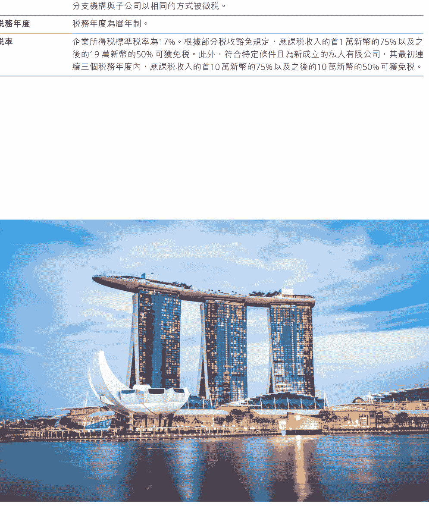

# Deloitte Private

## 其他稅種

### 資本利得稅
新加坡一般不對利得徵稅。自2024年1月1日起，除非符合特定條件（包括事實實體屬於相關集團、如非居民且在新加坡無經營聯繫，或在新加坡擁有足夠的實質行為（除了與遺產有關的）），出售或轉賣在新加坡外的房產或動產所所得的收益引入新加坡或將出售為目的的收入，將按規定所得稅稅率課稅。

### 物業稅
新加坡於每年年初對所有非住宅動產徵收物業稅。該稅包括發展、住宅、辦公室、倉庫和商店。物業稅是由物業局根據物業淨價值決定。物業稅稅率為累進制，自2024年1月起，住宅稅率從0%至22%不等。非住宅稅率為12%至36%。在特定情況下，住宅物業稅可能豁免。

### 印花稅
印花稅適用於股票、股份和不動產的轉讓。對於住宅，購買印花稅（Buyer's stamp duty）最高達6%，賣方印花稅（Seller's stamp duty）最高達22%。對於股票，購買印花稅（Buyer's stamp duty）最高達2%，賣方印花稅（Seller's stamp duty）最高達5%。在特定情況下，上市公司的印花稅可豁免。

# 資本稅 / 遺產稅

### 外匯管制
新加坡對外匯流動沒有限制。資金可以自由進入新加坡，但不對於非金融機構。

# 韓國

請注意，以下內容是根據持續更新的韓國國際稅務整理，最後更新日期為2024年1月。

## 個人稅務

### 稅收居民
個人在韓國擁有住所，並且在稅務年度內停留至少183天，則被視為稅收居民。如果因工作需要在韓國停留183天以上，其成員來到韓國且該個人在韓國擁有資產（例如房產），則通常在離開韓國時被視為稅收居民。

### 稅收基礎
稅收居民須就其全球範圍內的所得申稅。而短期居住於韓國的外人士（指在過去10年內），則僅對來自韓國的所得申稅。其他收入包括工資和薪酬、股息、利息收入、租金、營業收入、養老金以及其他收入。

### 稅率
所得採用累進稅率，稅率6%到45%（另加10%的附加稅，則為6.6%到49.5%）。

### 稅務年度
稅務年度為曆制。

## 企業稅務

### 稅收居民
一家企業的總部或有效管理地位於韓國，則被視為稅收居民。

### 稅收基礎
稅收居民對其全球範圍內的所得課稅；而非居民僅對來自韓國的所得課稅。分支機構公司以相同的方式課稅。對企業的所得徵收企業所得，根據會計準則與稅務法規的差異調整後的收入。除了個別情況外，正常營業費用可作為稅前扣除。

### 稅率(不含加稅)
首2億元的所得稅率，稅率為9%；2億元以上至200億元的所得收入，稅率為19%；200億元以上至3000億元的所得稅率，稅率為21%；超過3000億元的所得稅率，稅率為24%。

### 稅務年度
稅務年度為公司章程規定的會計年度。

# Deloitte Private

## 其他稅種

**附加稅 (Surtax)** 對企業利得稅總額收取10%。因此，2億元以上的應課稅，稅率為0.9%；2億元以上至200億元的應課稅，稅率為1.99%；200億元以上至300億元的應課稅，稅率為2.1%；超過300億元的應課稅，稅率為2.4%。

**資本利得稅** 企業的資本利得（或轉讓）通常應納稅，並涵繳企業利得。非居民獲得來源台灣的利得，其應課稅率為銷售金額的11%（包括附加稅）或已實現利得的22%（包括加稅）之低者。個人的利得是單筆課，稅率取決於產類型、持有期間。

**社會保險稅** 僱主和僱員必須向相關社會險基金繳保險金（即國家退休金、醫保險、失業保險及傷保險）。僱主繳保險金會依據僱員人數而行有所不同。

**工資稅** 公司必須從給付薪資中扣繳稅款。

**資本稅** 公司於註冊或增加資本時需要繳4%（包括附加稅）的註冊資本稅。對於註冊成立的公司，稅率為44%。

**物業稅** 公司或個人持有房產計繳物業稅。根據房產類型，稅率1%至4%不等。非住宅稅率為10%。在特定情況下，住宅稅可能豁免。

**印花稅** 印花稅適用於股票、股份的轉讓。從2024年1日至12月，上市股票的稅率為18%；非上市股票，稅率為0%。

**印花稅** 購買印花稅（Buyer's stamp duty）最高達6%，賣方印花稅（Seller's stamp duty）最高達22%。

**遺產稅/淨值稅** 無遺產稅。淨值稅最高率達50%。

**外匯管制** 雖然存在管制措施，但已逐步放寬。超過額度的外國貸款需要申報。

# 泰國

請注意，以上內容是根據泰國國際稅務概要整理，最後更新日期為2024年1月。

## 個人稅務

### 稅收居民
在泰國（當地）稅務年度內停留滿180天以上的人，被視為稅收居民。

### 稅收基礎
稅收居民及非稅收居民須繳來自泰國的所得稅。稅收居民在稅務年度內（不論哪一個稅務年度）對於外國來源的收入，與泰國來源的收入一樣，需繳納所得稅；例如受僱的福利（除免稅項外），從事貿易或服務的所得。個人所得稅率：收入500萬泰銖以上，最高稅率達35%；外籍可享受15%。

### 稅務年度
稅務年度為12個月。

## 企業稅務

### 稅收居民
在泰國境內設立註冊的公司或合資企業，被視為稅收居民。

### 課稅基礎
稅收居民對全球來源的所得課稅；非居民僅計算來自泰國的所得。居民納稅人對於外國來源的收入，與泰國來源的收入一樣，需繳納企業所得。在泰國註冊的外國分支機構或合資企業與有限公司課稅方式相同。對於分配給非居民的後續利潤，將採取10%收分支機構扣款。在泰國已構成課稅事實未在泰國完成註冊的實體，其納稅方式與有限公司相同。從事國運輸業務且在泰國有設立處的外國公司，按3%的稅率收企業所得，而不是以淨利潤計算，並且免利潤課出的所得稅。

### 稅務年度
稅務年度為12個月。

# Deloitte Private

## 其他稅種

### 資本利得稅
對企業而言，資本利得按企業課稅率，並對於資本虧損未限制。對個人而言，資本利得為課稅收入並適用於一般所得稅率。出售在泰證券交易所註冊的上市公司股票所得的資本利得，則免個人所得稅。

### 社會保險費
僱主與員工按月繳納薪資每月5%社會保險費，但供款金額不多於每月的限定。依照經濟狀況，相關費比例可能會調低。

# 工稅
僱主從僱員的薪資中扣稅，並按月向機關繳。

### 印花稅
無印花稅，在註冊時需要支付註冊費。

### 物業稅
《土地與建築稅》依照土地的性質適用不同的進稅率。最高稅率取決於土地/建築物的類型和其評估價值：
- 對於用途的土地，土地價值不值超過7,500萬泰銖進稅率0.001%，到土地價值超過10億泰銖須課稅率0.1%。
- 對於住宅用途的土地，土地價值不值超過5,000萬泰銖進稅率0.002%，到土地價值超過10億泰銖須課稅率0.1%。
- 對於商業用途的土地，土地價值不值超過5,000萬泰銖進稅率0.3%，到土地價值超過50億泰銖須課稅率0.7%。
- 荒地（指已閒置未被質使用的土地）的進稅率0.3%至3%以下（未被使用的土地）。在特定情況下，住宅物業可豁免。

# 轉稅
特定資產轉讓。若為公司，則須繳2%扣稅；若為個人，則按當地所得稅率收。

### 印花稅
印花稅適用於特定種類的文件，稅率不同。例如：租約、股票/債權等，稅率也為0.5%。

# 遺產稅/淨值稅
無遺產稅。淨值稅最高率達50%。

### 外匯管制
雖然存在管制，但已逐步放寬。超過額度的外國貸款需要申報。

# 英國

請注意，以下內容是根據英國國際稅務整理，最後更新日期為2024年1月。

## 個人稅務

### 稅收居民
英國居民身份是基於法定居民測試（Statutory Residence Test）與英國其他地區密切聯繫。居留（Domicile）是兩個不同的概念。個人的居留狀態可能由其居籍決定。在過去20個稅年度內至少15年的人，被視為英國居民。英國出生、有英國籍並且為居留的個人，被視為英國居民（即使在此期間已在國境外）。

### 課稅基礎
擁有英國籍且是英國居民的個人，其全球收益須繳英國稅。對於不擁有英國居留的英國稅，對於不擁有英國居留個人，其收入可申請外國稅免。根據法定居民身份，認定為英國居民且擁有英國籍的個人，就需要其全球收入繳納英國稅。對於過去六個稅年度中有七年住在英國的納稅人，繳稅申請人可以採用外英國免。一旦過去十四個稅年度中有十二年住在英國，該額外承擔稅負將上升到60,000英鎊。如果未經回英國收入與資本利得低於2,000英鎊，或符合其他條件，則無需適用稅制。

### 稅率
個人所得按累積繳稅率。

### 稅務年度
稅務年度為2024年46日至2025年5日。

# Deloitte.

## 企業稅務

### 稅收居民
如果一家公司是在英國註冊，或者其中央管理和控制地於英國，該公司即可為英國居民公司。

### 課稅基礎
英國居民必須就其全球收益繳納企業所得稅，並扣除已扣抵的外國所得稅。非居民公司僅來自國利潤繳納25%的企業所得稅或英國所得稅(20%)。其中包括非居民在英國內設置機構的、來自當地相關業務的收入和收益、某些英國來源的利潤收益和持有費用，以及用於任何設置機構貿易目的的資產。分機構稅收方式基本與其公司相同。

### 稅率
對於利超過250,000英鎊的公司，企業所得稅的主稅率為25%。對於利潤在50,000英鎊或以下的英國公司，適用19%的利得稅率。對於利潤於50,000英鎊至250,000英鎊的英國居民公司，按25%的主稅率並豁免。對於會計期間少於12個月的英國居民公司，50,000英鎊至250,000英鎊的門檻也會隨遞減比例，並要考慮公司的數量。

利潤超過1億英鎊的銀行及其集團公司，需要額外徵收3%的附加稅。當英國公司利用利潤為安排利潤移至境外以規避英國稅，將適用稅率為31%的轉移利稅。利潤超過集團年度稅免限為2,500萬英鎊的英國，按4%徵收。

### 稅務年度
公司稅務年度是基準的會計期間。

## 其他稅種

### 資本利得稅
對於企業而言，資本利得按企業課稅率，並對於資本虧損未限制。對個人而言，資本利得為課稅收入並適用於一般所得稅率。出售在泰證券交易所註冊的上市公司股票所得的資本利得，則免個人所得稅。

### 社會保險費
僱主和員工必須向相關社會險基金繳保險金（即國家退休金、醫保險、失業保險及傷保險）。僱主繳保險金會依據僱員人數而行有所不同。

# 工稅
僱主從僱員的薪資中扣稅，並按月向機關繳。

### 印花稅
無印花稅，在註冊時需要支付註冊費。

### 資本稅
公司於註冊或增加資本時需要繳4%（包括附加稅）的註冊資本稅。對於註冊成立的公司，稅率為44%。

### 物業稅
《土地與建築稅》依照土地的性質適用不同的進稅率。最高稅率取決於土地/建築物的類型和其評估價值：
- 對於用途的土地，土地價值不值超過7,500萬泰銖進稅率0.001%，到土地價值超過10億泰銖須課稅率0.1%。
- 對於住宅用途的土地，土地價值不值超過5,000萬泰銖進稅率0.002%，到土地價值超過10億泰銖須課稅率0.1%。
- 對於商業用途的土地，土地價值不值超過5,000萬泰銖進稅率0.3%，到土地價值超過50億泰銖須課稅率0.7%。
- 荒地（指已閒置未被質使用的土地）的進稅率0.3%至3%以下（未被使用的土地）。在特定情況下，住宅物業可豁免。

# 轉稅
特定資產轉讓。若為公司，則須繳2%扣稅；若為個人，則按當地所得稅率收。

### 印花稅
印花稅適用於特定種類的文件，稅率不同。例如：租約、股票/債權等，稅率也為0.5%。

# 遺產稅/淨值稅
無遺產稅。淨值稅最高率達50%。

### 外匯管制
雖然存在管制，但已逐步放寬。超過額度的外國貸款需要申報。

##美國

請注意，以下內容是根據美國的國際稅務規定整理，最後更新日期為2024年1月。

## 個人稅務

### 稅居民

以永久居民身份進入美國，且未正式放棄或失去其永久居留的外籍人士，將被視為稅收居民。透過「實際居住測試」（Substantial Presence Test）的個人要求在一年內於美國暫停停留180天以上，或在一個年度內至少停留31天，且包含涵年度在內的3年內按天比例計算之累計居住天數180天以上（當年度增加比例相同或為二分之一，前一年度增加比例為二分之一以上）。

### 課稅基礎

所有美國公民和稅務居民，包括外籍居民及於美國之外的個人，其就需要對其全球所得課稅連結。非居民僅受美國源所得（另註稅收限制範圍）影響（Effective Connected Income, ECI），對於非居民，或於美國之外長期稅務居民放棄美國或居留之時，還可能適用於稅務規定。美國各州和紐約州亦視居民為及居住的個人所得。此，如果美國公民和稅務居民有足夠美國外的所得，則產生相反的課稅優惠。

### 稅率

累進稅率高到37%；依2023年度規定，若納稅人的年度收入超過578,500美元，或合併申報的婚姻收入超過693,500美元，則適用於其超過的部分稅率為37%。

一般而言，個人必須申報任何來源的所得（其價值），利息、股利、出售服務所得（所有形式的薪金、佣金、財產權、資本交易，以及來自合作公司、有限公司、遺產或信託的收益）。非美國的外籍人士在計算稅所得時將排除之，但如果收入來自美國且非屬銷售轉換所得時，也需要對該部分所得的金額繳稅，一般是在收入時預扣。

除了所得稅外，個人的一個暫定最低稅率超過其他所得稅率，可能需要繳納最低稅率（Alternative Minimum Tax）。最低稅率的稅率對於達到特定水平的所得稅額差分（最低稅負額減去至「免稅額」的後）為26%，對於超過此類水平的所得稅額差分為28%。在塞亥門框架之下，針對2023年度最低稅率的免稅額，合併申報的稅人為126,500美元，未婚稅人為81,300美元，之後將根據連動規則進行調整。

### 稅務年度

稅務年度為曆年度，除非選擇財政年度。

## 企業稅務

### 收稅居民

如果一家企業（或合夥企業）是在美國境內設立，或根據美國50州或波波哥特區的法律所設立，不論該企業（或合夥企業）的管理與控制權，在聯邦所得法的角度下，該企業被視為國內企業。在某些情況下，外國企業通過特定業務，直接或間接與國內企業直接或間接持有的全部財產（或構成國內貿易業務實質上的全部財產）（即「留置」），該外國企業可能被視為國內企業，並須用聯邦所得稅規定。外國企業可能在其他情況下被視為國內企業（例如，根據《國內稅收法》(IRC)第53 (d)節的規定進行選選）。

### 課稅基礎

輸入來源，國內企業對其主要收入徵收聯邦所得稅。此外，特定規定允許國內企業就其擁有的海外企業所得進行課稅。

輸入來源地（非適用所得的免稅或豁免），國內企業須據所有收入（例如營業收入、服務收入、股息、利息、特許權使用費、租金、費用所得、財產交易收益以及其他營業收入），扣除允許的折舊、損失後按特定項目課稅。

### 稅率

企業所得稅率為21%。其他類型的收入可以按較低的所得稅率課稅。例如，由於國內公司允許適用其外無形資產的所得之37.5%的扣除額，實際上所得稅率可能低至13.25%。某些企業可能還需要繳納最低稅，而對於某稅務年度內支付過多的企業，可能需要計算替代稅。

### 稅務年度

公司可以採用任何一個月的最後一天的財政年度作為其稅務年度。

## 其他稅種

### 資本利得

對於人們而言，長期利得（通常是指持有超過一年的資產的收益），按最高20%的稅率。收入超過250,000美元已報稅人以及收入超過200,000美元未報稅人，則包含資本利得在內的收入繳8%的稅。對於企業，可以從資本利得（例如對於其擁有的資產）與普通收入以相同的稅率。在某些情況下，資產的銷售或交易所產生的利得可以課稅。資本利得通常不需要稅，除非是從美國業務相關獲取的收益。

### 資本轉稅

無資本稅。轉稅由州/地方政府課稅。

### 遺產/贈稅

對於美國公民和居民，美國實施遺產稅和贈稅。以2024年而言，通常按照稅率或超過13,610,000美元免稅額。在繼承情況下，繼承人不需要對其資產價值繳納稅，但在某些情況下，如果遺產價值超過60,000美元就可以課稅。對於非公民和居民，遺產價值位於美國且超過60,000美元的就可以課稅。在遺產期內徵取的贈稅，以及超過18,000美元每年未實現收益允許特定限制。遺產稅和贈稅的最高稅率是40%。作為遺產稅的一部分，聯邦政府對特定轉讓課遺產稅。各州亦課不同的遺產稅或繼承稅。

### 印花稅

聯邦政府不收印花稅。州/地方政府對於特定文件收印花稅。印花稅也可能適用於酒精和菸等項目。

### 物業稅

物業通常由地方政府按不同的稅率課稅。

### 淨利得稅/價值稅

無淨利得稅/價值稅。

### 外匯監管

雖然對股息、股利、利息、特許使用費的支出或付給居民的費用並沒有限制，但是對於列入指定國家的國家確實實施的禁令和管制措施，包括對外付款、匯款以及其他類型的合同和貿易交易存在限制。根據法規美國財政部制定，財政部對於外國資產管制措施負責遵循相關名單。進行巨額交易時，須申報和保存交易紀錄。

# Deloitte Private

大中華高淨值人士財富與保險規劃報告

## 附錄3：调研參與者概況

# Deloitte Private

### 性別
- 女：44%
- 男：50%

### 年齡範圍
- 不透露：6%
- 61歲或以上：16%
- 20-30歲：2%
- 51-60歲：22%
- 31-40歲：30%
- 41-50歲：30%

### 主要居住地
- 中國內地
- 香港特別行政區
- 澳門特別行政區
- 中國臺灣
- 其他: 加拿大、美國、澳洲、馬里岡斯

### 職業分佈
- 公司高層（如管理層）
- 專業人士（如醫生、律師、會計師、專業金融顧問或技術人員等）
- 企業家
- 投資者（房產或股票等）
- 退休人士
- 其他

### 年收入範圍（包括投資收入）（港元）
- 100萬以下：4%
- 100萬-500萬以下：16%
- 500萬-1000萬以下：16%
- 1000萬-1億以下：31%
- 1億-5億以下：32%
- 5億以上：49%

### 資產淨值範圍（港元）
- 100萬以下：51%
- 100萬-500萬以下：49%
- 500萬-1000萬以下：4%
- 1000萬-1億以下：1%
- 1億以上：1%

### 婚姻狀態
- 單身：17%
- 已婚：74%
- 離婚：5%

### 企業概況

### 行業
- 製造業
- 服務業
- 科技行業
- 醫療行業
- 基金
- 貿易
- 房產
- 餐飲

### 企業規模
- 中小型企業(1-2000人)
- 大型企業(2000人或以上)
- 本地(中國/香港)

## 附錄4：鳴謝

我們在此《中華高淨值人士財富與保險規劃》的合夥人、總監、經理、客戶高管，以及幕後貢獻團隊等成員致謝（排名不分後）：

| 劉明揚 | 黃頌欣 | 夢文傑 | 莊瑋玲 |
| 白振昌 | 呂喲 | 陳煥儀 | 黃世顯 |
| 伍嘉豪 | 丘美兼 | 潘情婷 | 羅健潔 | 
| 王玉媛 | 周凱凱 | 張家銘 | 黃寶玥 |

全體內人員：
- 稅務與商業諮詢
- 業務與運營管理
- 品牌、傳播與市場部
- 全國稅務技術中心

全體內人員：
- 私人客戶財富合規劃
- 個人財產產品發展
- 法律及規管部

## 聯繫我們

宏利人壽險（國際）有限公司
德勤中國華南區主管合夥
於香港成立之有限公司
電話：+852 2852 1266
香港龍觀塘保街223-231 宏利金融中心22樓
郵件：edwau@deloitte.com
電話：(852) 2510 3383
網址：www.manulife.com

劉明輝
德勤中國國民企業與私人客戶服務香港主管合夥
國際稅收主管合夥人
電話：+852 2852 1082
郵件：antlau@deloitte.com

黃婉欣
德勤中國保險業主管合夥
電話：+852 2852 6724
郵件：joawong@deloitte.com

白振富
德勤中國私人客戶財富服務總監
電話：+852 2740 8618
郵件：kpeh@deloitte.com

# Deloitte Private

## Manulife Zebra

**顧問服務**
從中國到中國，我們是領先的綜合服務機構，由德勤的中國團隊提供服務，業務涵蓋改變與建議建設。我們的辦公室遍布31個城市，擁有超過2萬專業人士為客戶提供諮詢、稅務等一切的專業服務。

我們致力：嚴謹、勇當，以卓越的專業能力、行業經驗和我們的技術解決複雜問題，協助我們的客戶在多變的環境中取得先機，在面對未來的挑戰中成長、實現價值。

德勤從於1845年成立，於1978年成立德勤（會計、諮詢、管理諮詢）。我們致力：全球卓越的專業人士分佈150個國家和地區服務，我們不於成為各個領域的領先者，不斷提升，為客戶創造前所未有的價值。

Deloitte Private（德勤私人服務）是一項為我們的富 de人士提供的服務。我們致力協助客戶的財產規劃、市場策略的開發、法律及規管部。

## 宏利保險

宏利人險（國際）有限公司
德勤中國華南區主管合夥
於香港成立之有限公司
電話：+852 2852 1266
香港龍觀塘保街223-231 宏利金融中心22樓
郵件：edwau@deloitte.com
電話：8852) 2510 3383
網址：www.manulife.com
