# 2025年宠物行业消费趋势洞察

2025年3月

MobTech研究院&库润数据联合出品

特别感谢：魔镜洞察

## # Contents

- 01 宠物消费市场现状概览
- 02 养宠人群基础画像
- 03 养宠人群消费偏好
- 04 宠物消费趋势分析

## 01 Part one

## 宠物消费市场现状概览

### 市场规模：稳中好，2024年城镇（犬猫）消费市场规模突破3000亿

2024年城镇（犬猫）消费市场规模增长7.5%，达到3002亿元。其中，犬消费市场规模达到1557亿元，小幅增长4.6%；猫消费市场规模达到1445亿元，增长10.7%。

#### 2020-2024年中国宠物（犬猫）消费市场整体规模

#### 城镇宠物（犬猫）同比增长幅

| | 猫消费金额（亿元） | 狗消费金额（亿元） | 总体（亿元） |
| :--- | :--- | :--- | :--- |

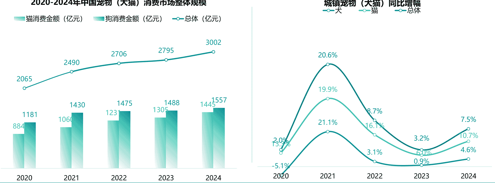

Source:《2025年中国宠物行业白皮书》派读宠业，MobTech研究院整理绘制

### 宠物数量：2024年城镇宠物猫数量持续回升，宠物猫更受青睐

2024年，宠物数量为12411万只，较2023年增长2.1%。其中，宠物犬数量为5258万，较2023年增长1.6%，宠物猫数量为7153万只，较2023年增长2.5%。

#### 中国宠物消费市场规模（犬猫）数量

#### 2020-2025年中国宠物（犬猫）数量

#### 2024年中国宠物（犬猫）占比

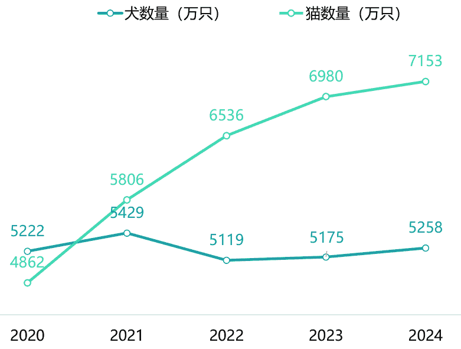

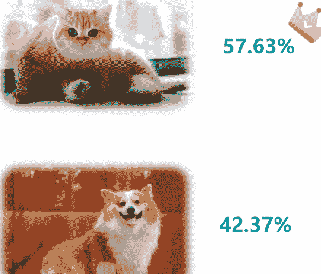

Source：《2025年中国宠物行业白皮书》派读宠业，MobTech研究院整理绘制

### 行业渗透：宠物行业渗透率远低于海外，未来潜在空间有望进一步释放

2023年国内宠物家庭渗透率约为17.8%，预计2026年将达到19.4%；中国宠物猫犬家庭渗透率相比美国、日本等发达国家相比存在较大差距，未来潜在空间巨大。

#### 2021-2026年（预测）中国宠物猫犬家庭渗透率

- 宠物猫家庭渗透率
- 宠物狗家庭渗透率
- 日本水平
- 美国水平

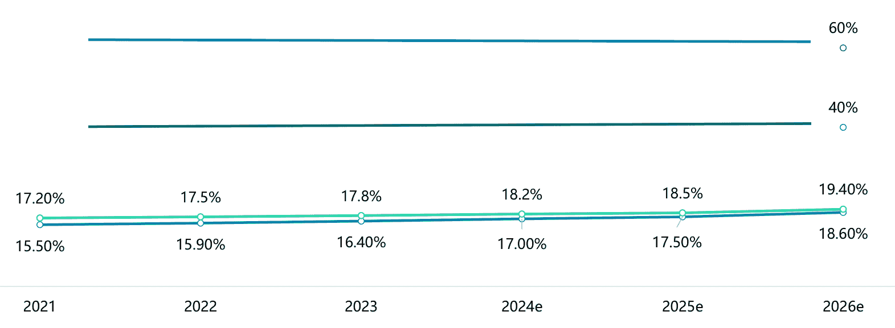

Source: 公资料，中国统计年鉴，国家统计局，艾瑞咨询，MobTech研究院整理绘制

### 资本表现：一级市场进入寒冬，二级市场头部企业表现亮

2023年经营范围包含“宠物”的新增企业数量190家，由于2021年宠物融资出现“寒冬”，融资数量大幅下滑；宠物经济指数稳大盘，宠物经济指数分主收入持续走高。

#### 2019-2023年宠物企业新增以及宠物行业融资事件数量

#### 2019-2023年沪深300指数与Wind宠物指数季度态势
（%）及宠物经济指数分主收入收入（亿元）

#### 2019-2023年经营范围包含“宠物”的新增企业数量及增速
- 增速 190.1
- 分主收入收入
- wind宠物经济指数季度态势
- 沪深300指数季度态势

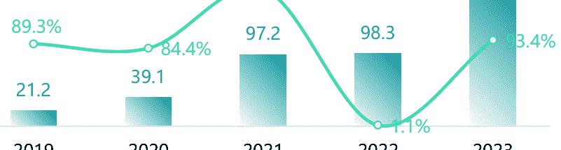

#### 2019-2023年宠物行业的融资事件及增速
- 增速 25.5%

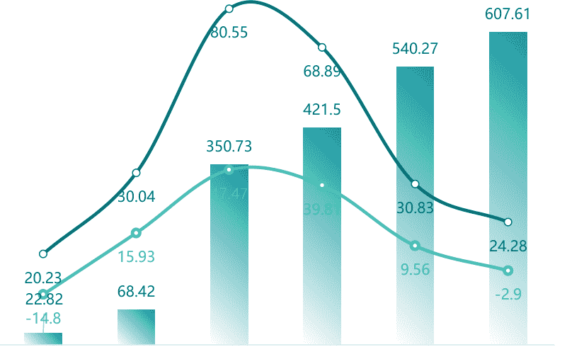

Source: 公资料，中国统计鉴，国家统计局，艾瑞咨询，MobTech研究院整理

### 消费结构：宠物市场结构稳定，细分市场波动

主粮、营养品、寄养、保险呈现上涨趋势；零食、用品、药品、疫苗、洗澡轻微下降；体检、训练表现平稳。

#### 中国宠物（犬猫）消费结构（%）

| | 主粮 | 零食 | 营养品 | 用品 | 药品 | 疫苗 | 体检 | 洗澡 | 训练 | 寄养 | 保险 |
| :--- | :--- | :--- | :--- | :--- | :--- | :--- | :--- | :--- | :--- | :--- | :--- |
| 2023 | 35.5 | 35.7 | 13.6 | 3.4 | 9.8 | 9.7 | 2.6 | 2.6 | 3.2 | 0.7 | 0.7 |
| 2024 | 35.7 | 13.6 | 12.5 | 2.4 | 2.6 | 2.5 | 3.2 | 4.7 | 0.7 | 0.8 | 0.9 |

Source：《2025年中国宠物行业白皮书》派读宠业，MobTech研究院整理

## 02 Part two

## 养宠人群画像

### 女性宠物主占比高，高学历，较高收入的年轻白领

女性养宠群体占比60.5%，宠物主六成以上为0后，本科及以上占比67.8%；企业占比最多，其次为医生、教师等专业人士；宠物主整体收入较高，具有一定能力。

#### 养宠人群性别分布
- 女：60.5%
- 男：39.5%

#### 养宠人群学历分布
- 高中及以下：59.7%
- 专科：26.6%
- 本科：8.1%
- 硕士及以上：5.6%

#### 养宠人群收入分布
- <5k：38.7%
- 5-10k：26.4%
- 10-20k：30.3%
- 20-30k：3.5%
- >30k：1.1%

#### 养宠人群年龄分布
- 18-24岁：55.7%
- 25-35岁：61.7%
- 36-45岁：14.3%
- 46岁以上：20.8%

#### 养宠人群职业分布
- 公务员：3.2%
- 专业人士：5.8%
- 企业员：13.7%
- 个体经营户：7.1%
- 自由职业者：12.2%
- 其他：5.5%

Source: KuRunData数据，2024.08, MobTech研究院整理绘制

### 六成宠物主宠龄2年以上，小宠市场迎来新机

六成宠物主的养宠时长在两年以上；对比2022年，养猫人群反养狗人群，异宠市场（鸟类、冷血类、水族类）呈上升态势。

#### 养宠人群养宠时长

#### 养宠人群偏养宠物类型

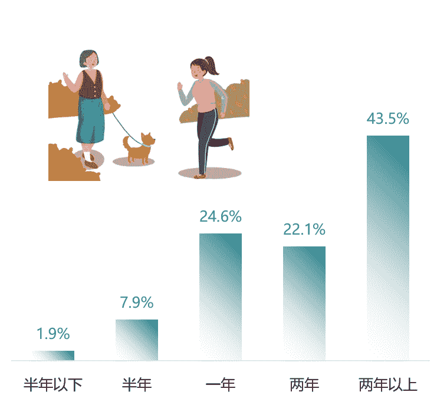

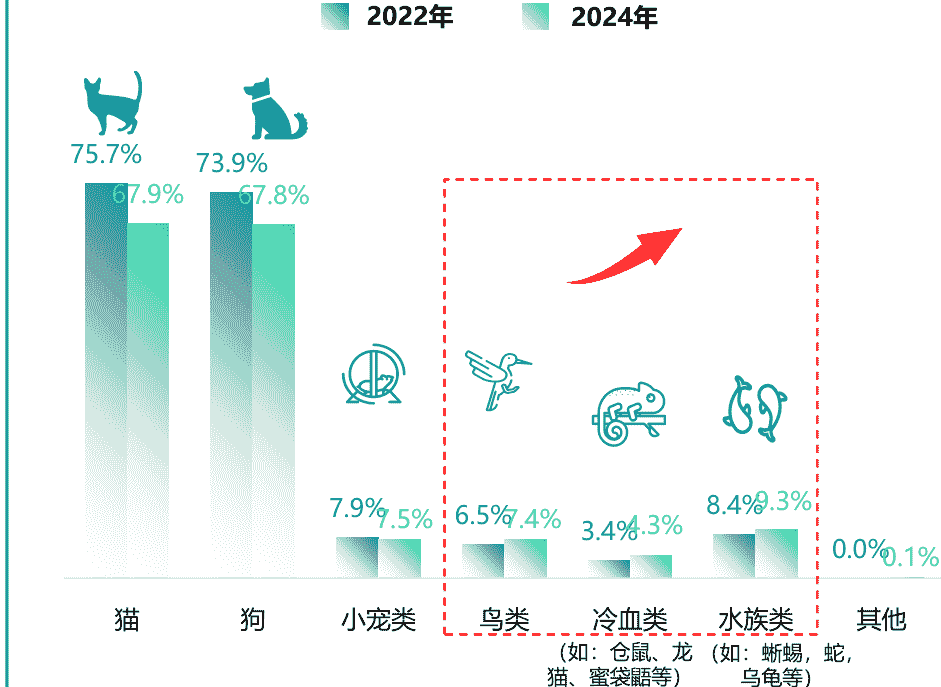

Source: KuRunData数据，2024.08，MobTech研究院整理绘制

### 京沪粤成为养宠大本营，北京人最爱“铲屎”

在养宠人群区域分布中，三线城市占比最高，超30%，一线和二线城市占比接近；北京、河北、上海位列铲屎分布Top3省。

#### 养宠人群城市线级分布

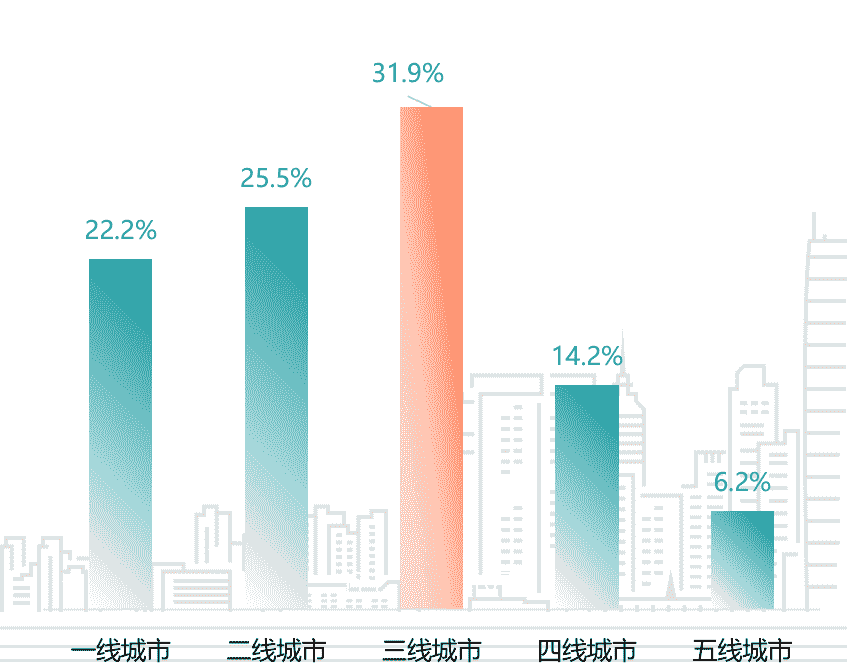

#### 养宠人群省份/城市排名

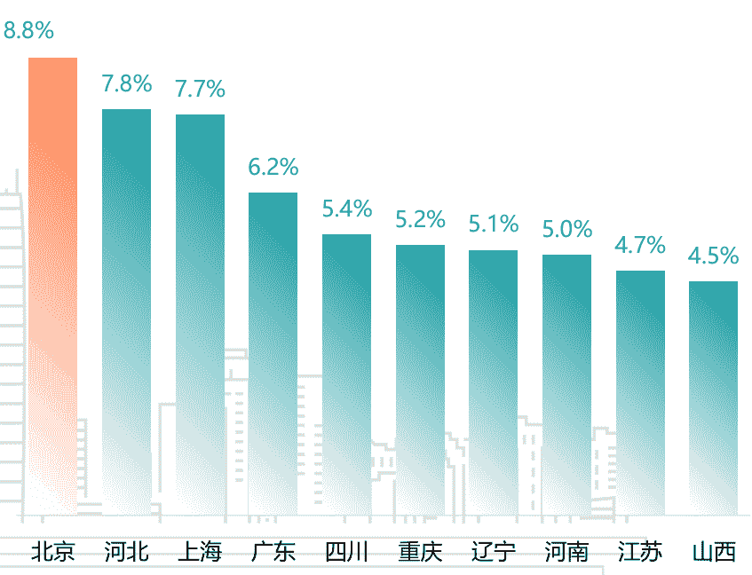

Source: KuRun数据库数据，2024.08，MobTech研究院整理绘制

### 养宠打一个“陪伴”，但真的费钱又费力

“陪伴”是宠物主们最大的诉求，爱宠成为他们工作及生活压力下治愈身心的良药；打扫卫生和医疗费用高昂成为了养宠的负担。

#### 养宠人群主要诉求
- 个人陪伴
- 责任
- 培养兴趣
- 缓解压力

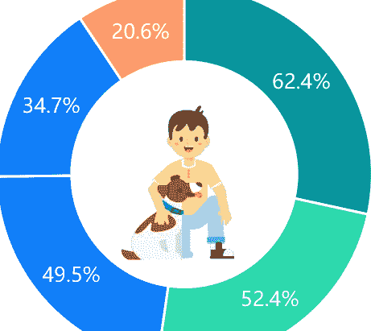

#### 养宠人群主要痛点
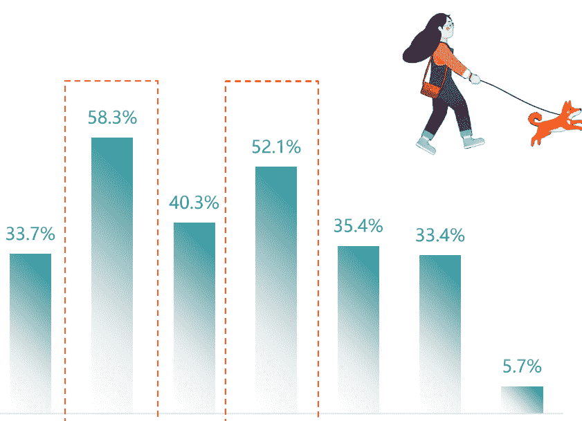

Source: KuRunData数据，2024.08，MobTech研究院绘制

### 养宠遇到困难？短视频和社交媒体寻找答案

短视频平台和社交媒体快速发展，当遇到养宠问题时，宠物主倾向通过小红书和抖音、传统的宠物医生等渠道占比下降。

#### 养宠人群痛点变化

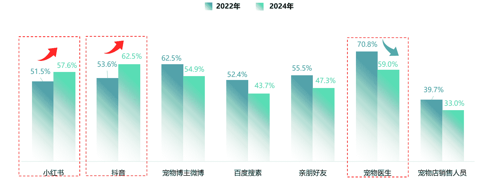

Source: KuRunData数据，2024.08，MobTech研究院绘制

## 03 Part three

## 养宠人群消费偏好

### 花费情况：宠物主高消费比例下降

与2022年相比，宠物主单只宠物平均花费中500元以上高端消费占比上升；除了宠物口粮这一绝对刚需，医疗花费领先。

#### 单只宠物月花费变化

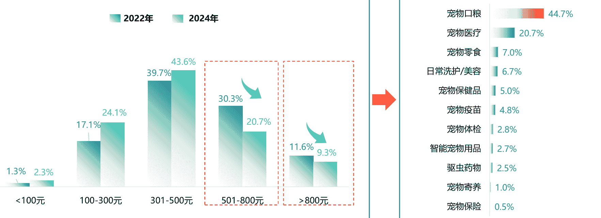

Source: KuRunData数据，2024.08，MobTech研究院整理绘制

### 渠道偏好：线上买口粮零食，线下看疫苗美容

除了宠物口粮、零食外，宠物主也习惯线上选购驱虫药物；宠物医疗、日常洗护/美容等类别，线下渠道有绝对优势。

#### 养宠人群线上购买品类

| 宠物口粮 | 宠物零食 | 驱虫药物 | 宠物娱乐/玩具 | 日常洗护/美容 | 宠物保健品 | 宠物疫苗 | 智能宠物用品 | 宠物医疗 | 宠物体检 | 宠物保险 | 宠物养犬 |
| :--- | :--- | :--- | :--- | :--- | :--- | :--- | :--- | :--- | :--- | :--- | :--- |
| 83.9% | 73.6% | 53.7% | 49.4% | 41.8% | 39.2% | 32.3% | 27.9% | 26.7% | 21.3% | 16.5% | 12.2% |

#### 养宠人群线下购买品类

| 宠物医疗 | 宠物疫苗 | 日常洗护/美容 | 宠物口粮 | 宠物体检 | 宠物零食 | 驱虫药物 | 宠物保健品 | 宠物寄养 | 宠物娱乐/玩具 | 智能宠物用品 | 宠物保险 |
| :--- | :--- | :--- | :--- | :--- | :--- | :--- | :--- | :--- | :--- | :--- | :--- |
| 48.0% | 46.2% | 44.0% | 42.5% | 40.3% | 38.9% | 38.8% | 28.6% | 23.3% | 22.2% | 17.1% | 14.1% |

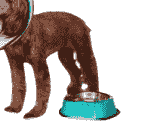

Source: KuRunData数据，2024.08，MobTech研究院绘制

### 宠物食品：国产宠物口粮实现超车，这届家长给毛孩子买保健品

相比2022年，选择国产宠物口粮的宠物占比大幅提升，近六成。其中，五谷天然粮和主食罐头得到更多宠物主偏爱；益生菌、维生素类以及钙片类是最受欢迎的宠物保健品。

#### 宠物口粮消费偏

#### 进口/国产选择

| | 2022 | 2024 |
| :--- | :--- | :--- |
| 无所谓 | 37.7% | 23.3% |
| 进口 | 24.6% | 39.0% |
| 国产 | 17.7% | 57.7% |

#### 国产口粮选择
- 五谷天然粮
- 主食罐头
- 益生菌
- 维生素类
- 钙片类
- 免疫蛋白
- 冻干粮

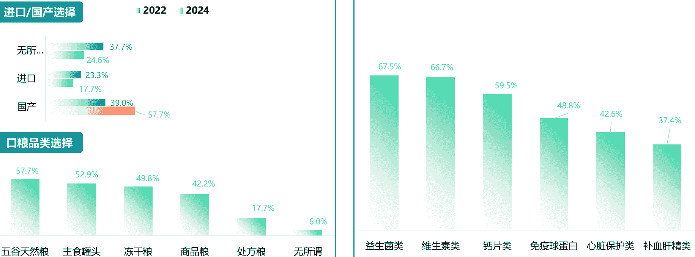

Source: KuRunData数据，2024.08，MobTech研究院绘制

### 宠物服务：托运减少，价格敏感人群占比上升

对比2022年，选择托运的宠物主进一步减少；其中选择空运车和火车占比上升；除了担心情绪、排泄及温度控制等问题，费用较高占比显著。

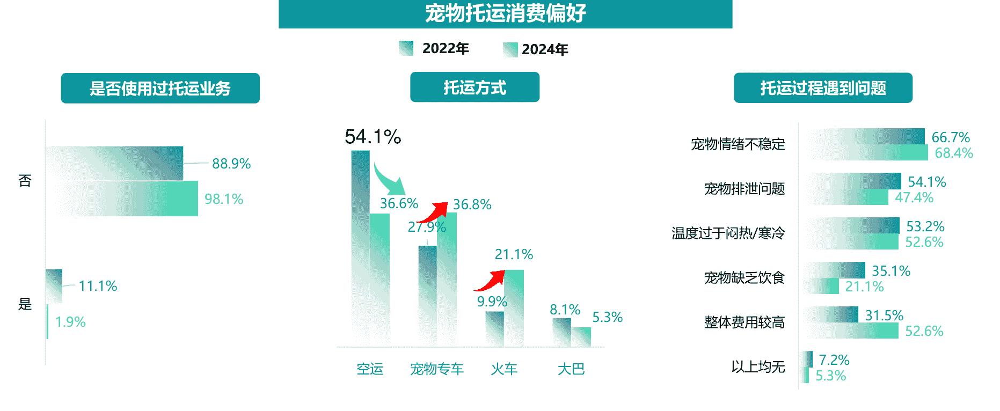

Source: KuRunData数据，2024.08，MobTech研究院绘制

### 宠物服务：保险渗透率低，宠物主导向大

和2022年相比，选择宠物保险的宠物主小幅下降；太平洋保险是宠物主优先选择的平台，500-1000消费区间最高。

| 是否购买保险 | 2022年 | 2024年 | 单只保险费用（元） |
| :--- | :--- | :--- | :--- |
| 平安财险 | 36.1% | 35.4% | >2000: 5.4% / 8.2% |
| 太平洋保险 | 31.1% | 24.7% | 1501-2000: 8.8% / 9.1% |
| 阳光保险 | 10.5% | 10.7% | 1001-1500: 26.7% / 23.0% |
| 众安保险 | 8.4% | 9.5% | 500-1000: 41.2% / 45.7% |
| 大地保险 | 5.1% | 7.4% | <500: 17.9% / 14.0% |
| 太平洋科技 | 5.1% | 9.1% | | |
| 人保财险 | 3.4% | 2.9% | | |

Source: KuRunData数据，2024.08，MobTech研究院绘制

### 宠物服务：认真规划“那一天”，让宠物永远“陪伴”在身边

对于将会离开自己的可爱，选择自行处理和交由专业葬仪处理的宠物主占比上升；在选择医院代为的宠物中，近七成宠物会选择回骨灰。

#### 宠物葬仪形式选择

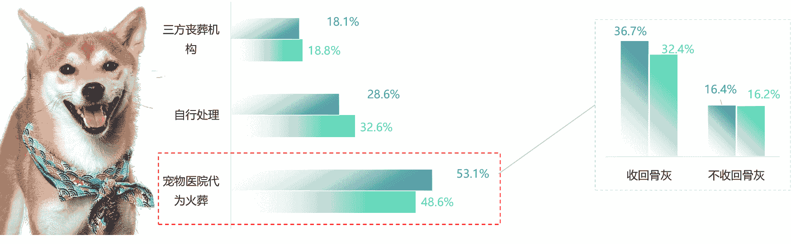

## 04 Part four

## 消费趋势分析

### 宠物主粮：科学养宠观念引导，功能类宠物主粮市场增长显著

在全价狗主粮中，关节保护、体重控制等功能类主粮增速较快；在全价猫主粮中，调肠胃、益肾/泌尿道保健市场潜力较大。

#### 宠物主粮消费趋势

#### 2023-2024全价狗主粮销售增速及占占比增幅

Source: 魔猿数据（2024.08，MobTech研究院

### 宠物医疗：宠物健康意识更强，300-800单次平均花费占多数

相比2022年，宠物主选择给宠物体检的频率整体增加，选择一年两次为宠物体检的占比大幅上升；单次体检费300-500元最多。

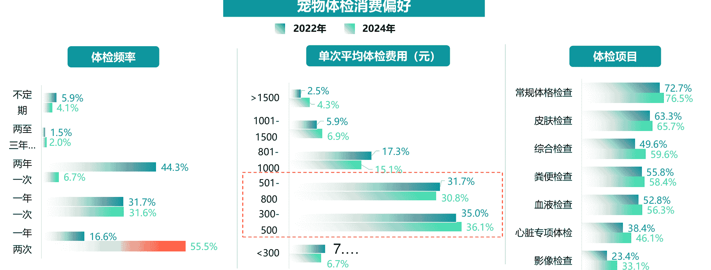

### 宠物医疗：方便、无时间和空间限制，超六成主人进行在线问诊

超过六成宠物主都经历过为宠物线上问诊的经历，忙碌的工作和生活下，线上问诊的便捷性，可以随时随地满足上班族的养宠问诊需求。

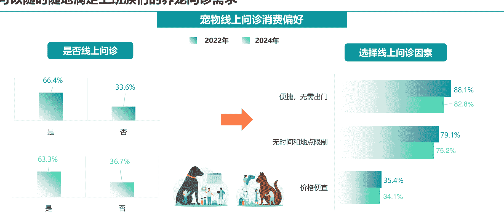

## 宠物服务：在线问诊、宠物摄影等众化服务或成为蓝海赛道

宠物在线问诊和宠物摄影服务销售量和销售额增长较快，整体市场份额较小，仍处机会市场阶段

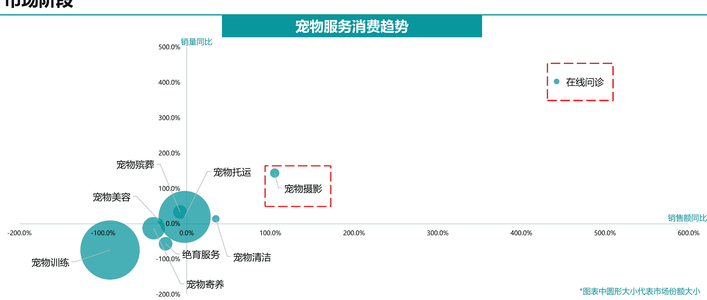

Source: 魔镜数据（数据时间：2023.01-12、2023.04-12），MobTech研究院整理 own

## 特别鸣谢

作为AI赋能的零售洞察公司，从2012年起，魔镜洞察核心团队就开始为品牌提供市场和消费者洞察服务。十年来，魔镜洞察一直利用机器学习和算法，帮助品牌从海量的市场信息中提取增长的、有投资价值的新机会。魔镜洞察的研究涵盖了整个线上零售市场的各个细分行业和海量消费品牌。

通过saas系统和行业市场洞察，魔镜洞察服务于500+中国品牌，见证他们从成长到成熟。

## 报告说明

1. 数据来源

本报告数据基于市场公开信息，MobTech自有数据，以及MobTech研究模型估算等来源。

2. 数据周期及指标说明

报告整体时间段：2023.01-2024.12

具体数据指标请参考各页标注

3. 版权声明

本报告为Mob研究院制作，报告中所有的文字、图片、表格均受有关商标和著作权的法律保护，部分文字和数据来源于公开信息，所有权为原作者所有。没有经过本公司新媒体许可，任何组织和个人不得以任何形式复制或传递。任何未经授权使用本报告的相关行为都将违反《中华人民共和国著作权法》和其他法律法规以及有关国际的规定。

4. 免责条款

本报告行业数据及市场预测为分析师采用桌面研究、行业访谈及其他研究方法，并且MobTech监测产品数据，通过统计预测估算获得，仅供参考。受研究方法和数据获取资源的限制，本报告只提供给用户作为市场参考资料，本公司对该报告的数据和观点不承担法律责任。任何机构或个人援引或基于上述信息所取的任何行动所造成的法律后果均与MobTech无关，由此引发的相关争议或法律责任均由行为承担。

## MobTech研究院

全球领先的数据智能科技平台

## 库湖数据
a toluna company

随时随地链接消费者

| 项目 | 联系方式 |  |
| :--- | :--- | :--- |
| 研究报告合作 | 18516649078 | marketing@mob.com |
| 研究报告合作 | 400-021-8081 | mkt@kurundata.com |

## 扫码加入 知识星球TOP 免费资源群

公众号: 知识星球TOP

免费

- ✓ 每日免费获取高价值资源
- ✓ 可提供各类资源搜索服务

微信号: jntsg8

价值

热门付费文章

各行各业报告

精选图书资源

副业赚钱方法

微信号: jntsg2

及时

职场实用资源

AI经营自媒体

专注

分享资料仅供个人学习，请及时删除，切勿商用传播