# 2025 家居生活方式消费趋势报告

优居视界

## 免费 价值 及时 专注
## 扫码加入 知识星球TOP 免费资源群

- 每日免费获取价值资源
- 可提供各类资源搜索服务

| ◆热门付费文章 | ◆各行行业报告 |
| ◆精选图书资源 | ◆副业兼职方法 |
| ◆职场实用资源 | ◆AI与智能自媒体体 |

公众号：知识星球TOP 微信公众号：jntsg8 微信信号：jntsg2

分享资料仅供个人学习，请及时删除，切勿商用传播

## Home Lifestyle
## 家居生活方式消费趋势报告

## 目录 CATALOGUE

## 01 前言
### 宏观经济环境和行业市场洞察
- 0.1 2024年我国GDP突破134万亿，总体稳中有进
- 0.2 城镇化稳步提高，旧改和改善型需求将进一步释放
- 0.3 家居行业市场将破5万亿，生活方式影响消费决策
- 0.4 国民对内消费再升级，重塑新时代的居住体验

## 02 居家方式消费洞察
- 0.1 消费者决策更理智，追求“质价平衡”时代
- 0.2 向内寻找，“限时制”带来疗愈体验和松弛感
- 0.3 为“情绪价值”成为年轻人消费趋势TOP1
- 0.4 “赛博空间”，智能休闲家居高适配代表一代
- 0.5 能量块和健康需求受追求，家居环境改造需求大
- 0.6 线下消费快速回潮，家居场景体验无可替代

## 04 新消费趋势下的逻辑与思考
- 0.1 内观且理性的消费使家居回归本真生活
- 0.2 健康、智能化需求与家居空间的深度融合
- 0.3 深度体验将重构家居零售的场景打造

## 01 前言

当前，中国家居消费市场正经历一场春静细流的价值重构，在宏观经济换挡与消费代际更迭的双重作用下，家居主力消费群体呈现出前所未有的理性自觉与价值觉醒。

这个拥有14亿人口的巨大市场，正在从规模扩张的“量变”转向价值深化的“质变”，人们不再仅仅渴望生活品质的进阶，致力于个人的精神升华，因此不断探索。

为了抓住这波消费变革的机遇，中国家居企业将回归消费本真、回归经营本质和商业常识，从消费者真实需求出发，踏实地做好产品服务，做一个坚定长期主义者，助推中国家居产业迈向新时代。

在此背景下，优居视界启动“2025家居生活方式消费调研”，依托于优居视界大数据及线下潮流的实地调研，开展全方位的数据采集，结合行业洞察，利用定量和定性分析相结合的方法，形成真实、系统、权威、专业的消费调查报告，旨在为家居装修链路深度接入用户消费市场提供更为全面、真实的资讯，为家居品牌营销发展方向提供更多思考与借鉴。

## 02 CHAPTER: 宏观经济环境和行业市场洞察

### 宏观经济环境和行业洞察
### 2024我国GDP突破134万亿，总体稳中有进

根据国家统计局，初步核算，2024年全年国内生产总值134.91万亿，按不变价格计算，比上增长5.0%，国民经济运行总体平稳、稳中有进，高质量发展持续，中国式现代化迈出新的坚实脚步。

2025作为“十四五”的收官之年，承载着许多的期待与使命，国家各项重大改革措施正在加速推进。消费市场也处于一个关键期，众多需求有待释放，它们将成为推动经济向前发展的强大动力，中国经济预计将保持增长态势。

国内总值（亿元）
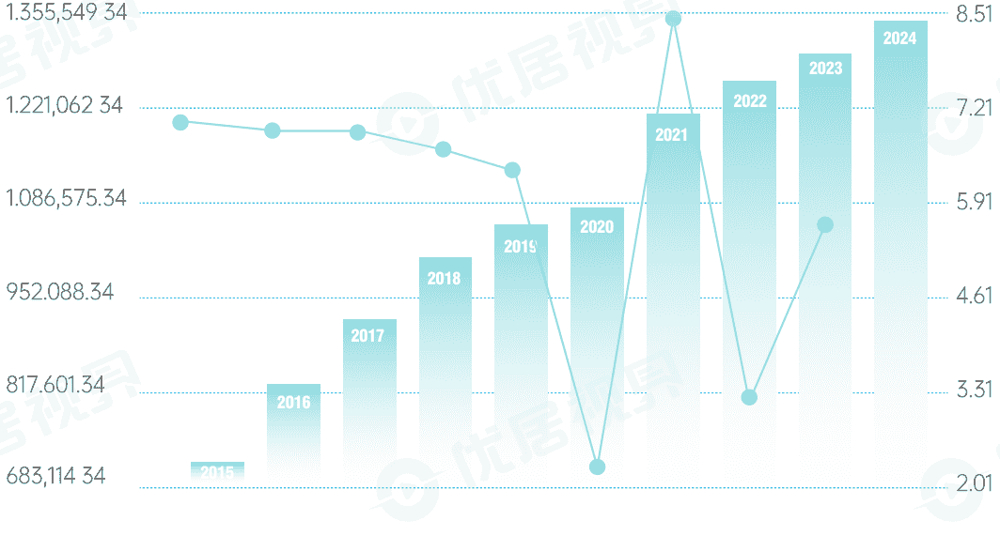
- 国内总值（亿元）
- 国内增长率（%）

### 城镇化率继续提高，旧改和改善型需求进一步激活

2024年末，中国城镇化率达到67%，仍处于城镇化进程的快速增长阶段，与美、韩等代表的国家相比还有10%以上的上升空间。随着城镇化进程持续深入，有望进一步带动住房需求增量。

城镇化率
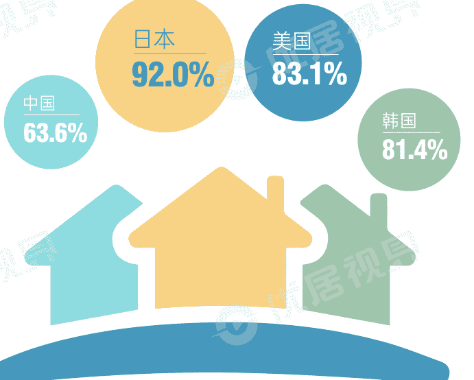
数据来源：国家统计局、公开资料

### 北上广深一线城市和县级城市，消费预期更强烈

另外，根据《2025中国消费趋势》显示，北上广深一线城市和县级城市的消费者在2025年消费预期会更强烈。不少受访者表示，愿意为改善居住环境做出更高的支出，对美好生活向往。

- 增加消费
- 保持不变
- 减少消费
数据来源：2025中国消费报告

### 家居行业市场规模将破5万亿，生活方式影响决策

根据《2024中国家居行业报告》显示，预测中国家居行业未来五年的复合增长率为2.8%，至2028年市场规模将达5.17万亿。刚需属性充足，市场增长将呈周期性波动并趋于稳定，中国家居业处于重要的发展机遇。

预测中国家居行业未来五年的复合增长率2.8%
5.17万亿
2019-2028中国家居行业零售规模（万元）增长率
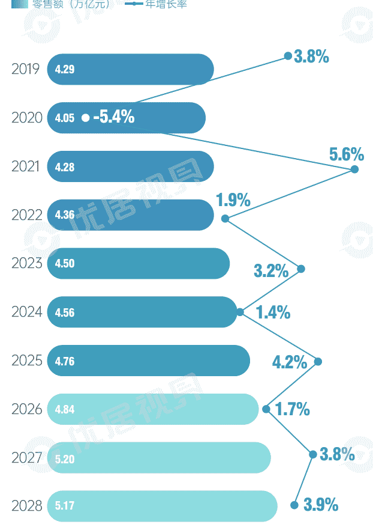

### 增量时代正在远去，存量时代美好生活正在到来

当前消费者对提升生活质量和个人价值的重视，通过行动来实现更深的自我实现和精神满足。因此，能否与生活方式共鸣成为他们选择的关键。

2024年消费关键词

### 国民内在消费升级，重塑新时代的居住体验

调研关于未来消费时发现，人们希望将更多的资金花费在个人成长、健康体验；并且认为家庭、健康和个人成长是人生重心的TOP3。可以看出，当下人们更关注内在消费，与之相关的产品更能引起消费。

家庭、健康和个人成长三大重心
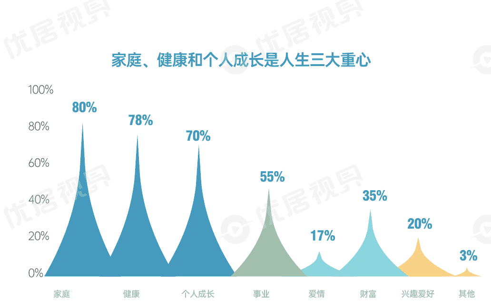

同时，受访者近3年生活消费都在逐年上涨，并表示希望重塑家居环境体验，渴望有情感温度的环境，让心灵回归舒适区。

近三年的生活消费变化
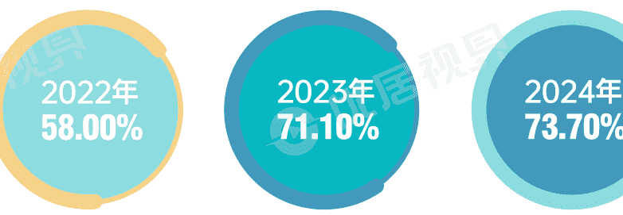

## 03 CHAPTER: 家居生活方式消费洞察

### 家居生活方式洞察
### 消费者决策更精明谨慎，追求“质价双优”平衡时代

#### 购买家居产品时关注的要素

过去，人们在追求高质量家居产品时，不得不接受昂贵的价格，或者为了便宜而在质量上做妥协。但如今的消费者对品质和价格均都不会做出让步了，力求花出去的每一分钱都是物有所值的，追求“质价双优”的消费体验。

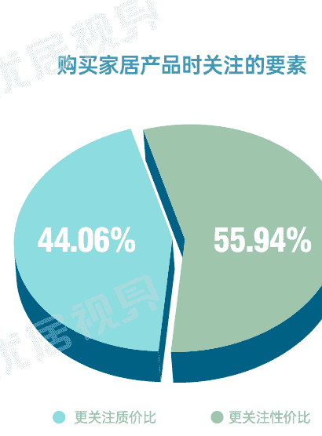

同时，有32.19%的用户选择“平替产品”品质并不大落差，不是为了付溢价，而是“理性消费”。看出，消费者在购买决策时表现得更理性、更谨慎和更有智慧。他们认为，一件家居产品的低价、高质和能否带来独特的精神内核，都是衡量的因素。因此在购买家居产品时，有77.84%的受访者会为了更好的使用体验和情绪价值而买贵一点。就是说，消费者已经进入到“性价比”、“质价比”和“心价比”并存的多元时代。

#### 消费者选择平替产品的情况

| 情况 | 占比 |
| :--- | :--- |
| 非常满意 | 22.13% |
| 赞同 | 55.71% |
| 一般 | 17.48% |
| 不赞同 | 4.68% |

平替产品的品质能够满足基础需求，比大牌差是不为了溢价，是为了节约开支。如果收入增加，习惯优先选择价格低、合适的替代。购买家居产品时能给你更好的使用体验和情绪价值。

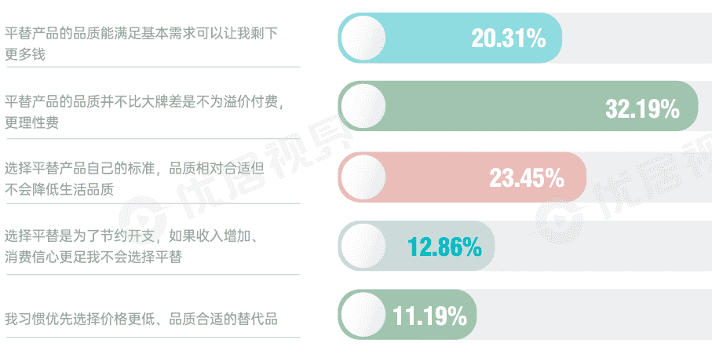

### 向内探寻，“限时制”带来疗愈体验和松弛感

随着个体觉醒，人们越来越倾向于向内寻找内心指引。调研显示，2024年有45%的消费者开始进行深度思考，渴望真实的自我。尤其在快节奏的当下，他们希望通过调整生活节奏，获得松弛的状态。因此，40.20%的消费者表示闲闲时间更喜欢家里，还有31.55%的人更喜欢宅家。

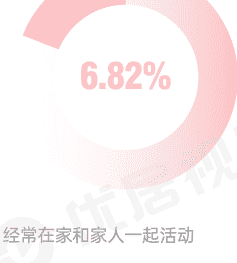
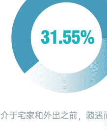
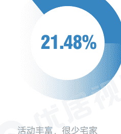
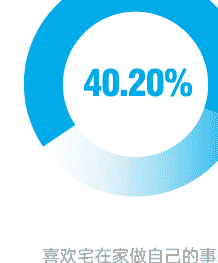

### 一个舒适的家居环境让人更放松

“一个舒适的家居环境让人更放松”这一说法的占比高达85.65%，可见家居是人们首选的放松场所。舒适沙发、智能助眠床等家居产品，可以帮助他们打造更轻松的氛围。

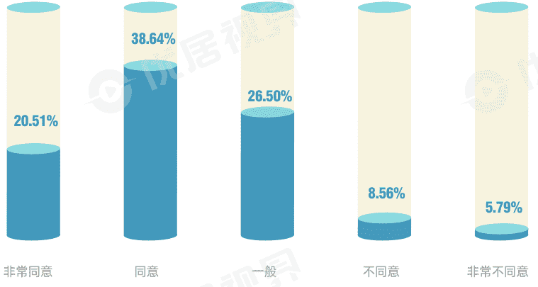
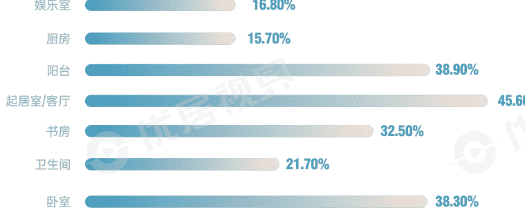

### 场景打造

为了消费者对家居舒适场景的打造，家居品牌也在不断升级迭代产品，才能贴近用户，在生活方式上产生共鸣。以顾家居代表的场景化解决方案完美契合现代生活需求，通过技术创新重构舒适体验，满足用户在不同空间不同场景下的轻松“躺平”。在客厅场景，顾家奥德赛KG187沙发通过“零感”和“双电动”等设计实现舒适升级，让影视阅读、音乐欣赏或纯享都能沉浸式放松体验。

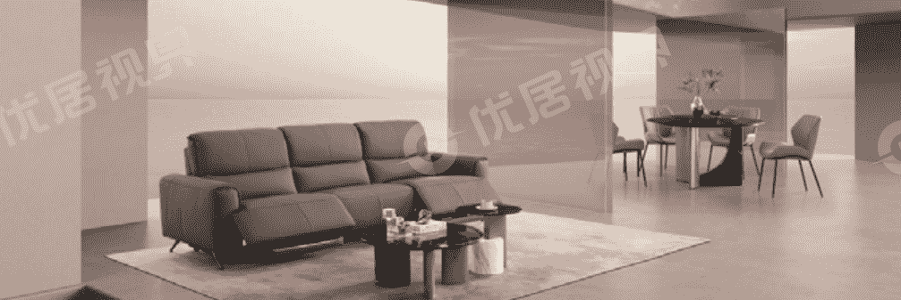

在卧室空间，顾家最新发布的1号垫十周年纪念版，以独立立体垫胶结构为核心，从护脊支撑到云包裹满足用户的个性化睡眠需求。这种既延续品牌人体工学基因，又通过智能升级打造的差异化发展路，让用户同步感知技术创新与品质传承，并在独特的情感环绕中获得更放松的家居体验。

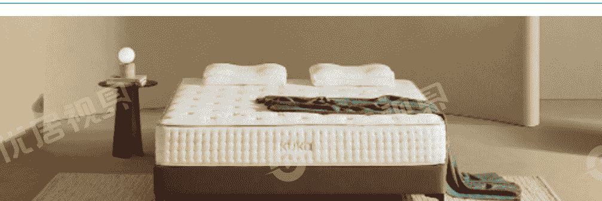

### “情绪价值”买单成为年轻人消费态度TOP1

一边是高呼“穷鬼快乐”、遵守极致优惠券的直播间，一边又是买爆价不菲的“哈萨”路边店，这种看起来很极端的消费模式，表现出的年轻人的消费逻辑有了明显变化，为情绪价值买单成为一种主流。在关于消费心的中，“快乐消费，为情绪价值/为趣而消费”（40.1%）是年轻人最多的投票选项。这也不难理解为什么陪伴型玩偶jellycat、各地联名的文创IP卡席年轻群体。

- 40.1% 快乐消费：为情绪价值而消费
- 36.9% 极简消费：如必要要不消费
- 37.1% 消费理念升级：关注品质
- 30.2% 消费降级：更看性价比
- IP消费：为圈层、为认同、为喜欢买单

数据来源：2024消费行为报告

### 家居生活方式洞察
### 有情感互动、共鸣和品质美好

同样在选购家居产品时，84.07%的访者认为与情感互动、共鸣和品质美的产品让他们满意，并且希望通过独特体验（63.69%）、精致感（57.90%）和科技潮流（51.91%）来提升精神上的感知。这种消费心理的转变，2024年国货家居了一个很酷的事情：在自然光下仍保持着舒适的体验，推出移动式全方位空间，融入了更多智能、科技元素，也符合年轻群体的需求。

- 有情感互动、共鸣满意：84.07%
- 独特体验：63.69%
- 精致感：57.90%
- 科技潮流：51.91%

### 赛博空间，高适配一代

从全球热议的ChatGPT到DeepSeek，科技浪潮正渗透着各个领域，AI应用场景已不断成为生活中不可或的一部分，智能设备全天待命，“赛博空间”让人们的家居越来越智能化。超过74%的访者认为智能家居让生活更便捷，并且期待未来AI能给我们提供个性化的服务。

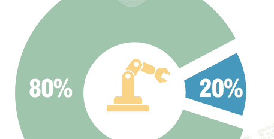

### 对智能家居的需求

调研显示，人们对智能家居的需求主要是实用型、娱乐型和智能安全系统。这些智能家居产品让消费者得到减负、放松和安心体验；同时让用户节约时间和提升效率，高度便利的功能非常契合当代需求。同时，关于消费者对智能家居的投入显示，在10万以内的占到85.3%，其中1-5万元的预算最多能够接受（49.3%）。

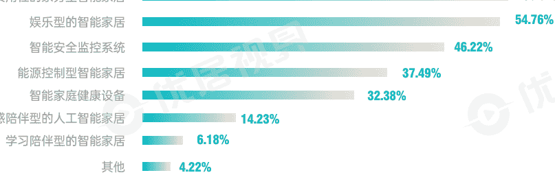
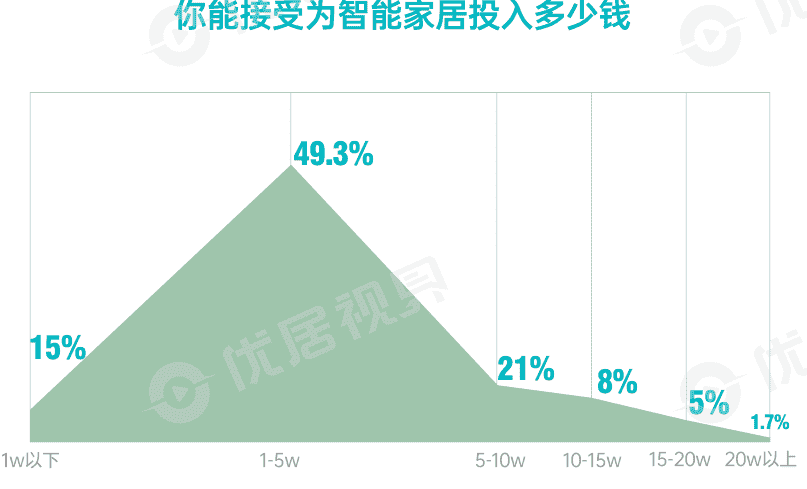

## 能量快充和健康养生受追捧### 家居环境改造需求大

在现代社会的语境下，人们已将健康构建了一个整合化、多维度的目标，具体涵盖体、心理和面的健康状态。当下，运动需求从强健身体转向精神、人生赛道的内化关注，他们把运动健康融入家居场景中，在家就能轻松运动释放压力，快速补充能量充电。57.31%的受访者表示家里多功能的主要用途就是健身，可以满足他们“随时随地”、“聚会养生”的需求。

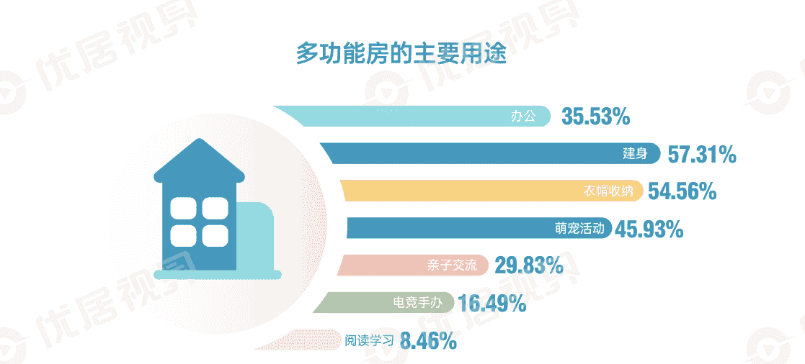

### 家居空气质量评价

人们认为家居清新的空气是健康生活的关键。但从调研显示，仅有27.77%的受访者表示家居环境的空气质量是非常不错，可以自由呼吸的。

- 空气积透了，不必大力呼吸
- 时好时差，就能深度呼吸
- 非湿不燥，清新自由呼吸

因此，他们希望重新打造家居空间，例如通过阳台或功能室的改造，满足健身运动需求，并选择更环保、绿色的品牌。全友推出的ENF级欧松U+板非常符合当代消费者需求，他们精选优质实材，从源头上确保板材环保，此外，全友从成品到定制全面升级抗菌功能，可有效抑制家具表面大肠菌。

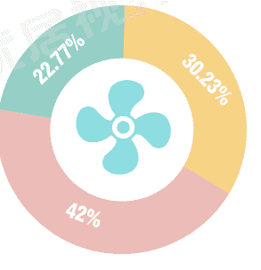

# 04 CHAPTER
### 新消费趋势下的总结与思考

### 内观且理性的消费促使家居回归本真生活

在开始慢生活、回归本需求的环境，现代人对宁静、松弛感的追求已经延伸到生活方式和家居设计之中。

因此，人们对于居住空间、家居产品的追求不再是留在表面的奢华，而是趋于内在的自然、舒适和安逸，回归本源。那么现代家居设计在经历多种风格后，人们的意力转到了“以人为本”的人性化设计观念，关注消费者的情绪共鸣、疗愈焦虑和喜爱主题，重产品与使用者之间的关系，不仅能让人享受生理上的舒适体验，也能感受心理上的陪伴与宁静。

另外，消费者对家居消费出现更为理性谨慎的态度，关注那些能够最大化提升自身幸福、舒适与满足感的产品和服务，寻找价格与品质恰好的“质价双优”产品。所以品牌不仅要专注于高质量产品，每个细节严格把关，还要优化供应链、降低成本，让消费者物有所值的高质量产品。

以人为本，回归产品是家居品牌未来的必然趋势和最终归属，未来的家居生活，不仅是质价双优的产品，更是理想生活方式的方案。

### 新消费趋势下的总结与思考

### 健康、智能化需求与家居空间的深度融合

随着智能技术的快速发展和生活方式的变革，人们更进一步地将生活方式需求融合到家居空间中。

消费者加关注整体的健康与悦体验，积极寻求身心的和谐平衡，运动健身、环保健康融入家居场景中，寻求多样化的健康生活，让健康家居生活更丰富享受和满足感，从而实现健康的便捷、高效和悦。家居品牌可以挖掘阳台、卧室等多个空间产品，推出生活方式专属的空间解决方案，满足不同人的具体爱好需求。

此外，在智能AI的推动下，消费者也希望将智能家居融入生活中，并且希望通过智能产品提供的主动服务，给家居生活带来轻松的同时，也能带来一些生活乐趣。

只有实现家居空间的个性化、场景化，以生活的具体需求融合到家居空间的打造，促进人与产品、人与环境、人与人之间的互动，才能真正地打动消费者。

## NO.2
### 深度体验将重构家居零售的场景打造

长时间沉浸于虚拟世界后，消费者对真实体验的渴望激增，推动线下消费的回归，其背后也反映出，人们对于产品的真实感、深度体验的需求更强烈了。

实体商业的真实感，文旅旅游的逸以及零售体验的沉浸感，交织线下新生的多维视象。而对于家居消费场景的独特特性体现在体验空间，让消费者更好地融入场景中体验真实的生活感和感受品牌传递的生活方式理念，因此新兴线下体验空间强调的是提供一种全新的购物体验，这种体验不仅关乎产品的购买，更关乎品牌故事的传达、社群的建立和对于家居场景打造的沉浸式体感的全方位满足。

事实上，无论是线下综合商，还是小区店，消费者期待的不止购物和消费，而是希望在线下空间获得更多体验，家居品牌未来要以独特的外观设计、主题性场景、特殊的布局，才能进一步刺激消费者探索欲望，进入零售门店有更深度的体验和更长的停留。

# 2025 家居生活方式消费趋势报告
## 优居视界

## 优居视界
### 2025
### 家居生活方式消费趋势报告

## 免费 价值 及时 专注
### 扫码加入 知识星球TOP 免费资源群

- 每日免费获取有价值资源
- 可提供各类资源搜索服务

| 热门付费文章 | 各行行业报告 |
| :--- | :--- |
| 精选图书资源 | 副业赚钱方法 |
| 职场实用资源 | AI政经自媒体 |

公众号：知识星球TOP 微信号：jntsg8 微信号：jntsg2

分享资料仅供个人学习，请及时删除，切勿商用传播
