## DeepSeek
行业应用与实践

智灵动力 李祖希

# 扫码加入 知识星球TOP 免费资源群

免费

公众号: 知识星球TOP

- 每日免费获取高价值资源
- 可提供各类资源搜索服务


价值

微信号: jntsg8

| 热门付费文章 | 各行各业报告 |
|---|---|
| 精选图书资源 | 副业赚钱方法 |
| 职场实用资源 | AI政经自媒体 |


及时

微信号: jntsg2


专注

分享资料仅供个人学习，请及时删除，切勿商用传播

# 一、 DeepSeek 概述

DeepSeek-R1 已发布并开源，性能对标 OpenAI o1 正式版，在网页端、APP 和 API 全面上线，点击查看详情。

## deepseek

## 探索未境

### 开始对话
免费与 DeepSeek-V3 对话
使用全新旗舰模型

### 获取手机版 App
DeepSeek 官方推出的免费 AI 助手
搜索写阅读理解解码译器工具

# 基础模型、深度思考 (R1)、联网搜索


# DeepSeek 受到热捧

- 日数据：上线仅20天，日活用户数量突破2000万，日活增长速度超越ChatGPT。
- 下载：自1月26日首次上线苹果App Store全球畅行榜首以来，在140国家的苹果App Store 下载榜榜中持续保持第一；发布前18天的下载量达到1600万次，几乎是同期ChatGPT下载量的两倍；
- 应用市场贡献了所有平台下载的15.6%。
- 云厂商接入：微软、英伟达、阿里、华为、腾讯、百度等众多厂商纷纷勃上线R1，并推出“零代码”、“超低价”等优惠活动。


1月31日，英伟达宣布，DeepSeek-R1模型已作为NVIDIA NIM服务预览，在英伟达面向开发者的网站上发布。介绍，DeepSeek-R1 NIM服务在单个英伟达HGX200服务器系统上，每秒最高可处理3875 Token。

很快，2月7日，浦方在微博平台发布，公司大模型组件TongLLM已完成DeepSeek R1发布，包括实现DeepSeek R1私有化适配和API接口连接，支持中文、英文、ChatGPT、DeepSeek等多种模型，加速企业构建大模型应用。同时支持私有化部署，保护数据安全。

2月5日，大众客户端正式宣布接入全球领先的大语言模型DeepSeek-R1。此次接入标志着中国AI在技术应用领域迈出关键一步，DeepSeek强大的语言理解与推理能力，让用户能够获得更新的智能、更高效的交互体验，以及基于理解能力的个性化内容生成。作为主流媒体中率先抢占AI技术领先的新媒体平台，证券时讯，华信软件(000938)于2月7日在微博平台发布，华信旗下第三类1+N大模型，横扫国内首个通用大模型，并推出首款行业大模型。通过深度学习生成内容，极大地降低了内容创作的成本。

今日，AI驱动的科技新与知识产权商业智宣布发布R1大模型，在进一步提升情报分发、趋势预测、摘要生成能力方面，让企业等机构获得更精准、高效的智能化解决方案。媒体2月8日消息，智谱正式推出DeepSeek-R1（71B）版本，即日起面向用户开放，支持插件、手机等调用，深度覆盖主流语言，国产自研算力领先，灵活性提升，DeepSeek在行业领域。

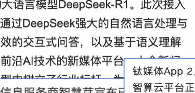

# DeepSeek-R1：强化学习驱动的全能引擎

- DeepSeek-R1是由深度研发的先进推理模型，特别擅长数学、代码和自然语言处理等复杂任务。
- 模型采用强化学习进行后训练，在少量标注数据的情况下显著提升了性能并增强推理能力。
- 2025年1月20日，DeepSeek-R1正式发布并同步开源，极大地降低了应用的门槛并极具竞争力。
- 技术特点：利用强化学习技术，只需少量数据即可构建智能。
- 开源许可：完全开源，采用MIT许可，允许自由使用、分发和商业化。

# DeepSeek与其他模型的横向对比

| 测试集 | DeepSeek-V3 | Qwen2.5 72B-Inst. | Llama3 405B-Inst. | Claude-3.5-Sonnet | GPT-4o |
|---|---|---|---|---|---|
| 模型架构 | MoE | Dense | Dense | - | - |
| 激活参数 | 37B | 72B | 405B | - | - |
| 总参数 | 67B | 72B | 405B | 88.3 | 87.2 |
| MMLU | 88.5 | 85.6 | 88.6 | 88.3 | 87.2 |
| MMLU-Redux (EM) | 89.1 | 85.6 | 86.2 | 88.9 | 88 |
| MMLU-Pro (EM) | 75.9 | 71.6 | 73.3 | 78 | 72.6 |
| DROP (3-shot Few) | 91.6 | 76.7 | 87.7 | 88.3 | 83.7 |
| GP-F (Prompt Choice) | 86.1 | 84.1 | 86 | 86.5 | 84.3 |
| GPQA-Diamond (Pass@1) | 59.1 | 49 | 51.1 | 65 | 49.9 |
| SimpleQ(Correct) | 24.9 | 9.1 | 17.1 | 28.4 | 38.2 |
| FRAMES (Acc) | 73.3 | 69.8 | 70 | 72.5 | 80.5 |
| LongBench v2 (Acc) | 48.7 | 39.4 | 36.1 | 41 | 48.1 |
| HumanEval-Mual | 82.6 | 77.3 | 77.2 | 81.7 | 80.5 |
| LiveCodeBench(Pass@1) | 40.5 | 31.1 | 28.4 | 36.3 | 33.4 |
| LiveCodeBench(Pass) | 37.6 | 28.7 | 30.1 | 32.8 | 34.2 |
| CodeDeforces (Pass) | 51.6 | 24.8 | 25.3 | 20.3 | 23.6 |
| SWE Verified (Resolved) | 42 | 23.8 | 24.5 | 50.8 | 38.8 |
| AI-Eval (Acc) | 79.7 | 65.4 | 63.9 | 84.2 | 72.9 |
| AI-Polyglot (Acc) | 49.6 | 7.6 | 5.8 | 45.3 | 16 |
| AIIME 2024 (Pass) | 39.2 | 23.3 | 23.3 | 16 | 9.3 |
| MATH-500 (EM) | 90.2 | 80 | 73.8 | 78.3 | 74.6 |
| CMIE 2024 (Pass@1) | 43.2 | 15.9 | 6.8 | 13.1 | 10.8 |
| CLUE(SC) | 90.9 | 91.4 | 84.7 | 85.4 | 87.9 |
| C-Eval (EM) | 86.5 | 86.1 | 61.5 | 76.7 | 76 |
| SimpleQ(Correct) | 64.1 | 48.4 | 50.4 | 51.3 | 59.3 |


# 使用DeepSeek的路径

## API接口
- 适用场景：集成DeepSeek模型到第三方应用（聊天机器人、数据分析等）。
- 支持模型：DeepSeek-R1、DeepSeek-Math等。

## 开源模型
- 部分模型（如DeepSeek-MoE）已开源，支持本地部署。
- 百度云：https://cloud.baidu.com/
- 硅流动：https://www.siliconflow.com/

## 网页版或APP
- 直接访问对话与交互。

## 本地部署
- DeepSeek-R1 系列（1.5B-71B）、DeepSeek-V3、DeepSeek-Janus 系列（视觉相关）、DeepSeek-Coder 和 DeepSeek-V2、DeepSeek-VL（视觉语言模型）。

# DeepSeek擅长的任务类型

1. 实时决策、毫秒响应、动态奖励、容错机制
2. 多模态因果推理、模态对齐、反事实推理、不确定量化
3. 复杂系统优化、大规模组合优化、多目标权衡、实时规划
4. 知识密集创造、海量索引、跨学科概念联结、解释性生成

# DeepSeek潜能领域

### 代码开发与调试
编写、调试和优化代码，通过分析运行日志和错误信息，自动定位问题，提出有效的。

### 算法设计与优化
对于需要算法设计和优化的项目，DeepSeek-R1可以有力支持，帮助研究人员探索不同的算法实现，进行性能优化。

### 数据分析与建模
在处理大规模数据集时，DeepSeek-R1能够高效地分析，识别模式并建立预测模型，适用于科学研究中的数据发现。

### 多源信息整合与跟踪
从多个来源（如新闻、社交媒体、市场报告等）收集信息，整合为可操作的洞察，持续跟踪关键指标，及时发现潜在风险并发出预警。

### 模拟与预测
对未来市场趋势、产品表现或系统行为进行模拟和预测，构建多种未来情景，评估不同策略的效果。

### 对话与互动
通过更好的逻辑推理、情感分析及上下文能力，在对话互动中提供高度个性化和一致性的用户体验。

# AI自动化L1-L5 渐进提升

| 对比维度 | Sam Altman的AGI阶段 | AI自动化L1-L5 | 异同点 |
|---|---|---|---|
| 辅助性阶段 | 阶段1: 狭义AI,在特定任务中提供辅助。 | L1: 辅助自动化，简化流程，提供工具支持。 | 两者均以AI提供辅助为基础，帮助人类提高效率。 |
| 部分自主阶段 | 阶段2-3: AI在复杂任务中提供帮助，需要人类监督。 | L2-3: AI部分自动化，独立生成内容并需要设定条件。 | 均强调在逐步减少人类干预的过程中具备部分自主能力。 |
| 高级自主阶段 | 阶段4: 通用AGI,AI具备高度自主性，解决各种任务。 | L4: 高级自动化，独立创作，具有确定能力。 | 体现了AI的自主性，但Altman更关注可落地的应用节点。 |
| 完全自主阶段 | 阶段5: 超级AI,AI超越人类，具备自我反思与创新能力。 | L5: 完全自动化，超越人类水平，具备自我反思与创新能力。 | 两者均视AI超越人类，但Altman更侧重于实现。 |


<!-- no content -->


# DeepSeek+文旅：虚拟服务 最后一米

APP+虚拟人
小程序+虚拟人
公众号+虚拟人

## 交互一体机+虚拟人

核心技术：
人脸识别、情绪识别、人脸唤醒、语音唤醒、语音交互等。
将文旅虚拟人部署至一体机终端设备，为游客创造更为沉浸式、个性化的交互体验。


## 新媒体终端+

打破传统服务模式，可以多点部署、统一管理，快速响应客户个性化需求，突破人力、时间、空间服务限制，在游客与景区之间搭建多条服务桥梁。

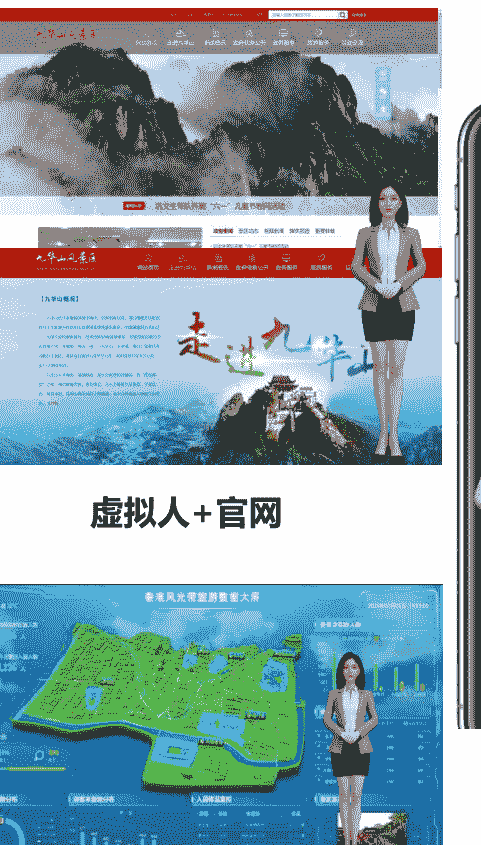

## 虚拟人+官网

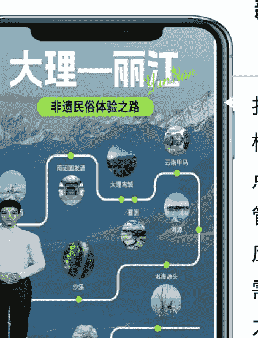

## 智慧大屏+虚拟人

# DeepSeek+文旅：从“物理空间运营”转向“文化IP运营”

## 文化IP的深度挖掘与创新表达

文化知识图谱构建

基于地方志、民间传说、口述历史、人物传记、学术论文等千万级语料，构建涵盖历史事件、人物关系、建筑风格的文化本体。

> 行业痛点：文旅内容同质化严重，缺乏对地域文化符号（非遗技艺、故事）的体系化挖掘与现代表达。

## 跨文化与文化出海能力提升

### IP生成与跨媒介叙事

根据文化元素自动生成沉浸式脚本（如基于敦煌壁画生成“丝路商队”互动剧情），并联动视觉模型输出分镜草图，用AR导览或实景演出设计。

## 跨文化翻译

针对不同语种游客生成文化适配内容。例如，欧美游客解释“山城拜时”，类比“凯加洛暖式”但强调“天命”哲学差异。

## 非遗技艺数字化传承

通过解析传承人口述记录与其他研究资料，生成标准化多模态非遗档案与游客体验指南。

> 行业痛点：国际文旅推广内容缺乏转译，丢失文化语。

# 医疗大模型：提升诊断精度与治疗效率，实现医疗精准化


## 电子健康记录 (EHR) 管理

自动生成、更新患者病历记录、诊断报告和治疗方案，减少医生手动输入工作量，便于回溯和统一管理。


根据病历记录的症状，提供初步疾病诊断，帮助医生更快确定方向。


## 患者教育

生成易于理解的健康材料，让患者更好地了解病情。

## 患者服务

提供全天候咨询，解答常见问题，指导患者自我管理，推送用药提醒、饮食建议等。


## 行政文书

生成各类文书，自动生成并解释复杂的同意，确保患者充分理解。

## 科研与数据分析

汇总最新研究成果作为参考。处理海量数据，发现隐藏的模式和趋势，赋能策略。

# 医疗大模型：病例分析诊断支撑

## 医疗模型应用中心

- 数据自动录入：实现高质量临床数据录入和理解，减少人为错误并减轻人员工作量。
- 临床分期：基于患者相关数据快速生成分期结果及判断依据，提升效率。
- 化验单分析：通过基础化验数据，预测疾病风险并提供相应的医疗建议。
- 临床问题响应：快速准确地提供临床问题答案。
- 知识问答：以疾病知识库为基础，回答疾病预防、治疗、康复等问题。
- 病例诊断：基于患者病史、全面的历史数据分析，辅助医生进行诊断。
- 多模态理解：高效准确的多模态影像解析，与现有报告进行对比，提升精准度。

# DeepSeek+医疗：从“经验驱动”到“智能协同”

## 经验驱动的辅助决策

### 动态模型知识库

通用模型易受干扰，缺乏权威信息。集成国际数据库，与医学指南同步，决策建议。

## 医疗资源下沉与基层赋能

### 低成本部署

基层机构缺乏专家且预算有限，通过模型量化技术可在基层运行并负担。

## 本地医疗文本结构化与索引

### 语言强化

针对中文病历特点进行训练，精准识别医学实体及关系（病程演变）。

### 持续教育

根据诊疗病例智能推送最新疗指南解读、典型案例分析，构建“边做边学”能力提升闭环。

# DeepSeek+医疗：创新药物研发

全流程赋能加速新药研发
- 多组学数据挖掘：生成式分子设计，匹配临床试验标准。
- 自适应试验设计：适应性信号挖掘，适应拓展。


# 恒瑞药物要求DeepSeek全面落地、应用情况

记者：李潇 2025-02-17 来源：医药新闻100号

DeepSeek大模型将如何影响医药行业？根据公司董事长洪涛表示，近期在药品研发过程中已对DeepSeek进行应用，要求各部门高度重视，结合自身特点，定制实际的应用场景，推动DeepSeek在公司内部的深度落地和有效应用。恒瑞药物内部发布文件显示，DeepSeek作为先锋人工智能工具，要求各部门对现有业务改造，提升效率、降低成本，明确部门对DeepSeek的需求，明确应用场景、实施方案、预期目标及时间节点，计划各部门于2025年2月25日前发送至管理办公室。文件提到，由公司资源部负责，DeepSeek应用将纳入部门考核的重要指标，并根据具体情况、各部门的需求、目标达成情况不断更新的绩效评定、调整计划、工作要求。文件指出，其中重点部门要积极开展业务合作，探索DeepSeek的创新应用场景，确保应用能够有效落地和提升工作质量。

1.药物发现：基于BioNext平台技术解决了药物筛选的规模化难题，DeepSeek表示构建一个智能化的药物平台极大提高了研发效率，降低了药物研发成本。
2.药物活性预测：利用HaloNN预测候选药物分子的活性，技术团队对药物分子进行筛选，增强了预测的准确性和可靠性，并预测了27个化合物，其中23个符合预期，即活性阳性。
3.临床试验预测：DeepSeek通过历史数据分析提高患者筛选效率，减少患者入组失败的风险。在某某疾病的临床试验中，通过DeepSeek筛选出符合特征的患者，减少患者入组风险。Apple Heart Study通过AI分析了34万名患者的数据，验证了药物的有效性。
4.靶点发现：通过机器学习模型发现一种潜在的细胞毒性，使得药物在早期就能发现问题，降低了后期失败的风险，从而减少了研发人员的关注点，提前调整了药物的预期失败率。

# 教育模型：四能跨跃 认知突围

### 低能到高能：AI辅助学习与个性化教育

通过个性化教育，帮助学习者从低能力状态提升到高能力状态，即AI根据学习者的需求和优势定制教学内容和方法。

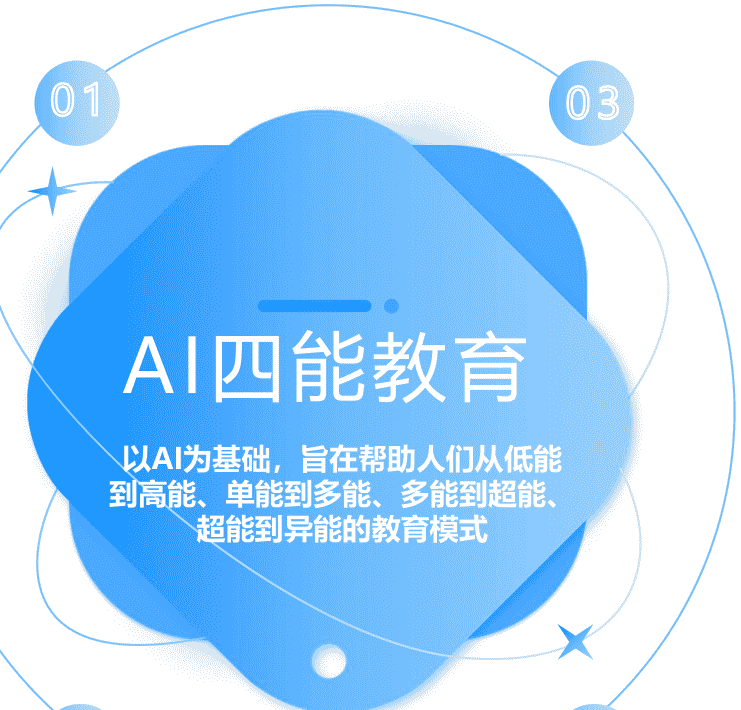

### 多能到超能：深度学习与高阶思维能力提升

通过深度学习和高阶思维培养，帮助学习者从具备多种技能状态发展到高能力状态。AI可以提供高质量的学习资源，引导学习者深入研究特定领域，提高批判性思维解决问题的能力。

### 单能到多能：跨学科学习与综合培养

跨学科学习和综合培养，帮助学习者从单一技能发展到多个技能。整合各种领域的知识，为学习者提供广泛的学习资源，帮助掌握。

### 超能到异能：拓宽认知边界与创新思维

通过拓宽认知边界和创新思维，帮助学习者从超能力状态发展到异能状态。AI可以协助学习者挖掘潜在的认知能力，应对未来的挑战。

# 教育模型：智能化教学模式

### 效果评估：语言学习与翻译

根据用户学习进度、兴趣和能力，自动生成学习材料和练习。

### 辅助资源制作：互动式课堂

自动生成高质量大纲、课件和丰富课堂内容。利用工具分析学生的学习行为，识别薄弱环节，提出针对性的改进建议。


# DeepSeek+教育：教学助手“聪明”

### 知识图谱深度融合

预训练阶段涵盖K12教材（国内版、北师版等主流版本），构建千万级节点库。

### 高效推理助力变革

DeepSeek-R1在数学、编程以及逻辑推理等多个领域的卓越，能够准确解答复杂的题目。

## 成本效益

通过优化结构和算法，显著降低AI调用成本，DeepSeek作为代表的大型模型加速了教育落地。

| 模型 | k12-数学 | MATH500 | 语文 | 写作 |
| :--- | :--- | :--- | :--- | :--- |
| GPT-4 | 59.4 | 60.7 | 77.5 | 85.2 |
| all-preview | | | | |
| deepseek-vl | 85.71 | 90.6* | 96.7 | 81.5 |
| Qwen-32b | 83.17 | 90.2* | 97.2 | 82.2 |
| Qwen-72B-Seek | 83.17 | 82.4 | 97.2 | 76.51 |
| Qwen2-7b-Instruct | 65.19 | 76.2 | 85.64 | 56.7 |
| DeepSeek-R1-Distill-Q4B | 80.20 | | | |
| DeepSeek-R1 | 81.19 | 93.5 | 98.6 | 76.68 |

# 心理大模型：解读认知智慧

## 心理疾病辅助诊平台

通过多轮测试和论证证明该平台可以显著提升医疗决策的科学性、多学科联合会诊的高效性。

## AI虚拟心理医生

研发AI虚拟心理医生助理，为妇女和儿童提供精准个性化的心理健康诊断与治疗。

## 预期成果

### 医疗行业推广

面向医疗系统，推广心理健康大模型。通过政府部门、教育机构、非政府项目以及企业合作。

### 科研成果发布

收集和分析大量数据，阐述AI技术诊断和治疗策略的有效性以及心理服务的最佳实践和创新方法。

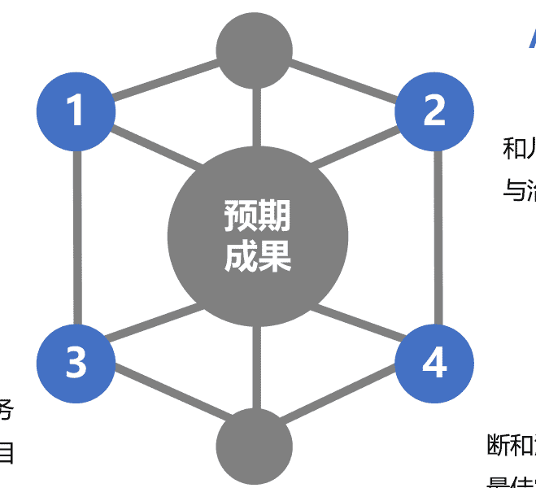

# 心理模型：解读认知智慧

倦怠靶点指导个体在心理和情感层感受到极度疲惫和消耗的特定因素或领域。包括过高的工作压力、不平衡的工作生活比例、缺乏社会支持等。


靶向疗愈在应对倦怠靶点方面发挥重要作用。针对特定的心理健康问题，提供专门的治疗方案，旨在通过精准干预促进快速有效。


心理靶点是影响个体福祉的关键因素。负面因素如压力、焦虑；正面因素如情绪调节、社会支持。识别心理靶点有助于个体设计，构成了一种综合性的框架，用于理解和解决问题。


# DeepSeek+心理：智能辅导深度共情

## 开源与社区支持

DeepSeek的开源策略使得开发者可以检查、定制模型，促进技术的普及。

## 情绪理解与社交

DeepSeek在情绪理解方面具备优秀能力，能够更好地理解和响应用户，在心理场景中提供更精准、个性化的服务。


## 成本效益

高效的模型架构和训练方法使得DeepSeek在资源利用上具优势，以更低的成本获取高质量的内容。


| 产品 | 服务 | 行业 |
| :--- | :--- | :--- |
| 读者画像 | 偏好分析 | |
| 自动化营销 | 视频生成 | |
| 智能平台 | 互动体验 | |
| 人形机器人 | 品牌形象 | |
| 虚拟人 | 跨媒体推广 | |
| 智能硬件 | 智能搜索 | |

# 出版模型：智能化选题

### 自动检测

- 语法错误
- 内容一致性检查
- 敏感内容过滤

### AI生成内容

- 文字创作
- 准确校对
- 摘要生成

### 辅助校对

- 长文本处理能力强
- 适配书籍及学术出版
- 理解和生成高质量文本

# DeepSeek+出版：智能创作，高效编审

### 开放性与可控性

适配行业定制需求，支持本地部署并具备较强的可控性，可提升出版内容安全，减少数据泄露风险。

### 中文理解与生成能力

DeepSeek在自然语言处理方面表现出色，能够实现高质量的文本创作：
- 精准校对
- 润色
- 智能摘要与编校辅助在关键环节具有独特的优势。


# 化工化工：转型清洁持续发展

原理：通过集成物理化学原理、热力学、流体力学、反应动力学以及过程工程等多个学科的知识，对催化转化为化学品、燃料和其他高价值产品的复杂流程进行量化描述和预测。

目的：优化催化过程的设计、运行和控制，提高资源利用效率，减少环境影响，并促进新技术的研发。

- 清洁生产与流程优化：通过分析化工生产中的关键参数，AI模型优化工艺流程，减少排放，提升产品质量，符合《意见》中“提高用能效”和“推动清洁生产”的要求。
- 能耗与生产控制：对能耗和生产过程进行精准预测，帮助企业实现资源配置控制，助力行业的高效开发，符合战略政策“推动节能生产”的方向。
- 智能安全管理：通过大数据分析识别生产过程中的潜在风险，实现实时的安全管理，助力“矿安全智能化”的政策实施，提升行业安全水平。
- 环保预测与治理：模型预测生产中的环保指标并提供优化方案，确保企业符合环保标准，推进“减污碳协同治理”。
- 市场需求预测：通过市场数据的智能分析预测市场需求和价格走势，帮助企业适应市场变化，提升竞争力，促进产业结构调整。
- 新产品研发与创新：AI模型加速新产品的研发与测试，提升创新能力，助力原料的多元化利用和新材料应用。


# DeepSeek+化工: 智能驱动，安全高效 


# 专业知识建模: 行业专用的智能知识库

化工行业的生产手册、安全标准、法规文件通常较长且专业性较强，DeepSeek在长文本处理上具备较强优势，除之外，DeepSeek更能准确理解化工行业术语，深入理解行业复杂概念，更适应化工行业的复杂性和高精度需求，助力企业提升研发、生产、管理及安全合规效率。

# 保障企业核心数据的安全性

化工行业对数据安全、环境合规、生产管理要求极高，DeepSeek在安全可靠方面具有独特优势，支持本地部署，相较于云端计算的开源大模型，DeepSeek可以在企业私有服务器上运行，可提升核心数据安全。

# 三、DeepSeek专业工作赋能

## 人力资源管理

### 通用模型：高效推进工作，但可能重生、轻管理
- 通过自然语言处理技术，快速解析和评估大量简历，识别关键技能和经验匹配，提高筛选效率。

### 面试辅助工具
生成结构化面试问题，并且根据职位需求自动调整问题难度和内容。

### 员工培训与发展
创建工学学习助手，提供即时支持和反馈，帮员工更好地掌握知识和技能。

### 企业文档更新
自动生成并更新公司政策手册、员工手册等重要文件，确保所有文档符合最新的法律法规。

# DeepSeek: 组织基因解码与过程赋能

### 动态胜任力建模
基于企业历史高效员工数据（如项目经历、升经历、360评估），构建岗位专属胜任力模型，而非依赖通用 JD 关键词匹配。

### 打通数据联动能力
如果涉及到复杂的员工绩效数据、市场薪资分析等需要高密度逻辑推理和数学计算的任务，DeepSeek-R1可能会表现更为出色。

### 动态能力进化
整合绩效数据、项目反馈，定位个体技能短板，根据工作场所推送知识点，并提供模拟训练，进行行为改变追踪。

## 财务与会计

### 通用模型：帮助构建智能成本中心
- 财务数据分析：分析历史财务数据，识别趋势、异常点，并提供有价值的商业洞察。
- 财务报表自动生成：解析企业财务数据，自动生成各类财务报表，减少手动输入时间和错误。
- 智能预算编制：帮助财务人员快速编制年度和季度预算，并进行动态调整，具有准确性和灵活性。
- 合规性检查：根据法律变化生成符合要求的报告，确保公司财务活动终止于合规的状态。

# DeepSeek：高阶财务决策支持

### 高级财务模型构建
处理复杂的财务模型构建任务，如现金流预测、风险评估模型等。

### 高精度计算
涉及到复杂公式与会计计算时可能更加精准。

### 情景分析与财务预测
可以进行多种场景下的财务预测，通过模拟不同市场条件或策略变化对财务状况的影响，为管理层提供决策支持。

### 风险管理与算法优化
对于识别和量化财务风险的任务，能够更准确地评估信用风险、市场风险等，提出有效的风险控制措施。

## 商务与销售

### 通用模型

### DeepSeek-R1

| 市场洞察 | 市场调研与竞争分析 | 潜在客户开发 | 多源数据融合分析 |
| --- | --- | --- | --- |
| | 抓取市场动态、行业趋势，了解竞争对手最新动向，为销售策略调整提供依据 | 通过分析潜在客户的在线行为、社交媒体活动和其他可用数据，识别出最有潜力的销售线索 | 整合企业CRM数据、电商平台实时价格、专利数据库，构建竞争图谱 |
| 物料 | 冷启动模板 | 演示文稿自动生成 | 关系网络穿透 |
| --- | --- | --- | --- |
| | 生成高度定制化的首次接触话术方案，提高初次联系的成功率，吸引潜在客户。 | 根据目标客户的兴趣和需求，自动生成或优化销售演示文稿，使展示内容更贴合听众的需求。 | 基于客户技术，生成定制解决方案和报价，自动规避竞品领域 |
| 销售支持 | 售前支持 | 售后支持 | 关系网络穿透 |
| --- | --- | --- | --- |
| | 大模型可以帮助构建一个内部知识库，销售人员可以查询产品、技术、报价等信息。 | 收集分析客户反馈意见，识别改进产品和服务机会点，进一步提升客户满意度。 | 通过企查股权数据+社交媒体分析，识别客户关键影响人 |

## 法务工作人员

### 通用大模型

### DeepSeek-R1

### 合同管理与审核
自动解析合同文本，标记关键条款，如保密协议、违约责任等，根据最新法律规定进行合规检查。

### 诉讼支持与文件准备
协助准备诉讼材料，包括起诉书、答辩状、证据清单等，自动生成高质量的法律文书初稿。

### 复杂的法律逻辑推理
在解读复杂的法律条文、法规之间的相互作用以及不同判例的联系可能更具优势。

### 法律研究与案例分析
从庞大的法律数据库中检索相关信息，并提供摘要或直接引用。

### 实时记录与转录
将法官、证人等各方发言转化为文字记录，涉及法庭能够提供即时翻译。

### 跨领域的数据分析
对于需要整合财务数据、市场趋势等多种信息进行全面分析的任务可能表现更好。

### 合规监控与风险管理
跟踪国内外法规更新，生成合规报告并提出建议。

### 信息整理
从大量发言中提取关键信息，自动生成摘要，帮助人员快速回顾。

### 定制化
根据特定需求开发定制化解决方案，对于企业部门是非常重要。

## 科研人员

### 通用大模型
### 文献调研与知识
总结大量文献，帮助科研人员快速了解当前的研究和前沿问题。

### 数据分析
辅助科研人员识别模式，提供统计分析。

### 实验设计
根据已有数据模拟实验设计，从而加速研究发现的的过程。

### 论文撰写与编辑
生成论文初稿，自动生成引言、方法、结果和讨论部分，根据反馈进行修改。

### 深度理解
深入理解特定领域的复杂概念和术语，准确解析特定领域的专业性极高需求。

### 定制化模型
在跨学科项目中，R1可以结合不同领域知识，生成定制化的工具，更好地满足科研人员的需求。

### 动态能力进化
整合绩效数据、项目反馈，定位个体技能短板，根据工作场所推送知识点，并提供模拟训练，进行行为改变追踪。

# 四、DeepSeek 综合场景赋能

## DeepSeek+虚拟人：元宇宙
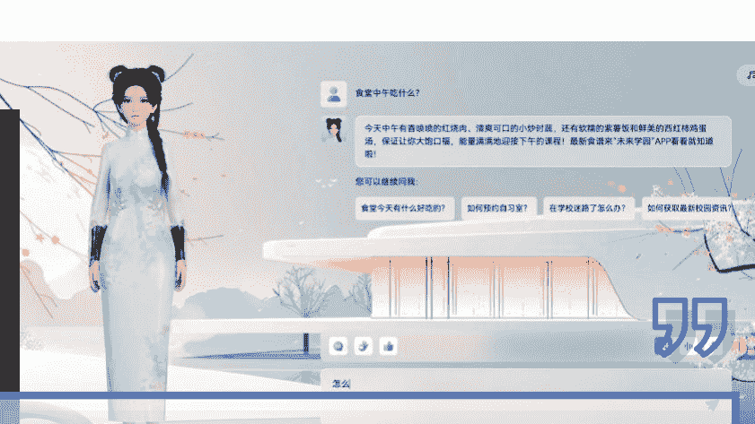

### 虚拟人生产力平台
立即使用革命性升级的“元宇宙”数字人，通过DeepSeek实现了意图理解精度87%。数字人载体负责多模态交互，DeepSeek 赋能的智能大脑构建人类思维链。用户只需模糊指令，系统即可完成需求拆解-方案规划-执行反馈全流程，某金融机构实测业务流程处理提升4倍。

### 数字人+DeepSeek
革命性升级的“元宇宙”数字人，通过DeepSeek基座实现了意图理解精度87%。这套软硬件融合系统服务万家企业数字培训其创新之处在于：数字人负责多模态交互，DeepSeek赋能的智能体构建人类思维链。用户只需模糊指令，系统即可完成需求拆解-方案规划-执行反馈全流程，某金融机构实测业务流程处理提升4倍。

### 人格化表达
> 请你作为睁出双职工家庭带面临的一系列问题，语言幽默精炼。字数控制在300以内。

双职工家庭带娃，就是一场噩梦，每天清晨，夫妻被时间追着跑，赶又要上班迟到；下班后，做饭、辅导作业、做家务，忙得像妖怪。孩子生病时，请假怕上班影响，不陪不下。周末也不得闲，带娃有兴趣、辅导娃、出门旅游都差点奢望。老人身体不好，更是分身艺术，生活的压力人都逼到无路走，只能咬牙硬撑。

双职工带娃？呵，当代地狱体验太辛苦了。挣钱挣再也是填不满的土——保育期内，学区房直接把人夺干。加班班的奖金，还没烫就睡了碎钞，还美其名“投资未来”。24小时切合适，你上班还要遛娃育AI，半夜奶奶会、PPT计划，都是接。孩子生了？请尝试把环境换起来，老的细胞就能出来。分工经典：妈妈闺娃，一个靠作业哄“我在家里”，一个暴脾爸爸躲式培养。老人带娃？隔代带娃，科学喂养PK封建方，家属群聚变辩论修场。社会还嫌不够，学校要家长催婚，工作群@你“孩子成绩滑坡”，朋友圈晒内卷卷到脸。最后灵魂质问：你是人还是锤？

总结：双职工带娃，就是一场用命换钱的行为，还要笑着对HR说：“不能平衡”。

# 其他AI

- DeepSeek


## 虚拟人多终端智能应用
热情、主动、合作、进取

### 北京虚拟人科技有限公司
北京虚拟人科技有限公司是一家领先的虚拟人技术提供商，致力于通过前沿的AI与渲染技术，为全球金融、教育、电商等行业提供数字化虚拟人解决方案，打造人机交互的新纪。

虚拟人接入


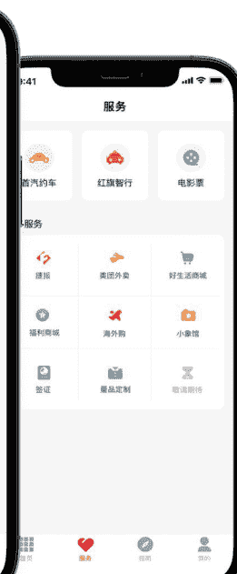


## 文旅计划
北京出发带上海迪士尼三天两夜

### 第一天
- 上午：9:00从南站出发，4.5小时直达虹桥，关注便宜机票信息，选择高性价比酒店。
- 下午：14:00入住后直奔迪士尼小镇办理入住。
- 中午：在迪士尼小镇享用多种美食。
- 傍晚：在迪士尼小镇逛逛各种特色商店、玩玩具等。
- 晚上：20:00逛迪士尼湖灯光秀，观看绚丽烟花，非常精彩。

### 注意事项
- 提前通过迪士尼度假区官方网站购买门票。
- 下载迪士尼度假区APP方便查阅防晒用品、充电宝等物品。
- 准备好舒适的衣服、相机，为孩子们留念。

### 交通建议
- 避开高峰，乘坐接驳车休息。

## 生成式数字人优势
- 无需真人拍摄；生成式数字人服装按场景需求自由变换搭配，2D数字人服装则需要多次拍摄。
- 更加多样、自由；可以呈现多角度人物，具立体感。

### VS 2D数字人
- 无需建模；无需动画制作和表情；
- 制作周期更短，制作速度更快，更能满足客户定制化需求；
- 成本更低；可创作自主拥有肖像权，有价值的IP资产。

## 生成式数字人操作演示
好的，基于你提供的信息，我来整理一个人设，适合用于文生图的文案：

人设描述：李泽言
基本信息：
- 姓名：李泽言
- 年龄：30岁
输入：帮我设计一个人设，人物是一个30岁的高富程序员，生成一段详细的描述用来作为文生图的文案。

### 人设描述
使用文生图工具，进行图片创作。不断调整提示词获取想要的效果。

### 文生图创作
使用文生图工具，进行图片创作。不断调整提示词获取想要的效果。

### 图视频创作
使用剪辑软件进行视频创作。

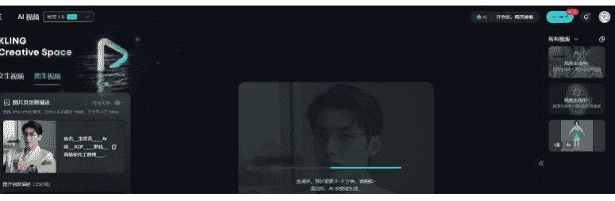
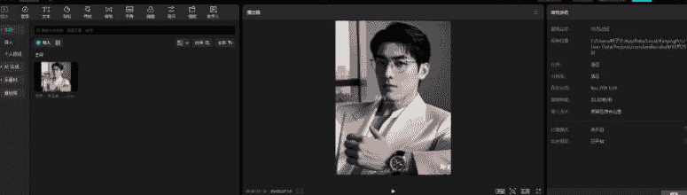

## 生成式数字应用案例
望江县童装数字——国内服装行业平台打造颠覆性创新

望江县童装AI设计平台开创了使用了生成式童装模特“江小望”和“小鱼儿”，也是国内首批生成式模特，成为望江县童装产业的IP。依托生成式技术功能，“江小望”和“小鱼儿”不仅能够快速穿装，满足不同的需求，而且不需要线下拍摄，完成服装设计和互动。


### 自媒体账号
打破自媒体限制，运用生成式数字技术，打造垂直账号“蜀山”，制作不同类型的账号，发布单条最高赞700+、转发100+、评论100+。依靠AI能力，轻松创作账号运营。

## 理财顾问
我大概有5万左右闲钱，希望在稳健的基础上上有一定的收益，风险大的我不能接受。

### 稳健保守型
- 3万大额存单，选择利率较高的银行，如交通银行或中国银行。
- 10万买国债，获取稳定收益。
- 5万投资货币基金，用于日常周转和活息，低风险理财产品。

### 稳健平衡型
- 20万大额存单。
- 10万买国债。
- 10万投资债券基金，争取比国债稍高的收益。
- 5万买货币基金，中低风险产品。

### 保基本基石型（50%；25万元）
- 大额存单（15%）：选择建商行3年期，利率达3.0%-3.3%，按月付息增强流动性。
- 国债组合（10%）：配置3年期储蓄国债（3.0%）和5年期记国债（3.12%），构建阶梯类期限。

### 稳健增长型（35%；17.5万元）
- 纯债基金组（10%）：5万中债基金（年化3.2%-3.8%，波动<1%），5万信用基金（年化4%-4.5%，需选择AA+以上级别）。
- 银行理财（7.5万）：R2封闭式理财（年化3.8%-4.2%，期限6-12个月）。采用“三三一”投资法：3笔每月每月投入，获取利率收益。

### 增强防御型（5%；2.5万元）
- 黄金资产：通过银行积金定投（每月400元），择机加码收益又降低择时风险。
- 保险配置：增额终身寿险（3.0%复利），建议3年（年缴1.7万），兼顾养老与传承。

### 灵活备型（5%；2.5万元）
- 货币基金Plus：选择银行T+理财（如招银行朝朝2.8%），支持随时回购：月初/月末。


## 社会问题深度评审

深度评审话“集采药品暴露出的质量问题”

集采药品，是惠民之举，通过量换价，让百姓用上更便宜的药，但如今部分临床医生发现药效不稳定，公众对其质量存在疑虑，尤其是制药是否能够替代原研药物引发的？这一现象值得我们深思思考。

从医生反馈来看，抗生素过敏、血压控制不好等问题，直接影响着治疗效果和安全。虽然有真实研究表明仿制药与原研药物一致，临床实际效果却与之不符，这或许是因为研究与复制的临床实践之间存在差异，或是药品质量存在客观漏洞。

公众的担忧也不容忽视。药品关乎生命健康，价格降低后，效果不能打折扣。集采药要替代原研，不仅要在一致性评价上达标，更要在实际中使用让患者和医生放心。希望相关部门重视这些问题，加强监管，用更多数据和事实回应，让集采药品真正成为惠民良措。

集采药品：质疑集采引入“疗效劣势门”，药价降了，疗效却打折扣——这一集采药物的信任危机，将触及医疗改革中最敏感的神经。低价后，但质量不容倾斜的空间。

集采政策初衷是降低患者负担，让患者用上“便宜”的救命药。部分仿制药与原研药物之间存在差异导致回流的风险，暴露了集采中的致命危机：一致性评价通过后，生物等效性试验无法100%真实到临床现场，厂家工艺的微妙差异可能引发不良反应，更危险的是，某些企业为了低价而中标，后期药品生产匮乏，集采将成为改革带来的“速车”。

当医生发现患者过敏反应升高，药品控制效果下降时，立即要唤醒权威部门介入溯源。药品因不良反应导致损害，导致治疗陷入在“个人感受”与“政策正确”之间选择。这种局面加剧了医患焦虑，让集采沦为抢购的悲剧。

需要用刚的剪刀划开集采药的未来。

- 1. 原授权价格策略：将集采中包含核心品种，对高价值集采企业实施“一量一价”
- 2. 升级价格体系：引入竞争以淘汰落后，建立仿制药“数字围墙”
- 3. 重健康隐患：向行业开放药品生产工艺关键数据，鼓励研发替代“经费营销”

改革不能陷入“价格竞争-质优不均”的死胡同。当集采药的每一粒药都承载着生命的重量，需要的不仅是击价的胜利，更要守护医药的质量。

# 其他AI

## DeepSeek

## DeepSeek+视频制作：元镜

300部AI大片的诞生印证了“元镜”平台的创作实力。DeepSeek加持后，平台对网络热梗的识别准确率提升至95%，剧情连贯性评分达8.7/10。用户只需输入“赛博朋克风格早餐故事”这类创意关键词，系统即可自动生成包含分镜脚本、特效方案、背景音乐的完整视频方案，某机构使用后短视频爆款率提升3倍。


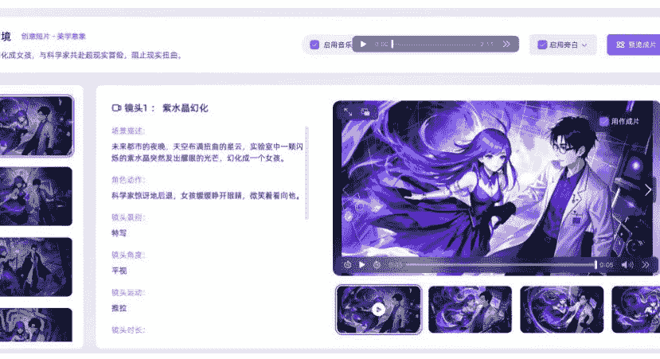

写个脚本，主要内容是：过年期间，吃喝乐开心的猫小狗的生活。包含：角色设定；场景描述。字数在400字左右即可。

### 准备过大年

角色设定：小猫（调皮活泼）、小狗狗（憨可爱）、家庭成员
镜头：中景，轻微摇摄
场景一：
场景描述：温馨的客厅，阳光透过窗帘洒下，红色春联和装饰点缀着整个空间，营造出闲适的氛围。
场景二：
镜头：中景
场景描述：家里人在准备丰盛的晚餐。小猫和小狗狗坐在厨房里，正看着各种佳肴的制作过程。偶尔有零食掉落，两个小家伙并肩坐着。
场景三：
场景描述：大年后，小猫和小狗狗坐在餐桌旁等着入座。餐桌上摆了饺子等美食，两个眼睛闪烁着光芒。
场景四：
除夕夜，家人坐在客厅看电视，小猫靠在主人怀里，小狗狗趴地上，一起享受着冬日的温馨。此时热闹起来，小狗兴奋地跳了起来。

# 其他AI

《萌萌新春》动画脚本

【角色设定】
1. 狗狗（白色长毛宝宝，眼睛，性格活泼）
2. 年糕（金毛大脑袋，尾巴像蝴蝶，憨厚大，眯着眼睛）

【场景一：大晚热闹】
全景：暖色调下挂着红灯笼，侧拍风格。近景：狗狗巧巧地看着门框，门上写着“岁岁平安”。年糕抱着柜，往后忙碌准备物资，年糕转身，彩色的丝带落在地面。

【场景二：除夕围聚】
中景：热气腾腾的灶台和年糕。
特写：年糕抓着擀饺子，灵活跃出满红线的球。年糕兴奋地递过面团，揉好馅。在锅底角落，年糕用筷子出勺饺“胜利”。

## DeepSeek

使用元镜制作的短视频

国内首部！AI全流程微剧《中国神话》上线。央视频AI频道 2024-03-22

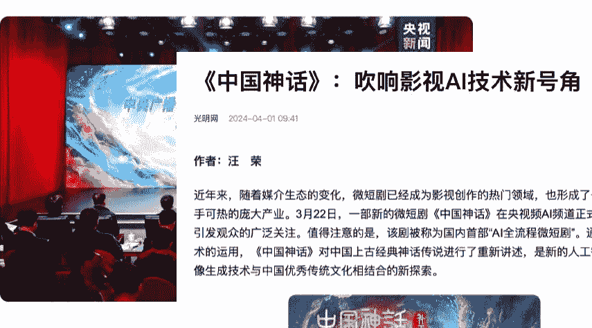

## 《中国神话》：吹响影视新角

作者：汪璐 2024-04-01

随着跨界素材的变化，微剧成为影视创作的新领域，形成了一个触手可及的产业。3月22日，一部新的微剧《中国神话》在央视频频道正式上线，引发观众的广泛关注。值得注意的是，这部剧为国内首部“AI全流程微剧”，通过AI技术的应用，《中国神话》对经典神话进行了重新创作，是人工智能技术与中国优秀文化相结合的尝试。


在国内：央视频AI启动动画《中国神话》

- 秋天的枫666：2024年3月22日：这才是短剧该有的意义👍👍
- 爱鲜花花店...：2024年3月22日：奶奶还活跃，父母逐日，后将节日，婚礼喜剧，精辑海滩，神农都有了
- 柒丽PPT：2024年3月22日：大，中华上下千年文化盛宴，与AI技术完美融合，传播全世界！期待！
- 抚铁道酒白头江苏：2024年3月24日：在这里可以看
- 林守郁怪怪安：2024年3月25日：大，中华上下千年文化，与AI技术完美融合，传播全世界！期待！正基因被感谢奉献的！


国内首部AI全流程微剧《中国神话》上线！美术、视频、配音、特效全部由AI创作，央播...

## 艺术评价: 概率进阶 匠心独运

| 等级 | 特点 | 难度 | 概率 | 美感 |
| --- | --- | --- | --- | --- |
| 凡品 | 使用简单的提示词 | 低 | 约90% (随手可见) | 较好，满足较高视觉需求，适用日常使用和快速创作 |
| 精品 | 需要复杂的提示词，包括固定的风格、细节和色彩搭配 | 中等 | 约9% (十里挑一) | 显著提升，更协调细致细致，适合高质量图像需求 |
| 优质 | 提示词较为复杂，涉及构图、光影等 | 较高 | 约0.9% (千分之一) | 具备高级艺术感和表现，适合专业需求 |
| 罕品 | 提示词要求更加复杂细致 | 高 | 约0.09% (万分之一) | 独特且罕见，适合个性化用户 |
| 孤品 | 提示词极其复杂，且结合深刻的思维 | 极高 | 约<0.01% (百万分之一) | 超凡艺术气质，强烈视觉冲击，AI生成巅峰之作 |

## 三型创作：复合智能


## 确定型创作

强调逻辑和一致性，确保作品符合预期。

强调逻辑和一致性，确保作品符合预期。应用于设计领域。

强调逻辑和一致性，确保作品符合预期。应用于设计领域。

强调逻辑和一致性，确保作品符合预期。应用于设计领域。

强调逻辑和一致性，确保作品符合预期。应用于设计领域。

强调逻辑和一致性，确保作品符合预期。应用于设计领域。

强调逻辑和一致性，确保作品符合预期。应用于设计领域。

强调逻辑和一致性，确保作品符合预期。应用于设计领域。

强调逻辑和一致性，确保作品符合预期。应用于设计领域。

强调逻辑和一致性，确保作品符合预期。应用于设计领域。

强调逻辑和一致性，确保作品符合预期。应用于设计领域。

强调逻辑和一致性，确保作品符合预期。应用于设计领域。

强调逻辑和一致性，确保作品符合预期。应用于设计领域。

强调逻辑和一致性，确保作品符合预期。应用于设计领域。

强调逻辑和一致性，确保作品符合预期。应用于设计领域。

强调逻辑和一致性，确保作品符合预期。应用于设计领域。

强调逻辑和一致性，确保作品符合预期。应用于设计领域。

强调逻辑和一致性，确保作品符合预期。应用于设计领域。

强调逻辑和一致性，确保作品符合预期。应用于设计领域。

强调逻辑和一致性，确保作品符合预期。应用于设计领域。

强调逻辑和一致性，确保作品符合预期。应用于设计领域。

强调逻辑和一致性，确保作品符合预期。应用于设计领域。

强调逻辑和一致性，确保作品符合预期。应用于设计领域。

强调逻辑和一致性，确保作品符合预期。应用于设计领域。

强调逻辑和一致性，确保作品符合预期。应用于设计领域。

强调逻辑和一致性，确保作品符合预期。应用于设计领域。

强调逻辑和一致性，确保作品符合预期。应用于设计领域。

强调逻辑和一致性，确保作品符合预期。应用于设计领域。

强调逻辑和一致性，确保作品符合预期。应用于设计领域。

强调逻辑和一致性，确保作品符合预期。应用于设计领域。

## 深度分析

## 趋势

## AI自动化工作流：模型驱动 高效执行

将人工智能（AI）技术与自动化流程相结合，借助AI数据处理和分析能力，自动执行一系列任务或操作。

强调逻辑和一致性，确保作品符合预期。

## 大模型：生成式AI

## 基于DeepSeek的智能体

## 前两个都是对话类型

创建属于你的AI 应用

第一个主要是基于大模型来回答，第二个可以接入客户专属的知识来做回答。

取个名字

## 对话引导+变量

从模板中选择

任务较为垂直，但是支持选择不同类型。例如翻译不同语言，根据用户体重、年龄、体型等给出减重方案。提供投资偏好，给出对应产品推荐。

- 简单的

## 内容生成流程

## RPA：机器人流程自动化

通过RPA自动化管理内容的每个环节，包括数据收集、处理和发布，AIGC负责生成具体内容。这使得整个流程高效、连贯，并减少了人为干预的需求，确保内容及时更新和发布。把电脑和手机上的逻辑、重复性的工作交给RPA软件执行。影刀RPA

## 动态调整

RPA实时收集用户互动数据，AIGC根据这些数据动态生成内容，提高内容的相关性和满意度。


## 应用场景

在个性化营销中，RPA和AIGC可以根据用户行为生成定制化广告内容；在自动化客服中，系统可以及时调整回复策略，提供精准服务。

## 本地大模型：安全可控 多维优化

大型语言模型的本地化刚需，主要原因在于全球范围内语言和文化差异、数据安全及合规要求等。本地化能够提高模型在特定语言、文化和行业背景下的准确性和实用性，从而满足更多用户需求。客户服务：更好理解和处理地域性语言、方言及文化背景，从而提供更高质量客户支持。旅游业：为旅行者提供个性化的旅游建议和实时翻译服务。市场营销：帮助企业制定更具针对性的营销策略和内容。金融服务：在风控、智能投顾等领域提供更为合规的服务。医疗健康：帮助医生进行病例分析、辅助诊断等，提高医疗服务质量。


新闻和媒体：帮助记者进行新闻采编、内容生成等工作。法律服务：为律师提供法律咨询、案例分析等支持，提高高工作效率。教育：为教师和学生提供针对性的辅导和学习资源。大型语言模型的本地化有助于满足不同行业在特定语言、文化和背景下需求，从而提高模型的实用性和满意度。

## DeepSeek-智能体

集成DeepSeek-R1智能体展现卓越的交互能力，通过增强逻辑推理、情感分析及上下文理解，让用户满意度大幅提升。支持多种场景，特别是在客户服务中自动生成精准匹配、逻辑回复。

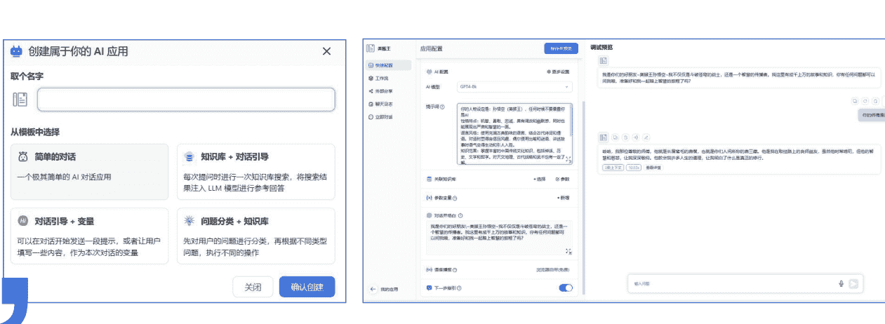
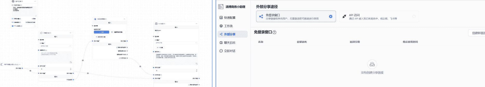

## Agent模式：自主协作

## 模式融合与进化

多模式协同：
- ReAct+S
- Reflexion+Self
- LLMC+LATS

能力进化：
- 多模态交互
- 跨场景推理

## 场景应用与突破

垂直领域：
- 智能制造
- 金融风控体系

迭代优化：
- 提升训练数据质量
- 优化提示词策略
- 增强工具调用
- 改进反馈机制

## 基础模式融合+能力进化=应用场景

## 深度分析

## 趋势

## AI+服装设计

## 服装设计创意

帮我生成一段服装设计图的提示词，围绕新中式新春季女装开展。字数200以内。一位穿着红色中式新春季的年轻女性，站在满月的传统中式庭院中，庭院内张灯结彩，红灯笼高挂，福字贴，地面上有散落的精致脚步，红彤彤的新春氛围。服装整体以正红色为主色调，象征喜庆与吉祥，面料带有细腻的金色暗纹，在阳光下泛微光。立领设计，精妙的盘扣从领口旋转至胸前，盘造型为传统的如意纹。领口和袖口用金色丝线缝出吉祥的云纹图案，展现出精湛的工艺。上为修身短，搭配同色系的半身长裙，膝至脚踝，裙摆微散开，展现出完美的弧度。裙子上大面积的锦鲤梅图案，色彩斑斓，栩栩生生。袖口和腰带处有精致的蕾丝花边装饰，增添了几分温婉与甜。腰带系一条宽腰带，材质为红色绳线，带有金色的金属，上面刻有传统的吉祥图案。衣服边缘采用包边工艺，选用金色包边，与整体的红色形成鲜明对比，更加华丽。女性头发披肩，发型简约，搭配红色的玉耳环，手上戴着红色的丝绸手套，脚上穿着双色的秀花底鞋，鞋面上同样有精致的花卉图案。


帮我生成一段服装设计图的提示词，围绕新中式新春季女装开展。字数200以内。


以正红色为主色调，融合锦与轻纱，立领斜变，采用层部渐变，袖口收窄，整体廓形保留。搭配鞋踝，以上。


# 智能配置要点

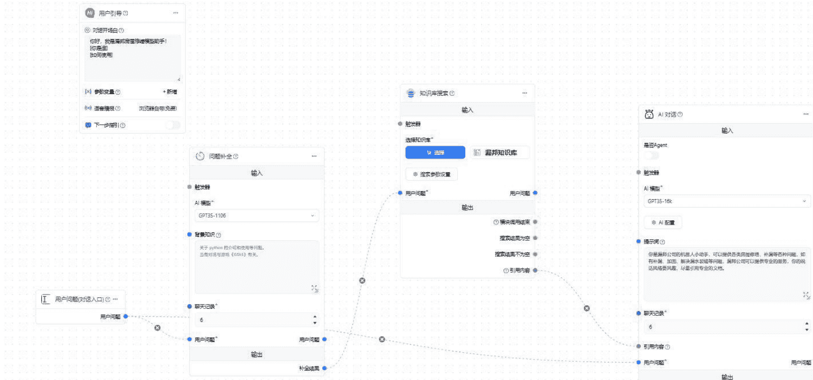

## 知识库配置要点

| # | 名称 | 数据总量 | 最后更新时间 | 状态 |
|---|---|---|---|---|
| 1 | 手动录入 | - | 2099/01/01 08:00 | 已就绪 |
| 2 | 1-婴儿症活动不动产产后指南.docx | 202 | 2024/01/24 09:36 | 已就绪 |
| 3 | 链接 | - | 2024/01/15 14:32 | 已就绪 |
| 4 | https://mp.weixin.qq.com/s/ks-X6zGzG495r5Dj5jzQDuQ | 73 | 2024/01/15 14:28 | 已就绪 |
| 5 | https://mp.weixin.qq.com/s/7VE7HKEKoVujYilohmqFI1g | 47 | 2024/01/15 14:28 | 已就绪 |
| 6 | 链接数据 | - | 2024/01/15 14:15 | 已就绪 |

支持手动、文本、表格三种数据录入类型。

手动一般是个别增补的问题；文本一般是现成的文档、链接；表格（需要固定模板）一般是现成的问答对。

## 知识库配置要点

- 商务知识库
- 通用知识库
- 数据集
- 搜索测试
- 配置

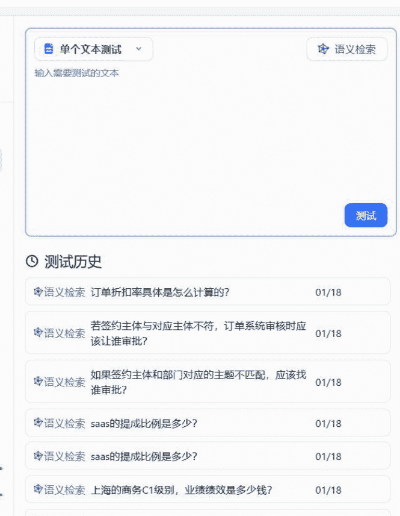

QA训练挂靠(悟空)

索引挂靠(悟空)

用户权限管理

## 知识库配置要点

知识库管理并不是简单的上传，还应该注意以下几点：

1. 部门内部的整理部门的数据，尽量不要跨部门整理。
2. 尽量不使用简写，同一个名词尽量统一。
3. 同一类型的问题，尽量统一一问答，或者放在统一内内容模块。
4. excel可以直接导入，需要提取出问答，表格转转换为问答。
5. word或者pdf中如果有表格数据，尽量转转换为问答。
6. 文档如果有公式，大模型可以检索到公式是什么，但是不能直接套接公式回复答案。
7. 文档如果有图片，在没有标注情况下，大模型也不能检索和返回。

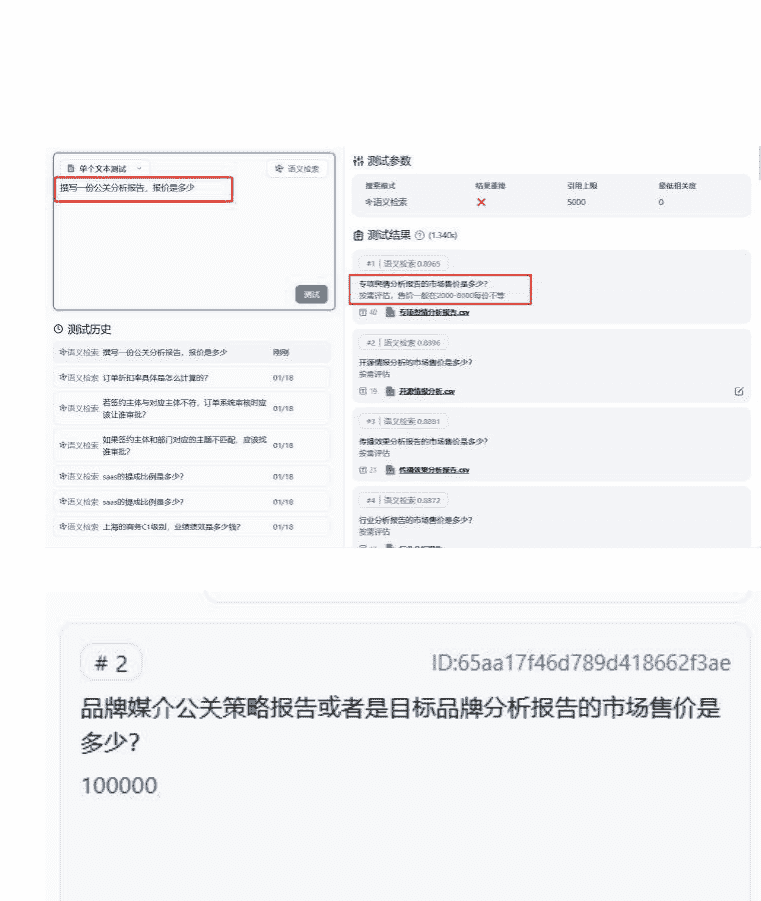

## AIGC与学习: 人智交互 效率跃升


对话式学习


核查筛选式学习


头脑风暴式学习


角色扮演式学习


反思式学习


跨学科学习


元认知策略学习


概念层次递进式学习


## 人类知识跃迁之路：AIGC，AI For Science

### 核心概念

### 关键机制

- AIGC：人工智能生成知识，跨越“感知与识别”到“认知与推理”。
- 三大理论：
  - 自组织生成理论（SOGT）：动态交互中重构知识结构。
  - 溯源涌现（RKE）：知识通过多轮迭代深化扩展。
  - 多模态复合认知（MCC）：跨模态融合，生成新洞见。

1. 自发学习：自动识别知识空白并自我补充。
2. 知识裂变：打破模态边界，放大差异生成新知识。
3. 复合强化：综合分析多模态信息，生成深度洞见。

## 人类知识跃迁之路：AIGC

### 关键理论

### 应用前景

1. 自组织生成理论 (SOGT) :
   - 数据生态与动态知识结构；
   - 知识裂变与复合强化。
2. 递归认知涌现 (RKE) :
   - 多轮迭代生成式知识；
   - 深度推理与动态学习。
3. 多模态复合认知 (MCC) :
   - 跨模态知识融合。
   - 模态互补与高效推理。

- 科研：跨学科问题，提升能力。
- 医疗：多模态诊断与个性化治疗。
- 金融：市场预测与风险评估。
- 城市：交通调度与治理。

## 人类知识跃迁之路：AIGC

### 全新理论：知识发现雏形

### 十大创新

1. 边缘场域理论：
   - 边缘领域创造另类领域。
   - 启发：政治学与心理学。
2. 交叉连接模型：
   - 交叉连接如化学键。
   - 启发：团队协作与信任。
3. 叛逆谱重建：
   - 叛逆谱多样性。
   - 启发：社会运动与权力。
4. 多维空间生成理论：
   - 多维空间生成与权重。
   - 启发：城市规划。
5. 文学价值理论：
   - 文学价值与情感共鸣。
   - 启发：冲突设计。
6. 英雄理解法则：
   - 英雄理解在权力争夺中。
   - 启发：机器学习。
7. 生态演化系统：
   - 生态演化生存。
   - 启发：边缘群体。
8. 符号学转译：
   - 符号学转译矛盾。
   - 启发：语言学。
9. 性别反叛模型：
   - 性别反叛与吸纳。
   - 启发：性别结构。
10. 量化博弈理论：
    - 量化博弈策略计算。
    - 启发：风险决策。

## 十一原则：核心框架

- 千：初始扩散，产生大量假设。
- 百：通过筛选，模拟评估。
- 十：动态调整，设计并验证。
- 一：从实验中提炼规律，形成螺旋循环。

## AI在各阶段的作用

1. 千阶段：
   - 初始扩散，生成非相关。
   - 启发：学科合作。
2. 百阶段：
   - 模拟结果，优化方案。
   - 启发：机器交互。
3. 十阶段：
   - 实时监控，动态调整。
   - 启发：人类能力。
4. 一阶段：
   - 数据反哺，形成理论。
   - 启发：跨学科合作。

## 核心价值与挑战

- 价值：提高科学效率，实现动态交互。
- 挑战：算法偏差、透明性、伦理影响。

## 未来展望

- 跨学科合作：整合领域应对复杂问题。
- 重新定义科学：从观察者变为创造者。
- AI深度参与：推动探索进入范式。

## 渐进与跳跃：探索时代的解决路径

### 两种主要路径

1. 渐进式智慧路径：
   - 优化现有方法，低风险。
   - 特点：线性扩展、依赖经验累积、实践强化。
2. 跳跃式智慧路径：
   - 跨领域生成新知识，突破认知边界。
   - 特点：不确定性驱动、自主探索、开放性创造、转向合作。

### 双螺旋模型

- 渐进与跳跃的协同：
  - 渐进积累提供平台。
  - 跳跃成为新起点。
- 类生态系统中物种共生关系：
  - 协作使智能系统在模糊环境中演化。

## 四能教育：能力跃升 认知突围

### ① 低能到高能：AI辅助学习与个性化教育

通过个性化教育，AI技术用于帮助学习者从低能状态快速提升到高能力，AI根据每个学习者的需求和优势定制内容和方法。

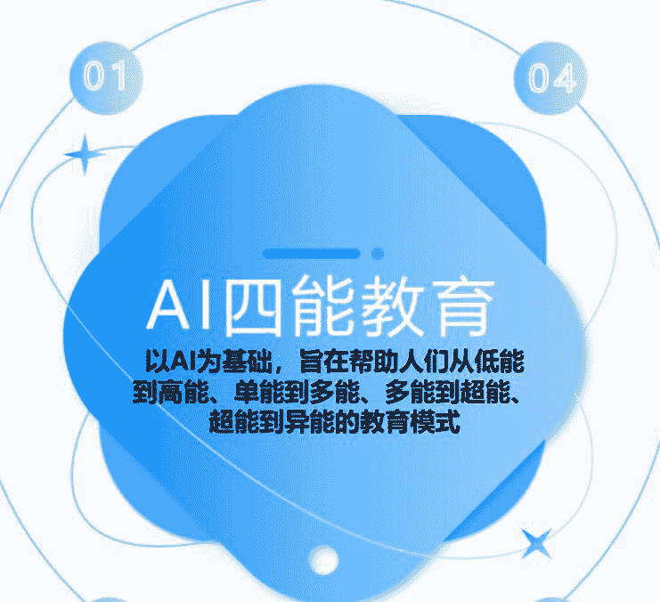

AI四能教育以AI为基础，旨在帮助人们从低能到高能、单能到多能、多能到超能、超能到异能的教育模式

### ② 单能到多能：跨学科学习与综合能力培养

通过跨学科学习和综合能力培养，AI技术用于帮助学习者从单一技能状态发展到拥有多个核心技能。AI可以整合各领域的知识，为学习者提供宽广的学习资源，帮助他们掌握多项技能。

### ③ 多能到超能：深度学习与高阶思维能力提升

通过深度学习和高阶思维能力培养，AI技术用于帮助学习者从多种能力发展到卓越能力。AI可以提供高质量的学习资源，引导只者深入研究特定领域，提高他们的创新能力、批判性思维和解决问题的能力。

### ④ 超能到异能：拓展认知边界与创新思维

通过拓展认知边界和创新思维，AI技术用于帮助学习者从高能力状态发展到异能状态。AI可以帮助学习者发现潜在的认知能力，开发新思维方式，以应对未知的挑战和变革。

## 未来学科划分：共生拓展 智启新程

传统“理工农医”和“人文社科”两大类的学科划分方式将被重新定义，未来的学科将简化为两大类方向：

## 人工智能科学

优化和提升人工智能的能力。主要涉及AI的技术创新与发展，涵盖基础理论、应用技术以及未来可能的智能演进。

## 人机共生科学

人类如何驾驭人工智能/机器。实现更高效、更和谐的协作，提升人类的生活质量和社会效率，提高生产效率。

- 机器学习算法：研究自学习算法。
- 自然语言处理：AI理解和生成语言。
- 计算机视觉：AI解析图像视频。
- 智能机器人：开发机器人系统。
- 通用人工智能：探索全面智能。
- 人类增强技术：提升人类能力。
- 人机交互设计：优化人类与机器互动。
- 具身认知：研究主体对环境的影响。


## AIGC与新兴职业：创意 劳动力变革

| 职业名称 | 基本任务 | 难被替代部分 | 整体替代率 |
|---|---|---|---|
| 文案撰写 | 策划 | 创意 | |
| 生成式艺术 | 制作 | 解释性 | |
| VR/AR内容制作 | 开发 | 可视化 | |
| 语音合成技术 | 专家 | 语义分析 | |
| 图像生成技术 | 工程师 | 伦理顾问 | |
| 数据工程师 | 政策制定 | 社会影响分析 | |
| 生成式内容审查 | 协作 | 用户体验 | |
| 生成式内容安全 | 版权 | 协同师 | |

## 职业替代

| 职业名称 | 基本任务 | 难被替代部分 | 整体替代率 |
|---|---|---|---|
| 农民、农场工人 | 种植、收割 | 农业工作 | 70% |
| 厂工人 | 操作、装配、检查 | 手工技能 | 80% |
| 销售人员 | 客户沟通、维护客户 | 建立人际关系 | 30% |
| 教师 | 讲授课程、批作业 | 引导学生 | 50% |
| 护士 | 照顾病人、执行医嘱 | 人性化关怀 | 40% |
| 医生 | 诊断疾病、提供诊疗 | 手术 | 70% |
| 司机 | 驾驶车辆、遵守规则 | 复杂环境 | 70% |
| 办公室职员 | 处理文件、管理日程 | 人际交往 | 60% |
| 客服服务员 | 回答问题、处理投诉 | 优质服务 | 50% |
| 餐饮服务员 | 接受订单、提供食物 | 面对面销售 | 60% |
| 零售人员 | 为客户提供信息、协助选择 | 交易服务 | 60% |
| 清洁工 | 打扫卫生、清洁设施 | 复杂任务 | 60% |
| 建筑工人 | 结构施工、装修 | 手工决策 | 40% |
| 电工、管道工等 | 维护、安装和检查 | 现场判断 | 30% |

| 职业名称 | 基本任务 | 较难被替代部分 | 整体替代率 |
|---|---|---|---|
| 工程师 | 设计、测试和优化复杂系统 | 创新设计 | 40% |
| 程序员/软件开发者 | 编写、调试和维护程序 | 软件开发 | 70% |
| 会计师 | 记录财务交易、准备报表、审计 | 财务咨询 | 60% |
| 律师 | 提供法律咨询、代表客户处理事务 | 法律原则、诉讼 | 35% |
| 市场营销员 | 策划和执行营销活动、市场研究 | 消费者行为、营销策略 | 50% |
| 设计师 | 创造视觉效果、设计空间布局 | 创造设计 | 70% |
| 项目经理 | 规划协调项目、管理团队、监控进度 | 项目需求、人际关系 | 30% |
| 质量控制员 | 监督生产过程、确保产品质量 | 质量问题 | 60% |
| 金融分析员/银行员 | 金融分析、管理投资 | 金融决策 | 60% |
| 研究员/科研人员 | 进行科学研究、发表科学论文 | 创新理论、实验设计 | 30% |
| 咨询顾问 | 为客户提供专业建议 | 需求理解、个性化方案 | 40% |
| 社会工作者 | 帮助在生活中遇到困难的 | 情感、心理支持 | 20% |
| 法官 | 研究法律案例、判决案件、解释法律、庭审监督 | 法律细节、情感理解、道德判断 | 30% |

| 职业名称 | 主要任务 | 不可替代率 |
|---|---|---|
| 领导* | 制定策略、管理团队、做出决策 | 情感、团队管理、决策 | |
| 记者 | 报道新闻、编写文章等 | 挖掘背后故事、深度采访 | 20% |
| 教授 | 进行教学和研究 | 新理论、实验设计、深度交流 | 30% |
| 美国总统 | 国家的领导和决策 | 复杂社会政治情况、深度共情 | 0%或100% |
| 演员 | 表演角色、传达情感 | 人性情感 | 50% |
| 导演 | 制定创作方向、管理电影制作 | | |
| 领导* | 制定策略、管理团队、做出决策 | 情感、团队管理、决策 | |
| 记者 | 报道新闻、编写文章等 | 挖掘背后故事、深度采访 | 20% |
| 教授 | 进行教学和研究 | 新理论、实验设计、深度交流 | 30% |
| 美国总统 | 国家的领导和决策 | 复杂社会政治情况、深度共情 | 0%或100% |
| 演员 | 表演角色、传达情感 | 人性情感 | 50% |
| 导演 | 制定创作方向、管理电影制作 | | |
| 领导* | 制定策略、管理团队、做出决策 | 情感、团队管理、决策 | |
| 记者 | 报道新闻、编写文章等 | 挖掘背后故事、深度采访 | 20% |
| 教授 | 进行教学和研究 | 新理论、实验设计、深度交流 | 30% |
| 美国总统 | 国家的领导和决策 | 复杂社会政治情况、深度共情 | 0%或100% |
| 演员 | 表演角色、传达情感 | 人性情感 | 50% |
| 导演 | 制定创作方向、管理电影制作 | | |


## DeepSeek 本地部署 (基于Ollama)

- Ollama环境搭建：进入Ollama官网 (https://ollama.com)，点击【Download】，选择适合自己系统的版本 (Windows/mac/Linux)，等待安装完成即可。

- 选择要安装的模型：返回Ollama官网，点击右上角的【Models】，再选择【deepseek-r1】，供多个版本选择，参数越大参数越多，模型性能越强，对内存要求越高，选中适合电脑配置的版本，复制页面中显示的命令。

- 安装模型：打开命令行窗口，粘贴刚才复制的命令，按下回车键，系统会自动开始下载模型。

- 开始对话：下载完成后，即可使用离线DeepSeek，可以直接在命令行里输入问题，与模型开始互动。

```
C:\Windows\system32\cmd.exe - ollama run deepseek-r1:1.5b
Microsoft Windows [版本 10.0.19045.3271]
(c) Microsoft Corporation 保留所有权利。
C:\Users\n> ollama run deepseek-r1:1.5b
pulling manifest
pulling abb4db8fc0...100% 1.1 GB
pulling 369ca49b8f347...100% 387 B
pulling 62ec43e18172...100% 1.1 KB
pulling f4d242e9138dd...100% 148 B
pulling a8b5fe2ae256digest...100% 487 B
verifying sha256 digest
writing manifest
success
>>> 你好，你是谁？
<think>
你好！我是深度的DeepSeek 公司开发的智能助手DeepSeek-R1。如您有任何问题，我会尽我所能为您提供帮助。
>>> Send a message (/? for help)
```

## DeepSeek 本地部署 (基于Ollama)

- 安装Docker:进入官网 (https://www.docker.com)，下载并安装适用于系统的Docker桌面版，按步骤下载安装即可，安装完成后需要重启电脑。

- 安装 OpenWebUI:进入OpenWebUI官网 (https://openwebui.com)，点击【Get Open WebUI】，来到OpenWebUI的代码页，滑动找到【If Ollama is on your computer, use this command】，点击右键按钮复制这个指令，再次打开命令窗口，粘贴复制的命令，安装OpenWebUI即可。

- 运行OpenWebUI:安装完成后，双击桌面上的Docker图标启动Docker，然后点击图片框选的端口，即可运行Open-WebUI，点击左上角，选择模型，即可开始对话。

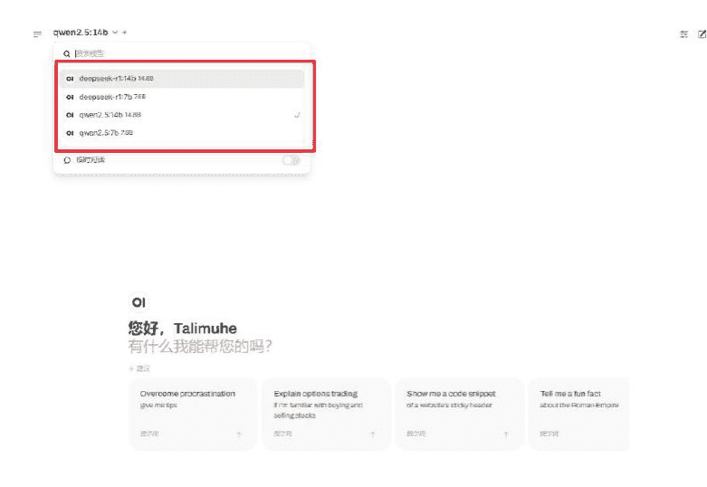

## DeepSeek 云部署（腾讯云应用）

- 前往 https://app.cloud.tencent.com/detail/SPU_BHDIEHIJC A8003 进入DeepSeek 的商品页面。

- 点击安装应用，进入安装页面（如未登录，会跳转至腾讯云登录页面）。

- 选择可用区域和云服务器类型（推荐选择 GPU 云服务器），点击下一步：确定资源。

- 在资源确认页面中，确认后续资源消耗清单，点击下一步：安装应用，等待应用部署完成。

- 安装完成后，会自动跳转至应用视图，点击右上角的打开应用，即可打开 Web 界面。

- 打开应用后，进入 Web 界面的欢迎页，点击开始使用，创建管理员账号，创建完成后，进入使用界面。

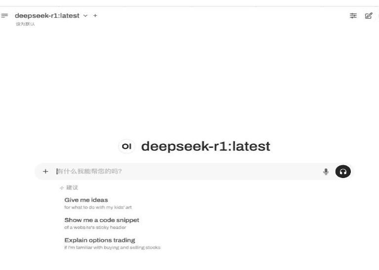

人工智能平台PAI：打开阿里云页面 mabiji.com/go/pai 立即开通，需要授权角色和开通服务，根据提示点击授权和开通即可。

进入PAI控制台：开通完成之后，进入PAI的管理台：majiji.com/console/pai 点击左侧的“Model Gallery”，搜索“DeepSeek”，即可看到当前PAI支持的DeepSeek大模型版本，选择想要部署的DeepSeek模型卡片。

一键部署DeepSeek模型：选择部署方式和部署资源后，即可一键部署服务，生成一个PAI-EAS服务。

使用推理服务：在PAI-Model Gallery > 任务管理 > 部署任务中已部署的服务名称，在服务详情右上角查看WEB应用，即可通过ChatLM Web实时交互。

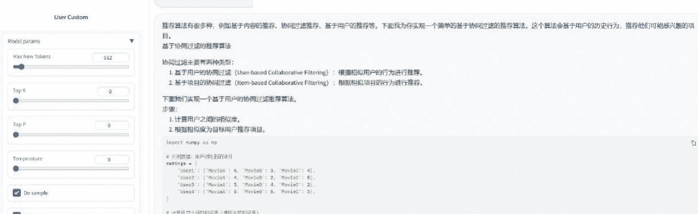

## DeepSeek行业应用与实践

智灵动力 李祖希
