# 中国女性私密健康白皮书

她有千钧力，亦有万万相

部门: 企服研究五组

©2025 iResearch Inc.

# 扫码加入 知识星球TOP 免费资源群

免费
公众号: 知识星球TOP

- 每日免费获取高价值资源
- 可提供各类资源搜索服务

价值
微信信号: jntsg8

| 热门付费文章 | 各行各业报告 |
| :--- | :--- |
| 精选图书资源 | 副业赚钱方法 |
| 职场实用资源 | AI政经自媒体 |

及时关注
微信信号: jntsg2

分享资料仅供个人学习，请及时删除，切勿商用传播

# ABSTRACT # 摘要

## 研究意义

随着《中国妇女（2021-2030）》发布，旨在全方位提高妇女女性生命质量，从健康学、改善营养、提高营养、提倡控烟等多方面为妇女覆盖全生命期的良好的卫生健康服务，国家和社会对于女性私密健康的重视程度达到了前所未有的高度。报告旨在提供对中国女性私密健康行业的深入洞察，分析市场发展情况，为用户选择私密健康产品服务的特点，以供行业从业者和投资者等各类主体参考借鉴。

## 研究内容

报告从认识私密健康的定义和重要意义出发，从发展现状出发，从群体视角层层深入，全面地对中国女性私密健康行业整体状况进行了分析。

- 正确认识和重视意义：报告首先从对女性私密健康的行业出发，从个人、家庭、社会及民众多重界面下面临的责任与愿望出发，这些医疗方法将直接影响到女性的私密健康。因此，实现自我“身体、心灵、感、行为、关系”五位一体的健康管理，为女性一生一生的重要课题。
- 发展现状：本章深入分析了中国女性私密健康行业的现状，涵盖了驱动、行业发展趋势、产业链及产业规模、市场规模等内容，研究指出，该行业经历了从无到快速增长的过程，有着较强的外部风险应对能力，且市场巨大，预计2027年市场规模将突破万亿，2030年直亿元。
- 群体洞察：通过对过去一年消费/使用私密健康产品/服务的1241位调研对象进行问卷调查，报告深入了解女性的生活优态、家庭与婚恋关系、性教育状况、私密健康问题、日常习惯以及未来产品服务的期待，为产业行业从业者提供了重要的引导。

## 研究展望

随着中国女性私密健康意识的不断提升，女性私密健康行业仍呈现积极的发展态势。趋势预测如下：1） 需求增长：消费者需求由基础功效走向五位一体、全周期健康管理方案升级；2） 市场发现：市场将在多重影响下保持活力、走向规范，专业化和差异化是行业成长的关键；3） 市场细分：需求将裂出多个高层次市场，观念的解放和扩大将赋予更多市场机遇。

# 目录

01 方兴未艾: 女性私密健康行业发展现状 Overview
02 见微知著: 女性私密健康人群洞察 User insights
03 迭代竞击: 女性私密健康行业发展趋势 Development trend

# 01 / 女性私密健康行业发展现状

## 什么是女性私密健康?

对于中国女性而言，明确“我”与“自己”的关系，意味着重新明确女性的身体与女性意志的关系，重新明确女性的物质精神存在与女性符号称谓的关系。

> ——中国·孟悦、戴锦华《浮出历史地表》

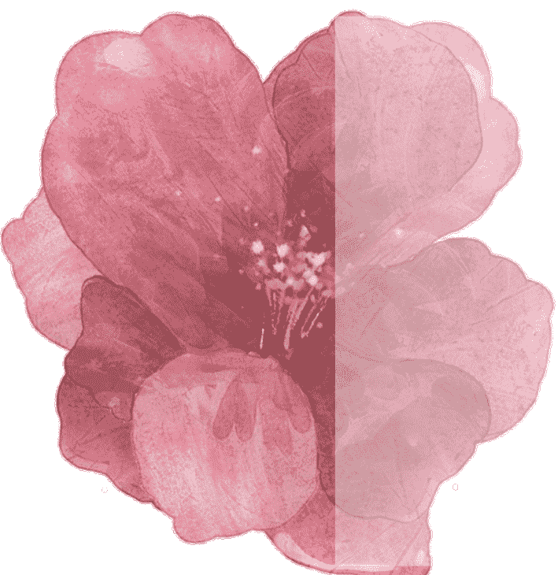

## 用户观点

## 女性在经历私密健康的“认知觉醒”，关注开始从单一的生理维度向心理、关系等维度转变

艾瑞调研显示，92.5%的女性认为私密健康非常重要。并且调研她们对于私密健康的认知发现，妇科炎症、经月不调、阴道松弛、不敏感等问题是她们最关注频繁的关于私密健康的内容，焦虑、情绪等问题均提及。此外，巨量数据显示，2025年期间，用户对“私密健康”相关的搜索内容大部分聚焦于生理层面，但表明，女性对私密健康的理解已经从单一的生理维度向心理、关系等维度转变，她们正在经历“认知觉醒”。

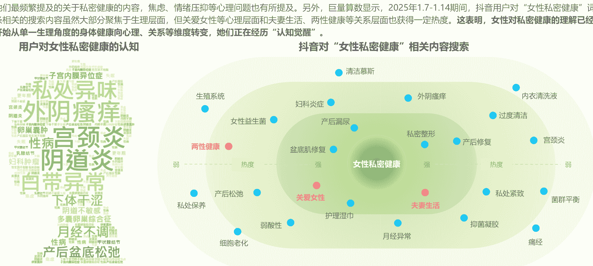

来源：巨量数据，艾瑞研究院自主研究。©2025 iResearch

## 正确认识

## 私密健康是渗透在女性生活方面的，涉及身体、心理、感受、行为、关系五位一体

随着经济水平与教育程度提高，女性对于私密健康的重视日益加强。从个人、家庭、社会及民众多重界面下面临的责任与愿望出发，这些医疗方法将直接影响到女性的私密健康。因此，实现自我“身体、心灵、感、行为、关系”五位一体的健康管理，为女性一生一生的重要课题。

## 女性私密健康的“五位一体”：身体、心理、感受、行为、关系

随着观念的进步和压力感的提升，她们开始注意自己生活中的变化。私密健康的重要性，不仅仅限于“妇科”，而是针对女性的选择与社交生活、贯穿整个生命周期的问题。

- 1.身体健康：女性的器官和系统的正常功能和状态，包含生殖健康、维护等。
- 2.心理健康：涉及心理状态、对压力的能力、自我认同和价值等方面，包括焦虑、抑郁、情绪波动等。
- 3.感受健康：女性对自己身体和情绪状态的认知和体验，包含疼痛、劳累、舒适感、快乐等。
- 4.行为健康：涉及行为、生活方式的选择，例如工作与学习。
- 5.关系健康：女性在家里、工作和社会中面临的人际关系和社交网络，包括亲密关系、家庭关系、朋友关系等。

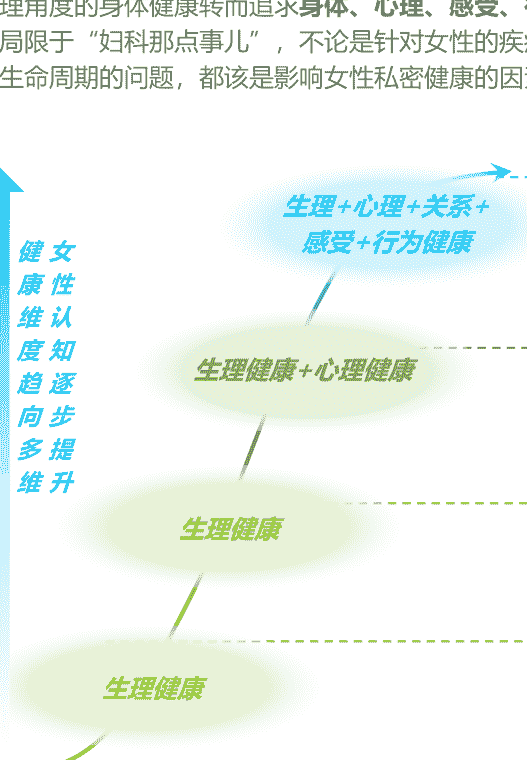

## 为什么要讨论女性私密健康?

我希望你们找到人生中真正的意义、满足和激情。我希望你们能够度过艰难时光，获得更强大的力量与坚定的决心。我希望你们能够平衡自己的生活，睁大眼睛去寻找。我还希望你们怀着进取心，在事业里全心投入，掌控世界。因为世界需要你们去改变，全球女性都在指望你们改变命运。

> ——美国·谢丽尔·桑德伯格《向前一步》

## 女性扮演着多重角色

责任加持下女性多重期望难以有效平衡直接影响心理健康

在现代社会高速发展和传统观念根蒂固的作用下，女性扮演多重角色，是家庭支柱、职精英、社会管理决策者、还是自己成长路上的不懈追求者。在这种情况下，多重的期望和自我价值认同给女性带来压力，她们被迫向社会、领导、同事、家人甚至向自己证明自己的能力和价值。根据《2023 Cigna全球活力指数调研》，18.5%女性表示压力较大，男性为4.6%。女性的生理构造和身体反应使得她们常常备各种私密问题的困扰，若无法平衡家庭、职业、自我之间的关系，外界因素直接影响女性心理健康，进而对生活造成不可忽视的影响。

## 女性的多重角色定位

## 女性的“个体”角色

女性在被赋予多重角色之前，是独立的自我，要保护自己，尊重自己的感受和个人追求。但在多重身份下，女性往往失去了自我，面临着多种健康危机。

## 女性的“家庭”角色

女性作为妻子、母亲、女儿、儿媳等多重身份，承担着抚育和照顾家庭成员的职责，是一个家庭是否完整幸福的关键：

- 作为妻子：承担与丈夫共同育孩子的责任
- 作为母亲：承担与照顾及维护双方关系，共同维持照顾和家庭的责任
- 作为女儿：承担父母的照顾责任，照顾老父母
- 作为儿媳：承担与公婆关系的责任

## 女性的“社会”角色

随着教育水平提高，越来越多的女性开始进入职场角色，同时也面临性别歧视、多重身份带来的压力。这种观念的解放和扩大将赋予更多市场机遇。

## 女性的“公职”角色

女性在职场环境中仍然面临生育与兼职压力，在社会管理中发挥价值。多重的社会角色与自我认同给女性带来压力，她们被迫向社会、领导、同事、家人甚至向自己证明自己的能力和价值。

## 女性在生理层面的私密健康问题

 生理层面：女性面临多种疾病和特殊症，不及时治疗将持续影响。根据卫生组织（WHO）数据显示，中国女性40%有不同程度的患病率高达70%。估计2023年中国有2.8亿女性患以下类型的疾病：

1.妇殖炎：阴道、外阴、宫颈炎、盆腔炎等
2.良性疾病：子宫内膜异位症、子宫肌瘤等
3.卵巢疾病：多囊性卵巢综合、卵巢囊肿、早发性卵巢功能不全等
4.子宫肿瘤：子宫肌肌、子宫内膜癌、宫颈癌等
5. 肿瘤：阴道肿瘤、外阴肿瘤等等
6. 月经问题：月经不规律、月经量异常、痛经等
7. 性传播疾病：尖锐湿疣、梅毒、艾滋、肝炎等
8.不孕：由多种原因引起不能怀孕的状况

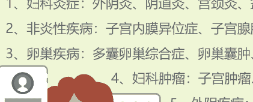

## 2023年中国女性妇科疾病诊疗需求

| 类别 | 比例 |
| :--- | :--- |
| 备孕/产 | 24.5% |
| 备孕问题 | 15.4% |
| 月经问题 | 8.2% |
| 妇科炎症 | 8.0% |
| 其他 | 43.9% |

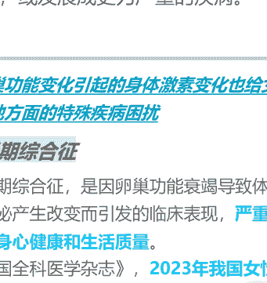

> 此外，卵巢功能衰竭会导致身体的变化，也带来了其他方面的妇科疾病困扰

### 1.卵巢功能综合征

* 又于更年期综合征，是因为卵巢功能衰竭导致神经内发生改变而引发的临床表现，严重影响女性的健康和生活质量。
* 根据《中国医学杂志》，2023年中国女性卵巢功能综合征的发生率为61%。
随着年龄的增加，卵巢——

### 2.经前期综合征(PMS)

* 是一种发生在生育期女性的综合征，具体表现为出现躯体症状、精神症状和行为的改变。

来源：艾瑞咨询-2024年中国女性妇科疾病白皮书，《中国医学杂志》，WHO，国家数据统计，艾孚咨询医学研究院自主研究及结论。©2025 iResearch Inc. www.iresearch.com

## 女性的个体身份压力（2/3)

心理层面：多重身份压力和生理特性增加心理障碍，需予以重视，提高病理化识别率。
世界卫生组织ICD-10诊断系统中，女性身份的特性和生理变化，特有的心理障碍类型：焦虑症、抑郁、产后抑郁、经期抑郁——涵盖了女性从初潮到绝经的整个周期。《中国妇女发展规划（2021-2030）》，要求建立全生命期的健康服务网络，重点关注女性健康。尽管如此，艾瑞调研显示，由于女性承担多重身份压力，问题往往难以解决，病理化识别率低。

## 女性生活中的不适状况

| 社会环境 | 比例 |
| :--- | :--- |
| 生活中感到不适 | 47.4% |
| 人际关系 | 14.4% |
| 家庭压力 | 13.3% |
| 学业生活 | 6.6% |

> 《Cigna全球活力指数》的一项调研，2022年女性因压力遭受的程度比男性的两倍。

## 女性的心理状态和压力

## 常见心理挑战

- 持续的担忧、焦虑、烦躁、情绪波动、神经紧张、睡眠障碍。
- 反复出现的、无法控制的想法、强迫症。
- 压力来源：艾瑞调研数据，《中国妇女发展规划（2021-2030）》显示，其中2.4%的女性更为常见。

## 女性的个体角色(3/3)

行为、关系和感受面：生活直下维持多属关系是女性面临的课题。
- 加速、神经紧张、睡眠障碍。
- 反复出现的、无法控制的想法、强迫症。
- 压力来源：艾瑞最新调研数据，《中国妇女发展规划（2021-2030）》显示，其中2.4%的女性更为常见。

## 不同年龄的女性的行为、关系、感受存在的问题

艾瑞博士提到女性一生分为五个阶段，分析不同阶段的表现：

| 行为 | 关系维度 | 感受维度 |
| :--- | :--- | :--- |
| - 能够理想形象 - 不会与他人沟通内心所想 - 开始关注自己的形象 - 得如何与异性互动 | - 面对困难，到处面对 - 意外情况，需要立即面对产后 - 后如何面对 | - 照顾小孩，频繁睡起 - 需要照顾睡眠 - 因产后产生变动 |
| - 更倾向于他人交流 - 与丈夫交流，认为自己不佳 - 开始关注异性的特征 | - 感觉孤独不被理解 - 与丈夫交流时不够频繁，被忽略 | - 重复工作任务，为生活 - 拒排丈夫 |
| - 学习压力、压力 - 烦躁，情绪波动较大 - 容易产生焦虑 - 开始关注社交世界和个人兴趣 - 发现，却不被理解 | - 爱情的甜蜜和折并存 - 得到解决 | - 不被丈夫喜欢 - 生孩子后被忽视 - 婚后对丈夫失去关注 - 下班丈夫产生期待 - 丈夫妻子 |
| | 夫妻继续独立，面临婚姻危机 - 与子女沟通出现规律，有代代沟 - 老观念不体贴 - 父母年龄近，依赖性 | 子女成长，需要应对 - 综合后 - 身体机下降，罹患慢性疾病的侵扰 - 性生活越来越少 - 家务负担、养育妻子、照顾 - 人事事务处理 - 照顾老人和自己 |

## 女性的社会角色越来越多的女性承担了更重要的角色

近年来，在政府的高度努力下，我国义务教育阶段已基本消除性别差别，高等教育阶段男女比例基本均衡，女性接受教育等平等权利得到有力保障。2022年，高等教育在校女生为2903.3万人，占总数的50.0%。而在三十年前，这一数据为37.7%。随着女性教育水平的提升，她们在社会经济发展中承担了更为重要的角色。国家统计局数据显示，2022年女性就业人员3.2亿，占就业人员的比重为43.2%。女性科技工作者总量超过4500万人，2011年增加了86%。世界银行的数据，我国15-64岁女性劳动参与率为68.5%，高于全球平均水平。在这些数据不断新新的同时，多项研究显示，女性数量与工资有关，每一个女性工资下降10%。这种状况，我认识到：女性在职场中屡日益增，她们的职业发展与生育的需求亟需通过切实可行的福利政策得到解决。

## 全球女性劳动参与率与中国女性职场参与表现

### 女性所遭遇的职场环境 不同职场所的不对待

### 全球主要经济体女性劳动参与率

| 加拿 | 英国 | 日本 | 中国 | 美国 | 韩国 | 世界平均 | 亚洲 | 印度 |
| :--- | :--- | :--- | :--- | :--- | :--- | :--- | :--- | :--- |
| 75.6% | 73.6% | 72.8% | 68.6% | 67.9% | 56.0% | 55.0% | 49.1% | |

## 中国女性的职场表现

| 全国女性就业人员 | 3.2亿 |
| :--- | :--- |
| 全国女性科技工作者 | 4500万 |

| 职求过程中 | 比例 |
| :--- | :--- |
| 未遭遇婚育 | 32.3% |
| 年龄歧视 | 43.0% |
| 遭遇职业歧视 | 38.3% |
| 遭遇职业晋升 | 17.9% |
| 性别歧视 | 22.5% |
| 遭遇职业晋升 | 9.5% |

| 企业女性职场遭遇不公 |
| :--- |
| 37.1% |

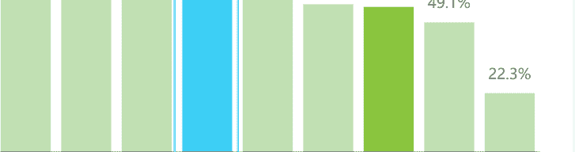

- 劳动参与率为15岁及以上的人口中从事经济活动的人口比率，女性劳动参与率准则是15岁及以上女性群体的比例。
- 世界平均女性劳动参与率为55.0%，从1990年至2019年，中国女性的劳动参与率从61%下降到50%左右，在全球劳动参与率中处于中上水平。

> 根据智联的数据显示，61.2%的女性在求职过程中遭遇婚育困扰，高于一年的55.5%。38.3%的女性表示遭遇职场影响。可见，职场歧视、年龄歧视、性别歧视对女性的职业发展造成困难。

此外，由于女性生育后的女性往往没有获得足够的支持。一方面需要建立支持女性的家庭支持系统，另一方面则要在现实上实现进步，打破男尊女卑的传统观念。更需要让社会认可女性的家庭价值，同时也要认可女性的职场价值，让女性无论是否在就业都能在选择上变得更加自由。

来源：iResearch，《2023年中国女性职场发展报告》、《2022年中国女性就业状况报告》、《中国女性发展报告（2021—2030年）》统计报告，咨询方：智联招聘分析研究中心

## 女性的国家公民，女性天然承担生育与繁殖责任，并在社会决策和管理中发挥价值

根据第七次人口普查数据，我国人口14.12亿，其中女性6.89亿，占比48.76%，人口性别比（以女性为100，男性女性的比例）为105.07，与2010年第六次全国人口普查基本持。虽然，女性作为国家公民占据了“半天边”。一方面女性由于特殊的结构承担了生育与繁殖后代的责任，这种生育能力是自然赋予的一种天赋，是人类种族延续的重要基础，同时也应该考虑到女性拥有生育的自主权和选择权，生育可以选择的之一。另一方面，女性同样在社会决策和管理中发挥价值，我国人大代表占比从2.0%上升到24.9%，政协从6.6%上升到20.4%，这体现了女性在社会过程中发挥的作用，未来将取得进展。

## 女性特殊的结构承担了生育与繁殖

## 女性在社会决策和管理中发挥价值

| 全国人大代表与政协占比 | |
| :--- | :--- |
| 一 二 三 四 五 六 八 九 十一 三 |
| 24.9% | 22.6% | 21.2% | 21.3% | 21.8% | 20.2% | 21.3% | 17.7% | 17.8% |
| 17.8% | 12.0% | 11.4% | 8.1% | 9.0% | 13.1% | 13.7% |

- 女性的生理结构决定了她们生育后的能力：从生物学角度来看，女性是人类自然的属性，生育后每个母亲都能育儿，这一过程是自然的，在许多社会中，同时也是社会稳定的因素。
- 根据法律规定，女性拥有完全的生育权和选择权：生育自由是自己的选择，不可缺的一部分，无论成为母亲还是从事事务，都应该取决于自身判断，不受外界干预。

> 女性人大代表与政协委员比例逐年提高：根据智联的数据显示，女性比例在最新报道中至少占30%，未来将进一步提高。

## 行业积极推动女性健康

国家直接影响家庭和社会的水平，是实现健康的重要组成部分。以来，随着国家的不断努力，我国女性人均寿命从2010年的77.3岁提高到了2020年的80.8岁，比世界平均寿命高。以后，国家战略的重心从“活寿”转向了“健康活好”，通过筛查、防护等手段进行预防。同时，随着寿命提高，国家对健康的关注逐渐从“活得长”向“活得好”转变，通过女性环境、保障人格尊严、维护健康减少内耗（如缓解焦虑等），呼吁社会关注女性特殊期的身心健康，全面提升女性质量，增强获得感和安全。

- 《2020年健康规划》针对不同年龄段妇女健康包括内分泌、心理、管理等方面的预防以及常见疾病治疗，推动营养、筛查和治理。
- 《中国妇女发展纲要（2021-2030年）》关注妇女生命周期，从健康教育、科学管理、营养、保障等多维度为妇女健康提供全生命周期的良好服务。
- 《关于落实国家健康促进的通知（2024-2027年）》将妇女健康发展的重点之一，全系统提升健康水平，引导居民成为自己健康的“第一责任人”。

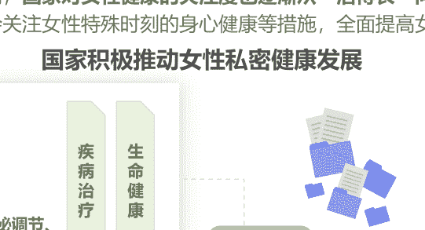

### HPV疫苗正式入
HPV疫苗的接种范围已扩大到9-45岁，保障更多女性的健康。

### 政府主体积极推动女性私密健康教育
以网络为代表的政府主体积极发布有关女性私密健康的内容，引导女性了解到。

### 妇女爱自己，减少伤害

来源：中新、中国数据局、《世界健康报告》，微播，艾瑞研究院主研究及主编辑

## 行业驱动力：需求侧

女性的自我私密健康意识开始增强，并身心一体化全面拓展。近年来，随着生活水平与受教育水平的提高，女性对于自己的私密健康日益重视，且不再局限于普通关注的健康问题。社交媒体平台的搜索指数显示，“女性健康”话题的讨论热度较高，其中“女性健康”话题热度指数达到了4.7万/日，和医疗健康类的其他话题相关系数较高。重庆、北京、广州、上海、成都五个城市的居民对于“女性健康”话题的搜索指数最高。（参考《当女性健康被忽视》一中的数据统计与研究报告，在微博中搜索“女性私密健康”维护、妇科、产科、两性健康、女性健康支持等为广受关注的话题，然而越来越多的女性意识到私密健康不仅与身体状况相关，还关心理状况、行为、感等多个维度，女性的自我意识增强和身份认同正在快速发展中。

## 2024年女性健康话题搜索指数

### 抖音女性健康健康话题搜索指数

| | 抖音话题搜索指数TOP5城市 |
| :--- | :--- |
| 最高热度指数：4.7万/日 | 北京 2.40% |
| 平均热度指数：2.1万/日 | 广州 2.02% |
| | 上海 1.95% |
| | 深圳 1.90% |
| | 成都 1.72% |

### 百度女性健康话题搜索指数

| | 百度话题搜索指数TOP5城市 |
| :--- | :--- |
| 平均热度指数：728/日 | 北京 0.28% |
| 最高热度指数：1907/日 | 上海 0.27% |
| | 成都 0.3% |
| | 重庆 0.4% |
| | 广州 0.5% |

## 关注的话题及关注点

| 关键词 | 核心关键词 | 关注点 |
| :--- | :--- | :--- |
| 妇科 | 经血、痛苦、备孕、经期... | 主要涉及月份、孕、生理带来的困扰。 |
| 两性体验 | 第一次、害怕、未知... | 主要涉及生活检、个人性、对健康的未惑、生活、心理等。 |
| 女性疾病 | 检查、手术、医学、预防、疫苗... | 主要涉及女性特有的疾病、美容、情绪等。 |
| 健康支持 | 医复、感谢、怀、有用... | 主要涉及医学人士为女性群体提供帮助、普及相关知识。 |

> 依托社交媒体的讨论和传播使得各类需求被广泛关注。通过引导，女性获得了自身在全方位健康中的主权，也让女性健康在社会层面得到了重要性。

来源：算数、百度，《当女性健康被忽视：基于社交媒体的讨论报告》：苏苏、若坤、艾瑞研究院主研究。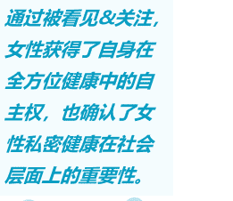

## 行业发展：供给侧

## 产品类型和功能持续化、技术升级为产业发展注入动力

随着私密健康成为日常需求，相关产品不再局限于单一清洁，开始走出市场蓝海，多元化、专业化。随着新入者增加，技术的快速升级和女性需求的增长，市场意识引起，单纯的消毒不能解决根本问题，需要寻找更有效的手段；在此机会下，粘膜再生、菌群平衡、抗衰等功能出现，满足现代人追求的安全性和品质。

## 产品类型多样化、功能进阶、丰富供给

## 技术发展、持续升级

## 产品类型多样化、丰富场景

### 材料合成、提取升级

| 私密洁洗 | 私密凝胶 | 私密湿巾 |
| :--- | :--- | :--- |
| 私密面膜 | 私密精油 | 私密滋养 |
| 私密益生菌 | 家用私密仪器 | |

> 生物医学、化学技术以及应用材料的进步，利于更好效果、安全性的提升。在密膜修复领域，多家企业通过生物工程、合成等技术，提取可用于粘膜修复的蛋白质膜，提升女性生殖吸引力，改善干燥、敏感度。私密舒适和滋润是女性健康通道。过去，产品聚焦于单一清洁、消毒等功能，可能会破坏菌群平衡导致屏障反复；如今，产品开始菌群平衡、修复再生与更高级的功能进阶。

### 产品功能与性进阶

- 从洁护产品，逐步向医疗器械转化。
- 不同类型产品越明确，避免产品滥用。

### 生产效率与品质提升

> 3D打印技术：实现女性个性化建模，精准适配特殊的女性个性化需求。
> 互联网、云计算：实现智能化生产和自动化管理，有效提高生产效率和产品质量。

### 数据分析优化产品迭代

> 计算机科学技术发展，大数据分析进行产品使用反馈，在保障质量的同时优化客户体验。

来源：艾瑞咨询《2023年中国私密健康行业报告》专家访谈，艾瑞咨询主分析师及执行主任

## 行业发展驱动力：全面爱自己

###关注自身身心健康和生活品质成为女性消费趋势

随着女性经济地位的提升和自我意识的增强，她们对于美丽和健康投资的消费意愿不断增强，对生活的丰富程度提出了更高的要求。消费能力和消费意愿的提升使女性在经济发展的不同阶段扮演着重要的角色，她们不仅是消费升级时代的主力，也是消费降级时代消费回暖的强大动力。根据统计，2024年10月21日，女性消费主题指数数据709.67点，近一个月上涨了23.32%，显示出较强的增长态势。随着“悦己消费”成为新的消费趋势，她们在抖音、携程等平台上已经留下了“方位爱己”的消费足迹，她们关注自己的外形上，更注重丰富的精神世界，还拥有健康的身体，催出更多多元化、品质、个性化的消费。“经济”下的女性消费发展趋势

2024年10月，女性消费主题指数数据显示出强劲的增长态势。

女性消费主题数据：
709.67点
近一个月上涨了：23.32%

这个指数选取了50只在女性相关行业中市值较大的上市公司证券，涵盖了女性在美妆、护肤、旅游、医疗保健、服装时尚等多个方方面的消费需求。

【抖音：经济学下的女性消费趋势】

【携程：女性在旅中发现与寻找自我】

“旅行”消费消融：2023-2024年，女性全年人均旅行消费支出：“男性”为8%。2024年消费数据显示，女性购物品类增长超过23.2%，消费需求转型，从单一向多维转变，要在内外的结合，回归自己的物质世界和精神世界，“全位爱己”的主要趋势。

最关注商品类别：
TOP1 特饰品
TOP2 运动品
TOP3 护肤
TOP4 乐器
TOP5 图书

成为新潮。90/后女性【消费力】：“离婚后，在旅行中发现自在”（不，此处应为“90后”及“离婚”可能是OCR错误）。
50/60后女性【消费速度】：“活到老老，在旅行中重拾与自信”。

来源：中信数据、抖音、携程《2024年女性消费趋势》，艾瑞咨询研究院主分析。

## 行业发展历程

## 从女性健康到市场化，女性健康从单一治疗走向预防为主

私密健康经历了从单一到市场化、开放，女性健康从单一治疗走向预防为主。此外，市场细分化需求涌现，市场快速扩张的同时也带来了问题。未来，随着政策驱动，深耕细分领域，提升服务效率，推动行业向科学化、专业化、精细化演进。

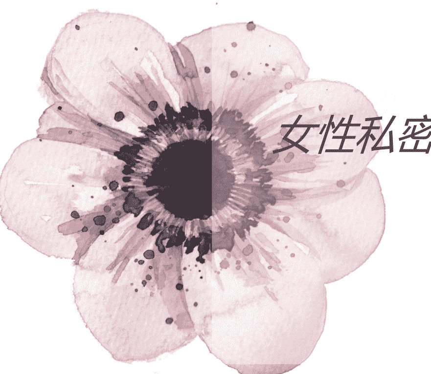

私密健康行业处于高速增长期，市场红利巨大，但尚未形成垄断格局。

1.0 萌芽期
2.0 探索期
3.0 野蛮增长
4.0 成

来源：《健康中国2030规划》，艾瑞咨询行业报告及自创

## 行业发展呈现：需求侧

女性认知持续市场需求，需求升级引发市场需求变现。在《健康中国2030规划》的指导下，各部门积极推进“女性健康工程”，根据调研数据显示，已有38.4%的女性对私密健康含义及清晰的防治措施了解，教育成效。然而，仍有六成女性对私密健康的认知有限，市场教育需进一步强化以满足女性对自我探索和健康管理的需求。根据今日头条平台“女性私密健康”热数据显示，“女性性”正在不断努力中出现越来越多积极的探索，随着观念升级，产后、卵巢保养与私密整形等消费需求将多元化发展；同时，随着女性消费趋于理性，质量及安全成为满足她们健康的关键因素，进一步推动了行业专业化和规范化。然而，市场需求是一把双刃剑，在推动市场快速发展的同时也使得消费为主，若无专业人士引导选择，消费者购买难度将高。“高质量”的“消费升级”如果不考虑因素可能会造成消费的失败。

## 女性私密健康需求侧呈现现状

产后修复美容行业：一方面，女性对私密功能及修复术系统缺乏认知，通常在产后一个月后发现诊断后才开始积极修复；另一方面，即使从开始，很多女性也难以完成整个私密美容修复，主要是她们对私密健康重要性的认识不足，受低价值观和传统观念的持续影响。

从生命安全到生命质量，观念升级带来多元需求

随着女性对“生命质量”的重视，她们不再局限于“有病治”，而是“无病优”等，开始关注私密健康的日常维护、卵巢保养、产后防治、产后修复、私密护理等需求将如春般爆发。

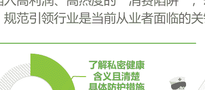

## 今日头条热词“女性私密健康”需求侧指数

## 行业发展：供给全周期解决方案，市场高速发展供给侧将进入优胜劣汰期

## 私密机构侧已重视私密健康的防治与保全

机构侧，医院虽已重视私密健康的防治与保全，但侧重于临床检验、情绪价值较低、服务不全面等问题；私密机构已在一定程度上弥补了医院的缺陷，但存在专业性不足、合规性不高、误导消费者等关键问题。此外，多家医院与私密机构联合，打通诊疗路径，服务侧，逐步形成女性私密健康全周期解决方案，覆盖全年龄段和生理心理核心问题，并多样化、精细化和专业化发展。然而，巨大的市场红利已过频，随着女性从生育时代逐渐进入稳长期，以及以新时代消费者趋成熟的选择，“优胜劣汰”将成为供给侧的大趋势。

## 中国女性私密健康行业发展趋势

| 机构侧 | 产品服务侧 |
| :--- | :--- |
| 医患端 | 围绕生命重心 |
| 医生对认识和治疗手段 | 未孕女性：卵巢抗衰、子宫平复等 | 覆盖生理核心：围排卵、子宫颈部部位，提供营养支持、抗衰等生理解决方案 |
| 就医体验提升（私密性、服务等） | 女性营养：盆底、腹部肌修复、卵巢抗衰等 | 女性私密健康全周期解决方案 |
| 难以以结实心理状态的沟通方式 | 中老年女性：更年期、老年期、愈症防控等 | 重心理健康：注重质量、压力等状况，提供优质心理解决方案 |
| 更侧于临床疾病和治疗，康复服务亟待优化 | 产品应用批准，优化更新 | |

### 机构侧
### 产品服务侧
### 医患端
### 私密机构端
- 医院
- 医体
- 健康管理中心
- 私密机构
- 乱象

## 庞大的市场“不专业”有机生长

从消费者角度缺乏专业，或有意之者，市场中不乱、监管相对后；导致市场出现“不良产品”，对女性私密健康造成不健康的影响。

“乱营销”：许多产品中泛滥添加导致皮肤干燥、过敏，消费者认为是认为增的，卵牙可以提高效率，事实上对盲目操作后并无改善，仍旧有旧疾。

就医体验（服务化、私密性、与客户互动流程）
- 服务和种类齐全
- 提供私密健康全周期解决方案
- 存在人才不匮、疗法质量不均、专业性不足
- 合规性持续，减少少大其词，使用不规范产品及服务
- 产品类型较为多样，定位不明确，消费者难以与其自身需求匹配，出现“进店错”现象

来源：蔻源，艾瑞咨询研究院主创及记者
©2022 iResearch Inc.

## 产业链与产业图谱分析

### 上游
### 中游
### 产品服务
### 下游

- 私密保健品牌
- 线上电商平台
- 私密护理品品牌

- 私密保健品牌
- 商场
- 药店
- 专卖店

- 私密治疗与健康
- 医疗机构
- 私密机构

- 私密美容与整形

- 情趣用品品牌
- 线上电商平台
- 情趣用品

- 心理咨询品牌
- 商场
- 药店
- 专卖店
- 心理咨询服务

- 心理咨询机构
- 心理健康APP

- 心理健康品牌
- 心理健康服务

- 健康产品

- 各机构
- 私密健康平台

## 市场规模

私密健康行业抵抗外部风险显示出强韧性，随着经济减缓和需求增长，市场规模将于2027年突破万亿，2030年突破万亿。
单位：亿元

| | 2020-2024 | 2024-2030 |
| :--- | :--- | :--- |
| 女性私密健康总市场 | 9.7% | 17.5% |
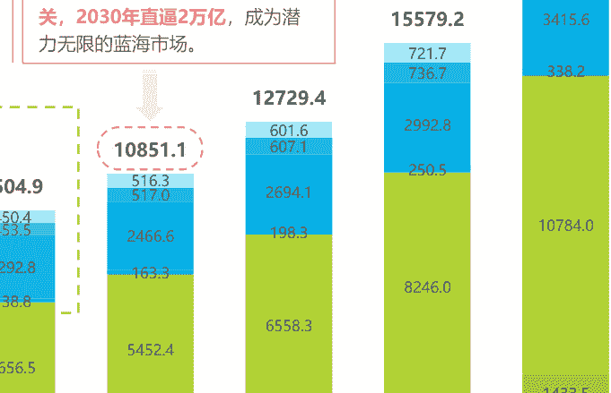

## 波动下韧性

在2022和2023年的特殊时期，受到负面影响，私密健康行业经历短暂下滑。2023-2026年，经济处于波动期，预计女性私密健康行业保持在11.5%左右的复合增长，增速稳健。

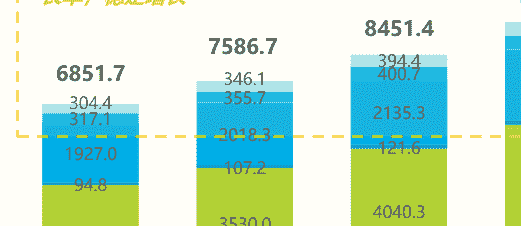

| | 2020 | 2021 | 2022 | 2023 | 2024 | 2025 | 2026 | 2027 | 2028 | 2029 | 2030 |
| :--- | :--- | :--- | :--- | :--- | :--- | :--- | :--- | :--- | :--- | :--- | :--- |
| 精用药品 | 6051.2 | 6005.9 | 304.4 | 290.8 | 1927.0 | 341.0 | 335.7 | 394.4 | 213.5 | 136.8 | 121.6 |
| 医疗器 | 1579.2 | 719.1 | 82.4 | 1804.5 | 841.4 | 7586.7 | 107.2 | 2298.2 | 9504.9 | 4565.5 | |
| 护肤 | 2330.4 | 275.6 | 2629.7 | 435.0 | 3051.0 | 482.9 | 746.5 | 538.5 | 609.7 | 698.0 | 832.8 |
| 其他 | 298.3 | 528.9 | 320.6 | 625.4 | | | | 400.3 | | | |
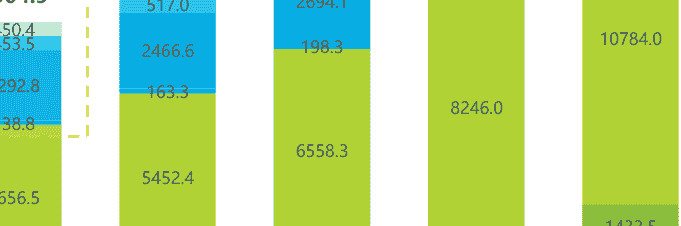

精用药品：1. 私密健康与女性健康药物，包括生殖治疗、注射、避孕类避孕产品；
2. 私密护理产品：洗护、洗液、去味、护肤等；
3. 私密健康产品：女性生殖健康保护裤；
4. 性护理：按摩、美容性
市场范围：阿里、京东、天猫、线下专卖店、分销渠道、电商及线下平台、其他渠道等。

私密医疗与美容：“蓝色类”代表女性相关的私密健康产品/服务，“粉色类”代表女性相关的私密健康产品/服务，“黄色类”代表女性均相关的私密健康产品/服务。

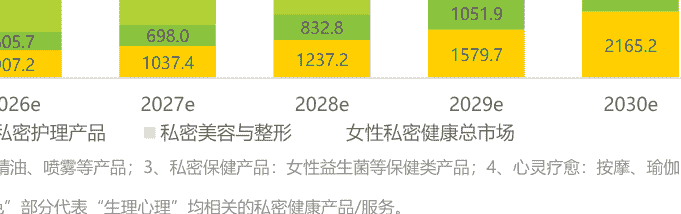

| 2020 | 2021 | 2022 | 2023 | 2024 | 2025 | 2026 | 2027 | 2028 | 2029 | 2030 | 女性私密健康总市场 |
| | | | | | | | | | | | |

## 女性私密健康人群洞察

### 调研说明
### 研究目的及内容
本次通过艾瑞调研收集样本，利用调研了当前中国女性用户的画像、生活状态、认知、产品服务消费周期、消费偏好、未来期望等进一步了解当前女性私密健康现状。

| 调研概况 | 描述 |
| :--- | :--- |
| 样本来源 | 艾瑞调研平台 |
| 调研时间 | 2025.1月 |
| 调研对象 | 过去一年购买/使用过私密服务的女性 |
| 覆盖地区 | 全国地区 |
| 样本数量 | 1241个样本 |

### 私密健康用户整体画像
本次调研主要为已婚女性，城市分布均衡，广东占比最高；大部分用户仅了解私密健康的基本概念。

### 学历及收入状况
本次调研主要为已婚人群，近半数年龄超过9年。
- 约七成用户为本科及以上
- 77.27%的个人月收入在5000-20000元之间
- 69.01%的用户家庭收入在15000-50000元之间

### 职业&地区
- 约4成用户为企业员工及一般管理人员
- 城市分布均衡，广东占比最高（21.54%）
- 其次为浙江（6.32%及河北（5.91%）

### 私密健康认知
- 2成用户仅听过私密健康，约八成用户了解了私密健康的具体含义
- 仅不到四成用户清楚防护措施，女性对私密健康的认知仍留在表面
样本：N=1241，至2025年1月开展调研。关注的问题：您的年龄是多少？您的学历和职业状况是什么？请问居住地？请问婚姻状况是？请问您的工作性质是什么？请问您对私密健康的了解有多少？请问您购买过哪些私密健康产品?

## “悦少女”人群精细画像——基本情况

多为生活在一线、新一线的未婚群体，左右出生的她们较为早熟，还未步社会，责任少，生活相对轻松、压力较小，爱自己是她们阶段的“主旋律”。

| 年龄&性别婚育阶段 | 18-25岁（中阶段后期） |
| :--- | :--- |
| 城市线 | 48.8% (一线城市), 15.6% (新一线城市), 15.3% (二线城市), 20.2% (三线以下城市) |
| 人生状态 | 为“未婚”群体：未婚且单身:67.5%，未婚有伴侣:19.7% |
| 平均消费 | 2000-8000元：美容与护肤、理疗与康复（1000-5000元）、护理产品（100-500元）、保险产品（300-1000元）、心理咨询服务（1000-5000元）、医疗产品/服务（1000元以下）、情感类用品（300-1000元） |
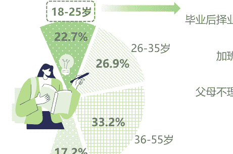

| 18-25岁 (22.7%) | 26-35岁 (26.9%) | 36-55岁 (17.2%) | 56岁及以上 |
| :--- | :--- | :--- | :--- |
| 49.8% (毕业后择业困难) | 40.8% (加班、工作压力大) | 34.4% (父母负担、沟通困难) | 25.9% (恋爱不顺), 19.7% (面婚催生育困难) |

结婚压力是高压力女性面临的主要问题。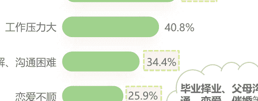

| 女性的责任担当TOP3 | TOP1 24.0% 月经不痛 | TOP2 11.4% 敏感焦虑思绪 | TOP3 10.5% 容易感染妇科疾病 |
| :--- | :--- | :--- | :--- |
| | 为个体，关注并爱自我 | | 爱自己，充足自己，渴望健康创造价值 |
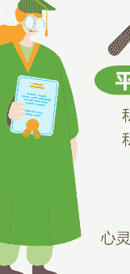

样本：18-25岁女性N=312，2025年1月调研。

## “悦少女”人群—消费路径

年轻人受“养生”等观念影响，私密健康防护意识强，独立，决策时间相对短，热爱口碑给予额外的期望。

### 消费动因
| 决策因素 | 占比 |
| :--- | :--- |
| Top1: 安全 (20.7%) | 网络宣传（短视频、公众号） |
| Top2: 功效 (18.2%) | 短视频 |
| Top3: 专业 (16.4%) | 医生 |
| Top4: 心理 (13.1%) | 亲友推荐 |
| Top5: 金钱 (10.0%) | 亲友推荐 |

### 满意度&产品期望
表示非常满意并愿意回购的27.1%。

| | 私密健康日常 | 产品期望 |
| :--- | :--- | :--- |
| NO.1 | 29.0% | 私密治疗与康复 |
| NO.2 | 25.4% | 私密护理 |
| NO.3 | 18.8% | 私处美容 |
| NO.4 | 15.8% | 心理压力 |
| NO.5 | 13.7% | 心理咨询 |
| NO.6 | | 私密保健产品 |
| NO.7 | | 情绪 |
| NO.8 | | 效果 |
| NO.9 | | 维持 |
| NO.10 | | 安全 |

| | 私密健康产品 | 信息渠道 |
| :--- | :--- | :--- |
| NO.1 | 17.3% | 短视频 |
| NO.2 | 16.8% | 平台 |
| NO.3 | 11.6% | 医疗机构 |
| NO.4 | 10.6% | |
| NO.5 | 7.6% | |

## “优雅妈妈”人群精细画像——基本情况

多为生活在二线城市的已婚女性，增加了妻子、母亲、儿媳等身份，对自我关注度下降，生育后的私处松弛、干预等问题显著提升。

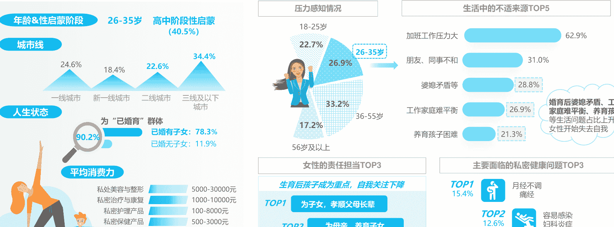

| 年龄&性别活跃阶段 | 18-25岁 (22.7%) | 26-35岁 (31.0%) | 36-55岁 (24.6%) | 56岁及以上 (40.5%) |
| :--- | :--- | :--- | :--- | :--- |

### 生活中的不适来源TOP5
- 加班工作压力 (62.9%)
- 朋友、同事和不同 (34.4%)
- 产后烦躁等 (28.8%)
- 工作家庭失衡 (26.9%)
- 养孩子困 (21.3%)

### 城市线
- 一线城市 (18.4%)
- 新一线城市 (22.6%)
- 二线城市 (33.2%)
- 三线及以下城市 (26.9%)

### 人生生态
婚后产后烦躁、工作家庭失衡、养孩子等问题占比上升、女性开始失去自我。

“已婚女性”群体
- 已婚子女: 78.3%
- 已无子女: 11.9%

### 女性的责任担当TOP3
- TOP1: 15.4% 为子女，孝父母母
- TOP2: 12.6% 为丈夫，养育子女
- TOP3: 11.6% 为个体，关注与爱自己

### 主要私属健康TOP3
- 私处美容与聚形
- 私密治疗与康复
- 私密护肤品
- 私密保健产品
- 心理咨询
- 心灵疗护/服务
- 情趣消费

### 平均消费
- 私处美容与整形：5000-30000元
- 私密治疗与康复：1000-10000元
- 私密护肤品：100-8000元
- 私密保健产品：500-3000元
- 心理咨询：1000-8000元
- 心灵疗护/服务：300-1000元
- 情趣消费

样本：26-35岁女性N=306，2025年1月通过微信调研获得。
©2025 Research Inc.
www.iresearch.com

## “优雅妈妈”人群精细画像—消费路径

婚后的女性“改善两性关系、缓解身体不适”等消费决策倾向占比上升，掌握了更多，决策时间相对长，消费偏好增加了。

### “优雅妈妈”人群—消费路径

### 决策时间&因素
| 决策因素 | 占比 |
| :--- | :--- |
| Top1: 安全 (20.7%) | 短视频、公众号 |
| Top2: 功效 (18.2%) | 平台 |
| Top3: 专业 (16.4%) | 医疗机构 |
| Top4: 心理 (13.1%) | |
| Top5: 金钱 (10.0%) | |

### 满意度&产品期望
| | | |
| :--- | :--- | :--- |
| NO.1 | 29.0% | 缓解压力 |
| NO.2 | 25.4% | 心理压力 |
| NO.3 | 18.8% | 维持型 |
| NO.4 | 15.8% | 私处美容 |
| NO.5 | 13.7% | 与正规 |
| NO.6 | | 私密护理 |
| NO.7 | | 私密健康 |
| NO.8 | | 效果 |
| NO.9 | | 增加 |
| NO.10 | | 心理咨询 |

| | 私密健康产品 | 信息渠道 |
| :--- | :--- | :--- |
| NO.1 | 17.3% | 短视频 |
| NO.2 | 16.8% | 平台 |
| NO.3 | 11.6% | |
| NO.4 | 10.6% | |
| NO.5 | 7.6% | |

| | 私密健康产品 | |
| :--- | :--- | :--- |
| NO.1 | 20.7% | |
| NO.2 | 21.1% | |
| NO.3 | 19.6% | |
| NO.4 | 13.1% | |
| NO.5 | 10.0% | |

## “多边战士”人群精细画像—消费路径

70、80后的她们更关注产品隐私性，多重身份心理压力和身体不适等消费因素增加，对自视下的消费决策更为谨慎，偏好改善两性关系、舒缓心理的产品，对效果给予更多期望。

## “多边战士”人群精细画像—消费路径

| 产品关注&信息渠道 | 消费动态 | 决策因素&决策因素 |
| :--- | :--- | :--- |
| Top1: 安全性 20.6% | 23.8% 网络宣传(短视频、公众号等) | NO.1 心理压力调节 15.5% / NO.1 完善产品/服务 18.0% |
| Top2: 功效性 19.8% | 22.6% 私密购物 | NO.2 改善/促进夫妻关系 12.2% / NO.2 急需改善心理压力 12.4% |
| Top3: 隐性 13.4% | 15.5% 医疗机构 | NO.3 身体不适干预 11.8% / NO.3 找到合适的机/产品 12.1% |
| | | NO.4 一定的私密健康标识 11.5% / NO.4 急需改善夫妻关系 10.4% |
| | | NO.5 短视频等平台单品 10.7% / NO.5 急需身体不适通过 10.0% / 平均决策时间 16.9天 |

## 满意度&产品周期

## 私密健康产品/服务偏好

核心需求：表示非常满意并很愿意回购（26.5%）

| NO.1 | NO.2 | NO.3 |
| :--- | :--- | :--- |
| 33.0% | 18.7% | 18.3% |
| 避繁心理 | 私密美容与整形 | 两性关系的提升 |

| 产品周期 |
| :--- | :--- |
| 安全，无副作用 |
| 15.8% 持续 |
| 11.0% 效果明显 |
| 9.3% |
| 专业与正规 |

| TOP1 | TOP4 |
| :--- | :--- |
| 私密治疗与康复 | 私密护理产品 |
| TOP2 | TOP5 |
| 心灵焦虑产品服务 | 心理咨询服务 |
| TOP3 | TOP6 |
| 情绪用品 | 私处美容与整形 |

中年女性对“情绪用品、私处美容与整形”等改善两性关系的产品需求更求。

样本：26-35岁女性N=306，2025年1月通过问卷调研获得。

©2025 iResearch Com.

## “岁月丽人”人群精细画像——基本情况

多为生活在一线、二线城市的已婚已育群体，退休后的她们压力明显减少，生活不适显著降低，找回自我、照顾父母成为生活重心。

## “岁月丽人”人群精细画像——基本情况

| 年龄&生命阶段 | 56岁及以上 高端阶层已婚群体(31.9%) | 压力感知 | 生活中的不适来源TOP5 |
| :--- | :--- | :--- | :--- |
| 城市线 | | 18-25岁 22.7% | 家务繁重 32.2% |
| | 37.2% 36.9% | 26-35岁 26.9% | 几乎无闲可言 27.7% |
| | 6.6% 一线城市 二线城市 三线及以下 19.2% | 与子女沟通不畅 21.8% |
| 人生生态 | 为“已婚育”群体 | 36-55岁 33.2% | 与家庭工作失衡 21.8% |
| | | 已婚子女:95.6% 未婚子女 | 因性别遭遇社会歧视 19.0% |
| | 96.5% | 56岁及以上 | 主要面临的私密健康问题TOP3 |
| 平均消费费 | 私密美容与整形 5000-5000元 | TOP1 容易感染 妇科炎症 14.1% | 回找自我，父母生活重心 |
| | 私密治疗与修复 3000-3000元 | TOP2 为母亲，养育子女 11.2% | 外阴疾病 |
| | 私密护理产品 300-1000元 | TOP3 为子女，关注并爱自我 10.9% | 阴道松弛、干湿、不敏感 |
| | 私密保养品 500-3000元 | | |
| | 心理咨询服务 1000-10000元 | | |
| | 心灵呵护品/服务 1000-5000元 | | |
| | 情趣用品 300元以下 | | |

样本：56岁及以上女性样本N=317，2025年1月通过线上问卷获得。

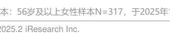

## “岁月丽人”人群精细画像—消费路径

对产品健康的关注度提升，身体机能下降和更年期带来的“身体不适”成为她们消费的主要要素，对温和、无刺激的产品给予更多期望。

## “岁月丽人”人群精细画像—消费路径

| 产品关注&信息渠道 | 消费途径 | 决策时间&决策因素 |
| :--- | :--- | :--- |
| Top1: 安全性 20.5% | 网络宣传(短视频、公众号等) | NO.1 身体不适干预 15.3% / NO.1 充分解决产品/服务 15.0% |
| Top2: 功效性 19.0% | 私密购物 | NO.2 私密宣传 12.9% / NO.2 急需增强身体 14.2% |
| Top3: 隐性 17.3% | 医疗机构 | NO.3 心理压力调节 12.6% / NO.3 急需改善心理压力 12.1% |
| | | NO.4 亲友推荐 12.2% / NO.4 亲友支持 12.0% |
| | | NO.5 医生等专业人员 11.3% / NO.5 找到合适的产品 10.6% / 平均决策时间 16.1 |

## 满意度&产品周期

## 私密健康产品/服务偏好

| 产品期望 | 安全、无副作用 14.5% | TOP1 私密治疗与康复 | TOP4 私密护理产品 |
| :--- | :--- | :--- | :--- |
| 使用且无刺激 11.4% | TOP2 心灵焦虑产品服务 | TOP5 心理咨询服务 |
| 专业与正规 22.1% | TOP3 情绪用品 | TOP6 私处美容与整形 |

| 核心需求：表示非常满意并很愿意回购（22.1%）

| NO.1 | NO.2 | NO.3 |
| :--- | :--- | :--- |
| 30.4% | 22.5% | 20.4% |
| 避繁心理 | 缓解压力 | 减轻身体不适 |

中年女性对“情绪用品、私处美容与整形”等改善两性关系的产品需求更求。身体机能下降，又面临“更年期”压力。

备注：26-35岁女性样本N=30，2025年1月通过微信调研。
©2025 iResearch.

## 生活感受

85%的女性面临“内外焦虑”。调研显示，女性对自己的幸福度打约为8.4；进一步发现，15.0%的女性表示“没有感到任何不适”，85.0%的女性在“社会环境、人际关系、家庭生活、学业生活”等方面感到不适。这种差异主要因为当代女性普遍自立自强，即使在生活中感到不适，也愿意以积极的心态面对生活；这种心态的出现源于自身生活，也源于对于幸福标准的下降。她们起初开始承担家庭和工作的重担，还需要照顾家庭成员，也需要实现事业、理想的成就。对不适来源，社会环境是首要因素，其次为人际关系；其中，“加班，工作压力大”、“工作与家庭平衡”、“朋友/同事不同”成为女性主要的“内外焦虑”。

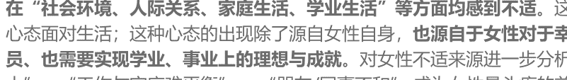

Q:女性中的不适源自哪里？

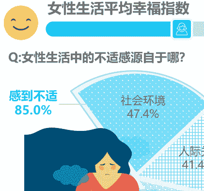

| TOP1:社会环境 | |
| :--- | :--- |
| 加班，工作压力大 | 74.0% |
| 因为遇到歧视 | 23.2% |
| 遭遇职场PUA | 23.0% |
| 跳槽/工作不满意 | 17.0% |
| 被裁员/薪资低 | 16.5% |

| TOP2:人际关系 | |
| :--- | :--- |
| 朋友，同事不同 | 44.9% |
| 婆媳争吵 | 33.0% |
| 子女不合/沟通不畅 | 28.3% |
| 恋爱不顺/被忽视 | 26.5% |
| 父母不理解/沟通不畅 | 17.3% |
| 姐妹吵 | 16.8% |

| TOP3:家庭生活 | |
| :--- | :--- |
| 工作与家庭平衡 | 53.2% |
| 家务繁忙 | 42.0% |
| 养育孩子 | 36.7% |
| 经济压力 | 21.0% |
| 面临离婚/分手 | 13.7% |

| TOP4:学业生活 | |
| :--- | :--- |
| 课业、学习/升学 | 43.1% |
| 毕业后困难 | 43.1% |
| 学业问题、毕业困难 | 27.5% |
| 面临困难、压力 | 25.5% |
| 面临专业问题 | 25.5% |

备注：针对过去一年使用私密健康产品的样本N=1241，2025年通过问卷调研。
注：请对自己的生活满意度打分，请认为您认为生活中不符合您的预期主要来自哪些方面？

## 生活压力随身份增加

调研显示，18-25岁的女性普遍轻松、压力小；随着26岁进入婚育期，身份的转变意味着责任感的增加；在36-55岁时，除去工作，还要面对老年、更年期等问题，心情低落、压力达到顶峰；随着56岁及以后退休后开始生活，子女已成家，身体机能得到恢复，晚年压力减少，生活比较轻松。

女性选择压力的方式：

- 80.4% 娱乐/运动/网购等其他方式
- 19.6% 私密健康产品/服务
- 54.9% 通过发展爱好、旅游、聚会、网上等方式排解
- 47.4% 运动、健身等方式
- 38.4% 与家人/伴侣适当分享压力
- 35.9% 进行放松（冥想、按摩、睡觉、瑜伽、芳香美容疗法等）
- 34.5% 与朋友/同伴聊天分享压力
- 28.8% 通过美颜等事获得情绪价值
- 13.7% 寻找专业的心理咨询服务

压力：经常觉得压力大样本：过去一年消费/使用过健康类产品N=1241，2025年通过问卷调研。

## 生活女性的负担

婚后的女性逐渐降低自我关注，将重心放在其他家庭成员身上，生活的负担艾瑞调研显示，在认为“为自己应该承担的责任”中，“自我”与“养”占据排名前两，仅5.4%的用户表示女性不应该承担任何责任。对于不同群体调研，“百老为孝”一直是女性无法放弃的传统美德。但在不同的人生阶段关注点不同，18-25岁“爱自己”是人生的主旨，她们期待能够通过作为职场人创造价值；26岁以后，她们开始失去对自我的关注，给予孩子、丈夫更多关注；到56岁以后，孩子成家，才重拾自我关注，并且父母对她们的关注也有所提升。此外，94.2%表示其他家庭成员应该承担责任，但实际却是有多半家庭成员在共同承担责任，许多女性依然在独自承担生活。

Q: 请选择出你认为女性最应该承担的责任

| NO.1 | NO.2 | NO.3 |
| :--- | :--- | :--- |
| 48.0% | 45.4% | 43.7% |
| 自我 | 母亲 | 子 |

| NO.4 | NO.5 | NO.6 |
| :--- | :--- | :--- |
| 27.7% | 24.3% | 20.0% |
| 职场人 | 妻子 | 公民 |

| NO.7 | NO.8 | NO.9 | NO.10 |
| :--- | :--- | :--- | :--- |
| 18.6% | 14.8% | 13.5% | 5.4% |
| 家务 | 辈 | 社会 | 任何 |

94.2%的家庭成员愿意分担，50.1%一般，9.1%不参与，4.8%不应承担任何责任。

不同阶段女性的心情和压力：

- 18-25岁“青春期”：压力来自于学习和择业，压力小。
- 26-35岁“优越期”：进入婚育期，除了工作，还面对孩子、育儿的各种压力，心情低调，压力增大。
- 36-55岁“多线战斗”：除去工作，还要面对老年、更年期等问题，心情低落、压力巨大的阶段。
- 56岁及以上“梦回期”：退休后开始生活，子女已成家，身体机能得到恢复，晚年压力减少，生活比较轻松。

实际分担情况：

| 维度 | 占比 |
| :--- | :--- |
| 心理 | 20.1% |
| 焦虑 | 22.9% |
| 情绪 | 15.4% |

## 女性年龄&婚恋指数趋势

| 问题 | 占比 |
| :--- | :--- |
| 容易感染疾病（膀尾炎等） | 33.2% |
| 月经不调、月经异常 | 29.1% |
| 腰酸骨痛、乏无力 | 26.6% |
| 外阴疾病（外阴肿、白带等） | 25.1% |
| 失多梦 | 19.8% |
| 脱发 | 18.6% |
| 烟渍、皮肤干燥 | 13.1% |
| 乳乳/甲状腺增节性 | 13.0% |
| 卵巢异常（多囊卵巢综合征等） | 8.5% |

| 程度 | 占比 |
| :--- | :--- |
| 0%认同 | 4.2% |
| 25%认同 | 15.8% |
| 50%认同 | 44.8% |
| 75%认同 | 31.2% |
| 100%认同 | 4.1% |

Q: 你婚后/恋爱后出现过哪些健康问题？
Q: 你在多大程度上认为这些健康问题是性关系压力带来的？

84.7%的用户在进入两性关系后出现过以下健康问题。

## 家庭恋爱——家庭生活中的资金分配情况

女性作为家庭负责人更愿意为子女和伴侣花钱，获得付出似乎是她们的一大幸福来源。
艾瑞调研，86.0%的女性表示自己是家庭资金的主要负责人，掌握家庭财权。对家庭资金支出顺序调研，女性花的首位是子女，其次是伴侣、第三位是自己；对于女性每年在自己身上投入的资金占家庭资金的比例进一步调研得出，超过6成女性该比例不超过30%。然而然而，对女性对于当前的资金分配情况是否幸福，近8成女性表现积极态度。为家庭付出似乎是女性的价值观和价值的体现，她们对于幸福的定义似乎围绕着“孩子和爱”展开，她在婚姻中似乎没得那么重要……是付出越多越幸福？被传统框架下的女性价值观取向应当如何？当下是否需要考虑的。

86.0%的女性表示自己是家庭资金支出的主要负责人

## 女性对家庭资金的分配情况分析

### 女性每年在自己身上的资金投入比例

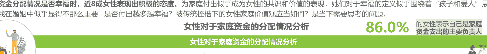

65.1%的女性成立家庭后每年在自己身上投入的资金比例不超过30%；9成女性该比例不超过50%。

### 女性在当前资金分配下是否能获得多少幸福感
即便女性在自己身上投入不长，近8成女性认为为当前家庭生活中的资金分配比例是可以让她让她感到幸福的，体现了女性在家庭中的奉献精神。

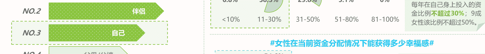

样本：过去一年消费/使用/租赁私密健康产品/服务的N=1241，于2025年1月通过调研获得。
备注：请问您是家庭资金支出的主要负责人？对您的家庭资金的主要来源进行调研，请问您每年在自己身上投入的资金占家庭总支出的比例是多少？请问您认为的资金分配是否让她获得幸福?

©2025 iResearch
www.iresearch.com

## 家庭婚恋—孕产生活中的健康问题 (1/2)

女性孕产期激素水平、胎儿生长等因素影响，身体会出现包括生殖殖器、乳房、骨骼、循环系统和心理等多个方面的影响，若不得及时有效的干预，或可伴女性一生。

女性在怀孕、生产期间出现过的健康问题

生理性 81.4%
- 41.1% | 腰酸背痛、脐痛
- 38.8% | 容易感染妇科疾病(阴道炎等)
- 32.1% | 恶心呕吐、胃部不适
- 30.1% | 尿频急、漏尿
- 27.5% | 乳腺胀痛
- 26.5% | 阴道松弛
- 25.5% | 妊娠严重
- 24.4% | 外阴疾病(外阴瘙疹、白斑等)
- 24.0% | 脱发严重
- 23.7% | 怕冷、疲乏无力
- 20.7% | 失眠多梦
- 18.7% | 头晕头
- 18.3% | 卵巢疾病(多囊卵巢综合征等)
- 16.1% | 其他并发症(肝功能异常等)

18.6% 心理性
- 18.7% | 情绪波动
- 18.3% | 敏感焦虑、思绪混乱
- 16.1% | 心情低落、郁郁欢

约 92.5%的女性在怀孕、生产后出现过不同类型的健康问题。

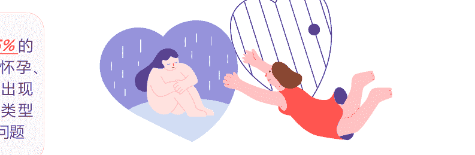

## 家庭关系：孕生活中的健康问题 (2/2)

### 仅女性依靠“自我解救”解决了孕产带来的身体不适
权威调研显示，24.7%的女性表示孕产生活中出现的健康问题已经完全缓解，但仍75.3%的女性存在孕产后虑“后遗症”。追溯其原因，“自我养护与护理”及“及时医疗/干预措施”是女性身体恢复的主要因素。此外，丈夫作为女性最近的人，起到了很大的作用；但伴侣作为女性重要的角色，在孕期给到的支持有限，女性在生命中相对累的时期，需要很多的帮助和支持。孕产带来的各种问题随女性一生。

### 孕产后出现的健康问题的缓解情况
- 24.7% | 已完全缓解
- 53.9% | 已缓解大部分
- 17.6% | 已一定缓解
- 7.7% | 仅缓解了部分
- 0.1% | 没有得到任何缓解

- 76.9% | 自己养护与日常护理
- 65.1% | 及时医疗/干预措施
- 53.7% | 父母给予了很多帮助
- 30.3% | 爱人给予了很多帮助
- 0.1% | 自身意识缓慢缓解

> 女性对健康问题的保养和及时干预措施是足够非常用的。
样本：过去一年使用/使用私密后服务的N=1241，于2025年1月通过调研获得。
请问您的孕产身体状况是否已经得到缓解？若孕产身体状况已经完全缓解，您认为主要是以下原因引起
©2025 iResearch | www.iresearch.com

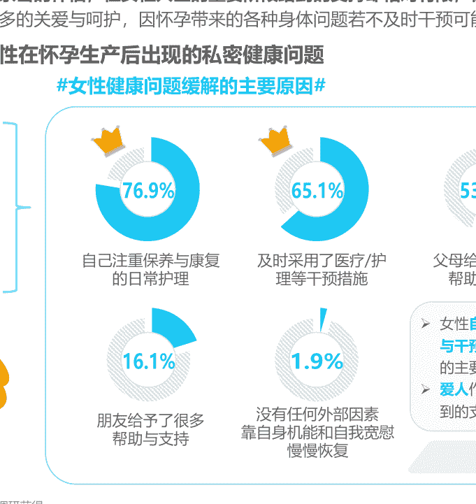

## 认知教育篇

女性在成长过程中接受到的性教育情况如何？
女性性教育启蒙的节点是什么？
女性是否曾主动寻求性教育？

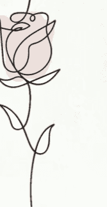

## 女性在成长过程中接受到的教育资源

女性在成长阶段（3-18岁）普遍面对性教育资源的双重缺失，这种缺失不仅体现在学校和社会的资源偏移、深度不够，更在女性教育中表现出一定的“鸿沟”。艾瑞调研显示，女性在成长阶段接受到的教育资源有限，我国教育体系中性教育仍处于边缘状态。在这种情况下，作为女性最易接触的教育资源，家庭教育成为性教育的重要来源。然而，只有不到27.4%的用户在成长阶段经常与父母讨论健康/性教育话题，更多家庭虽具有一定的意识，但主动讨论较少且深入。致使女性在成长过程中面临较大的“教育短板”，学校和家庭在性教育中的双重缺位，需社会予以重视。

### 女性在成长过程中接受到的性教育程度
### 女性在成长过程中/父母主动讨论健康/性教育话题

| 超过一半的女性在成长阶段能够收获到的性教育知识 | 15.6% | 42.0% |
| :--- | :--- | :--- |
| 几乎没有接受过只皮毛 | 偶尔接受到一点性教育知识一般 | |

| “淡性色氛围” | 3.1% |
| :--- | :--- |
| 家庭教育“沉默鸿沟” | 仅三成 |
| 经常主动讨论 | 24.3% |
| 基本不主动讨论 | 26.9% |
| 偶尔主动讨论 | 35.5% |
| 从未没有主动讨论 | 10.2% |

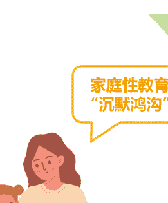

| 我国教育体系中性教育“边缘化” | 6.6% | 35.9% |
| :--- | :--- | :--- |
| 接受非常少性教育知识 | 接受一些性教育知识较多 | |

样本：过去一年使用私有云数据服务的用户样本量N=1241，2022年5月由艾瑞调研。
注：请问在成长过程中（3-18岁）接受多少性教育？请问在成长过程中（3-18岁），父母或监人在多大程度上会主动讨论健康/性教育话题？

## 认知女性在成长过程中的性教育渠道及影响节点

调研显示，近半女性在成长过程中接触性教育的来源是学校和家庭两个传统渠道。此外，短视频、公众号等网络渠道因资源丰富、信息易得逐渐成为新兴途径之一。尽管学校和家庭在性教育渠道中占主导地位，但在思想启蒙的关键节点上，其作用存在差异。这体现了当前教育在覆盖率虽有，但实际效果不足。此外，在结婚、婚姻等成年年后，教育模式未能满足女性的主动需求，未来的教育应更加科学、主动，并把握教育的节奏。

### 女性首次接触教育渠道及影响节点

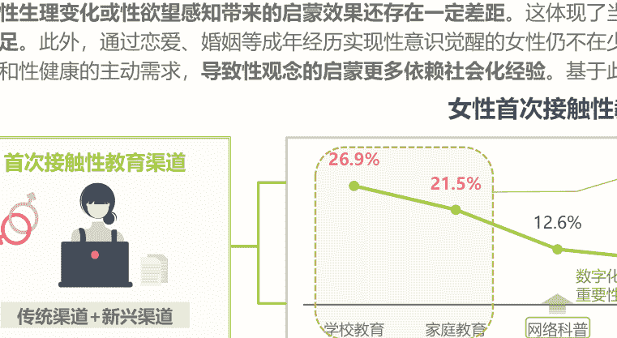
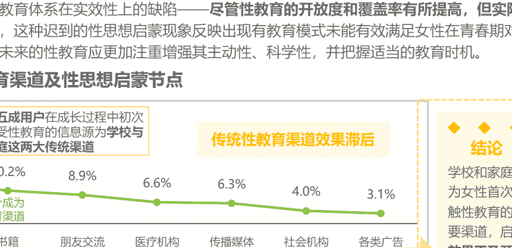
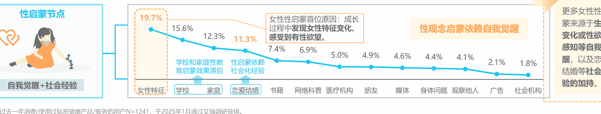

样本：过去一年消费/使用私密健康用品/服务的N=1241，2025年1月追踪得到。
注：请问您认为理想的教育渠道是什么？请问您认为的性教育的节点是？

## 认知教育女性成长期的性教育及启蒙

调研显示，86.9%的女性首次接触教育主要集中在中学、初中和高级（6-18岁）；而86.6%的女性在初中、高中和大学阶段（12-22岁）真正规律滞后。这可能由于现行教育深度不足，未能在身体变化的关键时期提供及时且全面的引导。性教育不仅涵盖生理知识，还涉及心理、道德和价值观等多个维度。目前尚缺乏系统、可操作的体系，教材建设也相对薄弱，未来应高度重视。一方面，研发合适的教材，拓展内容；另一方面，需加强社区协作，通过多方联动实施，为女性成长期的教育提供保障。性教育的正式教学通常安排在小学低年级或初中阶段。性教育通常从性知识入手，逐步推进到心理、道德和健康方面。

### 首次接受教育年龄

| 近六成用户在中学、初中和高中阶段接触 | 首次接受教育年龄 | 实际启蒙年龄 |
| :--- | :--- | :--- |
| 17.6% | 3-6岁 | 0.6% |
| 43.4% | 6-12岁 | 8.3% |
| 25.9% | 12-15岁 | 32.7% |
| 10.3% | 15-18岁 | 33.7% |
| 1.5% | 18-22岁 | 20.2% |
| 0.0% | 22-30岁 | |
| | 30-50岁 | 0.1% |

近五成用户在中学、高中和大学阶段形成

> 性教育不仅仅是了解生理变化，更包括心理和情感的认知。在高中和大学阶段，青少年正探索好奇心的时期，性别认同、需求、性欲望等因素逐渐显现，因此这一阶段为启蒙的关键时期。

## 认知教育性寻求教育资源分析

4成女性在自我觉醒后主动积极寻求资源，女性意识仍有较大提升空间

艾瑞调研显示，4成受访者表示主动寻求资源。在这一背后，“自我觉醒”是核心驱动力，其中认知特征强化是促使女性主动探索自我的主要原因。此外，3成女性被动寻求，她们或受外界因素启发而对健康知识产生兴趣，或在健康问题出现后才寻求。基于此，仅有4成女性寻求资源为自我觉醒的“主动”行为，3成为被动行为，更有30.8%的人从未寻求。资源的普及及传播需要进一步强化，创造营造支持的社会环境，全面提升女性的意识与应对能力。

## 寻求教育资源的三种类型

### 是否寻求教育资源

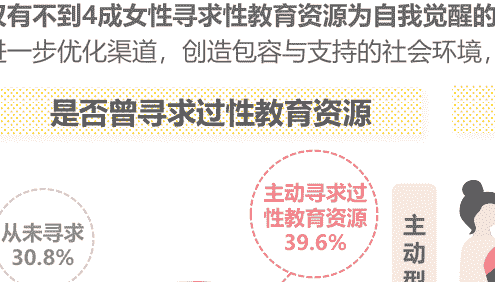

### 自我觉醒型 (39.6%)：内在驱动，探索自我认知
- 感受到女性特征变化后，主动寻求性知识。
- 倾向于独立思考和自我探索，具有较强的求知和好奇心，积极应对成长。

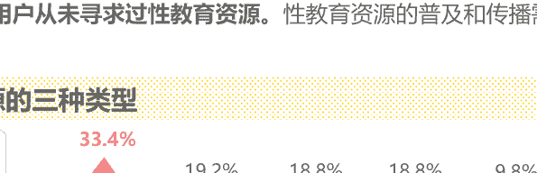

### 外部引导型 (25.1%)：外界引导
- 收到新闻、广告等媒体信息启发，或在学校老师的引导下，对领域产生兴趣。

### 问题驱动型 (4.5%)：问题后才开始
- 在出现问题后才探索，错过了最佳时机，焦虑也会影响个人的质量。

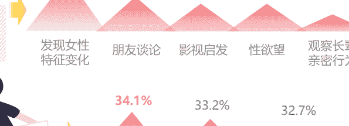

样本：过去一年内使用私密产品的N=1241，在2025年1月完成调研。
备注：请问您是否寻求资源？请问您寻求资源的原因是什么？

## 健康问题篇

不同年龄的女性显示，82.8%的女性面临同类型的健康问题，其中随着年龄增加，身体功能下降而发生变化，月经不调、痛经交织出现，轻微下调。不同年龄段女性面临多种生理性问题，易染妇科疾病是随着年龄增加而高发，直到月经结束后，这成为现状。

### 女性面临的健康问题

| 女性健康问题占比 | 女性面临的“生理性”问题 | 18-25岁 | 26-35岁 | 56岁以上 |
| :--- | :--- | :--- | :--- | :--- |
| 无问题 | 生理性问题 | 133 | 94 | 105 | 35 |
| 月经不调、痛经 | 外阴炎症 | 50 | 61 | 79 | |
| 妇科炎（子宫肌炎等） | 4 | 17 | 13 | 5 |
| 卵巢炎（多囊卵巢综合征） | 13 | 27 | 20 | 34 |
| 易染疾病（阴道等） | 58 | 77 | 115 | 99 |
| 子宫内膜炎症、子宫肌瘤增生 | 10 | 14 | 7 | 11 |
| 乳腺/乳腺结节 | 9 | 25 | 37 | 34 |
| 阴道干燥/干/不敏感 | 21 | 71 | 93 | 77 |
| 更年期 | 0 | 6 | 21 | 47 |
| 失症 | 49 | 44 | 45 | 57 |

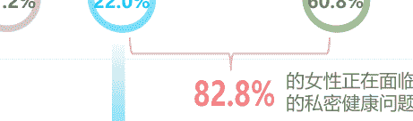

82.8%的女性面临同一类健康问题，女性面临的“心理性”问题
- 情绪波动大：20.0%
- 心情低落、抑郁：17.6%
- 敏感、思绪过多：17.5%

> 针对不同年龄段的女性“三大”健康问题引发关注：
> 易染妇科疾病：女性随着年龄增加，在产后出现发生变化。
> 月经不调、痛经：困扰18-55岁女性，18-25岁间是面临的主要问题。
> 阴道干燥/干/不敏感：是26岁左右的产后女性非常重要且需要引起关注的，这关系到她们的生活、婚姻关系，甚至是整个家庭的幸福源泉。

随着年龄增长，女性成为“老去”的主角，身体发生变化、代谢早衰、更年期频繁观察时发生。

注：基于过去一年使用过私密健康服务的用户N1241，于2021年10月进行调研得出。
备注：如有问题可以在线咨询我们的医生咨询女性私密健康问题。

## 健康问题一：私密健康问题出现的原因及影响

8成女性认为是私密健康问题对生活造成一定影响，生活方式和压力是问题出现的原因。艾瑞调研显示，70%的女性认为这些问题对生活造成一定影响，85%的女性认为“自己对饮食、生活方式、卫生状况不满意”是首要原因。其中36-55岁女性在压力达到顶峰，处于关键时期，学业、关系、家庭、社会等压力因素更为显著。

### 女性私密健康问题出现的原因

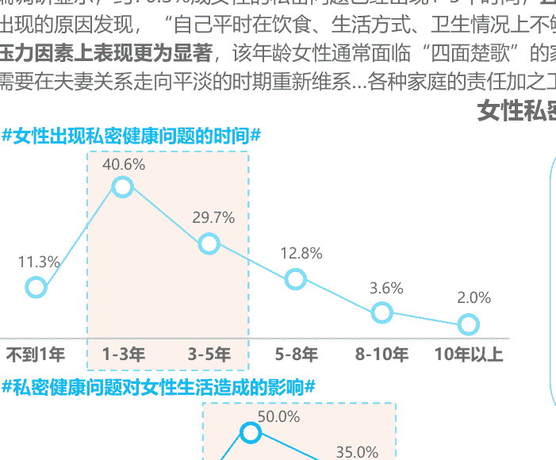

| | 18-25岁 | 26-30岁 | 36-55岁 | 56岁以上 |
| :--- | :--- | :--- | :--- | :--- |
| 遗传/身体因素 | 25.2% | 17.7% | 34.2% | 15.9% |
| 自身性问题 | 43.8% | 44.2% | 25.3% | 17.4% |
| 自己对饮食、生活方式、卫生状况不满意 | 61.7% | 73.8% | 59.6% | 35.1% |
| 学业、关系、家庭、社会等压力因素 | 46.4% | 46.7% | 52.9% | 17.2% |
| 气候、地理等环境因素 | 23.0% | 17.6% | 28.0% | 14.4% |

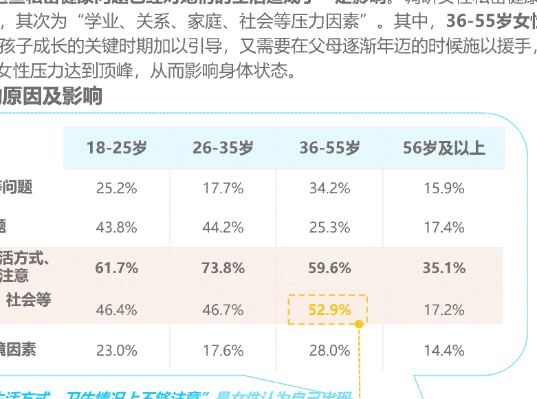

## 健康问题 私密健康问题的干预情况

干预后近1成的女性的私密健康问题得到解决，女性难以识别专业有效产品，市场亟待整合规范

艾瑞显示，消费型的私密健康产品/服务被认为是有效缓解健康问题的方式，占比近7成，私密健康日用品/保健品/医美等私密健康机构的服务、心灵疗愈产品/服务是女性最倾向消费的类别之一。另外，通过与好友交流经历、自查网络/书籍等无出门、无需消费的普适方式是女性比较偏好的干预方式。然而，经过干预与调解，12.3%的女性表示自己的私密健康问题已经得到完全解决，这与目前市场上干预情况有一定关系；由于私密健康行业正处于野蛮生长时期，各种产品/服务质量不齐，女性难以识别到真正有效的产品。

## 女性私密健康问题的干预情况

## 女性私密健康问题干预后的解释

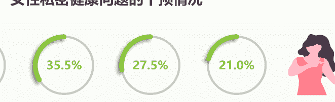

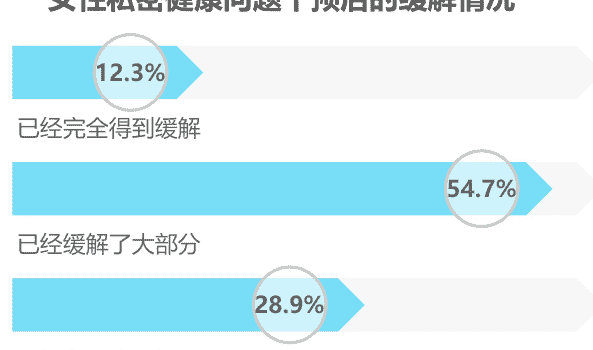

| 类别 | 具体措施 | 状态分布 |
| :--- | :--- | :--- |
| 消费干预 | 消费私密护理用产品/保健品、家居护理 去私密健康/医美美容等私密健康机构寻求干预措施 消费/体验心灵疗愈服务/产品 去医疗机构寻求干预措施 去专业的咨询机构/平台寻求干预措施 | 73.9% 已经完全解决 已经了解了大部分 已经有一定干预 了解了小部分 没有得到任何干预 |
| 普适干预 | 与参与好友交流经历、得到帮助与支持 通过网络/书籍等经验和解决措施、家居护理 | 24.6% 未采取任何措施 |
| 消极干预 | | 1.5% |

调研显示，仅12.3%的女性私密健康问题已得到完全解决

样本：过去一年使用过私密健康产品/服务的样本量=1241；2025年1月通过艾瑞调研获得。备注：请您在阅读完后来回答上述哪些问题？请问您采取干预措施后得到了什么？

## 保养护理篇

女性针对私密健康问题，日常的保养习惯如何？
对于私密健康产品和服务的认知度如何？
使用过哪些产品和服务？使用行为和关键决策点是什么？

备注：此处数据为一年内使用私密健康产品的平均花费：1241元，基于2021年3月调研结果。请问对于私密健康，是否有日常养护、预防健康问题的困扰？您认为要采取哪些措施进行私密健康的防护和预防？请问您日常养护的一花费花费最多的是

## 女性对于私密健康产品/服务的认知

安全和功效是女性关注重点，网络宣传和专业机构普及的主要认知来源

艾瑞调研显示，安全和功效是女性选择私密健康产品/服务的关注点，其次为专业性和私密保护。在消费者追求理性的环境下，她们更注重产品的内涵和实用性，更愿意为高质量、高安全的产品付费。在产品认知来源方面，随着互联网的普及和数字化趋势的发展，消费者越来越依赖平台获取信息，网络传播宣传成为女性私密产品认知的主要来源。此外，随着女性对自身健康关注的提升，她们更倾向于专业机构和权威的信息来源，而私密康复、美容等私密机构和医院、诊所等医疗机构的宣传成为教育和引导消费者的重要途径。相比之下，女性健康教育主要基于基础知识和健康观念的启示，家庭教育更让她们更多关于行为规范和基础健康知识的培养，女性对私密健康产品的认知更多源于网络平台及专业机构的传播。

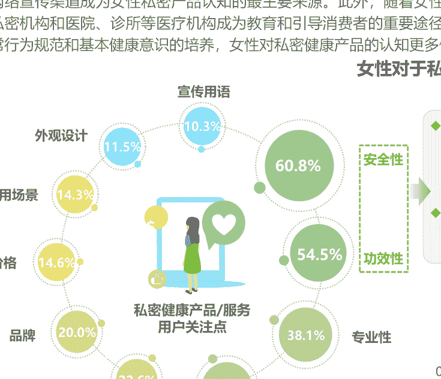

## 女性对于私密健康产品/服务的认知

Q:女性私密健康产品/服务的来源是什么？

| 来源 | 占比 |
| :--- | :--- |
| 安全是私密健康产品的基础，决定了后续的价值 | 18.05% |
| 功效是私密健康产品的的核心，决定了后续的效果 | 26.27% |
| 在发达的今天，随着手机等媒介让人们信息的获取，“网络营销”成为首要 | 42.2% |
| 机构作为私密健康产品的权威性，成为信任的来源 | 13.62% |
| 医疗机构成为女性信任的来源 | 4.2% |
| 学校和家庭发挥观念和行为培养的作用 | 1.5% |
| 其他 | 0.0% |

样本：过去一年购买过私密健康产品/服务的用户数为1241，2025年1月通过调研得出。注：请问您对私密健康产品/服务的了解如何？对于私密健康产品/服务的认知来源是什么？

## 女性对私密健康产品/服务的偏好

进入孕期后，身体机能、激素变化、活跃、生活压力直接导致健康问题。艾瑞显示，在不同类的私密健康产品人群中，26岁及以上的群体表现出更强的偏好，是因为随着年龄增长，身体变化和环境压力出现问题。另外，18-25岁女孩在私密健康产品上展示出了较高的偏好。在体验“私密美容/整形”和“情趣用品”与夫妻双方项目中，26-55岁女性是主要的消费者、促进者和法宝。

| 细分基础 | 18-25岁 | 26-35岁 | 36-55岁 | 56岁以上 |
| :--- | :--- | :--- | :--- | :--- |
| 私密理与康复 | 52.4% | 73.7% | 77.2% | 68.4% |
| 私密护理 | 42.2% | 38.2% | 35.5% | |
| 私密保健产品 | 15.1% | 12.3% | 11.5% | 12.9% |
| 私处美容/整形 | 8.1% | 18.7% | 19.4% | 5.9% |
| 情趣用品 | 35.1% | 45.6% | 50.8% | 8.2% |
| 心理咨询服务 | 22.4% | 24.1% | 25.8% | 9.8% |
| 心理异常期服务 | 55.1% | 69.3% | 40.2% | |

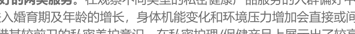

26岁以上的女性由于身体变化、激素变化、活跃、生活压力增大，各种问题风险增加，且36-55岁段达到高峰期。随着女性进入孕期，她们对私密护理需求显著降低，但孕期带来的身体和心理变化不容忽视。

18-25岁的女性对“私密理/保健产品”表现出更强的购买偏好，通常她们为之前的私密意识，26-55岁女性随着身体的增长开始追求自我关注，日常私密护理的需求较弱。

26岁以上的女性已婚，提高夫妻生活质量是婚姻、生活的关键，身体的转变变化可能会影响夫妻生活，“私处美容/整形”、“情趣用品”是26-55岁女性女性为主。

许多女性在压力增大时，心理、异常上表现出了较强的购买意愿，与她们所处的人生阶段密切相关。

样本：从过去一年使用过私密健康产品/服务的用户N=1241，于2025年1月交叉调研得出。注：调研期间为一年，购买/使用过以下哪些私密健康产品/服务？“未使用私密健康产品/服务”的数据来源于调研渠道的甄别。

## 女性私密健康产品/服务的决策因素

一定的健康防治意识和迫切的心理需求推动女性消费。艾瑞显示，目前女性对于私密健康产品的养护具有迫切的需求，但只有专业的态度才可能解决。经过平均16.8天，一种健康防治意识和生活压力下的焦虑、症状出现导致女性视线。抖音、小红书等短视频、内容的分享种草引起女性的关注。

| 决策因素 | 18-25岁 | 26-35岁 | 36-55岁 | 56岁以上 |
| :--- | :--- | :--- | :--- | :--- |
| 健康防治意识 | 34.7% | 28.8% | 26.9% | 22.6% | 18.5% | 13.7% | 10.9% |
| 心理压力 | 短视频/直播 | 购物 | 改善/促进 | 朋友 | 专业 |
| 身体状况 | 种草 | 渗透 | 科普 | 不需要 | 丈夫 | 推荐 |
| 电视/网络 | 优惠 | 杂志 | 商店 |

| 决策因素 | 占比 |
| :--- | :--- |
| 1-5天 | 11.6% |
| 6-10天 | 30.0% |
| 21-30天 | 15.9% |
| 1-2个月 | 6.6% |
| 3-4个月 | 1.0% |
| 5-6个月 | 0.2% |
| 半年以上 | 0.1% |

| 因素 | 占比 |
| :--- | :--- |
| 38.1% | 29.5% | 27.0% | 25.2% | 22.4% | 19.3% | 18.5% | 17.9% | 17.5% |

| 因素 | 占比 |
| :--- | :--- |
| 了解产品/服务 | 心理压力 | 寻找合适的机构 | 朋友干预 | 急需支持 | 有足够的状况 | 急需购买 | 被忽视/网络关系 | 有营销种草 | 价格合适 |

| 占比 |
| 18.05% | 26.27% | 15.17% | 13.62% | 57.13% | 46.98% | 3.2% | 1.5% |

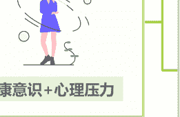

样本：过去一个月使用过私密健康产品/服务的人为1241，2025年1月进行艾瑞调研。备注：请问是从渠道开始购买私密健康产品/服务的？从开始到最终购买有多多久？请问促使女性购买私密健康产品的消费决策因素有哪些？

## 保养护理—女性使用/消费私密健康产品的频率

女性使用/消费频率仍偏高。艾瑞显示，36.4%的女性使用私密健康产品/服务者“至少每周2-3次”的频率，45.9%的女性坚持“至少每月1-2次”的消费频率。其中，“每月使用或消费1-3次”是女性最常谈的频率。对不同年龄群体发现，18-25岁“悦少女”表现出更高的私密健康意识，使用和消费频率均较高；36-55岁“多边战士”基于生活压力、身体变化等因素遭遇迫切的需求。

| 频率 | | |
| :--- | :--- |
| 每天 | 5.0% |
| 一周2-3次 | 31.4% |
| 一个月2-3次 | 15.1% |
| 半年2-3次 | 4.5% |
| 一年2-3次 | 0.7% |
| 两年1次 | 0.1% |
| 三年1次 | 0.1% |
| 四年及以上1次 | 0.7% |
| 每周1-2次 | 9.2% |
| 每月1-2次 | 36.7% |
| 季度1-2次 | 32.3% |
| 半年1-2次 | 15.6% |
| 一年1-2次 | 4.5% |
| 2-3年1次 | 0.6% |
| 3-5年1次 | 0.2% |
| 更低消费频率 | 0.9% |

“18-25岁‘悦少女’爱美常念，私密健康意识增强，表现出的使用和消费频率很高，一周2-3次的用户占比高达40.3%，其中约有18.3%的年轻群体每月都会消费1-2次/服务，比其他年龄段表现要更为显著。”

| 年龄/使用频率 | 18-25岁 | 26-35岁 | 36-55岁 | 56岁以上 |
| :--- | :--- | :--- | :--- | :--- |
| 每天 | 6.6% | 3.1% | 5.8% | 6.0% |
| 一周2-3次 | 40.3% | 33.5% | 23.0% | 26.5% |
| 一个月2-3次 | 34.4% | 43.4% | 52.2% | 43.9% |
| 半年2-3次 | 11.5% | 15.1% | 11.0% | 18.6% |

| 年龄/使用频率 | 18-25岁 | 26-35岁 | 36-55岁 | 56岁以上 |
| :--- | :--- | :--- | :--- | :--- |
| 每周1-2次 | 18.3% | 7.7% | 3.9% | 9.5% |
| 每月1-2次 | 37.9% | 35.5% | 42.8% | 34.1% |
| 季度1-2次 | 27.3% | 32.2% | 35.9% | 31.6% |
| 半年1-2次 | 9.1% | 19.4% | 11.4% | 20.2% |

注：去年使用私密健康产品/服务的N=1241，2021年1月调研得出。请问您使用私密健康产品服务的频率如何？请问您使用私密健康产品服务的频率如何？*为年龄段分布图

## 满意期望篇

女性对于私密健康产品和服务的满意度和复购意愿如何？私密健康的核心需求是什么？还有哪些期望没有满足？

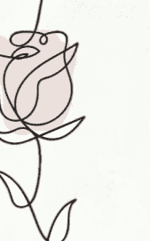

## 满意度女性对私密健康产品的满意度

艾瑞显示，在未使用私密健康产品的用户中，24.5%的人群具有较高的满意度和回购意愿。从不同年龄阶段的满意度来看，36-55岁女性满意度相对较高，达26.5%，与她们所处年龄段的状态密切联系。前述述，该阶段女性面临压力达到全年龄段峰值；并随着身体下降，激素变化带来的风险增加。这些因素导致她们对于私密健康的需求更旺盛，效果也更显著，更容易感知产品价值，满意度相对较高。此外，18-35岁的青年女性正处于职业发展、婚恋关系及家庭规划的关键时期，面对多重角色转换的压力，她们更关注私密健康产品对心理需求的满足，希望得到更多慰藉。

| 反馈 | 18-35岁 | 36-55岁 | 56岁以上 |
| :--- | :--- | :--- | :--- |
| 身体不满意 | 43.0% | 52.6% | 48.6% |
| 不好炎症等性疾病 | 42.6% | 58.2% | 55.5% |
| 得到慰藉，幸福满意 | 47.7% | 44.4% | 47.6% |
| 提高夫妻生活满意 | 32.5% | 43.1% | 19.6% |
| 提高家庭满意和 | 27.8% | 36.0% | 34.4% |
| 整体满意度 | 24.8% | 26.5% | 22.1% |

身体不满意：在各年龄级中满意度居群第二，反映出私密健康产品对女性身体机能提升有一定的效果。

提高夫妻满意和和谐：36-55岁女性由于职业生涯的稳定期，更关注与伴侣的质量以及家庭和谐。由于，她们对提高夫妻满意、家庭和满意的效果感知更强，满意度相对较高。整体满意度：36-55岁女性由于身体压力处于峰值、健康问题在发，更易感知到产品价值。

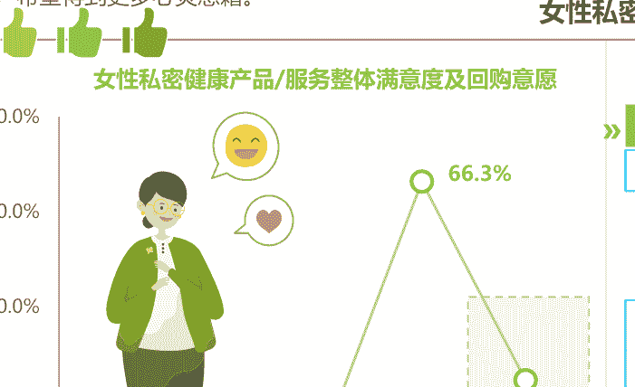

## 健康的养护与预防是女性私密健康产品的期望

身心健康的养护与预防是女性的核心需求，安全与合规是女性最迫切的期待。调研显示，女性对于私密健康产品的养护与预防是核心需求，安全与合规是女性最迫切的期待。身心健康的养护与预防是女性的核心需求，安全与合规是女性最迫切的期待。

## 女性私密健康用户在需求

| 需求 | 身体健康 | 私美护 | 私密养 | 心理缓解 | 亲关系 |
| :--- | :--- | :--- | :--- | :--- | :--- |
| % | 29.9% | 17.0% | 16.2% | 21.5% | 15.3% |

+   - 保护隐私、深度共情、强化产品功效、治愈疾病、富营养
- 女性的需求集中在私密健康的日常护理和缓解压力等方面
- 26-55岁女性大多已进入状况，尤为关注女性升
- 18-28岁的女性大多尚未入婚，对女性关系的亲密程度相对独立
- 56岁以上的女性对自身健康的自然倾向，则要求更多向自我照护靠近

# 03 / 女性私密健康行业发展趋势

## 行业发展趋向长期管理，“她健康”催生女性私密健康消费升级

根据行业调研，产品的“效能和安全”是女性关注的首位，是女性私密健康行业的基石，只有满足此类基础需求的产品和服务才能增长长期价值，否则仅为昙花一现。随着“自我意识”觉醒，“她健康”催生女性私密健康消费升级，呈现出“年轻化、怀旧化、个性化、数字化化”的体验升级。随着女性的需求不断被满足，她们更期望一种“陪伴式的”长期价值的、“全方位的”的关怀与健康管理，有望获得覆盖整个生命周期的方案和整个人生阶段的心理陪伴，最终实现身体、心、感、行为、关系五位一体的健康管理。

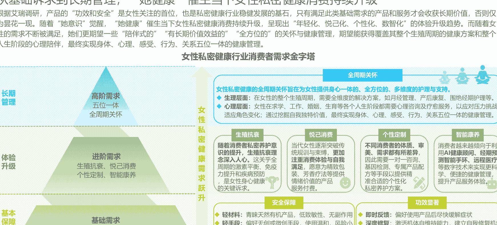

| 全周期关怀 | | |
| :--- | :--- | :--- |
| 长期管理 | 生理需求：在女性的整个周期内，需要全面的解决方案，如月经管理、产后康复；心理需求：在求学、工作、生育等每个阶段都需要专业的咨询服务，以应对压力挑战，适应变化；通过调节自我找到平衡，最终实现身体、心、感、行为、关系五位一体的健康管理。 | 安全保护：轻型：天然无添加产品，低敏，无残留操作；中型：兼顾无刺激或微侧护，使用温和，降低风险；重型：重视女性私密健康教科书、权威机构认证等 | 效果显著：即时反馈：偏好在使用后获得快捷舒适；深度修复：激活女性自身健康能力，让更多自我修复私密健康；长期增长：追求长期以上稳定效果，拓展健康屏障 |
| 女性私密健康需求驱动 | 生态健康：随着消费者私密需求的提升，健康升级愈深入人心，这尤其需要关注每个生命周期的周期变化、免疫力提升和疾病预防，是女性私密健康的关键。 | 长期价值：当女性私密需求日益常规化后，更加关注健康与自我契合，需要精心包装、香氛等优质服务提供，强调化服务体验。 | 个性定制：满足不同的消费者需求，更需要一一咨询、个性化建议、基因检测、专属产品定制寻找适合自己的女性私密方案。 | 智能健康：消费者利用AI工具，精准定制服务，运行数据等数字化技术来服务，便捷的健康管理，提升产品服务水平。 |
| 体验升级 | 进阶需求：生态健康、悦消费、个性定制、智能康养 | | |
| 基本保障 | 基础需求：安全与功能 | | |

来源：公开资料，艾瑞咨询研究院主研分析师及编辑。
©2025 iResearch Inc.

## 行业发展趋势：供给侧

市场在多重压力下保持活力、走向规范，专业化和差异化是企业长盛的关键

随着健康养市场愈演愈烈，爆发式增长的大利必然吸引多方关注。跨境电商的境外品牌涌入，强势入局市场“鲶鱼效应”，将进一步激发市场活跃；另一方面，随着政策的逐渐落地和市场教育的推进，市场发展初期一些企业“遛流量”、“红利”的从业者将越来越难获得消费者信任，最终在市场发展洗牌中“优胜劣汰”。另外，虽然消费者随着观念转变展现出了巨大的需求，但经济增长让他们保持维持，低价营销等传统商业模式或可能被淘汰，有能力、有差异化竞争的企业才能顺利行业发展，直通上。

## 行业激烈竞争下的、机构和产品发展方向

激烈竞争和市场化引发行业多重变化

消费决策的转变引发行业发展方向

决策关键因素

### Section 女性护肤/保护品牌的“鲶鱼效应”

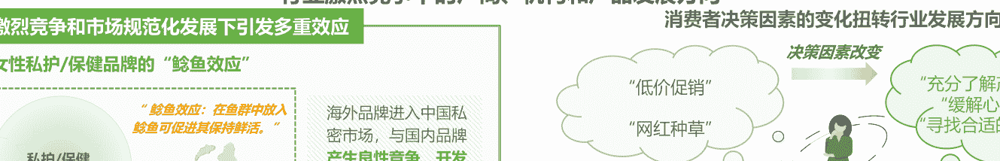

国内市场引入、激发生效应

鲶鱼效应：新品牌的进入能够有效促进行业持续发展

- 护肤市场
- 海外市场

海外品牌进入中国市场，与本土品牌产生良性竞争，开发新产品、新品，激发市场活跃、影响行为

- 低价营销
- 充分了新产品/服务、“增强心理压力”
- “寻找合适的机构/产品”
- 网红效应

- 过去
- 现在

低价营销手段不再是获客的有效手段

产品机构参差不一，同质化，消费者容易被消耗，选择困难

新品牌、新入者通过差异化竞争

持续发展

### Section 女性性健康护肤的“溢出效应”

- 产品扩张：护肤品类快速迭代的常规，和产品功能原理遵循科学，不专业的“格调”产品将出市场；
- 机构扩张：健康健康行业已经经历了增长后，各种机构横细分领域，参差不齐， 只有少数市场入入后，有优势的机构才能获取消费者信任，在竞争中突围。

“只有明确自身定位、精准定位，打造规模化、温暖化、差异化产品和服务，才能与消费者的深度链接，在激烈的竞争中脱颖而出。”

从行业从专业知识的积累
- 产品/服务的有效性经过验证
- 产品/安全的整合得到充分保障
- 产品/服务定位，精准匹配

从精细化，心灵竞争
- 小而美，而非大而全的机构
- 医疗优质资源供给
- 目标针对受众的服务/...

备注：北京某生殖品类的女性性健康品牌，凭借核心，在2022年十一活动迅速成为天猫，强势入局女性护理领域。
来源：华尔、美丽消费新洞察及研究院

## 行业需求趋势：市场侧

随着女性的进化与裂变，私密健康在各个细分领域的隐形市场逐渐显现，未来将成为大健康领域的增长点。我国9亿女性难以忽视，直接或间接影响，如何维持良好的始终得到解决，抗菌、黏膜修复等手段或可进女性生活幸福等角度改善女性关系。现代观念呈现出前所未有的趋势，Founders数据显示，到2025年进入这一领域，这一市场的机会扩大到6000亿元。此外，对于女性生理结构和天然需求，尿道感染日益扩大，市场规模不可估。我国女性问题已不容忽视，作为心理咨询更为重要，使用更多丰富的帮助将获得更多。

## 女性需求裂变下的高渗透

女性需求裂变多个细分市场重合形成新的机遇

女性经济增长

“亲密关系”保护女性亲密关系至家庭

“更年期”化养护

产品功能需求

- 需求阶段一
- 需求阶段二
- 需求阶段三

需求进口

- 渗透
- 美白祛斑
- 紧密润
- 封闭舒肤
- 黏膜修复

生理健康

抗菌黏膜修复

更年期健康教育

清洁私处

消毒杀菌

“盛蓝”改善女性群体“不可言症”

“后行”

实疗方法

美容方法

报告，84.7%的女性在婚后亲密关系中会导致身体出现问题，生理功能衰退、退化会影响女性生活幸福，随着女性开始出现破损问题，该市场将迎来巨大活力。随着女性需求增加，预计到2030年的女性更年期群体将扩大。发展：预计到2030年的女性更年期群体将扩大倍；全球该群体将拥有足够的市场空间，由于新生人数的减少，更年期市场将持续增长，目前预计私密健康仍处于待开发。根据WHO，女性尿道感染的发生率约为男性的8-10倍，每位女性平均会有一次尿道感染1-3次，群体庞大，市场规模不可估量。另外，约有30%-50%的女性在产后一年内会出现出血，这些问题需要解决。满足女性健康需求，提供精准服务，实现效果。心理类型对大多数女性非常敏感，以及对咨询帮助有助于建立起信任，舒适的治疗方式更容易被接受。该市场目前仍处于发展早期，缺乏领先者。

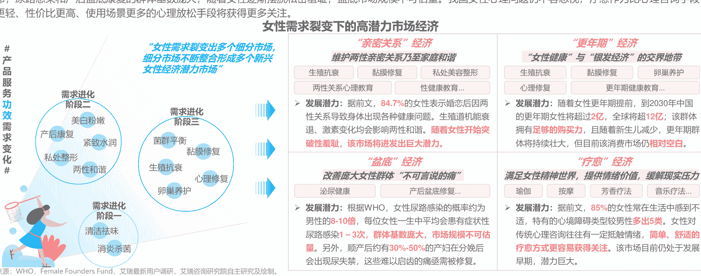

来源：WHO; Founders Forum; 女性私密用户调研；艾瑞咨询研究院主研及编译。
© 2025 iResearch

## BUSINESS COOPERATION

### 业务合作

- 官网
- 微信公众号

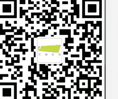
- 新浪微博
- 企业微信

### 联系我们

400 - 026 - 2099
ask@iresearch.com.cn
www.idigital.com.cn

www.iresearch.com.cn

## 法律声明

### 版权声明
本报告为艾瑞数智旗下品牌艾瑞咨询制作，其版权归属艾瑞咨询，没有经过艾瑞咨询的许可，任何组织和个人均不得以任何形式复制、传播或输出境外。任何未经使用本报告的相关行为均将违反《中华人民共和国著作权法》和其他法律法规以及有关国际的规定。

### 免责条款
本报告中行业数据及相关市场预测主要为研究人员采用桌面研究、行业访谈、市场调查及其他方法获得，部分文字和数据采集于公开信息，并且结合艾瑞监测数据，通过艾瑞统计预测模型估算；企业数据主要为访获得，艾瑞咨询对等信息的准确性、完整性或可靠性作为最大努力的追求，但在任何情况下，本报告的信息和述的观点均不构成建议。
本报告中发布的的数据采用样本方法，其数据结果受到样本的影响。由于调研方法及样本的限制，调查资料范围的限制，该数据仅代表调研时间和人群的基本状况，仅服务于当前的调研目的，为市场和客户提供参考。

## THANKS

艾瑞咨询为商业决策赋能

## START YOUR FINANCE

起点财经，网罗天下报告
