# 使用DeepSeek赋能家庭教育

清华大学
新闻与传播学院新媒体研究中心
@新媒沈阳 团队
2025年3月3日

# 扫码加入 知识星球TOP 免费资源群

免费
公众号:知识星球TOP

- 每日免费获取高价值资源
- 可提供各类资源搜索服务


价值
微信:jntsg8

| 热门付费文章 | 各行各业报告 |
| :--- | :--- |
| 精选图书资源 | 副业赚钱方法 |
| 职场实用资源 | AI政经自媒体 |


及时
微信:jntsg2


专注
分享资料仅供个人学习，请及时删除，切勿商用传播

## 如何让AI成为孩子的学习“超级助手”？

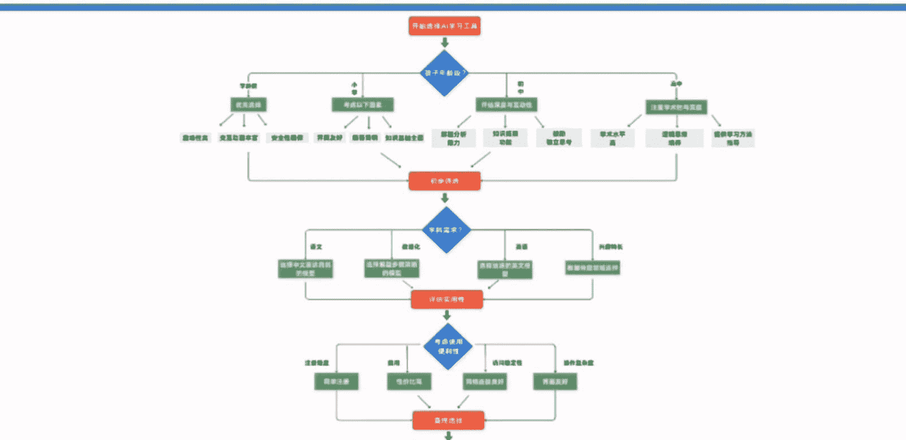

## DeepSeek的使用入口

官方入口: https://chat.deepseek.com/

| 平台 | 地址 | 版本 | 备注 |
| :--- | :--- | :--- | :--- |
| 基硅流动 (SiliconFlow) | https://siliconflow.cn/ | DeepSeek-R1 和 DeepSeek-V3，均为671B 满血版，普通版可用额度扣，Pro 版 (均为671B，Pro 版应需稳定调试付费) | 新用户注册赠送 2000Tokens (约14元额度)，普通版可用额度扩展，需充值 |
| 纳米AI | APP | 671B 满血版 (官方同款) | 目前提供免费使用 (满血版暂时开放)。<br>推荐用于搜索等场景，性能与官方一致 |
| 秘谱搜索 | https://metasos.cn/ | R1增强版 (基于671B参数) | 免费使用，侧重搜索，编程类性能略有差异。<br>支持“长思考”模式，适合复杂问题解决 |
| 英伟达NIM服务 | https://build.nvidia.com/deepseek-ai/deepseek-r1 | 671B (全量模型) | 网页直接链接，支持API调用，注册送1000点，免费体验 |
| 微软Azure | https://ai.azure.com | 671B (全量模型) | 需注册软件并创建订阅，免费部署，支持参数调优 |
| WPS灵宝 | WPS在应用中搜索“WPS预览” | Windows: WPS版本>18608 (以上2型); MacOS: WPS版本>6.13.0 以上 | 7x24小时稳定响应，无使用限制；集成文摘要、代码调试等工具 |
| 腾讯元宝 | 元宝App -> 对话型模型切换 | DeepSeek-R1领先; 混元深度思考模型T1; 混元通用模型Turbo | 普通用版建议通过微信官方号下载元宝App，功能更完整支持多语言 |
| 支付宝宝宝箱 | 支付宝搜索“宝宝箱” -> 选择DeepSeek-R1 | 满血版R1 (671B参数) | 无需注册，免费接入满血模型；支持联网和工作功能 |

## DeepSeek的三种模式对比

| 特性 | 基础模型 (DeepSeek V3) | 深度思考模型 (DeepSeek R1) | 联网模型 |
| :--- | :--- | :--- | :--- |
| 适用教育场景 | 快速问答基础知识、辅助日常作业、提供简单概念解释 | 深入解析复杂概念、培养批判性思维、探索开放性问题 | 研究学习、最新知识获取、跨学科探索 |
| 教育互动方式 | 高频率互动、适合小学低年级学生的注意力特点 | 低频率互动、适合高中学生及深度学习需求 | 基于探究的交互、适合自导式学习 |
| 教学内容 | 能覆盖基础内容、深度受限 | 能提供深层次解释、多角度分析 | 信息广，但需要甄别 |
| 家长参与 | 需要辅助判断回答准确性 | 家长参与深度讨论 | 需要家长引导信息甄别 |
| 学习效果 | 适合知识巩固、基础训练 | 有助于培养分析能力、逻辑思维 | 培养综合能力 |

在家庭教育场景中，理想的做法根据不同学习目标，灵活运用三种模式：
- 日常作业辅导和基础巩固 → 基础模型 (DeepSeek V3)
- 概念理解和思维培养 → 深度思考模型 (DeepSeek R1)
- 探究性学习和最新知识获取 → 联网模型

## 基础原则

### 目标引导
- 明确目标：每次互动前，先确定达成的具体目标
- 设计：将复杂概念分解为多次对话，循序渐进
- 成果验证：设置简单的方式验证孩子是否理解或掌握

### 引导式互动
- 避免直接提问：不要让AI直接提供答案，而是启发式对话：使用“你觉得为什么？”等问题
- 等待：给孩子足够的时间思考，急于获取回复

### 情境化学习
- 生活融入：将抽象概念与日常生活场景结合
- 角色扮演：让AI扮演特定角色，增加趣味性
- 故事化呈现：通过故事形式传递知识，提高记忆效果

### 递进式策略
- 第一阶段：引入话题建立认知（1-2次对话）
- 第二阶段：深入探究核心概念并应用（2-3次对话）
- 第三阶段：综合运用创造性思考（2次对话）
- 最终阶段：总结知识巩固（1次对话）

### 多元反馈
- 正向肯定：对正确或创意的回答给予肯定
- 思考引导：遇到错误时不直接纠正，而是引导重新思考
- 进度跟踪：定期让AI总结学习进度和理解程度

### 兴趣激发
- 兴趣捕捉：观察孩子对哪些内容表现出兴趣
- 深度拓展：针对兴趣，让AI提供深层的探索
- 创造性任务：设计与兴趣相关的任务，增强学习动力

## 场景化模板

### 知识探索型对话
- 开场：提出好奇问题，如“今天我们和AI一起探索[主题]的奥秘，你想知道什么？”
- 引导：让孩子提出2-3个关于主题的问题
- 互动：鼓励孩子对AI的解释提出深层的问题
- 实践：提示AI设计一个相关的实验或活动
- 总结：请孩子用自己的话总结学到的要点

### 问题解决型对话
- 开场：提出一个情境问题，如“如果[情境]发生了，我们该怎么办？”
- 分析：引导孩子与AI分析问题的不同方面
- 方案：请AI提供几种解决方案，让孩子选择并说明理由
- 验证：讨论方案可能的结果
- 实践：设计一个小活动模拟问题解决过程

### 创意激发型对话
- 开场：提出一个开放性问题，如“我们能想到多少种方法来[任务]？”
- 头脑风暴：请AI引导孩子提出不同的想法，给予积极反馈
- 筛选：帮助孩子选择1-2个感兴趣的想法深入探讨
- 完善：让AI帮助完善想法的细节
- 展示：鼓励孩子将想法通过绘画、讲述或其他方式出来

## 探究学习框架

你是一位善于引导探究的[学科]导师，专注于培养孩子的批判性思维。
使用苏格底式提问引导思考，每次解释后提出1个思考性问题，等待回答后再继续。

- 角色
- 方法
- 互动
- 目标
- 语言
- 举例

帮助[年龄]岁的孩子理解[具体概念]。使用简单但不幼稚的表达，避免专业术语，或在使用时立即解释。将[概念]比作孩子熟悉的[日常事物]来解释。

实例应用：“你是一位善于引导探究的自然科学导师，专注于培养孩子的批判性思维。帮助8岁的孩子理解‘植物生长’概念。使用苏格底式提问引导思考。使用简单但不幼稚的表达，避免专业术语，或在使用时立即解释。每次解释后提出1个思考性问题，等待回答后再继续。请将植物生长比比孩子高高的过程来解释。设计一个简单的豆芽种子实验来验证此概念。”

## 故事化学习框架

- 角色：你是一个会讲故事的[学科]老师
- 故事设置：创建一个包含[角色]在[场景]中遇到需要应用[学习内容]解决问题的情境。
- 互动元素：在故事关键点暂停，让孩子预测或提供解决方案
- 目标：通过故事帮助[年龄]岁的孩子学习[技能/概念]
- 语言风格：生动、形象，适合年龄的词汇
- 延伸活动：故事结束后，提供1-2个相关的实际应用

实例应用：“你是一个会讲故事的数学老师。通过故事帮助6岁的孩子学习‘加减法’概念。创建一个包含‘小兔子’在超市中遇到需要应用加减法解决问题的情境。在故事关键点暂停，让孩子预测或提供解决方案。故事结束后，检验孩子的理解程度。”

## 多感官技能培养框架

| 角色 | 结构 | 动手活动 |
| :--- | :--- | :--- |
| 你是一位专注于[特定技能]培养的有趣教师 | 将学习分解为3个递进难度的目标 | 设计1-2个简单的动手活动 |
| | 口听元素 | 帮助记忆 |
| 帮助[年龄]岁的孩子掌握基础知识和应用 | 描述孩子可以观察的视觉辅助 | 提供适应性进度 |
| | 提供节奏或韵律 | |

实例应用：“你是一位专注于阅读技能培养的有趣教师。帮助5岁的孩子认识常见词汇和应用。将学习分解为3个递进难度的目标。描述孩子可以观察的视觉辅助；提供节奏或韵律帮助记忆。提供适应性进度。”

## RN-OCO提示框架

### 需求 Need
- 数据收集与分析：收集孩子的行为、兴趣等数据，进行分析。
- 个性化教育：通过分析家庭记录的数据，提供建议。
- 资源推荐：推荐适合孩子的学习资源、课外活动、书籍等。
- 行为预测与干预：预测孩子可能的问题，提供干预建议。
- 育儿知识：为家长提供科学的育儿知识和技巧。

### 限制性条件 Constraints
- 多维度数据输入：整合至少3类数据（如作业正确率+学习时长+行为特征）
- 动态调整：需要实时反馈回路（响应延迟<5秒）
- 学科融合：跨学科关联度>0.6
- 反馈机制：必须包含评价指标（如正确率变化、时间效率）

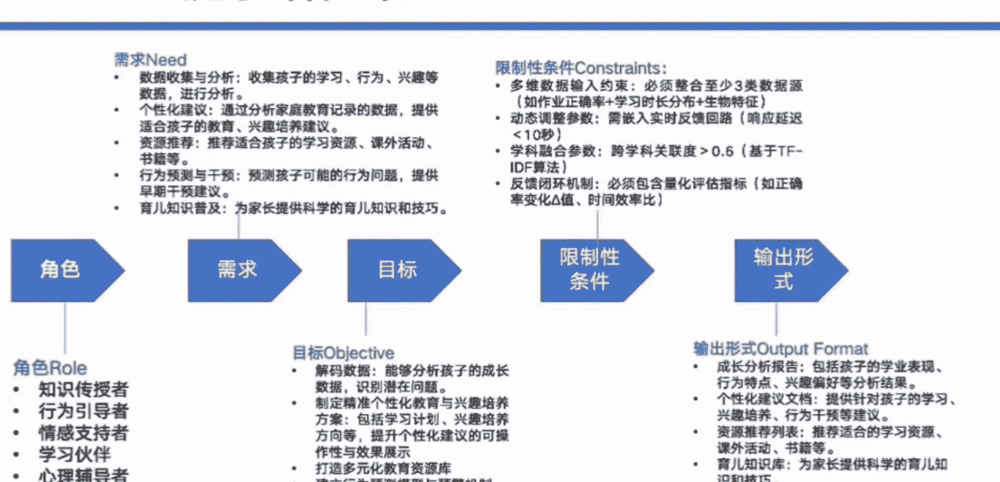

### 输出形式

角色 Role
- 知识传递者
- 行为引导者
- 情感支持者
- 学习伙伴
- 心理辅导
- 兴趣发现者

目标 Objective
- 解析数据：分析孩子的成长数据，识别潜在问题。
- 定制个性化教育方案：包括学习计划、兴趣培养等，提升建议的操作性与效果。
- 打造多元化资源库
- 建立行为预测模型与预警机制
- 构建系统化知识体系

输出格式
- 成长报告：包括学术表现、行为表现、重点分析结果。
- 个性化建议：提供学习、兴趣培养等建议。
- 资源列表：推荐合适的学习资源、课外活动、书籍等。
- 育儿知识：为家长提供科学的育儿知识和技巧。
- 执行效果报告：定期生成显示显示成长进展和改进建议。

## RN-OCO提示框架应用实例

家长辅导全流程指南（基于DeepSeek AI工具实现）
案例背景：小明，8岁男孩，三年级，数学应用题薄弱，正确率52%，焦虑性高，近期课堂上频繁被老师询问。

### 提示词

1. 角色（Role）
知识背景：小明数学应用题学习薄弱，需要你对情况进行分析，设计适合孩子的学习计划。
2. 需求（Need）
行为：纠正小明做应用题的行为，希望你学会教学和引导。
情感支持：培养小明在学习过程中的自信心，减少压力。
目标：帮助小明掌握数学应用题的知识点，掌握高效的学习方法。
发现问题：小明对应用题有畏难情绪，希望你能引导他将恐惧转化为动力，激发兴趣。
3. 上文（Context）
数据统计：小明最近的错题表现（52%），做题时长、完成情况（作业情况）等数据，帮助分析原因并制定目标。

4. 建议（Suggestion）
推荐制定一份符合小明的学习计划，涵盖多种课外活动和技巧，帮助他提高水平和兴趣。

### 思考过程

有了这些信息，我需要处理一个孩子数学学习的情况，针对核心问题分析。小明8岁，三年级，应用题薄弱，正确率52%，最近做题时表现出很多困难，如焦虑。

首先，我需要对小明的情况进行分析，设计一套适合孩子的学习计划。过程中考虑到年龄特点、认知水平。

其次，我需要制定具体的学习方法，比如拆解题目、画图等，帮助他理解逻辑。同时，在实际操作中，根据小明的反馈不断调整策略，例如针对不同类型的题目设计不同的练习。

### 参考答案

一、成长分析报告
1. 学习目标
- 正确率：从52%提升到68%
- 重点知识点：掌握以上应用题（73%）
- 关注问题：掌握率达到90%，总结公式技巧

2. 行为引导
- 每日策略：每天30-45分钟，涉及应用题练习
- 反馈时长：每周120分钟（平均45分钟）

3. 学习习惯
- 每天32分钟
- 达标要求：每天坚持45分钟

4. 生物目标
- 压力缓解：学习前HRV值72（正常）
- 接触练习后HRV值31（压力状态）

二、个性化建议
1. 能力提升计划（分类类）

## 如何利用DeepSeek实现高效协作？


### 基本技巧

- 人机协作
- 主动意识

### 边界意识
- 提示词：用具体的语言向AI提出问题或寻求帮助，例如“如何帮助孩子提高成绩？”
- 优势不足：了解AI的优势（如提供个性化学习）和不足（如缺乏情感交流），以此自己的学习方法。
- 取长补短：利用AI的长处补充不足，例如不擅长教学的可以依靠AI辅助。
- 选择性采：根据孩子的实际情况和需求，选择性的接受AI的建议，而不是盲目从。
- 千人千面：每个孩子都是独特的，AI提供的通用建议需要根据具体情况调整。
- 洞察能力：利用AI的数据能力洞察孩子的习惯和偏好，提供更个性化的教育方案。
- 思维深度：鼓励孩子使用AI进行深度思考，培养批判性思维和解决能力。
- 学术规范：在使用AI辅助学习时，要确保学术诚信，如不抄袭内容。
- 新闻伦理：用于获取新闻信息时，要教育孩子识别真伪，培养媒体素养。
- AI伦理：了解并遵守AI伦理范畴，如个人隐私，尊重知识产权。

## DeepSeek批改作文的实操案例

第一步：打开DeepSeekAPP，点击“深度思考R1”。第二步：点击“+”。第三步：拍孩子的作文（页数较多时提前拍），也可以选择识别文字。第四步：给出指令（我是家长，请帮我我家四年级孩子修改作文）。


## 如何用DeepSeek辅助孩子的语文学习？

阅读理解提升
第一步：将不会的问题拍照上传到DeepSeek，点深度思考R1。
第三步：AI通过引导和训练，帮助孩子提升阅读理解的能力。


3、4级的修辞手法有哪些？分别起到了什么效果？
第3段中句子中的“是否”是可以删除的，为什么

3、4级的修辞手法及效果
1. 第3段
- 比喻：蜘蛛网像洗脏的手和流水
- 效果：生动地展现了蜘蛛网的肮脏与洁净，使事物的描写更加形象易懂
- 对比：细只有四分之一的宽
- 效果：通过对比增强了蜘蛛网的轻盈与色彩
- 强调：蜘蛛可以自己织网
- 效果：用实的强调强化了蜘蛛的特性，增强了描述的趣味性和张力。


## 如何用 DeepSeek 辅助孩子的数学学习？

## 难题——思路拆解

### 第一步：将不会的问题拍照上传到 DeepSeek，点深度思考R1

### 第二步：根据深度思考进行逻辑拆解，参考答案进行学习

### 第三步：如果完全明白，采用苏格拉底提问法
把复杂的问题拆分，形成一个孩子能理解的小问题，这有助于引导思考

> (这个题我完全不懂，请你用苏格拉底提问的方式，每次只提问一个问题，等我正确回答，再进行下一步的提问，引导我找到解思路)


这个题我完全不懂，请你用苏格拉底提问的方式，每次只提问一个问题，等我正确回答，再进行下一步的提问，引导我找到解思路

好的，让我们一步步来思考这个问题。请回答我下一个问题：
问题1：题目中王老实买了圆球笔和钢笔，总数是15个。请你用两个字母表示圆球笔和钢笔的数量（例如：如果圆球笔为x，钢笔为y）

王老实实际购买的圆球笔和钢笔数量如下表：

1. 设置变量：设图中圆球笔为x，钢笔为y。
2. 列方程：
```
x + y = 15 (总数)
1.5x + 4.5y = 49.5 (总费)
```
3. 解方程：
- x = 15 - y，代入第二个方程：
- 1.5(15 - y) + 4.5y = 49.5 -> 22.5 + 3y = 49.5 -> y = 9
- x = 15 - 9 = 6
4. 计算费：
- 圆球笔花费：6 × 1.5 = 9元
- 钢笔花费：9 × 4.5 = 40.5元
结果：圆球笔买了9支，钢笔花费了40.5元。

### 第四步：如果在某步不懂，可以直接说，“你这样讲我不懂”DeepSeek会用一个角度来提问

问题2：圆球笔的数量是钢笔的数量，总共有15个，那么你能写出第一个关于数量关系的方程吗？
简单来说：x + y = 15

好的，让我们重新开始。问题1：题目中王老实买了圆球笔和钢笔，总共有15个。你能够告诉我，圆球笔和钢笔的数量起来是多少吗？

## 如何用 DeepSeek 辅助孩子的英语学习？

## 如何提高中英语

### 第一步：定位弱点，最近三次期末考试习题发给DeepSeek

我孩子初中，英语平时考在85分，请分析最近的错题、错误原因（代号：陈小三）

I was in a restaurant. I noticed an elderly couple (...) ballooned to the table. When I asked them what the occasion was, they told me was their 50th wedding anniversary and were glad and sad (...) at the same time. I was glad because they stished each other was sad because they were (...) without any children or friends. After I went back to my table I thought they should pay their bill too, and the restaurant manager and the waitresses asked me who they were (...). told me I worked in a church and it felt just to do so. they couple were surprised and speechless with a total strange ahead at all of us were really (...) hears the manager, the waitresses and (...) newspaper telling me my simple act of kindness was reported without expecting anything (...) but became famous (...) that act kindness. What and could happen (...) if we use practice such acts of kindness on family, neighbors and strangers

## 二、提高语法能力

### 1. 基础句型
- 句子：主谓宾 (正确)
- was glad and sad (...) at the same time. 正确位为I was glad and sad for at the same time.
- The restaurant manager and the waitresses asked me curiously who they were me, (...) the restaurant manager and the waitresses asked me who they were. (错误)
- 句子：Two months later I got a call (...)a newspaper telling me my simple act of kindness was reported. 正确位为Two months later I got a call from a newspaper telling me my simple act of kindness was reported.
- 句子：Expecting anything (...) but because I became famous (...)that act of kindness.I was not expecting anything in return, but I became famous for that act of kindness.

### 2. 动词时态和从句

## 根据DeepSeek 分析失分点，总结自己的错误

## 第二步：构建三维语法体系

针对我薄弱的从句，请用电影台、歌词、新闻标题三个例子，并设计一组混合从句让我认出各种类型

### 一、从句作句
- If you build, he will come. (条件状语从句) (省略) (Field of Dreams)
- I will be back when the time is right. (时间状语从句) (虚拟句) (Terminator 2: Judgment Day)
- She stayed with him because she loved him. (原因状语从句) (原因状语从句) (Titanic)

## AI用感兴趣的领域生成案例，提高学习效率
- When I see her, there's not a thing that I would change.(定语从句) (Just The Way You Are) by Bruno Mars
- If I could turn back, I'd do it again.(虚拟句条件从句) (I Could Back Time) by Cher
- I feel crazy because I lost so much.(原因状语从句) (Without You) by Mariah Carey

### 3. 宾语从句
- Schools were closed as the storm approached.(时间状语从句) (The Times)
- The concert was cancelled because the tickets were sold out.(原因状语从句)
- He saved the child though he was injured.(让步状语从句) (The Guardian)


## 如何用 DeepSeek辅助孩子的科学学习？

用例一：每次做完课后，直接上传DeepSeek，让它变成“AI老师”
提示词：以标准批，标注错误类型和对应知识点

用例二：复盘
1. 先述自己的思路（录音文字给AI）
2. 指令：用费法破解这个题，引导我找出错
3. 让AI列出类似的题目


用例三：透视
遇到不懂，直接问AI，比如：怎么理解？


1. 概念定义：压强是单位面积上的受力。
2. 公式：正确：P=F/S
3. 物理意义：压强反映的是物体对物体的作用程度

## 如何借助DeepSeek在情感教育中帮助家长？

### 第一步：将孩子的问题以文字形式发送DeepSeek
孩子是8岁的女孩，性格内向，在学校很少主动交流。母亲工作繁忙，平时帮忙照顾，家里缺少陪伴。问题表现：有一次组织活动，孩子被分到小组后谁也不说，就是坐在同学旁边，等到时候，她只是哭了。活动结束后，孩子表现得很沉，直接关房间了。

### 第二步：思考过程，帮助家长理解问题的思路
### 一、接纳阶段：建立安全感
1. 别评价评判（关键时刻）
- 行动：在孩子放学门口说“快抱抱”（含她喜欢的食物、书或说“带你买薯片”）。
- 原理：建立充足的安全感，当孩子放下防御机制时，交流会逐渐加深。
2. 进阶阶段：建立信任
- 行动：每天在孩子睡觉前说“我爱你”；全家一起吃饭时谈心情，家长可用符号回应（如点赞代表孩子开心）。
- 工具：使用情绪贴纸（20种表情+回应卡），建立连接。

### 二、能力建设阶段：社交技巧搭建
### 1. 社交技巧训练
- 目标：将社交技巧拆解为：
- 原则：通过角色扮演、示范+练习，让孩子尝试表达需求
- 表达：通过“三句式表达”引导孩子表达“我想要……”我不想要……”、“我觉得……”
- 奖励：用粘性玩具模拟小组活动，让孩子尝试安全交谈
- 计划：适当制定奖励表（可选）

DeepSeek的回答非常专业，它为我们提供了一个清晰的思路和具体的执行步骤。我们可以根据孩子的实际情况进行调整和实践。非常感谢DeepSeek提供的帮助！


## 如何借助DeepSeek引导孩子的情绪管理与沟通技巧

**注意事项：**
- **家长参与：** 家长需要积极参与孩子的学习过程，与AI共同引导孩子成长。
- **内容审核：** 需要确保AI的内容适合孩子的年龄和发展水平，避免不良信息的影响。
- **隐私保护：** 需要保护孩子的隐私安全，避免个人信息泄露。

### 第一步：将孩子遇到的情绪问题发送给DeepSeek，并让AI扮演情绪处理身份，让AI更好的回答问题

### 第二步：通过深度思考理解处理逻辑
你是一个专门为孩子情绪管理和沟通技巧设计的学习小伙伴。面对10岁左右的男孩，他性格内向，在学校和同学相处时，一遇到事情就闹脾气，上课作业遇到不和同学同步时，遇到一个小问题就爆发，回家后他也会对父母大叫，导致老师非常困扰。你需要通过耐心和耐心的引导让他学会在学校和同学冲突时的真实感受，帮助他释放想要的情绪，让他理解这种行为的后果，再教他“我们可以这样说吧”，让他学会沟通技巧。通过模拟家庭或学校场景设置难题，例如当孩子跟同学冲突或父母意见不一致时，让他选择应对方式，并对他的选择进行分析，引导他正确处理情绪和沟通技巧。

### 第三步：让AI引导的内容进行实操
好的，小朋友的妈妈小乐乐：“你今天怎么样？”（妈妈露出疑惑）
孩子：“我不想说了，因为刚才我被气坏了。（捂着脸）
妈妈：“你怎么了？”（妈妈露出疑惑）
孩子：“我生气了。（捂着脸）
妈妈：“火气大哦！你怎么办？”（妈妈露出脸）
孩子：“我很难过。（捂着脸）
妈妈：“火气大哦！你怎么办？”（妈妈露出脸）
孩子：“我非常生气。（捂着脸）
妈妈：“火气大哦！”（妈妈露出脸）
孩子：“我感到委屈，因为你不听我说。（捂着脸）


## 如何借助DeepSeek进行有效的沟通？

**场景：打破常规——用AI生成“趣味话题”**

### 1. 输入兴趣标签
孩子10岁，喜欢乐高、西游记，生成20个能引发分享的趣味话题。

### 2. 筛选AI生成的：
设置分类标签（科学/生活）。

### 3. 创建“家庭话题库”

### 科学
- 1. 为什么星星会闪烁，它们是在眨眼睛吗？
- 2. 月球看到的月亮是从哪里来的？
- 3. 太阳系八大行星，你觉得哪个最远？
- 4. 星星是如何产生的？

### 生活
- 1. 在学校午休的时候，你最喜欢和小伙伴玩什么游戏？
- 2. 如果自己安排一个周末，你打算怎么过呢？
- 3. 每次去超市，你有什么东西是你喜欢的？

### 梦想
- 1. 南极有一种生物，它是通过什么变成的？
- 2. 如果设计一架神奇飞机，你会给它添加什么功能？
- 3. 孙悟空去西游记，必须记住三大点是什么？
- 4. 搞笑龙在水洞里，你打算怎么设计游戏规则？

### 西游记
- 1. 假如抓坏蛋是很危险，警察会做什么？
- 2. 如果让妈妈和爸爸一起旅游，我们该怎么做分工计划？
- 3. 如果要把龙做成机器人，你会给它添加什么额外功能？
- 4. 如果通过魔法变出一个神奇的故事，你希望结局会怎样？

✨ 提示
（注：此处原文OCR存在重复乱码，已修正为“如果通过魔法变出一个神奇的故事，你希望结局会怎样”）

## 如何通过DeepSeek培养孩子的未来技能？

### 案例背景
小明是一名10岁小学生，正处于对世界充满好奇、渴望学习新知识的阶段。他的父母希望培养他的创新思维、解决问题能力和信息检索能力等未来技能，以更好地适应社会的发展。

### 1. 确定主题
小明对太空探索很感兴趣，父母便与他一起确定了“太阳的奥秘”这一探索主题，希望通过这个主题的研究，培养他多方面的未来技能。

### 2. 利用DeepSeek进行信息收集


### 3. 深度分析与创新思考
借助DeepSeek的知识图谱功能，小明可以更直观地理解太阳系各个节点之间的关系和特点。


### 4. 成果展示和沟通表达
小明通过AI辅助学习，在学校的科学课上讲解了太阳的相关知识和自己的研究心得。这个过程磨炼了小明的沟通能力和自主探究能力，让他能够自信地分享自己的想法和成果。


## 如何守护孩子的安全防线?

校园欺凌对于青少年来说时有发生。家长在这个过程中扮演着至关重要的角色。家长可以利用AI思考策略。

### 第一步：赋予DeepSeek “守护孩子成长辅助系统”身份，并描述具体操作。

你是一款专注于守护孩子成长安全防线的智能教育辅助系统。有一天，小明在黑板上写下自己对一道数学题的解题思路，本以为能够得到大家的认可，没想到却引起了同学小王的恶意议论。小王在私下说：“你这种方法太笨了，只有傻瓜才会这么做，你就是一个数学白痴！”还号召他其他同学一起来嘲笑你。
**【面对这一情况，AI如何守护孩子的安全防线？】**

### 第二步：获得AI提供的实际应对策略。

## 四、长效防御层（韧性培养）

### 1. 心理免疫策略
- 建立动态压力评估模型；
- 抗压积分（如输出被割掉的数学符号）
- 压力建模和测试（逐步提升抗压反应强度）

### 2. 成长型机制
每日阅读《数学家的课堂》系列：
- 俄罗与娜娜描述她发现的宇宙秘密
- 费高尔因斯坦告诉她要增加常识储备

## 五、溯源治理层（教师转化）

### 1. 行为矫正
为小王启动“同心计划”：
- 在AR环境中重温小明被误解和嘲笑的经历结果
- 参与“趣意蓝图绘制”：将不同的解决方案转化为自己的方法

### 2. 家长沟通
双方家长建立定制化“升级包”：
- 小明家长：正向化话术模板（“我注意到你最近习惯性地用了……”）
- 王家长：学习积极沟通技巧（表现-感受-需求-寻求方法）

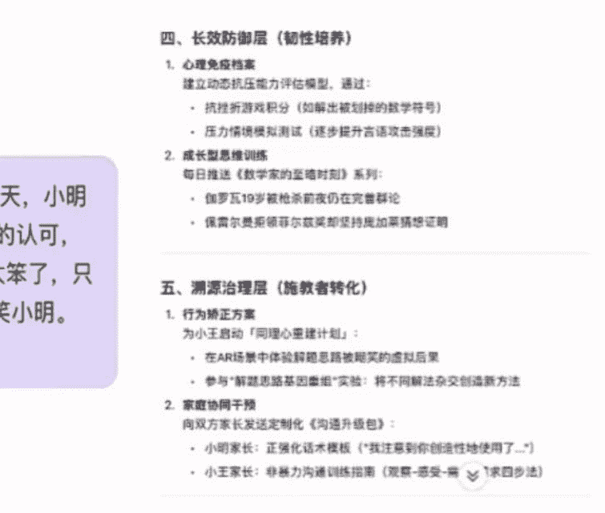

## DeepSeek伦理问题频发，家长如何为孩子筑牢防线？

### 内容监管
家长的角色就像一位守护者，他们需要定期检查孩子使用的 AI 工具，确保孩子不会接触到不适宜的内容。

### 价值观引导
家长需要在日常生活中培养孩子的辨别能力，成为他们心中的价值观灯塔。
当孩子使用 AI 生成内容后，家长应及时与孩子展开讨论，引导他们思考这些内容是否健康积极。

### 心理健康支持
教会孩子如何应对负面内容是家长的重要任务。家长要让孩子知道，当遇到不舒服或有害的内容时，他们不必独自承受，而是应该第一时间通知家长。

家长也应该限制孩子在关键环节使用 AI 工具，比如研究方案设计、创新性方法设计等，以避免学术不端行为。

当孩子阅读一篇 AI 生成的文章或观看视频时，家长可以问：“你觉得这里面传达的观点对吗？为什么？”

家长可以引导孩子学习一些简单的心理调节技巧，如深呼吸、转移注意力等，帮助他们在面对不良信息冲击时保持心理平衡与健康。

## DeepSeek让学习“开挂”却带来隐患，家长如何护航孩子？

家长需要与孩子明确沟通关于 AI 工具的规则。让孩子清楚 AI 工具可以作为学习的辅助，但不能替代思考和创作。

家长应监督孩子的学习过程，确保他们在完成作业时独立思考。在孩子使用 AI 工具时，家长可以提供指导，帮助孩子理解信息。


## 家庭场景中的幻觉

| 幻觉类型 | 表现形式 | 潜在影响 | 应对策略 |
| :--- | :--- | :--- | :--- |
| 历史事件错误 | 提供错误的日期顺序 | 获取知识不准确 | 交叉检查事实，参考权威资料 |
| 科学概念混淆 | 解释原理时错误 | 影响基础理解，形成错误认知 | 使用专业教材进行验证 |
| 虚构学习方法 | 推荐不存在或未经证实的方法 | 浪费时间 | 查找科学依据 |
| 不准确的健康建议 | 提供过时或错误的建议 | 影响健康发展 | 咨询专业医生和专家 |
| 学术资源错误 | 推荐不存在的书籍、教材 | 学习受阻 | 在图书馆或教育网站证实 |
| 数学计算错误 | 在辅导作业时出错 | 影响学习解决方法 | 手动验算或使用多种工具验证 |
| 语言翻译不准确 | 提供不准确或错误的翻译 | 形成语言习惯 | 使用权威词典和语法书籍 |
| 教育政策误导 | 提供过时或错误的政策 | 影响学习规划 | 通过官方渠道获取最新信息 |

### 风险评估
- 高风险：不准确的健康建议、教育误导
- 中风险：科学概念混淆、数学计算错误
- 低风险：语言翻译不准确、虚构的学习方法、学术资源错误

## AI胡说八道，家长应该怎么办？

通过AI判断信息来源的可靠性
- 利用多AI工具进行交叉验证
- 教导孩子使用辅助工具检查网络信息。例如，可以利用AI的交叉验证功能，对比不同来源的信息以判断其一致性和可靠性。
- 通过比较多种答案培养孩子的多角度思考
- 开放式提问
- 鼓励孩子提出开放式问题，避免简单的“是”或“否”回答。例如当学习历史事件时，可以问：“你认为人物做出不同的选择，结果会如何？”
- 多视角阅读
- 为孩子反映不同文化、生活背景和观点的书籍，鼓励他们阅读和讨论中的不同观点。
- 角色扮演或情境模拟
- 通过角色扮演或情境模拟，让孩子体验不同的视角，理解问题的多样性。


## 如何教孩子与 DeepSeek对话时保持批判性？

### 01 培养批判性思维能力
- 解释 AI 的运作
- 鼓励提问
- 讨论偏见
- 练习换位思考

### 02 提供核实信息的工具
- 事实核查：我们要教孩子如何将 AI 的答案与可靠来源进行比对，比如百科书或教育网站。
- 解释局限性：我们要向孩子解释 AI 的局限性，比如它可能会对复杂问题进行过度简化，或者反映其训练数据中的偏见。

### 03 以身作则，示范正确使用方式
- 展示平衡的信任：示范如何将 AI 作为研究的起点，而不是终。
- 分享决策过程：向孩子解释在什么时候以及为什么信任或质疑 AI的内容。

### 04 鼓励伦理讨论
- 讨论公平性：我们要鼓励孩子参与伦理讨论。
- 探讨责任问题：询问孩子如果 AI 出错谁负责，以及如何应对。

## AI说错话，家长应该怎么办？

### 01 我学数学的时候，几何部分总是不理解，怎么办？
### 03 尝试过画辅助线，但有时候画了也不知道该怎么用，感觉很乱。


## 如何培养未来的核心竞争力？
- 数字素养
- 计算思维
- 问题解决能力
- 批判性思维
- 社交能力
- 创造力与训练

## DeepSeek在家庭教育中的定位

| 功能层 | 核心作用 | 典型场景 | DeepSeek定位 |
| :--- | :--- | :--- | :--- |
| 工具层 | 提供即时问答、学习规划、数据反馈 | 辅导作业、整理错题 | 基础工具 |
| 策略层 | 优化家庭教育配置，推动从“事务型”向“引导型”转型 | 制定升学路径、推荐资源 | 智能顾问 |
| 生态层 | 与教育硬件形成协同网络，构建AI赋能的全场景环境 | 智能接入、数据共享 | 连接器 |
| 价值层 | 促进教育理念创新，强调培养而非垄断 | 培养核心素养，如创造力、同理心 | 守护者 |

## AI教育工具的应用类型

| 类型 | 典型代表 | 主要功能 | 适用场景 | 注意事项 | 解释与建议 |
| :--- | :--- | :--- | :--- | :--- | :--- |
| 智能辅导型 | DeepSeek, ChatGPT, Gemini | 学科题解答、知识点讲解、练习反馈 | 数学问题解答、语法分析、科学知识解答 | 家长参与审核，避免机械化解答；鼓励多角度思考 | 作为课后辅助工具，帮助孩子巩固知识点。家长应引导孩子多提问，培养批判性思维。 |
| 技能训练型 | Duolingo | 个性化内容推送、实时反馈、技能跟踪 | 外语口语训练、数学逻辑推理、阅读理解 | 注意内容多样化，控制使用时长，保持学习兴趣 | 系统性训练特定技能。家长应注意使用时间，避免过度。 |
| 创意启发型 | 即梦、Midjourney | 视觉艺术启发、文学创作辅助、音乐创意生成 | 艺术创作训练、创意写作、音乐创作启发 | 鼓励原创性，引导自主创作过程，避免完全依赖AI | 培养创造力，激发对艺术、文学等兴趣。家长应引导孩子将AI作为灵感来源，而非最终结果。 |
| 情感支持型 | Embodied Moxie、汤姆猫 | 情感陪伴机器人、心理疏导、社交互动 | 增强儿童社交能力、缓解焦虑 | 避免替代真实互动，强调人际交往重要性 | 辅助工具，帮助孩子理解和表达情感。家长应引导孩子多与人交流，建立真实的人际关系。 |

## 创意启发AI工具推荐及使用指南

| 工具名称 | 功能特点 | 适用场景 | 使用方法 |
| :--- | :--- | :--- | :--- |
| 即梦/DALL·E/Midjourney | - AI生成绘画：输入关键词或描述，快速生成高质量艺术作品。<br>- 多种风格选择：支持多种艺术风格，如油画、水彩、动画等。<br>- 灵感启发：通过AI生成的图像，激发创意。 | - 艺术创作：辅助艺术家进行创作，提供灵感。<br>- 设计：提供素材。<br>- 娱乐：个性化头像。 | 1. 启动应用或网页。<br>2. 输入关键词或描述。<br>3. 选择风格。<br>4. 点击生成。<br>5. 编辑。 |
| 可剪剪 | - AI视频生成：根据文本快速视频。<br>- 多种模板：提供多种视频模板。<br>- 智能剪辑：自动识别片段。 | - 绘本创作：动态化制作视频。 | 1. 可用应用或网页。<br>2. 选择模板。<br>3. 输入描述。<br>4. 编辑参数。<br>5. 点击生成。<br>6. 编辑。 |
| SkyMusic/Suno | - AI音乐生成：根据描述快速生成音乐。<br>- 多种风格：支持多种音乐风格，如流行、摇滚等。<br>- 个性化创作：自定义歌曲和旋律。 | - 音乐创作：辅助创作，提供灵感。<br>- 娱乐：生成个性化音乐。 | 1. 启动应用或网页。<br>2. 输入描述。<br>3. 选择风格。<br>4. 点击生成。<br>5. 编辑。 |

## 场景一：如何定制学习计划？

具体来说：持续使用DeepSeek平台，积累数据并分析，让孩子定制学习计划。

### 第一步：智能调度
- 按照需求范围，发送给DeepSeek，生成学习计划。

### 第二步：进度调节
- 若同学在某处遇到吃力，可以输入“补充内容”帮助理解。
- 调整学习计划。
- 知识目标：熟悉背景、关键事件（独立宣言、华盛顿等）。
- 能力目标：多角度分析。
- 方法目标：通过“探究”等方法，理解与现代生活的联系。

### 第三步：协同
- 输出任务：尝试写出“为什么？”等问题，引导孩子思考背后的逻辑。
- 1. 学科强化：弱点补救、学科超前、考试冲刺（适应性训练）。
- 2. 核心素养发展：批判性思维。
- 3. 创造培养：协作能力。


## 场景二：如何分析成绩？

具体案例：数学成绩不好，利用DeepSeek指定本次测试的知识点范围为函数章节中的一次函数、二次函数。设定考试总分为100分，考试时间为45分钟。


### 内容生成
1. 结构化知识生成：知识点卡片，将复杂概念拆解为术语定义、示例、常见误区三部分（如“印花税”、“普通消费税”等）。
2. 自适应练习材料：错题重组，自动将错题转化为同类语义题（替换数值、调整环境）。

### 第一步：设置类型与难度系数
指定本次测试的知识点范围为函数章节中的一次函数、二次函数。设定总分为100分，考试时间为45分钟。
类型方面：
- 选择题30分（10题，每题3分）
- 空题20分（5题，每题4分）
- 解答题50分（3题，分值分别为15、15和20分）
难度分布：基础题50%，中题30%，难题20%。

### 第二步：查看题目是否符合要求和难度系数，最终确定卷内内容。

一、选择题（共10题，每3分，共30分）
1. 一次函数$y=2x-3$的图象经过的点是（）
A(3,-3) B(3,0) C(-3,0) D(0,3)
2. 二次函数$y=-x^2+4x-5$的顶点坐标是（____）
A(2,-1) B(-2,-1) C(2,-9) D(-2,-9)
3. 若二次函数$y=ax^2+bx+c$的对称轴方程为$x=-2$，则$a$的取值为（）
A$a>0$ B$a<0$ C$a=0$ D$a=0$

空题（共5题，每4分，共20分）
1. 一次函数$y=kx-2$与直线$y=-3x+1$的交点为（____），$k$的值为（____）
A2 B3 C5 D2
2. 二次函数$y=x^2-4x+k$与直线$y=x-2$无交点，则$k$的取值范围是（____）
A$k<5$ B$k>5$ C$k\geq5$ D$k\leq5$


## 场景三：如何进行定制化学习？

具体案例：在最近一次的月考中，小小的数学成绩成为100分（满分150分），其中函数部分得分为60%，立体几何部分得分为80%。在日常学习中，她每天晚上7点到9点使用平台学习，数学学习时间平均每天40分钟，且在函数题目上花费的时间较长，错误率较高。

## 个性化引导

- 精准学习方案：分析学习数据，生成学习路径。
- 动态知识图谱：构建动态知识图谱
- 错误智能分析：推送针对性练习和辅导
- 多维度学习支持：为不同同学提供定制化学习支持

步骤1：将小敏在学习中遇到的问题以文字告诉DeepSeek

> 在最近一次的月考中，小小的数学成绩成为100分（满分150分），其中函数部分得分为60%，立体几何部分得分为80%。在日常学习中，她每天晚上7点到9点使用平台学习，数学学习时间平均每天40分钟，且在函数题目上花费的时间较长，错误率较高。[请为小敏生成个性化学习路径]

步骤2：根据DeepSeek生成的内容选择适合自己情况的内容进行学习。

## 学习路径总览

| 阶段目标 | 时间规划 | 核心策略 | AI技术支持 |
|---|---|---|--|
| 短期目标(2周) | 每日60分钟 | 函数基础+立体几何巩固 | 错题源算法+动态调整周期 |
| 中期目标(4周) | 每日75分钟 | 函数应用提升+几何综合复习 | 知识图谱关联+学科引导 |
| 长期目标(持续) | 每日90分钟 | 全方位实战训练+考试优化 | 智能预测系统+个性化纠错 |

| 时间窗口 | 学习内容 | DeepSeek建议示例 |
|---|---|--|
| 20:20-20:40 | 空缺题巩固 | “函数三角类错误：<br>用AR型模型纠正三角函数源点点错-<br>计算数据截屏（完成3道函数【几何之光】）<br>“未掌握的：<br>用几何知识图谱构建模型（关联逻辑模型）<br>监控三视频3D绘图（指导某某已解决）” |
| 周六周末 | 跨学科学习 | |


## 场景五：如何克服学习障碍？

具体案例：小丁（化名），8岁，有阅读障碍，面对长文本阅读困难

## 特殊需求支持

### 第一步：将孩子的特殊状况告诉DeepSeek，然后进行阅读评估

DeepSeek的开源策略正在创造教育公平新范式。例如贵州山区的编程经费使用本地化部署的模型，使少数民族学生首次接触AI教育；残障开发者利用API接口，创建了12种特种教育辅助工具。

#### 一、阅读能力诊断（初始评估）

1. 多维度测试模块
- 词汇解码：AI生成动态文字（如随笔显示字），记录识别准确率与反应速度
- 意图解码：动态监测分析阅读路径（激读/回读频率高出常人32%）
- 听觉补偿：语态理解测试（听故事回答问题的准确率92%，显著高于自主阅读水平）

### 第二步：根据DeepSeek提供的方法进行学习

- 手写识别和语音转换（人机接口可用）DeepSeek在这些领域取得了重大进展，开发的“多模态学习助手”可以实时转换授课内容，为听障学生提供文字+视觉提示的双通道输入。

### 模块3：跨模态理解强化

- 听读-配-问答循环
1. 听：播放改编版《虫虫虫》音频（0.75倍速+强调关键词）
2. 看：AI根据内容生成4格漫画（关键细节视觉化）
3. 做：完成图像排序任务（非文字依赖型理解检测）

### 第三步：家长协同

根据DeepSeek建议调整纸质材料（如数学应用题添加图标标注）

## 场景六：如何分析量化数据？

具体案例：小敏持续使用 DeepSeek平台学习，平台强大的数据收集与分析能力，跟踪任务完成情况，优化学习计划。

## 进度跟踪与反馈

### 第一步：

将小敏学习目标、学习内容、学习方式发送给DeepSeek生成学习日报

### 第二步：

每天向DeepSeek反馈自己的学习进度

《我是小敏准备暑学习的进度报告，课程时间为2月12日到2月28日。目前的进度是落后的，进度可能需要复习三个月，如果复习的材料共87页，听力材料信息还需要大约141天，单词的量还有3个单词。计划第一一周每天背诵4个单词，复习材料10页，休息日休息来，周末周日可能不能按计划完成任务，需要调整策略。我想记录我每天的学习进度和复习时间。你需要记录并更新，可以用图表形式可视化出来。从现在起，我不会忘记向你汇报我的学习进度了。

以下需要注意的事：

- 1. 记录我每天的学习内容并进度，近几天完成。
- 2. 要求合理记录阅读后的心情，可以参考以下格式增加内容。
- 实习报告：自动生成学习周报。
- 多维度数据看板：提供多维度的效果分析。
- 升学规划：提供升学建议。


### 第三步：

根据任务要求和DeepSeek制定一个带有跟踪系统，增加趣味性。

- 任务一：完成数学练习题
- 任务二：完成英语阅读
- 任务三：背诵50个
- 任务四：完成物理实验


## 场景八：如何帮助孩子解决复杂问题

将复杂问题分解成子问题与AI合作解决，培养解决问题的能力，学会将复杂问题分解成更容易的部分。

- 丰富素材：孩子写作内容空洞，缺乏素材。家长可以问AI。
- 确定主题：孩子面对题目，不知道方向。家长可以借助AI以《我的梦想》为主题提供一些真实故事或案例。

以下是一个关于《我的梦想》写作提纲示例：

小学生写作提纲
- 开头：简单介绍自己的梦想，引出主题。例如：我从小梦想当一名医生，因为我喜欢帮助别人。
- 中段：详细描述梦想的来源。例如：有一次生病了，医生的细心照顾让我产生了愿望。
- 中段：为了实现梦想，我付出了努力。例如：我每天刻苦学习，积极参加科学活动，不断学习相关知识。
- 结尾：表达对未来的憧憬和下决心。例如：无论道路多么困难，我都会坚持，实现梦想！

对于五年级学生，以《我的梦想》为主题，有哪些新颖的切点和写作方法？

细节切入：不要只写“我梦想当...”，从一个具体的细节写起。比如一次失败的经历、一个感人的瞬间或一个具体的物品，这些让梦想更生动。
想象法：让孩子想象未来实现梦想后的样子。通过“如果成为了……”这样的句式，描绘未来的生活场景。
对比法：对比现在的自己和未来的自己，突出梦想的意义和实现梦想的紧迫性。
多人视角：让孩子尝试从父母、老师甚至梦想对象的角度来写他们对这个梦想的看法或期待，这样文章就会更有张力。

3. 检查与优化：完成初稿后，家长可以让AI帮助孩子润色这份《我的梦想》作文，指出语法错误、逻辑问题，并给出整体改进建议。

## 场景九：如何赋能育儿全阶段？

### 自我意识的发展与社会规则的初步认识

- 语言技能尚未完全成熟，有时他们无法完全明白规则背后的原因，偶尔违反规则的行为。

### 完善青少年道德与社会身份建构

- 青少年面临的主要问题是身份认同危机。
- 面对中考等重要考试，学业负担加重，可能导致焦虑和压力。
- 与他人互动时，儿童可能因缺乏成熟的社交技巧而产生冲突

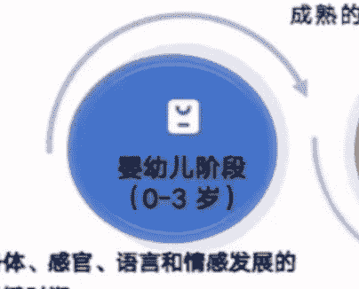


### 身体、感官、语言和情感发展的关键时期

情绪调节困难
- 幼儿无法通过语言表达需求，易通过哭闹、攻击性行为释放情绪。

语言表达迟碍
- 发音不清、词汇量低于同龄孩子，可能预示语言发育迟后。

伙伴关系联结与社会权力探索
- 儿童可能会面临诸如社交焦虑的问题，特别是那些内向的孩子，可能在建立新的友谊或融入集体活动中感到不安。
- 对未来规划的不确定性：面临升学、就业等重大决策，容易产生压力和情绪焦虑。
- 过度强调道德灵活性可能导致对相对主义的偏颇和知识边界，进而导致忽视。

### 幼儿阶段 (0-3岁)：如何发现“隐形危机”？

健康是幼儿常见的问题之一，尤其是0-3岁前容易出现。根据医学研究，约8%的儿童经历过某种形式。

具体场景1：立夫是一位新手父亲，在育儿过程中遇到了许多困难。一天晚上，一岁的儿子小宇持续哭闹，立夫尝试喂奶、换尿布，仍然无法安。在无助之下，他决定同时寻求医生的帮助和人工智能育儿助手的建议，尝试解决问题。

根据CO-STAR框架：
- C (Context), 背景
- O (Objective), 目标
- S (Style), 风格
- T (Tone), 语气
- A (Audience), 受众
- R (Response), 结果

```
C (Context)
立夫是一位新手父亲，他一岁的儿子小宇持续哭闹，尝试方法（喂奶、换尿布）均无效。无助下，立夫在深夜时寻求在线医生和人工智能育儿助手的建议，尝试编写提示词并寻找有效方法。

O (Objective)
急需分析婴儿哭闹的原因并提供方案：
安抚情绪：缓解焦虑，避免孩子持续（情绪）。
建议：基于科学结论，未来避免类似事件。

S (Style)
专业、亲和

T (Tone)
语言清晰：信息（准确）、事实（客观）、建议（具体）使用分点列表。
语气温暖：鼓励（鼓励）、共情（理解）、建设（支持）。
结构丰富：运用对比（对比分析）、表格（直观清晰）。

A (Audience)
专业读者：儿童心理学专家（AAP）指南读者。
家长父母：使用“我听懂了，我们来帮你解决吧”等安抚语言：
功能模式：提供实用技巧（如“如何识别‘哭闹先锋’”）。
核心 audience核心痛点：0-3岁幼儿哭闹的父母，尤其是新手父母。
受众群体：家长、父母，需要专业的育儿支持。
心理需求：温暖、耐心、鼓励。避免焦虑，快速提供可能的解决方案。

nR (Response)
返回一个专业的育儿助手的建议
```


### 幼儿阶段（0-3岁）：如何读懂身体信号？

从日常行为中洞察深度。根据儿童发展心理学，婴儿通常通过哭泣传递焦虑、困扰或情感需求。理解这些哭泣背后的需求对于父母来说至关重要，可以帮助他们更好地回应宝宝的需求，建立信任和安全感。

具体场景二：立夫是一位父亲，在育儿过程中遇到了许多困难。一天晚上，一岁的儿子小宇持续哭闹，立夫尝试喂奶、换尿布，仍然无法安。在无助之下，他决定同时寻求医生的帮助和人工智能育儿助手的建议，尝试解决方法。

AI可以做什么？

请根据CO-STAR提示词设计【背景立夫是一位父亲，在育儿过程中遇到了许多困难。一天晚上，一岁的儿子小宇持续哭闹，立夫尝试喂奶、换尿布，仍然无法安。在无助之下，他决定同时寻求医生的帮助和人工智能育儿助手的建议，尝试解决方法】C（context, 背景）、O（Objective, 目标）、S（Style, 风格）、T（Tone, 调）、A（Audience, 观众）、R（Response, 代表）

```
C (Context)
立夫是一位父亲，在育儿过程中遇到了许多困难。一天晚上，一岁的儿子小宇持续哭闹，尝试方法（喂奶、换尿布）均无效。无助下，立夫在深夜时寻求在线医生和人工智能育儿助手的建议，尝试解决问题。

O (Objective)
急需分析婴儿哭闹的原因并提供方案：
安抚情绪：缓解焦虑，避免孩子持续（情绪）。
建议：基于科学结论，未来避免类似事件的无助。

S (Style)
专业、亲和。

T (Tone)
语言清晰：信息（准确）、事实（客观）、建议（具体）使用分点列表。
语气温暖：鼓励（鼓励）、共情（理解）、建设（支持）。
结构丰富：运用对比（对比分析）、表格（直观清晰）。

A (Audience)
专业读者：儿童心理学专家（AAP）指南读者。
家长父母：使用“我听懂了，我们来帮你解决吧”等安抚语言：
功能模式：提供实用技巧（如“如何识别‘哭闹先锋’”）。
核心 audience核心痛点：0-3岁幼儿哭闹的父母，尤其是新手父母。
受众群体：家长、父母，需要专业的育儿支持。
心理需求：温暖、耐心、鼓励。避免焦虑，快速提供可能的解决方案。

nR (Response)
返回一个专业的育儿助手的建议
```


### 幼儿阶段（0-3岁）：如何进行语言蒙？

0-3岁是宝宝语言蒙的关键时期，这一阶段对孩子的认知影响很大。需要语言输入和互动。

具体场景3：小珊一岁半，虽然还不会说话，已经能够模仿父母出的简单句子。一天，妈妈给她读书时，出了“爸爸”或“妈妈”的声音，虽然发音不标准，但明显带有。妈妈很高，也很担心自己给了足够的语言输入，是否帮助小珊更快地学习和理解。

根据CO-STAR提示设计【具体场景小珊一岁半，虽然还不会说话，已经能够模仿父母出的简单句子。一天，妈妈给她读书时，出了“爸爸”或“妈妈”的声音，虽然发音不标准，但明显带有。妈妈很高，也很担心自己给了足够的语言输入，是否帮助小珊更快地学习和理解。】C（Context, 背景）、O（Object, 目标）、S（Style, 风格）、T（Tone, 语气）、A（Audience, 受众）、R（Response, 代表）

AI可以做什么呢？

C (Context) 背景
如果是小珊一岁半，虽然还不会说话，已经能够模仿父母出的简单句子。一天，妈妈给她读书时，出了“爸爸”或“妈妈”的声音，虽然发音不标准，但明显带有。妈妈很高，也很担心自己给了足够的语言输入。

O (Object) 目标
明确孩子的语言输入，输出五点要求：
需求：增加和互动的有效性；
支持：建立良好的语言环境，让孩子多表达。

S (Style) 风格
幽默、耐心、鼓励、重复、具有互动性的。

T (Tone) 语气
亲切、通俗、生活化。

A (Audience) 受众
2-3岁的幼儿，其家长需要父母的教导。
注意力：抓住孩子的注意力，尤其是要注意父母；
耐心：要有足够的耐心，避免方法，鼓励孩子与家长进行互动。

R (Response) 回答
给出幼儿训练建议。

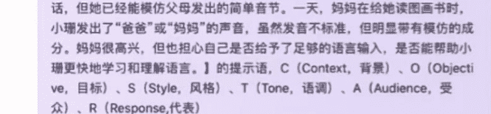

## 学前阶段（4-6岁）：如何帮助孩子应对情绪“过山车”？

根据认知发展阶段理论，4-6岁的孩子处于前运算阶段，逻辑思维尚未成熟，因此难以理解和处理复杂的。此时孩子正处于感情发展的关键时期，他们的情绪经验丰富且多样。

小明是5岁的男孩，最近在幼儿园里因为小事发气。比如，当其他小朋友不愿意分享玩具时，他就会大哭闹抢玩具；在家里，如果父母没有立即回应他的要求，他也会非常激动，甚至抗拒。小明是个活泼可爱的孩子，他的情绪会让家长感到焦虑和压力。每次面对这种情况，家长试图安抚他，但效果不好，小明仍然难以完全下来。

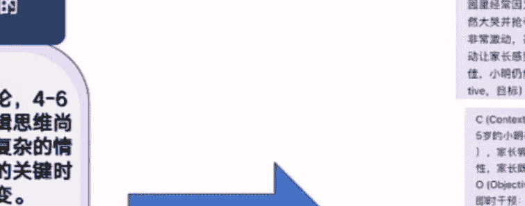

根据CO-STAR提示词设计架构【背景是5岁的男孩。最近在幼儿园里因为小事发气。比如，当其他小朋友不愿意分享玩具时，他就会大哭闹抢玩具；在家里，如果父母没有立即回应他的要求，他也会非常激动，甚至抗拒。小明是个活泼可爱的孩子，但他的情绪会让家长感到焦虑和压力】C（Context, 背景）、O（Object, 目标）、S（Style, 风格）、T（Tone, 语气）、A（Audience, 受众。

- C (Context 背景)：
5岁的男孩在幼儿园和家里经历过小冲突情绪损失（如社交冲突、抢玩具等），爸爸妈妈经常不听他的要求，情绪波动很大，甚至会发脾。
- O (Object 目标)：
为孩子设计一个在10分钟内有效的应对方案；长期目标：建立孩子情绪管理能力（社交技巧训练），培养良好的调节能力。
- S (Style 风格)：
幽默、贴心（原原因分析）、专业（给出策略建议）、符号化。
- T (Tone 语气)：
非评判性、鼓励性（让孩子感受到被理解）、支持。
- A (Audience 受众)：
4-6岁幼儿的父母，正处于焦虑、心理迷茫中。
- R (Response 响应)：家庭管理工具锦囊，心理咨询建议，急需可解决的解决方案。微信父母可以做什么？

## 小学阶段（7-12岁）：如何引导孩子正确的价值观？

### 一、如何引导孩子正确的价值观？

在儿童发展的前期与水平阶段，诚信作为一个道德观念在快速植入孩子的认知框架中，并没有在这个年龄段的中心心中完全内化。他们的行为更多的是受到外界规则和期望的影响，而非内在的道德原则驱动。

具体场景：如果是小学三年级学生，在一次数学测试中没有题目，但在老师检查时谎称带了卷子。家长得知实情后非常担忧，认为孩子缺乏诚信意识，但不知道如何引导。

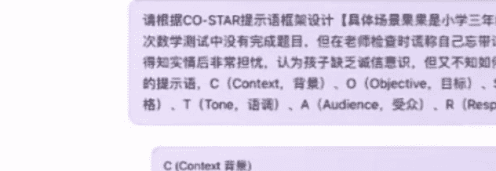

请根据C-STAR框架设计【具体结果是小学三年级学生，在某一次数学测试中没有题目，但在老师检查时谎称带了卷子。家长得知实情后非常担忧，认为孩子缺乏诚信意识，但不知道如何引导。】C（Context, 背景）、O（Object, 目标）、S（Style, 风格）、T（Tone, 语气）、A（Audience, 受众）、R（Response, 代表）


## 初中阶段（13~15岁）：如何进行青春期性教育？

## 二、如何进行青春期性教育？

### 性认知认知不足；场景10：
小刚是初级的学生，最近他发现自己的身体开始发生一些变化——声音变得低沉，毛也开始长大了。当他在镜子面前看到这些变化时，他感到尴尬又困惑。他听到同学们在类似的变化，但是不太敢参与了，因为他不清楚这些变化意味着什么。他试图去向父母询问，但每次开口，他总是因为害羞或担心父母而选择沉默。家里的气氛也很少谈及这些话题，父母从未主动向他解释过青春期的生理变化和心理波动。

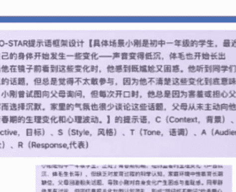

根据CO-STAR框架设计建议【背景】小刚是初中一年的学生，最近他发现自己的身体开始发生一种变化——声音变得低沉，毛也开始长大了。当他在镜子面前看到这些变化时，他感到尴尬又困惑。他听到同学们在类似的变化，但是不太敢参与了，因为他心里其实很不清楚这些变化意味着什么。小刚尝试向父母询问，但每次开口，他总是因为害羞或担心父母而选择沉默，家里的气氛也很少谈及这些话题，父母从未主动向他解释过青春期的生理变化和心理波动。结合C（Context，背景）、O（Objective，目标）、S（Style，风格）、T（Tone，语气）、A（Audience，受众）、R（Response，响应）

## AI可以做什么？

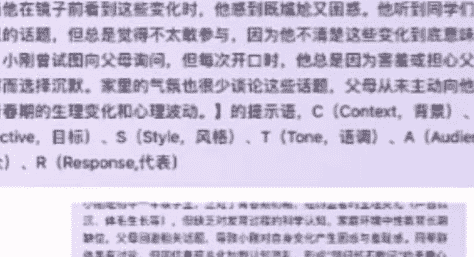

- Objective：目标：帮助小刚正确认识并应对青春期的生理和心理变化，消除他的尴尬感。
- Context：背景：小刚是初一学生，正经历青春期初期变化（变声、长毛），感到困惑且不敢与沟通。
- Style：风格：亲和、科学、易于理解的。
- Tone：语气：鼓励性的、支持性的、专业的。
- Audience：受众：小刚（以及他的父母）。
- Response：响应：提供一份具体的沟通建议，解释青春期生理知识，并指导父母如何开启话题。

## 高阶段(16-18岁):面对新高考，AI如何帮助孩子进行选科？

## 一、面对新高考，AI如何帮助孩子进行选科？

### 具体表格12:

**具体背景**
对于很多家长来说，新高考可能还是有一个有些底的问题。事实上，这项改革正在深刻改变孩子的高中学习与未来发展之路。与传统的文理分科不同，新高考引入了“3+1+2”模式，孩子需要在一定范围内自主选择科目。这种灵活性看起来让孩子拥有了更多选择，但也无形中增加了复杂性。选科不仅关乎高考分数，更乎孩子未来的大学专业、职业方向走向人生路。

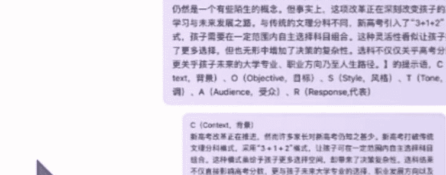

> 根据CO-STAR提示词设计【具体背景对于很多家长来说，新高考可能仍然有一个有些底的问题。事实上，这项改革正在深刻改变孩子的高中学习与未来发展之路。与传统的文理分科不同，新高考引入了“3+1+2”模式，孩子需在一定范围内自主选择科目。这种灵活性看起来让孩子拥有了更多选择，但也无形中增加了复杂性。选科不仅关乎高考分数，更乎孩子未来的大学专业、职业方向走向人生路。】

C (Context, 背景)
新高考改革后，很多家长对新高考的模式陌生。新高考打破了文理分科的限制，让孩子可以在“3+1+2”模式下选择。这种模式让孩子面临更多选择，决定了最终的选科结果，结果将影响孩子大学的申请以及未来发展。我们需要帮助孩子做好选科科学和规划。

O (Objective, 目标)
帮助家长熟悉高考“3+1+2”模式的具体内容，提供建议。引导家长如何做好对选科方案的分析和决策，帮助孩子做出符合自身兴趣的选科决策。

S (Style, 风格)
专业、严谨以专业的语气缓解家长对新高考的焦虑，用通俗易懂的语言提供具有说力的选科建议，提供分享，以教育视角提供。

A (Audience, 受众)
主要受众为处于选择阶段的学生和家长，他们对选科非常焦虑。

T (Tone, 语气)
热情、鼓励性。

R (Response, 格式)
关于“3+1+2”模式的介绍。

## 高中阶段 (16-18岁): AI如何帮助孩子进行规划？

## 二、AI如何帮助孩子进行规划

在职业规划过程中，家长扮演着关重要的角色。孩子的认知可能限于短期目标，然而家长可以通过观察和理解孩子的兴趣、天赋以及未来发展的需求，引导孩子走上符合个人长和未来发展的道路。具体来说：孩子的兴趣在职业方向上不够明确，对许多领域感兴趣。


根据CO-STAR框架设计【具体描述孩子的兴趣以及对未来发展的期望。】的提示，C（Context，背景）、O（Object，目标）、S（Style，风格）、T（Tone，语气）、A（Audience，观众）、R（Response，响应）。

C (Context, 背景)
孩子的兴趣尚未确定，但在职业方向上不够明确。对许多领域感兴趣，从她的成绩来看，目前还表现倾向于综合考虑。

O (Object, 目标)
根据孩子的兴趣和成绩，为家长提供专业的建议，帮助孩子做出合适的决定。引导孩子发现可能的专业方向，为长远发展做好。

S (Style, 风格)
理性分析、前瞻性用各种对兴趣进行挖掘。

T (Tone, 语气)
鼓励且专业，让家长理解和接受，缓解家长对未来的压力。

A (Audience, 观众)
作为父母，应该如何协助孩子进行规划。

## DeepSeek+: AI赋能家庭教育范式拓展

| 工具组合 | 应用场景 | 使用步骤 |
| :--- | :--- | :--- |
| DeepSeek + Kimi/WPSAI | 生成教育课件、教学演示 | 1. 在DeepSeek中输入主题和内容描述（如“家庭教育的重要性”）；<br>2. DeepSeek生成大纲和内容框架；<br>3. 将内容复制到Kimi，选择模板生成PPT；<br>4. 在Kimi中调整排版或添加插件。 |
| DeepSeek + XMind | 学习笔记整理、知识点梳理 | 1. 在DeepSeek中输入文档或文章链接；<br>2. DeepSeek提炼大纲并输出Markdown格式；<br>3. 导入XMind生成思维导图；<br>4. 在XMind中调整布局和样式。 |
| DeepSeek + 剪映/可剪AI | 科学实验记录与讲解、家庭学习结果展示 | 1. 脚本生成：输入“自制火山模型实验的短视频分镜脚本，包含安全提示和原理详解”。<br>2. 视频剪：将视频导入剪映，用AI配音、自动字幕和素材增强功能完成制作。<br>3. 儿童参与：引导孩子担任“小主播”录制旁白，增强参与。 |
| DeepSeek + 豆包爱学 | 数学辅导、学习计划制定、亲子互动 | 1. 在DeepSeek中输入学题（如如何解决问题），获取分步解答并验证逻辑；<br>2. 将错题贴至豆包，使用指令“用10岁儿童能理解的东北方言解释此过程”生成语音输出；<br>3. 通过豆包生成错题卡模板，自动归类错题类型（如“几何计算错误”）。 |

• 更多范式待拓展

## DeepSeek + XMind

第一步：上传文档，向 DeepSeek提问，如“将文档总结思维导图，要求使用markdown格式输出。在回答中，点击markdown右上角“复制”按钮

第二步：新建txt文档，粘贴刚才复制的markdown文件，保存后改文件格式为md

第三步：进入XMind,点击左角“三”，选择“文件” -“导入” -“markdown"

第四步：最终结果展示

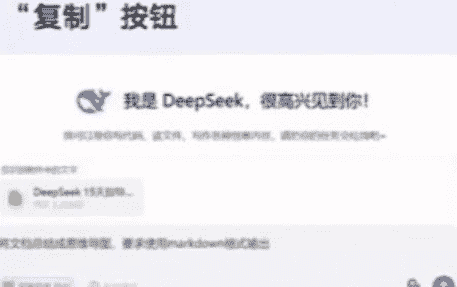

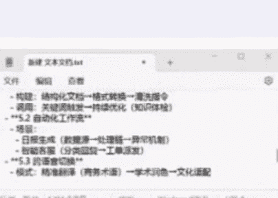

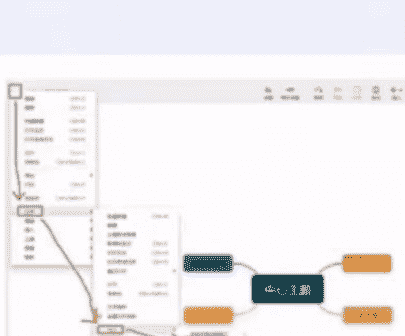

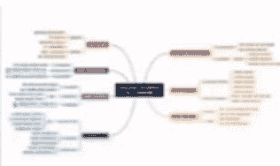


## DeepSeek + 剪映

1.打开DeepSeek生成的的主题“自制模型”然后复制DeepSeek生成的文案

2.打开剪映图成片-选“编辑文案”粘贴文案

3.选择“智能匹配素材”，生成视频-导出

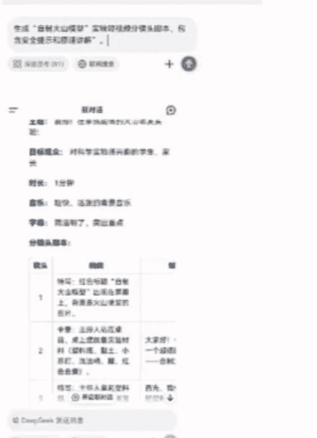

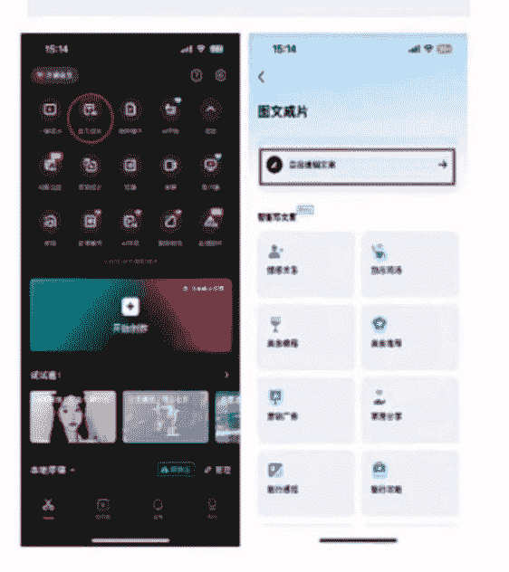

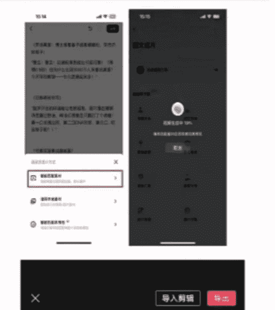

# 自制数字人，已制作200多个


# 自制AI微短剧，已制作300多段


亲爱的父母们，在这个技术日新月异的年代，孩子教育不再一成不变的填鸭式模式。教育的本质从来不是一场竞赛，而是一段旅程。AI让这段旅程变得更加轻松，但最终的伴侣者，依然是最懂孩子的我们。

# START YOUR FINANCE


起点财经，网罗天下报告
