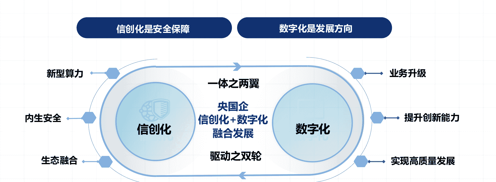
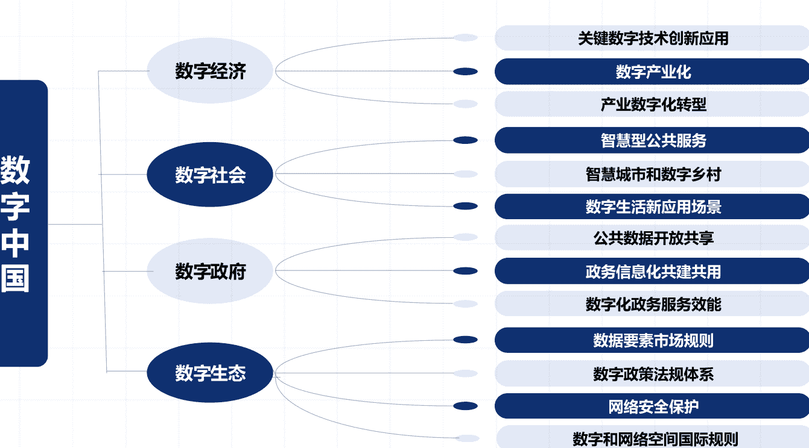
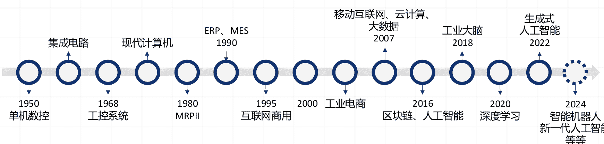
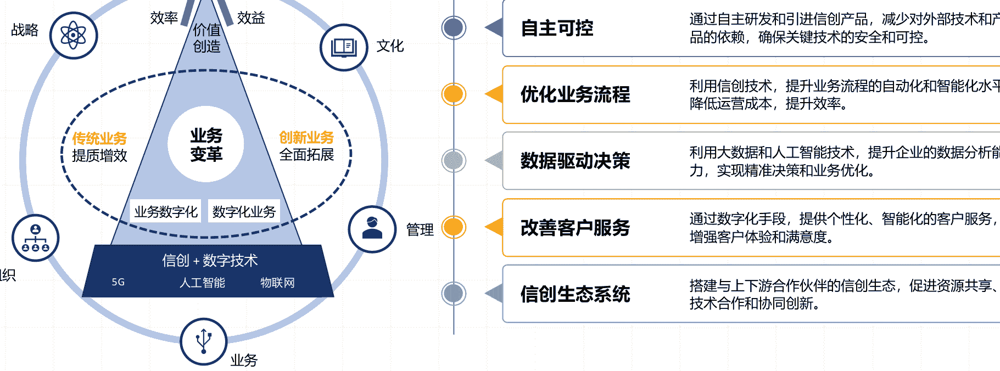

# 2025年信创系列大报告之
《2025年央国企信创数字化研究报告》

# 扫码加入 知识星TOP 免费资源群

免费

公众号:知识星TOP

- 每日免费获取高价值资源
- 可提供各类资源搜索服务

价值

微信:jntsg8

| 热门付费文章 | 各行各业报告 |
| :--- | :--- |
| | 精选图书资源 | 副业赚钱方法 |
| | 实用资源 | AI经营自媒体 |

及时

微信:jntsg2

关注

分享资料仅供个人学习，请及时删除，切勿商用传播

# 目录
CONTENTS

01 国企信创数字化发展背景
02 国企信创数字化建设框架
03 采购要求分析
04 成功案例分析
05 面临的挑战与应对策略

## 央国企信创数字化发展背景

### 研究范围包括131家企业和46万家企业

央企通常涉及国家安全、国民命脉和前瞻性、战略性产业，在国家经济发展中发挥着关键作用，是国民经济的支柱。国企则是由地方管理的国有企业，涉及地方经济建设、民生保障等领域。

国企在多个关键领域具有显著影响力，涵盖了能源、通信、航空航天、装备制造、矿产资产、交通运输、农业和金融等多个行业。

| 46万家国企 | 国企是指国家拥有或控制权的大型企业，包括中央企业和地方国有企业，国有企业的股权结构主要由国务院或地方政府持有一定比例的组成，其业务范围涵盖国家经济发展、保障民生以及推动国有资产的保值。 |
| :--- | :--- |
| 131家央企 | 央企是由国务院或其授权的财政部、国务院资产监督管理委员会等机构代表国务院出资履行职责的国有企业，属于国家经济的重要支柱，通常涉及国家战略性、基础性行业。 |

### 按主管单位分类的131家企业

| 能源电力 | 煤炭电力黄金 | 石油化工 | 建建 | 汽车 | 钢铁轨道机械设备 | 运输物流 | 旅游服务 | 投资商业服务 | 农业医疗盐业 | 信息技术 |
| :--- | :--- | :--- | :--- | :--- | :--- | :--- | :--- | :--- | :--- | :--- |
| 19 | 10 | 7 | 7 | 2 | 9 | 12 | 3 | 8 | 6 | 9 |

资料来源：公开资料，东安工作室

#### 央企信创与数字化辅助相成、相互促进

- 信创化与数字化本质是“安全”与“创新”的双螺旋演进。在全球数字化转型的背景下，央企需要积极推动信创技术的应用与创新，以提升自身的竞争力和服务水平。通过实现信创与数字化的深度融合，可以更好地满足社会和经济发展的需求，推动企业的持续发展，为国家经济的高质量发展贡献力量。

央企需求：核心技术路线自主可控、系统架构上云用数赋智“双升级”

#### 背景：国企业是推动数字经济发展的重要主体

《十四五》规划和2035年远景目标纲要》明确提出建设数字中国的总体蓝图，涵盖数字经济、数字社会、数字政府以及数字生态。在过程中，政府与市场深度融合至关重要，央国企业是实现融合的关键力量。在数字经济领域，无论是数字化转型，还是核心技术的突破和基础研究的推进离不开央国企业的引领。在数字社会、数字政府和数字生态建设时，不仅要有政府的推动，还离不开央国企业深度参与。

资料来源：《《十四五》规划和2035年远景目标纲要》，东安工作室

#### 背景：数字技术迅速发展，为央国企数字化转型提供工具

数字技术的迅速发展为央国企业的数字化转型提供了强大的工具和支持。随着人工智能、大数据、云计算、物联网、区块链等技术的不断成熟，央国企能够通过这些先进技术来优化运营、提升管理效率和创新业务模式。

#### 生成式AI、智能机器人

技术发展：信息化系统、计算硬件

数字化升级：单点信息化 -> 全信息化、数字化、智能化

资料来源：埃赛哲，公开资料

#### 背景：国际安全事件频发，美国限制，信创发展在必行

随着国际形势的变化，中美贸易和技术封锁加剧，特别是在操作系统、数据库等核心技术领域，外资占据主导地位，中国面临较大的风险。信创的推进可以帮助企业脱离对外的依赖，国际安全格局的变化，直接影响中国发展的战略地位。

#### 2025

拜登政府拟进一步限制算力，美国对华投资的限制，特朗普可能实施限制，自主增强。

#### 2022-2024

2022年，俄罗斯战争，美国《芯片法案》和《出口管制》
2023年，荷兰、日本、美国对中国半导体管制
2024年，美国出台出口管制新规

#### 2018-2022

2018年，中美贸易爆发，华为被制裁
2020年，美国扩大限制范围，将中国列入黑名单
2020年，疫情爆发，全球供应链中断，尤其是芯片、硬件元件
2018年，微软“黑屏”事件

资料来源：公开资料，东安工作室

#### 政策：国家不断出台政策，支持信创数字化发展

| 时间 | 发布方 | 政策/会议名称 | 重要内容 |
| :--- | :--- | :--- | :--- |
| 2024年3月 | 国资委 | 中央企业人工智能专题会 | 强调要把发展人才放在工作中，建设一批智能能力中心。 |
| 2023年6月 | 中办、国办 | 《关于深化改革推动人工智能行动计划（2023-2025年）》 | 优化我国布局，加强现代化产业体系；完善创新机制，实现高水平。 |
| 2023年5月 | 国国务院 | 《关于中央企业内部控制体系与监管工作有关通知》 | 加强行业管控，要符合监管要求，加大内控建设力度，并将控控纳入各项业务系统，改进违规行为。 |
| 2023年2月 | 国务院 | 《数字中国建设总体规划》 | 夯实数字数据治理体系基础，实现技术自立自强所需的核心技术。 |
| 2022年9月 | 国务办公厅 | 《全国一体化大数据建设指南》 | 通过数据流通应用，提升能力，促进数据在政务、服务及大众方面的作用。 |
| 2021年12月 | 中办、信委会 | 《“十四五”国家信息化规划》 | 到2025年，国家数字化能力提升，企业实现资源高效集成、创新引领，中小企业效益增强。 |
| 2021年3月 | 国务院 | 《中国经济社会发展十五五规划和2035年远景目标纲》 | 加强经济布局结构合理性，增强我国竞争力，加强创新、控制，加强抗风险能力，做优一流大国。 |
| 2020年8月 | 国国务院 | 《关于推进国有企业数字化转型特定工作的通知》 | 国有企业要制定数字化转型路线和路径，建立跨部门联合机制，增强数字化转型能力。 |
| 2024年12月 | 国家发委 | 《电力系统安全防护规定》 | 加强电力系统运维要符合国家安全和合同（生产要求），电力系统专用产品要采用统一的技术路线。 |
| 2024年9月 | 工部 | 《工业重点领域设备更新和技术改造指南》 | 聚焦2027年完成20万亿元和7万台工业设备更新任务，力争在2027年，80%以上的工业企业基本完成。 |
| 2024年7月 | 中办、中办 | 《关于深化改革、推进数字化转型试点实施的决定》 | 全国要加速实现新生产力体系建设，加强经济运行与数字化深度融合，发展服务型产业体制，健全数字化基础设施建设，提升整体生产效率和安全水平。 |
| 2024年7月 | 国国务院 | 《关于规范央企业采购行为的指导意见》 | 提出要加强产品提供服务透明性和规范化水平，健全央企业采购管理体系，建设以价值驱动的央企业采购管理模式，提升效率、智能化、水平。 |
| 2024年5月 | 中央办公办等三部 | 《信息化标准基础建设指导意见》 | 如图4四个方面重点工作：一是加强信息化标准体系建设，二是聚焦重点领域，推进信息化标准化应用，提升信息化标准化能力。 |
| 2024年3月 | 国务院 | 《十四五》国家信息化工作报告》 | 加快科技自立自强，加强社会创新，攻关关键技术，掌握先进技术，涵盖网络、数据等领域，有效支撑我国经济良好运行。 |

资料来源：公开资料

#### 政策：工业重点领域更新和技术改造，持续信创数字化政策

| 时间 | 发布方 | 政策/会议名称 | 重要内容 |
| :--- | :--- | :--- | :--- |
| 2024年9月 | 办公部 | 《关于工业重点领域设备更新和技术改造的通知》 | 提升产业链韧性和安全水平，聚焦制造、航空、钢铁、汽车、医药、轨道交通等领域，推动基础软件、工业操作系统更新。 |

#### 节点：2027年100%国企完成信息化信创改造

- 数字化转型成熟度达到15%以上。
- 关键工序数字化率达到85%以上。
- 数字化设计工具普及率达到85%以上。
- 生产制造效率提升30%。
- 运维效率提升30%。
- 关键工序数字化率分别超过90%、75%。
- 到2027年，新增电机、变压器、工业机器人占比提高10%、15%。
- 到2027年，完成工业软件和操作系统更新任务80%。
- 到2027年，制造业基本实现边缘网、边缘控制器等产品部署，“5G+互联网”项目落地。

资料来源：工部、东安工作室

#### 节点：2027年底国企必须完成信息化系统的信创工作

- 2022年9月，国资委发布信创相关文件，要求国企全面实施信息系统的国产化改造，并对推进节奏提出了明确节点，最终目标是在2027年底前全面完成。
- 数字化设计工具普及率达到90%以上。
- 生产制造、研发系统达到80%以上。

资料来源：国资委、东安工作室

#### 发展历程：信创和数字化的发展是从初步探索到全面深化的过程

央国企业的数字化转型与信创发展是一个循序渐进的过程，数字化转型为业务创新和运营效率提供了技术支持，而信创的实施确保了技术自主可控，为数字化进程奠定了安全可靠的基础。两者相互促进，共同推动央国企业智能化、现代化方向发展。

#### 信创数字化发展历程

##### 起步
- 随着信息化浪潮的到来，央国企业重视数字化转型的重要性。
- 重点领域：主要在基础设施和信息化系统的应用，企业逐步步入ERP、CRM等管理系统。

##### 加速
- 计算、大数据和人工智能技术的成熟，推动央国企业进入更深度的数字化转型阶段。
- 重点领域：许多央国企业开始进行数字化战略布局，推动智能制造、智能物流、智能电网等业务的应用。

##### 全面
- 随着国家政策的支持，央国企业在数字化转型方面取得了显著进展。
- 重点领域：云计算、大数据等技术深度融合，不仅仅用于内部管理，还扩展到客户服务、产品研发和市场等多个领域。数字化转型成为企业可持续发展的核心动力。 许多央国企业开始大规模推进国产化替代，建立信息化平台，优化关键技术应用。 部分央国企业开始尝试自主研发核心技术，并在内部选用国产化软件硬件。央国企业不仅注重内部信息系统的国产化，开始推动行业层面的信创建设，与上下企业共同发展数字化生态。

- 提升内部管理和运营效率
- 提升产品与服务的创新能力
- 推动央国企业的数字生态建设
- 2000年代初至2010年代初
- 2010年代中期至2020
- 2020年至今

资料来源：公开资料、安信工作室

#### 资金：央企投资方向中重点强调数字化和信创，为资金投入提供方向指引

《关于做好2023年中央企业投资进一步扩大有效投资有关事项的通知

#### 高端设备
- 核心部件：传感器、伺服电机、人机交互系统
- 制造：机器人、数控机床、智能仪表
- 交通：航空、轨道交通

#### 双碳目标
- 能源：光伏、水力、核能
- 节排：钢铁、建材、有色金属、运输

#### “大安全”
- 供应商安全：计算机、通信电子
- 信息安全：网安、密码

#### 数字经济
- 基础设施建设：5G基站、光纤
- 产业化：人工智能、5G、数据、云计算
- 数字化：工业互联网、智慧农业

#### 资金：2024年央国企投资保持增长，数字化提供保障

2024年，固定投资高达5.3万亿元，同比增长9%。其中战略性新兴产业投资2.7万亿元，同比增长1.8%。投资总额的比重突破40%。显示央企在数字化和信创领域方面的积极布局，2024年，研发经费达到1万亿元。在集成电路、量子通信、高端装备制造、工业软件、新材料等领域取得了一系列突破。

#### 研发经费：随着长期特别债发放，信贷投入将恢复

| 科技研发 | 绿色智能基础设施 |
| :--- | :--- |
| 农村转移人口、就业、医疗、住房、养老等公共服务体系 |
| 高标准农田建设 | 城市地下管线维护、更新和升级 |
| 绿色产业体系 | 能源原材料重点领域 |
| 重点行业设备更新和技术改造 | |

资料来源：发委、安徽工作室

## 央国企信创数字化建设框架

### 国企数字化转型的目标

国企数字化转型是指国企在数字化转型过程中，基于信创技术和解决方案，通过整合新兴数字技术、数据资源和创新思维，提升企业的核心竞争力和市场适应。这一转型不仅涉及技术的应用，还包括业务流程、管理模式和企业文化的全面变革，实现更高、更智能的业务运营。

资料来源：东安工作室

### 央企数字化全面启动，促进其数字化、网络化、智能化发展

根据《关于加速推进企业数字化转型工作的通知》，促进企业数字化、网络化、智能化发展，增强竞争力、创新力、控制力、影响力、抗风险能力、提升产业基础能力和产业现代化水平。

- 突出重点打造行业数字化转型示范样板
  - 制造企业：数字工厂、数字化车间
  - 能源企业：智慧管网、智慧油田、智能矿山
  - 建筑企业：建筑信息模型、三维数字化协同设计
  - 服务类企业：企业营销、智慧物流、智慧金融

- 制定数字化转型规划和路线
  - 把握方向加速推进数字化创新
  - 结合企业实践加强动态跟踪和闭环管控，开展诊断对标

- 产业体系生态化
  - 产品创新数字化+生产运营一体化

- 协同推进数字化转型工作
  - 联合实施团队
  - 数字化创新中心
  - 智能调度中心
  - 大数据中心等平台化
- 技术赋能全面推进数字化产业化发展
  - 用户服务智能化

### 发展数字产业

### 关键核心技术攻关

- 加强对标对标夯实数字化转型基础

新型基础设施建设

| 基础数据技术平台 | 构建数据治理体系 |
| :--- | :--- |
| 建立体系化管理体系 | 提升安全防护水平 |

### 做好数字化转型资源保障

- 专人负责协调
- 专项资金投入机制
- 完善人才薪配套

### 信创数字化转型已成为国企行业高质量发展的核心驱动力

- 国企的信创数字化转型可以按照行业分为四大类别，分别是智能制造、智能能源、智能建造、智能服务。其本质是通过数据、技术和业务的深度融合，重构价值链与生态体系。

### 国企数字化转型呈现“五转、五化、五新、五维”的特点

2023年6月，国资委召开深入推进国企数字化转型专项。会议要求，深入实施国企数字化转型计划，全面提升数字化智能化发展水平，加速世界一流企业建设，更好发挥国企创新、产业控制、安全支撑作用，为建设现代化产业体系、促进实体经济高质量发展做出更大贡献。

#### 五转
- 转意识
- 转组织
- 转模式
- 转方法
- 转文化

#### 五化
- 研发数字化
- 生产能化
- 经营一体化
- 服务敏捷化
- 产业智能化

#### 五新
- 创新技术
- 推出新产品
- 布局新基建
- 打造“精精特新”企业
- 培育新生态

#### 五维
- 数字政府
- 数字化
- 数字社会
- 数字乡村
- 数字生态

- 89家央企明确数字化转型发展规划。
- 90多家央企组建“一把手”负责转型的机制，明确头部职责。
- 800多央企开展传统业务转型模式，推进国企企业900多个、320多个，组织转型型培训33场，参与人次近万。
- 国企数字化转型“热中温冷”局面面临重大挑战。

- 52家中工工业企业2022年数字化研发工具及设备覆盖率平均85.5%，关键设备数字化覆盖率平均72.6%，分别国企水8.9个和14个企业。
- 60多央企牵动产业链同平台转型规模超过100个，带动链上下、中小企业实现转型。
- 国企数字化转型“不转不活跃”情况得到定性改变。

- 70多央企获取5G无线波芯片、操作系统等200项数字技术成果，累计558个基站达730个，建成基地1.2万处。
- 组建科技公司近5公里。
- 国企技术供给服务能力提升。
- 国企积极参与或数字电子商务业务，业务最多六次，“数字技术+医疗健康”服务，“乡村工程”“农村新型能源储备基础设施等建设。
- 国企在中国数字化建设的骨干作用日益凸显。

资料来源：国资委，安信工作

### 国企信息数字化转型规划ABC方法论

信息数字化转型是企业系统化工程，旨在通过自主可控的技术支持，对企业价值进行重塑。这一转型强调以客户为核心的生态系统建设，是一个长期的演进过程，而非短期项目。国企通常具有较大的规模和复杂的结构，因此需要一套完整的顶层规划和设计方法。我们认为国企数字化转型的顶层设计主要包括现状和需求分析、规划设计、实施和优化四个关键环节。

| A 现状与需求分析 | B 规划与设计 | C 实施和优化 |
|---|---|---|
| 业务策略分析 | 信息数字化战略规划 | 现状与需求、差距分析 | “速赢”场景设计 |
| 价值链分析 | 信息数字化顶层设计 | 项目组合定制 | |
| 生态图谱分析 | 企业数字化业务规划 | 项目规划和卡片设计 | |
| 商业模式分析 | | 实施路线制定 | |
| 现状分析 | | 业务架构设计 | 项目交付 |
| 最佳实践分析 | 应用架构设计 | 效果评估优化调整 迭代推广 | |
| 新兴技术分析 | 数据架构设计 | 分析现状和需求分析 | |
| DT 成熟度评估 | 技术架构设计 | Blueprint 规划和设计 | |
| | 信息数字化现状和展望 | 安全架构设计 | |
| | | Construction 实施和优化 | |

资料来源：公开资料，东东工作室

## 央国企信息架构引导

### 央国企信息数字化愿景

| 目标 | 管理精细化 | 产品差异化 | 服务精准化 | 决算科学化 | 客户体验个性化 | 能力评估 |
|---|---|---|---|---|---|---|
| 基本原则 | 业务引领、技术支撑 | 统一规划、迭代实施 | 价值导向、集约建设 | 战略与发展 | | |
| 主要思路 | 以信息+数字规划为起点 | 以信息+数字能力为主线 | 以转型价值为导向 | 以生态协作作为支撑 | 组织与人才 | 技术与平台 |
| 重点任务 | 明确企业发展战略 | 构建系统性解决方案 | 提升企业新型能力 | 推进业务优化创新 | 打造数据治理体系 | 重视数字人才培养 | 数据与应用 |
| 实践路径 | 2大推动因素 战略转型 驱动识别 | 1个核心工作体系 诊断评估 战略规划 数据能力提升 平台建设及运营 | 1个能力保障体系 组织保障 技术保障 数据保障 管理保障 | 核心 | 业务与流程 | |

### 央企信息数字化转型全景图

构建基于国产环境的三层三翼总体框架，坚持安全为先、需求牵、技术先进的原则，全面支撑数字化转型

| | | 国企信息 | | | | |
| :--- | :--- | :--- | :--- | :--- | :--- | :--- |
| | 终端 | 业务融合 | | 大屏 | | |
| | 办公类 | 经营管理类 | 业务应用类 | 生产控制类 | | |
| 电子办公 | 综合门户 | 内容管理 | 运营业务 | 数据资源管理 | 远程运维系统 | 运维系统 |
| 文件交换 | 电子存档 | 安全部件 | 财务管理 | 运营分析 | 设计管理 | 调度控制系统 |
| | 业务中台 | 基础服务 | 镜像仓 | 领域应用 | 业务中台 | |
| 开发中台 | 移动平台 | 微服务 | CI/CD | 数据汇聚 | 数据缓存 | 开发中台 |
| | 基础支撑 | 产品组件 | | 数据处理 | 数据模型 | 特征工程 | 机器学习 |
| | | 云中台 | 弹性伸缩 | 镜像有 | 负载均衡 | 弹性IP | 执行层 |
| | | 云主机 | 硬盘 | 对象存储 | | | 操作层 |
| | | 操作系统 | 数据库 | | | | 控制层 |
| | | 国产化软件 | 中间件 | 流式文件 | 标识 | 移动办公 | 设备层 |
| | | 国产化数据库 | 网络设备 | 安全产品 | 备份存储 | | |

资料来源：公开资料、东东工作室

### 不同行业央企数字化发展水平

尽管各行业央企都在积极推进转型，但行业间的发展差异明显。信息技术与通信行业起步早，转型进展显著成效，能源矿业、制造业的转型进程慢，转型满意度较低。

| | 信息技术与通信 | 能源矿业 | 制造业 |
|---|---|---|---|
| 转型起始时间 | 77% 始于2017年后 | 石油电力较早，多数2019年后 | 75% 始于2019年后 |
| 主要挑战 | 1.成效数据治理 | 1.人才不足;2.人才缺乏 | 1.人才缺乏;2.人才不足 |
| 流程优化 | 跨部门全业务 | 部门内部&跨部门业务 | 部门内部&跨部门业务 |
| AI应用领域 | 产品创新&流程优化 | 流程优化&产品研发 | 自动化 |
| 转型满意度 | 82% | 27% | 33% |

### 央企信息数字化转型痛点

央企在信息数字化转型面临复杂的挑战，这些痛点跨技术、文化、资金和市场等领域。有效识别并应对这些问题，不仅是提升成功率的关键，也是适应变化的必要条件。只有整合资源、优化管理，才能推动转型进程，创造更大的价值。

| 技术相关 | 文化与人才 | 资金与投资 | 管理与策略 | 用户体验 |
|---|---|---|---|---|
| 技术积累不足 | 内部抵触 | 资金投入不足 | 项目管理复杂性 | 项目管理复杂性 |
| 系统适配问题 | 人才短缺 | 投资回报不确定 | 缺乏系统化策略 | 用户体验不佳 |
| 生态建设滞后 | | | | |
| 数据孤岛问题 | | | | |
| 标准化问题 | | | | |
| 安全风险管理 | | | | |

资料来源：公开资料，山东工作室

### 央企建设依赖多方协作，内外资源互补推动数字化转型

为了更好地适应技术的快速发展，提升核心竞争力，央企必须在数字化和创新方面加大投入，推动资源整合与创新。在这一过程中，多个关键参与者共同推动实施与落地。具体而言，主要参与者包括内部信息化部门、下属科技公司以及外部的第三方供应商。

#### 第三方信息产品供应商

长期为央企数字化提供服务的第三方供应商，在通用产品及新技术领域具有较强的优势。它们拥有市场化经验、成熟的人员架构和高效的研发能力，能够与内部信息化及业务部门紧密合作，提供符合业务需求且擅于基于前沿技术的产品和解决方案，推动数字化企数字化转型。

#### 央企下属科技公司

近年来，央企通过成立子公司来整合集团内部的数字资源。这些公司主要负责内部的数字化建设，且部分具备较强能力的数字科技公司，已开始向上游及外部市场输出方案。

#### 央企内部信息化部门

负责管理集团的数字化和升级，包括规划、研发、实施和资源协调等工作。为了有效推动升级，集团可能会成立由高层领导主导的委员会、工作组或项目组，负责制定整体战略并解决部门协作中的挑战。

资料来源：公开资料、安东工作室

## 央企企业与外部供应商协同推进数字化转型，释放智能化潜力

国资委的数据显示，为了加速数字新兴产业的培育，并布局新一代信息技术、AI等领域，央企已成立近500家子公司。在能源、运输和信息通信等行业，央企建设较早，且升级更为快速。相比外部供应商，央企在适应业务场景、文化等方面具有明显优势。外部供应商在通用产品、前沿应用以及成熟的市场机制和组织架构方面具有更优势。未来，供应商将与内部业务部门紧密合作，提供符合业务需求、基于前沿技术的产品和解决方案，进一步推进数字化智能化的价值释放。2023年各行业央企数字化转型多年，带动上下经济高质量发展。

资料来源：艾瑞咨询、安东工作室

## 信息创产业链谱

- 系统集成
- 外设
- 应用场景（PC）
- 网络设备
- 打印机

- 基础硬件
- 芯片
- 存储
- 固件/IO设备

- 应用软件
- 云计算
- 办公软件
- 企业管理软件
- 信息安全软件
- 云服务软件

- 操作系统
- 数据库
- 中间件
- 虚拟化
- 信息创平台

资料来源：公开资料、东软工作室

- 党
- 政府
- 金融
- 电信
- 电力
- 石油
- 交通
- 教育
- 医疗
- 航空航天
- 烟
- 汽车
- 物流

## 国企信息数字化组织聚产学用力量，推动产业链创新与发展

信息数字化在国企中的实施涵盖了信息化、数字化架构、软硬件选型等多个层面，构成了一个复杂的系统工程。面对这一挑战，行业组织发挥了不可忽视的作用。在产业初期，像“工委会、协会、联盟、适配中心”等行业组织，凭借其在培育和壮大应用生态方面的努力，成功聚了产学用各方力量，推动了产业链的协同创新和可持续发展。

| 行业组织的核心职能与价值 | 组织驱动的生态构建路径 | 典型组织模式与实践 |
|---|---|---|
| 标准制定者： 牵头制定技术标准（如架构、兼容性清单） | 技术适配： 适配验证：建立联合实验室，提供“芯片→OS→数据库”全链路测试。 | 垂直联盟： 金融行业：聚银行、证券适配分段迁移路径。 |
| 认证权威： 发布产品目录。 | 资源共享： 开放级知识库（如开源工具包），加速技术复用。 | 能源行业： 整合电网、油气业务需求，定向智能化调度。 |
| 生态连接： 搭建“产学用”协作平台，聚厂商、软件联合攻关。 | 市场适配： 通过适配降低门槛。 | 区域网络： 行业集群：以中国电子（CEC）带动芯片、OS、中间件、应用落地。 |

资料来源：公开资料，东软工作室

## 采购要求分析

### 采购要求：生态、安全、可用、服务与品牌力的平衡之道

#### 1
- 全能兼容：芯片（ARM/x86/RISC-V）→ 操作系统（鸿麟）→ 数据库（达梦/OceanBase）→ 应用适配
- 性能适配：国产硬件（算力、低耗）满足业务增长需求，避免“为替代而替代”。
- 生态开放：支持主流中间件、开发框架，降低二次开发成本。

#### 2
- 入门门槛：通过信息安全测评中心、国家保密中心“安全可靠测评”是企业的重要要素，测评结果将影响投标指标。
- 场景适配：不同行业（金融、能源等）需满足测评标准（如信创级稳定性验证）。

#### 3
- 国产密码：支持SM2/SM4等加密标准，确保核心数据安全。
- 跨越：兼顾国内标准与国际合（如GDPR）。
- 隐私保护：数据脱敏、权限分级等能力内置于产品。

#### 4
- 服务能力：厂商需提供“产品+运维”一体化服务承诺。
- 本土支持网络：本地技术支持覆盖能力，确保快速响应。

#### 5
- 市场占有率：优先选择在细分领域市场份额领先的厂商。
- 标杆客户：重点考察在同行业中央项目中的实施结果。
- 用户口碑：通过行业报告及客户调研，评估产品可靠性、兼容性等表现。

## 国测成为采购的新要求，未通过国测的厂商在央国企业行业仍有机会

- 从2023年7月信息安全测评中心发布《安全可靠测评指南（试行）》，到2024年11月更新第二版指南，安全可靠测评已经出了三期结果，聚焦向终端客户端和服务器中所涉及的 CPU、操作系统以及数据库等基础软硬件产品，对于产品的安全性和持续性的要求越来越规范。
- 根据政府采购要求，通过国测的产品在党政领域具有绝对优势。在央国企业，是否通过国测并非强制性要求，如许多云商等各分领域的央国企业会自行组织各领域的信创测评，因此通过国测的厂商在央国企业行业仍有机会。

## 安全可靠测评的要求

### 安全可靠测评发展历程

### 2024年11月26日
中国信息安全测评中心更新了《安全可靠测评指南》。

### 2024年9月30日
中国信息安全测评中心发布《安全可靠测评结果（2024年2号）》。

### 2024年5月20日
中国信息安全测评中心发布《安全可靠测评结果（2024年1号）》。

### 2023年12月26日
中国信息安全测评中心发布《安全可靠测评结果（2023年1号）》。

### 2023年7月27日
中国信息安全测评中心发布《安全可靠测评指南（试行）》

## 从“单向合规”转向“分层分类适配”，通过差异化测评体系拓宽厂商与空间

信贷领域正加速开放向规范化的市场转型。以测评体系为例，从早期报名录到2023年安可测评，如今已发布3期结果，未来计划将继续开展轮测。尽管部分测评细则（评分值权重等）仍未公开，但测评机制的标准已清晰明确——信贷标准与通用能力在动态对齐中协同进化，规范化与透明化已成为不可逆的趋势，为更多企业降低准入门槛、激发行业活力。

这一趋势在落地层面看来尤为显著：各行业与地方单位精细化信贷采购规则，推动评估方式多元化。典型运营领域，总部主导的服务器集采已成功突破一项可测评限制，形成“多赛准入”机制。中兴华嵘服务器借此路径实现突破：虽未通过传统安认证，但通过运营商专项测评测试成功通过。此类实践表明，信贷生态从“单向合规”转向“多维适配”，通过分层分类的评估体系拓宽厂商选择空间。

## 1 中国电信

## 2 中国联通

2023年，中国电信集团有限公司和中国电信有限公司关于近期开展中国电信2023-2024年服务器集中采购项目产品测试。

2021年中国联通通用服务器（HH）集中采购项目：采购通用服务器（HH）约1.4亿元，采购额8.8亿元，该采购项目不设评分。得分占比规则为3家中中标，得分占比为5:32，采购金额分配占比。

产品测试通过将作为中国电信2023-2024年服务器销售项目开发资质审查通过的必要条件之一，测试结果也将作为技术评审的部分依据。本次测试委托中国电信研究院学院院测试中心进行。

本次采购要求投标人参加并通过2020年至今中国联通或中国电信或中国移动总部组织的集采项目HH CPU服务器测试。

中国电信和联通总部服务器集中采购项目产品测试，意味着信贷采购项目的测评更加多元化，不再局限于单一的安可，给更多厂商机会。

数据来源：中国信联，亚太工作室

## 成功案例分析 04

### 金融行业：工商银行数字化转型，构建“用数、运营、链接、触达”平台

- 工商银行的数字化转型通过“用数、运营、链接、触达”四大平台，全面引入国产技术和设备，推动核心业务的全链自主可控改造，涵盖服务器、操作系统和数据库，一方面实现效率的提升、客户体验的优化和数字生态的建设，另一方面提升自主可控能力。

## 深化分行调研

### 数据驱动问
- 数据资产时效存在不足
- 数据授权机制有待完善

### 板块运营调研
- 运营部门支撑存在断点
- 部分功能能够供给分行

### 生态链接调研
- API申请流程效率低
- 研发测试排查时效不足

### 全域触达调研
- 单一渠道效果有限
- 缺乏新媒体投放渠道

## 构建分行支撑平台

以API开放平台和SaaS金融生态平台为支撑，输出链接能力，助力构建数字生态

| 链接平台 | API | SaaS |
| :--- | :--- | :--- |
| 触达平台 | 呼叫、外呼、投放 | 企业微信等 |

通过手机短信、e生活、智外访、微信信等多个渠道触达客户覆盖范围

| 运营平台 | DIMO | DCOM |
| :--- | :--- | :--- |
| | EIOP |

通过数字个、对公、知识数字化运营平台为大家提供全链路营销运营，触达客户和一线营销人员

| 用数平台 | 融业务 | 大数据工作站 |
| :--- | :--- | :--- |

涵盖基础数据、赋能触点、标准模式和解决方案，旨在降低数据应用模型难度，推动分行应用成果的复制和推广

## 统一话语发布指南

> 《应用指南》
> 《操作手册》

为分行数字化转型提供了统一的工具和抓手

## 通信行业：中国电信“云改数转”战略实践，实现数字技术与基础业务深度融合

作为我国最早提出“云融合”概念的运营商，中国电信坚持“云为基础、云为核心、云网同盟、云一体”的原则，不断推进云融合走向。2024年，中国电信将原有的“四融”（融、AI、安全、平台）升级为“七融”，推动人工智能、量子信息、新一代信息通信等七大新业务能力与中国电信基础业务深度融合。

## 中国电信云网融合能力布局和案例

## 中国电信云网融合能力建设

| 中国电信云网融合能力布局 | | | |
| :--- | :--- | :--- | :--- |
| 云云一体 | 极级云基础设施 | 跨区域云网运营系统 | 算力分发和调度平台“磐域” |
| 云智一体 | 通智一体化云平台 | 一站式算力云服务平台“智算” | 星辰大模型训练 |
| 天地一体 | “天星+网+云枢纽”能力布局 | 二次开发，集成交付 | |
| IT平台：100%以上自研占比 | | |
| 业务平台：物联网平台用户增加 | | |
| 云：软硬一体、操作系统、数据等关键技术攻关 | | | |
| AI：行业领先模型 | | | |
| 网：天域平台升级，安全防护能力达到十级 | | | |
| 网：6G推进、近域融合化发展 | | | |

| 云网融合赋能新型城市案例 | 广州市乡村项目 | 贵州三县项目 | 湖南亚县项目 |
| :--- | :--- | :--- | :--- |
| 道路水务建设AI调度系统 | 拥有安全AI平台、监控AI调度 | 网格治理、智慧政务、美丽乡村等重点项目 | 实施“1+3+N”样本，探索基层管理智能化、精细化 |

云基础设施建设创新实验室：云网基础设施、先进技术与应用 | 联合实验室：与头部企业、科研院共建超过10个联合实验室 |

云网融合资料来源：阿里云、工作室

## 行业：中车集团数智转型，推动业务重构与技术深度融合

中国 中国车集团作为全球领先的轨道交通装备企业，积极推进信创与数字化转型，以提升核心竞争力，推动轨道交通装备高质量发展。“十四五”期间，中车积极推动数智转型，通过战略牵引，形成集团及子公司一体化穿透的经营体系，统筹流程、数据、信息系统建设，推动业务重构与技术深度融合。

资料来源：公开资料、工作室

## 能源行业：国家电力通过“三融三化”和“三条主线”，推进“智慧国网”建设

十四五期间，国家电力推进“智慧国网”建设，主要通过“三融三化”和“三条主线”进行数字化转型。“三融”是指信息技术、数字技术全面融入业务、融入生产一线、融入生态。“三化”是指架构的中台化、数据的价值化和智能化。“三条主线”是指能源数字化、运营服务数字化、能源产业化。

来源：公开资料、工作室

## 食品行业：中粮集团围绕“数智中粮”目标，建设中粮云平台

- 中粮集团作为最大的粮食出口公司和实力雄厚的食品企业，积极推进信创与数字化转型，以提升企业运营效率、保障国家安全，并推动行业高质量发展。

- 中粮集团的数字化转型围绕“数智中粮”建设目标，通过构建统一的云平台和数字化基础设施，推动业务流程的智能化升级。

数据来源：公开资料、工作室

## 案例：中控终端产品助力数字化，打造国产转型标志性

- 在国家大力推动数字化的背景下，中控自主研发的天系列产品，完善的产品种类、广阔的应用领域、丰富的生态体系、可靠的安全保障等优势，推动数字化设备广泛应用，助力政务机关、事业单位、央企等加速数字化转型和信息安全体系构建。

- 2024年，凭借市场领先实力，中控多次强势入围信创及十余项市场国产化升级改造入选中国信创高质量发展荣誉的“首入百国央企信创实战案例”，成为企业级可控基础设施建设的关键攻坚。

## 全新一代中控终端产品天瑞系列：已应用于政务、金融、能源、交通、科教、企业等多个领域

| 政府 | 金融 | 能源 |
| :--- | :--- | :--- |
| 产品已覆盖全国省份，政府客户数已达3000+，并在重点垂直部委每周巡检、烟、国税等收获多数客户口碑。 | 银行、保险、证券全部应用试点，与主流ISV完成应用测试。覆盖范围有限，多个重点领域分行业、区域市场等。 | 与捷SW深度合作，在国内南方网络、中国大象、电力能源、中国华能、国电网、中石化、中石油集团聚立大标杆项目。 |

| 通信 | 教育 | 企业 |
| :--- | :--- | :--- |
| 通信行业：全部完成硬件融合适配，国产化占比第一。 | 教育行业：通过权威机构进行测试，产品和安全性已被适配，覆盖教学等场景。 | 企业行业：精心打造专用终端，覆盖多媒体、手机等多种环境。 |
| 政务 | 移动 | 研发 |
| :--- | :--- | :--- |
| 政务系统：在云南、山东等多个省市级应用，手机终端。 | 移动运营商：全部完成数字融合适配。 | 研发中心：华电信等企业项目占比领先。 |

资料来源：中控、工作室

## 案例：海光数字转型，高性能和丰富生态优势

- 在信创数字化的总体架构下，芯片是整个系统的核心和基础。海光凭借其优异的架构、高兼容性和安全性，广泛应用于各类服务器、工作站。

- 从性能来看，海光产品在国内处于领先水平；从应用领域来看，海光产品在党政、互联网、交通等行业应用，市场份额稳居国内第一队。

### 背景：海光数字全景应用

随着电网的发展，安全要求日益增强，基于海光CPU的架构，大幅提升系统能力。

### 方案优势

- 1 芯片级安全，通过内置计算技术加密，确保系统安全，防止数据泄露。
- 2 大幅提升可靠性，智能电网领域的信息安全无忧。
- 3 平滑扩容与扩展，满足业务需求。

### 代表案例：江苏省大数据中心

江苏大数据中心构建基于OpenStack的计算环境，进一步扩展云平台范畴，统一实现数据采集、处理、运维管理，满足基础资源需求。

### 丰富的海光形态

- 机架服务器
- 人工智能服务器
- 网络服务器
- 存储服务器
- 刀片式服务器
- 桌面终端
- 高性能终端
- 云终端
- 一体机
- 硬件方案
- 移动工作终端
- 软件方案

资料来源：海光信息，公开资料，东软

## 05 面临的挑战与应对策略

## 央企信创数字化未来趋势

### 技术创新与应用深化

信创技术与人工智能、大数据、云计算等新技术深度融合，进一步提升央企的数字化能力。例如，通过AI技术实现智能制造、智能客服、智能应用等场景的优化。

### 安全与自主控

- 安全防护体系强化：央企构建全面、多层次的数字化防护体系，保障数据安全和业务连续性。
- 信创深度融合：信创与数字化转型深度贴合，从简单的“产品替代”向“系统升级”“架构创新”“体系化信创”转化。

### 数据价值最大

- 数据决策化：把数据作为核心资产，构建完善的数据治理体系，深度挖掘分析数据，实现业务过程的智能化和精准化。
- 数据资产化：数据入表和要素化发展加速，推动数据在企业内部的共享和流通，以及在业务场景中的应用。

### 未来趋势

### 人才与组织变革

- 人才培养加速：加速培养具备数字化素养的复合型人才，建立适应数字化转型的人才队伍。
- 组织架构化：推动央企的组织架构变革，形成灵活高效的运营模式。

### 业务模式创新

- 场景落地与业务融合：智能制造、智慧金融、智慧能源等重点行业不断探索数字化技术的深度应用，催生新的业务诉求和运营模式。
- 产业协同加速：央企发挥引领作用，推动产业链上下游的协同，通过构建生态平台，拉动中小数字化转型。

### 绿色可持续发展

- 绿色转型：把绿色技术应用于绿色各个环节，推动绿色产业的发展，助力实现“单碳”目标。
- 可持续发展能力提升：提升资源利用率，降低运营成本，增强企业的可持续发展。

资料：公开资料，安信工作室

## AI大模型进入央企加速应用

自2023年以来，国家多次出台相关政策，明确数字化的发展。例如，在2024年召开的专题会议上，提出“AI+专项行动”，目前政务、南方电网、招商集团、华润、中国中联等企业已领先布局。

## 央企大模型落地项目

### 数量及金额呈现

- 南方电网：大瓦
- 中国中联：昆仑
- 中国石化：万界
- 中国移动：九天
- 中国核：龙吟
- 华润：大模型

### 数量及金额（亿元）

- 2024年总量远超2023年。

## 央企数字化转型面临多重挑战

### 技术适配与生态割裂

- 国产芯片、操作系统等核心技术与国际主流差距。
- 软件生态不完善，工业软件适配低，导致业务依赖外部。
- 不同技术路线交叉兼容性差。

### 数据治理与安全合规

- 数据孤岛现象频繁，跨部门、跨系统整合难度大。
- 国产安全标准与国际标准兼容不足，跨境业务面临冲突。

### 供应链安全与可持续性

- 关键硬件（芯片）和工具（EDA软件）依赖进口存在风险。
- 头部厂商垄断，供应链单一问题突出。

### 组织惯性与人才缺少

- 传统组织架构僵化，难以适应敏捷、平台化转型需求。
- 既懂技术又熟悉业务的复合型人才严重不足。

### 商业模式创新

- 传统业务模式难以匹配数字化服务，盈利模式单一。

## 央企数字化发展的建议

央企数字化转型需要应对技术、供应链、数据、组织等多维挑战，通过分阶段替代、生态共建、多元布局、组织革新等策略，逐步实现从“被动合规”到“主动创新”的跨越，最终构建自主控、弹性兼顾的生态体系。

- 构建统一数据中心：打通业务链，实现数据共享与资产化管理。
- 分层加密策略：核心数据采用国产密码技术，非核心数据兼容国际标准。
- 组织扁平化改革：推行“平台+项目制”管理模式，提升决策效率。
- 学研协同培养：联合高校、企业培养信创人才，强化实战能力。

- 分阶段推进替代：非核心系统优先国产化，逐步向核心业务延伸。
- 推动行业标准化：联合厂商制定一套规范，促进数据互联互通。

- 多源化采购策略：引入多技术路线供应商，分散供应风险。
- 扶持国产产业链：通过政策引导和资金投入，加速半导体材料、工具等关键领域突破。
- 探索“产品+服务”模式：从硬件销售向数据驱动的型增值服务（如能源管理、智能运维）转型。
- 跨界合作：与互联网、科技公司合作开发解决方案（如智慧城市、工业互联网）。

资料来源：公开资料，安徽工作室

## 附录

## 优秀信创厂商通讯录

### 整机

### 中科可控

中科可控是国内信息产业的领先企业，凭借领先的高端技术研发、测试、系统集成，能够为用户提供世界级的产品。近年来完成了服务器、工作站、便携式计算机（笔记本电脑）多种类型。Suma终端已广泛应用于政务、金融、能源、电信、科教等多个领域。

联系人：400-988-1286

### 云算

### 炎盈盛 ActionSoft

炎盈盛是全球领先的代码和BPMaS服务，自研发最新一代AWS PaaS平台融合IaaS低代码、智能BPM、iPaaS集成和AI智能助理。连接国产操作系统、数据库、中台、云服务器等百家主流软件生态环境，帮助用户快速完成全层架构转型及技术栈选型。通过源码低代码平台实现源码低代码从构建、运行、维护到升级的全生命周期管理，快速完成应用迭代。中国石油、中国石油化等行业客户，选择AWS PaaS加速数字化转型和信源落地。中国电信、中国航天、外交部、国家建设、中国移动、国家网。

联系人：吴立 1855021528

### 常青云

广州常青科技有限公司是创业上市公司云创智能的子公司，专注于云平台能力的建设与综合治理。公司自主研发的服务器一体化软件、超融合一体机（DeepSeek版）及智磐云平台等产品，全支持“一云、多云、多OS”的异构信创，帮助通过连通异构、自动化自助交付、智能运营维护、安全合规的信创平台，团队积累丰富央企信创落地经验，解决方案可覆盖95%以上的业务场景。

联系人：董进 1342206364

### 华胜华 TEAMSUN

北京华胜华科技股份有限公司面向全球客户提供云计算解决方案和面向各行业的云服务，发力帮助客户转型为数字化运营商，华胜华成立足中国，服务全球市场，业务机构覆盖18个国家40个城市，全球有37个交付中心，员工数据超过7000名。2025年，华胜华以“专注于企业级应用的AI服务提供商”为定位，发力通过“生成式AI重塑企业经营场景”，为全球客户数字化转型打造实在的底座。

联系人：张胜 15699982181

### 天穹云

天穹是中国云下第一家科技型、服务型、安全型云，天穹云以建设、研发、运营、生命周期服务一体化方式，向客户提供计算、存储、分发、平台和应用对接全栈解决方案。天穹云以云融合、安全可控、专家定制三大大优势满足教育、医疗及各行业直行对质量、安全、简单、快捷、一站式服务提出的上云需求。

联系人：翟亚 19910022816

### 芯片

### 海光 HYGON 海光

海光信息是国内稀缺的具备通用处理器和处理器研发能力的企业。公司通过自主研发成功通用处理器的多次迭代与商业化落地，并构建了可领先的国产x86处理器技术线路和软件发展生态体系。海光CPU完美兼容x86指令集与国际主流操作系统和应用环境，软硬件生态高性能，能够确保安全可靠，广泛应用于政务、电信、互联网、教育、医疗、科研等关键领域，是信创市场领先线路。

北芯掌握自主处理器及其系统平台芯片设计的核心技术，全面覆盖其微架构与实现技术等关键领域，构建了健全的知识产权体系，致力于为用户提供高效、兼容、安全的自主处理器和芯片组等产品，构建从云边到云端等各种应用场景的计算方案，支撑政务、金融、通信与广播电视、车辆、交通、工业制造等行业的迁移，帮助用户缩短周期，支撑业务创新，助力加速构建“双环”新发展格局。

- 联系方式：010-8282650
- 联系方式：岳宇 1360208853

### 龙芯 龙中科技

### Phytium 飞腾

龙芯中主营业务为处理器及配套芯片的研发、销售及服务，主要产品包括处理器和配套芯片产品与基于软硬件的解决方案。目前，龙芯中基于信息技术和控系统两条线路并行开展业务建设，面向网络安全、办公业务信息化、控及物联网等领域与合作伙伴保持密切的市场合作，系列产品在电子数据、能源、交通、金融、教育等行业获得广泛应用。

飞腾信息有限公司是CPU研发领先的国家、国内领先的核心芯片提供商，致力于通用处理器、智能处理器等高端芯片的研发设计和产业化推广。飞腾系列产品具有安全、自主性特点，包括通用处理器、智能处理器、高性能CPU、高效能CPU和高端嵌入式CPU。飞腾系列芯片广泛应用于政务、金融、电力、交通和教育等领域，市场份额超过千万片。

- 联系方式：秦泰 1327005
- 联系方式：刘宇 1999999

### 麒麟软件

麒麟软件以安全可靠为核心，致力于为用户提供安全、稳定的国产操作系统。核心产品涵盖桌面操作系统、服务器操作系统、工业操作系统、物联网操作系统等，已达到国内领先水平，广泛应用于政务、金融、能源、教育等行业。

- 联系人：马云 65527

### 信软软件

信软软件以自主技术为内核，致力于为用户提供安全、稳定的国产操作系统。核心产品涵盖云计算平台、智能终端等，广泛应用于政务、金融、能源、医疗等行业。

- 联系人：马 299468

### 新起点

新起点(NewStart)是国内领先的国产操作系统，致力于为用户提供安全可靠的国产操作系统。核心产品涵盖笔记本电脑、平板电脑、服务器、边缘计算终端等，广泛应用于政务、航天、电子、金融、教育、医疗等领域。

- 联系人：张先生 302069

### 中科方德

中科方德长期聚焦数据库技术与应用，目标为用户提供安全、好用的国产数据库。核心产品涵盖数据库工具及硬件适配，重点服务于政务、通信、金融、能源等行业。

- 联系方式：400-118-1558

### 数据库

### 梦数据库

武汉梦数据库成立于2000年，是国内领先的数据数据库开发服务商。为客户提供企业级大数据软件及相关技术，涵盖数据的集成、存储、治理、建模、分析等全生命周期。领先的大模型系列：TDH、ArgoDB、KunDB、TDC。

- 联系人：陈女士 8007250
- 联系人：刘军 1393337

### 电科金仓 KINGBASE

### 海量数据

海量数据专注于数据库软件开发，同时为用户提供软硬件一体的一站式数据库解决方案。其核心产品包括数据库Vbase系列、数据仓库一体机Vasc系列、存储Vastore系列、数据应用平台Datalink系列，适应各种需求。

中电金仓（北京）股份有限公司成立于1999年，是成立最早的拥有自主知识产权的数据库企业，也是中国电子集团成员企业。电科金仓自成立一直坚持自主创新，专注于数据库领域20余年，具备卓越的数据研发及服务能力。核心产品金仓数据库管理系统Kingbase5具有国际领先水平的大型数据库，广泛应用于能源、金融、电子、交通、医疗、政务等重点领域和关键领域，累计部署超过10万套。

- 联系人：崔武驰 131082117
- 联系人：潘深 1391027380

### 基础软件

### 瑞友 REALOR

西安瑞友信息技术有限公司成立于1999年，国家级的高新技术企业和双软企业，是专业的国产适配解决方案供应商。瑞友近年来主要聚焦信创产业，多年积累深厚的技术实力，成功研发出适配适配解决方案——瑞友国产融合系统：彻底解决国产难题，真正实现“自主可控、安全可靠、真正准确”。

联系人：刘先生 1851912068

### 华瑞云数据 ExponTech

华瑞云数据基于新一代分布式架构的数据基础设施整体解决方案。致力于增强企业的数据存储能力，帮助企业构建“以数据为中心”的新型基础设施。基于自研的新一代分布式存储引擎和分布式X数据引擎，开启了支持跨数据库关键业务数据和高吞吐并发低延迟的大规模AI数据处理平台，实现一个数据平台上管理和分析企业的全景数据，同时监控数据生产。

联系人：李女士 1591062

### 东方通

东方通是中国国产软件的开拓者，是国家级领先企业，荣获多项奖项。持续保持领先技术，积极推动国产化转型，通过联合各开源社区贡献国产软件发展。核心产品Euler操作系统，广泛应用于政务、航天、电子、金融等领域。

联系人：刘玉杰 185138

### 宝德 BEST

宝德专注于基础中间件，致力于为用户提供安全、可靠的国产中间件产品。覆盖了政务、金融、电子等领域，形成了多层次、专业化的本地化网络，为用户提供全面的技术支持。

联系人：罗绪 13887

### 其他软件

### 博科资讯 BOKE

博科资讯致力于国产适配工作，具有完全自主产权，并在信创领域领先。积极参与国产替代，覆盖了石油集团、制造等行业，为用户提供全面的国产软件解决方案。

### 信易达 Ease Computing

南京信易达是一家专业的高性能计算（HPC）服务商，构建了领先的计算基础设施、管理系统，解决复杂环境、数据分析等问题，为用户提供全球运维服务。

- 联系人：吕然 1392354

### Coremail

Coremail深耕邮件领域26年，领先的邮件科技有限公司。为客户打造全新的邮件系统、邮件客户端等产品，增强邮件产品的安全性和稳定性，满足中国客户在合规、审计、安全防护等需求。

### 有度时通

有度推出全栈自主开发并全面兼容国产芯片、数据库的内核，支持内网、分布式、混合部署模式，保障数据隐私，同时提供了丰富的接口，应用于政务、金融、能源、交通、教育、医疗等领域。

- 联系人：曾洛 150183268
- 电话：400-160131

## 广州市信息技术应用协会：产业生态完善者+战略服务者

广州市信息技术应用协会是由广州地区12家信创参与者自愿组成的非营利组织。在广州市工业和信息化局、广州市社会管理局的共同指导和支持下，于2022年9月正式成立，成为广州市信息技术创新应用联盟。协会共有理事单位37家，监事单位3家，会员单位75家，涵盖了大部分重点企业、头部企业，覆盖信息领域上下游产业链。作为粤港澳大区唯一的信创协会，协会将立足广州，辐射湾区，联合多方行业主体共振，共同发力，推动产业发展围绕五大服务能力，实现高质量发展。

## 多方头部生态共同发展

## 五大核心服务能力

| 会员服务 | 政策咨询 | 评估咨询 | 生态建设 |
| :--- | :--- | :--- | :--- |
| 分享行业发展活动平台，用对外宣传企业行业新技术、新产品、新动态；对内交流学习、对接会员需求及政策动态、行业趋势、对接行业资源。 | 响应国际趋势，聚焦信创产业的市场头部、把握行业主导题，协助企业规划发展、梳理核心业务模型、开展行业深度调研，关注相关动态及政策，开展行业趋势和行业共振，推动政策落实。 | 分享行业性服务能力，帮助企业提升升级的关键在于，通过国产创、国际等标准行业体系、平台评估标准，提供评估服务、认证。 | 定期举办行业发展类活动，邀请首创性企业共同参与，助力产业上下游发展，政府机构、高校、社会组织、共同打造产业生态。 |

协会由广州地区12家信创产业参与者共同发起成立，12家发起单位立足行业，经过多年的积累积淀在信创领域形成了独特的优势，他们自己能够成为行业联盟，作为行业对接、资源汇源、经验分享多方助力协会发展，共同推动信产业生态建设。

资料来源：广州信科、安东工程工作室

[PAGE 57]

# START YOUR FINANCE

起点财经，网罗天下报告
