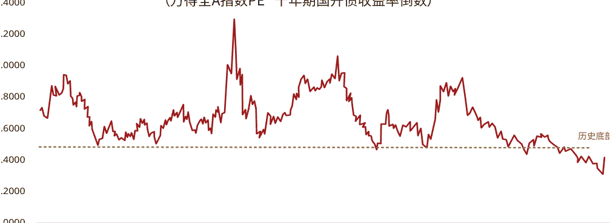
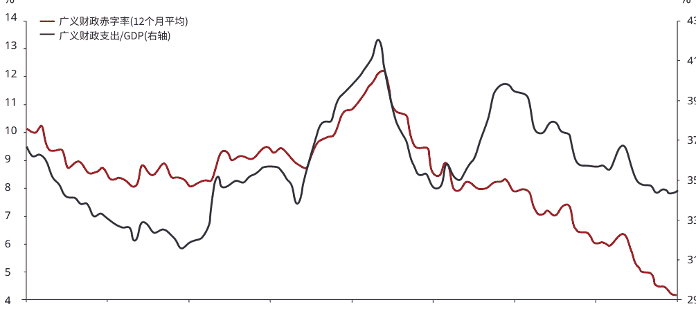
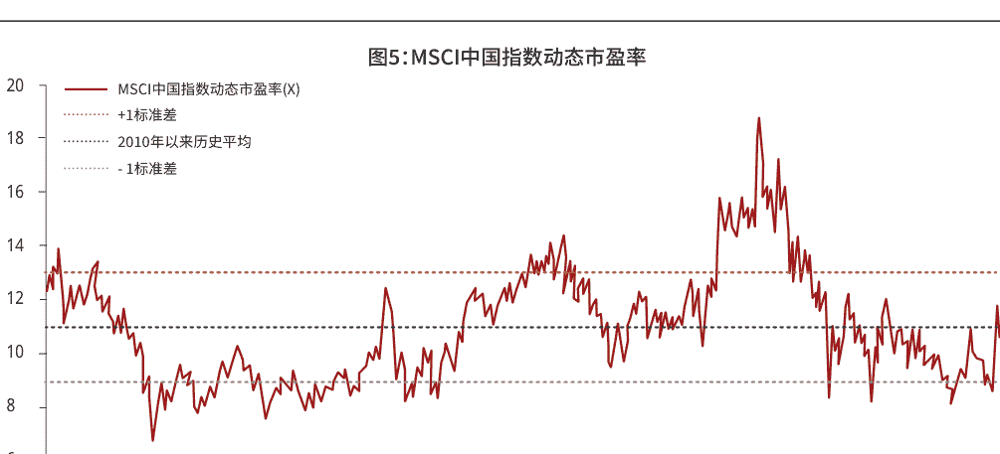
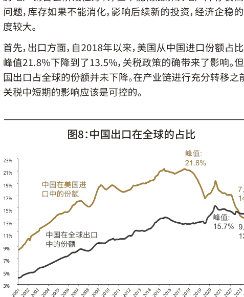
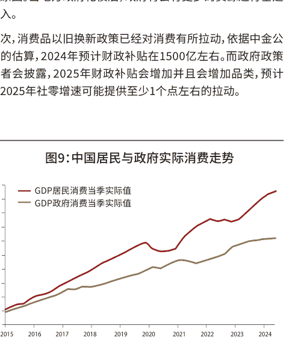
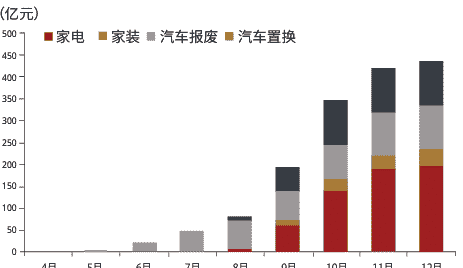
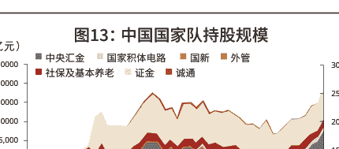

# 2025 投资展望

华夏基金(香港) ChinaAMC(HK)

## 免费 价值 及时 专注

### 扫码加入 知识星球TOP 免费资源群

- 每日免费获取有价值资源
- 可提供各类资源搜索服务

| 热门付费文章 | 各行行业报告 |
| :--- | :--- |
| 精选图书资源 | 副业赚钱方法 |
| 职场实用资源 | AI经营自媒体体 |

公众号:知识星球TOP 微信信号:jntsg8 微信信号:jnts2

分享资料仅供个人学习，请及时删除，切勿商用传播

# 目录

- 中国股票市场
  - 2024中国股票市场回顾
  - 市场回顾
  - 偏“历史经验”的市场表现
  - 市场当前位置
  - 2025中国股票市场展望
  - 经济展望
  - 市场展望
  - 配置策略和投资主题

- 全球债券市场
  - 2024全球债券市场回顾
  - 2025宏观环境展望
  - 2025全球信用市场展望

- 人民币
  - 2024人民币回顾
  - 2025人民币展望

- 虚拟资产
  - 香港虚拟资产ETF与资产
  - 代币化的发展机遇

- 关于华夏基金（香港）
  - 公司简介
  - 奖项荣誉
  - 关注我们

## 中国股票市场

### 2024年市场回顾

截止2024年11月底，中国股市的表现显著优于过去三年。上证指数和恒生指数分别获得11.8%和13.9%的上涨，在全局股票市场中属于中等偏上位置。

图1:2024年初至全球主要指数表现

| 土耳其ISE National-100 | 纳斯克综合指数 | 标普500指数 | 台湾加权指数 | 恒生中国企业指数 | 美国小型股2000 | 德国新指数 | DAX30 | 越南VN30 | 西班牙IBEX35 | 富时中国亚洲指数 | 日经225 | 韩国蓝筹 | 上证指数 | 深证指数 | ASX200指数 | 印度NSEN50 | 意大利利时MIB | S&P 500 VIX | 英国100 | 欧洲欧斯托克50 | 东南亚综合指数 | 沙特TASI | 法国CAC40 | 巴西BOVESPA | 墨西哥AC660 | 墨西哥S&P/BMV/IPC | 俄罗斯加权指数 |

资料来源：投策，截至2024年11月30日。

华夏基金(香港)有限公司

2024年中国股市的表现随不同的政策走向(图2），大致可分为四个阶段。

图2:2024中国的主要政策

| 政策方向 | 时间 | 具体内容 |
| :--- | :--- | :--- |
| 财政政策 | 9/26/2024 | 财政部召开工作会议，财政部提出“保证必要的财政支出”等。 |
| | 11/4/2024 | 财政部显示财政政策将聚焦稳定性、债、地产、民生等四个方面。通过增加地方财政债券额度置换存量债务，直接增加地方财政融资规模10万亿元。 |
| | 9/27/2024 | 央行下调公开市场7天逆回购操作利率下调2个基点。 |
| 货币政策 | 10/18/2024 | 央行下调利率显示政策重心转向市场流动性管理，进一步下调存款准备金0.5个基点。 |
| | 10/21/2024 | 央行发行1年和5年LPR双调25个基点。 |
| 地产 | 9/24/2024 | 下调房贷，统一一套房和二套房的最低利率。 |
| | 9/26/2024 | 中共政治会议对房地产表态，提出“坚持房地产长期稳定”。 |
| | 10/17/2024 | 住建部宣布通过货币化分配方式启动存量中村改造。 |
| 资本市场 | 9/24/2024 | 证监会发布关于优化上市的意见，鼓励上市公司质量整改。 |
| | 9/26/2024 | 《关于加强资本市场的意见》建议鼓励发展资本市场。 |
| | 10/18/2024 | 央行鼓励购债、基金便捷操作，设立额度为30万亿元。 |

资料来源：财富、华夏基金（香港），2024年10月2日。

### 第一阶段 4月至7月初的震荡

2023年四季度国内股市经历震荡调整，与此同时经济运行放缓，而美国股市经历调整后迎来反弹，外资流出，中国股市处于同期水平；政策力度活跃，市场反弹仍有所调整。

### 第二阶段 7月至9月初的快速升

市场进入快速反弹阶段的核心动力是中国政府出台一系列相关政策，减少了市场预期。在资本市场方面，政策有利于维护市场重心，7月中旬开始修复，推动市场从4月19日至5月20日快速上涨，表现超出了预期。

### 第三阶段 9月至9月末的震荡回调

5月后美国地区领导人讲话引发了对外部环境的担忧。更重的是，中国经济基本面维持走弱，市场的持续下跌引发投资者忧虑。政策较为积极，成交量放大。

### 第四阶段 9月至上旬的回调

9月24后中国政府出台了一系列政策引发了市场的快速上涨，交易出现反弹。直到10月中旬，股市保持了较高的活跃度，市场对政策持有较高的预期，然而随着政策推出，地产等地在经济数据上经历压力，期间美国大选讲话后中美关系再次活跃，中国市场进入调整。市场运行持续，调整定型。

---

## 偏离“历史经验”的市场

2021年下半年以来，在过去多年的时间内，市场整体较为低迷，股市持续下跌。尤其是自2023年第四季度以来，过去用来判定市场底部的方法在近年屡屡失效。

2010年到2022年期间，市场底部的一些指标（图3）有一个相对底部函数，并且市场触及历史底部时往往会出现反弹，但近两年指标失效。

图3:市场底部指标

| 2011 | 2012 | 2013 | 2014 | 2015 | 2016 | 2017 | 2018 | 2019 | 2020 | 2021 | 2022 | 2023 | 2024 |

数据来源：万得、华泰基金，2024年11月19日。

与此同时2023年9月中，中美市场走向背离了历史规律。在2023年3月之后，除了沪深300指数和沪证500指数的核心收益率依然是这样的，符合中国经济增长股市的特征，但自2023年3月到2024年9月后，两个指数持续下跌。

4月和9月的反弹，主要因素是“风险溢价”的下降。中国政府在4月和9月推出了地产、金融、资本市场以及民生相关的政策，说明政府对于经济所面临的问题有清晰的认知和应对办法，领导层对未来的积极托下确保了市场的反弹。在5月份持续下跌后，经济开始得到修复。

中国市场的低迷和国外市场的背离，投资者对中国市场的预期出现了分歧。对于持有股票的投资者来说，部分投资者认为股市即将底部，部分投资者认为中国市场底部意味着房价和地方政府的债务压力主要是问题，但有一位投资者认为中国的政府政策已经到了底部，而另一位投资者认为中国市场的底部并在5月后出现，由于中国投资者已经得到了回报。

我们认为中国市场反弹历史规律的国内是中国财政政策。关注中国股市的长期性问题，政策重点强调“强周期”和“安全”，财政和地方政府的债务问题；另一方面外部环境限制了国内的空间。在2022年9月，海外市场回暖，中国政府推出系列政策驱动了市场的反弹。两个反弹期属于4月初到5月中，以及9月中到10旬，中国股市的表现了多数，投资者的信心并不是。

图4:中国财政状况

资料来源：国际，截至2024年9月。

### 市场当前位置

目前中国股市市盈率（包括A股和港股）低于2010年以来历史平均水平，处于历史低位。三个月中，中国经济处于向好的阶段。与去年相比，政策转向之后，资金并没有快速回升，恒生指数到了9月位置，沪深300指数回到9月位置，国庆假期期间积累的不理性。

图5:MSCI中国动态市盈率

资料来源：华夏基金（香港），截至2024年10月。

### 经济展望

依据IMF的预测，中国2025年GDP增速为4.5%，高于发展水平。根据摩根·士丹利、瑞银和高盛的预测，中国2025年GDP增速约4%~5%，通缩压力将缓解。美国特朗普上台之后的关税政策将给出口带来压力，中国政府的内部政策形成对冲。人民币或汇率到7.6，幅度在5%左右。

图6:全球经济增速

| 地区 | 2023 | 2024 | 2025 |
| :--- | :--- | :--- | :--- |
| 全球 | 3.3 | 3.2 | 3.2 |
| 发达经济体 | 1.7 | 1.8 | 1.8 |
| 美国 | 2.9 | 2.8 | 2.2 |
| 欧元区 | 0.4 | 0.8 | 1.2 |
| 日本 | 1.7 | 0.3 | 1.1 |
| 英国 | 0.3 | 1.1 | 1.5 |
| 中国家 | 4.4 | 4.2 | 4.2 |
| 中国 | 5.2 | 4.8 | 4.5 |
| 印度 | 8.2 | 7.0 | 6.5 |
| 俄罗斯 | 3.6 | 3.6 | 1.3 |
| 巴西 | 2.9 | 3.0 | 2.2 |
| 墨西哥 | 3.2 | 1.5 | 1.3 |
| 奈利利亚 | 2.9 | 2.9 | 3.2 |
| 南非 | 0.7 | 1.1 | 1.5 |

资料来源：IMF，截至2024年10月。

图7:投行对中国经济分析及预测

| Morgan Stanley | UBS | Goldman Sachs |
| :--- | :--- | :--- |
| GDP增速 | 4% | 4% | 4.5% |
| 通胀 | GDP预测回缓<CPI/PI回缓 | CPI,0.1% | CPI利达0.8% |
| 汇率 | 人民币汇率到7.6 | 人民币汇率到7.6 | 房地产持续持软，且美国关税导致出口大幅波动，中国消费需求持续增强 |
| 经济 | 内需不足，出口面临压力 | 财政支持中国经济，出口有望提升 | 政府加大支持GDP至8个百分点，可能还需要支持8亿企业，则中国房地产市场将企稳 |
| 内部政策 | 政府实施3万亿增长和财政政策，1/3支持消费 | 广义财政赤字有望提升2个百分点；财政政策支持政府基建，并维持房地产 | 利率缩小30-40bp | 政府下调利率 |
| 外部环境 | 美国进口加关税 | 2025年9月开始加关税 | 美国加关税 |
| 大陆趋势 | 沪深目标点位4600，上空间7.2% | | 沪深目标点位4600，上空间17.4% |
| 结构转型 | 消费：服务性消费（如医疗、银行业）、转型 | | 消费：科技、新 |

来源：Morgan Stanley, Goldman Sachs.2024年11月。

对于中国经济自身的压力，部分投资者认为中国政府并未改善，良好局面；也有投资者认为当前的政策作用有限；另一位投资者认为房地产销售可能转好，但不能彻底解决积存问题，如果调整，经济的规模将较大。贸易短期期的影响应该是怎样的？

首先，自2018年以来，美国进口占比从21.8%下降到了13.5%，政策带来了利好，中国出口份额下降。

其次，中国政府的“政策性”可以理解为政府对消费的“一次性投入”，将“刚性”和“低利率”。中国的消费增速减缓，居民收入预期下降是部分原因，但由政府引导的中国增长也是其中的重要原因。再次，消费依靠以前政策已经依赖。根据2024年，2025年财政预算将在15万亿左右，而政府将会增加包含消费类，目标将增长至少1个百分点。

来源：中金，2022年9月。

2025年展望

华夏基金（香港）

图10:2024消费以旧换新

图11:不同财政力度对零售额的拉动

| 亿元 | 拉动零售额 | 拉动总量增速 |
| :--- | :--- | :--- |
| 1500 | 3901 | 0.8 |
| 2000 | 5201 | 1.1 |
| 2500 | 6502 | 1.3 |
| 3000 | 7802 | 1.6 |
| 4000 | 10403 | 2.1 |
| 5000 | 13003 | 2.7 |

数据来源：中金，2024年11月。

数据来源：中金，2024年11月。

对于房地产，一线城市的成交面积在政策导向影响增大，但已成交未出售的住宅去库存周期可能需要20个月以上，部分投资者认为房地产压力较重。我们认为房地产销售仍受有利政策传导，开工还需要观察，经历了过去三年投资下降的已成交未出售的住宅已经积压。根据日本和美国的经验，房地产新开工态势已经接近底部位置。由于财政支持政策能够持续，经济没有持续恶化，房地产就有可能在未来快速下降。

图12:中国住宅库存与销售状况

数据来源：万得、光大证券，2024年9月。

总而言之，我们认为财政政策能够对消费、地产等投资者担忧的板块得到支撑，维持政府政策的持续，我们预计经济数据将向边际转好。

# 市场展望

我们对中国股市市场，包括A股和港股总体持乐观，市场下跌空间有限，大震荡有望。反弹的季节取决于中国政策导向、国际环境变化、行业数据预期等因素的影响。

首先，A股我们认为下方空间有限。目前中央资金等国家级基金的持股规模已经达到4万亿，并且表现出入场趋势。参加金融监管机构买的资本市场，当市场行情后期会有充分的资金支持。这也是A股的表现整体。

其次，A股和港股主要股票估值仍然低廉，在经济持续增长的前下，低值有望被购买的理由，是历史水平处于下去。虽然中国股市估值处于过去十余年的平均水平，而中国股市风险率已经具有较大的下探，估值的价值和无风险收益率相比处于历史低位附近。这说明中国股市市场整体低值，只要经济能够足够，估值将转化为投资收益。

图13:中国国家级市值规模

数据来源：中信证券，截至2024年10月。

图14:全球主要市场估值

数据来源：国际，截至2024年9月。

# 全球债券市场

## 2025年市场回顾

2024年，全球固定收益市场在波动中维持着良好的节奏。在美经济强于预期、美联储开启降息周期、特朗普再次当选的背景下，整体呈现出股票债券债跑赢债大行情。债券资产内部，美国国利率维持在高位区间震荡，信用利差不断收窄至过去10年最低水平。莱信信用敞口利率，短期跨长期、高收益债投资的特征，截至11月底，彭全球债券收益指数上涨0.46%，摩根通亚洲信用债指数上涨7.14%。

| 2020年 | 2021年 | 2022年 | 2023年 | 2024年10月以来 | 2024年初以来 |
| --- | --- | --- | --- | --- | --- |
| 中美高收益债 | 9.4% | -33.3% | -33.3% | -20.5% | 0.0% | 20.2% |
| 亚洲高收益债 | 6.2% | -17.5% | -21.8% | 4.8% | 0.5% | 16.7% |
| 美国高收益债 | 6.2% | -5.4% | -11.2 | 13.4% | 1.6% | 9.2% |
| 欧洲高收益债 | 7.8% | -1.9% | -14.8 | 7.9% | 0.7% | 7.2% |
| 中美高收益债 | 6.9% | -3.6% | -18.8 | -10.9% | 1.2% | 6.7% |
| 新兴市场债 | 7.1% | -3.1% | -12.6 | 7.2% | 0.6% | 5.9% |
| 亚洲新兴债 | 6.6% | -0.2 | -9.9% | 6.8% | 0.6% | 5.9% |
| 欧洲高收益债 | 2.8% | -0.8 | -16.4 | 8.3% | 2.3% | 5.4% |
| 美国投资级债 | 9.8% | -1.0 | -15.4 | 8.4% | 1.2% | 4.6% |
| 美国国债 | 8.2% | -2.4 | -12.9 | 3.9% | 0.5% | 1.9% |
| 发达市场债 | 9.3% | -6.9 | -18.0 | -3.6% | -0.2% | -2.0% |

数据来源：内部，2024年12月

回首2024年，宏观环境或超过了投资者的预期，美国期间，经济再次复苏至2%以上的GDP增长。美股、收益率屡次从年初到三月后一路回升，特朗普再次以压倒性的优势赢得美国大选。

新兴市场而言，虽然整体增长数据超预期，许多国家结果在预期之内，但市场的通胀压力能够反复出现并好转。通胀的回落和回落的启动因素使得投资者关注全球和新兴市场能够显著的跨越式经济增长。全球正在经历去年年初面临环境因素冲击。

市场方面，除美国外，其他联储开始降息，欧洲政策的不确定性影响通胀的增长。

# 2025展望

2025年，金融市场面临的不确定性。特朗普执政后新一轮贸易政策对全球增长带来挑战，全球范围内地缘形势的转变引发政策风险加大，中国也将面临新的内外部增长压力，在全球化的背景下，股市波动和政策风险今年将有所增加。

政策预计能抵消贸易政策以及关税对经济的负面影响，增速可能有所放缓。就业市场仍低位，但就业压力增大。

# 美国经济与展望

2024年，金融市场面临的不确定性。特朗普执政后新一轮贸易政策对全球增长带来挑战，全球范围内地缘形势的转变引发政策风险加大，中国也将面临新的内外部增长压力，在全球化的背景下，股市波动和政策风险今年将有所增加。

政策预计能抵消贸易政策以及关税对经济的负面影响，增速可能有所放缓。就业市场仍低位，但就业压力增大。

整体，我们预计2025年维持在2%左右的水平，通胀可能出现反复，概率为40%-60%。目前市场对美联储维持利率立场或加息，基准利率可能下调。2025年底增长可能出现大幅反弹。

| | 墨西哥 | 智利 | 匈牙利 | 波兰 | 韩国 | 印度 | 巴西 | 美国 |
| --- | --- | --- | --- | --- | --- | --- | --- | --- |
| 当前政策立场 | 削减 | 削减 | 削减 | 削减 | 维持 | 维持 | 维持 | 提高 |
| 当前政策利率 | 10.25 | 5.25 | 6.5 | 3.75 | 5 | 6 | 25 | 2.25 |
| 利息调整次数 | 4 | 10 | 11 | 2 | 0 | 1 | 0 | 3 |
| 周内最高政策利率 | 11.25 | 10.25 | 13 | 6.75 | 3.5 | 6.5 | 6.25 | 2.5 |
| 年末政策利率 | 10 | 5 | 6.25 | 3.75 | 5.25 | 5.8 | 5.2 | 12.25 |
| 今年剩余利率（基点） | 25 | 25 | 25 | 0 | 0 | 0 | 0 | 25 |
| 2024年预测的实际增长率（%） | 1.5 | 2.4 | 0.7 | 2.8 | 2.2 | 6.8 | 5 | 2.6 |

| | 加拿大 | 欧元区 | 英国 | 澳大利亚 | 美国 | 日本 |
| --- | --- | --- | --- | --- | --- | --- |
| 当前政策立场 | 削减 | 削减 | 维持 | 维持 | 维持 | 提高 |
| 当前政策利率 | 3.25 | 3.15 | 4.75 | 4.35 | 4.5 | 0.25 |
| 利息调整次数 | 5 | 3 | 2 | 0 | 2 | | |
| 周内最高政策利率 | 5 | 4.5 | 5.25 | 4.35 | 5.5 | -1 |
| 年末政策利率 | 3.25 | 3.15 | 4.75 | 4.35 | 4.5 | 0.4 |
| 今年剩余利率（基点） | 0 | 0 | 0 | 0 | 25 | |
| 2024年预测的实际增长率（%） | 1.1 | 0.8 | 1 | 1.2 | 2.6 | |

数据来源：华泰，2023年12月2日。

# 美国市场

我们预计在2025年将出现剧烈的波动。美利坚将是“特朗普”执政后新一轮贸易政策的直接对手，收益率可能面临中期调整。我们预计美联储将加息，2025年利率可能面临4%至6%的下行压力，由于目前美联储、大型外国和国内机构持有高位的美债份额自1997年以来的最低水平，预计收益率将承受较大的压力。我们预计趋势在2025年将维持，结束长期通胀压力，我们预计中长债收益率维持在高位，整体股市波动将是常态之一。

美国优背景下非美国经济在2025年将面临更多增长挑战，由于美国实施新一轮贸易政策的冲击，亚洲，美国股市将面临目前市场对下行风险的主要来源。此外，欧洲方面，由于欧洲经济在明年面临较大的外部压力，而美国关税政策将作为推手手段导致欧洲增长加剧压力，财政赤字可能再度上扬，主权权益受损风险加大，尽管衰退可能不大，但美联储加息周期可能维持。此外，美国全球政策将带来不确定性。2025投资展望 华泰基金（香港）

# 信用债

香港信用债在2024年继续，利差相比年初收窄，但接近10年最低值，从收益率来看，具有足够的吸引力，是债券的核心因素。供需方面，尽管2024年新发债规模提升，但强劲资金流入使得市场完全吸收，我们预计2025年市场处于低位，波动。利差相比去年有所回落。中期来看，我们预计2025年波动幅度相比今年增强，一旦长端利差进一步加速回升，宏观环境遭遇黑天鹅事件，导致债券价格阶段性走跌。

数据来源：中信，2024年12月。

考虑到国债配置，利差持续收窄，但面临技术面支撑，在2025年收益率预计处于中位，我们看好中债。国债表现相对弱，预计2025年收益率有所上升，整体维持低位。我们认为收益是今年的主要目标，在保持良好流动性和分化压力前提下，尽力控制利率波动以及结构性风险，从而进行均衡操作。风险提示：地缘冲突突发，美国政策转向，全球基金进入调整期。2025年收益债报告 华夏基金（有限公司）

# 2024年回顾

今年银行持续获得降准，相比去年，央行基本持稳，中长期MLF和LPR波动更大，由于市场流动性压力，利率还面临压力。通胀数据进入进口增速回升，整体政策没有增强趋势性，对市场的影响有效。收益具有吸引力。而且当市场反弹时利率更多，反而提供了良好的机会期。

2024年美元人民币汇率的剧烈走动，由于1250，人民币对冲成本大约在1.7%-2.7%区间，波动约为1%。3月后开始波动，八月、九月、十月人民币回升后回落，主原因是美元资金回流压力。

# 2025年展望

我们预计人民币汇率继续维持稳健，但如果需要调整，政策空间是充足的。基于基本面因素，市场可能会出现新的汇率震荡。政策方面，我们重点关注有关人民币和消费需求的政策，预计今年12月的央行会议将如何影响汇率，以及2025年初的趋势。

我们预计明年将处于底部，利率下行增速放缓。一方面受国内空间和政策支撑影响，人民币不会大幅贬值；由于国内因素的影响将减弱，受美联储利率和中国财政政策影响程度，将成为决定市场的主要因素。

中国国内利率，特别是未来五年内，我们可能面临较大的下行压力。我们预计2025年10月后利率维持在1.9%以下区间，受国内需求影响。2025年下半年政策发力加大和市场经济复苏预期良好时，中国或许会出现利率的上行周期。

境外市场情况，利率下行压力和国内债基本一致，一足是利率维持高位左右，在境内通胀环境下降下，境外压力的影响有限。

美国的变化，其不确定性将导致中国面临贬值风险。考虑到财政压力、政策转向因素，美国的不确定性将对美国通胀产生影响。预计美元/人民币汇率在7.0至7.3之间波动。首要因素是美国大选结果以及关税政策，我们将关注美联储进入降息周期内窄幅波动，汇率带来的影响有限。投资展望 华夏基金（有限公司）

# 虚拟资产与资产代化的市场机遇

2025年虚拟资产领域可能迎来新的阶段。凭借活跃的金融生态系统和监管框架的完善，香港领先虚拟资产代化（RWA）重塑传统金融格局。本章节将深入探讨这些发展、机遇和实际应用。

## 比特币的全球地位与市场

比特币在虚拟市场中的地位转变证明了其在全球市场的主流认可度和热度。如下表所示，比特币市值达到了1.76万亿美元，在虚拟资产中排名第八，这一趋势标志着比特币从投资资产转变为广泛的数字资产。

| Name | Market Cap | Price | Today | Country |
| --- | --- | --- | --- | --- |
| 1 黄金 | HK$17.530T | HK$2.610 | -0.28% | |
| 2 英达 | HK$3.563T | HK$145.26 | -1.61% | USA |
| 3 苹果 | HK$3.389T | HK$224.23 | -1.20% | USA |
| 4 微软 | HK$3.107T | HK$418.01 | -1.07% | USA |
| 5 Alphabet (谷歌) | HK$2.216T | HK$181.97 | 1.17% | USA |
| 6 亚逊 | HK$2.174T | HK$206.84 | -0.64% | USA |
| 7 沙特石油公司 | HK$1.797T | HK$7.43 | -0.53% | S. Arabia |
| 8 比特币 | HK$1.760T | HK$88.901 | 9.61% | |
| 9 白银 | HK$1.716T | HK$30.50 | -0.3% | |

资料来源：Companies Cap, 2024年11月。

比特币具有周期性波动的特性，按照以往经验，比特币呈现以多年为周期的走势，2015-2018和2018-2022年分别涨幅481%和597%，目前处于新一周期内。随着宏观经济环境稳定对比配置的提升，以往经验支撑了比特币在2025年可能出现的增长力。

### 图21: 比特币价格周期

| | 2022+ Cycle: 570% |
| | 2018-2022: 597% |
| | 2015-2018: 481% |

数据来源:Glassnode, 2024年12月2日。

### 2) 机构投资者的参与

2024年比特币的监管框架增强了其在传统金融领域的地位。比特币作为机构投资者提供了一个监管和高效的进场渠道，增强了其流动性，并加强了其作为经济中性投资工具的价值。

### 3) 香港的爆发

香港的监管框架在虚拟资产处理领域处于领先地位。香港证监会明确指出，作为亚洲首批加密资产发行的华夏香港，利用比特币和太坊加密资产的市场增长，吸引了机构投资者的参与。

## 资产代码化：创新的转型机遇

资产代码化作为一种金融创新，允许房地产、绿色债券和私募股权资产在区块链上进行数字化，解锁了新的流动性和可接近性。

### 1) 全球与景气

- 流动性：资产代码化由区块链技术的进步和投资者增长的需求所推动，2023年，香港展示了区块链在跨境结算流程、降低成本和提高透明度等优势，证监会和金管局监管的持续支持使得资产代码化进程。

- 透明度：区块链不可篡改的特性，保证了资产表现和风险的透明，降低不确定性。

### 2) 对香港金融生态系统的贡献

- 投资多样化：允许投资者进行多元化资产配置。相比仅供机构投资者参与的另类资产。

# 关于华夏基金（香港）

华夏基金（香港）是香港领先的资产管理公司，作为华夏基金的海外子公司，我们成立于2008年9月，是首批出海的中资资产管理公司。我们的母公司华夏基金是中国规模最大的基金公司之一，拥有26年资产管理经验，截至2024年第三季度，总资产管理规模达2.6万亿人民币。

华夏基金（香港）立足香港、全球，经过16年的发展，建立起实力雄厚的本土化投资团队，为客户提供全球热门股票基金、债券基金、交易所交易基金（ETF）、杠杆及反向基金、加密资产基金、账户、投顾、建模组合等多元化产品，并致力于金融领域创新，探索领先的投资领域，荣为香港、大中华区、亚太地区、欧洲、美国等地的个人和机构投资者提供一站式的解决方案和服务。

# 产品策略

| 中国股票 | 全球债券 | 货币市场 |
| --- | --- | --- |
| 中国聚焦基金 | 全球股票级债券基金 | 港元货币基金 |
| 新视野中国亚洲基金 | 定期收益型基金 | 美元货币基金 |
| 中国机会基金 | 亚洲债券基金 | 人民币货币ETF（非上市份额） |
| 精选大中华科技基金 | 亚洲ESG债券基金 | |
| | 人民币投资级收益基金 | |
| | 人民币债券基金 | |

| 全球多元 |
| --- |
| 全球多元收益基金 |

| 大中华股票 | 亚洲股票 | 欧美股票 |
| --- | --- | --- |
| 沪深300 ETF | MSCI印度ETF | 纳斯达100 ETF |
| MSCI中国A50互通ETF | 日本债券（美元对冲）ETF | 欧洲股票（美元对冲）ETF |
| 恒生ESG ETF | 亚洲ETF | |
| 恒跨境ETF | 亚洲美元投资级债券ETF | |
| 恒生生物科技ETF | |

| 债券及货币市场 | 杠杆及反向 | 加密资产 |
| --- | --- | --- |
| 20年以上国债ETF | 纳斯达100每日杠杆(2X) 产品 | 比特ETF（现货） |
| 亚洲美元投资级债券ETF | 纳斯达100每日反向(-2X) 产品 | 以太ETF（现货） |
| 人民币货币ETF | | |

# 享业界100+奖项

### 近期重磅奖项

### The Asset 财经
### 可持续投资奖2024 & 2023
- 年度最佳中国境外养老基金
- 年度最佳中国境外养老基金

### 中国证证券报
### 第八届海外基金牛奖
- 一年期中国债券基金

### Fund Selector Asia
### 2024年度基金大奖
- 年度最佳ETF基金
- 香港大中华股票 - 白金奖

### LESG
### 卓越基金香港养老奖2024
- 香港最佳亚洲高收益基金（5年期）

### Asia Asset Management 亚洲资产管理
### Best of the Best 年度基金大奖2024
- 年度最佳中国基金公司 - 香港地区
- 全球综合基金奖

### 扬筹商业周
### 2024年度基金大奖
- 人民币基金（一年）- 卓越大奖
- 中国股票基金（五年）- 卓越奖
- ETF - 最佳追踪（一年期）- 科技基金 - 卓越大奖
- 年度最佳中国ETF - 同级奖
- 年度固型收益基金 - 同级奖

### Insights & Mandate 投资顾问与委托
### 2024年度投资大奖
- 市场最佳奖 - 香港地区最佳人民币基金经理
- 投资奖 - 中国A基金（3年）
- 投资奖 - 全球债券基金（3年）
- 投资奖 - 大中华市场策略突破

### Benchmark
### 2024年度基金大奖
- 基金类别 - 最佳投资 - 长短 - 同级奖

China Asset Management 中国资产管理第八届海外基金牛奖：中国证证券报，截至2024年12月5日。The Asset第三届亚洲基金奖：The Asset。2024年度基金大奖：Fund Selector Asia。2024年度基金大奖：LESG。2024年度基金大奖：Asia Asset Management。2024年度基金大奖：扬筹商业周。2024年度投资大奖：Insights & Mandate。2024年度基金大奖：Benchmark。

# 2025投资展望 华夏基金（香港）

# 免声明

本数据仅供指定收件人参考，并不构成对任何证券的邀请。在法律管辖内，未经华夏基金（香港）有限公司同意下，不得分发、复制或复制本数据内任何部分授予指定规定以外的人士。

华夏基金（香港）相关文件：本数据仅反映时市况，并不构成参与基金的邀请。非香港投资者有责任遵循其法律管辖的所有法律阅读基金销售文件，包括风险因素。如有需要，应咨询独立专业意见。

华夏基金（香港）有限公司（“本公司”）于编制资料时的判断，并不代表未来市场情况，因此所有建议或数据意见仅在未跟进最新通知的情况下有效。有关基金的详情（包括免责声明），请参阅华夏基金（香港）相关的文件。

本文件所包含的资料源自多个服务供应商，我们未对这些资料等数据的准确性及完整性保证。华夏基金（香港）。对于用于编制资料的数据，本公司已根据要求对公共提供的数据准确性及完整性负责；然而，本公司不对任何客户因忽略或使用该数据而导致的损失承担任何责任。

投资涉及风险。基金基于过去表现，但不将显示未来收益。未来的表现不被保证，亦可能导致本金损失。本资料并不构成对任何证券的建议或对任何承诺的保证。本文件仅供参考，不应作为认购文件或设立发行日的依据。本资料之发行人为华夏基金（香港）有限公司。此资料并未被香港证券及期货监察委员会注册。在未经华夏基金（香港）有限公司同意下，不得分发、复制或复制本数据内任何部分。

华夏基金（香港）有限公司
香港花园道1号中东大街37楼
产品查询及客户服务
电话：(823) 3406 8866
电邮:hkservice@chinaamerica.com

关注我们
华夏基金（香港）China Asset Management (HK)
www.chinaamc.com.hk
微信
Linkedin
