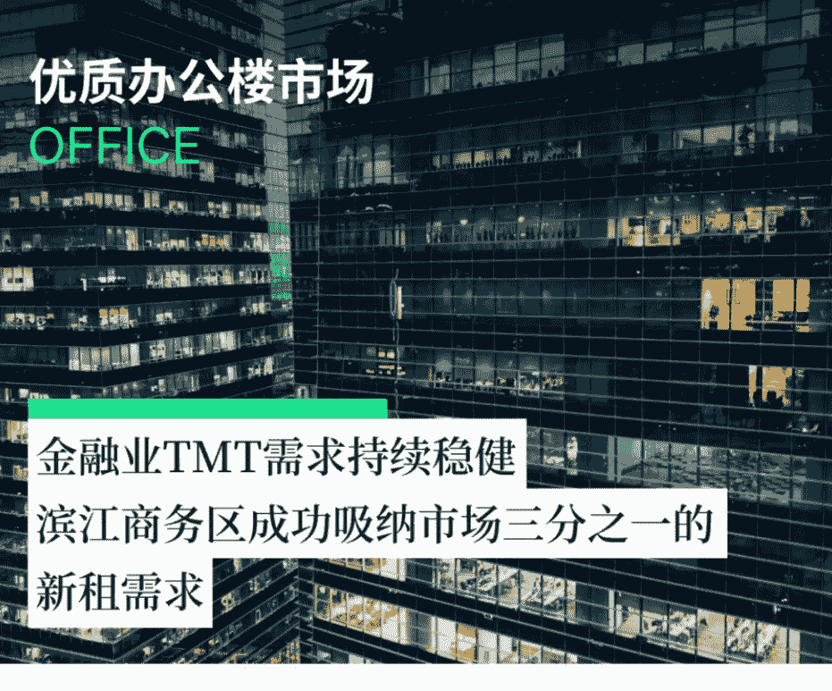
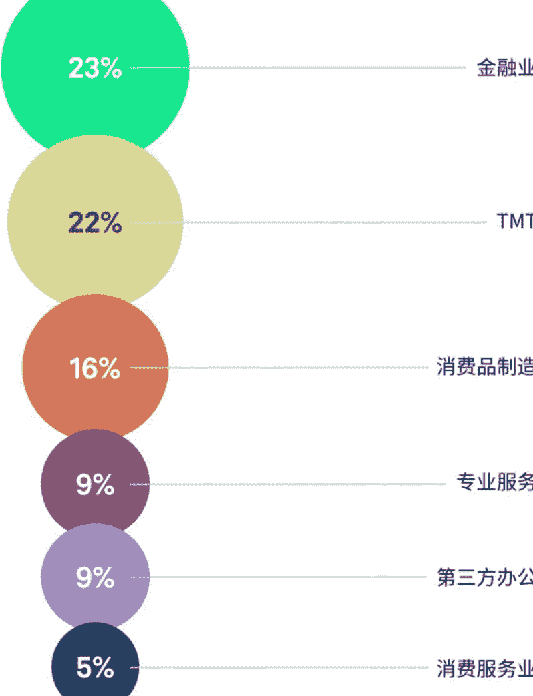
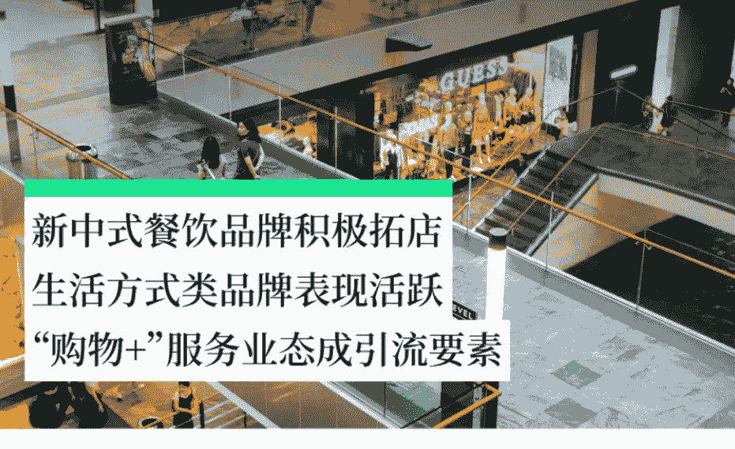
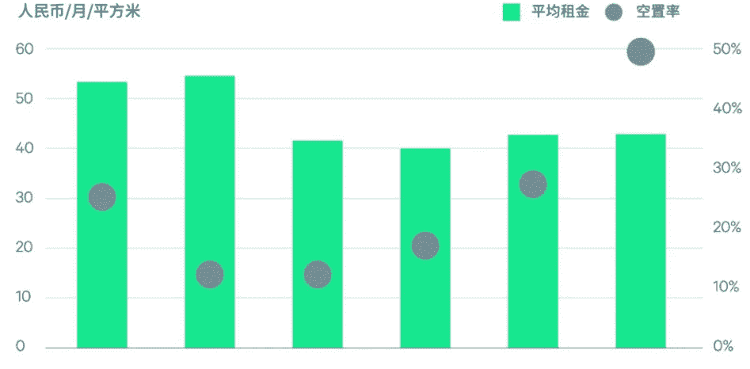

# 2025年
第一季度上海房地产市场回顾

上海经济稳中向好
科技与消费驱动市场回暖

## 免费 价值 及时 专注

## 扫码加入 知识星球TOP 免费资源群

- 每日免费获取价值资源
- 提供各类资源搜索服务

| 热门付费文章 | 各行行业报告 |
| :--- | :--- |
| 精选图书资源 | 副业赚钱方法 |
| 职场实用资源 | AI政经自媒体 |

公众号: 知识星球TOP 微信信号: jntsg8 微信信号: jntsg2

分享资料仅供个人学习，请及时删除，切勿商用传播

2025年第一季度，上海经济整体呈现稳中向好的态势。围绕科技、金融和消费，以及上海两会提出的重点工作，将成为推动2025年经济发展的重要引擎。上海办公楼需求逐渐回温，金融业TMT需求稳健，滨江商务区日益成为市场新宠。零售市场消费需求动态变化，新式餐饮品牌表现活跃，服饰和生活方式相关的零售业务布局加快。仓储物流需求回升，为全年奠定了坚实基础。商园区办公楼在新质生产力的推动下，需求温和增长，张江浦河成交占比尤为突出。投资市场核心办公交易拉动市场交易总额环比回升。

CBRE世邦魏理中国研究部资深董事陆燕

## 优质办公市场

### 金融业TMT需求持续稳健
滨江商务区成功吸纳市场三分之一的新租需求

2025年第一季度

| 新供应 | 净吸纳量 | 空置率 | 租金报价 |
| :--- | :--- | :--- | :--- |
| 13.9万平方米 | 7.9万平方米 | 22.3% | 249.3 人民币/月/平方米 |

2025年第一季度，上海办公市场共获得两个新项目，分别是静安区的静纳中心以及徐汇的徐汇洛中心三期（T2），共计13.9万平方米。季不淡，尽管受到假期回暖的影响，一季度的数据表现出回暖的潜在性。全市办公吸纳量环比同比均有提升，达到了7.9万平方米，空置率环比回升0.2个百分点。

从行业需求来看，金融业仍然处于主导位，占比23%，主要受到租赁管理和银行等领域需求的推动。TMT行业稳居第二，占比22%，得益于电商、电信以及部分软件系统开发和互联网平台的租赁需求。第三位是消费制造业，需求回升显著，占比16%，其中零售快消和3C产品等相关行业活跃较高。第四位是专业服务，占比9%。值得一提，随着消费升级和服务服务的推动...

从租户流动的角度来看，滨江板块吸引了市场三分之一的需求，这主要得益于一江的规划，标志着上海陆城区正从工业转型为生活活动中心，活跃了滨江商务区的发展。此外，北徐汇、浦东以及徐汇区的兴起也带动了市场整体的升级。在本季度市场中，某特定...桥、真如、北滩和外滩板块位居前五，合计占全市城市化的一半。其中，五角场主要受益于第三方公共和消费服务的推动；虹桥受到TMT和消费品制造业的支持；真如则由金融业、TMT、零售贸易及专业服务业等多元化需求推动。北滩和外滩显著受到金融业的影响。来看，一季度市场的去化情况均表现稳定，对于今年的市场发展开展了一个好头。

租金方面，第一季度全市租金报价环比下降1.9百分点至每平方米249.3元，有效租金环比下降2.0个百分点至每平方米179.4元。租金下行压力存在，业主通过降租提高出租率，同时积极探索其他策略，如灵活的租赁条款、共享设施、改善物业环境及数字化服务。这些措施提升了租户的满意度和留存率，也帮助业主在当前市场环境下，灵活与创新成为租赁市场的关键。

### 市场新租需求行业分析 按租赁面积

### 市场新租需求区域分析 按租赁面积

未来六个月，上海预计迎来72万平方米的新增供应。然而，市场竞争激烈。政府积极施政，为科技、金融和消费品等行业专项扶持，放宽企业限制，简化注册流程和降低审批门槛，也将吸引初创企业和外资扩张。我们也观察到相关行业需求回暖，特别是TMT与高端制造的深度结合，以及人工智能与大数据的应用。这将赋能传统制造业，从而促进制造业的发展和运营效率的提升。相关企业的快速成长不仅会吸引高端人才的聚集，还将办公楼市场注入新的动力。

CBRE中国区顾问及交易服务部 办公室负责人 张越

## 优质零售市场 RETAIL

### 新中式餐饮品牌积极门店
生活方式类品牌活跃
“购物+”服务态成为流量要素

2025年第一季度

| 新增供应 | 净吸纳量 | 空置率 | 首层平均租金 |
| :--- | :--- | :--- | :--- |
| 10.5万平方米 | 5.6万平方米 | 8.5% | 32.3 人民币/天天/平方米 |

2025年第一季度，上海零售市场迎来了多个商业中心落地，为市场新增了10.5万平方米的零售面积。全市零售空置率提升0.5百分点至8.5%。从各个商场来看，零售品牌的细分领域活跃，品牌端通过精准定位、场景创新和数字化转型重塑零售态势。当市场需求方面，餐饮业以60%的占比持续领先。其中以Bistro为主的新中式餐饮最为活跃，这种餐饮兼具功能性和空间氛围感，注重社交平台的流量营销，深受消费者欢迎。例如“捕Bistro”、“露营薇”、“筑山野味”等布局市内热门消费零售业方面，整体占比为30%。其中时装类需求最高，国外设计师品牌入驻，典型案例包括意大ZONA MILANO在陆家嘴中心已登陆，以及Zara登陆古里，海外还有滑雪、露营与潮品等品牌持续领先。生活方式类活跃，占零售份额的18%，其中潮牌品牌突出社交和情绪价值，位于年轻消费者发展迅速。KKV、名创及潮流零售品牌积极拓门店。此外，服务类业务占比10%，“购物+”场景加速融合，消费者对瑜伽、SPA等配套服务的逐步成为引流要素。季末，全市购物中心首层租金环比下降0.9%，报每天平方米32.3元。

### 市场新租需求分析 按新店数量

*由于数据四舍五入，导致各项占比的总和可能不等于100%

> 展望未来六个月，上海零售市场将迎来60万平方米的新增供应，除了徐汇国贸中心二期外，其余项目主要分布在次级及非核心区，潜力将加速释放。政府推出系列政策，包括旧换新补贴、大宗消费券发放。这些政策结合如AI技术的应用，为零售市场注入了可持续发展的动力。同时，上海将举办更多主题公园和展览，进一步促进旅游消费。

CBRE中国区顾问及交易服务部 负责人 希诺

## 良好开局为全年奠定坚实基础

| 2025年第一季度 | 新增供应 | 净吸纳量 | 空置率 | 平均租金 |
| :--- | :--- | :--- | :--- |
| 21.2万平方米 | 16.4万平方米 | 29.0% | 42.0 人民币/月 |

2025年第一季度共有两个项目，分别是亚洲产业一期（三层仓库）和普洛斯物流园二期（五层仓库），其中普洛斯物流园是改造项目。上海经济回暖，一季度净吸纳达16.4万平方米，环比明显回缓。今年增速回缓，带动三方物流和消费品增长，其中已有21.2万平方米租赁，空置率维持在高位29%，租金环比下跌至每月42.0元。金山和青浦面临较大的去化压力，临港则相对稳健。

### 主要区域平均租金与空置率

未来六个月内，上海将迎来7万平方米的优质仓储交付，接近70%位于西南区域。一季度市场表现巧妙证明了我们对上海市场的判断，我们乐观地预计，国家方位扩大内需的政策刺激，以及城市更新带来的升级搬迁将推动上海仓储物流需求继续回升。另一方面，都市圈的供应高峰将迎来尾声，随着空置面积的不断去化，租金跌幅将逐步收敛。

CBRE中国区顾问及交易服务部投资及资本市场 产业地产负责人 孙洁

## 商务园区市场 BUSINESS PARKS

### 新质生产力推动需求温和增长 张江和漕河成交占比尤为

2025年第一季度 | 新增供应 | 净吸纳量 | 空置率 | 租金报价 |
| :--- | :--- | :--- | :--- |
| 20.0万平方米 | 6.1万平方米 | 23.0% | 135.6 人民币/月/平方米 |

2025年第一季度，上海产业园区市场新增两个供应，分别是浦江汇的东方智慧城一和漕河湾的中心，新增面积199,527平方米，环比和同比均回落。受新增供应和租需求的影响，季末整体空置率上升0.7个百分点至20%。本季度净吸纳量为61,199平方米，环比和同比均有所上升，呈现较均衡的增长趋势。在行业方面，TMT行业以61%的占比首持需求，其中短视频、网络游戏和数字互联网的需求旺盛。其次是软件行业、电商企业以及人工智能相关需求，充分体现了数字娱乐的兴起与新技术的创新驱动，使得内容制作和用户体验获得丰富多样。工业行业以18%的占比位第二，主要趋势为半导体与芯片企业的增长。随着技术的进步，新材料与高端工业品也实现了快速发展，在航天、电子、汽车等多个领域得到了广泛应用，推动了相关行业的租赁需求。消费制造业则受到新能源汽车行业驱动，需求占比为6.1%，第三是医药及生物科学类企业占比5.5%。总体来说，第一季度市场多元化趋势明显，表明各行业正朝着更加细和专业化的方向发展。这种多样性不仅反映了消费者的需求变化，也显示了产业调整。在创新方面，产品升级和需求不断探索。对比各子市场表现，上海租赁需求活跃，占比分别为45%和40%。其中TMT、工业制造业（半导体）和生物医药类需求来源于张江、虹桥和徐汇板块。今年供应高峰，需求温和，仍处于平衡状态。季末全市租金环比下降0.9%，报每月135.6元。

### 主要区域平均租金与空置率

| 2025年第一季度 | 办公楼相关 | 投资自用型 | 内资 |
| :--- | :--- | :--- | :--- |
| 成交总量 | 物业占比 | 占比 | 买家占比 |
| 151.7亿元 | 33% | 7% | 94% |
| 按笔数 | 按笔数 | 按笔数 |

2025年第一季度，上海物业投资活跃得18笔交易，交易总额约151.7亿元，环比上涨36.3%。尽管交易金额有所上升，但整体依然浓厚。值得的是，博华广场交易作为近年来唯一的百亿级单体成交，有望为市场注入积极信号。按交易统计数据显示，上海物业交易占比33%，核心位办公楼吸引更多买家，收购博华广场代表性还包括宗教机构入手办公楼，个人投资者购入人民币办公楼。投资结构中外资买家占比22%，交易均为个人或企业买家通过司法拍卖购买小型住宅。此外，租赁住宅交易占比17%，上海南西集团租赁公寓活跃。零售物业与地产占比11%，通过司法拍卖完成交易。内买家依然聚焦，博华广场交易投资者交易金额高达72%，企业和人的投资热情持续，特别对于少量办公楼、酒店与租赁住宅等物业类型尤为青睐。相比之下，外资买家相对谨慎。投资类交易重回主导，其中法拍交易笔数占比过半。同时，交易的办公楼及零售物业均位于中环内区域，整体风险偏好两极化趋势愈发显著。

## 大宗交易物业类型分析 按交易金额

| 亿元 | Q1 | Q2 | Q3 | Q4 |
| :--- | :--- | :--- | :--- | :--- |
| 1200 | | | | |
| 1000 | | | | |
| 800 | | | | |
| 600 | | | | |
| 400 | | | | |

*由于数据四舍五入，导致各项占比的总和可能不等于100%*

博华广场的交易进一步印证核心优质办公物业的投资价值并有望缓解市场对核心资产的观望情绪。这一交易不仅体现了投资者对高品质物业的认可，也反映了市场恢复信心的积极信号。同时，政策推动消费提振与产业升级，预计将带动零售物业和产业需求释放，进而吸引新一轮投资关注。CBRE华东区投资及资本市场部 负责人 王晶

# START YOUR FINANCE

起点财经，网罗天下报告
