# 2025年第一季度
全国高标仓市场报告

# 扫码加入 知识星球TOP 免费资源群

免费
公众号:知识星球TOP

- 每日免费获取高价值资源
- 提供各类资源搜索服务

价值
微信号:jntsg8

| 热门付费文章 | 各行各业报告 |
| :--- | :--- |
| 精选图书资源 | 副业赚钱方法 |
| 职场实用资源 | AI政经自媒体 |

及时
微信号:jntsg2

专注

分享资料仅供个人学习，请及时删除，切勿商用传播

# 目录

01 宏观市场
02 全国高标仓市场概览
03 重点城市群分析
04 市场总结

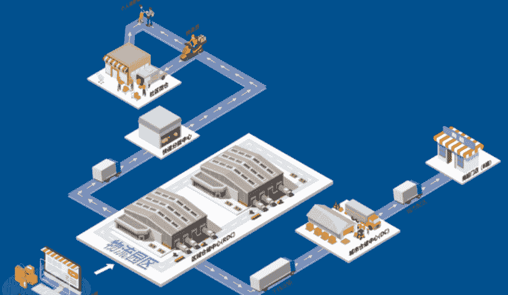

# 相关说明

## 数据来源和说明

> 本报告所用数据来源于物联云天大数据平台和中国土地市场等网站公开资料，截至时间为2025年3月31日。
> 本报告中储量、增量、租金和空置率的统计对象为证照齐全、市场化的非标高标准仓库，不包括“二房三落”仓库。
> 本报告中所指“租金”，包含税费、物业费用等，已折算租期和装修期。
> 本报告中的数据，仅包含物联云天大数据平台采集的城市数据，存在一定的局限性，分析结果反映趋势为主，仅供参考。

收录的城市
> 长三角城市：苏州市、上海市、嘉岩市、杭州市、南京市、无锡市、合肥市、宁波市、绍兴市、南通市、淮安市、湖州市、湖州市、金华市、徐州市
> 京津冀城市：天津市、坊山市、北京市、石庄市、唐山市、保定市、家口市、衡水市、廊都市、北京市
> 珠三角城市：东莞市、佛山市、广州市、肇市、惠市、中山市、深圳市、珠海市、江门市
> 长江城市：武汉市、黄石市、岳州、长沙市、成都市、襄阳市、荆门市、长沙市、株州市、湘潭市、常德市、南昌市、江州市、杭州市
> 成渝城市：重庆市、成都、德市、桂山市、乐阳市、锦市、南充、内江市
> 其他地区：安山市、北同市、海口市、贵昌自治、茂名市、大连市、大同市、州州市、德德市、东营市、福州市、抚仙市、阜新市、赣州市、贵阳市、哈尔滨市、海东市、海口市、望市、呼浩市、济州市、扬阳市、中庆市、酒泉市、开封市、明市、兰州市、临市市、洛阳市、温州市、南宁市、南京市、宁波市、青岛市、泉州市、京市、厦门市、沈阳市、泰安市、芜安市、扬扬市、乌鲁齐市、西安市、咸阳市、铜台市、银川市、营口市、芜州市、长春市、郑州市、禹庄市、芜阳市

## 第一部分宏观市场

### 降本增效 为物流行业创造新机遇

2024年底，中共中央办公厅、国务院办公厅发布了《有效降低全社会物流成本方案》，为此发展明确了方向：数字化改造、科学布局与物流网络完备、绿色升级改造以及物流仓储提供保障。

| 维度 | 内容 |
| :--- | :--- |
| 完善现代商贸流通体系 | 支持商贸领域物流设施标准化智能化改造，提高流通能力和效率，降低商贸流通领域物流成本。 |
| 健全城乡商贸流通网络 | 发展共同配送、仓配一体等集约化模式。 |
| 促国际供应链提质增效 | 鼓励大型企业与骨干物流企业深度国际物流合作，共建海外仓储基础设施，提升提运、流通加工等综合服务能力。 |
| 整合提升物流枢纽设施功能 | 积极推进“平两用”公共基础设施建设，科学布局城乡郊大基地等大型物流设施，完善涵盖分拣中心、末端网点的分流配送体系。 |
| 推动物流数字化发展 | 推进物流基础设施数字化化改造，加快智慧公路、智慧港口、智慧物流枢纽、智慧物流园区等新型设施发展。推广无人车、无人机以及无人装卸等技术装备，强化智能一体化、数字孪生技术应用，创新规模化应用场景。 |
| 物流绿色化转型 | 制定绿色重点技术和装备材料，推广物流枢纽、仓储运输工具等绿色化升级。 |
| 加强物流仓储用地 | 对企业利用原有土地进行改造升级的按规定予以支持。 |

## 第二部分
全国高标仓市场概览

### 全国高标仓数据一览

**总存量**：1.68亿平方米 ▲环比上升2.00%

**空置率**：18.80% ▼环比下降0.51百分点

**有效租金**：22.20元/平方米/月 ▼环比下降3.85%

### 市场存量：各省市分布
截至2025年第一季度，全国非标高标仓总存量达1.68亿平方米。目前，江苏、浙江及广东存量列全国第一梯队，其中江苏现有存量超过2500万；上海、天津、北京及湖北和四川列第二梯队，现有存量为900万至1000万平方米。
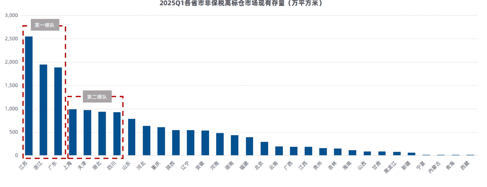
数据来源：物业研究院

### 市场存量：城市TOP20
目前，苏州市场存量近400万，位于第一梯队；上海与天津存量近1000万，位于第二梯队；成都、武汉、嘉兴以及重庆位于第三梯队，现存量600-800万。其余城市均在300-400万区间。
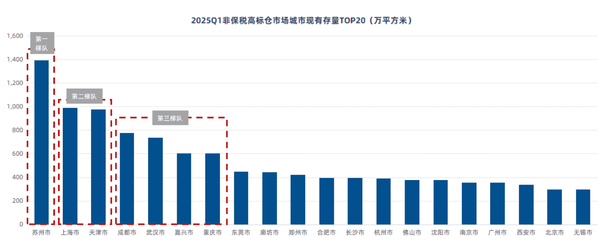
数据来源：物联云研究院

### 供应增量：季度城市TOP5
从具体城市角度来看，杭州、苏州、上海、北京以及南昌列供应增量的前五。25Q1城市供应增量TOP5及占比
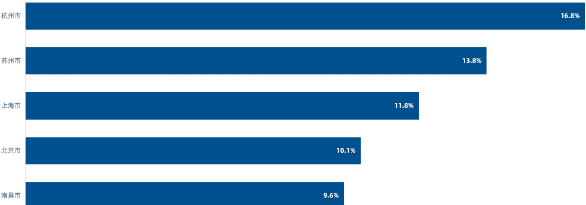

### 空置率走势：当季下行
过往一年，全国非标高标仓空置率呈现“先上升后下降”的走势。截止当季，空置率继续下降，环比下降0.51百分点至18.80%。
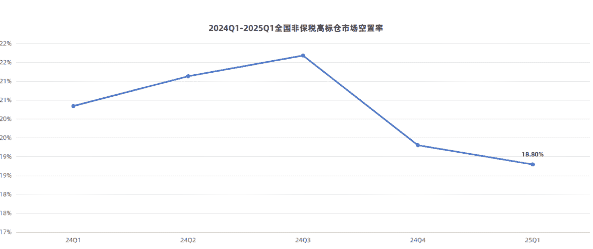

### 租金走势：环比下降
过往一年，全国非标高标仓有效租金呈现“持续下降”的走势。截止当季，有效租金继续下降，环比下降3.85%至22.20元/平方米/月。
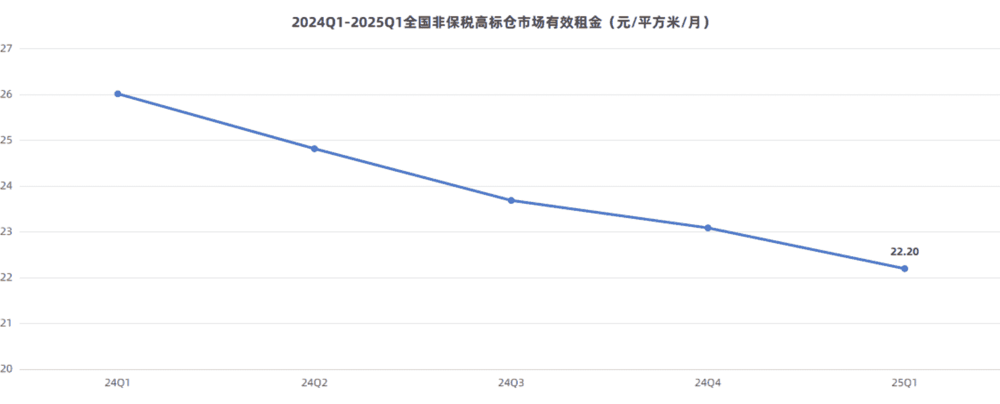

### 各省市租金表现：普遍环比下降
2025年第一季度，市场新增需求疲软。受此影响，市场采取以价换量策略，普遍租赁平均有效租金环比下降。
2025Q1各省市非标高标仓租金（元/平方米/月）及环比变化
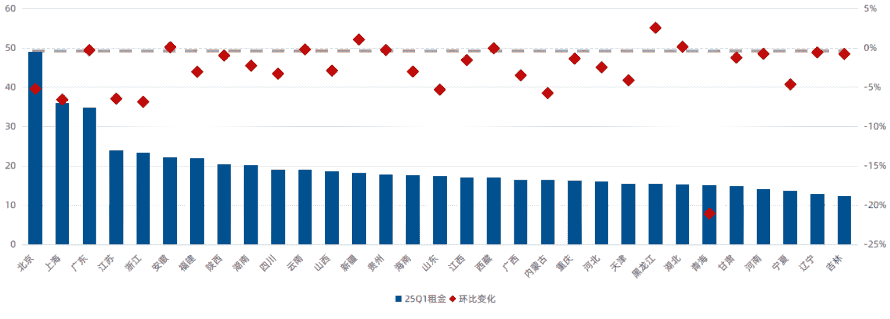
数据来源：物联云数字研究院

### 各省市空置率表现：普遍下降
2025年第一季度，“以价促量”带动市场去化。本季度全国许多省市空置率环比下降。
2025Q1各省市非标高标仓空置率及环比变化
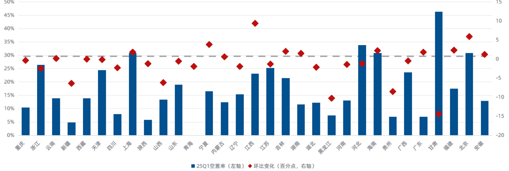
数据来源：物业云数字研究院

### 租户类型：三方物流需求活跃
2025年第一季度，三方物流、电商以及制造业等为本季需求主力。三方物流需求活跃，成为本季第一大来源。

### 成交租户类型：25Q1活跃省
| 省市 | 需求主力 |
| :--- | :--- |
| 广东 | 电商、快递物流、制造业 |
| 重庆 | 三方物流、制造业、零售 |
| 北京 | 电商 |
| 湖南 | 三方物流 |
| 陕西 | 快递物流、三方物流 |
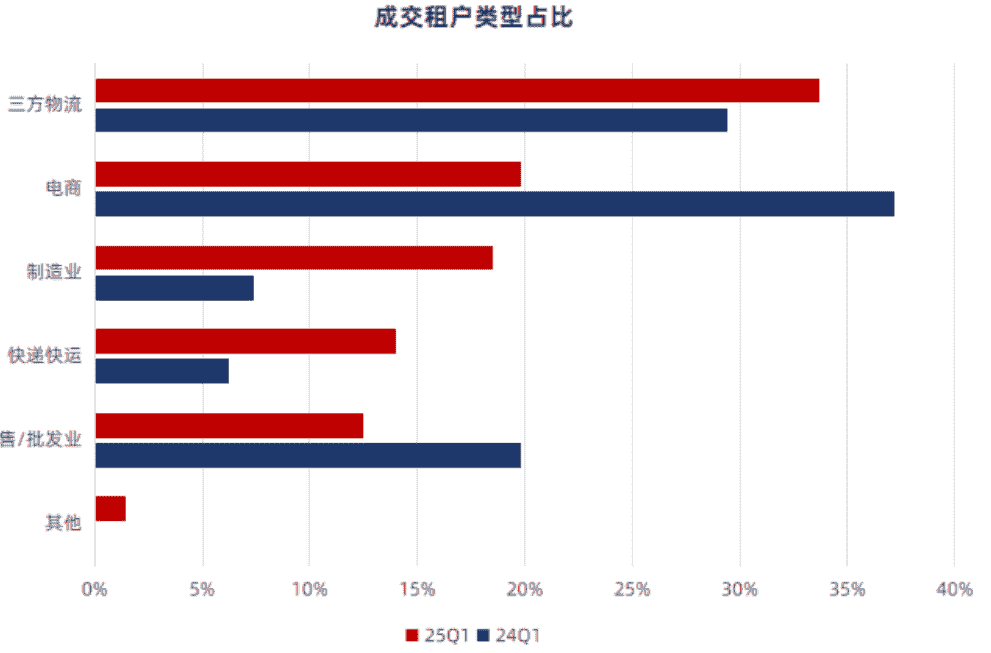
数据来源：物联云数字

### 未来供应：广东为领先
截至2025年第一季度统计，全国非标高标仓市场2025年预计供应172.3万平方米；2026年供应放缓，供应量为128.62万。
2025-2026年，广东、浙江、北京以及江苏为五大省，其中广东合计面积超130万平方米。
2025-2026年全国非标高标预测未来供应（万m²2025-2026年未来供应TOP10（万m²）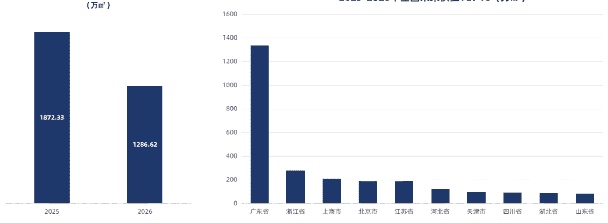

### 未来供应：城市TOP20
2025-2026年，广州迎来超过60万平方米的新增，居所有城市之首。佛山、上海、嘉兴以及北京供应量150-300万平方米。其余城市新增在100万平方米以下。
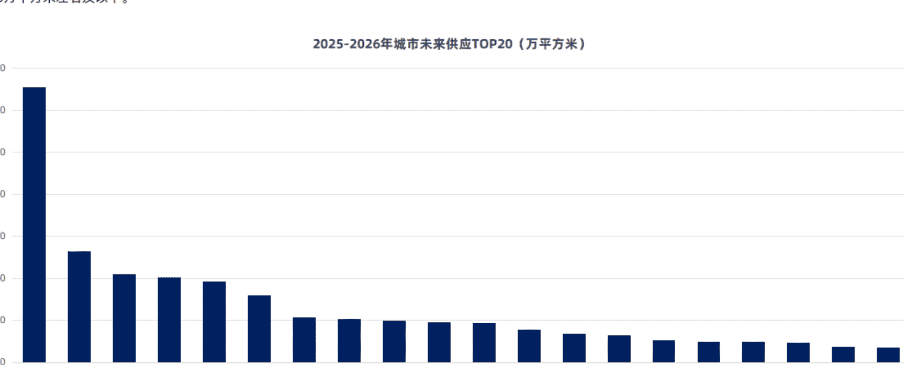

### 仓储用地：供应持续放缓
2025年第一季度，全国非标高标仓市场供应面积与总面积双降。本季，全国出让面积2.95万亩，环比下降38.96%，同比下降9.61%。全国出让442宗，环比下降47.26%，同比下降3.91%。成交均价为30.62万元/亩，环比下降8.13%，同比上升6.11%。
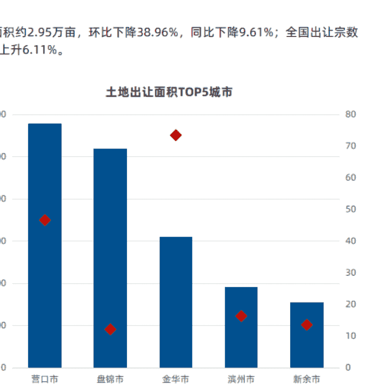
出让面积：2.95万亩，环比下降38.96%，同比下降9.61%
出让宗：442宗，环比下降47.26%，同比下降3.91%
成交均价：30.62万元/亩，环比下降8.13%，同比上升6.11%
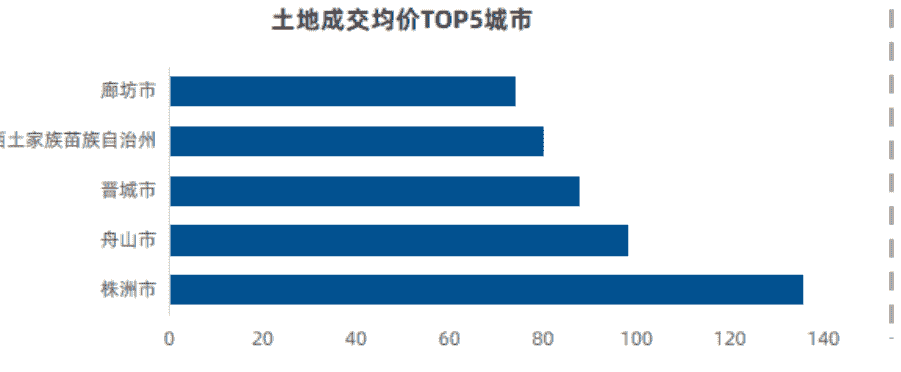
数据来源：中国土地市场。物联云研究院整理

## 第三部分重点城市群分析

### 重点城市群市场概览

| 城市群 | 现有存量 (万平方米) | 空置率 | 平均有效租金 (元/平方米/月) |
| :--- | :--- | :--- | :--- |
| 京津冀 | 1906.96 | 28.56% | 21.91 |
| 长三角 | 6033.34 | 25.42% | 25.71 |
| 珠三角 | 1756.42 | 6.12% | 35.24 |
| 长江中游 | 1551.65 | 13.33% | 16.99 |
| 成渝 | 1534.64 | 8.91% | 17.94 |
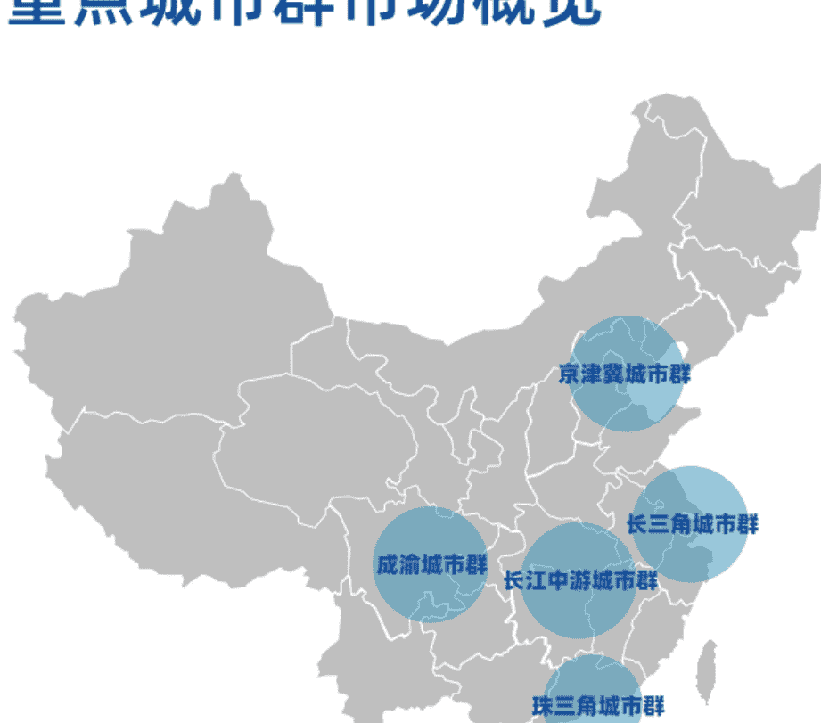

### 重点城市指标对比图览
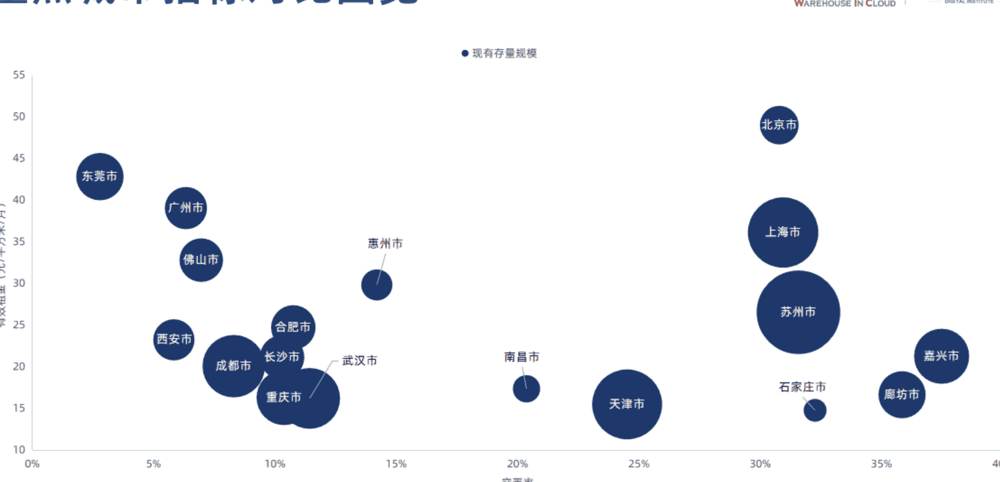

### 京津冀城市群·空置率仍处高位
截至2025年第一季度末，京津冀城市群存量1906.96万平方米受到库存压力及需求不足的双重影响，当季空置率环比微升0.44百分点至28.56%，平均有效租金环比下降3.73%至21.91元/平方米/月。当季有一个新增项目，位于北京，仓储面积约16.11万平方米。
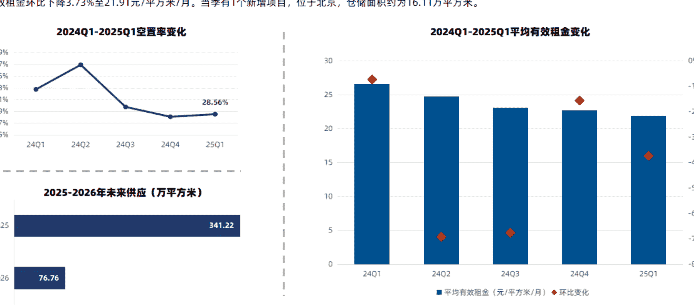
数据来源：物联云

### 北京：空置率上升
截至2025年第一季度末，北京非标高标仓总量298.77万平方米；空置率上升5.93百分点至30.78%，平均有效租金下降5.18%至49.02元/平方米/月。本季新增项目平谷物流园，仓储面积16.11万平方米。电商行业较为活跃。
| 项目名称 | 区域 | 仓储面积 (万平方米) | 建成时间 |
| :--- | :--- | :--- | :--- |
| 北京平谷物流园 | 平谷 | 16.11 | 2025.03 |
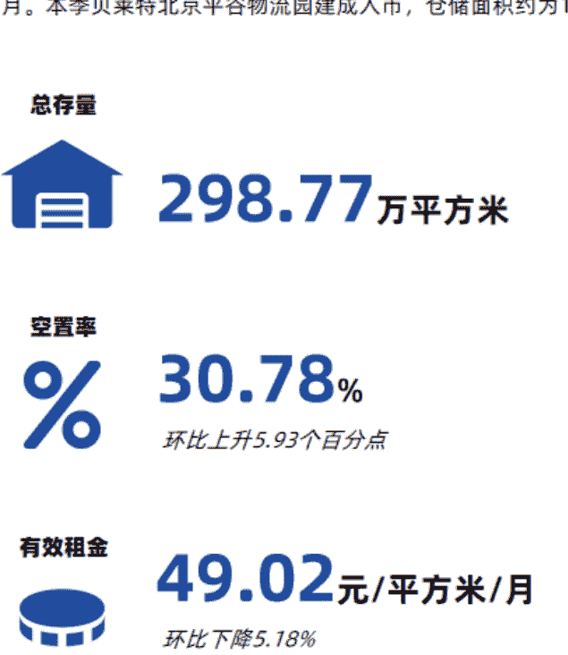

### 北京：有效租金下降
北京非标高标仓市场有效租金持续下降。数据显示，2025-2026年期间，合计供应192.00万平方米，主要集中在平谷区、顺义区等地。2024Q1-2025Q1平均有效租金变化
2025-2026年未来供应分布（按面积）
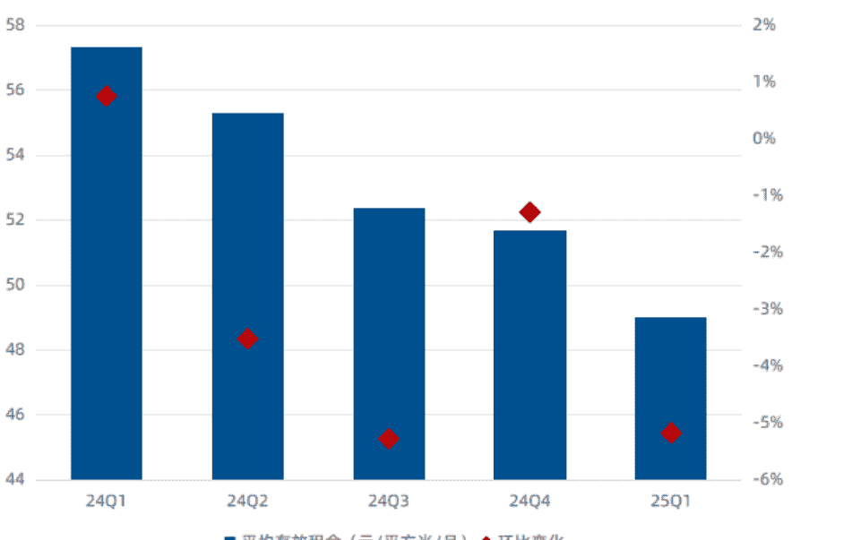
平均有效租金（元/平方米/月）环比变化
数据来源：物联云

### 长三角城市群：租金下调市场去化
截至2025年第一季度末，长三角城市群存量6033.4万平方米；租金下调市场去化，空置率下降0.9百分点至25.42%，有效租金下降6.14%至25.71元/平方米/月。当季新增4个项目，分别位于上海、苏州及杭州，合计面积67.94万平方米。
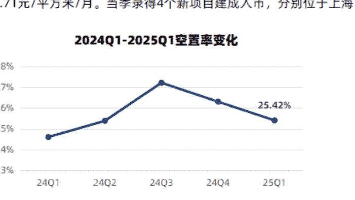
2025-2026年未来供应（万平方米）
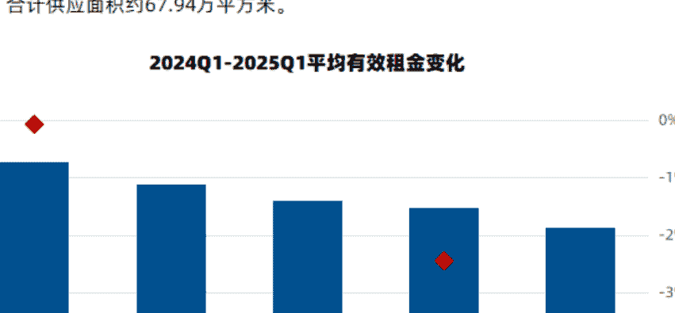
数据来源：物业云研究院

### 上海：两项目入市空置率微升
2025年第一季度末，上海非标高层市场总量为989.53万平方米；空置率环比上升1.83百分点至30.94%，有效租金下降6.53%至36.14元/平方米/月。本季，普洛斯临纺松江物流园区（二期）与烟蒿产业园项目（一期）建成，仓储面积约为18.90万平方米。
| 新增项目 | 项目名称 | 区域 | 仓储面积（万平方米） | 建成时间 |
| :--- | :--- | :--- | :--- |
| 普洛斯临纺松江物流园区（二期） | 松江区 | 13.73 | 2025.03 |
| 烟蒿产业园项目（一期） | 嘉定区 | 5.17 | 2025.01 |
总量 989.53万平方米
空置率 30.94% 环比上升1.83个百分点
有效租金 36.14元/平方米/月 环比下降6.53%
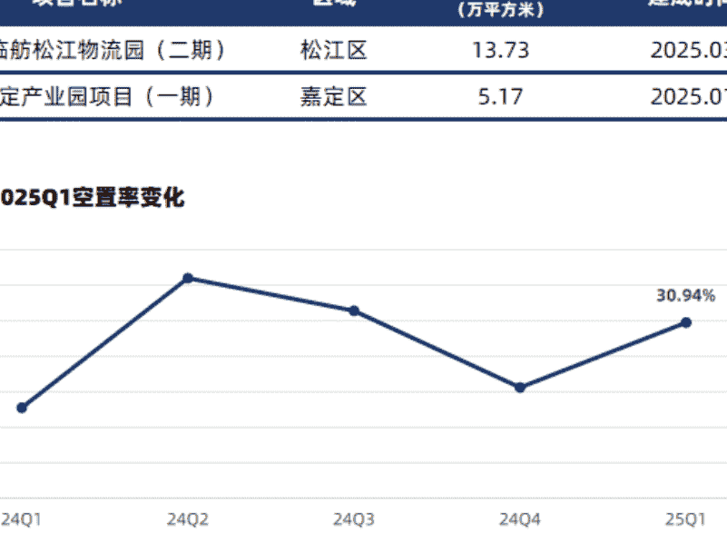

### 上海：浦东新区未来供应占比超五成
近一年，上海非标高仓市场平均有效租金整体呈下降趋势。数据显示，2025-2026年期间，新增供应210.79万平方米，主要集中在浦东新区、松江区以及山区等地。
2024Q1-2025Q1平均有效租金变化
2025-2026年未来供应（按面积）
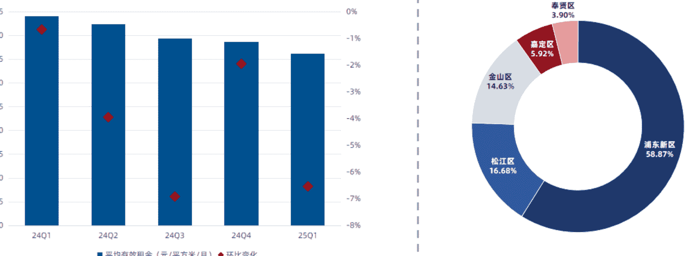
平均有效租金（元/平方米/月）环比变化
数据来源：物联云

### 珠三角：未来供应
截至2025年第一季度末，珠三角存量1756.42万平方米，空置率环比上升1.94百分点至6.12%，有效租金下降0.27%至35.24元/平方米。未来供应。
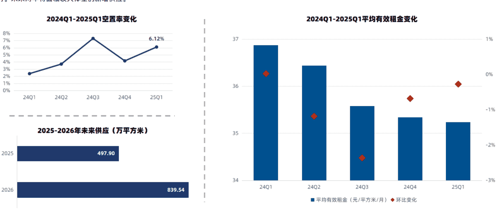
| 年份 | 供应（万平方米） |
| :--- | :--- |
| 2025 | 979.00 |
| 2026 | 839.54 |
数据来源：物业云

### 广州：空置率环比上升
2025年第一季度末，广州非标高标仓总量355.22万平方米；空置率环比上升1.40百分点至6.33%，有效租金基本持平39.07元/平方米。电商、三方物流需求活跃。
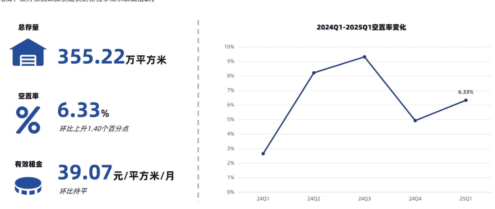

### 武汉：一项入市，空置率持续下降

截至2025年第一季度末，武汉非保税高标准市场总量为737.78万平方米；空置率持续下降，环比下降1.68百分点至11.43%；平均有效租金基本持平，环比上升0.02%至16.23元/平方米/月。本季东百武汉东物资物流园建成入市，仓储面积约为7.19万平方米。零售/批发行业在该区域较为活跃。

| 项目名称 | 区域 | 仓储面积(万平方米) | 建成时间 |
| --- | --- | --- | --- |
| 东百武汉东物资物流园 | 东西湖区 | 7.19 | 2025.03 |

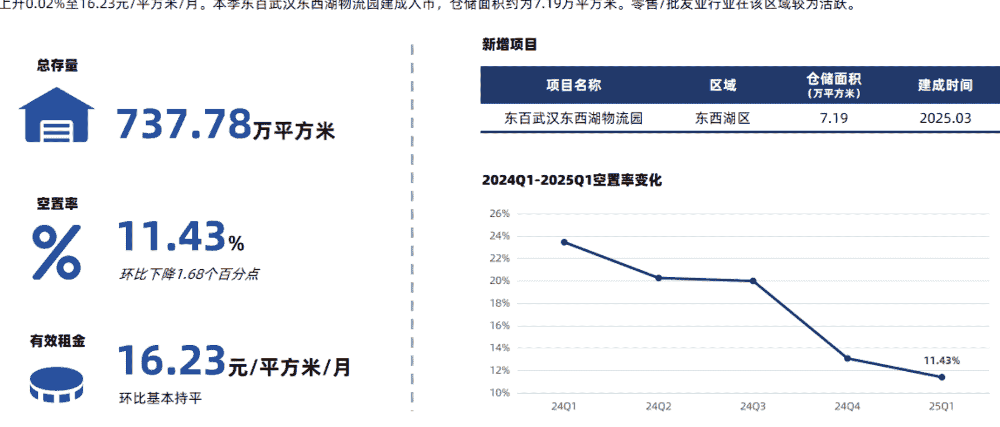

### 武汉：东西湖区与蔡旬区为主要供应地

近年，武汉非保税高仓市场平均有效租金下降持续收窄。数据显示，2025-2026年期间，合计新增供应为63.93万平方米，新增供应位于东西湖区、黄陂区以及蔡旬区。

### 2024Q1-2025Q1平均有效租金变化

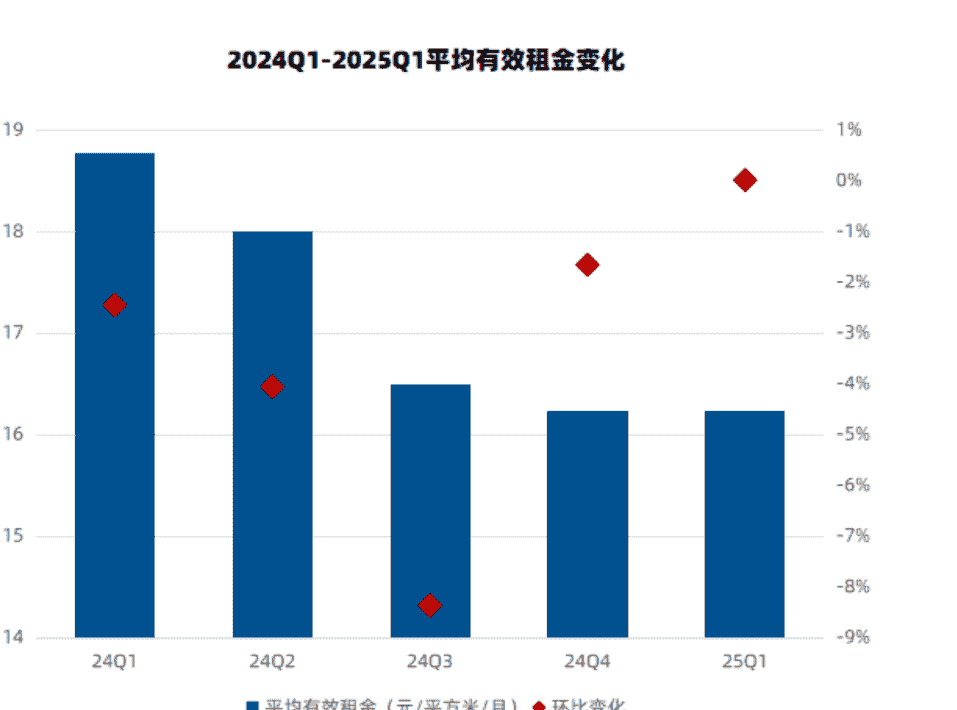

### 2025-2026年未来供应区域分布 (接面积)

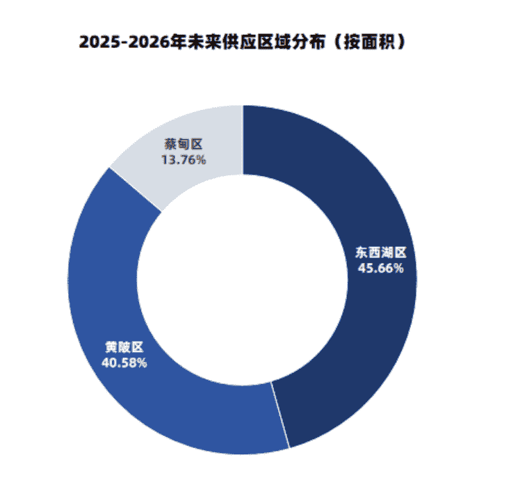

平均有效租金（元/平方米/月） 环比变化

数据来源：物联云数字研究院

### 成渝城市群，租金下降带动稳步去化

截至2025年第一季度末，成渝城市群现有存量1534.64万；当季空置率环比下降1.30个百分点至8.91%；有效租金持续下降但幅度收窄，平均有效租金环比下降2.57%至17.94元/平方米/月。当季有一个新增项目，位于重庆，仓储面积约为5.33万平方米。

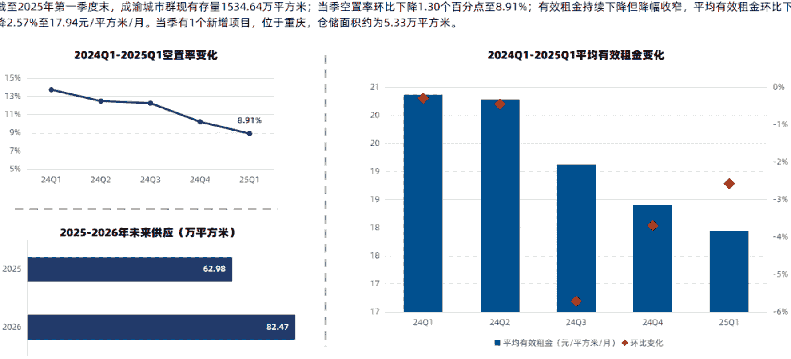

数据来源：物联云仓数字研究院

©2025.04 50yc Ltd. All Rights Reserved

### 成都：空置率环比下降，总体处低位

截至2025年第一季度末，成都非保税高仓市场总总量为778.26平方米；空置率环比下降1.65百分点至8.30%；有效租金环比下降3.33%至20.10元/平方米/月。三方物流、快递快运以及零售/批发业在该区域表现活跃。

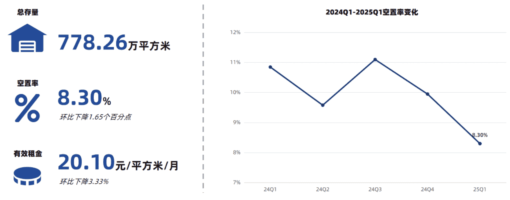

### 2024Q1-2025Q1空置率变化

数据来源：物联云仓数字研究院

### 成都：未来供应区域多元化

近一年，成都非保税高标市场平均有效租金下降收窄。数据显示，2025-2026年期间，新增供应为93.3万平方米，新增供应主要集中在双流区、简阳市以及龙泉驿区等。

### 2024Q1-2025Q1平均有效租金变化

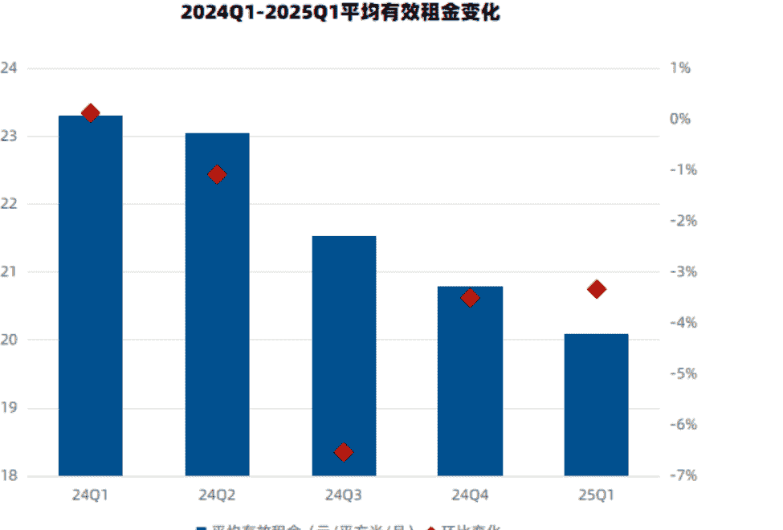

### 2025-2026年未来供应区域分布（接面积）

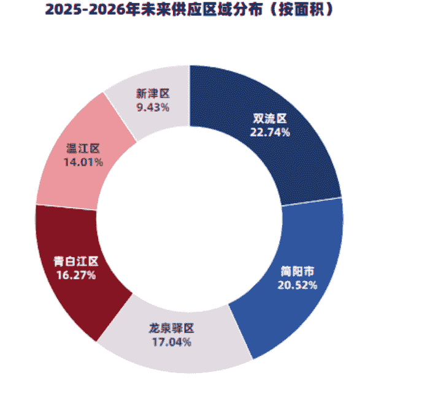

■ 平均有效租金（元/平方米/月） ◆ 环比变化

数据来源：物联云仓数字研究院

©2025.04 50yc Ltd. All Rights Reserved

### 其他：西安空置率持续下行

截至2025年第一季度末，西安非保税高仓市场总量为338.88平方米；空置率环比下降1.32个百分点至5.83%；有效租金基本持平，环比下降0.06%至23.26元/平方米/月。快速快运、三方物流以及电商在该区域表现活跃。

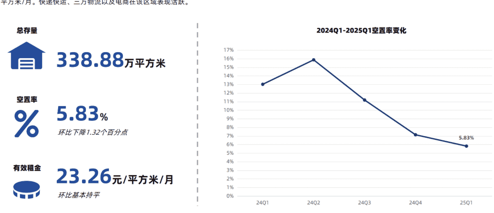

### 其他：西安未来供应位于渭桥区

一年来，西安非标高仓市场平均有效租金幅持续收窄。数据显示，2025-2026年期间，合计新增供应为2.25万平方米，新增供应位于渭桥区。

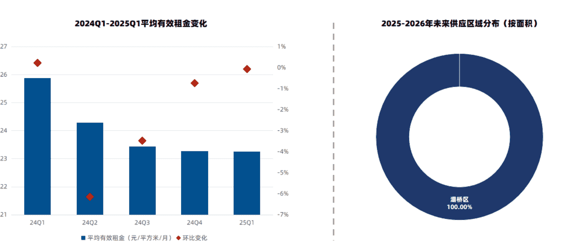

数据来源：物聚云仓数字研究院

## 第四部分
## 市场总结

### 新增供应

- 2025-2026年，全国非保税高仓市场或迎来近3,000万平方米的新增供应，考虑到当前租赁市场的行情及经济环境的不确定性，部分高仓仓库可能选择延期或暂缓开发
- 2025-2026年，未来供应主要集中在珠三角、长三角以及京津区域。广州、佛山、上海、嘉兴等区域，其中广州新增供应超过600万平方米。

### 租金&空置率

- 本季度，“以价促量”带动市场扩大，大部分城市高仓面临供应压力，预计租金将下降。其中京津冀、长江流域以及成渝城市群，整体空置率处于较高。

### 需求变化

- 本季度，物流、电商以及制造业为三大需求主力。
- 近期，消费品类仓储需求显著增长。
- 另一方面，跨境政策调整给市场带来了不确定性。

## 物联网云仓简介

物联云仓以www.50yc.com为核心，借助互联网技术、数字化运营和创新模式，打造世界领先的供应链网络。深耕物流行业，拥有专业的管理团队与研发团队，产品涵盖了仓储、运输等环节。

### 物联网云数字研究院

专注于中国仓储市场深度洞察，提供标准化和定制化的服务，助力构建客户与市场的桥梁。依托平台的海量数据、丰富的仓储经验，不断推进研究方向。我们提供全面的数据服务及专业咨询，助力行业的持续发展和转型。如有需要，请与我们联系。

### 合作咨询

| 总经理/越 | 高级研究员 |
| --- | --- |
| 电话 | +86-186140033 |
| 邮箱 | suichao@50yc.com |
| 林子凯 | linzikai@50yc.com |
| 邮箱 |

## 天镜大数据平台

物联云十年专业沉淀，重磅推出“天镜”大数据平台，以城市为单位，提供定制化的服务。帮助客户精准把握行业动态。

### 数据维度

| 项目名称 | 仓库面积 | 开发区域 | 建成状态 | 冷链 | 建成时间 |
| --- | --- | --- | --- | --- | --- |
| 空置率 | 建筑类型 | 金融 | 净增量 | | |
| 定位城市、定位区域 | | | | | |

### 区域列表

北京、郑州、苏州、福州、东莞、重庆、天津、济南、厦门、佛山、成都、青岛、杭州、深圳、贵阳、大连、上海、宁波、长沙、芜州、昆明、长春、南昌、合肥、广宁……数据维度包括城市层、存储层、在建项目，可及时解决周边信息，为后期营销决策支持。

### 土地数据

可全面、准确了解土地交易信息、公告信息、供应计划、获取一手交易数据，为项目策划提供土地支持。

### 城市宏观数据

地区生产总值、项目建设规模、城市市场调研、市场资源能力以及仓储需求评估提供数据支持。

### 市场研究报告

定期更新月度、季度、冷链等仓储市场动态报告。

### 覆盖范围

全国300+城市、仓库资源超亿、高标仓覆盖率占全国95%。

### 可可靠性

数据严格采用业务主体上传、线上审核认证的方式

### 权威认证

中企协唯一指定合作的仓储大数据平台

### 看板展示

各维度数据可以通过数据看板直观展现，方便用户快速理解

### 持续更新

十年数据积累、定期高频更新、每个仓独立潮流

### 专业全面

数据维度最多达74项、全方位多维度库

## 物流咨询规划业务

- 量身定制市场调研方案
- 调研项目所在地及周边区域
- 定期发布全国各类仓储物流报告（月报、季报、年报等）
- 实时解读行业热点政策
- 发布专题研究报告
- 发布物流园区调研、选址、智慧园区、REITs等行业深度研究报告

- 研究项目背景、需求预测、定位规划、投资估算、效益分析等
- 提供项目建议书、可行性研究报告、项目策划方案等
- 策划当地物流产业特征，预测物流发展趋势和需求
- 论证当地物流产业总体发展方向及空间布局

市场研究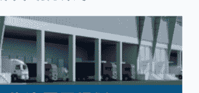

物流园区规划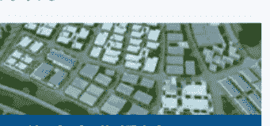

物流产业规划

- SaaS系统灵活适配园区场景
- 物联网设备与数据的全面对接

- 规划园区建筑布局、道路交通、绿地、基础设施等
- 提供平面布局、概念规划、总体规划

- 策划项目招商方案，包括定制企业标准和评估
- 开展在线需求引入和区域引导，实现需求精准匹配

行业分析报告

智慧园区设计

建筑规划设计

招商代理

[PAGE 44]

在线客服
4008-567-150

官方微信公号

# 版权声明 COPYRIGHT NOTICE

文中的一切资料及数据，仅作参考之用，物联云仓保留一切权利，转载请保留原文链接或说明出处。
