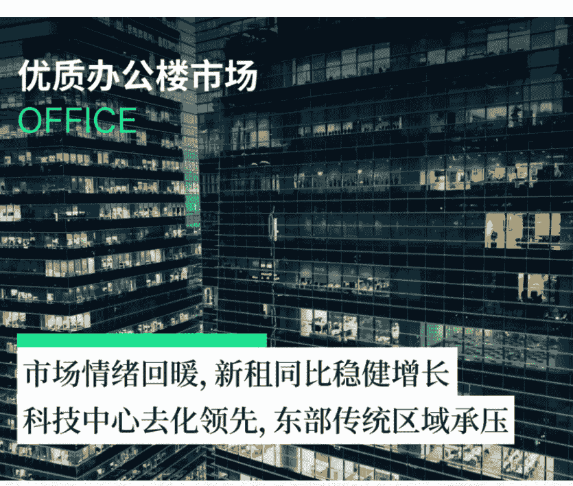
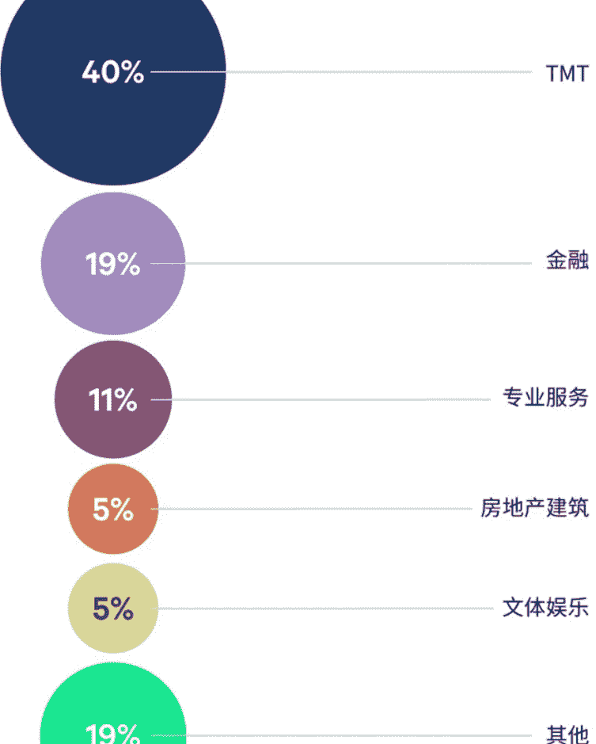
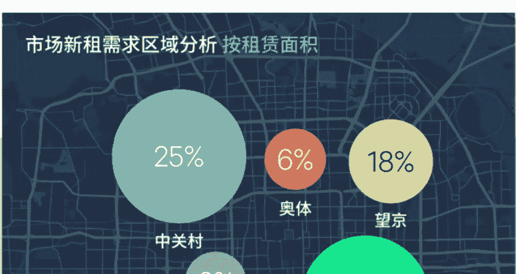
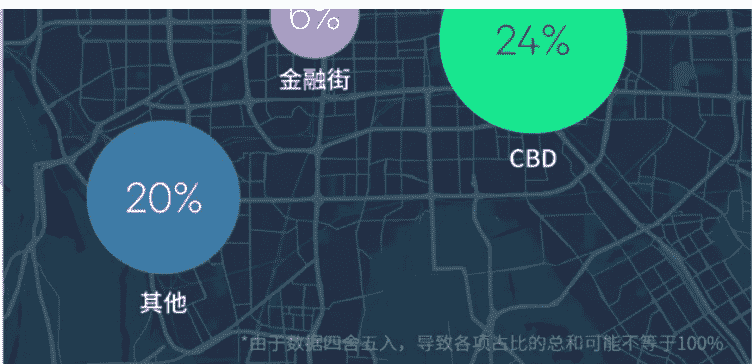
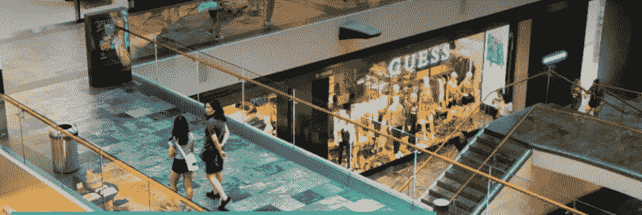
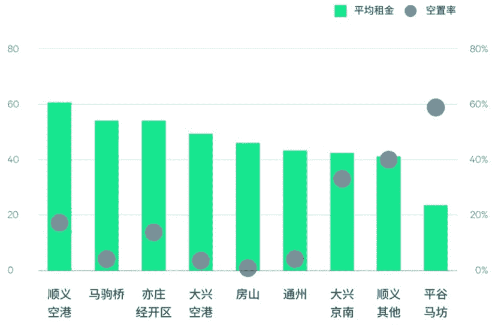

[content]
# 2025年第一季度北京房地产市场回顾

CBRE

## 办公租赁和购置需求回升

## 生命科学园区单季新增供应创历史纪录

2025年第一季度，北京办公楼市场情绪回暖，新租同比稳健增长，科技楼租赁领先，东部传统区域承压；零售物业市场存在量积聚寻求转型需求，消费支持计划或促租赁需求回暖；仓储物流市场北京新租需求回暖，以换量促进净吸量回正；商园区市场新型生产造成租赁市场大幅提升净吸量，公寓需求承压力加速下行；物业投资市场自用需求一家独秀，买卖需求引擎，资产价格持续松动，办公楼、零售物业板块资本化率继续升华。

## CBRE世邦经理华北区研究部负责人 孙祖天

市场情绪回暖，新租同比稳健增长
科技中心去化领先，东部传统区域承压

2025年第一季度
| 新增供应 | 净吸纳量 | 空置率 | 平均租金面价 |
| :--- | :--- | :--- | :--- |
| 3.1 万平方米 | 11.0 万平方米 | 20.4 % | 249.2 人民币/月/平方米 |

2025年第一季度，北京公寓市场位于区域的新项目交付，新增面积3.1万平方米，项目租值表现优，此前已有两次市场被预热。

春季后，市场行情有所回暖，需求与供应量步步升。本季度新房交易总额超过2023年和2024年同期。租赁需求依然是新房交易的主要组成部分，占新房交易总额的近八成。在头部TMT行业的带动下，租刚数量和面积占比均出现回。从行业分析，TMT行业的人工智能、大数据和互联网等需求持续爆发，占租房需求位。季内录得万平方米以上的扩租及整合升级的交易。金融行业的基准和金融类需求呈现小规模租象。专业服务的需求位列第三，律律所、咨询客户新增或扩租需求逐步呈现。房地产的市场需求已上升至四季度。

季内全市净吸收量达到11.0万平方米，环比增长16%，主要来源于中关、望京两大科技中心，以及丽望等子市场。反映了东部的传统转型，如CBD、西京、王府井东二、金融融合TMT行业整合，换租、随退等因素，净吸收量均为负值。市场空置率环比下降0.6个百分点至20.4%。多数成熟圈仍处于高位，且租赁市场尚未释放强劲的需求导致趋势持续蔓延。本季度全市平均租金面积同比环比下降2.9%至每月平均涨249.2元。与邻区之间竞争激烈的子市场（如CBD、望京），租金跌幅超前。此外，此前更有韧性的超甲市场延续近一年的调整，季内租金降幅大于全市平均水平。

## 市场新租需行业分析 按租赁面积

*由于数据四舍五入，导致各项占比的总和可能不等于100%

## 市场新租需区域分析 按租赁面积

## 办公楼

未来六个月，预计近24万平方米的新增面积将投放，且增量全部集中于非核心商务区。短期内，大型企业成本压力持续增大，但其策略不再限于单个职场，而是整个房地产组合的整合和优化。近期独家加大力度，叠加人工智能、细胞、脑接口等高精尖产业和科技、服务领域，都有利于政策出持，有助于稳固市场基础，激发需求扩张。

CBRE华北区顾问及交易服务部负责人 袁慧

## 优质零售市场

## 存量物业市场寻求转型突破消费支持计划促租赁需求回暖

2025年第一季度，北京零售市场新增项目交付。现有存量租赁积极转型，模式迎合市场变化；此外，核心区域遭遇租赁升级和态势调整。2025年第一季度，北京零售销售总额同比下降4%，较去年全年虽有波动但低于水平，反映出期内消费活跃。本季度新店铺占比达49%，零售规模萎缩，主要由于核心区域扩张有限，而线下消费小镇增长（如寿司、肉包、烘焙小吃）仍占据市场，并保持稳定的增长。零售方面，低价市场租金引流，由远郊市场的回领衔、安次、永清、安高等地亦有所表现。内录净吸纳量再破历史高至39.9万平方米，新增需求以三方物流企业为主、批发零售的市场分别为57%和21%。北京末季全市空置率加速下降，环比下滑8.4百分点至2021年以来最低。

## 市场新租需行业分析 按租赁数量

- 49% 餐饮
- 31% 服饰
- 6% 生活方式
- 4% 珠宝首饰
- 4% 生活服务
- 3% 家居电器
- 3% 美妆香氛
- 3% 鞋饰鞋包
- 1% 电子产品
- 1% 新能源汽车

*由于数据四舍五入，导致各项占比的总和可能等于100%

未来六个月内，预计将有超过35万体量的零售物业在非核心商业圈陆续开业，新项目的加入将推动其所在区域商业品质提升。近期政府加大码、3C产品等旧换新补贴，以及生活服务业等支持计划，有望促进消费回暖，并为发展创造更多需求。

CBRE华北区区域总经理 刘丽

## 仓储物流市场 LOGISTICS

## 北京新租需求回缓以换带动净吸纳回回

2025年第一季度
| 新增供应 | 净吸纳量 | 空置率 | 平均租金报价 |
| :--- | :--- | :--- | :--- |
| 6.7 万平方米 | 26.0 万平方米 | 25.0% | 48.4 人民币/月/平方米 |

2025年第一季度，北京平马交付一个仓储项目，带来了6.7万平方米新增供应。以供应链和合同物流企业为代表的三方物流仓储占总新增的60%，而电子及零售需求有小回暖，带动活跃净吸纳量在连续四年的负增长后首次回正至2.6万平方米。市场需求有所回暖，内录数据显示电商或制造业造成万平方米的大面积扩张，但租金整合、隔断、降级活动同样出现。在租金推高的影响下，市场表现呈现分化，核心区域、装修且租金灵活项目更受欢迎，反之具有较大的客户流失风险。全市空置率环比上涨0.6百分点至25.0%，空置主要来自首都机场和廊。

北京末季平均租金每月增长48.4元，同样租金环比涨至~3.9%。平马、顾义等空置率最高的非核心市场，成为本季净吸纳量最高的项目。在市场上物流需求的驱动下，通州、南部机场、望京等核心区域市场持续稳健，本季度加速减缓。

逊第二季度无新增供应，市场持续维持低化。低价市场租金引流，由远郊市场的回领衔、安次、永清、安高等地亦有所表现。内录净吸纳量再破历史高至39.9万平方米，新增需求以三方物流企业为主、批发零售的市场分别为57%和21%。北京末季全市空置率加速下降，环比下滑8.4百分点至2021年以来最低。

本季度春季退潮后，净吸纳量大幅落至5万平方米，需求以第三方物流及制造业为主，分别为52%和30%。天津全市空置率稳于28.4%。未来六个月，平谷及顺义、廊坊预计将迎来63万平方米的新增仓储设施，由于交通高效、租金低，活跃度有望升。

## 主要区域平均租金与空置率表现

CBRE华北区顾问及交易服务部负责人 王睿

## 商务园区 BUSINESS PARKS

## 新型园区驱动大幅提升全市净吸纳量

2025年第一季度
| 新增供应 | 净吸纳量 | 空置率 | 平均租金报价 |
| :--- | :--- | :--- | :--- |
| 48.2 万平方米 | 16.3 万平方米 | 25.1 % | 143.8 人民币/月/平方米 |

2025年第一季度，商务园区市场需求迎来高涨，新增项目总量48.2万平方米，其中为研发、中试、生产一体化功能的新型园区吸引了众多企业进入，新增18.8万平方米租赁本季度主要贡献，需求占比85%。从全市市场分布来看，人工智能、大数据、电商等行业较为活跃，录得16.3万平方米除新增项目外，存量物业依旧缓慢，叠加需求持续压力，空置率环比上涨4个百分点至25.1%。

以换租策略在内核软件、东华等区位和硬件先行者具有竞争力的企业来实现突破。未来六个月，北京商务园区预计迎来26万平方米使用，新项目分布于北清和亦京区，均为新型园区，从同类产品近期的活跃度看，预计将良好的化表现。

近期政府发布《北京市级技术开发区管理办法》，对符合基础设施完备、配套设施齐全、产城融合、可持续发展等要求的科技园区，从土地、人才、资金、项目、场景等方面加大力度，引导社会力量参与其建设，并助力优质园区的发展。

CBRE华北区董事总经理 刘焕熙

## 物业投资市场 INVESTMENT

## 自买一独秀成为买卖需求引擎资产持续松动，办公楼、零售板块资本化率继续升

| 2025年第一季度 | 办公物业占比 | 企业买家占比 | 内资买家占比 |
| :--- | :--- | :--- | :--- |
| 成交总量 92.9 亿元 | 按套数 100% | 按套数 78% | 按套数 100% |

2025年第一季度，北京物业投资市场活跃显温和，共获得9笔交易，累计交易总额92.9亿元，环比下降4.8%，同比下降14.7%。

本季度自买家活跃度显著，推动了8笔交易落地，其中包括8笔标准办公楼和零售园区项目。买家多为处于扩张的企业，结合自身资产配置策略和区域业务布局形成物业购买决策，涉及教育、医药健康、文体教育等多个领域。例如，以“互联网+教育”为特色的国家级大学购入景山崇光的高品质园区；某医药健康企业在产业集群效应下按购生物医药基地的独特需求。另外，某企业以12.2亿元购入区域改造项目，该项目由低效商超精细改造，多功能、大平层、高层楼、创新设计完美契合大型创意型企业对空间和品质的要求。从这些可见，非核心区域的优质项目在成熟的产业环境加持下可能会受到相关企业的青睐。

## 大宗交易物业类型分析 按交易金额

| 亿元 | Q1 | Q2 | Q3 | Q4 |
| :--- | :--- | :--- | :--- | :--- |
| 1000 | | | | |
| 800 | | | | |
| 600 | | | | |
| 400 | | | | |
| 200 | | | | |
| 2020 | | | | |
| 2021 | | | | |
| 2022 | | | | |
| 2023 | | | | |
| 2024 | | | | |
| 2025 | | | | |

