# 2025年第一季度连锁餐饮品牌n门店发展趋势蓝皮书

GeoQ 智图出品

| 2025.04 |

# 扫码加入 知识星球TOP 免费资源群

公众号:知识星球TOP

免费

- 每日免费获取高价值资源
- 可提供各类资源搜索服务

价值

微信号:jnts8

| ◆热门付费文章 | ◆各行各业报告 |
| ◆精选图书资源 | ◆副业赚钱方法 |
| ◆职场实用资源 | ◆AI政经自媒体 |

及时

微信号:jnts2

关注

分享资料仅供个人学习，请及时删除，切勿商用传播

# Foreword
前言

度过了艰难的2024年，2025年第一季度的连锁餐饮品牌们，都还好吗？在门店发展上，是否获得了突破？？

2025年第一季度，我们基于GeoQ Data品牌数据，整理了餐饮行业大热门赛道、240家品牌的发展和开店情况，对部分典型品牌也有更进一步的分析，希望能让大家深入了当前市场的现状、趋势，更客观地看到各个赛道和品牌之间的发展差异。

GeoQ Data智全域数据涵盖客流、商业地产、连锁品牌、行政区划等8大数据体系，其中品牌数据涵盖全国700+品牌，70万+门店，逐日更新。商业地产数据覆盖全国363个主要城市，拥有3.4万+商业项目数据，3800+商场内部平面数据。为企业在市场洞察、规划布局、经营决策、市场营销、风险评估等业务场景提供海量、精准、专业的位置支撑。

# Contents
目录

01 新式茶饮
蜜雪冰城 沪上阿姨

02 连锁咖啡
瑞幸咖啡 挪瓦咖啡

03 小吃快餐
塔斯丁 杨国福麻辣烫

04 结语

2025年第一季度连锁饮品品牌门店发展趋势蓝皮书

# 01
# 新式茶饮

# 01 新式茶饮

## 2025年第一季度连锁新茶饮饮料整体闭店情况

2025年1-3月
115家连锁新茶饮饮料品牌整体门店变化

- 门店变化数量 数据来源：GeoQ Data 品牌数据

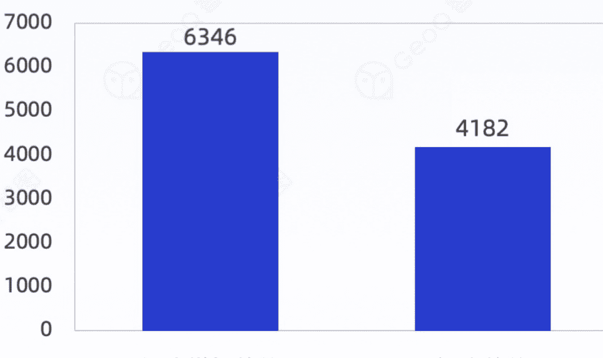

2025年第一季度，GeoQ Data收取的115家连锁新茶饮品牌，整体闭店数量约6346家，开店数约为4182家。整体闭店比约为1.52。

相比于去年第一季度1.73的开店比，今年第一季度闭店占比有所下降。整体闭店数相对于去年更高，行业“淘淘战”更为激烈。

新茶饮赛道整体规模仍然增长趋势。

# 01 新式茶饮

## 2025年第一季度连锁新茶饮行业扩张情况

2025年1-3月
115家连锁新茶饮饮品牌扩张情况（门店净增）

数据来源：GeoQ Data 品牌数据

2025年第一季度，连锁新茶饮品牌门店呈现“冰火两重天”的态势。

GeoQ Data收录的115家新茶饮品牌中，有10家品牌（占比为9%）门店净增大于100家，呈快速扩张状态。17%的品牌处于缓慢扩张阶段。

- 快速扩张 (>=100)
- 缓慢扩张 (>0且<100)
- 收缩或停滞 (≤0)

另有74%的品牌处于收缩和停滞状态。相对于去年第一季度，更多新茶饮品牌陷入门店发展瓶颈。

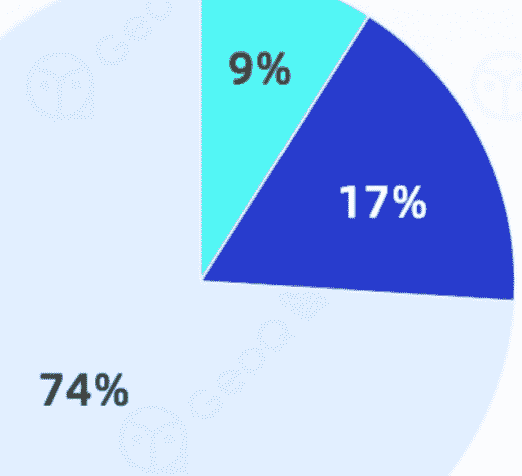

# 01 新式茶饮

## 2025年第一季度，新茶品牌更喜欢在哪些等级的城市开店?

2025年1-3月
各个等级城市新茶饮门店开店占比

数据来源：GeoQ Data 品牌数据

| 城市 | 占比 |
| --- | --- |
| 一线城市 | 6% |
| 新一线城市 | 21% |
| 二线城市 | 20% |
| 三线城市 | 20% |
| 四线城市 | 20% |
| 五线城市 | 13% |

2025年第一季度，连锁新茶饮门店向低线市场倾斜。在中低线城市的开店占比约为53%，其中三线城市和四线城市的开店数均为20%。一线城市的开店占比从去年的10%下降到6%。

# 01 新式茶饮

## 2025年第一季度连锁新茶饮品牌门店净增TOP10城市

2025年1-3月
115家连锁新茶饮品牌门店净增TOP10城市

| 门店净增 | 数据来源：GeoQ Data 品牌数据 |
| --- | --- |
| TOP1 苏州市 | 120 |
| TOP2 南京市 | 69 |
| TOP3 南宁市 | 53 |
| TOP4 郑州市 | 46 |
| TOP5 无锡市 | 45 |
| TOP6 常州市 | 38 |
| TOP7 镇江市 | 35 |
| TOP8 东莞市 | 35 |
| TOP9 西安市 | 34 |
| TOP10 济南市 | 34 |

GeoQ Data收取的115家连锁新茶饮品牌今年3月在苏州市净增最多，约120家，位领先。南京市和南宁市分第二、三，门店净增均在50家以上。在高线城市居多，也有江苏省镇江市。

# 01 新式餐饮

## 2025年第一季度新茶饮品牌门店净增数对比

2025年1-3月
15家典型连锁新茶饮品牌门店净增数 数据来源：GeoQ Data 品牌数据

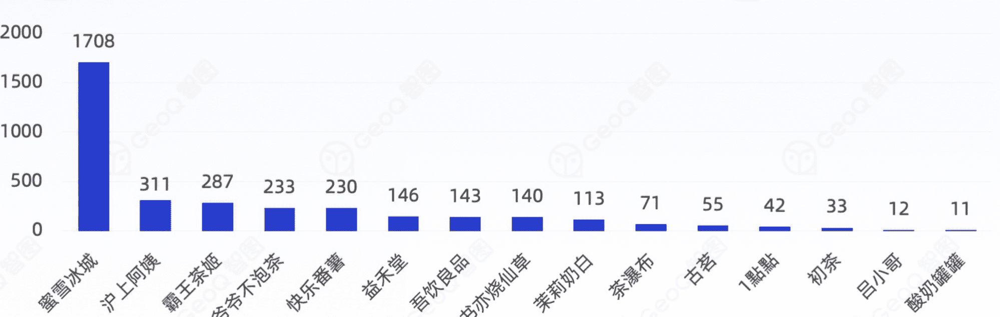

- 2025年1-3月，蜜雪冰城的门店增数最高，达到1708家，位领先。
- 沪上阿姨和霸王姬并列第二、第三，门店净增均在300家左右。
- 爷爷不泡茶、快乐霸茶、茉莉奶茶等品牌保持快速开店状态。

# 01 新式茶饮

## 2025年3月新茶饮品牌在营门店TOP10

| 门店总数 | 数据来源：GeoQ Data 品牌数据 |
| --- | --- |
| TOP1 蜜雪冰城 | 38952 |
| TOP2 古茗 | 9789 |
| TOP3 沪上阿姨 | 8851 |
| TOP4 茶百道 | 7990 |
| TOP5 益芙堂 | 6849 |
| TOP6 霸王茶姬 | 6548 |
| TOP7 甜甜啦 | 5438 |
| TOP8 书亦烧仙草 | 5010 |
| TOP9 喜茶 | 4341 |
| TOP10 COCO | 3353 |

GeoQ Data 品牌数据，在新式茶饮品牌中，蜜雪冰城门店总数仍稳榜首。截至今年3月底，门店总数突破3.8万家，接近4万家。另外，当前热门门店总数达到了9789家，沪上阿姨随其后，门店超过8800家，冲击“万家”。当前，门店规模在5000家以上的新茶饮品牌已有8家。霸王茶姬近年来开店速度亮眼。

### 新茶典型品牌发展情况 - 蜜雪冰城

- 2025年第一季度，顺利上市的“雪王”加盟店扩张脚步快，新开门店数超过2300家，覆盖了32省、314城。在广东省、浙江省新增门店相对较多，均超过200家。
- 从蜜雪冰城布局的门店位置来看，在其核心城市门店数较多，另外在乡镇地区的门店数也超过了550家。高线城市和下沉市场双线拓展。

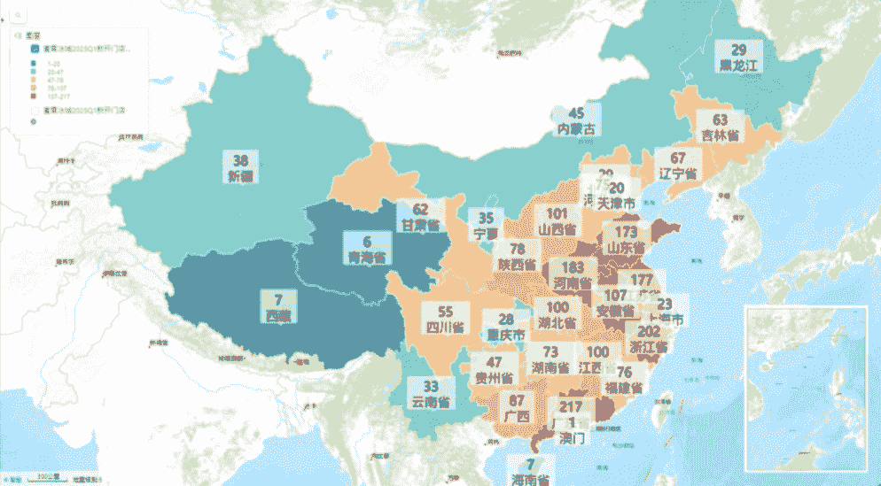
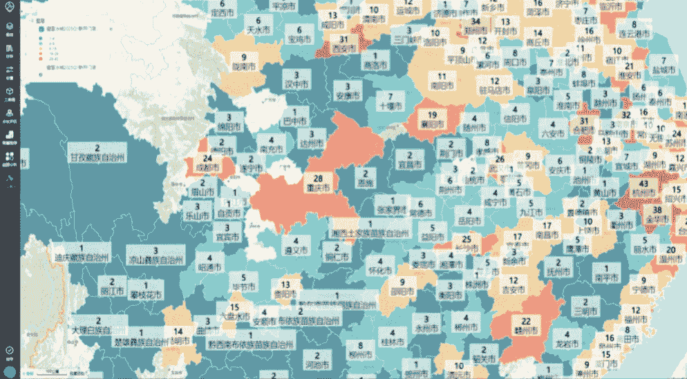

*图片使用GeoQ Ana数据分析
关于品牌链更多详细信息，可登录 GeoQ Ana 查看、分析。
www.geoq.cn

### 新茶典型品牌发展情况 - 蜜雪冰城

2025年第一季度，蜜雪冰城在中低线城市新增的门店多于高线城市，占比约为57%。二线城市、三线城市、四线城市的开店均为21%。一线城市新增的门店最少，仅有6%。高线城市和二线城市增长较多，杭州、广州开店数列前二。

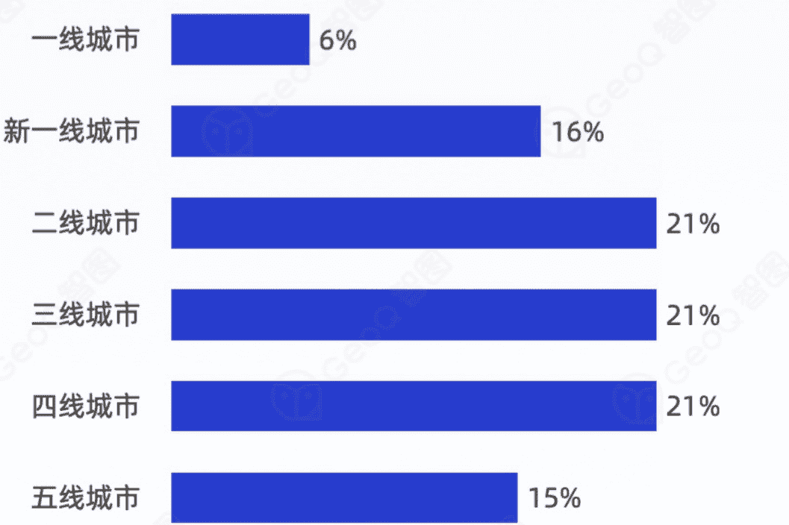

| 城市 | 数量 |
| --- | --- |
| TOP1 杭州 | 43 |
| TOP2 广州 | 42 |
| TOP3 深圳市 | 38 |
| TOP4 金华市 | 38 |
| TOP5 郑州市 | 34 |
| TOP6 太原市 | 33 |
| TOP7 西安市 | 32 |
| TOP8 南京市 | 32 |
| TOP9 合肥市 | 31 |
| TOP10 长春市 | 29 |

### 新茶典型品牌发展情况 - 沪上阿姨

- 2025年第一季度，沪上阿姨门店超过了300家，覆盖30个省、147个城市。在山东省、广东省、江苏新增门店较多。
- 沪上阿姨当前不同区域扩张力度不同。华东、华南区域门店密集。而在西南、西北地区要在核心城市。

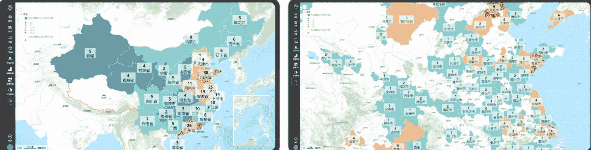

沪上阿姨2025年1-3月新增门店分布（可查看）
*图片使用GeoQ Ana分析
关于品牌更多详细信息，可登录 GeoQ Ana 查看、分析。
www.geoq.cn

### 新茶典型品牌发展情况 - 沪上阿姨

2025年第一季度，沪上阿姨在下沉市场门店数达到了58%，其中五线城市开店数最高，约为20%；其次是三线城市和四线城市，占比约19%。沪上阿姨今年1-3月门店增长的TOP10城市既有高城市也有中城市，上海、青岛增长并列第一。

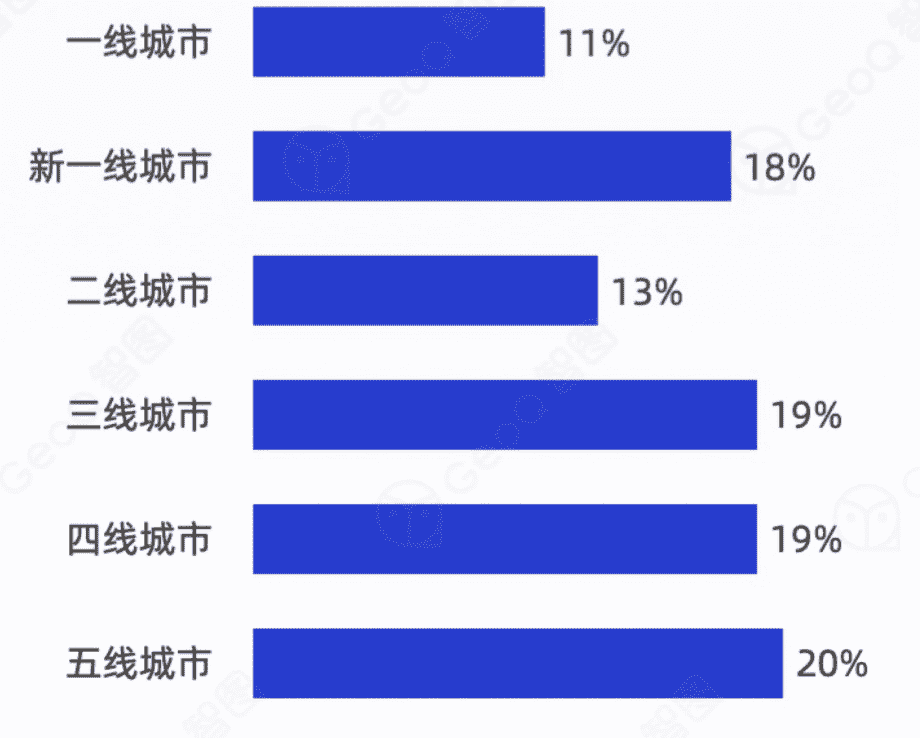

| 城市 | 数量 |
| --- | --- |
| TOP1 上海 | 13 |
| TOP2 青岛 | 13 |
| TOP3 北京市 | 9 |
| TOP4 苏州市 | 7 |
| TOP5 济南市 | 7 |
| TOP6 深圳市 | 6 |
| TOP7 大连市 | 5 |
| TOP8 重庆市 | 5 |
| TOP9 南京 | 5 |
| TOP10 邯市 | 5 |

# 02
| 连锁咖啡

## 2025年第一季度连锁咖啡整体开闭情况

2025年1-3月
24连锁咖啡品牌门店整体变化

- 门店变化数量 数据来源：GeoQ Data 品牌数据

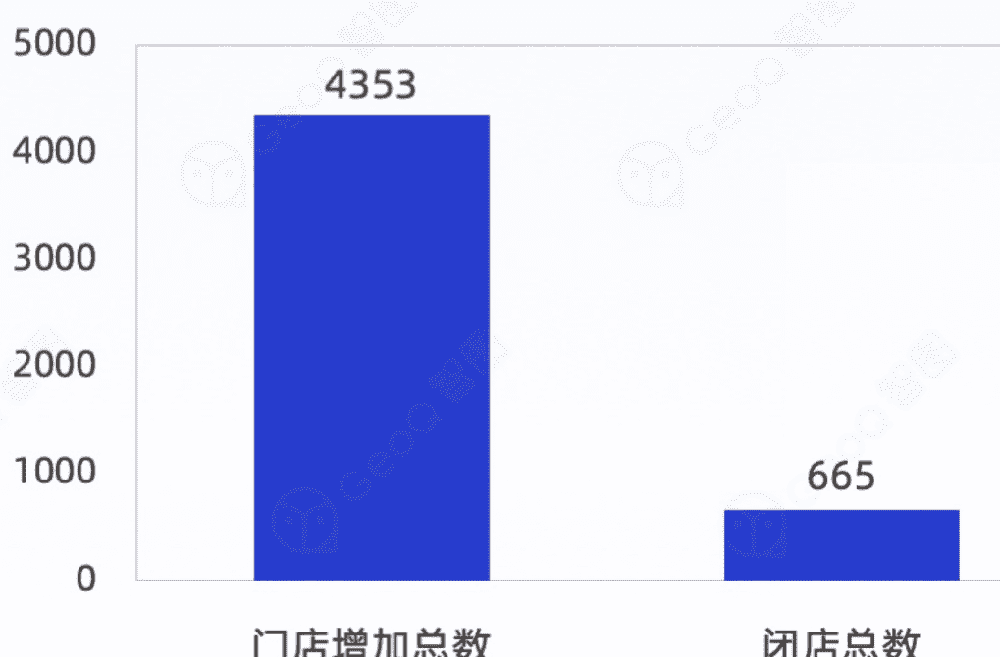

2025年第一季度，GeoQ Data收取的24家典型连锁咖啡品牌，整体门店数量约4353家，关店数约为665家。整体开闭占比为6.55%。相比去年第一季度5.94的闭店占比，第一季度闭店占比略有提升。虽然赛道内竞争越来越激烈，但连锁咖啡整体开店“加速速度”依旧存在。

# 02 连锁咖啡

## 2025年第一季度连锁咖啡扩张情况

2025年1-3月
24家连锁咖啡品牌扩张情况（门店净增）

数据来源：GeoQ Data 品牌数据

2025年第一季度，典型连锁咖啡中，超过一半的品牌实现了门店扩增。

GeoQ Data收录的24家连锁咖啡品牌中，有7家品牌（占比为29%）门店净增大于100家，头部快速扩张态势。25%的品牌处于缓慢扩张阶段。

- 快速扩张 (>=100)
- 缓慢扩张 (>0且<100)
- 收缩或停滞 (≤0)

另有46%的品牌处于收缩和停滞状态。相比去年第一季度，更多咖啡品牌陷入门店发展瓶颈。

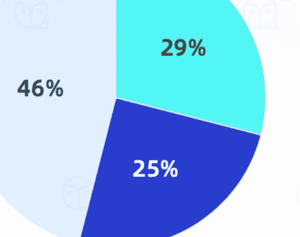

# 02 连锁咖啡

## 2025年第一季度，咖啡更喜欢哪些等级的城市开店?

2025年1-3月
各个等级城市咖啡门店占比

数据来源：GeoQ Data 品牌数据

| 城市 | 占比 |
| --- | --- |
| 一线城市 | 58% |
| 新一线城市 | 23% |
| 二线线城市 | 21% |
| 三线城市 | 19% |
| 四线城市 | 13% |
| 五线城市 | 10% |

2025年第一季度，咖啡品牌在高端城市的开店占比更高，约为58%。一线城市和新一线城市最多，其次是二线和三线城市。五线城市占比最少。

# 02 连锁咖啡

## 2025年第一季度连锁咖啡品牌门店净增对比

2025年1-3月
24家典型连锁咖啡门店净增对比

- 门店净增 数据来源:GeoQ Data 品牌数据

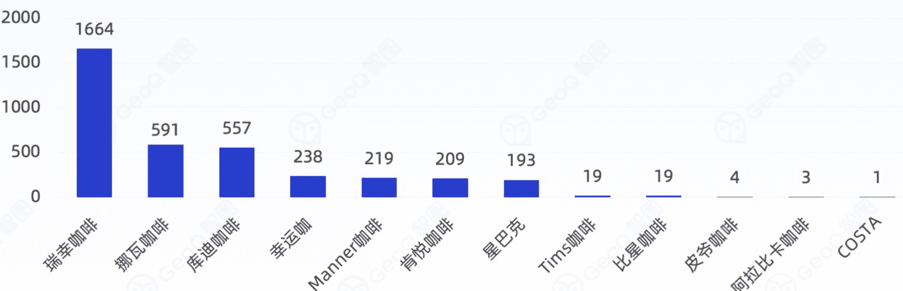

2025年1-3月，瑞幸咖啡的门店净增达到1664家。相对于去年同期门店净增来看，有所降低。瑞瓦咖啡、库迪咖啡并列第二、第三，门店净增分别为591和557。幸运咖啡、Manner咖啡、肯悦咖啡、星巴克等品牌也保持快速开店状态。

# 02 连锁咖啡

## 2025年3月连锁咖啡品牌在营门店TOP10

咖啡品牌在营门店TOP10（截至2025年3月）

| 门店总数 | 数据来源:GeoQ Data 品牌数据 |
| --- | --- |
| TOP1 瑞幸咖啡 | 23714 |
| TOP2 库迪咖啡 | 10163 |
| TOP3 星巴克 | 7758 |
| TOP4 幸运咖啡 | 3780 |
| TOP5 瑞瓦咖啡 | 2504 |
| TOP6 肯悦咖啡 | 2319 |
| TOP7 Manner咖啡 | 1832 |
| TOP8 Tims咖啡 | 1031 |
| TOP9 M Stand | 562 |
| TOP10 COSTA | 338 |

2025年第一季度连锁饮品门店发展趋势数据，在连锁咖啡品牌中，瑞幸门店总数约23714家，稳居榜首。另外，库迪咖啡去年通过模式，也突破了“万店”规模。坚持“第三空间”的星巴克门店总数暂列第三。其他连锁咖啡品牌与门店数TOP3的咖啡门店规模仍存在一定差异。幸运咖啡和瑞瓦咖啡列第四、第五，门店数为3780家和2504家。

### 连锁咖啡典型品牌发展情况 - 瑞幸咖啡

2025年第一季度，瑞幸速度对比去年有所放缓，新开店数约1834家，覆盖了30省、278城。在东南沿海省市新开门店较多。广东、江苏省、浙江省新增门店数量前三。从瑞幸布局的门店位置来看，其在核心城市门店数较多，在华东、华南、华中、西南区域渗透。

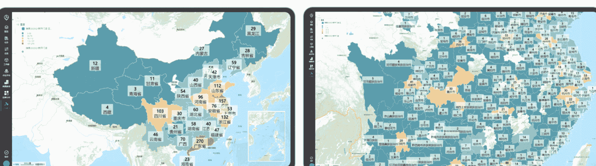

# 连锁咖啡品牌发展情况 - 瑞幸咖啡

2025年第一季度，瑞幸在低线城市的开店占比更高，约为58%。一线城市和新一线城市最多，其次是二线和三线城市。

| 城市 | 数量 |
| --- | --- |
| TOP1 杭州 | 43 |
| TOP2 广州 | 42 |
| TOP3 深圳市 | 38 |
| TOP4 金华市 | 38 |
| TOP5 郑州市 | 34 |
| TOP6 太原市 | 33 |
| TOP7 西安市 | 32 |
| TOP8 南京市 | 32 |
| TOP9 合肥市 | 31 |
| TOP10 长春市 | 29 |

### 连锁咖啡型品牌发展情况 - 挪瓦咖啡

- 2025年第一季度，挪瓦新开门店近600家，覆盖了26省、112城。在广东省、福建省、河南省新增门店数分前三，广东省新开门店约125家。
- 从挪瓦布局的门店位置来看，在不同的地区，门店策略有所不同，比在广东省，东莞的门店数多于核心城市深深圳和广州。而在福建，核心城市福州的门店数明显更多。

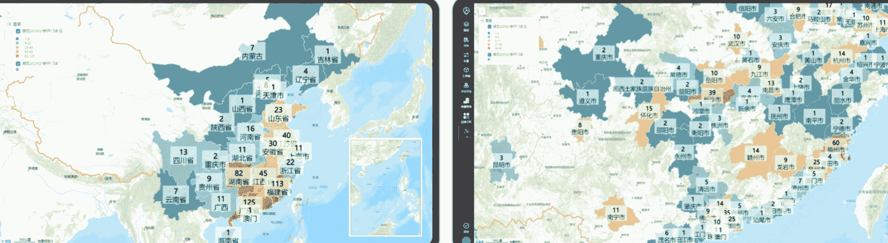

挪瓦2025年1-3月新增城市门店分布（可放大查看）

图片使用GeoQ Ana品牌分析
关于品牌更多详细信息，可登录GeoQ Ana 查看、分析。
www.geoq.cn

## 连锁咖啡品牌发展情况 - 鄂瓦咖啡

2025年第一季度，鄂瓦明显在高线城市新增门店更多，占比达到了66%。在二线城市中新开门店最多，占比约30%，其次是新一线城市，占比约为了27%。

鄂瓦年1-3月门店增长的TOP10城市既有中低线城市。福州、长沙、东莞新增门店数量列前三。

### 2025年1-3月 鄂瓦在每个等级城市开店占比

数据来源:GeoQ Data 品牌数据

| 等级城市 | 占比 |
| :--- | :--- |
| 一线城市 | 9% |
| 新一线城市 | 27% |
| 二线城市 | 30% |
| 三线城市 | 19% |
| 四线城市 | 12% |
| 五线城市 | 3% |

### 2025年1-3月 鄂瓦新增门店数TOP10城市

门店增长数量 | 数据来源:GeoQ Data 品牌数据

| 排名 | 城市 | 数量 |
| :--- | :--- | :--- |
| TOP1 | 福州市 | 60 |
| TOP2 | 长沙市 | 39 |
| TOP3 | 东莞市 | 35 |
| TOP4 | 深圳市 | 25 |
| TOP5 | 泉州市 | 25 |
| TOP6 | 南京市 | 17 |
| TOP7 | 怀化市 | 15 |
| TOP8 | 杭州市 | 14 |
| TOP9 | 广州市 | 14 |
| TOP10 | 赣州市 | 14 |

# 03 小吃快餐

# 03 小吃快餐

### 2025年第一季度连锁小吃快餐整体开闭店情况

### 2025年1-3月
101家小吃快餐品牌整体门店变化

- 门店变化数量 数据来源:GeoQ Data 品牌数据

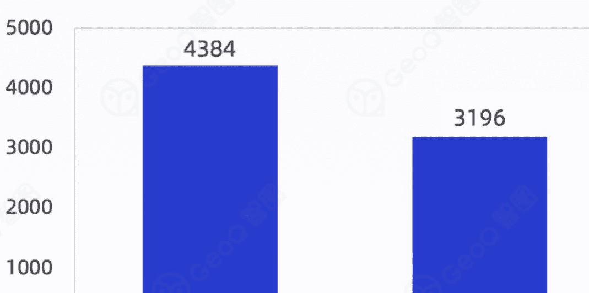

2025年第一季度，GeoQ Data收录的上百连锁小吃快餐品牌，整体门店数量约4384家，开店数约3196家。整体开店占比为1.37。

相比于去年第一季度1.17的闭店比例，今年第一季度闭店比例有所提升。但开店量相对去年第一季度有所下降。

2025年，连锁小吃快餐品牌门店规模稳步增长，但整体扩张步调更为“保守”。

# 03 小吃快餐

### 2025年第一季度连锁小吃快餐扩张情况

### 2025年1-3月
101家连锁小吃快餐品牌扩张情况（门店净增）

数据来源：GeoQ Data 品牌数据

2025年第一季度，上百连锁小吃快餐中，门店数“正增长”的不足半。

GeoQ Data收录的101家连锁小吃快餐品牌中，仅有5家品牌（占比为5%）门店净数大于100家，快速扩张状态。36%的品牌还处于缓慢扩张阶段。

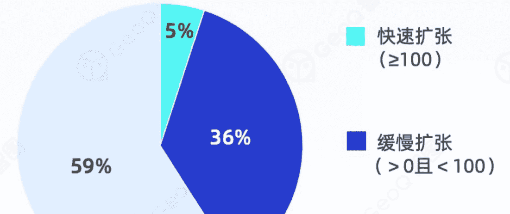

- 快速扩张（≥100）
- 缓慢扩张（>0且<100）
- 收缩或停滞（≤0）

另外59%的品牌处于收缩和停滞状态。相对于去年第一季度，陷入门店发展瓶颈的连锁小吃快餐品牌占比明显提升。

# 03 小吃快餐

2025年第一季度，小吃快餐品牌更喜欢在哪些等级的城市开店?

### 2025年1-3月
各个等级城市小吃快餐门店开店数占比

数据来源：GeoQ Data 品牌数据

| 等级城市 | 占比 |
| :--- | :--- |
| 一线城市 | 14% |
| 新一线城市 | 22% |
| 二线城市 | 20% |
| 三线城市 | 18% |
| 四线城市 | 15% |
| 五线城市 | 11% |

2025年第一季度，连锁小吃快餐品牌在高端城市的开店占比更高，约为56%。其中新一线城市的开店最多，约为22%，其次是二线城市和三线城市。五线城市的开店占比最少，约为1%。

# 03 小吃快餐

### 2025年第一季度连锁小吃快餐品牌门店净增TOP10城市
### 2025年1-3月连锁小吃快餐品牌门店净增

| 排名 | 城市 | 门店净增 数据来源:GeoQ Data 数据 |
| :--- | :--- | :--- |
| TOP1 | 济南市 | 33 |
| TOP2 | 苏州市 | 27 |
| TOP3 | 南京市 | 27 |
| TOP4 | 合肥市 | 25 |
| TOP5 | 唐山市 | 24 |
| TOP6 | 成都市 | 24 |
| TOP7 | 保定市 | 22 |
| TOP8 | 宁波市 | 21 |
| TOP9 | 哈尔滨市 | 20 |
| TOP10 | 石家庄市 | 20 |

GeoQ Data收录的连锁小吃快餐品牌在济南市、苏州市、南京市门店净数列前三。差异大，既有高城市也有中线城市，例如唐山市和保定市。一线城市和二线城市入多。

# 03 小吃快餐

### 2025年第一季度连锁小吃快餐品牌门店净增对比
### 2025年1-3月15家典型连锁小吃快餐品牌门店净增对比 数据来源:GeoQ Data 数据

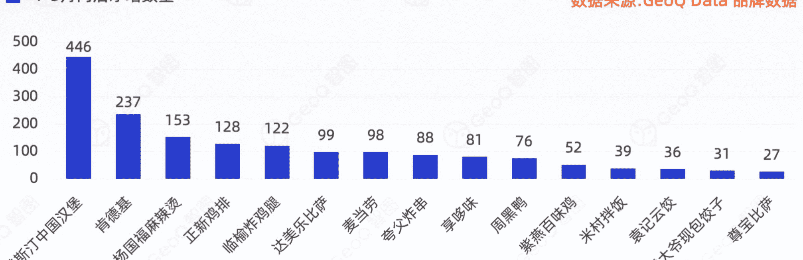

2025年1-3月，塔斯汀汉堡的门店净增达到446家。肯德基列第二，净增237家。杨国福、正新鸡排三个品牌的门店净增在100-150家之间，实现了快速扩张。

# 03 小吃快餐

### 2025年3月连锁小吃快餐品牌在营门店TOP10
连锁小吃快餐品牌在营门店TOP10（截至2025年3月）门店总数 数据来源:GeoQ 数据

| 排名 | 品牌 | 门店数 |
| :--- | :--- | :--- |
| TOP1 | 华莱士 | 18271 |
| TOP2 | 肯德基 | 12381 |
| TOP3 | 绝味鸭 | 10641 |
| TOP4 | 塔斯汀汉堡 | 9043 |
| TOP5 | 正新鸡排 | 8773 |
| TOP6 | 麦当劳 | 7116 |
| TOP7 | 杨国福 | 6988 |
| TOP8 | 紫燕百味 | 6656 |
| TOP9 | 袁记源 | 4168 |
| TOP10 | 必胜客 | 3687 |

据 GeoQ Data品牌数据，在连锁小吃快餐品牌中，华莱士门店总数约18271家，稳居首榜。肯德基和绝味鸭的门店数量第第二、第三，也是“万店品牌”。值得注意的是，塔斯汀汉堡在今年第一季度快速扩张，相比去年同期，门店数增长2000家，门店数已突破9000家，今年有望突破“万店”规模。

### 小吃快餐型品牌发展情况 - 塔斯汀

- 2025年第一季度，塔斯汀新开门店530家，覆盖了26省、200城。其在广东省、河北省、山东省新增门店数列前三，新开门店均超过50家。
- 从塔斯汀布局的门店位置来看，其在核心城市门店数较多，同时向周边的中低线城市渗透。

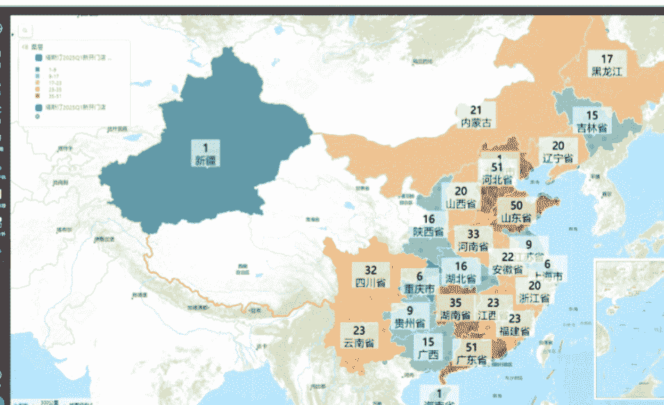

塔斯汀2025年1-3月新开门店分布（可放大查看）

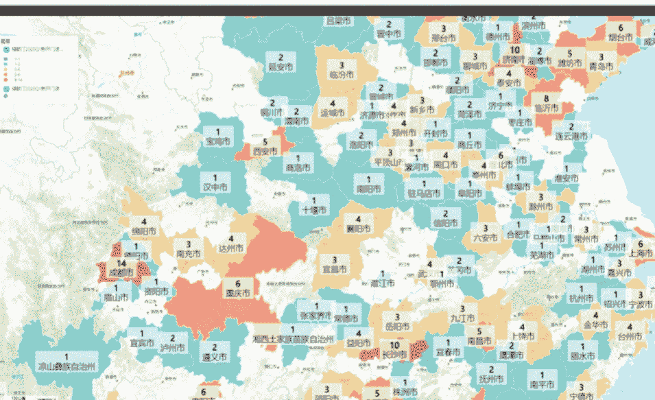

塔斯汀2025年1-3月部分城市新开门店（可放大查看）

图片使用GeoQ Ana品牌分析
关于品牌更多详细信息，请登录 GeoQ Ana 查看、分析。
www.geoq.cn

### 小吃快餐型品牌发展情况 - 塔斯汀

- 2025年第一季度，塔斯汀在中低线城市开店更多，占比达到了66%。三线城市开门店最多，约为26%，其次是四线城市，占比约为24%。一线城市开店数量仅为6%。2025年1-3月塔斯汀在各个等级城市开店占比 数据来源：GeoQ Data 数据

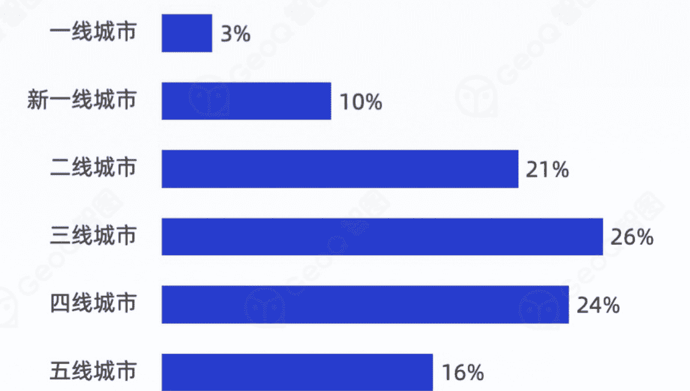

| 排名 | 城市 | 门店增长数量 数据来源：GeoQ Data 数据 |
| :--- | :--- | :--- |
| TOP1 | 成都市 | 14 |
| TOP2 | 保定市 | 14 |
| TOP3 | 长沙市 | 10 |
| TOP4 | 济南市 | 10 |
| TOP5 | 长春市 | 8 |
| TOP6 | 汕头市 | 8 |
| TOP7 | 临沂市 | 8 |
| TOP8 | 昆明市 | 8 |
| TOP9 | 唐山市 | 7 |
| TOP10 | 石家庄市 | 7 |

### 小吃快餐型品牌发展情况 - 杨国福

2025年第一季度，杨国福新开门店500家左右，覆盖了28省、88城市。其在东南沿海省新开门店多，范围广。从杨国福布局的门店来看，其在核心城市门店较多。

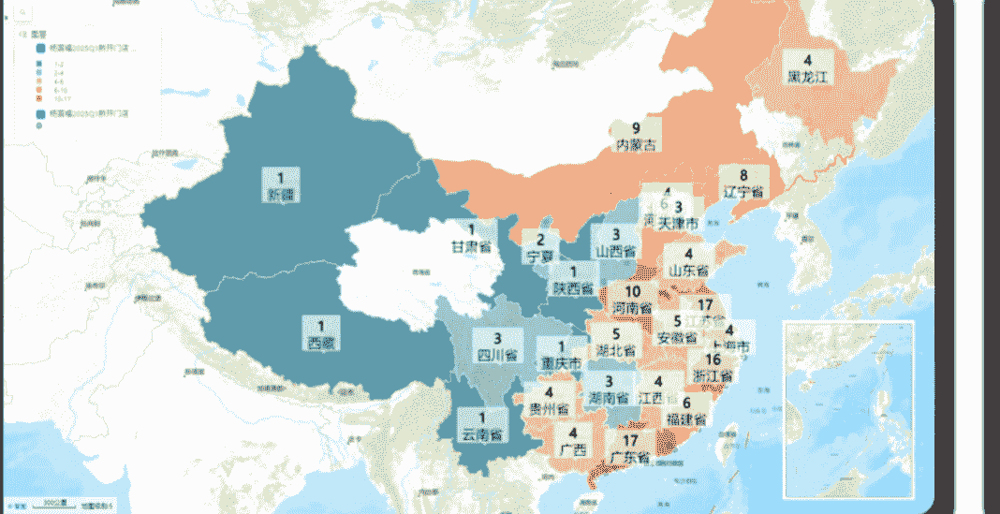

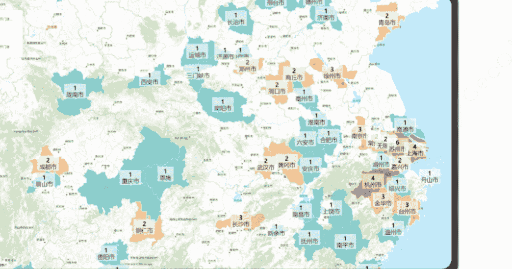

杨国福2025年1-3月新增门店分布（可放大查看）

杨国福2025年1-3月部分城市新增门店（可放大查看）

图片使用GeoQ Ana品牌分析
关于品牌更多详细信息，可登录GeoQ Ana 查看、分析。
www.geoq.cn

## 小吃快餐类型发展情况 - 杨国福

- 2025年第一季度，杨国福在高城市门店更多，占比约为58%。在二线城市开门店最多，占比约为25%，其次是新一线城市，占比约为24%。三、四、五线城市开店占比约为14%。
- 杨国福今年1-3月增长的TOP10城市，既有高城市也有中线城市。苏州市和沈阳市开店数列二。

### 2025年1-3月 杨国福各个等级城市开店数占比

### 2025年1-3月 杨国福新增门店TOP10城市

数据来源：GeoQ Data 品牌数据

| 排名 | 城市 | 门店增长数量 数据来源：GeoQ Data 品牌数据 |
| :--- | :--- | :--- |
| TOP1 | 苏州市 | 6 |
| TOP2 | 沈阳市 | 5 |
| TOP3 | 上海市 | 4 |
| TOP4 | 武汉市 | 4 |
| TOP5 | 杭州市 | 4 |
| TOP6 | 广州市 | 4 |
| TOP7 | 东莞市 | 4 |
| TOP8 | 北京市 | 4 |
| TOP9 | 长沙市 | 3 |
| TOP10 | 徐州市 | 3 |

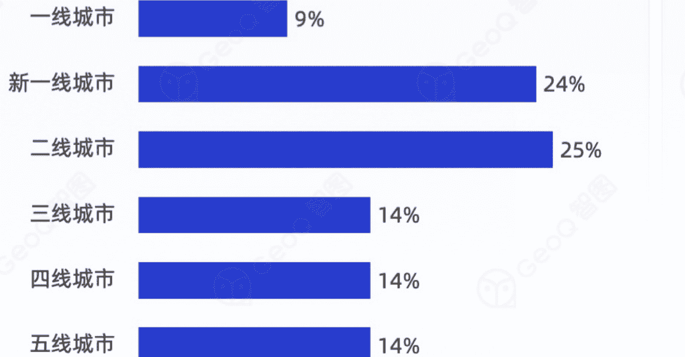

# Conclusion 结语

2025年第一季度，连锁餐饮的“悲欢”并不相通。

连锁新茶赛道“内卷”加剧，在所有百品牌中，74%的品牌面临门店增长瓶颈，仅有9%的品牌保持门店快速增长。

而连锁咖啡和小吃快餐今年第一季度的整体开闭店比高于去年第一季度，保持门店规模的稳步扩张。

小快餐今年1-3月整体门店数较去年同期下降，可见连锁小吃快餐品牌今年扩张调整较为“保守”。

虽然，各个赛道门店扩张的“领头羊”品牌节奏稳健，蜜雪冰和塔斯汀汉堡今年第一季度门店净增数相对去年同期有所提升。

无论是身处行业的品牌还是从业者，我们都在关注宏观经济和市场的同时，也不能忽视行业内细分赛道之间、品牌之间的差异化发展，才能更理性地看待市场现状、趋势及变化。

GeoQ持续关注市场的动态和走向，继续为各个品牌提供高价值的信息，促进餐饮、零售行业的繁荣发展。欢迎和我们直接进行沟通、交流，共同进步。

# GeoQ Ana 位置智能助力企业降增效

# GeoQ Ana 智图门店规划开发系统

## 产品体系

## 品牌总部

## 网络规划

## 地区招商开发人员/加盟商

GeoQ Ana 位置智能助力企业降本增效

GeoQ Ana 智图门店规划开发系统

产品体系

品牌总部

网络规划

地区招商开发人员/加盟商

GeoQ Ana 位置智能助力企业降本增效

GeoQ Ana 智图门店规划开发系统

产品体系

品牌总部

网络规划

地区招商开发人员/加盟商

GeoQ Ana 位置智能助力企业降本增效

GeoQ Ana 智图门店规划开发系统

产品体系

品牌总部

网络规划

地区招商开发人员/加盟商

GeoQ Ana 位置智能助力企业降本增效

GeoQ Ana 智图门店规划开发系统

产品体系

品牌总部

网络规划

地区招商开发人员/加盟商

GeoQ Ana 位置智能助力企业降本增效

GeoQ Ana 智图门店规划开发系统

产品体系

品牌总部

网络规划

地区招商开发人员/加盟商
