# 西藏大学信息化工作专题讲座

## ——新一代人工智能技术发展及其应用

主讲人: 尼玛扎西 中国工程院院士 西藏大学信息科学技术学院教授

2025年4月9日

# 扫码加入 知识星球TOP 免费资源群

免费
- 每日免费获取高价值资源
- 可提供各类资源搜索服务

价值

公众号: 知识星球TOP


微信:jntsg8

| 热门付费文章 | 各行各业报告 |
|---|---|---|
| 精选图书资源 | 副业赚钱方法 |
| 职场实用资源 | AI政经自媒体 |


微信:jntsg2

及时


专注

分享资料仅供个人学习，请及时删除，切勿商用传播

# 新一代人工智能技术发展及其应用

信息科学技术学院
藏语智能全国重点实验室

尼玛扎西

# 目录

# 第一部分 人工智能
- 人工智能的定义
- 人工智能与算力
- 人工智能的动力
- 人工智能与算法
- 人工智能与数据
- 我国的人工智能

# 第二部分 新一代人工智能
- 大语言模型
- Transformer
- 自监督学习
- 自然语言处理
- 强化学习
- ChatGPT与DeepSeek

# 第三部分 人工智能+
- AI4Education
- AI+政务
- AI4Science
- AI+新质生产力
- AI4Life
- AI正在接替部分职业

# 第一部分 人工智能
- 人工智能的定义
- 人工智能的动力
- 人工智能与数据
- 人工智能与算力
- 人工智能与算法
- 我国的人工智能

## AI 的定义-图灵测试

### 由英国科学家阿兰·图灵于1950年提出

一名测试者写下自己的问题，随后将问题以纯文本的形式（如计算机屏幕和键盘）发送给另一个房间中的一个人与一台机器。测试者根据他们的回答来判断哪一个是真人，哪一个是机器

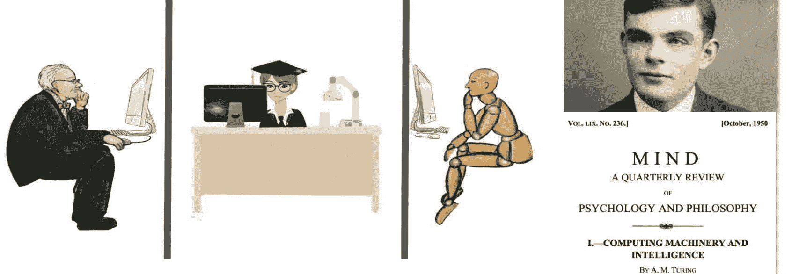

## AI 的定义-7个研究问题

1955年达特茅斯人工智能暑期会议书中所提出的7个研究问题，提出了“人工智能”这一名词。

| 研究问题 | 当前的拓展性解读 |
|---|---|
| 计算机 | 通过让机器自动完成特定工作，如语音识别或图像分类 |
| 使用语言对计算机进行编程 | 通过 AI 编程语言来实现某些功能 |
| 神经网络 | 设计神经网络让计算机从感知数据中抽象概念 |
| 计算复杂度 | 寻找一种方法来度量计算机完成特定任务时耗费的运行时间和空间等开销 |
| 算法自我改进能力 | AI 算法从以往经验中学习，不断提高其性能 |
| 算法抽象能力 | 从海量数据中归纳数据中隐藏知识 |
| 算法随机性和创造力 | 模拟人类思维中可能特有的创造性 |

## AI 的定义-达特茅会议

会议围绕“如何让机器模仿人类学习及其他智能行为”展开，探讨了通过计算机实现推理、语言理解、模式识别等能力的可能性。

### 标志着“人工智能”学科的正式确立

会议为 AI 奠定了基础理论框架，包括符号推理、机器学习、自然语言处理等核心方向，并激发了后续算法研究。

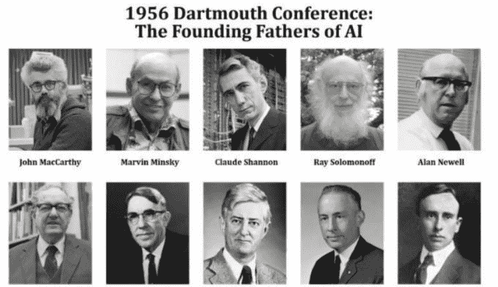

McCarthy J, Minsky M, Rochester N, et al. A proposal for the dartmouth summer research project on artificial intelligence, August, 31, 1955. AI Magazine, 2006, 27(4): 12-14

## AI 的定义

人工智能深臻计算机科学、脑科学、类脑科学、认知科学、控制论等基础科学之中，直接表现为机器学习、计算机视觉、自然语言处理、智能语音、知识图谱、大模型、智能体、群体智能、具身智能等技术形态，外化为人机器人、数字人、智能终端、智能运载工具、智能软件等产品形态。

人工智能通过类脑计算增强脑力劳动的新级，通过“机器换人”培养体力劳动的新动力，带动农业、工业和服务业中的脑力劳动与体力劳动的新四次变革，形成新兴的人工智能产业。

## AI 的定义-三大学派

| | 符号主义学派 (逻辑学派) | 联结主义学派 (仿生/生理学派) | 行为主义学派 (控制论) |
|---|---|---|
| 代表人物 | Herbert Simon, Alan Newell, Ray Solomon | Marvin Minsky, McCulloch, Hinton | Norbert Wiener, Claude Shannon, Brooks |
| 主要思想 | 人的认知基元是符号，认知过程即符号操作 | 人的思维基元是神经元 | 人的智能取决于感知和行动进化 |
| 研究领域 | 机器证明、自动机、专家系统、知识库 | 人工神经网络、认知科学、大脑计算 | 演化计算、多智能体、群体智能 |
| 可解释性 | 可解释 | 不解释 | 可解释 |
| 主要特点 | 基于知识推理（手工） | 基于模型（数据为基础） | 基于环境感知、反馈 |
| AI发展 | 从“知识推理”到“统计学习” | “统计学习” | “数据智能” |

## AI 的动力-计算的4个时代

机械计算时代 电子计算时代 网络计算时代 智能计算时代 (1200s—1940s)

### 算盘——中国发明最早的计算工具


### 步进计算器——德国莱布尼茨发明第一台自动完成运算的装置（1673年，乘法器）


### 雅卡织机——法国人雅卡发明“编程”的概念，通过打孔图案（1801年）


## AI 的动力-计算的4个时代

机械计算时代 电子计算时代 网络计算时代 智能计算时代 (1950s—1970s)

### 现代计算机基础

- 布尔代数：描述程序和硬件的底层逻辑
- 图灵机：将复杂任务转化为自动化
- 晶体管：构成基本的逻辑电路和存储电路
- 冯·诺伊曼架构：提出了三原则：1. 二进制逻辑 2. 程序存储执行 3. 由运算器、控制器、存储器、I/O组成

### 计算机跨越的第一个水岭

- 70年代，计算机完成从物质到“思维”的转变。
- 70年代开始的第四代计算机：以大规模、超大规模集成电路为主要元件；运算速度每秒百万次至上亿。软件方面出现数据库管理系统、网络管理系统和对象语言等。

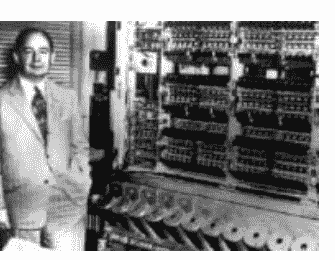
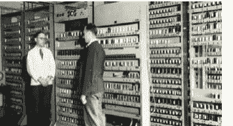
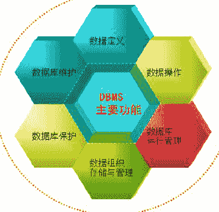

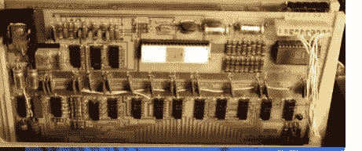
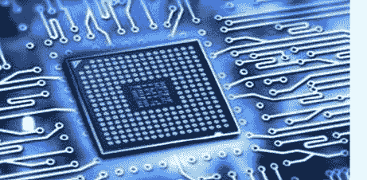

## AI 的动力-计算的4个时代

机械计算时代 电子计算时代 网络计算时代 智能计算时代 (1980s—2020s)

TCP/IP协议让所有上网设备（手机/电脑/服务器）都遵守相同的通信规则，保证跨设备通信的畅通。定义了开放的通信标准，让公司可以开发各种网络应用，而不用担心底层通信问题。

## TCP/IP协议通过协议分层架构、可靠传输机制和开放标准，构建了互联网的神经中枢

提出者罗伯特·卡恩获得2004年图灵奖

| | | | | | |
|---|---|---|---|---|---|
| 应用层 | HTTP | FTP | SMTP | POP3 | |
| 传输层 | TCP | UDP | | | |
| 网络层 | IP | | | | |
| 网络接口层 | IP over 以太网 | IP 封装链路 | IP over SDH | | |
| 不同类型网络 | 以太网 | 链路环 | SDH | | |

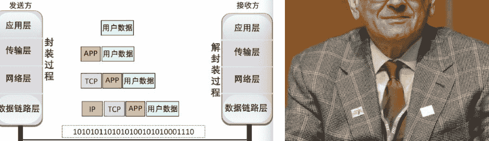

## AI 的动力-计算的4个时代

机械计算时代 电子计算时代 网络计算时代 智能计算时代 (1980s—2020s)

## 互联网以“人”为中心

将人使用的计算机与终端与后台数据连接，互联网的应用通过智能终端与人进行交互，深刻地改变了人类社会，我们的工作、生活和学习几乎离不开它。

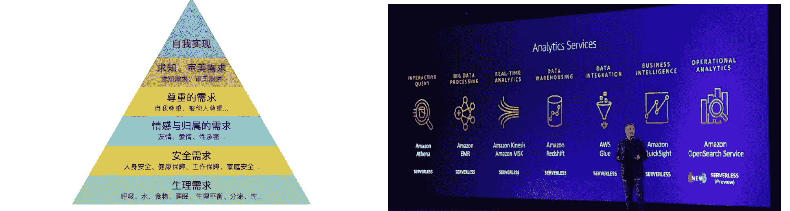

## AI 的动力-计算的4个时代

机械计算时代 电子计算时代 网络计算时代 智能计算时代

物理世界的设备被数字化、网络化和智能化

实现“人、机、物”融合。除联网外，还有基础设施支持各类终端通过边缘实现万物互联，终端、边缘、云都渴望AI大模型服务，实现计算的地方。智能计算带来了巨量数据、人工智能算法的突破和算力的爆发。

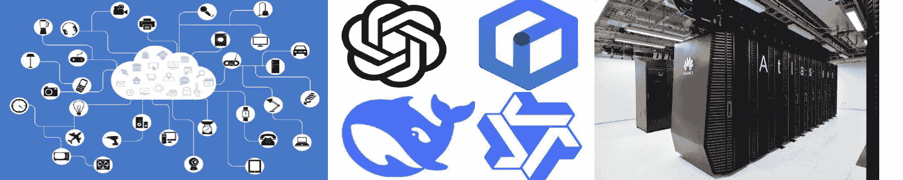

## AI 的动力-计算的4个时代

机械计算时代 电子计算时代 网络计算时代 智能计算时代 (2020至今)

传统AI数字世界的符号推理，而具身智能通过机器实体与环境实时交互，实现感知、认知、决策和行动一体化，揭示了智能的本质：必须通过身体与环境动态互动。机器人在协作时，通过强化学习不断优化动作，人类专注于规划，形成“人类创造力+机器人效率”的分工模式。

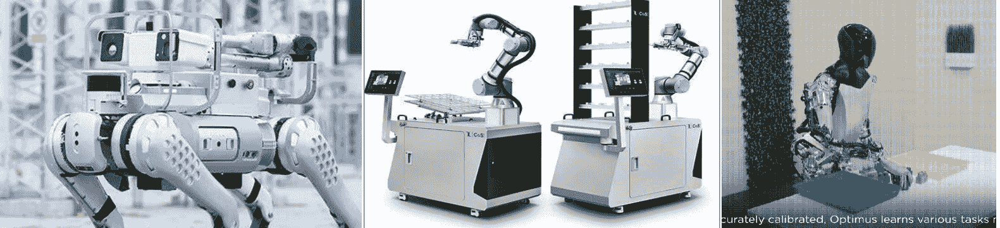

## AI 的动力-计算的4个时代

机械计算时代 电子计算时代 网络计算时代 智能计算时代 (2020至今)

计算机跨越了第二个水岭：从“有意识思维”到“无意识思维”的转变。这一转变涉及到“莫拉维克悖论”（Moravec's Paradox）。


## AI 的动力-计算的4个时代

机械计算时代 电子计算时代 网络计算时代 智能计算时代

“莫拉维克悖论”（Moravec's Paradox）。计算机善于处理人类觉得困难的问题，而不擅长处理人类而言很容易的问题。不同于传统假设，计算机实现逻辑推理等高级智慧只需要少的计算能力，而实现感知、运动等低级智慧却需要巨大的计算资源。


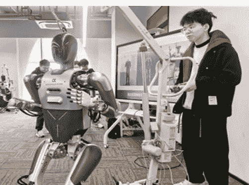

## AI 的动力-计算的4个时代

机械计算时代 电子计算时代 网络计算时代 智能计算时代 (2020至今)

人工智能汉·莫拉维克写道（1988年）：“让计算机在智力测试或下棋中展现出一个成年人的水平是相对容易的，但是要让计算机拥有如同一小孩般的感知和行动能力却是相当困难甚至是可能的。”

> 莫拉维克提示的这些现象与我们生活中的常识相左

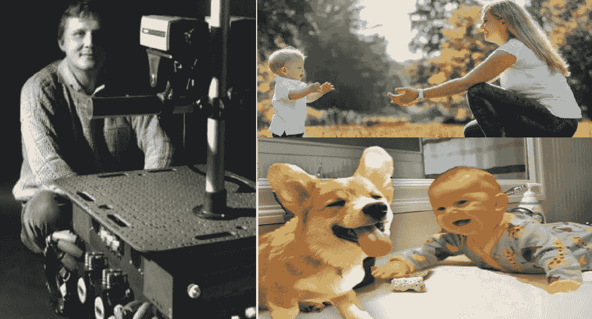


# AI的动力-计算的4个时代

机械计算时代 | 电子计算时代 | 网络计算时代 | 智能计算时代

“困难的问题是简单的，简单的问题是困难的”

- 语言学家和认知科学家史迪芬·平克 (Steven Pinker) 认为这是人工智能研究者的最重要的发现，他在1995年出版的专著“The Language Instinct》（《语言本能》）中，他写道：经过35年人工智能的研究，人们学到的主要内容是“困难的问题是简单的，简单的问题是困难的”。

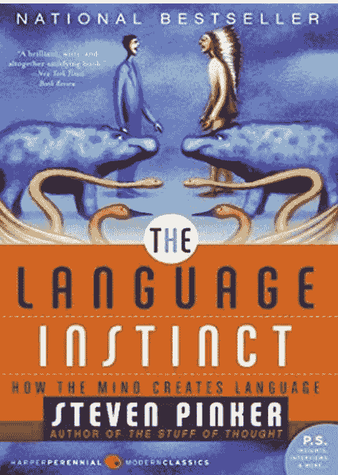

# AI的动力-计算的4个时代

机械计算时代 电子计算时代 网络计算时代 智能计算时代

这反映了人类思维特征：两种截然不同的方式：
- 有意识的：谨慎的、有逻辑思维
- 无意识的：快速的、本能思维

有意识的：当你在超市买物品时，用的是逻辑思维，这与直觉无关；无意识的：当你走路被绊倒保持平衡时，使用的是本能思维，这与逻辑无关。

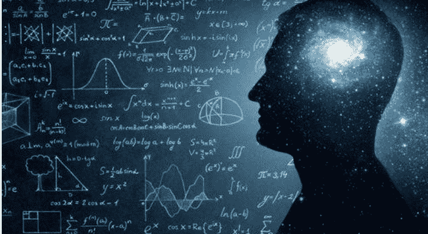
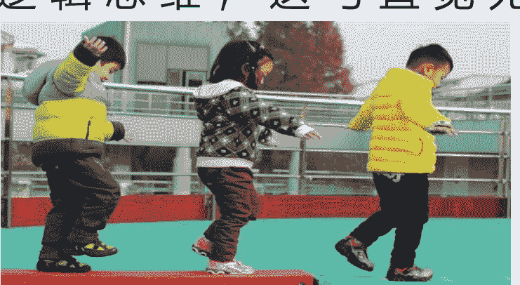

## AI 的动力-计算的4个时代

机械计算时代 电子计算时代 网络计算时代 智能计算时代 (2020至今)

一个例子：我坐在咖啡馆边看书边喝咖啡。这并不是一件简单的事，在机器人领域，人们仍在努力让机器人顺利完成此类任务。这涉及了视觉系统（可能是眼睛）先扫描整个场景，锁定杯子，运动准确调整整个躯干、胳臂和肌肉收缩，当手碰到杯子时，神经系统就传回了有关杯子的空间位置、光滑度、温度等信息。这些信息通过大脑的海量计算和反馈调整，最终在几秒里使我拿起杯子送到嘴边喝下。


## AI 的动力-计算的4个时代

机械计算时代 电子计算时代 网络计算时代 智能计算时代

我们能够理解人类自身是如何算数、下棋的，但我们不是太了解我们是如何认出一只猫的，也不清楚当我们跑路时是如何保持平衡的。

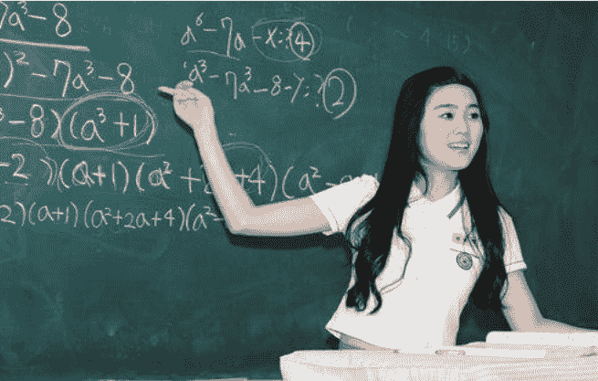


## AI 的动力-计算的4个时代

机械计算时代 电子计算时代 网络计算时代 智能计算时代 (2020至今)

机器学习通过改变编程方式解决了悖论。通过机器学习（深度学习），人类使计算机对一个庞大的模型进行推理计算，最后得出某个特定可能的解。

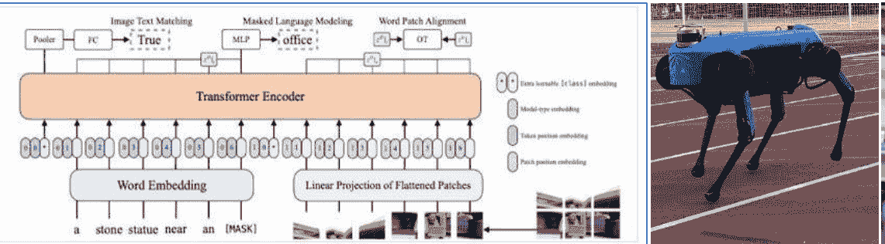
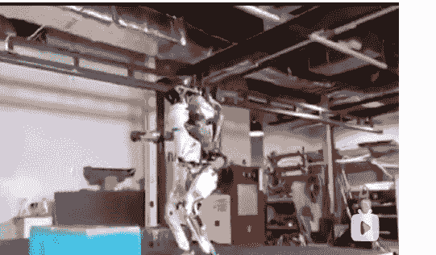
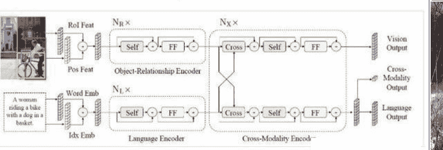
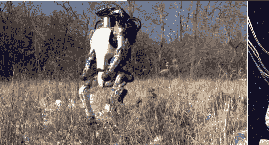
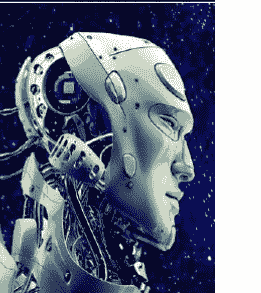

# AI的动力-计算的4个时代

机械计算时代 电子计算时代 网络计算时代 智能计算时代 (2020至今)

## 计算机从“服从”到“认知”的转变

直到不久前，我们还在用编程的方法教计算机完成特定任务（事情）。这些程序一步一步地设计计算机在可能遇到的各种情况下应该做什么？怎么做？但是我们自己在教计算机处理问题之前，首先清楚地理解我们自己处理问题时的思考方式。

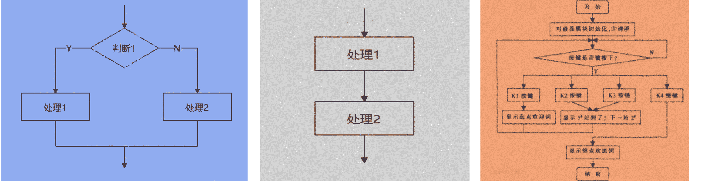

## AI 的三架马车

## 人智能三要素

- 数据：训练AI模型的原材料，包括结构化（表格）、非结构化（文本、图像、视频）和半结构化数据
- 算力：运行算法所需的计算能力，依赖硬件（CPU/GPU/TPU）和软件（并行计算框架）
- 算法：AI实现智能的逻辑规则和数学模型，如机器学习、深度学习、强化学习等

### 案例：AlphaFold（算法）通过海量蛋白质序列数据（数据）和超级计算机（算力）预测蛋白质三维结构


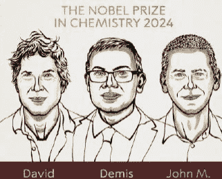
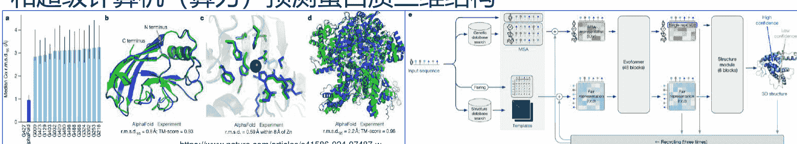


## AI 与数据

使AI发展速度的其中一个原因是大数据的收集、存储、传输和分析成为可能。

### 大数据：
规模大到在获取、存储、管理、分析方面超出传统数据库软件工具能力范围的数据集合，具有海量数据规模、高速数据流转、多样数据类型和高价值及低价值密度四大特征。

> Volume 规模 Velocity 高速 Variety 多样 Value 价值


## AI 与数据

Big Data: Whole Data（KB, MB, GB, TB, PB, EB, ZB, YB, NB, DB)

- TB, PB级的结构化、非结构化和半结构化数据。预计到今年全球数据使用量将达到175ZB (1ZB=2⁷⁷⁰Byte)。

- 以前利用统计学的原理、抽样的方法分析问题。但是，这显然没有全量数据更能说明问题。

- 全量数据的采集、存储、处理与分析的需求，推动产生了系列大数据技术，其中的重点在于基于分布式技术的数据存储与处理。

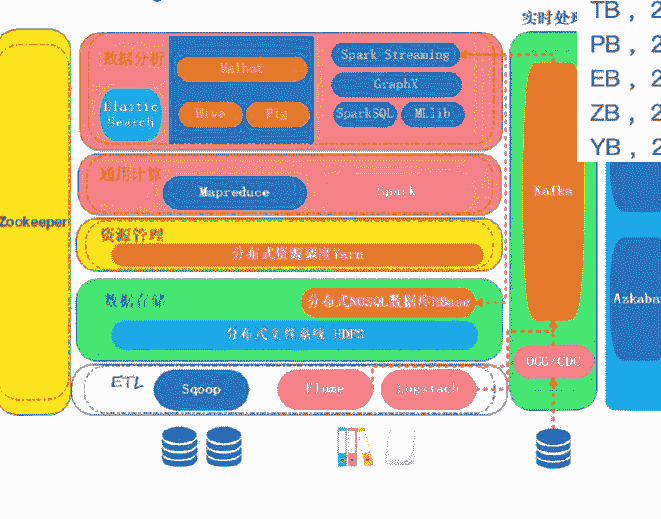
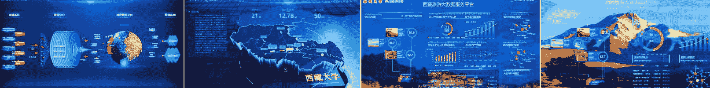

### AI与大数据技术者联系密切

### 深度学习

- 通过海量的样本数据进行模型训练，需要应用大数据技术存储与计算、分析这些数据。

- 大数据技术支撑了人工智能算法的实现。

- 人工智能更像是大数据技术中数据分析技术的高级阶段。曾经的数据仓库、数据挖掘技术。


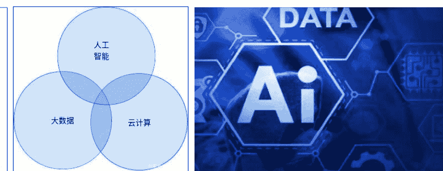

## AI 与数据

### 数据的重要性怎么强调都不过！

- 如果将机器学习算法比作一架机器，那么数据就是驱动这架机器的燃料，没有燃料驱动，机器设计得再精巧也只能摆设。而事实上，数据确实被誉为未来的“石油”。

- 当前，典型个人计算机硬件的容量为TB量级，而一些企业的数据量已经接近EB量级。


### AI与数据

### 数据估值、全球不同语种的数据平衡

人类目前所有印刷品的数据量约为200PB (1PB = 2^50Byte)。

人类所说的话的数据量约为4ZB (1ZB=2^70Byte)。


英语数据占互联网内容的50%以上，中文数据占15%，但方言数据稀缺，小语种数据更是占占比不到0.1%。

| Estimate | Median | 95% CI |
| --- | --- | --- |
| Common Crawl | 130T | [100T, 260T] |
| Indexed web | 510T | [130T, 2100T] |
| Whole web | 3100T | [1900T, 5200T] |
| Images | 300T | N/A |
| Video | 1350T | N/A |

> Table 1. Estimates of the stock of data on the web in tokens.³In the case of images and video we only have point estimates. *arXiv arXiv:2211.04325 (2022).

## AI 的数据

### 数据正在枯竭!

### Nature在头部敲响警钟——AI革命“吸干”互联网数据的海洋

- 研究机构Epoch AI近期公布的研究预测，到2028年，用于训练AI模型的典型数据集的规模将达到公共在线文本总量的估计。

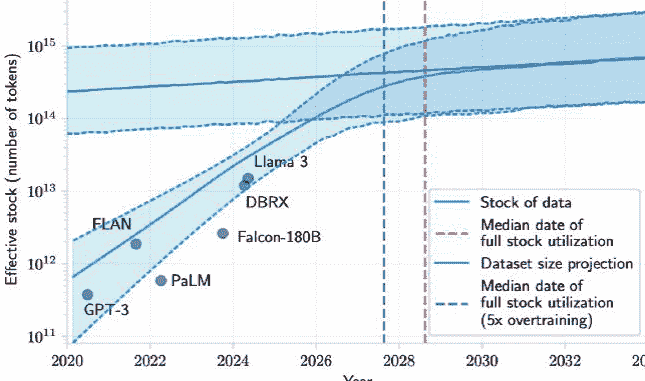

这意味着，未来几年内，AI大模型可能会耗尽可训练的高质量数据资源。

### AI与数据

深度学习需要大量的训练数据，目前的AI技术还是数据驱动的。

- "当数据量较小时，传统机器学习模型的性能与神经网络模型的差异不大"

- 当数据规模越来越大时，神经网络结构越复杂的深度学习模型能够从大数据中提取（学习）到有效的特征，模型性能也随之非常明显的上升。

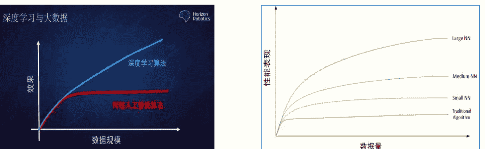

Preetum Nakkiran, Gal Kaplan, Yamini Bansal, Tristan Yang, Boaz Barak, and Ilya Sutskever. Deep descent: where bigger models and more data. Journal of Statistical Mechanics: Theory and Experiment, 2021.

## AI 与数据

我们今天正在使用巨大的数据集，几年前是不够的。现在，大数据无处不在且惊人。Big Data的单位一般以TB、PB衡量。1PB=1024TB。


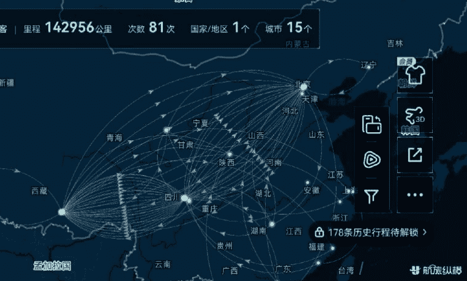

### 深度学习的大数据传输

若算力是深度学习的发动机，数据则是燃料。吉尔德定律（Gilder’s Law）保证了燃料供应。

Gilder’s Law：带宽的增长速度至少是性能增长速度的三倍，而带宽的不断增长意味着新的应用方式的出现和用户费用的不断下降（中国总带宽15T以上，美国总带宽58T）。

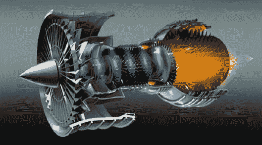


## AI 与算力

算力就是单位时间内硬件能够完成的某种运算。比如浮点计算、整数计算等。

- 1MOPS (Million Operation Per Second)：处理器每秒百万次（10⁶）。
- 1GOPS (Giga Operations Per Second)：处理器每秒十亿次（10⁹）。
- 1TOPS (Tera Operations Per Second)：处理器每秒一万亿次（10¹²）。

FLOPS (floating-point operations per second)：每秒执行浮点运算次数。

- 1MFLOPS (Mega FLOPS)：每秒百万（10⁶）次的浮点运算。
- 1GFLOPS (Giga FLOPS)：每秒十亿（10⁹）次的浮点运算。
- 1TFLOPS (Tera FLOPS)：每秒一万亿（10¹²）次的浮点运算。
- 1PFLOPS (Peta FLOPS)：每秒一千万亿（10¹⁵）次的浮点运算。

MOPS、GOPS和TOPS是操作次数，FLOPS是浮点运算次数。

哈希率：比特币网络处理能力的度量单位，即CPU计算哈希函数输出的速度。网络为了安全目的进行密集的数学和加密操作。例如，当网络达到10Th/s的哈希率时，意味着它可以每秒进行10万亿计算。

## AI 与算力

训练神经网络模型，使它像人一样识别图片或理解人类语言所需的算力是十分惊人的。深度学习中的模型权重调整涉及到大规模的“矩阵运算”数学运算。

### 模型训练

训练一个大模型，甚至需要10²次的浮点数运算。这就要求计算机的算力足够强大。

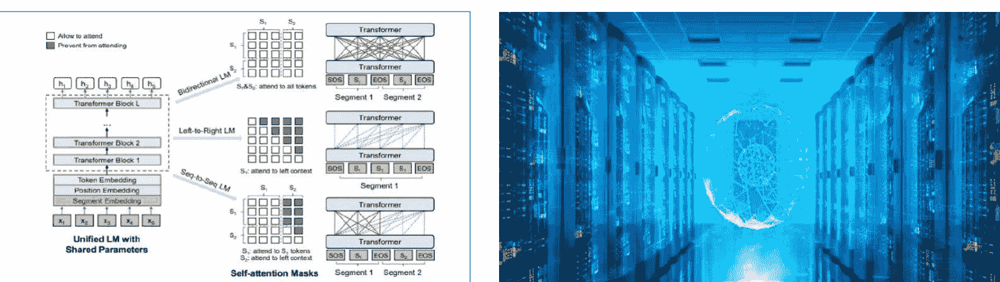

## AI 与算力

### 为什么现在AI发展的如此神速？

- 最简单的答案就是：有了更强的计算力！

曾经的摩尔定律 (Moore's law)。Moore's law：称为计算机第一定律，指IC上可容纳的晶体管数目，约每隔18/24个月就会增加一倍，性能也将提升——神经网络的基础——感知机是上50年提出的。

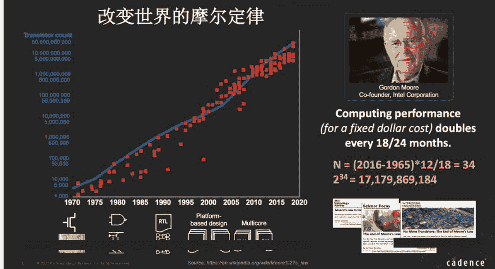

## AI 与算力

今天，摩尔定律的乐观律已不再存在，CPU性能的提升降至每一年不足3%，实现性能翻倍需20年。

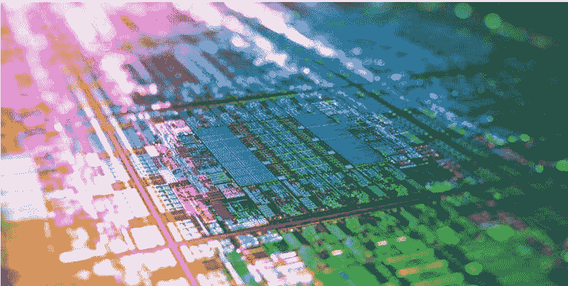
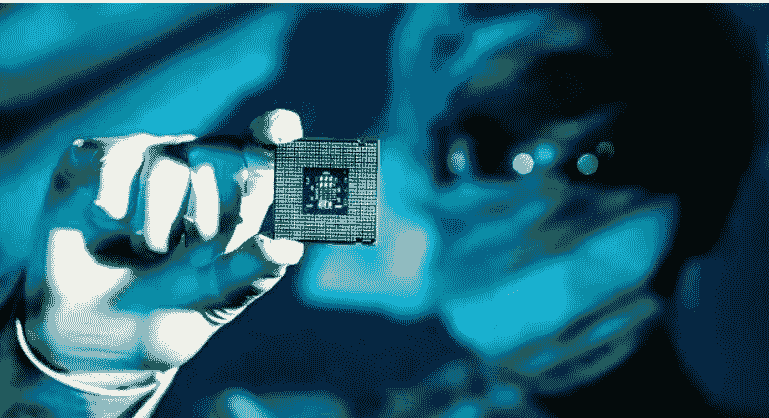

现在芯片线路可达~3纳米，相当于在这个尺度上只能容纳10个原子（台积电3纳米工艺：每平方厘米集成2.5亿晶体管）。

- 量变引起质变，产生如分子、量子芯片等。

CPU性能提升速度大幅放缓，出现八核、十六核、十二核。通过多核提高性能的方式并没有根本上解决问题。

- 功耗问题。
- 散热问题。
- 软件支持问题。

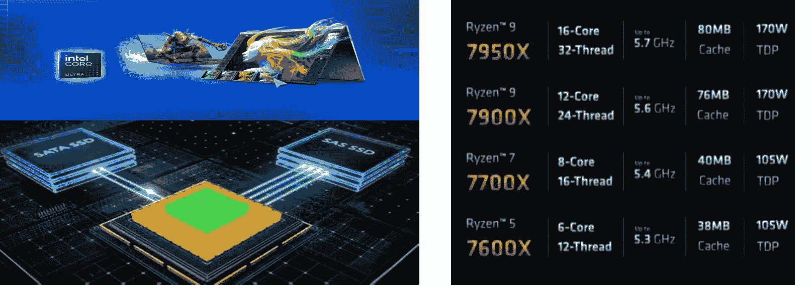

## AI 与算力

### AI加速与黄氏定律

以英伟达（NVIDIA）创始人黄仁勋命名的法律——黄氏定律 (Huang's Law)。Huang’s Law：GPU推动AI性能逐年翻倍。

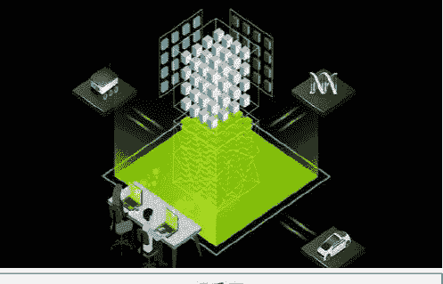
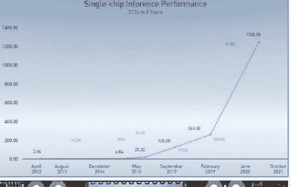


## AI与算力

### CPU与GPU

- CPU: 多核，内部cache以及控制单元占据很大，计算单元有限，串行效率太低。
- GPU: 成百千核，控制单元简单，大部分空间被计算单元占据，每个核心对应万个像素进行并行计算。

| Control | ALU |
| --- | --- |
| Cache | ALU |
| DRAM | |

CPU的微架构图，GPU的微架构图。

## AI 与算力

### CPU与GPU

- CPU: 不同的核执行不同的指令，如Core A在运行线程的同时Core B可以运行线程，所谓SIMD (Multiple Instruction, Multiple Data)。
- GPU: 所有核必须整齐划一运行相同的指令，只是操作不同的数据。
- CPU: 中断处理、内存管理、I/O等等。
- GPU: 绝不是用来取代CPU的，CPU只是把一些非常长的事情交给GPU，GPU仅仅充当工作的配角。


### 无论CPU还是GPU，其生产过程中都需要最重要的设备——光刻机

目前最先进的光刻机是荷兰ASML生产的High-NA EUV光刻机，支持2nm制程量产，通过多重曝光技术可延伸至1nm甚至0.5nm。

“卡脖子”问题

- 荷兰ASML的EUV光刻机自2019年起，被禁止向中国出口，该设备用于7nm及以下先进制程制造。
- 美国通过《出口管理条例》要求对3nm及以下制程、量子计算等技术的设备和软件实施全球禁运。

打破枷锁

上海微电子的SMIC600系列已实现90nm制程量产，28nm光刻机进入产线阶段。


## AI 与算力

过去只有超级计算机才能完成的计算、几年前无法企及的计算速度在今天成为家便饭。

由国防科技大学和国家超级计算机天津中心联合研制的“天河”新一代超算系统，搭载自研飞腾CPU、天河高速互联技术和麒麟操作系统，稳定算力超10⁸FLOPS。


“天河二号”超级计算机算力曾达30.65Pflops。一般的GPU服务器算力在1000GFLOPS左右。

## AI与算力

### CPU vs GPU vs TPU vs NPU vs QPU......

### 在AI的算力中，有哪些计算的处理器？哪种算力最好？

| 指标 | CPU | GPU | TPU | NPU | QPU |
| --- | --- | --- | --- | --- | --- |
| 名称 | 中央处理器 | 图形处理器 | 张量处理器 | 神经处理器 | 量子处理器 |
| 并行性 | 低 | 极高 | 高 | 中高 | 量子并行 |
| 能效比 | 中 | 中 | 高 | 极高 | 未知 |
| 通用性 | 最强 | 较强 | 低 | 低 | 极低 |
| 典型应用 | 通用计算 | AI训练、图形 | 云端AI训练 | 边缘推理 | 量子算法 |
| 代表厂商 | Intel、AMD | NVIDIA | Google | 华为、赛武纪 | IBM、谷歌 |


## AI与算法

### 人工智能技术沉淀阶段


1989年，Yann LeCun发明了卷积网络(Convolutional Neural Network)

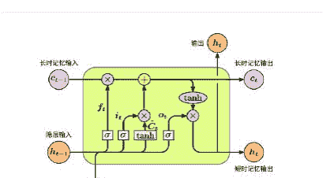

1997年，Schmidhuber提出了长短期时记忆网络(LSTM)

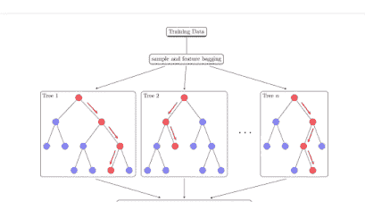

2001年，Breiman提出随机森林(Random Forest)

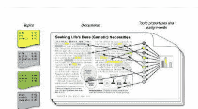

2003年，David Blei，Andrew Ng和Michael I.Jordan提出LDA(Latent Dirichlet Allocation)

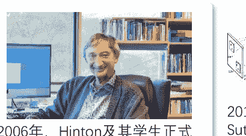

2006年，Hinton及其学生生成式提出的深度学习(Deep Learning)的概念

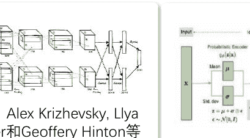

2012年，Alex Krizhevsky，Ilya Sutskever和Geoffrey Hinton等提出的AlexNet引发了深度学习领域的革命

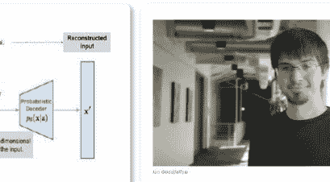

2013年，深度学习算法变分自编码器(VAE)被提出

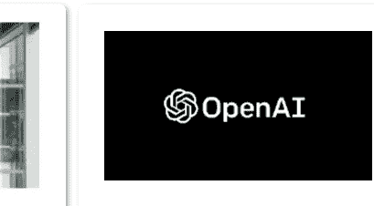

2014年，Ian Goodfellow提出生成式对对抗网络(GAN)


2015年，Sam Altman等人创建OpenAI

### CNN—LSTM—随机森林—LDA—深度学习—GAN

## AI与算法

### 人工智能技术快速发展阶段

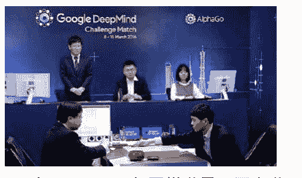

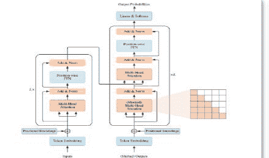

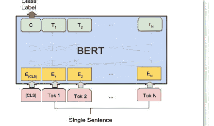

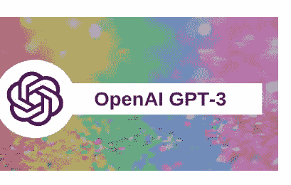

2016年，AlphaGo与围棋冠军李世石进行人机大战，以4-1总分获胜

2017年，Google提出了Transformer模型

2018年，Google提出基于Transformer注意力机制的BERT

2020年，OpenAI发布大语言模型GPT-3


2021年，OpenAI提出连接文本与图像的神经网络：DALL-E2

2022年11月，OpenAI发布ChatGPT

2023年2月，Meta开源语言模型Llama

2023年3月，OpenAI发布GPT-4

2024年12月，深度求索发布并开源DeepSeek-V3

### Transformer-BERT-ChatGPT-Llama-GPT4-DeepSeek

## AI与算法: 神经网络:追根源

### 大脑让人类成为万物之灵，而人类对大脑的深层次探索

### 刚刚刚刚开始！


> Jabr, F. How Humans Evolved Supersized Brains. Quanta Magazine, 2015, 10. Mark F. Bear, et al., Neuroscience: Evolving the Brain, Wolters Kluwer, 2016.

## AI与算法：神经网络-发展简史

- 神经网络起源于上世纪四十年代。1943年时神经科学家麦卡洛克(McCulloch)和数学家皮兹(Pitts)发表论文《神经活动中内在思想的逻辑运算》，提出了MCP模型。


> McCulloch, Warren S., and Walter Pitts. "A logical calculus of the ideas immanent in nervous activity." The bulletin of mathematical biophysics 5 (1943): 115-133.

## AI与算法：神经网络-发展简史

### MCP模型架构虽然相对简单，但是具有里程碑意义


- Neuron: 神经元接受多个输入 $(x_1, x_2, x_3,...)$
- Dendrites: 树突产生一个输出 (output)
- Axon: 轴突(神经细胞的突起，将信号发送到其他细胞如同神经末梢感受外部的变化，最后产生电信号

## AI与算法：神经网络-发展简史

1958年，计算机科学家弗莱克·罗森布拉提出由两层神经元构建的网络，并将命名为感知机（perceptron）。


基本拥有神经网络主要构件与思想。包括自动学习权重、梯度下降算法、优化器等，一定程度上推动神经网络发展。

## AI与算法：神经网络-发展简史

1969年，人工智能之父马文·明斯基(1969年图灵奖)在其著作中证明了感知机本质是一个线性模型，其最基本的异或问题都无法解决。


| x1 | x2 | AND | XOR |
|---|---|---|---|
| 0 | 0 | 0 | 0 |
| 0 | 1 | 0 | 1 |
| 1 | 0 | 0 | 1 |
| 1 | 1 | 1 | 0 |

## AI与算法：神经网络-简介

1986年杰弗里·埃弗斯特·辛顿提出多层感知机的BP算法


多层感知机BP算法

## AI与算法：神经网络-发展简史

在层与层之间的过程中引入了Sigmoid激活函数，为神经网络引入了非线性能力，改良了感知机无法解决异或问题的缺陷。


左图是一个以Sigmoid作为隐藏激活函数的层神经网络。通过调整参数$w_1=(w_{11},w_{12}), b=(b_1,b_2)$和$w_2$的值，可以不断改变目标函数的形状。额外的隐藏层能够提升输入和输出之间复杂的建模能力。

## AI与算法：浅层学习与深度学习

### 感知机 - 神经网络 - 浅层学习 - 深度学习


- 1900 Triode Tube
- 1920 First robot
- 1938 Digital Logic
- 1948 Cybernetics
- 1956 AI term born (A paper called the Dartmouth Proposal is published for the first time, the AI definition is used.)
- 1980 WABOT-26
- 1982 Hofstadter ANN
- 1986 Parallel Processing
- 1989 Convolutional Neural NN
- 1997 Deep Blue (IBM's Deep Blue defeats world champion Gary Kasparov.)
- 2003-2005 DARPA Challenges
- 2006 Deep Belief
- 2008 IBM Blue Brain
- 2010 Apple Siri
- 2017 Transformers (2017 Attention Is All Need)
- 2019 BERT LM
- 2020 GPT-3
- 2022 ChatGPT (OpenAI ChatGPT became the fastest growing software application in history just after 2 months)
- 2025 The Chinese DeepSeek overpasses OpenAI in 2 weeks!

### THE NOBEL PRIZE IN PHYSICS 2024


## John J. Hopfield Geoffrey Hinton

> "For foundational discoveries and inventions that enable machine learning to deceive a human believing it with artificial networks"

### THE ROYAL SWEDISH ACADEMY OF SCIENCES


- 1950 Turing test (A computer would deserve to be intelligent enough to deceive a human believing it was human)
- 1957 First Perception
- 1956 AI Program
- 1965 First Robot, Eliza ChatBot
- 1986 Backpropagation (Multi-layer networks could learn non-linear functions significantly contributing to the field's progress.)
- 1994 Robustcept
- 1995 LSTM ANN
- 2002 Sony Aibo
- 2003 Kismet Robot
- 2012 AlexNet (A Revolutionary Deep Learning Architecture significantly outperforms imageNet.)
- 2013 DeepMind
- 2014 Generative ANN
- 2015 TensorFlow
- 2016 AlphaGo
- 2020 DALL-E (generating images from descriptions, showing mastery of tasks cross-modal and creative generation)
- 2020 Tesla self drive
- 2022 Regulation & Ethics
- 2024 Sora, EU AI Act
- 2025 AGI, SuperHumans & Beyond

| 1st Winter | 2nd Winter |
|---|---|
| 1900-1950 | 1950-1970 |
| 1980-1987 | 1993-2000 |
| 2000-2012 | 2012-2017 |


## AI与算法：深度神经网络-3位奖

2018年的图灵奖颁给三位AI巨头Geoffrey Hinton、Yann LeCun以及Yoshua Bengio（深度神经网络）。

2024年，John J. Hopfield与Geoffrey E. Hinton因“使用物理学训练神经网络”获诺贝尔物理学奖


## AI与算法：深度神经网络-3位基人

“卷积神经网络（CNN）之父”，提出了第一个卷积神经网络LeNet-5（1998年），成功应用于数字识别。他推动了CNN在计算机视觉的发展。

“神经网络之父”，早期提出反传播算法和深度网络方法，奠定了现代深度学习的理论。

自然语言处理领域的先驱，提出了基于神经网络的语言模型（如概率语言模型），并推动了深度学习在序列数据（如文本、语音）中的应用。


## AI与算法：深度神经网络-CNN

卷积神经网络 (CNN) 是一种专门为处理网格结构数据（如图像）而设计的深度学习模型

- 卷积层：利用卷积核提取输入数据中的特定特征
- 池化层：主要功能是对特征图进行下采样，以减少数据量和计算量
- 全连接层：将提取到的特征进行整合，以完成分类或回归任务


LeCun Y, Boser B, Denker JS, et al. Backpropagation applied to handwritten zip code recognition. Neural Computation, 1989

## AI与算法：深度神经网络-RNN

循环神经网络 (RNN) 是一种专门处理序列数据的深度学习模型，其核心特点是通过循环连接保留历史信息，从而捕捉数据中的长期依赖关系

- RNN由输入层、隐藏层、输出层构成，具有多种架构
- 隐藏层的输出不仅传递给输出层，还反馈自自身，形成时间维度上的链式结构
- 理论上，RNN 可以记住任意长时间的信息，但实际中受梯度消失/爆炸问题限制，难以处理距离依赖


## AI与算法: 深度神经网络模型-LSTM

### 长时记忆网络 (LSTM) 是一种特殊的RNN，主要应用于序列任务，解决了RNN在处理长序列时的梯度消失或梯度爆炸问题

### LSTM引入了记忆元、遗忘门、输入门、输出门


### 记忆元

### 遗忘门


### 输出门

### 输入门

Ian Goodfellow, Yoshua Bengio & Aaron Courville. Deep learning. MIT Press, www.deeplearningbook.org

## AI 与算法: AI 框架


PyTorch 是由 Facebook 的 AI 研究团队开发的开源深度学习框架，于2016 年发布。其简洁易用的 API 和动态计算图的特性受到了广大研究者和开发者的喜爱

TensorFlow 是由 Google 开发和维护的开源机器学习框架，于2015 年首次发布。它最初是为了满足 Google 内部研究和产品开发的需求而创建的，但很快成为了全球范围内最受欢迎的深度学习框架之一

| 特点 | TensorFlow | PyTorch |
|---|---|---|
| 计算图 | 默认静态计算图 | 动态计算图 |
| API 复杂度 | 相对复杂 | 简洁直观 |
| 可视化 | 有强大的可视化工具 TensorBoard | 可通过第三方库实现可视化 |


## 我国的AI

### 中国AI发展历程

- **1950s-1990s：起步阶段**
  - 政策初探：1990年代国家“863”计划首批将AI纳入重点领域。
- **2000s-2010s：快速发展期**
  - 理论研究萌芽：早期聚焦机学习与模式识别，中科院等机构奠定基础。
  - 互联网驱动：百度、阿里、腾讯布局人工智能，推出语音助手、搜索引擎优化技术。
  - 技术突破：2010年后深度学习兴起，DeepSpeech语音识别、腾讯优人脸识别技术国际领先。
- **2020s至今：全面爆发期**
  - 大模型崛起：DeepSeek R1、悟等万亿参数模型实现低成本训练与长思维推理，跃身国际第一阵营。
  - 生态扩张：开源鸿蒙、开源欧拉等开源社区推动技术普惠，企业应用渗透率达42%。

## 核心技术与创新突破

| 类别 | 技术 | 描述 |
| :--- | :--- | :--- |
| 基础技术 | 深度学习 | 百度Paddle、为MindSpore框架支持分布式训练 |
| 基础技术 | 强化学习 | DeepSeek R1通过大规模强化学习提升数学与科学推理能力 |
| 基础技术 | 绿色计算 | 液冷技术、异构计算降低能耗、算力效率提升50% |
| 基础技术 | 算力突破 国芯片 | 昇腾、寒武纪等AI芯片支持万亿级模型训练，2025年智能算力达1,037.7 FLOPS |
| 前沿探索 | AI for Science | 药物研发（如晶泰科技）、气候预测模型加速科研进程 |
| 前沿探索 | 量子AI | 本源量子与中科大合作开发量子机器学习算法、适配量子硬件 |
| 前沿探索 | 自然语言处理 | 机器翻译（如腾讯翻译君）、智能写作（如Dreamwriter）覆盖多语种场景 |
| 前沿探索 | 机器视觉 | 海康威安防系统、医疗影像诊断（如联影AI）实现毫米级精度 |
| 前沿探索 | 多模态融合 | 华为鸿蒙分布式能力支持跨设备协同、阿里云ET实现视频-语音-文本多模态分析 |


《2025年中国人工智能算力发展评估报告》

## 中国人工智能发展困境

- **困境一**：在中国高端人才数量、AI基础算法创新、基座大模型能力、基座大模型训练数据、基座大模型训练算力，都与美国存在一定差距。
- **困境二**：高端算力禁售、高端芯片工艺长期被卡。国内可满足量产的工艺节点落后国际先进水平2-3代，核心算力芯片落后国际先进水平2-3代。
- **困境三**：国内智能计算生态薄弱，AI开发框架渗透率不足。研发人员、开发工具、资金投入、市场占比远落后于英达。国内企业山头林立，智能应用、开发框架、系统软件、智能芯片每层都有相关产品，但各层间无深度适配。
- **困境四**：AI应用于行业时成本、门槛居高不下。从互联网迁移至非互联网行业时，迁移难度大、单次使用成本高。AI领域人才数量与实际需求明显不足。


### 中国人工智能发展的道路选择

### 选择一：统一技术体系闭源封闭，还是开源开放的道路？

- **追赶兼容美国主导的A体系**：大多数互联网企业走GPU/CUDA兼容道路，很多芯片领域的创业企业在生态上也是尽量与CUDA兼容，该道路较易实现。
- **构建专用封闭的B体系**：在专用领域构建企业封闭生态，基于国产成熟工艺生产芯片，关注特定领域的垂直大模型，采用领域专有高质量数据。缺点：封闭，无法凝聚国内大部分力量，难以实现全球化。
- **构建全球共建开源开放的C体系**：用开源打破生态中断，降低企业拥有核心技术的门槛。用开放形成统一的技术体系，我国企业与全球力量联合构建基于国际标准的统一智能计算软件。共享高质量数据库，共享开源基座大模型。


### 选择二：拼算法模型，还是拼新型基础设施？

我国80%的中小微企业需要低门槛、低价格的智能服务，因此我国智能计划必须建立在新的数据空间基础设施上。我国政府已隐性地布局了新型基础设施，在世界国家的竞争中抢占了先机。

| 维度 | 核心描述 |
| :--- | :--- |
| 数据战略 | 数据已成为国家战略信息资源。数据具有资源要素与价值加码双重属性，我国应继续加大建设国家数据枢纽与数据流通基础设施。 |
| 算力建设 | 一体化算力建设在推动算力的基础设施上发挥了先导作用。中国方案的算力基础设施化实现“两低一高”：降低使用成本和门槛，提供普遍的高通量、高质量智能服务。在供给侧降低成本，让中小企业消费、开发；消费侧降低门槛，公共服务易于获取、易使用。服务效率要高通量，高并发时系统也能高效运行、“算得多对”对中国意义重大。 |

### 选择三：AI+着重赋虚拟经济，还是发力实体经济？

| 对比维度 | 中国 | 美国 |
| :--- | :--- | :--- |
| 经济结构偏向 | 实体经济（制造业占比27%） | 虚拟经济（制造业GDP占比11%） |
| AI应用领域 | 智能制造、工业机器人、新能源 | 虚拟现实、元宇宙、区块链、大模型 |
| 代表性行业 | 装备制造、医药 | 互联网、金融科技 |

中国制造业产业门类全、体系完整、场景与数据丰富。中国应选重点行业加大投入形成推广模式，解决AI赋能实体经济中算法与物理机融合难点。AI技术成功在于降低成本、扩大规模。

## 中国要走适合自己的AI赋能实体经济高质量发展之路

---

# 第二部分 新一代人工智能

- 大语言模型
- 自监督学习
- 强化学习
- Transformer
- 自然语言处理
- ChatGPT与DeepSeek

## 什么是大语言模型？


> 语言的边界就是思想的边界。
> —— 维特根斯坦《逻辑哲学论》

大语言模型 (LLM) 是指通过海量数据训练、具有超大规模参数的预训练人工智能模型，其核心在于通过深度神经网络学习数据中的通用规律，实现跨任务、跨领域的智能处理能力。

大语言模型的核心技术根植于自监督学习、强化学习和Transformer架构中。

- **强化学习为终点**：通过人类反馈微调，将基础智能转化为符合人类需求的实际能力，如对话交互。
- **Transformer为基础**：提供并行计算和长距离能力，支撑自监督学习的海量数据训练和强化学习的优化。

### 自监督学习

自监督学习是一种利用无标注数据，通过设计代理任务自动生成监督信号进行训练的机器学习方法，缓解标注成本，提升模型泛化性，更加适应开放场景。而监督学习依赖人工数据，模型直接通过信号优化。


### 强化学习

强化学习 (Reinforcement Learning) 是一种机器学习方法，智能体 (Agent)通过环境交互，基于奖励 (Reward)和惩罚机制学习最优策略，目标是最大化累积奖励。

- **智能体 (Agent)**：执行决策的主体。
- **环境 (Environment)**：智能体所处的场景。
- **奖励 (Reward)**：环境对智能体的反馈。
- **策略 (Policy)**：智能体从状态到动作的映射。
- **价值函数 (Value Function)**：评估状态或动作的长期收益。


### 基于人类反馈的强化学习 (RLHF)

RLHF 使用集合的人类反馈对 LLM 进行微调，有助于改进对齐指标。采用强化学习（RL）算法，通过学习奖励适配人类反馈。

### 强化学习发展史

- **2013: DQN突破**：DeepMind团队在Nature发表DQN算法，处理游戏超过人类。
- **2016: Actor-Critic**：A3C算法提出大幅提升并行效率。
- **2016: AlphaGo里程碑**：击败李世石，融合了蒙特洛树与价值/策略网络。
- **2017: PPO普及**：OpenAI提出PPO算法，成为工业界主流。
- **2020: 多智能体突破**：AlphaStar (星际争霸)、AlphaFive (Dota 2) 展示复杂多智能体协作能力。

> Mnih, Volodarsky et al. "Asynchronous methods for reinforcement learning." International conference on machine learning. PMLR, 2016.
> Mnih, Volodarsky et al. "Playing atari with deep reinforcement learning." arXiv:1312.5602 (2013).
> Schulman, John, et al. "Proximal policy optimization." arXiv preprint:1707.0634 (2017).

### Transformer

最初用于机器翻译，成为自然语言领域的里程碑，推动了大模型时代的到来。Transformer=编码器 (encoder)+解码器 (decoder)。

- **编码器**：处理输入序列（如源语句），生成上下文表示。
- **解码器**：生成目标序列（如目标语句），同时利用编码器的输出。
- **注意力机制**：使神经网络在每个时间步聚焦于某些重要/相关元素。


### 自然语言处理发展史：从统计语言模型到大语言模型

- **1990s：统计语言模型**：n-gram模型通过概率估计在特定任务中辅助。
- **2013：特征学习**：Word2vec通过静态词汇表征神经语境建模解决典型的NLP任务。
- **2018：语义感知表征**：ELMO, BERT, GPT-1/2通过训练+微调解决多样化的NLP任务。
- **2020：泛化目标**：GPT-3/4, ChatGPT, Claude扩展模型依据提示丰富真实世界的任务。


### OpenAI GPT发展及多语言支持

支持英语及部分西欧语言

| 目前 OpenAI GPT4主要支持20余种语言 |
| :--- | :--- |
| 英语 | 中文 |
| 西班牙语 | 法语 |
| 德语 | 葡萄语 |
| 阿拉伯语 | 印度语 |
| 俄语 | 日语 |
| 韩语 | 土耳其语 |
| 波斯语 | 意大利语 |
| 波兰语 | 印度亚语 |
| 越南语 | 希腊语 |
| 荷兰语 | 瑞典语 |


- 支持数十语言，包括主要西欧语言，增加部分东欧和亚洲语言。
- 支持约30语言。
- 支持约50语言。
- 能够处理和生成100种语言的文本。

### DeepSeek-V3基本原理

DeepSeek依托算法创新和算力优化，在开源数据上实现多项顶尖能力。

| 数据 + 算力 + 算法 = 大模型 |
| :--- | :--- | :--- |
| 14.8万token | | |


* 上述数据源自模型的公开数据及技术介绍。


## 协同创新：AI驱动的教育生态重构

### 数据中台建设
打通教务、科研、生活等多源数据，构建学生成长数字生命体，实现从入学到就业的全周期追踪

### 人机协同同教研
教师与AI共同开发“弹性课程包”：AI负责基础知识点讲解，教师专注高阶思维训练

### 伦理治理框架
建立AI教育应用白制度，对学生数据采集范围、算法决策透明度等制定明确规范

## AI4Education

### 自主定制 AI 助教
提供AI助教开发平台，教师自主定制，个性化教学。

### 构建课程知识库
整合教学课件材料，课程知识库生成，智能问答。

### 上传教学视频与教材文档
轻松定制课程 AI 助教。


## 国家智慧教育公共服务平台

https://www.smartedu.cn/

## 国家智慧教育公共服务平台


欢迎回来，一起试试我们的新能力！

| 学生学习 | 数学解析助手 | AI朗读助手 | 代码代答助手 |
| :--- | :--- | :--- | :--- |
| Student learning | 分子解析、几何拆解、函数视...<br>北京大学<br>华中大学教育信息平台 | 实用代词、指导方法、提...<br>上海大学<br>华东大学智慧平台 | 解释代码段、解析亮点、详细注...<br>北京大学<br>华中大学教育信息平台 |
| 教师教学 | AI课程设计 | AI助教 | 智能出题助手 |
| Teacher teaching | 帮助老师各种可能的作业、批改！<br>师范大学<br>华中大学教育信息平台 | 智能辅助教学、个性化...<br>上海交通大学<br>华东大学智慧平台 | 智能生成题库、出题为、定制...<br>北京大学<br>华中大学教育信息平台 |


https://www.smartedu.cn/

### 学生学习 (Student learning)

- **数学解题助手**：分解题、针对解释、多思路探索... 北京大学，中国移动提供算力支持。
- **代码纠错助手**：定位代码问题，指导解决方案，提... 北京大学，中国移动提供算力支持。
- **代码解答助手**：讲解代码段、解析重点、详细注... 北京大学，中国移动提供算力支持。

### 教师教学 (Teacher teaching)

- **AI课堂**：学生与多个AI角色实时互动，助力... 清华大学，中国移动提供算力支持。
- **AI助教**：融合智能教教与AI引导，支撑个性... 上海交通大学，中国移动提供算力支持。
- **智能出题助手**：智能批量出题，化“出题”为“选题” 北京大学，中国移动提供算力支持。

### 教育治理 (Educational governance)

- **AI求职助手**：智能生成简历，简析AI诊断，为您... 讯火大模型。
- **“自在”心理健康大模型**：“家庭亲子关系”测评+咨询式... 人民日报。

## 北京邮电大学：“马上”——大模型赋能的智能编程教学平台
https://excoding.bpt.edu.cn/


“马上”是大模型赋能的智能编程教学平台，为学生提供实时、智能、个性化、启动式的编程辅助服务，为教师提供数据统计、学分分析等支持，可为学校的组织编程教学、提高学生效率、减轻教师负担，促进教育数字化转型。

欢迎来到“马上！”“马上”是一个大模型赋能的智能编程教学平台，由北京邮电大学计算机学院/网络技术中心联合开发。我们致力于通过大模型技术，帮助学生在编程过程中获得实时的反馈和个性化的指导，从而提升学习效率，减轻教师负担，提供更高效的教学体验。

北京 — 测试记录
全开源！新版本发布啦！评价


支持

联系方式：北京邮电大学计算机学院，邮箱：cs@bpt.edu.cn


## 浙江大学：新代教平台（智海平台”）
https://momodel.cn/
主要是人工智能专业课程、人工智能学习和实训，包括视频课。


## 教育部“人工智能+教育”典型应用案例

- **华中师范大学**：人工智能赋能教与学——基于小雅平台的智能场景 (ccnu.ai)。
- **西安电子大学**：打造AI赋能督导新模式 (xidian.edu.cn)。
- **北京理工**：知识图谱驱动的智慧教学系统建设与应用。
- **华中科技**：构建智能学业预警与协同机制，助力学生成长 (hust.edu.cn)。
- **华东师大学**：水杉在线：大规模个性化数字素养提升平台 (shuishan.net)。
- **哈尔滨工业大学**：人工智能技术在自主学习模式下实验教学 (hit.edu.cn)。

## AI功能分类
- **AI助教**：智能备课、教学分析、作业批改、智能问答。
- **AI助评**：智能测评、学业评估、综合评价、学术评估、学生画像。
- **AI助学**：学习定制、智能伴、场景学习、语言学习、智能育。
- **AI助管**：学习预警、智能选课、智能排课、课堂评价、智能控制。

## AI4Science - AI For Engineering

- **时间尺度**：宏观、介观、微观。
- **微观 (science)**：电子、原子和分子、材料、化学、分子学。
- **宏观 (engineering)**：发动机、地质模拟、速度、应力、电流、机械、化工、土木等、高分子材料、火箭、动力电池、半导体、化学反应、药物分子。
- **时间范围**：s, ms, µs, ns, ps, fs。
- **长度范围**：Angstrom, nm, µm, mm, m。


## 2024年诺贝尔奖

### 物理学奖：基于统计物理的人的基础
- John Hopfield (Hopfield网络)
- Geoffrey Hinton (人工神经网络)
Memories are stored in a landscape. Hopfield's associative memory stores connections as synaptic weights that creates a valley in a virtual landscape for every saved pattern. When the trained network is fed with a distorted version of input, the energy rolls down a slope in this landscape. The ball rolls until it reaches a place where it is surrounded by potential walls, moving towards lower energy and finds the closest saved pattern.


### 化学奖：基于神经网络的蛋白质结构预测
- David Baker (戴维·贝叶克)
- Demis Hassabis (德米斯·哈斯斯)
- John Jumper (约纳·江)
输入 -> 隐藏层（多层） -> 输出

## 一个时代的开始：新的科研范式 AI for Science

RoseTTAFold是由美国华盛大学 David Baker（获2024年诺奖化学奖）团队开发的蛋白质预测工具，于2021年首次发布。通过深度学习技术，实现了从氨基酸序列快速解析蛋白质三维结构的突破，其核心创新在于采用三轴神经网络架构，同时整合了一维序列信息、二维残基间相互作用以及三维几何结构特征，显著提升了预测准确性和效率。该团队利用RoseTTAFold 生成自然界不存在的蛋白质，可100% 中和眼镜蛇毒素，未来替代传统抗蝮蛇毒，解决成本高、稳定性差的问题。


## AI4Life-写菜谱
这道菜是红烧肉，经典的中式家常菜，以五花肉为主料，色泽红亮，口感软糯香甜。以下是家常制作方法：

### 食材准备
- 五花肉 500 克、冰糖 30-40 克、生姜 1块、大葱 1段、八角 2颗、桂皮 1小块、香叶 2 片、料酒 2 勺、生抽 2 勺、老抽 1 勺、盐少许、清水适量。


### 制作步骤
1. **处理五花肉**：五花肉切 2-3 厘米见方的块，冷水下锅，加姜片、料酒焯水，撇浮沫，捞出。
2. **炒糖**：锅中放少许油，加冰糖，小火炒至融化呈红色（注意避免焦糖）。
3. **翻炒五花肉**：倒入肉块，翻炒至微微金黄，裹上糖。
4. **调味**：加入姜、八角、桂皮、香叶，加入生抽，足量热水，大火炖 40-50分钟，至肉软。
5. **收汁**：最后大火收汁，期间翻动肉块入味，汁浓稠即可。

## AI4Life-文生图
- 帮我生成图片：以写实风格展示一头牛。
- 帮我生成图片：为我生成一个相关的Logo，包含羊和龙。


## DeepSeek-R1 深度思考
以下是递归实现汉塔问题的代码：

```python
def hanoi(n, source, target):
    if n == 1:
        print(f"移动盘子从 {source} 到 {target}")
    else:
        # 将n-1 个盘子从源移动到辅助柱
        hanoi(n-1, source, auxiliary)
        # 移动 n 个盘子从源移动到目标柱
        print(f"移动盘子从 {source} 到 {target}")
        # 将n-1 个盘子从辅助柱移动到目标柱
        hanoi(n-1, auxiliary, target)

# 示例用法：移动3个盘子，从A移动到C，使用B作为辅助
hanoi(3, 'A', 'C')
```
**说明：**
1. **递归终止条件**：当只剩1个盘子时（n == 1），直接将其从源柱移动到目标柱。
2. **递归分解**：
   - 先将n-1 个盘子从源移动到辅助柱（此时目标柱作为辅助）。
   - 然后将最大的n盘子从源移动到目标柱。
   - 最后将n-1 个盘子从辅助柱移动到目标柱（此时源柱作为辅助）。

## DeepSeek 应用
DeepSeek已覆盖全国市政务系统，在智能问答、公文处理、热线调度等场景实现高效应用，显著提升政府工作效率与服务质量，如公文审核时间缩短90%、工单处理效率提升60%，并推动政务服务智能化、精准化转型。

DeepSeek在政务领域面临资源浪费、内容可信度、数据安全、系统依赖及责任边界模糊等多重风险。通过强化顶层设计、优化资源配置、筑牢数据安全防线、构建可信控生态，推动DeepSeek在政务领域的稳健发展。


## AI+新质生产力

### 人工智能的核心作用
- **科技突破**：为基础研究（如材料、医药）提供了新路径，国家专项强化其原动力地位。
- **产业赋能**：生成式AI通过通用性与自然语言融合，深度赋能政务、金融等垂直领域。
- **劳动者塑造**：智能机器人辅助生产，同时培养复合型人才以适应数字经济需求。

中国特色发展路径：以技术自主创新为核心，通过深化产学研协同，推动人工智能与实体经济融合、培育数字人才、健全治理体系，实现高质量发展与全球竞争力提升。


## AI正在接替部分职业
- **客户服务**：聊天机器人和虚拟助手处理咨询、订单及售后等标准化任务。
- **制造业流水线**：AI驱动的机器人在重复性劳动中广泛应用，提升效率并降低成本。
- **金融财务**：算法交易、智能风控模型和自动化财务工具覆盖风险评估、信贷审批及基础数据分析。


## AI正在接管部分职业

面对人工智能的快速发展

- 有人为此着迷，有人对此心存恐惧，但人都应该明白一点：人工智能正在深刻改变我们的工作、学习、生产、生活方式和社会结构。
- AI技术可能会发生巨大的变化，不可避免！


## 谢谢大家！敬请批评指正！


## 扫码加入 知识星球TOP免费资源群

免费

公众号: 知识星球TOP

- 每日免费获取高价值资源
- 可提供各类资源搜索服务


价值

微信号: jntsg8

| 热门付费文章 | 各行各业报告 |
| :--- | :--- |
| 精选图书资源 | 副业赚钱方法 |
| 职场实用资源 | AI政经自媒体 |


及时

微信号: jntsg2


专注

分享资料仅供个人学习，请及时删除，切勿商用传播
