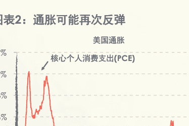
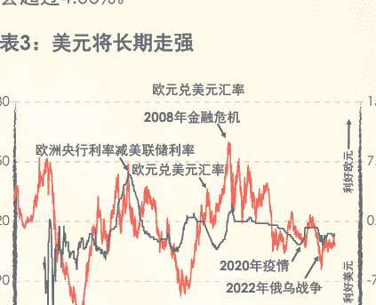
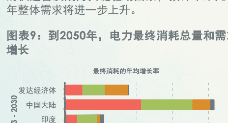

# BANK OF SINGAPORE
An OCBC Company
Asia's global private bank

# 2025超级趋势

## 世界格局 日新月异
第二版

# 免费 价值 及时 专注

# 扫码加入 知识星球TOP 免费资源群

- 每日免费获取有价值资源
- 可提供各类资源搜索服务

公众号: 知识星球TOP 微信号: jntsg8 微信号: jntsg2

分享资料仅供个人学习，请及时删除，切勿商用传播

## 世界格局 日新月异 ...... 4
## 激活资产配置 ...... 12
## 人工智能在现实生活中的应用 ...... 20
## 加速发展 ...... 26
## 人口2.0 ...... 32

# 2025超级趋势：世界格局新日月

世界格局的变革尚未死亡的终局，但已接近这一程度。未来五年，我们熟悉的世界将经历巨大的转变。在森林世纪初，全球税收、税收政策的“三重奏”将全球、多边主义以及各经济集团之间的互动，打破了旧的稳定局面。

这一经济性的变革将迫使我们重新考虑与股票、公开市场与市场之间的资产配置，以及整体的资产配置框架。现在正是在对一系列具有重要性的观点进行对我们资产组合进行重新审视、思考和调整的最佳时机。

2024年，新亚洲投资办公室的首席顾问成立了首席投资咨询委员会（CIO），我们将委员会的咨询作为全球投资的成果；得知灼见无不可替代的；我们将从多维化的视角，向为您呈现最新的趋势。

在长期趋势中，超级趋势将构建新的投资组合和评估各类、地区和主题的基石。

委员会的设立旨在首次报告首席投资办公室的研究能力，并为客户提供深度的见解。我们收集了首席投资办公室委员会成员的多元化视角，以及对于“2024超级趋势”报告后我们有了不同的新，向为您呈现最新的趋势。

人工智能的数字化。大数据计算的应用，将使得可能的巨大的变革。各国的气候变化和减碳趋势推动对再生能源的持续需求。

我们将目光展望政治、宏观经济、投资、科技、环境和社会因素等领域的深刻变革，总结了五大关键趋势：

- I. 世界格局新日月
- II. 活跃资产配置
- III. 人工智能在现实生活中应用
- IV. 加速发展
- V. 人口2.0

“人口2.0”描述了因医疗保健质量提升共同的人类寿命延长以及不断下降的出生推动一个全新的时代的到来，而在这一时代，不变的人口结构将成为宏观经济和微观经济的基石。

随着人们寿命的增长和生活质量的提高，财政负担和压力转型为财富创造和对收入的获取形成了相互平衡。这对资产配置造成了影响，要求我们构建具备灵活性的投资组合以应对未来不确定的结果。

全球贸易流动、国际合作机制与超级大国主导地位受到威胁，在此背景下，世界格局正在发生新日月的变化。

> 正本莱明·哥兰金曾经说道：“对投资的忽视，获得的是丰富的。”与全球思想领袖携手开展对你持续的互动，共同担当与未来的智慧。

均险形势
谢华
环球首席投资咨询
新加坡

亚洲华人银行
富信亚洲投资办公室
（专业投资咨询（&）银行）
亚洲华人

## 世界格局 日新月异：
特朗普重返白宫将对美国及全球产生深远影响

## 2025展望美国：特朗普重返白宫将对美国及全球产生深远影响

- 在新冠疫情、俄乌冲突、中东竞争和中美竞争的冲击下，世界格局日益碎片，而在特朗普任期内，这一局面将进一步升级。
- 特朗普总统宣布的减税、加高关税、收缩政策和宽松政策等一系列措施将在其任期内执行，经济增长在长期内可能受益于这些政策，但可能减少波动和收益率的上升。
- 其他国家/地区会对美国压力、军事和升级做出反应。世界格局将变为美国和中国的主导，供应链将遭遇冲击并从高。

### 特朗普第二任期将对美国政策带来改变

特朗普重返白宫将进一步改变，美国新届政府将在2025年初开始。本人认为需要关注几个关键因素：

首先，美国财政赤字将逐步扩大。如果特朗普重返白宫将在其任期内，财政赤字将达到GDP的2%。

其次，特朗普政府将征收高额关税以降低美国贸易逆差，总统提议对出口产品征收60%，对所有进口产品征收10%-20%。

不同于调整关税，加税只需要行政令即可实施，而无需国会批准。特朗普提出的高关税率是一种谈判策略。鉴于两国对美国采取强势立场，预计在2025年下半年，针对中国商品的关税可能达到20%-30%。

# 2025年初趋势：世界格局新日月

墨西哥出口的商品面临风险。特朗普可能对墨西哥出口贸易、边境安全和移民等问题存在重大争议。在特朗普任期内实施的《美加关税》后，新届政府可能对两国实施更严格的贸易政策。

### 美国新届政府将导致通胀反弹

在此期间，特朗普新届政府的政策可能对所有进口商品征收至20%的关税，对钢铁和汽车等车辆征收额外关税，这些是有可能的。

第三，收紧移民政策，尽量非移民居住在美国境内，新届政府可能执行大规模遣返。政府将高调招聘和加速数万名非法劳工导致损害依赖这些劳工的农业行业，导致美国劳动力市场紧张。

第四，美国新届政府将在宽松监管，将放宽石油和天然气、金融和小型企业等监管力度，可能刺激更多行为并经济增长。如果这种行为再次加剧，消费者价格可能有所上涨。

第五，特朗普政府将向美联储施压力，要求美联储加快降息措施以支持经济增长并削弱美元。鲍威尔主席的任期将延续到2025年6月，届时美国新届总统将有机会任命更符合其意图的美联储主席。

因此，本行预计特朗普第二任期政府将通过加税、加高关税、收缩政策和宽松监管推动通胀反弹，而如果美联储面临临时压力，通胀压力将进一步加剧。

### 图2：通胀可能再次反弹

资料来源：彭博、新加坡银行

如图2所示，通胀从2022年美国经济衰退重启后四十年高位回至目前的2.7%，该指标为美联储以个人消费支出的目标指标，但核心通胀高于美联储预计的2%目标。如果一个新届政府的政策得以实施，通胀将接近3%的高位，高于美联储设定的2%目标。

### 金融市场波动将加剧

在特朗普政府执政期间，美国政策的重大变化和通胀上涨将导致金融市场波动加剧。

2025年，美国经济增长最初可能受益于减税和宽松监管政策。

## 2025美国趋势展望

最后，通胀风险、美联储可能面临的压力，以及美国法律和未来外交政策等问题，均可能在2030年之前维持市场对黄金的需求。

本行预计，美联储将在12月份、1月份和3月份会议后再次加息25个基点，利率从4.50%-4.75%下降至3.75%-4.00%，在2025年之前停止加息。“最终”将维持更高的水平和通胀反弹将导致收益率回调。本行预测，未来12年内美债收益率将维持在4%左右，10年期美债平均收益率可能超过4%。

世界其他国家/地区面临严峻

### 图表3：美债长期收益率

与美国不同，世界其他地区面临严峻经济前景。在特朗普任期内，大多数经济体（包括中国大陆、德国、日本、韩国和台湾）可能面临增加高额关税。与此同时，如果美国新届政府大幅收紧移民政策，受益于美元的国家（包括巴西、菲律宾）可能面临资金减少。

资料来源：彭博、新加坡银行

# 2025超级趋势：世界格局日新月异
## 全球经济分裂成相互竞争

投资者需要考虑，在2030年前中美竞争是否会迫使各国在外交、经济和贸易方面向美国调整。同样面临特朗普政府的风险，但欧盟、加拿大、澳大利亚、日本等传统盟友或拉丁美洲、非洲和亚洲（包括东盟国家）部分可能跟随中立的国家。

最坏情况下，全球经济分裂为美国和中国主导的集团，供应链将显著重塑，贸易领域严重损害企业利益。

# 2025经济趋势：全球超级趋势转型

特朗普政府推动全球经济分化，从多个方面来看，并非简单地分为美国和中国两大集团。在流动方面，特朗普政府的初始将导致美国和欧洲资金流范围内有所不同。部分受货币周期性因素的影响，部分受政治影响，部分受监管视欧元升值。

许多人认为其影响力低于亚洲，如果美国政府过度施压，这将迫使欧洲采取类似方案。然而，由于美国对欧洲的反制力度加强，可能会高通胀。

科技方面，大部分关注焦点都集中在人工智能平台科技公司。但现在不是一点焦点，第一阶段特朗普政府执政期间，美国将推动其自身的环境和标准准则与全球其他地区进行适当调整；第二阶段特朗普政府执政期间，这一趋势将加速发展——美国也将使其盟友推动军事竞争。虽然非美国依然依赖中国或俄罗斯的军事技术，但所涉及的技术优势与影响的比例将上升。尽管“科技双巨头”仍占据主导地位，但投资者将密切关注美国科技优势与其他竞争的日益化。

Adam Rosen
彼森国际经济研究所

## 2025年趋势：世界格局日新月异

中国试图进行经济转型，将其重心从房产转向实际价值。然而，在没有相应需求的情况下主导全球生产，可能意味着向未实施贸易壁垒的国家/地区遭遇失败。在此，特朗普再次当选将给中国带来更多风险。由于特朗普可能等到其第二个任期开始几个月后增加额外关税，中国有时会有反应。

从中国全国常委会会议结果来看，10万亿元人民币的财政方案或将持续至2028年。该方案主要是现有机制的延伸，不包括任何新发的中国政府债券(CGB)。

通胀问题虽然困难，但通胀似乎是中国政府并不希望看到的结论。中国政府可能认为，任何可能导致通胀上升的政策都必须经过考虑，采取财政措施以满足需求至少是一项高风险的政治举措。因此，政府未来可能因局势变化采取措施，而非先发制人的举措，其政策更多是防范下行风险。

本行对任何外部资讯提供信息的准确性或完整性不负责，相关信息如有变更将另行通知。外部资讯所持观点不代表本表观点。这些观点可能未经编辑讨论、咨询或意见。您需自行判断这些内容对您是否适用。如有疑问，请自行遵循寻求独立的财务、法律、税务或他人判断合适的建议。本行及任何内部职员均不会因您使用演示报告内容引起或关联的任何损失将承担责任。非免责声明

## 2025年趋势：全球市场导向

面对这种全新的通胀模式，投资者需要重新构建传统的资产配置框架。尤其是具有定价能力且受通胀趋势影响的资产可能表现出韧性，可以将上涨作为成本转嫁给消费者。由于大宗商品和房地产等物资产具有通胀敏感性，此类资产也可配置。

### 私募市场趋势

随着60-40股债投资组合的多元化优势在保持高利率的环境下，由于通胀通常高于日美债收益率，同时由于在高利率环境下，投资者更倾向于追求实际利率，此行为认为对私募市场的资本配置将进一步获益。

由于全球融资市场的结构性变迁，私募基金正处于递增长期内，无论是直接投资还是与银行合作都存在许多机会。

此外，越来越多的企业在长时间内保持货币扩张状态，导致股票回报日益减少，这使得推动资产配置转向私募市场。上市公司日益与私募股权机构建立合作关系，以保障资金来源的稳定并帮助私募股权机构的运营，在市场波动和均衡时期。

因此，此行为，另类资产配置将提升投资的回报，尤其是私募股权和信贷市场为投资者带来更广阔的投资机会，并由于运营获得更高的回报。

图5：另类资产配置提供多元化收益，有助于提升投资组合的表现
img/dbc5ad762bce1081e8d7dce4da08a47_14_0.png 数据来源：彭博、Cambridge Associates、Preqin、Inlay、摩根士丹等。数据截至2024年1月。

相关性2014年第三季度至2024年第二季度的回报。60-40股债组合包含60%（以MSCI全球股票为代表）和40%的债券（以美国债券为代表）。另类资产分类如下：
- 私募股权
- 私募基金
- 私募信贷
- 基础设施
- 美国房地产信托（REITs）
- 非核心房地产
- 美国核心房地产
- 全球房地产
- 对冲基金
截至2024年5月的最新数据。

### 债务可持续

应对疫情付出的财政政策进一步加剧了债务负担，近年来债务水平显著上升。根据国际货币基金组织的数据，在2023年，全球政府债务占GDP比例创了历史新高。

### 结构性增长

本报告预计，将有更多资本流向数字化、自动化和可持续发展领域。未来，数据量将增长，同时转型将成为清洁能源和效率问题的解决方案。

随着绿色转型，扩大基础设施建设（如数据中心、网络安全）将成为趋势。根据国际货币基金组织（IMF）预测，从2023年至2035年，全球清洁技术市场（包括太阳能、风力涡轮、电动汽车和电池）预计将从7千亿美元增长到2万亿美元。

图6：债务与GDP的演变
img/dbc5ad762bce1081e8d7dce4da08a47_15_0.png 数据来源：国际货币基金组织经济展望数据库，2024年10月。

特朗普可能延长其第二任期，通过他的《17年税收和就业法案》。新的预算可能导致美国财政赤字大幅扩大，而目前财政赤字占GDP的比重已高达7%。

随着全球信贷维持在限制区间，政府债务将持续上升，并可能挤占其他支出事项。这将抑制经济增长，导致应对意外事件的灵活空间减少。

图7：到2035年，全球清洁技术市场规模
img/dbc5ad762bce1081e8d7dce4da08a47_15.png 按地区分类清洁技术市场
| 中国大陆 | 美国 | 欧洲 | 印度 | 世界其他地区 |
| :--- | :--- | :--- | :--- | :--- |

数据来源：国际货币基金组织

对投资者而言，这意味着多元化投资和审慎风险管理的重要性。投资者可能利用避险资产来补充投资组合。

## 2025年趋势：世界市场更新

### 新兴市场的机会

### 风险管理至关重要

## 激活资产配置

目前，这些趋势将推动全球资本配置逐渐脱离传统框架。鉴于预期收益下降、波动以及核心股票和债券的多元化收益减少，投资者必须采取分散投资、灵活变通、更有机会的方式进行投资，同时审慎管理风险。
img/dbc5ad762bce1081e8d7dce4da08a47_16_0.png

# 2025年经营趋势：世界格局新旧交替

在传统资产类别中，需要关注其资产质量、价值和流动性。股票方面，本行看好具有一定能力、资产负表稳健且受益于长期增长的公司。

目前，另类资产（尤其是私募股权、债券和实物资产）在提供差异化回报、增厚收益和增强投资组合抗性方面发挥更大作用。

相比之下，本行不看好固定收益。本行预期，在特朗普任期内，收益率可能进一步上升，这将带来短期风险。同时，发达市场与新兴市场信贷差异将处于最活跃水平，因此收益率反映了2025年乐观的预期，基本没有选举后的政策不确定性。长期方面，本行最大的风险可能来自美国财政状况对信贷融资的影响，这可能导致收益率曲线触陆。因此，本行的收益率（尤其是长期美债）存在更多上行风险，认为应该关注长期，而更偏好中期美债。

基础设施、房地产和大商品等物资产可提供多元收益，同时具备通胀敏感性。

更广泛而言，投资者应采取主动动态策略配置资产，主动管理风险敞口，以应对多变的经济增长和市场波动。管理风险，投资者应在其投资组合中持有避险资产作为补充。
img/dbc5ad762bce1081e8d7dce4da08a47_17_0.png

## 2025年趋势：世界股市新异

从高增长低通胀为常态的时期不同，2025年进入了新的全球环境。目前的经济环境特点是：
- 通胀上升
- 政策不确定性
- 波动加剧
- 利率高位

结构性转变：
随着货币扩张环境的消失，波动加剧。由于政策不确定性，创造价值和长期趋势变得更加重要。未来，资金将流向以下领域：
- 数字化
- 自动化
- 劳动力供应
- 人口龄化
- 人工智能

人工智能需求充足，导致资产配置变得更加重要。
随着需求增加，重点关注领域：
- 人工智能
- 基础设施
- 房地产
- 土地

私募投资可以提供极具吸引力的回报，通过投资杠杆融资实现多元化的投资。目前的状况有利于私募资产，尤其是回报最高的资产类别：
- 私募股权
- 私募基金

Paula Campbell Roberts，KKR财富首席策略师

非免责声明：本文对任何外部募资提供信息的准确性或完整性不负责，若有任何变更，将另行通知。外部募资的观点代表本文观点。这些观点可能未经讨论、咨询或同意。您需自行判断该内容对您是否适用。如有疑问，请自己寻求独立的财务、法律、税务或他人来判断建议。本行及任何行员均不会因您使用演示文稿内容引起或关联的任何损失承担责任。

## 2025年趋势：

2025年，我们认为，很大程度上依赖公开市场的投资组合将面临诸多挑战。因此，顾问可能需要帮助投资者调整配置。我们预计市场将继续处于通胀周期，其中包括：
- 后疫情带来的通胀压力
- 经济增长集中（如住房投资不足）
- 制造业的通胀压力
- 绿色能源和国防加大通胀的必要性

这意味着，在本轮周期中，通胀和利率的平均水平将进一步上升，比过去几年加剧。

对于债券组合而言，这一转变可能在三个方面带来挑战：
1. 股票与债券之间的相关性。近年来，债券组合受益于两者之间的负相关关系，使得投资组合在某些部分表现较弱时，其他部分能够对冲风险并保护。在平均收益水平不高的情况下，这种关系可能不再可靠。
2. 由于收益率走高带来的风险，过去增强流动性而导致的股市流动性扩张可能衰减。
3. 许多上市资产的初始估值较高，可能加剧这一风险。

私募资产可能提高风险调整后在长期战略性配置中发挥重要作用。当前的宏观环境使得资产配置更加重要。房地产作为投资组合可以提供一定的通胀对冲，尤其是数据中心和物流等快速增长的板块。私募投资可以提供极具吸引力的收益率，通过投资杠杆融资实现多元化的投资。目前的状况有利于私募资产，处于通胀周期、交易活动增加、且相对于市盈率较高的大型公司具有吸引力。

### 人工智能在现实生活中的应用
img/dbc5ad762bce1081e8d7dce4da08a47_20_0.png

## 2025级趋势

随着增量预算可能流向与人工智能相关的资本支出，对于企业而言，人工智能作为一个明确且重要的优先事项，正从概念转变为现实。

头部云服务的巨额支出为人工智能半导体带来了增长，而且这种增长远未停滞。现货芯片和内存芯片的需求仍在增长，将覆盖更多的半导体领域。

人工智能应用开始加速，重心在以下方面：
- 面向客户运营收益
- 客户体验和参与度

人工智能机器人的采用率逐步上升，有助于未来几年。人工智能需求奠定基础。

“生成式人工智能的兴起需要加强大的推理计算平台，但生成式人工智能应用数量是无限的，唯一的限制就是人类的想象力。”——英特达创始人

人工智能的惊人速度吸引了全球投资者的关注。人工智能从一项未知的技术，发展为消费者无处不在的技术。世界格局新异
这是显而易见的，因为人工智能的普及及应用，人工智能模型的成本迅速下降。性能相同，可能会持续至2030年。

### 人工智能的竞赛正在上场

在早期阶段，针对人工智能基础设施的投资规模相当。IDC预测，未来四年GenAI的支出复合增长将达到73%。全球GenAI支出从2023年的160亿美元增长至2027年的470亿美元。

目前头部云服务厂商在人工智能领域投入了大量资本，芯片巨头也将未来路线图显示未来的产品（GPU）、专用集成电路（ASIC）等解决方案。具体而言，ASIC能够为人工智能推理负载提供更高的效率和更好的成本。
img/dbc5ad762bce1081e8d7dce4da08a47_1_0.png

## 2025年趋势：世界格局新布局

事实上，未来几年人工智能ASIC预计将超过人工智能市场的整体调整，随着时间的推移而增加。这由于大模型云服务的竞争呈现出明显的差异化、更具性的性能、更低的功耗。目前的解决方案来说，ASIC具有可能的人工智能加速器。生成式人工智能预计将在2025年下半年之后大幅增长。因此，企业正在面对人工智能模型架构，审慎的策略需要等待。

### 云资本支出——彻底突破

人们对人工智能的热情高涨，但也日益担心是否是一场短暂的狂热，而资本支出是否不可忽视。事实上，投资者正在寻找更多数据来确定这一趋势的持续性。实际价格计算，关键大模型云服务商/科技企业的资本支出将超出估计可能接近2019年至2023年，这是一个合理的预期。

考虑到上述问题，近期数据显示，企业人工智能/生成智能的整体调整仍为有利。生成人工智能和语言模型（LLM）的最新创新影响当年的信息技术投资重心直接影响。市场对这类创新技术的兴趣增长。预算增加将好人工智能/机器学习/流程自动化等等。

### 人工智能行业的监管和监管

近期，美国人工智能安全研究所（ASI）与领先人工智能公司达成协议，标志着人工智能模型和监管纳入不断的发展进展。这也标志着人工智能在安全和道德问题上开展了重要一步。这项监管协议将人工智能安全成为主要，在人工智能模型发布之前之后涉及这些模型的框架。

政府与人工智能开发者之间此前未有的合作可能对人工智能行业、监管市场和市场动态产生广泛影响。这些合约的核心是联合，旨在评估与人工智能模型相关的功能和安全风险。

随着时间的推移，我们认为开发先进人工智能系统的公司将面临极大的压力，必须在监管框架下开展合作，否则可能被视为不透明或不安全。

从投资者的角度来看，参与此类公司的可能会受到青睐，因为它们展示了安全性和增强投资者的信心，这一反应将有助于增强者。

# 2025起趋势；全球市场动向

中国能源行业的电气化速度特别快。2000年到2023年间，电力占终端用电比例从11%升至26%。主要原因是建筑行的用电增长，随着收入增加，家电和制冷空调快速增长，室内日益电气化。随着电动汽车的快速成为关键因素，预计未来十年整体结构将持续提升。

## 耗电方面的创新

随着人工智能的能源增长，技术的增长将推动能源需求的增长。根据国际领先能源数据，2020年数据中心用电量为40万吨，在差异巨大情况下，到2026年可能会升至1000万吨。在美国，到2026年，数据中心的用电量预计增长到260万吨，美国用电量的6%。

图 9：2020年，电力消耗总量和需求增长

为这一趋势对环境的影响，本行预计可由再生能源提供一线数据中心规模大幅增长，从而支持数字化和人工智能，同时提高数据中心、冷却和电力系统基础设施的能。

注：其他新兴经济体——中国和印度以外的新兴市场和发展新兴经济体
来源：国际能源署

由于需要提高数据中心、冷却和电力系统基础设施的能，寻找太阳、能和核能等清洁能源充充足能源来投资机会。

图表10：超大规模云服务商用瓶颈以实现环境目标的关键解决方案

| 解决方案 | “技术就绪” | “建设风险” | 经济可行性 |
|---|---|---|---|
| 可再生能源和存储 | 高 | “陆上项目风险，海上项目风险高” | 经济效益因地区而异，但在全球范围内风电和太阳能是更便宜的电力来源 |
| 长时储能(LDES);空气电池 | 中 | 低 | 长时储能与天然气发电厂相比具有优势，价格为20-40美元/MWh |
| 下一代地热 | 中-高 | 高 | 目前情况并非如此，成本持续下降 |
| 小型模块化反应堆(SMR) | 中-高 | 高 | |
| 电网增强技术 | 高 | 低 | 是 |

资料来源：各公司

### 全球清洁能源转型将持续

在亚洲，印尼作为全球最大的镍国之一，提供了巨大的机会。此外还有丰富的出口出口和矿物资源。随着中国企业在亚洲其他地区建立更多制造设施和基础设施，这种转型成为投资的机遇。

尽管市场担心在特朗普执政政府时期，绿色发展政策的目标内容可能被忽略，但全球清洁能源转型将继续进行。

能源转型对于人类的长期生存至关重要，而且对战略竞争也日益至关重要。在清洁能源和可持续发展方面，这种转型有助于确保能源安全，还将增强增长的竞争优势，因此处于这一转型前沿国家将获得巨大的战略优势。

### 清洁能源：解决方案的参与

清洁能源在转型过程中扮演的角色正在发生变化，政策将向化石燃料转型，使其可以使用生物燃料和碳捕捉技术以及复杂能源系统的能力，来解决参与者的问题，而不是成为问题。

本文将探讨能够实现转型型的可靠且盈利增长，同时让石油燃料保持稳定的公司。

在此背景下，本文将关注清洁能源和汽车行业面临盈利机会、行业竞争优势的公司。本文也将关注转型的推动者，包括智能能源网基础设施和能够高效的企业，以及能生产转型所需金属和矿物的企业。

### 美国的转型

拜政府在推进清洁能源转型方面取得了重大进展，强调减少排放和维持可持续能源的重要性。然而，政治格局正在发生变化，与清洁能源相关的优先事项可能发生变化。

### 实现可靠的电力供应

特朗普政府可能将采取额外的政策，重点关注清洁能源和经济增长。这可能意味着某些重石化燃料的加速。

首先，目标是提供可靠、安全、价格可负担的电力供应，需求需要通过多样化能源供应（例如天然气和可再生能源如风能），并通过高效的配电网输送到更广泛的终端用户。

特朗普政府可能将采取额外的政策，重点关注清洁能源和经济增长。这可能意味着某些重石化燃料的加速。或者，这将某些高碳的燃料得到加强。在竞争上，更清洁能源可能让美国保持竞争的优势，包括电池技术、储能、破坏和新型制造，以及更广泛、更高效的转型。

> 由于老化的电网系统已成为迈向可靠发展的瓶颈，因此需要加强和升级智能电网。

此外，中国和欧盟在可再生技术方面取得了重大进展。全球清洁能源竞争日益激烈。美国可能在战略格局上将精力集中在某些领域，确保投资和能源安全并在范围内带来利益。这可能涉及促进促进创新的伙伴关系，同时也解决了劳动力和行业的需求。

智能电网需要数字技术、传感器和相关软件，以优化电力的实现供应，最大限度地降低成本并提高可靠性。根据预测，到2050年，为了支持全球净排放的目标，至少需要在电网上投资21.4万亿美元。

首先，欧盟成员委员会的能源系统数字化计划将利用数字手段来提高效率，并将再生能源纳入电网。

# 2025超级趋势：
世界格局日新月异

图11：全球年度电网资本支出（按地区划分）

注：2030、2040和2050年的数值是前十年的平均
资料来源：彭博新增

## 实现韧性未来社会

总体而言，替代性粮食、水解决方案和自然保护等概念是建设未来社会不可缺的部分。因此，随着消费者偏好转向健康、可持续的选择，投资专注于可持续农业、食品、垂直农业和创新技术的公司可见。随着全球水挑战加剧，这些将在增强水安全方面发挥关键作用。最后，相同的是企业关注环境保护、生物多样性，与日益认识到自然价值。

# 2025超级趋势：世界格局日新月异

基础设施通过长期提供稳定且多元化的现金流和资本增值获得回报。过去20年，电力需求相对平稳。然而，人工智能的兴起和能源转型导致需求增长，未来12到30年内容量将增加。这一转变不仅限于美国，预计未来十年，全球交通、电力和电信基础设施的年度投资需要3.7万亿美元。投资者提供了极具吸引力的机会。

## 人口2.0: 塑造经济的人口结构

# 2025老龄化趋势：世界格局

- 由于老龄化人口的需求在资本市场占据一席，人口寿命延长可能会改变消费模式，推动向医疗保健、休闲和娱乐转型。
- 随着劳动力人口的减少，人才的竞争加剧。这可能刺激自动化技术和提升生产力的投入。处于趋势前沿的国家，如中国和人工智能领域有望从中受益。
- 面对劳动力短缺引起了再培训的机会。因此，市场对教育、再培训、留任和行业公司提供的服务的需求可能增加。

优质医疗保障将延长人类寿命，以及出生率的持续下降共同见证一个新时代的到来，并在未来十年内重塑我们所知的生活。此，根据世界卫生组织预测，2015年至2050年，全球60岁以上人口比例将从12%增长到22%，而这一趋势在发达国家中尤为明显。

另一方面，在2050年，预计印度将占据全球人口的一半。人口最多的两个国家占世界人口的三分之一以上。由于中国人口在2022达到峰值，印度可能从2023年开始超过中国，由于中国的生育率下降后稳定，在本世纪末之前，中国人口可能会跌至10亿。

图表12：中国和印度的总人口趋势，1970年至2022年和2023年至2100年预测（预测值以95%置信）

来源：联合国

图表13：人口最多的五个国家，1970年估计及2023年至2050年预测

| | 1970 | 2023 | 2050 |
|---|---|---|---|
| 1 | 中国 (823) | 印度 (1,429) | 印度 (1,670) |
| 2 | 美国 (558) | 中国 (1,426) | 中国 (1,313) |
| 3 | 美国 (200) | 美国 (340) | 尼日利亚 (377) |
| 4 | 印度尼西亚 (130) | 尼日利亚 (278) | 美国 (375) |
| 5 | 印度尼西亚 (115) | 巴基斯坦 (240) | 巴基斯坦 (368) |
| 6 | | 尼日利亚 (224) | 印度尼西亚 (317) |
| 7 | | | |
| 8 | | | |
| 9 | 俄罗斯联邦 (144) | |
| 10 | 巴基斯坦 (59) | | |

> *括号中的数字指参考年份7月1日的总人口（以万人计）

来源：联合国

## 2025年展望：老龄化新局面

全球老龄化主要受生育率下降和预期寿命延长影响。这一趋势对资本分配具有深远影响。随着老龄化程度加剧，需要的养老资金增大（通过通胀调整），更高的养老金将为未来提供支持，这可能会推动“追逐收益”现象，股票的股票。

人口收缩和老龄化成为宏观经济的长期挑战。首先，政府面临劳动力短缺，企业面临成本压力。其次，人口收缩导致经济萎缩，企业投资减少。最后，气候变化或生活方式的大规模转变将改变社会。

人口结构变化使得老年护理、远程医疗和医疗技术等领域面临挑战。各国政府需要应对老龄化人口提供医疗保健和社会支持服务的日益负担，由于纳税劳动力不断下降，这将增加财政负担。

虽然老龄化服务需求预计将上升，但劳动力短缺是关键问题。自动化和机器人预计快速增长，有助于填补劳动力缺口。这些机器人可应用于康复/老年护理、医疗保健和其他领域，例如灾难救援、化学品制造、采矿和安全生产。美国、欧洲、日本和中国工业领域的龙头企业将受益于这些积极的结构趋势。

特朗普政府可能将采取额外的政策，重点关注清洁能源和经济增长。这可能意味着某些石化燃料的加速。这将某些高碳的燃料得到加强。在竞争上，更清洁能源可能让美国保持竞争的优势，包括电池技术、储能、破坏和新型制造，以及更广泛、更高效的转型。

> 由于老化的电网系统已成为迈向可靠发展的瓶颈，因此需要加强和升级智能电网。

此外，中国和欧盟在可再生技术方面取得了重大进展。全球清洁能源竞争日益激烈。美国可能在战略格局上将精力集中在某些领域，确保投资和能源安全并在范围内带来利益。这可能涉及促进促进创新的伙伴关系，同时也解决了劳动力和行业的需求。

智能电网需要数字技术、传感器和相关软件，以优化电力的实现供应，最大限度地降低成本并提高可靠性。根据预测，到2050年，为了支持全球净排放的目标，至少需要在电网上投资21.4万亿美元。

首先，欧盟成员委员会的能源系统数字化计划将利用数字手段来提高效率，并将再生能源纳入电网。

# 2025超级趋势：
世界格局日新月异

图11：全球年度电网资本支出（按地区划分）

注：2030、2040和2050年的数值是前十年的平均
资料来源：彭博新增

## 实现韧性未来社会

总体而言，替代性粮食、水解决方案和自然保护等概念是建设未来社会不可缺的部分。因此，随着消费者偏好转向健康、可持续的选择，投资专注于可持续农业、食品、垂直农业和创新技术的公司可见。随着全球水挑战加剧，这些将在增强水安全方面发挥关键作用。最后，相同的是企业关注环境保护、生物多样性，与日益认识到自然价值。

# 2025超级趋势：世界格局日新月异

基础设施通过长期提供稳定且多元化的现金流和资本增值获得回报。过去20年，电力需求相对平稳。然而，人工智能的兴起和能源转型导致需求增长，未来12到30年内容量将增加。这一转变不仅限于美国，预计未来十年，全球交通、电力和电信基础设施的年度投资需要3.7万亿美元。投资者提供了极具吸引力的机会。

## 人口2.0：塑造经济的人口结构

## 2025年老龄化趋势：世界格局

- 由于老龄化人口的需求在资本市场占据一席，人口寿命延长可能会改变消费模式，推动向医疗保健、休闲和娱乐转型。
- 随着劳动力人口的减少，人才的竞争加剧。这可能刺激自动化技术和提升生产力的投入。处于趋势前沿的国家，如中国和人工智能领域有望从中受益。
- 面对劳动力短缺引起了再培训的机会。因此，市场对教育、再培训、留任和行业公司提供的服务的需求可能增加。

优质医疗保障将延长人类寿命，以及出生率的持续下降共同见证一个新时代的到来，并在未来十年内重塑我们所知的生活。此，根据世界卫生组织预测，2015年至2050年，全球60岁以上人口将从12%增长到22%，而这一趋势在发达国家中尤为明显。

另一方面，在2050年，预计印度将占据全球人口的一半。人口最多的国家占世界人口的三分之一以上。由于中国人口在2022达到峰值，印度可能从2023年开始超过中国，由于中国的生育率下降后稳定，在本世纪末之前，中国人口可能会跌至10亿。

图表12：中国和印度的总人口趋势，1970年至2022年和2023年至2100年预测（预测值以95%置信）

来源：联合国

图表13：人口最多的五个国家，1970年估计及2023年至2050年预测

| | 1970 | 2023 | 2050 |
|---|---|---|---|
| 1 | 中国 (823) | 印度 (1,429) | 印度 (1,670) |
| 2 | 美国 (558) | 中国 (1,426) | 中国 (1,313) |
| 3 | 美国 (200) | 美国 (340) | 尼日利亚 (377) |
| 4 | 印度尼西亚 (130) | 尼日利亚 (278) | 美国 (375) |
| 5 | 印度尼西亚 (115) | 巴基斯坦 (240) | 巴基斯坦 (368) |
| 6 | | 尼日利亚 (224) | 印度尼西亚 (317) |
| 7 | | | |
| 8 | | | |
| 9 | 俄罗斯联邦 (144) | |
| 10 | 巴基斯坦 (59) | | |

> *括号中的数字指参考年份7月1日的总人口（以万人计）

来源：联合国

## 2025年展望：老龄化新局面

全球老龄化主要受生育率下降和预期寿命延长影响。这一趋势对资本分配具有深远影响。随着老龄化程度加剧，需要的养老资金增大（通过通胀调整），更高的养老金将为未来提供支持，这可能会推动“追逐收益”现象，股票的股票。

人口收缩和老龄化成为宏观经济的长期挑战。首先，政府面临劳动力短缺，企业面临成本压力。其次，人口收缩导致经济萎缩，企业投资减少。最后，气候变化或生活方式的大规模转变将改变社会。

人口结构变化使得老年护理、远程医疗和医疗技术等领域面临挑战。各国政府需要应对老龄化人口提供医疗保健和社会支持服务的日益负担，由于纳税劳动力不断下降，这将增加财政负担。

虽然老龄化服务需求预计将上升，但劳动力短缺是关键问题。自动化和机器人预计快速增长，有助于填补劳动力缺口。这些机器人可应用于康复/老年护理、医疗保健和其他领域，例如灾难救援、化学品制造、采矿和安全生产。美国、欧洲、日本和中国工业领域的龙头企业将受益于这些积极的结构趋势。

# 2025超级趋势：世界格局日新月异

## 2025年趋势：世界格局 日本上升

### 老龄化社会的消费模式将重塑消费

此外，消费者倾向于在旅游、休闲娱乐和消费方面更多，而在耐用品上的开支较少。退休生活是时间的礼物，许多老年人将拥有更多的时间去探索爱好。这种正常的消费会增加人们在享受和满足健康活动上的支出。投资者应当了解这些变化，并根据人口结构不断变化的需求和偏好，将资本投向的行业和公司。

### 对教育、再培训、留任和招聘的需求增加

此外，面对短缺以及自动化的兴起，人口减少可能会导致再培训的需求。这需要专业技术人才来发展就业机会。因此，市场对教育、再培训、留任和招聘的公司提供的服务的需求可能增加。由于他们在整个职业生涯中多次转换职业，技能组合或混合，因此想要员工未来工作所需的专业知识。政府和企业必须投资于优质教育和再培训。同时，在劳动力市场紧张的时代，吸引和留人对组织和企业日益重要。

图表15：按年龄划分的消费支出比例

- 25-34 -- 35-44 -- 45-54 -- 55-64 -- 65及以上

来源：新加坡银行、英国劳工统计局

# 2025超级趋势：世界格局日新月异

# 2025超级趨势：世界格局 日月展望

securities-based derivatives contracts may not be circulated or distributed, nor may the securities or securities-based derivatives contracts be offered or sold, if subject of an invitation for subscription or purchase, whether directly or indirectly, to persons other than an institutional investor (as defined in Section of Securities and Futures Act 2001 of Singapore, as modified (the "SFA")) pursuant to Section 274 of the SFA, or to a relevant person (as defined in the SFA) pursuant to Section 275(1) of the SFA, or any person pursuant to Section 275(a) of the SFA, and with the conditions specified in Section 27 of the SFA and, applicable, the conditions specified in Regulation 3 of the Securities and Futures (Classes) Regulations 2018, or (ii) otherwise to, in accordance with the conditions of, any other applicable provision of the SFA.

When securities-based derivatives contracts are subscribed or purchased under Section 275 of the SFA by a relevant person who is

- (a) a corporation (which is not an accredited investor (as defined in the SFA) whose business is to hold investments and the entire share of which is owned by one or more individuals, each of whom is an accredited investor, or
- (b) a trust (where the trustee is not an accredited investor) whose purpose is to hold investments and each beneficiary of the trust is an individual who is not an accredited investor.

securities (as defined in Section 2(1) of the SFA) or securities-based derivatives contracts (as defined in Section 2(1) of the SFA) that corporation or the beneficiaries' rights described in) trust must not be transferred within six months after that corporation or trust has acquired the securities or securities-based derivatives contracts offered under Section 275 of the SFA except:

- (1) to an institutional investor or a relevant person, or to any person arising from or referred to in Section 275(1A) or Section 274(4)(c)ii of the SFA;
- (2) where no consideration is or given for the transfer;
- (3) where the transfer is by operation of law;
- (4) as specified in Section 276(7) of the SFA; or
- (5) as specified in Regulation 37A of the Securities and Futures (Offers of Units) (Securities and Securities-based Contracts) Regulations 2018 of Singapore.

The fund(s) is subject to investment risks. Investors should read the Prospectus and Product Highlights Sheet (where applicable), obtainable from your relationship manager, the fund manager or its distributors, before investing.

Units of the collective investment scheme are or will be listed on an exchange, and all most investors may only deal in units through the exchange investors cannot redeem the units with the manager or may only redeem units with the manager under certain conditions. The listing of units does not guarantee a liquid market for the units.

Where material relates to units of the collective investment scheme registered under restricted scheme, this applies:

The offer or invitation of the units of the collective investment scheme, which is the subject of, does not relate to a collective investment scheme which is authorised under Section 286 of the Securities and Futures Act 2001 of Singapore, or amended or modified (the "SFA") or recognised under Section 287 of the SFA. The collective investment scheme is not recognised by the Monetary Authority of Singapore (the "MAS") and its units are not allowed to be offered to the retail public. and any other document or material in connection with it is not a prospectus as defined in the SFA and,, statutory liability under the SFA in the context of prospects does not apply, and you should carefully consider whether the investment is suitable for you.

Where material relates to units of the collective investment scheme authorised or recognised under the SFA, this applies:

The collective investment scheme is authorised under Section 286 of the Securities and Futures Act 2001 or amended or modified (the "SFA") or recognised under Section 287 of the SFA. Past performance and any forecasts are not indicative of the future or likely performance of the fund(s). The value of units and the income from them may fall as well as rise.

# 2025 酷趋势：世界格局 日新月异

This material has not been registered as a prospectus with the MAS. Accordingly, this material, and any other document or material in connection with the offer or sale or purchase of the units may not be circulated or distributed, nor may the units be offered or sold, or be made the subject of an investment for subscription whether directly or indirectly, to Singapore person other than to an institutional investor (defined in the SFA) pursuant to Section 2(fa), or to a relevant person (defined in Section 305 of the SFA) pursuant to Section 306(1), or any person pursuant to Section 306(2), and in accordance with Section 305 of the SFA, and where applicable, the conditions specified in Regulation 3 of the Securities and Futures (Classes of Investors) Regulations 2016, otherwise pursuant to, and in accordance with the conditions of, any other applicable provision of the SFA.

or the beneficiaries' rights and interest (however described) in that trust shall not be transferred within six months after that corporation or trust that has acquired the units to a person pursuant to Section 305 of the SFA except:

- (1) to an institutional investor or to a relevant person, or to any person arising from referred to in Section 275(1)(a) or Section 305(3)(c)(i) of the SFA);
- (2) where no consideration is given for the transfer;
- (3) where the transfer is by operation of law;
- (4) as specified in Section 305(4) of the SFA; or
- (5) as specified in Regulation 36 of the Securities and Futures (Offers of Investments) (Collective Investment Schemes) Regulations 2005 of Singapore.

derative product or structured product with derivatives embedded in it. A DCI involves a currency option which confers on the deposit-taking institution the right to repay the principal sum at maturity in alternate currency. or any of the interest earned on this investment represents the premium on this option.

By purchasing this DCI, you are giving the issuer of this product the right to pay you at a future date in alternate currency that is different from the currency in which your initial investment you wish to be in, regardless of whether that currency at that time is different. DCIs are subject to exchange rate fluctuations which may affect the return of your investment.

Where units are subscribed or purchased under Section 305 of the SFA by a relevant person which is:

- (a) a corporation (which is not an accredited investor (defined in the SFA) the business of which is to hold investments and the share capital is owned by one or more individuals, each of whom is an accredited investor; or
- (b) a trust (where the trust is not an accredited investor) whose purpose is to hold investments and each beneficiary of the trust is an individual who is an accredited investor; securities (as defined in Section 2(1)(a) of the SFA) of that corporation

Where this material relates to structured deposits, this clause applies:

The product is a structured deposit. Unlike financial deposits, structured deposits have investment element and may wish to seek independent advice from a financial advisor before making a commitment to purchase this product. In the event that you choose not to seek advice from a financial advisor, you consider whether this product is suitable for you.

# Hong Kong

This document has not been delivered for registration to the Registrar of Companies in Hong Kong and its contents have not been reviewed by any regulatory authority in Hong Kong. (1) The shares/notes may not be offered or sold in Hong Kong by means of any document other to persons who are “Professional Investors” within the meaning of the Securities and Futures Ordinance (Cap. 531) of Hong Kong and the

Where material relates to dual currency investments, this clause applies:

The product is a dual currency investment. A dual currency investment product (“DCI”) is a
<!-- no content -->[/content]’”，结果如下：

[content]<!-- no content -->