# AI产业全景洞察报告2025

Think big with data

MoonFox Nasdaq: JG 聚光锥下成员 

CEIBS AI与管理创新研究中心

联合发布

# 扫码加入 知识星球TOP 免费资源群

公众号:知识星球TOP

- 每日免费获取高价值资源
- 可提供各类资源搜索服务

免费 价值

| 热门付费文章 | 各行各业报告 |
| --- | --- |
| 精选图书资源 | 副业赚钱方法 |
| 职场实用资源 | AI经营自媒体 |

微信号:jntsg8

及时 微信信号:jntsg2

专注 分享资料仅供个人学习，请及时删除，切勿商用传播

# CONTENTS

- 01 | 人工智能发展现状
- 02 | 人工智能全景研究
- 03 | 中国人工智能企业出海分析

# 01 第一章：人工智能发展现状

当前，全球市场对人工智能的需求热度不减，各类垂直赛道的竞速仍然激烈，预计在未来十年内，全球人工智能市场规模将保持19.1%的年均增长率；在投资方面，全球AI领域的股权融资和交易情况也显示出积极的信号，2024年第三季度，人工智能交易数量达1245笔，数量规模回落2022年的顶峰水平，融资金额规模在2023年振幅明显。

## 全球人工智能市场规模（亿美元）

## 全球人工智能领域股权融资和交易情况

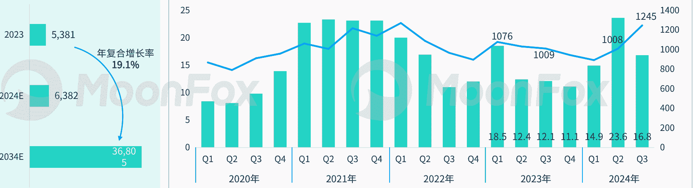

市场规模来源:Precedence Research；融资和交易数量来源:CB Insights

## 2024年1-10月全球人工智能融资国家分布(亿元)

- 2024年10月全球AI融资额约7000亿美元，较2023年同期下降70%，但AI企业数量增速了36%！

| 2024年1-10月全球人工智能融资国家分布(亿元) |
| 国家 | 金额 |
| --- | --- |
| 美国 | 2532 |
| 中国 | 366 |
| 英国 | 123 |
| 加拿大 | 109 |
| 法国 | 108 |
| 芬兰 | 49 |
| 德国 | 49 |

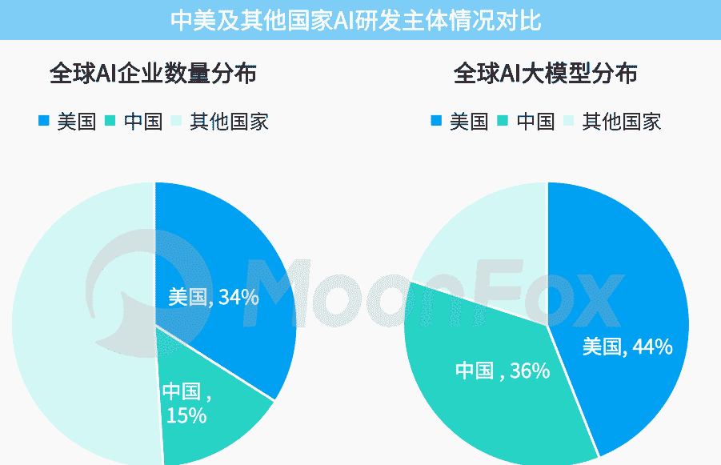

融资金额来源:非凡产,数据周期:2024.01-2024.10;AI企业数量、AI大模型数据来源:中国信通《全球数字经济白皮书(2024年)》

## OpenAI竞赛，生成式AI大爆发

## ChatGPT倾潮巅峰

- OpenAI持续领先，但竞争激烈，Anthropic等快速发力，ChatGPT每月下载量突破5.1亿次，2024年1-11月

**2024年福布斯全球人工智能50强企业（部分）** (按资金金额排序)

ChatGPT每月下载量TOP3国家对比（万）

| 所在地 | 出生时间 | 资金金额（美元） |
| :--- | :--- | :--- |
| Open AI | 美国 | 2015 | 113亿 |
| Anthropic | 美国 | 2020 | 77亿 |
| Databricks | 美国 | 2013 | 40亿 |
| Andurill Industries | 美国 | 2017 | 28亿 |
| Figure AI | 美国 | 2022 | 7.54亿 |
| Cerebras Systems | 美国 | 2016 | 7.2亿 |
| Insitro | 美国 | 2018 | 6.43亿 |
| Scale AI | 美国 | 2016 | 6亿 |
| Mistral AI | 法国 | 2023 | 5.27亿 |
| Adept | 美国 | 2022 | 4.15亿 |

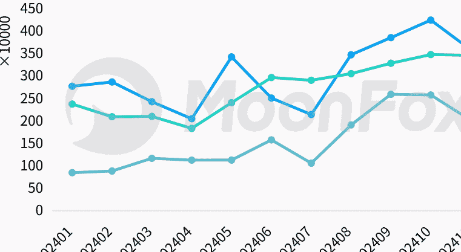

# MoonFox Nasdaq: CEIBS AI与管理研究中心

## 遵循Scaling Law演进

- 随着计算量和数据增加，模型能力持续提升。
- 2024年10月，AI模型数量达到新高。
- 2021-2022-2023-2024.-2024.11

| 软件能力评估 (SWE-Bench) | 代码能力评估 (Codeforces) | Scaling Law |
| --- | --- | --- |
| 100% | 3,000 | 1.0 |
| 80% | 2,500 | 71.7 |
| 60% | 2,000 | 1891 |
| 40% | 1,500 | 41.3 |
| 20% | 1,258 | 48.9 |
| 0% | 1,000 | 2.0 |
| | 500 | |
| | o1-preview | o1-preview |

Open AI

## 生成式AI持续热热

## 算力需求持续增长

- 2021-2022-2023-2024.01-2024.11
- 投资者对国内AIGC信心增强
- AIGC行业内需求膨胀

## 中国生成式AI应用活跃用户规模及渗透率

- 月活跃用户（万）
- 渗透率

| 月活跃用户（万） | 渗透率 |
| --- | --- |
| 1200 | 27.1% - 30% |
| 1000 | 25% |
| 800 | 20% |
| 600 | 15% |
| 400 | 7.2% - 10% |
| 200 | 6.1 - 5% |
| 0 | 6.3 - 0% |

2021-2022-2023-2024.
2024.01-2024.02-2024.03-2024.04-2024.05-2024.06-2024.07-2024.08-2024.09-2024.10-2024.11

资金数据来源:IT桔子;用户数据来源:月错App,数据:2024.01-2024.01.11

# 人工智能产业竞争重点演

## 第一阶段:模型化

## 第二阶段:多模拓展

## 第三阶段:终端应用

## 参数能力竞争

## 多模态能力竞争

## 应用能力竞争

人工智能的竞争主要集中在基础层和算法法则的比拼、模型的准确率、处理速度成为衡量竞争的核心标准、企业和平台要在算力和GPU资源上进行大量投入、要以支持模型的训练和优化。

平台开始探索和实现AI模型在多种类型和交互式模型的应用、竞争核心在于扩展AI的能力，使其不仅处理大量数据，还能理解和生成图像、视频、音频等多模态内容。

垂直场景的AI应用价值巨大，企业需要在特定的行业和场景中深化AI技术的应用、提升AI模型的化能力和智能化水平、以提供更多定制化高效的解决方案。

资料来源:月景研究院

| AI+教育 | AI+医疗 | AI+社交 | AI+办公 |
| AI+营销 | AI+金融 | AI+物流 | ...... |

## 东南亚消费者对人工智能的使用态度 / 2024年1-11月ChatGPT下载量地区分布

| 地区 | 抵拒 | 接受 |
| --- | --- | --- |
| 东南亚整体 | 22% | 78% |
| 新加坡 | 34% | 66% |
| 马来西亚 | 30% | 70% |
| 印度尼西亚 | 23% | 77% |
| 泰国 | 12% | 88% |
| 越南 | 10% | 90% |
| 菲律宾 | 26% | 74% |

使用态度数据来源：Lazada, Kantar《东南亚电商人士》; 下载数据来源：月App, 数据周期：2024.01-2024.11

## 2024年各地区投资规模（亿美元）

## 外资企业在东南亚投资及合作（部分）

| 企业 | 投资地区 |
| --- | --- |
| 新加坡 | 完成数据中心和云服务建设，增强AI及机器密集型应用的能力 |
| 谷歌 | 加入新加坡企业发展，帮助100家新加坡初创公司在未来内开发和商业化产品 |
| 马来西亚、泰国 | 投资建设数据中心，拓展东南亚计算布局，支持AI发展需求 |
| 印度尼 | 与当地科技集团扩大生成式AI的战略合作 |
| 越南 | 开设AI研发中心，越南本土的数据中心，共同推动越南人工智能技术的发展 |
| 泰国 | 与泰国政府共同打造AI基础设施，已在泰国投资Azure中心 |
| 微软 | 签署合作协议，推广微软Copilot及支持企业开发定制化解决方案 |

800
700
600
500
400
300
200
100

资金规模来源：Preqin，数据范围：截至2024年12月日

# 02 第二章：人工智能全景研究

## 中国算力领先

## 算力需求持续增长

## 算力基础设施持续扩张

- 2021-2022-2023-2024
- AIGC需求持续增长
- 2024年1-11月 AIGC
- 投资者对国内AIGC信心增强
- AIGC行业内需求膨胀

## 2024年算力 | 阿里云基础设施全景

| 2024年算力 | 阿里云基础设施全景 |
| --- | --- |
| 通用算力 | 算力占比40% | 网+新增+1000TFLOPS |
| 智能算力 | 335万片新增246EFLOPS | 智力 |
| 超算算力 | 551万片占比136% | 占比30% |

| 地区 | 算力 | 算力 | 地区 | 算力 |
| --- | --- | --- | --- | --- |
| 岷算力 | 4EFLOPS | | | |
| 算力 | 占比万新增 | 算力占比2EFLOPS | |
| 208PFLOPS | 期间万片新增5EFLOPS | | |
| 算力 | 占比 | 8.1EFLOPS | | |
| 算力 | 占比12EFLOPS | 670PFLOPS | | |
| 算力 | 算力占比(算力) 中万片新增 算力 占比  | | | |

## 智能插件与 AI 扩展插件

### 吐明插件

- 智能插件响响喇喇的...
- 插件扩展功能...
- 智能插件扩展功能...
- 插件扩展功能...
- 插件...

2022-2023 统计数据

| 年份 | 2022 | 2023 | 2024 |
| :--- | :--- | :--- | :--- |
| 数量 | 76.08 | 73 | |
| | | | 55.68 | 1743 |
| | | | 36 | 1699 |
| | | | 10 | 358 |
| 汇总 | 763 | 674 | | |
| 详细 | 426 | 349 | 328 | 225 | 203 | 202 | 186 | 110 | 110 |

（此处省略乱码）

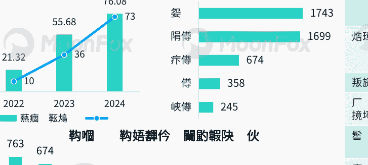

## 智能保险 AI+引擎 插件训练规划

- 广扬扩展插件...

2024H1开后剧劲华 2023-2024...AR...激励领域...V3 AI

| 指标 | 数值 |
| :--- | :--- |
| 12 | 150% |
| 10 | 100% |
| 8 | 50% |
| 6 | 0% |
| 4 | -50% |
| 2 | -100% |

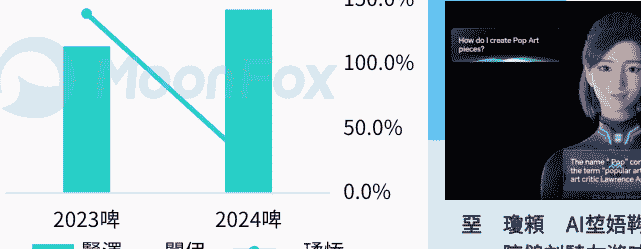

2023对比 2024对比 增长

| 比例 | 百比 |
| :--- | :--- |
| | 150.0% |
| | 100.0% |
| | 50.0% |
| | 50.0% |
| | 0.0% |

AR剧劲...VR剧劲...AI+插件...

## 智能硬件设备

- Meta Liam3+ AI
- Xreal - 3Dfor...DOF...
- Rokid AI+
- 甄露...

## 智能语音功能

- 智能语音扩展...
- 智能语音扩展...

2024年

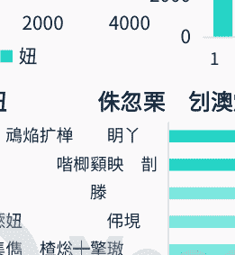

| 类别 | 增长率 |
| :--- | :--- |
| | 65% |
| | 51% |
| | 47% |
| | 40% |
| | 39% |

2024年 ADS 3.0

## 郭翊AI 悟空插件

- 无税慧酷扩展
- 8倍...豹...

2022-2024 免费数据

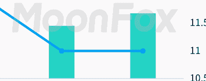

2023 2024 10.5

| 状态 | 描述 |
| :--- | :--- |
| 1 | ... |
| 2 | ... |

## 智能 AIGC 宇宙扩展

- 智能口碑扩展...
- 智能插件扩展...

2024年

## 智能 AI 插件

"ChatGPT" 插件...
- Uni-talk
- CareGPT
- Gemini.GPT
- Copilot

## 智能AI能力

- 智能能力扩展 (4000+)
- 学习工具 (30000)
- 词典翻译 (20000)
- 语言学习 (10000)
- 高校教育
- 专业知识
- 编程

2024年各类智慧教育情况

- 智能扩展...
- ... AIGC way
- 智能扩展 2.0 unique...

| 1月 | 2月 | 3月 | 4月 | 5月 | 6月 | 7月 | 8月 | 9月 | 10月 | 11月 |
| :--- | :--- | :--- | :--- | :--- | :--- | :--- | :--- | :--- | :--- | :--- |
| | | | | | | | | | | |

# 03 第三章：中国人工智能企业出海分析

## MoonFox Nasdaq: CEIBS AI与管理创新研究中心 出海现状

### 聚增长AI赋能

网页作为出海AI的主要入口，借用其便利性和易访问，持续吸引大量海外用户。这种轻量级使用方式，极大降低了用户使用门槛，促进出海AI产品的普及和推广。下半年Web出海AI产品的访问量保持在1.8亿以上，其中9月和10月的访问量总额突破了2亿；App端出海产品的下载量及Web端，但其在下半年持续保持积极增长势，未来发展潜力不容忽视。

### Web出海生成式AI产品访问情况 (万次)
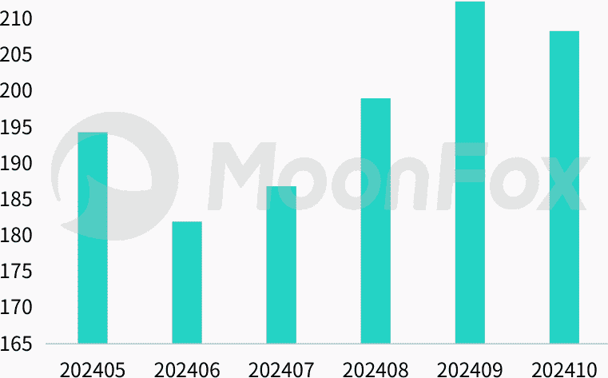

### App端生成式AI产品下载量情况 (万次)
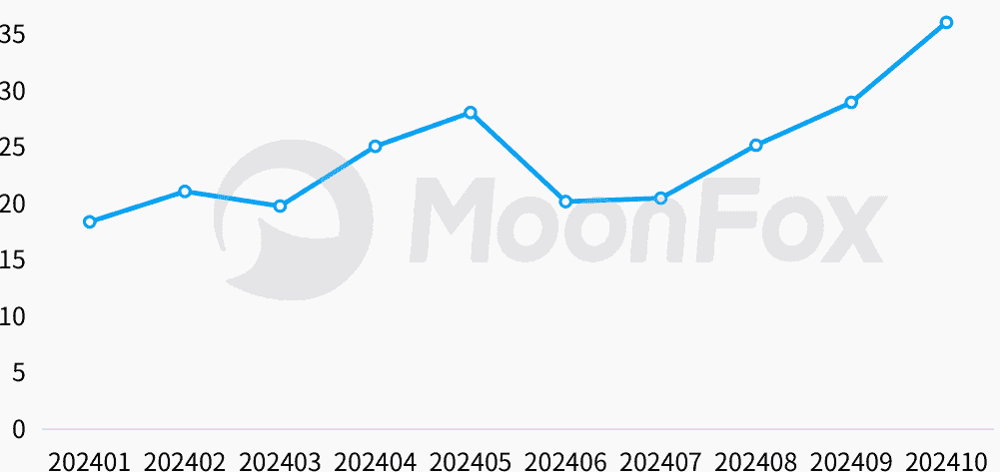

数据来源：点数据，数据周期：2024.01-2024.11

## 聚增长AI生态

人面对聚增长AI机遇

- 增长无AI理解
- Question.AI

### 2024年1-11月初头部出海产品下载量(万次)
| 实体 | 下载量 |
| :--- | :--- |
| Picsart | |
| InShot | |
| Gauth | |
| Hypic | |
| BeautyPlus | |
| Filmora | |
| Talkie | |
| Question.AI | |
| PictureThis | |
| Fotor | |

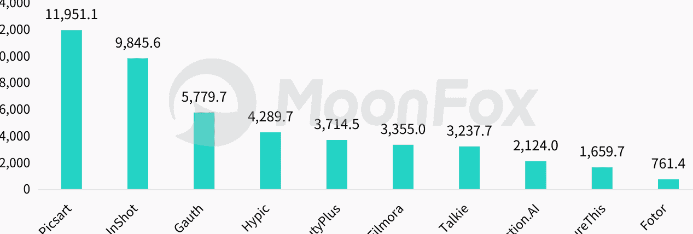

数据来源：月数据，数据周期：2024.01-2024.11

## MoonFox Nasdaq: CEIBS AI与管理创新研究中心

## 增长AI赛道

## ResiliencyAI韧性

- 增长AI拓展
- 增长AI领先
- 增长AI

2024年1-11月头部出海产品下载量地区分布
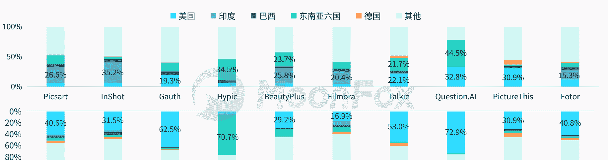

2024年1-11月头部出海产品收入地区分布
数据来源：月数据，数据周期：2024.01-2024.11

## 增长增长AI矩阵

### AI矩阵

- 增长AI风险
- 增长AI质量
- 增长AI拓展
- 增长AI

| 环境互动 | 增长项 |
| :--- | :--- |
| 增长增长AI | 探索海外市场 |
| 环境增长AI | 快速增长 |
| 激励增长AI | 增长速度领先 |

| 增长项 | 增长要 |
| :--- | :--- |
| 增长增长增长AI | 增长增长AI |
| 增长-增长AI | 增长增长AI |
| 增长增长增长增长AI | 增长增长AI |
| 增长增长AI | 增长增长AI |

## 增长增长AI中

## 晓隆魔 Filmora AI领先

- Filmora通过先进的全链路AI技术，极大提升视频创作的效率和质量。在2024年1月至11月期间，Filmora在全球范围内收入和下载量均稳健增长。在业务拓展方面，Filmora积极与全球创作者社区建立联系，通过参与和举办各类活动，增强品牌影响力、丰富产品资源，为海外创作者提供多维度支持。

### 2024年1-11月Filmora收入及下载量情况
| 收入（万美元） | 下载量（万次） |
| :--- | :--- |
| 150 | 800 |
| 100 | 600 |
| 50 | 400 |
| 0 | 200 |

### 全链路AI赋能视频创作
| 智能短功能 | 智能滤赛 |
| :--- | :--- |
| 智能剪辑 | AI超清 |
| 发丝绿像 | Filmora V14版本能力 |
| AI翻译驱动 | AI视频降噪 |
| AI人声美化 | AI音效精准调色 |

### 深度参与海外市场创作
- 与日本知名二次元平台pixiv推出活动，通过制作视频、参加各类展会等方式，实现对日本创作者群体的多维度支持
- 参加洛杉矶CosplayFest 2024，与日本知名游戏厂商Takara Tomomy旗下玩具BEYADE X深度合作与环球音乐集团Universal Music旗下达成音乐资源联合销售合作

| 2024年1-11月下载量TOP3国家 | 2024年1-11月收入量TOP3国家 |
| :--- | :--- |
| 印度 | 美国 16.9% |
| 墨西哥 | 5.7% |
| 美国 5.1% | |

数据来源：月数据，数据周期：2024.01-2024.11

## 反映增长Gauth AI+全球性

- 增长鸿打Gauth增长
- 增长辅助Gauth AI赛道
- 增长辅助GauthAI拓展、爆发
- 增长增长AI拓展

### 2024年1-11月Gauth收入及下载量情况
| 收入量（万元） | 下载量（万次） |
| :--- | :--- |
| | 3,000 |
| | 2,500 |
| | 2,000 |
| | 1,500 |
| | 1,000 |
| | 500 |

### 功能性策略：AI+专家打造短板
- AI解答：用户拍上传作业或提问，AI自动识别并进行解答，答案将配备详细步骤解释和指导，提供数据、化学、物理、社会科学等多个学科的解决方案，并帮助用户学习提供更个性化学习环境，支持更多语言
- 专业导师：拥有超过五万名专业导师的团队，为用户提供专业的指导和支持，提供清晰的步骤解析和深度解析，帮助学生理解各个学科的知识和概念

## 营销推广：社区运营和留住用户
- 推广：KOL网红营销，创意脑暴，直接与年轻用户之间建立紧密的联系
- 运营：打造全球社区，设计功能每月提供免费解答近十万，通过邀请朋友获得积分。

| 2024年1-11月下载量TOP3国家 | 2024年1-11月收入量TOP3国家 |
| :--- | :--- |
| 美国 19.3% | 美国 62.5% |
| 巴西 6.1% | 英国 4.7% |
| 墨西哥 6.0% | 加拿大 2.6% |

数据来源：月数据，数据周期：2024.01-2024.11

## 增长崛起 Talkie AI

在情感陪伴领域，Talkie通过聊天互动、个性化形象以及卡牌收集等功能，这种多元化的互动丰富了用户体验，还提高了用户黏性，使得Talkie在情感陪伴赛道中实现收入和下载量增长。从市场来看，美国在收入上占53%的份额，成为Talkie最大的增长市场。

### 2024年1-11月Talkie收入及下载量情况
| 收入（万元） | 下载量（万次） |
| :--- | :--- |
| 202401 | 1000 |
| 202402 | 800 |
| 202403 | 600 |
| 202404 | 400 |
| 202405 | 200 |

- Talkie通过AI技术模拟人类，为用户提供沉浸式的角色扮演体验，让用户创建并定制AI机器人，增强互动性。通过规定定制化和卡牌机制，Talkie为用户解锁更大的（卡牌）折扣，或者更多免费抽机会的互动
- 互动玩法：星缘：智能聊天提升（亲密度）
- 互动玩法：星星：智能每天随机发放热门卡，也可以购买更多抽机会

| 2024年1-11月下载量TOP3国家 | 2024年1-11月收入TOP3国家 |
| :--- | :--- |
| 美国 22.1% | 美国 53.0% |
| 墨西哥 5.3% | 菲律宾 16.0% |
| | 英国 11.0% |

## 增长训练报告 程 门 增长垂直AI 垂直AI领先

- 当前大模型研发热趋于稳定，头部厂商Anthropic、OpenAI、Meta等一代的大模型在综合能力上明显优势。相较于通用大模型产品，垂直AI产品专注于特定领域，更精准地满足用户需求，同时在开发和运营上也更为省力，研发成本更低，对于国内AI企业而言，无疑是性价比和效率更优的选择。

### 大模型语言能力测评 大模型代码生成能力测评 全球Top100 AI分布
| 模型 | 发布者 | M | 模型 | 发布者 | Human Eval | 内容生成应用 | 排名 |
| :--- | :--- | :--- | :--- | :--- | :--- | :--- |
| Claude 3.5 Sonnet | Anthropic | 90.5 | Claude 3.5 Sonnet | Anthropic | 90.5 | 内容生成应用 | 45 |
| Claude 3.5 Sonnet | Anthropic | 88.7 | Qwen2.5-Coder-32B- | 阿里巴巴 | 88.7 | 通用应用 | 18 |
| GPT-4o | Open AI | 88.7 | Claude 3.5 Sonnet | Anthropic | 88.7 | 社交聊天应用 | 11 |
| DeepSeek-V3 | 幻化灵 | 85.5 | GPT-4o | Open AI | 88.5 | AI搜索应用 | 6 |
| Llama3.1-405B | Meta | 87.3 | Llama3.1-405B | Meta | 87.3 | AI教育应用 | 5 |
| DeepSeek-V3-Base | 幻化量 | 87.1 | DeepSeek V2 | 幻化量 | 87.1 | AI工具类 | 3 |
| Claude-3Opus | Anthropic | 86.8 | Amazon Nova Pro | Amazon | 86.8 | AI助手 | 2 |
| GPT-4 | Open AI | 86.4 | Llama3-70B-Instruct | Meta | 86.4 | | |
| Llama3-400B-InTraining | Meta | 86.1 | Claude 3.5 Haiku | Anthropic | 86.1 | | |

## 对于垂直型AI产品，技术进步的加速使得海外应用所面临的壁垒将逐渐消失，单一依赖技术领先或先进已无法确保在激烈的海外市场中脱颖而出。

用户对于人工智能体验的期待与评价标准之提升，趋于同质化，仅凭AI功能的优劣难以构建持久的竞争优势，出海AI企业的竞争将从过去侧重于技术创新和功能的“技术栈”转变为运营定位、品牌建设的“营销战”。

- 作为AI应用营收贡献主力的北美地区已成为AI产品发布和推广的首选市场；由于拉美市场的购买和买卖门槛相对较低，一些出海AI产品通过拉美市场的兴起，逐渐获得关注和增长，在投App的应用数在多个国家中领先领先。

- 作为使用和付费的热门类别，随着技术市场日益成熟，AI内容和AI伴随赛道竞争愈发激烈，竞争阶段由技术、能力竞争转向营销竞争，争夺更多注意和市场份额；其中AI文本本身应用竞争更为激烈，其内容量和在投App数占比均高于其他类型产品。

## 2024年9-10月海外AI应用市场广量及在投App数量

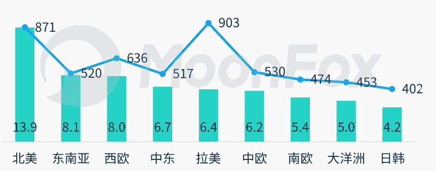

| 广量（万个） | 在投App数（个） |
| --- | --- |
| 871 | 903 |
| 636 | 517 |
| 520 | 530 |
| 474 | 402 |

| 广量占比 | 在投App占比 |
| --- | --- |
| 26.4% | 17.3% |
| 15.6% | 17.1% |
| 23.5% | 14.3% |
| 11.5% | 10.1% |
| 6.1% | 8.5% |
| 8.2% | 5.8% |
| 5.1% | 3.7% |
| 3.0% | 0.0% |

北美 东南亚 西欧 中东 拉美 中国 欧非 大洋 日韩

AI文本生成 图像生成 AI伴侣 图像编辑 头像生成 AI音乐 AI教育 AI工具 AI语音生成

数据来源:AgGrowing，数据周期:2024.09-2024

## 研究说明

本报告主要聚焦全球和国内的人工智能产业发展情况，分析当下人工智能产业发展概况、全景图和出海情况等内容，帮助市场了解和找准人工智能产业的发展趋势和机会。

报告研究范围主要为AI产业谱、AI发展情况等。

## 数据来源说明

报告收集多类数据进行综合分析研究，包括：

政府公布、市场公开、媒体披露、企业财报等公开数据资料。

## 机构介绍

月狐数据：是中国领先的全景数据洞察与分析服务专家。依靠全面稳定、安全合规的移动大数据根基以及专业精准的数据分析技术、人工智能算法，月狐数据先后推出移动应用数据（iApp-旗舰版、小程序版、厂商版、海外版）、品牌洞察（iBrand）、营销洞察（iMarketing）、金融类数据等产品，以及提供月狐研究院的专业研究咨询服务，旨在用数据帮助企业洞察市场量，赋能精准决策。

中欧AI与管理研究中心：是中欧国际学院于2024年4月25日成立的智库。中欧是全球顶级商学院，在国际权威的FT 2024年EMBA强势榜拿第一。

研究中心围绕国家智能发展战略，聚焦于AI在企业管理和产业创新应用中的研究与教学，致力于连接全球顶尖学者、行业领袖、政策制定者，成为全球AI与管理创新的高端智库，与伙伴共建具有商学院特色的AI产学研平台，推动AI落地与企业发展。

## 特别谢

编辑：陈光
顾问：钱文
秘书：方颖
合作：qwendy@ceibs.edu
