# Deloitte.

# 德勤

Deloitte

Access Economics

# AI时代的抉择

# 以“信”筑基，行稳“智”远

德勤亚太太 | 人工智能研究院

# 免费 价值 及时 专注

# 扫码加入 知识星球TOP 免费资源群

- 每日免费获取价值资源
- 可提供各类资源搜索服务

| 热门付费文章 | 各行行业报告 |
| 精选图书资源 | 副业赚钱方法 |
| 职场实用资源 | AI政经自媒体 |

公众号:知识星球TOP 微信号:jntsg8 微信号:jntsg2

分享资料仅供个人学习，请及时删除，切勿商用传播

# 目录

- 报告概要 4
- 01 应对AI快速采用带来的风险 6
- 02 卓越AI治理之道 8
- 03 亚太地区AI治理现状 12
- 04 卓越AI治理的益处 21
- 05 搭建可信AI的基础 24
- 附录

# 报告概要

本报告由德勤经济研究所和德勤人工智能研究院共同编制，旨在为亚太地区区域的首席高管和技术负责人提供洞察，助其改进治理结构和组织机制并开发更可靠的AI解决方案。

德勤高可信智能架构明确了AI解决方案建立可靠性必须的七大要素：透明、可解释、公平、中立、稳健、可靠、保护隐私、安全、稳健、承担责任、同责。

组织高管和董事对AI的核心是什么？就是卓越AI治理。

首席高管和董事会负责众多优先关注项，启动并推进有效AI治理实践可充分挑战，为组织AI治理解决难题，我们发布了AI治理程度指数，通过一系列标准来确定卓越AI治理实践。基于我们对亚太地区近900名高管进行的调研，覆盖多个行业和部门以及不同规模。

我们的调研旨在了解组织AI治理成熟度水平，识别有效AI治理的关键推动因素，并评估采取治理措施能够带来的实益。

- 透明、可解释
- 公平、中立
- 稳健、可靠
- 保护隐私
- 安全、稳健
- 承担责任
- 回答

## AI时代的抉择：以“信”筑基，行“智”御远

随着AI解决方案进入推进阶段，组织面临着一些风险，例如数据安全、隐私问题和法律风险。AI解决可能带来巨大的效益，但如果这些风险无法得到妥善管理，就导致数据泄露、声誉和业务受到损害以及罚款。然而，令人担忧的是，超过一半的技术者并不认为其在组织中能够有效应对AI相关风险。

为了有效AI治理如何应对这些风险并释放AI潜力，业界从亚太地区13个地区的近900名高管开展调研，针对AI治理成熟度水平进行全方位的分析和研究。

## 各行业AI使用导致的事件数量均上升趋势

超过四分之一的组织过去一年发生了AI相关事件有所增加。

## 各行业过去一年AI相关事件数量增长

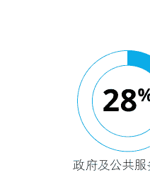

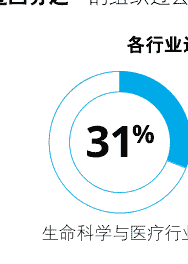

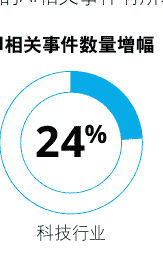

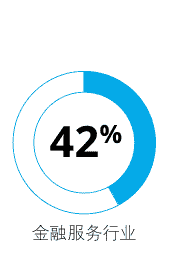

## 卓越治理也可让AI应用扩大和财务收益

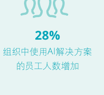

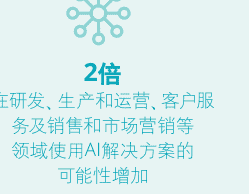

## 然而，90%的组织都需要提升AI治理

德勤AI治理指数采用1项指标来评估组织的治理成熟度。

| 初级 | 发展中 | 成熟 |
|---|---|---|
| 17% | 74% | 90% |

# 建立可信AI

## 01 应对快速采用带来的风险

AI正在改变亚太地区格局。生成式AI的迅速加速了这一过程，预计到2030年，亚太地区的AI投资将增长四倍，达到170亿美元。“生成式AI将成为亚太地区最领先的企业。在AI的快速采用下，组织内部领先超过半的员工在工作中使用生成式AI，其中经理更是熟练者。当应对这种速度和规模时，组织也面临着AI相关的风险。我们发现AI最普遍的担忧是安全漏洞（86%）、监控（83%）和隐私（83%）。从生成式AI以来，技术能力提升，工具界面人性化，人数大大增加，这些风险也得到了突出。AI解决方案使用的数据可能存在泄露，一旦数据被获取或泄露，可能产生巨大的损失。2024年，全球数据泄露的平均成本接近500万美元，去年增加了10%。对于快速发展的企业而言，本成本可能会更高。此外，还有难以量化的影响，品牌形象受损和客户流失，消费者信任和声誉损害会导致持续的负面影响。然而，对于AI确保安全至关重要。消费者对AI信任至关重要，62%的消费者认为在AI上使用服务是合理的，且53%的消费者愿意为该和服务付费。组织必须确保其使用的方式符合法律和监管要求，这必须在采取行动前制定并实施法律法规。因此，组织只需在采取努力降低风险的同时，至少达到最低标准，而不是最佳实践。因此，组织必须建立并执行针对解决方案的标准。应对AI相关的风险至关重要：如果应对不当，这些风险可能导致客户关系损害、被监管处罚或遭遇法律抵制。此外，风险可能被组织忽视。AI应用现状显示，在AI开发和使用面临的四大挑战中，其中三大挑战是风险、监管和治理问题。由此可见，有效治理对于管理AI相关的伦理和运营风险以及充分利用AI技术非常重要。

## 组织在AI中使用中最担心的潜在风险

- 安全漏洞 86%
- 监控 83%
- 隐私 83%
- 法律风险和版权侵犯 80%
- 监管不确定性 79%
- 可靠性和错误 78%
- 恶意内容 78%
- 合规负荷 76%
- 问责 75%
- 透明性/可解释性 73%
- 责任 73%
- 偏见和歧视 71%
- 裁员 70%

资料来源：德勤可AI调研(2024年)。

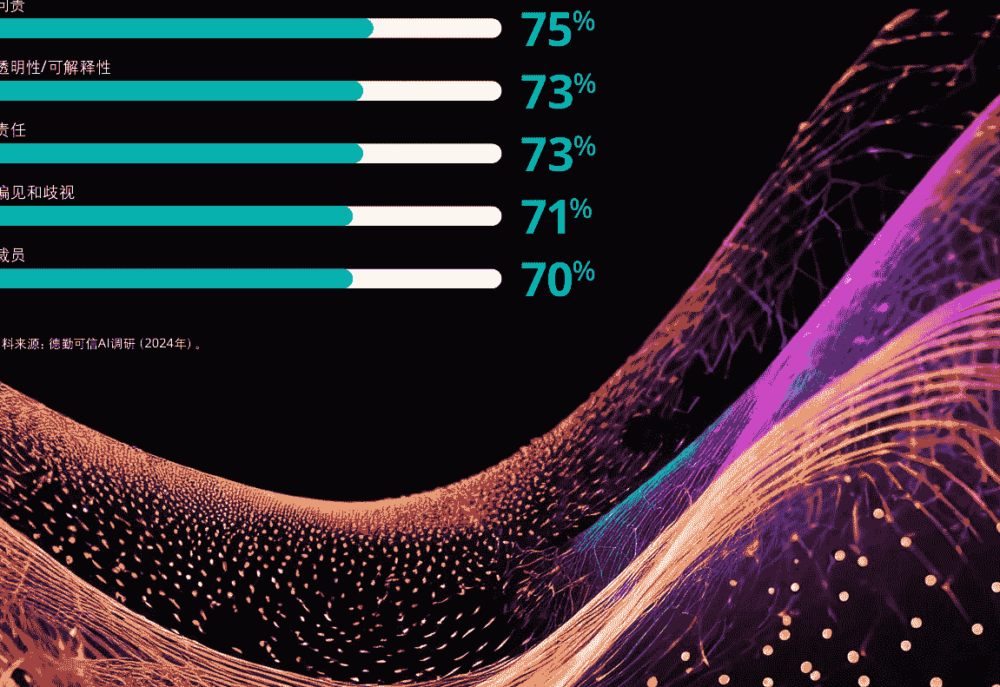

## AI时代的选择：以“信”为基，行“智”致远

## 卓越AI治理之道

开发可信AI方案至关重要，有助于组织高管应对AI快速采用带来的风险并全面推进AI技术转型。可信AI确保符合合理、法律和技术标准，并使高管有信心在整个组织内使用AI解决方案。德勤高可信人工智能框架明确了建立可信方案所需的七大要素：透明、可解释、中立、稳健、保护隐私、安全、稳定、承担责任、问责。该框架适用于从概念设计到开发、部署的所有环节。

图2：德勤高信人工智能框架

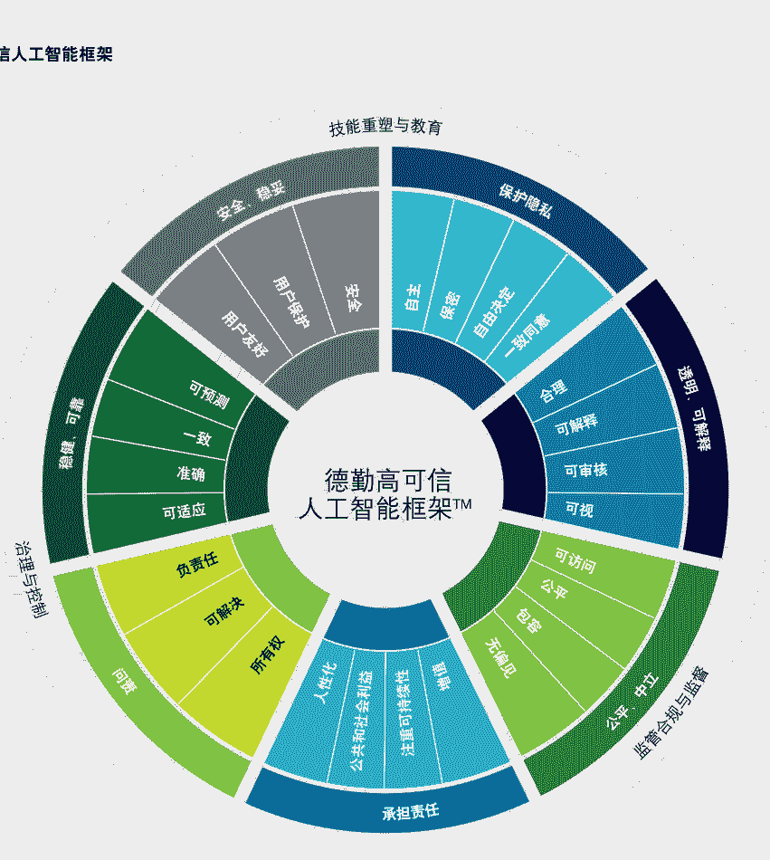

资料来源：德勤（2024年）。

## AI的转型 | “生成式”、“增强”

符合这些标准的可靠AI解决方案并非易事。组织需要健全的AI治理结构以确保AI解决方案与标准一致。卓越AI治理需要贯穿技术生命期的每个阶段，并融入技术、流程和人员。具体的治理措施根据AI的复杂程度、特定地区的适用法规进行调整。由于标准不断变化，AI治理可能变得复杂。为了帮助组织采取行动实施治理，我们可以定义治理成熟度指标。该指标从五个维度（组织架构、政策、程序与控制、人才与技能、监控、报告与评估）衡量成熟度（见表1）。

### 表1 治理成熟度指标

| 治理领域 | 初级 | 发展中 | 成熟 |
|---|---|---|---|
| 组织架构 | 未对AI治理指定角色和责任 | 组织内部指定部分角色 | 已建立委员会，明确明确角色和责任以支持组织治理 |
| 政策与原则 | 未制定政策或原则来指导AI治理 | 已制定基础政策或原则 | 拥有健康的政策，建立了组织且清晰的原则 |
| 程序与控制 | 未对AI系统的开发、部署或使用建立相关程序 | 正在对AI系统的开发、部署或使用建立相关程序 | 现有的风险管理控制满足AI系统的开发、部署或使用 |
| 人才与技能 | 未为帮助员工使用AI提供资源 | 正在为帮助员工使用AI提供资源 | 已提供应用指南和相关培训 |
| 监控、报告与评估 | 未实施AI系统的监控或报告机制 | 在开发对AI系统进行监控或报告的机制 | 拥有对AI系统进行监控或报告的机制和工具 |

来源：德勤（2024年）。

## AI时代的捷径 | 以“信”为基，行“智”远

下图显示了德勤AI治理成熟度指数的各个支柱如何作为基本要素实现可信AI。此外，此指数还明确了组织实现德勤高可信人工智能框架的七大要素应采取的切实行动。

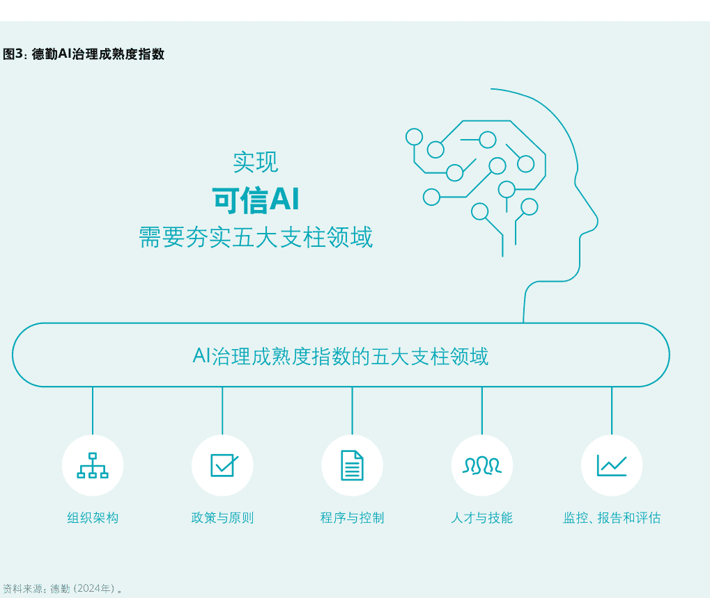

来源：德勤（2024年）。

AI治理没有通用的方案。具体的治理结构随行业、监管环境、目标和AI解决方案的类型而异。例如，组织为员工提供的AI对话机器人可能比直接与客户交互的AI辅助解决方案所需的控制策略也不同。分析AI治理的共性有助于组织找到标准中有改进的领域。此外，注意的是AI治理成熟度达到高水平并不等同于实现结果。如果组织建立的治理程序未被员工理解或者未能整合业务环境和策略，就可能无法实现结果。有效治理的标准因组织而异。为此，组织应当持续评估并完善AI治理框架，确保其适应组织独特的需求和变化的监管要求。

## 赋能未来：Energy Queensland
## 助力实现负责任的AI和可持续的创新

Energy Queensland是澳大利亚最大的电力公司，主要负责配电、零售和综合能源解决方案，拥有9300多名员工，为超过230万客户提供服务。

Energy Queensland首席执行官Shryn Sreet表示：“AI是变革性的技术，随着日趋成熟，将帮助我们实现愿景和2032公司目标”。客户总经理Josh Gow认为，AI是我们公司重点关注的领域，将有助于提升运营卓越性和客户体验。我们采用AI已多年，但现在只是我们探索AI领域的开始，我们将扩展至更广泛的应用场景，扩大影响力和口碑”。

在引入新的AI解决方案的过程中确保数据安全是首要任务，Energy Queensland已就AI相关工作开展了重要工作，包括制定AI政策和实施，以及采取建立必要的防护措施。同时，为确保AI政策符合最佳实践并确保AI在内部进行了评估，也邀请了外部机构进行评审。

要高效负责地使用AI，我们需要适当的能力和强大的解决方案，为此，公司正在执行并“小范围”测试，让不同的员工参与上线、学习和培训计划，然后再一步步扩展。

在一步步采用AI的过程中，带来AI的价值和机会对于维持管理层至关重要。AI将得到更广泛的应用，这只是时间早晚的问题。AI因人而异。我们需要制定定制方案，以确保AI的使用是有效的、负责且有价值的。

> “由于AI环境的变化和行业标准准则的建立，我们的AI政策需要进行持续审核和更新，由高管委员会对AI政策进行讨论更广泛的应用以及潜在的风险和机遇。”

在全面实施之前对AI进行测试和试点是一个重要特点。Energy Queensland AI实施的策略是通过内部部门进行试点运行，创造一个以学习为重点，逐步评估风险和机遇，具体包括试点工具和构建AI平台。

## 确保实现AI的关键条件

- AI政策
- AI指导委员会
- 在内部进行测试和试点
- 培训计划

## 亚太地区治理现状

亚太地区大部分组织拥有实现AI所需的治理结构。根据德勤AI治理成熟度指数，91%的组织治理结构处于“初级”或“发展中”，表明其AI治理仍有巨大的改进空间。

从AI治理成熟度指数五大支柱来看，亚太地区在“政策与原则”以及“程序与控制”领域仍处于“初级”到“发展中”之间，分别有11%和23%的组织达到“成熟”。在“报告”领域，超过90%的组织达到了“发展中”。要完全达到“成熟”水平，组织在治理成熟度指数五大支柱领域均表现优异。寥寥项达到“成熟”，表明组织需要采取全局视角。

### 图1：亚太地区AI治理水平

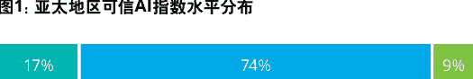

来源：德勤AI调研（2024年）。

### 图2：各支柱领域AI治理水平

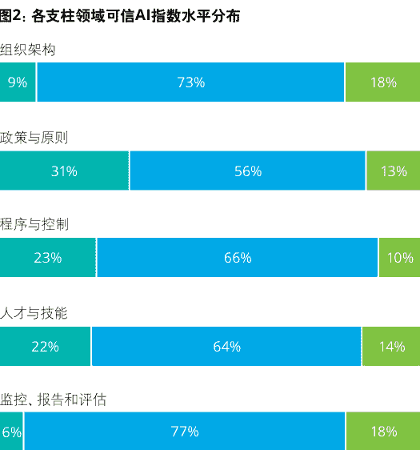

来源：德勤AI调研（2024年）。

## 纠正自我选择偏差

组织可能高估AI治理成熟度。AI应用现状调研显示，23%的组织认为其风险管理程序和治理非常完善。然而，本次调研更加细致地分析了治理的基础结构，结果显示只有5%的组织在AI治理上达到了“成熟”水平。虽然两次调研的问题样本不同，但偏差巨大，表明组织需要全面了解其治理成熟度。这一点至关重要，自信可能妨碍组织改进；如果组织认为自己建立了足够的机制来应对风险，就不可能努力进一步改进。

## 组织架构

明确组织内负责AI标准的角色，有助于组织妥善应对出现的任何问题。大多数受访组织表示这一责任由高管团队承担，91%的组织明确指定了一名董事或委员会成员或首席高管负责AI事宜，另有7%的组织任命AI负责人来管理风险和标准，有2%的组织在组织内指定相关负责人。

在监控和识别风险方面，大部分（61%）组织是在各个部门或团队中指定专门人员，其他组织则是在某些团队中指定专门人员，或者没有指定专门人员来管理AI使用。

对比组织架构，AI标准的责任和管理对于大型组织更为重要，但在小型组织中较为少见。员工人数超过100人的组织中，只有3%未设置专门的风险管理岗位，而在员工不足100名的组织中，这一比例约为23%。

不同组织搭建AI治理、法律和监管合规专职团队的方式会有所不同。只有28%的组织设有集体。

### 图3：AI治理、法律和监管合规专职团队架构

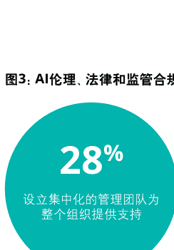

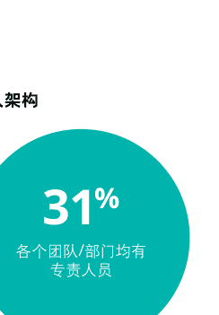

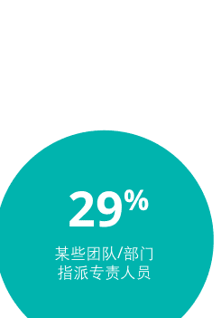

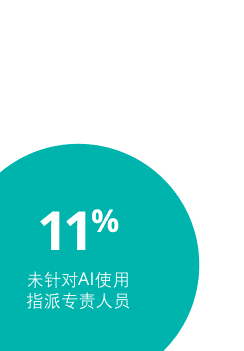

来源：德勤AI调研（2024年）。

### 政策与原则

清晰明确、广适的政策和原则是AI治理的基本前提。治理不同于AI策略，后者包括AI目标和目标实现的进展的关键要素，涉及的范围更广。亚太地区大多数组织都制定了AI策略，但许多组织未涵盖AI治理的关键要素。只有少数组织在AI治理实施目标上包含了治理原则。

将AI治理纳入战略有助于员工识别AI治理的价值。在已制定组织层面AI策略的组织中，有30%的组织表示并非所有人都能明白策略的价值。如果AI治理包括策略响应和补救计划与更广泛的组织策略进行整合，员工可能能够识别到策略的价值。

### 图4：可用AI政策的实施

| 事件响应和补救计划 | 15% | 38% | 48% |
|---|---|---|

| 治理逻辑和原则 | 11% | 34% | 55% |
|---|---|---|

| 涉及安全及负责任使用AI的政策 | 8% | 67% | |
|---|---|

- 未计划
- 未来计划
- 现实施

## AI支柱

### 人才与技能

人才在实现可靠AI中发挥着重要作用。然而，许多组织在这一方面面临挑战，平均仅有55%的员工拥有负责任地使用AI的技能。

培训可以有效弥补技能差距。仅有52%的受访组织提供了AI培训，但与不提供培训的组织相比，员工的技能比例高出77%，而在目前不提供相关培训的组织中，72%的组织正在积极开展培训计划。

大多数组织为负责使用AI提供了指南，55%的组织推出了在职学习提升举措，49%的组织为员工提供咨询服务或成立咨询小组。私营部门积极推广应用指南和培训，公共部门更多地关注安全保障和在职学习提升。

图6：帮助员工使用AI的资源

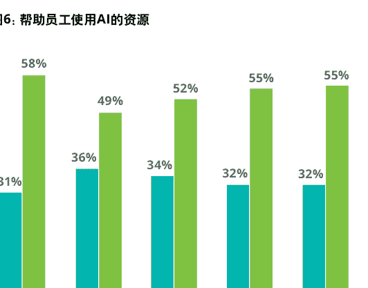

| 关于适当使用AI的指南 | 员工的咨询服务 | 关于适当使用AI的培训 | AI安全和隐私保护 | 在职学习提升 |
| :--- | :--- | :--- | :--- | :--- |
| 58% | 49% | 52% | 34% | 32% 31% |

- 开展中
- 已实施

资料来源：德勤可信AI调研(2024年)。

### 监控、报告和反馈

AI治理系统必须能够不断应对需求的变化和不可出现的问题，这对于确保组织能够快速响应风险和事件至关重要。整体来看，受访组织在这些领域日益完善，18%的组织达到了“良好”水平，大部分（85%）的组织根据内部标准对AI进行评估的频率至少为半年。同时，组织需要监控和评估AI治理是否符合监管环境，四分之一的组织至少每半年进行一次。

图7：根据组织内部标准评估AI系统的频率

资料来源：德勤可信AI调研(2024年)。

### 创新边界

第一责任有限公司 (Daiichi Holdings, Inc.)是一家拥有22年历史的领先集团，专注于亚洲和全球市场提供保险及投资服务。我们始终致力于为客户提供高标准，并构建坚实的信任基石。负责任地解决AI解决方案是实现业务的关键。我们深知：“如果具备适当的框架和流程，我们的员工无需担心AI带来的负担，可以心地使用AI，它不仅为高质量服务积累了基础，而且我们投入了大量精力确保系统运行达到预期，这不可蹴而就，而是需要付出持久的努力。”我们也强调理解企业文化的重要性，治理部门也至关重要。这意味着在AI领域，我们将“负责任”的价值观植于心。在推出“数字助手”（digital agents）后，我们积极探索其无限可能。数字助手支持多种形式，包括语音交互、手机交互。在交互中，数字助手帮助记录相关信息并总结对话。我们正在开展初期测试，以负责任的方式解决问题。数字助手已经在多个业务场景结束了近一周的测试。坚持“以人为本”的理念，数字助手的每条信息都经过人工审核，以确保提供的建议准确。有效的治理是全体员工的共同责任。在举办各项治理讨论后，公司内部高管层达成共识，一系列负责任的AI准则被所有利益相关者认为重要。基于稳定的体系和敏锐的预警机制，企业可以安心地推出和运用新型AI解决方案，并在事件发生时进行快速应对。

- 立足长远
- 凝聚力量

## 各行业

不同行业的AI治理成熟度以及各支柱领域的得分有所不同。调研发现，科技、传媒、电信、金融服务以及专业服务的组织达到“成熟”水平的比例最高。同时，政府及公共服务、生命科学与医疗行业的组织达到“成熟”水平的比例较低。下描述了各大行业的AI治理情况，附录复述了各大区域的AI治理。

### 金融服务行业

作为知识与数据密集型行业，金融服务在数字化创新方面领先其他行业，但也面临着更严格的监管和更高的敏感性。因此，金融服务组织需要快速建立治理流程并运用新技术。成熟度指数显示，金融服务的治理水平高于其他行业。由于需求不断增加（尤其是在精通技术的年轻群体），整个行业的未来离不开AI。随着AI应用深化，合规和客户数据安全将成为金融行业的关键议题。

# AI治理成熟度指数

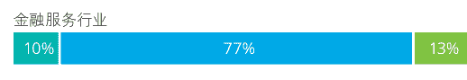

- 初级
- 发展中
- 成熟

注：数据选取自五个维度，加之和可能等于100%。

| 卓越AI治理为组织带来的三大收益 | 组织在AI中使用最为担忧的三大风险 | 组织在AI中使用或实施中的三大障碍 |
| :--- | :--- | :--- |
| 对AI解决方案成效或成果的信任提高(57%) | 可靠性和错误(92%) | 技术实施挑战(38%?原文误) |
| 信任提高带动AI解决方案使用增加(47%) | 法律风险和版权侵犯(88%) | 安全漏洞(87%) |
| 整个组织AI解决方案部门加速(47%) | 监管、法律、伦理、合规等风险的增加(45%) | 缺乏创新意愿或测试不足(32%) |

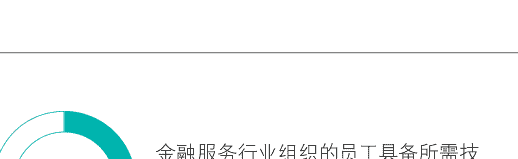

### 科技行业

科技行业处于颠浪之潮的前沿，也是其他行业开发AI解决方案的关键动力。由于长期使用AI解决方案，科技行业已形成更成熟的治理流程，治理熟度水平也高于其他行业。德勤生成AI报告显示，科技行业在流程中能够快速应用AI，然而在管理数据相关的法律方面面临重大挑战。作为其他行业的领先者，实现AI治理将成为重心。

# AI治理成熟指数

| 科技行业 | 所有行业 |
| :--- | :--- |
| 62% | 17% |
| 24% | 9% |

注：数据选取自五个维度，百分比之和等于100%。

### 生命科学与医疗行业

医疗行业的AI解决方案通常涉及人类数据（如统计信息），这类数据极易引发安全漏洞。为此，医疗行业必须制定严格的隐私和安全标准，确保患者数据足够。AI带来的巨大益处是在提高客户声誉。在医疗行业，成熟度处于“初级”的组织比较较高，数字化转型速度也较慢。

# AI成熟度指数

| 医疗行业 | 所有行业 |
| :--- | :--- |
| 25% | 67% |
| 17% | 74% |

注：数据选取自五个维度，百分比之和等于100%。

- 初级
- 发展中
- 成熟

### 公共部门

公共部门组织在AI监管与伦理方面面临重大挑战。要应对瞬息万变的环境，需要建立灵活的应对机制，消除AI技术带来的风险。在公共部门，AI有望提高公民提供数字化服务的效率，但组织须保障数据安全，防范网络攻击。因此，该行业对安全漏洞和监控风险表示担忧的组织占比相对较高。

# AI治理成熟度指数

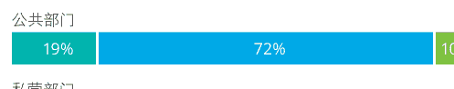

注：数据选取自五个维度，百分比之和等于100%。

| 卓越治理为组织带来的三大收益 | 组织在AI中使用最为担忧的三大风险 | 组织在AI中使用或实施中的三大障碍 |
| :--- | :--- | :--- |
| 对解决方案成效或成果的信任提高(56%) | 安全漏洞：网络入侵/网络安全风险(87%) | 技术实施挑战(38%) |
| 信任提高带动AI解决方案的使用(54%) | 监控滥导致隐私侵入(83%) | 恶意意内容(82%) |
| 整个组织解决方案部署加速(48%) | 对监管、法律、合规等风险的担忧(37%) | 对技术及其潜力的认识不足(36%) |

注：数据及公共服务行业样本量=172。公共部门所有组织均回复调查进行深度调研，其他行业根据其产品或服务提供进行分类。公共部门的组织划分为不同行业，如医疗行业和金融业。

## AI时代的选择以“信”为基、行稳“智”为远

## 04 卓越AI治理的益处

组织从提升AI治理成熟度中获益较浅，除非他们可以信任AI输出的结果，否则无法充分利用AI带来的机遇。图8：AI治理的五大益处

| 益处项目 | 比例 |
| :--- | :--- |
| 对解决方案成效或结果的信任提高 | -- |
| 信任提高带动解决方案使用增加 | 50% |
| 在客户中的声誉提高 | 45% |
| 利用AI解决方案提升生产效率 | 44% |
| 整个组织解决方案部署加速 | -- |

资料来源：德勤AI调研（2024年）。有效AI治理的益处之一有一半（50%）受访高管选择。另一项研究发现，透明的系统有助于用户对AI的信任度提高30%，从而增加用户采用和使用AI的可能性。输出结果信任度需要有效的治理，也就是采取行动来缓解组织在使用AI时面临的风险。例如，实施响应和帮助领导建立信任，达到“成熟”水平的组织其安全、隐私或法律风险比例较低，而处于“发展中”及“初期”水平的组织对这些风险表示担忧的比例较高，因此在各个领域实施有效的治理以解决这些担忧非常重要。

半数受访高管表示，AI治理的巨大优势就是扩大AI解决方案在组织内的使用。通过模型验证：达到“成熟”水平的组织与“初级”水平组织相比，部署解决方案的业务范围均增加。例如，在销售、营销和研发方面使用AI的可能性高出两倍。此外，定制化治理还能增强AI在其他业务领域的使用。与处于“初级”水平相比，达到“成熟”水平的组织使用工具的频率多出16个百分点，组织中用户数量增加了28%。

图9：按治理成熟度划分的AI状况

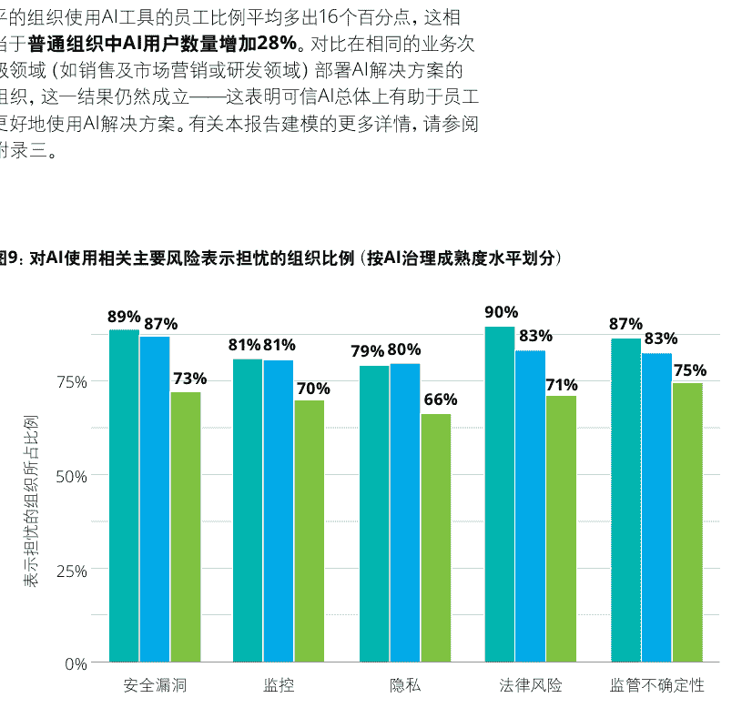

“本次研究显示，有效治理增加了组织中部署解决方案的广度（整个范围），增加了用户人数。”

资料来源：德勤AI调研（2024年）。

## 搭建可信AI的基础

有效AI治理对于组织将AI解决方案融入运营及业务模式至关重要。如前文所述，提高治理有效性能够扩大技术应用、增加回报，同时也有助于管理负面风险。组织领导当前能够采取哪些措施来改善AI治理？根据调研结果，以下四项行动具有突出的影响。

## 重视AI治理以实现效益

AI治理成熟度水平显示，多数组织需要大幅提高治理水平。研究表明，加强AI治理并非“锦上添花”，而是不可或缺的关键因素，能够组织利用AI这项强大的企业技术。将AI治理列为优先重点，组织首先需要从何处着手：评估相关制度并识别需要改进的领域。研究发现多数组织应主要关注“政策与原则”与“程序与控制”两大支柱领域。对于与AI相关的新风险随着解决方案的出现，组织需要对AI治理进行持续评估。特定地区和行业适用的法规不断变化，组织必须始终在AI治理标准的最前。

# AI治理成熟度指数的五大支柱领域

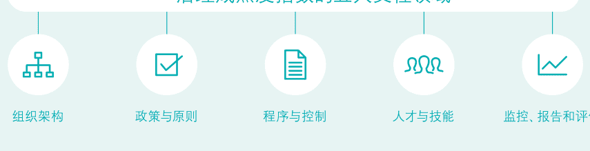

## 理解并利用更广泛的AI供应链

对AI的应用情况以及更广泛的“AI供应链”（即开发、部署、监管、平台服务商、终端用户及客户）的互动情况，能够帮助组织更全面地解决AI治理。例如，15%的受访者表示，其组织正在使用外用的“规制”AI解决方案，并将AI解决方案以及可许可的AI应用程序。更广泛的“AI供应链”还带来许多复杂性和不同的观点，从而帮助组织改进AI治理。越来越多的组织希望通过邀请外部审计机构在其治理框架中搭建“第三层防御”。为了开展这一工作，组织需要在AI解决方案的整个生命周期内安排外部审计。值得注意的是，已请外部机构进行审查的组织，获得的AI指数更高（图10）。

### 图10 AI实施情况审查类型与AI治理成熟度

| 医疗行业 | 比例 |
| :--- | :--- |
| 初级 | 25% |
| 发展中 | 67% |
| 所有行业 | 17% |
| 成熟 | 74% |

注：数据选取自五个维度，百分比之和等于100%。

## 打造风险管理者，而非风险规避者

人的判断和行动（反应）对实施有效的AI治理至关重要。无论作为AI解决方案的设计者、部署者还是使用者，员工都能在解决方案的功能上潜在风险方面提供意见。重要的是，发展良好的技能有助于识别、评估和管理风险，从而能够防止或避免风险的出现，而不是规避或忽视风险。具有价值的是，作为治理成熟度指数的关键支柱能力。

AI治理成熟度达到“成熟”水平的组织更积极发展治理技能，确保员工以符合合理、负责的方式使用AI。达到“成熟”水平的组织中，90%的组织在提高现有员工的技能，以缩小与符合规则和法律的方式使用AI相关的技能差距；处于“初级”水平的组织中，64%的组织为缩小这一差距而提升技能。此外，达到“成熟”水平的组织（65%），以及拥有适当技能的第三方合作伙伴，以及招聘时时有适当技能的员工（63%）。

这些行动对AI治理差距产生了显著的影响，而随着技术能力和监管环境的不断变化，持续提高和更新技能将变得十分重要。达到“成熟”水平的组织中，具备所需的技能以符合规则和法律的方式使用AI的员工比例高达73%，而处于“初级”水平的组织中，这一比例仅为40%。

## 图11. 缩小差距的方法与AI治理成熟度指数

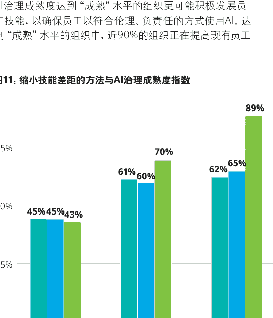

- 具备所需技能的人才
- 与第三方合作伙伴合作
- 提升现有员工技能

资料来源：勤动可AI调研（2024年）。

## 建议

### 加强沟通，确保AI模型准备就绪

在AI的治理中，有效沟通是非常重要，是让员工参与其中的必要条件。这包括披露AI对长期战略带来的收益和风险，提高员工使用AI模型的能力，以及对其工作在未来可能由AI执行的人进行技能提升。组织须确保所有利益相关者都对AI带来的风险有所认识，以及他们可以对AI的使用如何知识并解决问题。对此，组织要求透明的沟通，以及开展适当的意图。组织采取的实际行动包括针对高风险事件进行场景规划；编写故事，以便领导和员工能够理解技术的作用和影响并讲述出一个、充满人性化的故事；以及进行危机演习，以测试应对严重可能发生事件的准备情况。

> 建立卓越AI治理通常需要组织内部的思维转变。刚开始，一些同事会提出疑问，认为AI治理是否仅只是IT方面的问题。然而，经过讨论AI如何渗透各个领域，包括IT、网络安全、风险评估和监管合，我们意识到了一些要点：在实现卓越AI治理方面，每一个团队都承担责任。

——某大型电信服务提供商，数据策略总监

# 附录

## 附录一 调研

2024年9月和10月，我们对亚太十三个地区899名高管进行调研，旨在评估AI治理成熟度，以及对于卓越的AI领先态势。

我们选定首席风险官、首席合规官和首席数据官等高作为受访者，涵盖多个部门（包括公共、私营和非营利部门）及行业（包括金融、教育、健康和技术行业）。

表A1列示亚洲地区受访者数量。图A1和A2列示受访者所属行业及任职职务。

| 地区 | 受访者数量 |
| --- | --- |
| 澳大利亚 | 112 |
| 中国大陆 | 103 |
| 印度 | 102 |
| 日本 | 104 |
| 新西兰 | 53 |
| 东南亚 | 321 |
| 印度尼西亚 | 64 |
| 马来西亚 | 51 |
| 菲律宾 | 52 |
| 新加坡 | 51 |
| 泰国 | 52 |
| 越南 | 52 |
| 韩国 | 52 |
| 中国台湾 | 52 |
| 合计 | 899 |

数据来源：德勤可信AI调研（2024年）。

### 图A1：受访者所属行业

| 科技、传媒和电信行业 | 18% |
| 制造业 | 15% |
| 消费品行业 | 11% |
| 专业服务行业 | 9% |
| 其他行业 | 7% |
| 批发业 | 7% |
| 金融服务和保险行业 | 5% |
| 建筑业 | 4% |
| 生命科学与医疗行业 | 4% |
| 物流行业 | 4% |
| 教育与培训行业 | 4% |
| 能源、资源及工业行业 | 2% |
| 农业、林业和渔业 | 2% |
| 公共行政与安全行业 | |

资料来源：魔勤可信AI调研（2024年）。

### 图A2：受访者所任职务

| 首席技术官 | 15% |
| 首席信息官 | 14% |
| AI/技术相关决策者 | 8% |
| 首席数据官 | 6% |
| 首席数字官 | 5% |
| 首席人工智能官 | 4% |
| AI负责人 | 4% |
| 合规官 | 4% |
| 数据科学经理 | 4% |
| 首席合规官 | 4% |
| 首席风险官 | 2% |
| 风险官 | |

资料来源：魔勤可信AI调研（2024年）。

## 附录二

### 德勤AI治理开发治理成熟度指数

我们针对本次调研德勤AI治理成熟度指数，利用以下五大关键柱领域的领域的12个问题（部分问题包含多个问题）的答案作为指数建模框架，我们通过收集问卷答案已将该方法应用于近900家组织。

- 1) 在组织中，AI相关治理、法律和技术标准、首席数字、首席数据、首席合规、首席风险、人工智能主要？可能的回答：董事会、首席执行官、首席技术官、首席数字、首席数据、首席合规、首席风险、人工智能、AI负责人、业务负责人、高级经理、开发团队、其他
- 2) 贵组织目前具备哪些AI使用相关要素？
    - a. 有董事会监督的AI治理
    - b. 设有AI治理委员会（由法律、合规、信息技术、人力资源等组成）
    - c. 针对AI生命周期明确定义AI治理角色和责任，业务负责人、数据负责人、领域架构师等
- 3) 以下项反映贵组织负责管理使用的伦理、风险？
    - a. 负责管理使用的伦理、风险人员
    - b. 某些部门/团队有负责管理使用的伦理、风险人员
    - c. 各部门/团队有负责管理使用的伦理、风险人员
    - d. 监控组织范围内的趋势
    - e. 以上均不是
    - f. 不确定/不愿意透露

### 政策与原则

- 1) **如何描述贵组织的策略？**
    - a. 尚无AI策略，且当前并未采取行动
    - b. 当前尚无AI策略，但正积极采取行动
    - c. 某些部门/团队可能自定义策略
    - d. 已制定组织层面策略，但并非人人都明白
    - e. 已制定组织层面策略并将其重点，但未跟进进展
    - f. 已制定组织层面策略，具备明确流程，分析并提升价值
    - g. 不确定/不愿意
- 2) **贵组织的策略或治理框架包含哪些要素？**
    - a. 指导组织内部和负责人员如何使用AI
    - b. 理论依据和原则
    - c. 明确定义的风险偏好
    - d. AI目标和实施时间表
    - e. 治理所需的资源
    - f. 监控和审计流程
    - g. 事件响应和补救措施
    - h. 效能指标和关键指标
    - i. 与组织相关政策（隐私、数据监控或策略）
- 3) **贵组织使用或部署的AI系统包含哪些要素？**
    - a. 针对AI系统的监督和持续监控角色
    - b. 输出和决策明确责任
    - c. 已采取保护措施，确保AI系统数据不会规定和泄露
    - d. 用户了解AI系统如何做出决策影响了决策
    - e. 已采取适当机制防止偏见和AI偏差，确保公平和公正
    - f. AI系统以负责任的方式设计和运行，造福人类、社会和环境
    - g. 设计和运行性能使其具备一致和准确输出的能力，以及从意外中断中恢复的能力
    - h. AI系统具备增强防御，避免攻击访问和利用
    - i. 已采取数据脱敏及匿名化处理，保护敏感信息

### 程序与控制

- 1) 是否具备关键机制允许AI使用和引起问题？可能的回答：是、否、计划、不确定
- 2) 贵组织实施了哪些AI使用实践、程序或控制？
    - a. 对解决方案风险进行识别并定义的AI风险分类
    - b. 支持在开发、测试和实施过程中识别和管理相关风险的评估程序
    - c. 在能够解决解决方案使用风险的AI控制框架
    - d. 贵组织使用AI解决方案（包括内部开发外的）最新清单
    - e. 评估和监控AI系统活动和合规性的AI治理平台
    - f. 用于独立审计的AI全生命周期信息系统
    - g. 外部方（客户或其他利益方）处理AI相关风险或投诉的程序

### 人才、技术和文化

- 1) 贵组织为员工提供了哪些资源支持他们符合合规、合法、准确的方式使用AI?
    - a. 提供员工工作指南
    - b. 为员工提供咨询服务或成立咨询小组，员工向具有风险和合规经验的团队咨询有关AI使用的问题
    - c. 提供员工应用培训、法律及监管合规风险
    - d. 针对AI系统使用采取安全措施（如数据加密和访问控制）
    - e. 在职学习促进措施（鼓励员工独立测试或通过加入实践社区或参与团队讨论开展独立测试）
- 2) 根据您的合理估计，有多少员工的能力支持他们以符合合理且合法的方式使用AI?

### 监控、报告和评估

- 1) 组织多久复核一次规范AI工作的现行法律或监管要求，以保护权利并防止不当使用？
    - a. 至少数月一次
    - b. 至少半年一次
    - c. 至少一年一次
    - d. 年均不足一次
    - e. 以上均不是
    - f. 不确定/不愿意
- 2) 组织多久评估一次自有系统，以确保符合组织AI标准？
    - a. 持续或实时
    - b. 至少数月一次
    - c. 至少半年一次
    - d. 至少一年一次
    - e. 年均不足一次
    - f. 以上均不是
    - g. 不确定/不愿意

# AI治理的转型：以“技”、“基”、“运”驱动

每个问题的得分为0至100，每个问题的“最佳”答案得分为100分。例如，如果某领域的字段答案是“我们已经制定了组织领域AI策略，具备清晰的流程来确定优先顺序和评估价值”，则该组织认为只有某些部门制定了AI策略，领域相关问题得分60分，各支柱领域是相应支柱领域所有问题的平均得分，总体得分反映所有支柱领域的平均得分。

得分50分以上的组织为“初级”，50到90分为“发展中”，90分以上为“成熟”。按得分分领域统计的成熟度分布情况如图所示：

AI治理成熟度指数各支柱领域得分的平均值、中位值以及处于“初级”或“成熟”水平的组织占比如下表所示。

| AI治理成熟度指数 | 平均值 | 中位值 | 初级组织占比 | 成熟组织占比 |
| --- | --- | --- | --- | --- |
| 总体指数 | 70.8 | 68.0 | 9% | 17% |
| 组织架构 | 73.9 | 72.0 | 9% | 18% |
| 政策与原则 | 58.4 | 66.3 | 31% | 13% |
| 实施、流程和控制 | 64.8 | 67.5 | 23% | 10% |
| 人才、技能和文化 | 67.2 | 70.0 | 22% | |
| 监控、报告和评估 | 76.0 | 80.0 | 6% | 18% |

> 资料来源：德勤调研（2024年）。

### 附录三 计量建模

量化AI治理实践与绩效指标之间的关系，我们用普通二乘法求解。为降低偏差，我们将关键特征作为控制变量，具体如下表：

| 控制变量 | 详细信息 |
| --- | --- |
| 总部所在地区 | 13个选项 |
| 行业 | SIC代码（19个选项） |
| 员工人数 | 4个选项 |
| 部门 | |
| 营业收入 | 2023-24财年营业增长率（连续变量，换算为美元） |

此外，考虑到工作中的AI比例（0%-10%）。两个关键变量是德勤AI治理成熟度指数，其计算方法见附录。我们使用以下公式回归：

- 1) 使用AI的比例 = β₀ + β₁成熟度 + β₂AI领域数量 + 控制变量
- 2) AI领域数量 = β₀ + β₁成熟度 + β₂AI比例 + 控制变量
- 3) 营业收入增长率 = β₀ + β₁成熟度 + β₂AI比例 + 控制变量

回归模型汇总：鉴于数据自行报告，可能存在一些未观测到的因素与误差项相关，导致出现偏差。我们使用回归模型反映相关性。

### 模型一：变量 - 使用AI的比例

| 变量 | 估计值 | 标准差 | P值 |
| --- | --- | --- | --- |
| 指数得分 | 0.30543 | 0.0646 | <0.0001 |
| AI领域数量 | 0.20222 | 0.3996 | <0.0001 |
| 决定系数 | 0.1978 | | |
| 调整后的决定系数 | 0.1510 | | |

### 模型二：变量 - 使用AI的比例

| 变量 | 估计值 | 标准差 | P值 |
| --- | --- | --- | --- |
| 指数水平-发展中 | 8.27383 | 2.865 | <0.0001 |
| 指数水平-成熟 | 15.7533 | 4.123 | 0.004 |
| AI领域数量 | 2.257 | 0.393 | <0.0001 |
| 决定系数 | 0.1881 | | |
| 调整后的决定系数 | 0.1394 | | |

### 模型三：变量 - AI领域数量

| 变量 | 估计值 | 标准差 | P值 |
| --- | --- | --- | --- |
| 指数得分 | 0.0555 | 0.0061 | <0.0001 |
| 使用AI的比例 | 0.0197 | 0.0039 | <0.0001 |
| 决定系数 | 0.3352 | | |
| 调整后的决定系数 | 0.2965 | | |

### 模型四：变量 - AI领域数量

| 变量 | 估计值 | 标准差 | P值 |
| --- | --- | --- | --- |
| 指数水平-发展中 | 1.3557 | 0.283 | <0.0001 |
| 指数水平-成熟 | 3.0569 | 0.396 | <0.0001 |
| 使用AI的比例 | 0.0226 | 0.004 | <0.0001 |
| 决定系数 | 0.3120 | | |
| 调整后的决定系数 | 0.2707 | | |

### 模型五：变量 - 2023-2024财年营业收入增长率

| 变量 | 估计值 | 标准差 | P值 |
| --- | --- | --- | --- |
| 指数得分 | 0.0031 | 0.0018 | 0.0884 |
| 使用AI的比例 | 0.0017 | 0.0011 | 0.1355 |
| 决定系数 | 0.0667 | | |
| 调整后的决定系数 | 0.004769 | | |

# 印度

人口：14.51亿 | 3.95万

## 卓越的AI治理可为组织带来的三大获益

## 组织在AI中使用中最昂的三大风险

## 组织在AI使用或实施中的三大障碍

- 对AI解决问题成效或结果的信任提高（63%）
- 安全漏洞，网络入侵/网络安全风险（92%）
- 技术实施挑战（50%）
- 在客户中的声誉提高（60%）
- 隐私、敏感、保密或个人数据泄露风险（91%）
- 对技术及其潜力的认识不足（35%）
- 信任提高带动AI解决方案增加（57%）
- 监管不确定性；不断的要求可能导致合规义务（86%）
- 对监管、法律、伦理等风险的担忧（32%）

74% 印度组织已建立便于AI反映问题的机制。

60% 印度组织的员工工具所需技能，能够符合合理和法律的方式使用AI。

26% 印度组织显示上一财年报告增加。

72% 印度组织通过招聘拥有适当技能的员工，以缩小与符合伦理和法律的方式使用AI相关的技能差。

注：印度样本容量 = 102

# 日本

人口：1.238亿 | GDP：4.1万亿美元

## 卓越AI治理可望为组织带来的三大收益

## 组织在AI中使用中最担的三大风险

## 组织在AI使用或实施中的三大障碍

- AI对解决方案成效或成果的信任度提高(51%)
- 安全泄露、网络入侵/网络安全风险(88%)
- 人才和/技术技能短缺(38%)
- 在客户中的声誉提升(49%)
- 监控：监控泛滥导致隐私侵犯(85%)
- 监管、法律、伦理、合规等风险(36%)
- 信任度提升带动AI解决方案使用增加(45%)
- 隐私：敏感、保密或个人数据泄露风险(83%)
- 技术实施挑战(33%)

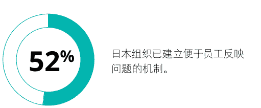
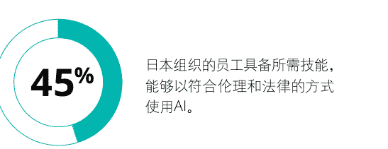
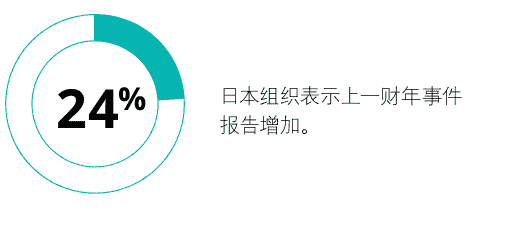
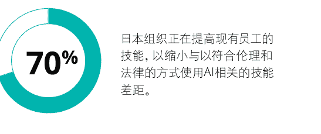

注：日本样本量 = 104

AI时代的选择 | 以“信”筑基，行稳“智”远

# 韩国

人口：5,180万 | GDP：1.7万美元

## 卓越AI治理可为组织带来的三大获益

## 组织在AI中使用最为担忧的风险

## 组织在AI使用或实施中的三大障碍

- 信任度带动AI解决方案使用增加（46%）
- 安全漏洞、网络入侵/安全风险（85%）
- 技术实施挑战（35%）
- 监管合规水平提高（42%）
- AI实施和意愿缺缺（33%）
- 整个组织AI解决方案加速（40%）
- 合规负担：AI解决方案相关报告或流程要求的严格程度（83%）
- 对监管、法律、伦理、合规等风险的担忧（33%）

42% 韩国组织已建立便于员工反映问题的机制。

52% 韩国组织的员工工具备所需技能，能够以符合伦理和法律的方式使用AI。

37% 韩国组织表示上一财年事件报告增加。

韩国组织通过招聘拥有适当技能的员工，以缩小与符合伦理和法律的方式使用AI相关的技能落差。

注：韩国样本量 = 52

# 新西兰

人口：520万 | GDP：2,530亿美元

## 卓越AI治理可望为组织带来的三大收益

## 组织在AI中使用中最担忧的三大风险

## 组织在AI使用或实施中的三大障碍

- 信任度提高带动AI解决方案使用增加(51%)
- 可靠性和错误(87%)
- 监管、法律、伦理、合规等风险的担忧(40%)
- 利用AI解决方案实现生产力提升(42%)
- 安全漏洞：网络被入侵/网络安全风险(85%)
- 对AI技术及其潜力的认识不足(38%)
- 在客户中的声誉提高(38%)
- 隐私：AI系统中敏感、保密或个人数据泄露风险(85%)
- 资金不足(36%)

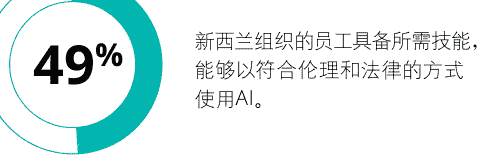
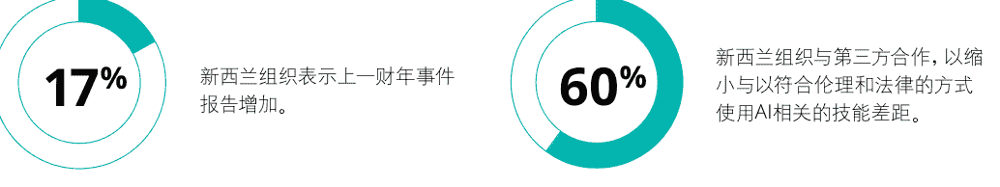

注：新西兰样本量 = 53

AI时代的选择 | 以“信”筑基、行稳“智”远

# 中国台湾

人口：2,340万 | GDP：7,565亿美元

## 卓越AI治理可为组织带来增益

## 组织在AI中使用中最昂的三大风险

## 组织在AI使用或实施中的三大障碍

- 利用AI解决方案实现生产力提升(64%)
- 安全泄露、网络入侵/网络安全风险(85%)
- 技术实施挑战(40%)
- 整个组织AI解决方案部署(48%)
- 监控、监控泛滥导致隐私侵犯(85%)
- AI应用与策略脱节(40%)
- 在客户中的声誉提高(44%)
- 监管不确定性；不断的要求导致合规义务(81%)
- 缺乏创新意愿和测试(37%)

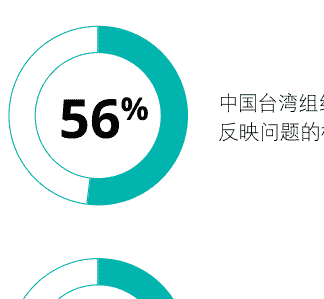
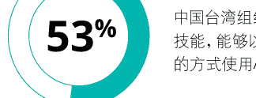
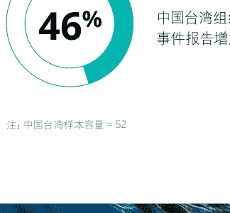
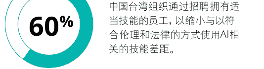

注：中国台湾样本量 = 52

# 新加坡

人口：580万 | GDP：5,010亿美元

## 卓越AI治理可望为组织带来的三大益处

## 组织在AI中使用面临担忧的三大风险

## 组织在AI使用或实施中的三大障碍

- 在客户中的声誉提高(43%)
- 安全泄露、网络入侵/网络安全风险(96%)
- 对AI技术及其潜力的认识不足(41%)
- 对AI解决方案生效或成果的信任提高(43%)
- 隐私：AI系统中敏感和数据泄露(94%)
- 对监管、法律、伦理、合规等风险的担忧(37%)
- 监管合规水平提高(39%)
- 可靠性和错误(94%)
- 技术实施挑战(31%)

新加坡组织已建立便于员工反映问题的机制。

新加坡工具具备所需技能，能够符合合理和法律的方式使用AI。

新加坡组织显示上一财年事件报告增加。

新加坡组织通过招聘有适当技能的员工，以缩小符合合理和法律的方式使用AI相关的技能差距。

注：新加坡样本量 = 51

# 印度尼西亚

人口：2,787亿 | GDP：1,37万亿美元

## 卓越AI治理可为组织带来的三大益处

## 组织在AI中使用中最担忧的三大风险

## 组织在AI使用或实施中的三大障碍

- 对AI解决方案成功率或效果的信任提高(67%)
- 安全漏洞、网络入侵/网络安全风险(88%)
- 对AI技术及其潜力的认识(41%)
- 整个组织AI解决方案开发(63%)
- 监控、监控泛滥导致隐私侵犯(84%)
- 对监管、法律、伦理、合规等风险的担忧(38%)
- 信任度提高AI解决方案增加(61%)
- 法律风险和版权侵权；AI解决方案数据使用相关责任(83%)
- 技术实施挑战(如维护、与现有系统集成所面临的挑战)(36%)

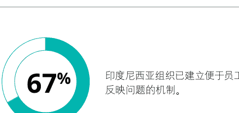
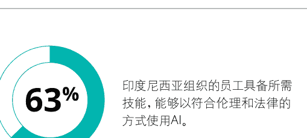
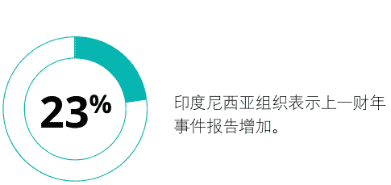
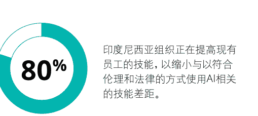

注：印度尼西亚样本容量 = 64

# 马来西亚

人口：3,340万 | GDP：4,000亿美元

## 卓越AI治理可能为组织带来的三大获益

## 组织在AI中使用中最忧的三大风险

## 组织在AI使用或实施中的三大障碍

- 对AI解决方案生效或成果的信任度提高(65%)
- 安全泄露；网络入侵/网络安全风险(90%)
- 技术实施挑战(如维护，与现有系统集成所涉的挑战)(51%)
- 信任提高带动AI解决方案使用增加(63%)
- 监控；监控泛滥导致隐私(84%)
- 对AI技术及其潜力的认识不足(37%)
- 整个组织AI解决方案开发增加(61%)
- 隐私：AI系统中敏感、保密或个人数据泄露(82%)
- 人才或技术技能短板(33%)

马来西亚组织已建立了反映问题的机制。

马来西亚工具配备所需技能，能够符合合理和法律的方式使用AI。

马来西亚组织显示上一财年报告增加。

马来西亚组织提高现有员工的技能，以缩小符合合理和法律的方式使用AI相关的差距。

注：马来西亚样本容量为 51

# 越南

人口：99亿 | GDP：300亿美元

## 卓越AI治理可能为组织带来的三大益处

## 组织在AI中使用最为担忧的三大风险

## 组织在AI中使用或实施中的三大障碍

- 在客户中的声誉提高(67%)
- 利用AI解决方案实现生产力提升(65%)
- 对AI解决方案成效或成果的信任提高(62%)
- 隐私：AI系统中敏感、保密或个人数据泄露(81%)
- 责任：AI开发者和使用者缺乏意识，不当使用(81%)
- 可靠性和错误：输出误、意外行为（幻觉）（79%)
- 人才或技能缺(56%)
- 监管、法律、伦理等负担(40%)
- AI实施策略和意愿缺(37%)

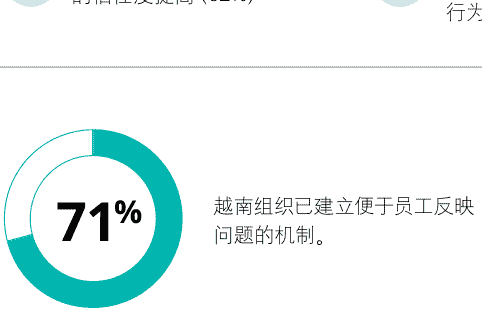
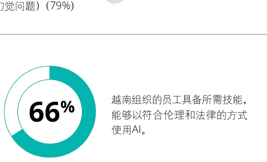
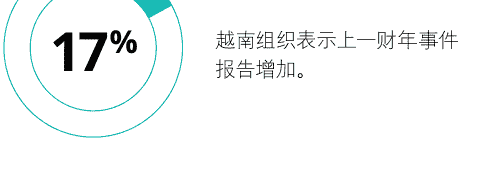
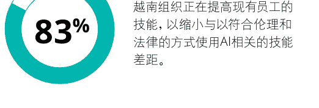

# 泰国

人口：6610万 | GDP：550亿美元

## 卓越AI治理可望为组织带来的三大效益

## 组织在AI中使用中最担的三大风险

## 组织在AI使用或实施中的三大难题

- 安全泄露、网络入侵/网络安全风险(76%)
- 对AI技术及其潜力的认识不足(41%)
- 信任度提高AI解决方案使用增加(51%)
- 监控：监控泛滥导致隐私(75%)
- 技术实施挑战(37%)
- 整个组织AI解决方案部署(43%)
- 法律风险和版权；AI解决方案数据使用相关责任(71%)
- 对监管、法律、合规等风险的担忧(35%)

71% 泰国组织已建立反映问题的机制。

56% 泰国组织的工具所需技能，能够符合合理和法律的方式使用AI。

33% 泰国组织表示上一财年报告增加。

78% 泰国组织正在提高员工的技能，以缩小符合合理和法律的方式使用AI相关的差距。

注：泰国样本容量 = 51

# 菲律宾

人口：1158亿 | GDP：4370亿美元

## 卓越AI治理可为组织带来的三大益处

## 组织在AI中使用最为忧的三大风险

## 组织在AI使用或实施中的三大障碍

- 对AI解决方案成功或效果的信任提高(67%)
- 监控：监控泛滥导致隐私(90%)
- 人才和/技能短板(38%)
- 信任度提高AI解决方案增加(52%)
- 安全漏洞、网络入侵/网络安全风险(85%)
- 技术实施挑战(37%)
- 在客户中的声誉提高(48%)
- 隐私：AI系统中敏感、保密或个人数据泄露风险(83%)
- AI实施策略和愿景缺失(33%)

52% 菲律宾组织已建立了反映问题的机制。

62% 菲律宾组织的员工所需技能，能够符合合理和法律的方式使用AI。

27% 菲律宾组织显示上一财年报告增加。

77% 菲律宾组织正在提高现有员工的技能，以缩小符合合伦和法律的方式使用AI相关的技能差异。

# 尾注

1. Deloitte (2024) "Generative AI in Asia Pacific", https://www.deloitte.com/nz/en/services/consulting/perspectives/generative-ai-in-asia-pacific-may-2024.html
2. ibid
3. Deloitte Access Economics (2024) "ACS Australia’s Digital Pulse 2024: Decoding the Digital Decade", https://www.deloitte.com/au/en/services/economics/perspectives/acs-australias-digital-pulse-decoding-the-digital-decade.html
4. IBM (2024), "Cost of a data breach Report", https://www.ibm.com/reports/data-breach
5. Capgemini Research Institute (2020), "AI and the ethical conundrum" Report, https://www.capgemini.com/news/press-releases/ai-and-the-ethical-conundrum-report/
6. Deloitte Centre for Regulatory Strategy (2024), "Generative AI: Application and Regulation in Asia Pacific", https://www.deloitte.com/au/en/industries/financial-services/analysis/generative-ai-application-regulation-asia-pacific.html
7. Deloitte (2024) State of AI in Enterprise, https://www.deloitte.com/content/dam/Deloitte/us/Documents/consulting/state-of-ai-q3.pdf

## 联系人与供稿人

如需了解更多信息或进一步探讨本文内容，请联系我们：

## 主要联系人

Chris Lewin
人工智能合伙人
亚太地区
chrislein@deloitte.com

Elea Wurth博士
可信服务合伙人
亚太地区及澳大利亚
eewurth@deloitte.com

John O'Mahony
德勤经济研究所合伙人
澳大利亚
joornahmony@deloitte.com.au

Stuart Scotis
前沿技术转型合伙人
德全球
sccotis@deloitte.com

朱源
可信服务合伙人
中国大陆
silzhu@deloittecn.com

范为
德勤人工智能研究院合伙人
中国大陆
rfan@deloittecn.com

Toyohiro Sometani
可信服务合伙人
toyohiro.sometani@tohmatsu.co.jp

Jessica Kim
可信服务合伙人
韩国
jessicakim@deloitte.com

Amy Dove
可信服务合伙人
新西兰
amydove@deloitte.co.nz

Jayant Saran
可信服务合伙人
南亚
jsaran@deloitte.com

Dishell Gokaldas
可信服务合伙人
东南亚
dogokaldas@deloitte.com

Chris Chen
可信服务合伙人
中国台湾
chrisachen@deloitte.com.tw

## 供稿人

Nick Hull
总监
nhull@deloitte.com.au

Jennifer Wright
亚洲越南中心总监
jenniwright@deloitte.com

Sanjukta Mukherjee
亚太研究负责人
sanjukmukherjee@deloitte.com

Tory Rowley James
高级经理
trowleyjamesjames@deloitte.com.au

Maud Dumont
高级分析师
madumont@deloitte.com.au

Dominic Behrens
分析师
dobehirens@deloitte.com.au

Tara Naidu
分析师
tarnaidu@deloitte.com.au

Angela Watzdorf
高级分析师
awatzdorf@deloitte.com.au

## Deloitte

关于德勤
德勤是一家国际会计师事务所，全球领先的专业服务机构，由其中国的合伙人拥有，服务于中国改革开放和经济建设的前沿。我们的办公室遍布中国31个城市，现有超过2万专业人才，为客户提供审计、税务、咨询等全球领先的一站式服务。

我们相信，卓越源于专注，通过卓越的专业能力、行业的洞察和技术解决方案，助力客户实现世界的高质量发展。

德勤成立于1815年，其名称“德勤”始于1988年起，集“会计、税务”之名。德勤是全球领先的专业机构，以“诚信、专业、影响力”为核心价值观，市场公认信誉，客户所信赖。通过我们创造的价值，为创造一个更好、更可持续的世界而努力。

Deloitte（德勤）是指一家或多个德勤成员公司，其在所在国家或地区开展业务的成员公司根据当地法律是独立的实体，成员之间互不产生法律关系也不承担任何责任或义务。德勤拥有每一成员公司及其每一成员公司的所有权并承担有限责任。德勤成员公司为客户提供服务，请访问www.deloitte.com/cn了解更多信息。

本通讯所包含的内容仅供参考。德勤或其成员公司获取的任何信息均不构成对任何人的任何法律或专业建议。在依赖本通讯所信息做出决策或采取任何行动前，您应当咨询有关的专业意见。

我们未对本通讯所包含的信息的准确性或完整性任何（明示或暗示）保证、保证或承诺。任何德公司、其成员、员工或关联方均不对因依赖本信息而导致的任何直接或间接的损失或损害承担责任。
