# 从DeepSeek爆火，看2025年AI行业发展 

2025-02

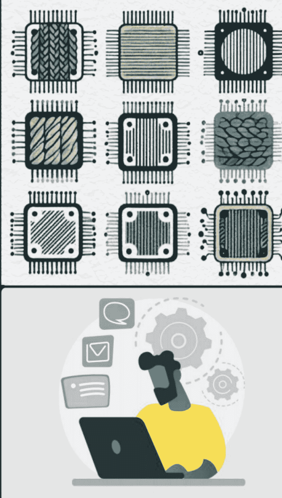

# 扫码加入 知识星球TOP 免费资源群

免费
- 每日免费获取高价值资源
- 提供各类资源搜索服务

价值：
| 热门付费文章 | 各行各业报告 |
| --- | --- |
| 精选图书资源 | 副业赚钱方法 |
| 职场实用资源 | AI政经自媒体 |

及时关注
分享资料仅供个人学习，请及时删除，切勿商用传播

# 当下AI行业现状

Company
Nobody asked for this... but
AI

Let's build an AI feature!
And say we are an AI company now!

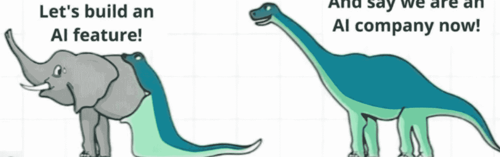

# 得亏我的年度AI报告是12月做的

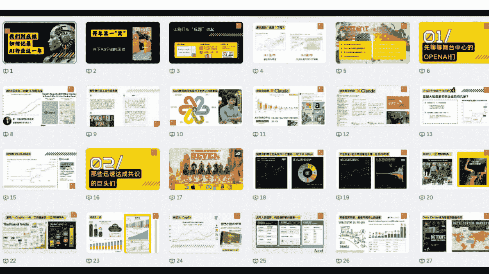

### 我们到底如何记录AI行业这一一年

屠龙之术
按照每年的习惯我都会对当年的行业发展一次整理。

### 小宇宙
感谢您的时空旅行

# 如果今天只有一页PPT

- **聊天机器人**：拥有对话能力的AI
- **推理者**：像人类一样解决问题的AI。
- **智能体**：不仅能思考，还可以采取行动的AI系统。
- **创新者**：能够协助创造的AI。
- **组织者**：可以完成组织工作的AI。

# L1 / L2 / L3 / L4 / L5

## 我们走到哪里了？在L2-L3之间

# DeepSeek爆火

- DeepSeek为什么火了？
- 火的到底是什么？
- 一些核心的关键决策/节点/细节
- 开源、低成本的意义
- 那些语言与误解

- more money=better infra=better training=better AI
- Capex-英伟达-数据中心-公有云
- 特朗普-星际之门计划
- 芯片与能源
- 战略投资与并购

## 过去年的叙事

- 基于现有数据的scaling law 失效
- 预训练边界效应加速降低
- 后训练与强化学习兴起
- 推理类模型显现的能力提升
- OpenAI o1/Claude 3.5 Sonnet/DeepSeek R1

## 新叙事的可能

- L3可能等于推理模型+场景实现
- 肉眼可见的aha moment=搜索、代码
- 没有共识的问题：模型连续或非连续
- 场景边界
- 组织结构的适配

## 万物皆可Agent

## 关于DeepSeek的种种种类

## 这些问题你是否想过?

差不多时间豆包、阶跃、Kimi、Minimax似乎都发了新模型，为什么他们没火？

如果你说因为开源，那么阿里的Qwen在春节期间也发了模型，榜单成绩很好，为什么没火？

DeepSeek V3是12月底发布，R1是1月20日发布，那什么是V3“重要”还是R1？

DeepSeek的官方APP上线时间是1月10日，为什么当初没火？后来又是为什么火的？

- 开源 VS 闭源
- 巨龙 VS 屠龙少年
- 低成本与推理模型
- 产品体验与窗口期

- 2024-12-26 v3发布
- 2025-01-10 官方APP发布
- 2025-01-20 推理模型r1发布
- 2025-01-20 梁文峰上任与总理座会
- 2025-01-21 特朗普上任与星际之门计划
- 2025-01-24 Alexander Wang和Marc Anderson发言
- 2025-01-24 允许深度思考和搜索同时进行
- 2025-01-26 游戏科学冯瑾推荐，“国运”
- 2025-01-27 英伟达跌17%
- 2025-01-28 黄仁勋内部信

回头看这几周有必然，也有偶然
- 科技巨头年底财报预期暴增
- 媒体称“出口内销
- 巨大Capex投入顶峰
- 美国主流媒体和创投
- 媒体信息的“春季”
- 文章的“真假难辨”
- 功能上的临界点与“定价”......

## US & China: Frontier Language Model Intelligence, Over Time

## 模型足够，中国、开源、便宜

The Language Model Frontier: Country of Origin Analysis, Select Leading Models

## 使用成本的指数下降

- The cost to use a given level of AI falls about 10x every 12 months, and lower prices lead to more use.
- You can see this in token cost from GPT-4 in early 2023 to GPT-4o mid-2024, where the price per token dropped by about 150x in that period.

## DeepSeek-R1 Upsets AI Market With Low Prices

Estimated price for processing one million input/output tokens on different AI

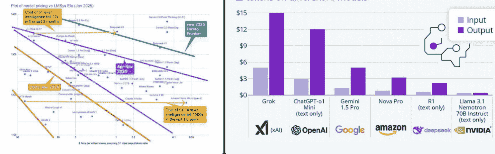

## “出口转内销” # DeepSeek AI VS GPT-4

A comprehensive infographic comparing DeepSeek AI and OpenAI's GPT-4

| Development Timeline and Cost | DeepSeek AI | GPT-4 |
| --- | --- |
| Developed in 2 months for under $6 million | Developed in several months, with training cost over $70 million |
| Model Parameters | DeepSeek AI | GPT-4 |
| --- | --- |
| Uses 67 billion parameters, with 7 million active per token | Contains approximately 1.8 trillion parameters, spread across 120 layers |
| Training Data and Computational Resources | DeepSeek AI | GPT-4 |
| --- | --- |
| Trained on 1.4 trillion tokens, requiring 2,788 GPU hours | Trained on approximately 13 trillion tokens, utilizing around 25,000 H100 GPUs over 90-180 days |
| Performance Benchmarks | DeepSeek AI | GPT-4 |
| --- | --- |
| Outperforms others like GPT-3.5, GPT-4, and Claude 3.0 in benchmark tests | Demonstrates advanced performance across various tasks, though DeepSeek AI is close |
| Pricing and Accessibility | DeepSeek AI | GPT-4 |
| --- | --- |
| Open-source, allowing free access | Expensive with access provided via API subject to usage fees |

## DESEEK AI COULD BE A WAKE UP CALL? THE CHINA TAKE ON DEEPSEEK STATE MEDIA HAILS DEEPSEEK AS CHINA Shares 2x Lower

## AI: HIT BY LARGE-MALICIOUS ATTACK AI SENSATION DEEPSEEK FACES CYBER/CHINA'S DEEPSEEK A.I. MODEL SPARKS TECH-OFF

| BUSINESS ANALYSIS | OIL | GOLD | EATON CORP | ETN |
| --- | --- | --- | --- |
| 73.62 ▼2.04 | 2,104 ▲11.11 | 2,764.80 ▼41.80 | 44.33 ▲0.05 |

## “国运”

- 强大---推理模型
- 便宜---模型成本
- 开源---模型部署
- 免费---转到APP
- 联网---产品体验
- 本土---国运级别

微博轻享版：
Yocar-冯骥
游戏科学创始人、CEO、《黑神话：悟空…
关注443 粉丝64.1万
2025-01-26 23:22:33

时间点：2025-01-26 可能是去年中国最出名之一。认真推下DeepSeek吧。V3已经用了一个月，但R1仅用了天。先讲一句：DeepSeek，可能是国运级的成果。

## PLAYER 1 / PLAYER 2

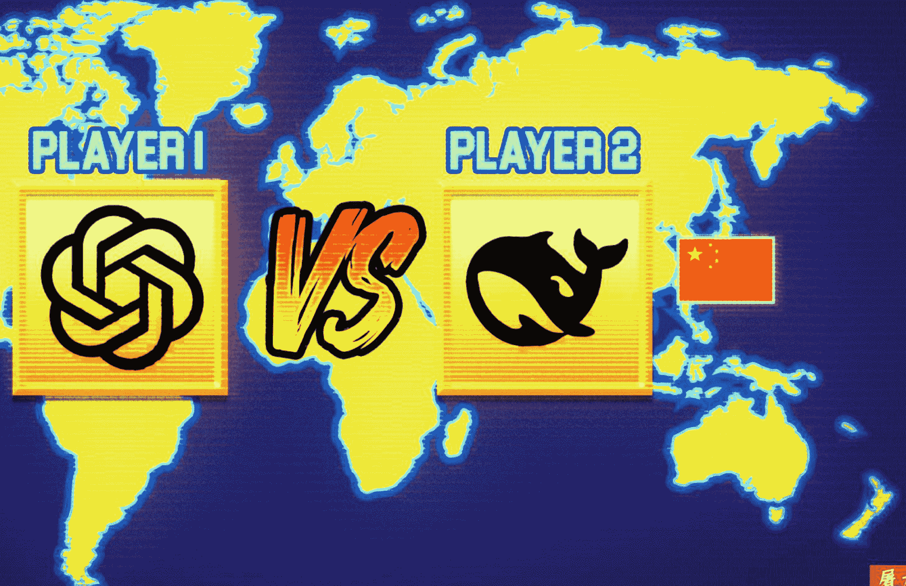

## 黄亦DeepSeek开信：各位同仁，今天的投入视为一份礼物，我们不是在制造芯片，而是在创造通用的智能！亲爱的同仁与伙伴们：此刻，我将向外界这种亮色的色彩，星辰与服务集合，希望它能让AI成为你生活中的水和电。

曾想2024年的最后一天，是两篇AI写的晚上DeepSeek刷了所有人的交流……谁是“真”，谁是“假”？如果再发展几年，如果大多数人都相信了那个“假”的东西，TA还是假的吗？

# AI探索

大年初一眨眼，又惊醒了几个被AI骗了的人；但如果再发展几年，如果大多数人都相信了那个“假”的东西，TA还是假的吗？

必须坦白，其实挺好的，所有人都是假的。我们不是站在你们的门槛上，巨大的规模这太大了好几年了，其实每一天都看着震撼动人的数字：那个在手机上的临时mini模型，灵感自于清一中中学还存在GitHub首页的 Issue：支持我们与交互的功能，是内部用户连续三次是三点提交交易信息想出来的。

## High起来吧......

## 波天的富贵

## 猜猜现在的数字

生成式AI应用：狂热用户活跃变化（1月25日-2月7日）

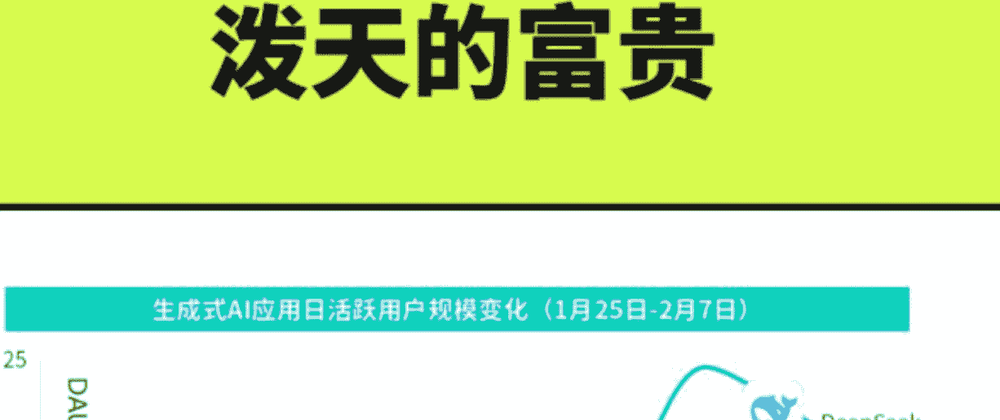

## AI产品榜·全球日活总榜

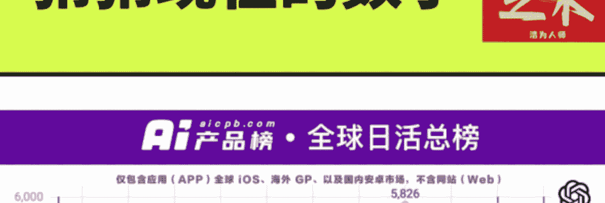
仅包含移动端（APP）iOS、海外、Android及国内核心活跃数据，不包含网页（Web）
数据来源：数据蝉 2025/01

## More Money

## Better Infra

## Better training

## Better AI LLM

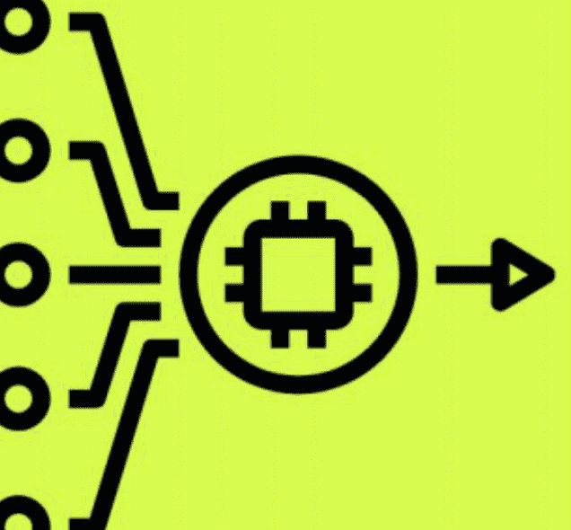

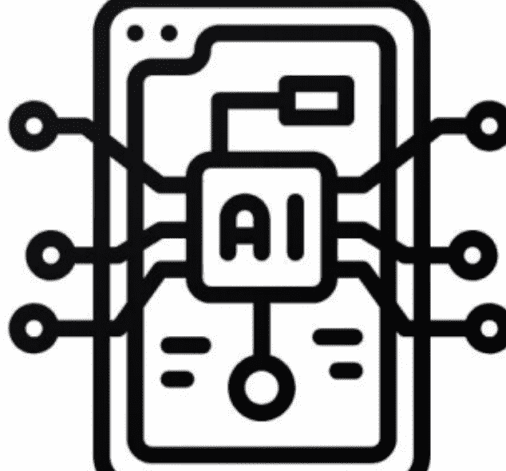

简单粗暴的递进关系

# # THE MAGNIFICENT SEVEN

The Venture Capital frontier & the new AI Wild West
May 2024

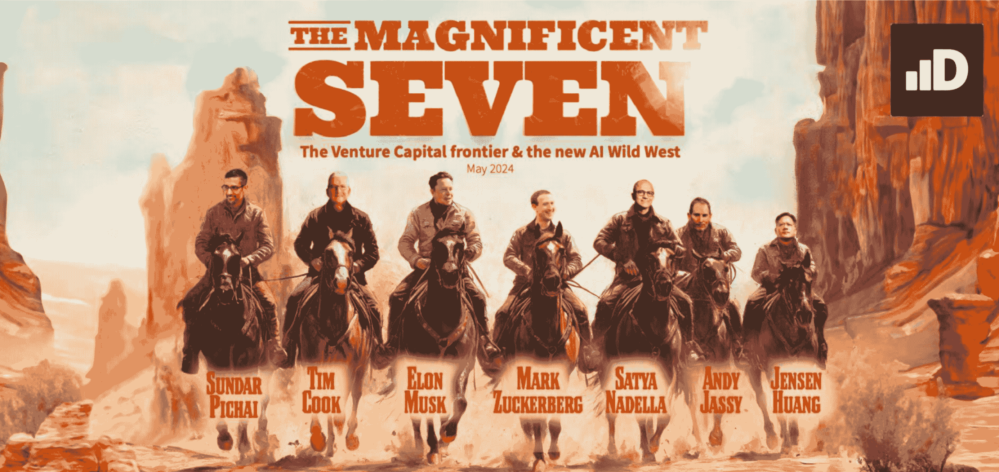

- Sundar Pichai
- Tim Cook
- Elon Musk
- Mark Zuckerberg
- Satya Nadella
- Andy Jassy
- Jensen Huang

# 七巨头看作一个整体

### $17.6 Trillion

MAGNIFICENT SEVEN MARKET CAP SOARS TO $17.6 TRILLION IN 2024

THE MAGNIFICENT SEVEN DRIVE 55% OF S&P 500 2024 GAINS WITH $5.6 TRILLION GROWTH

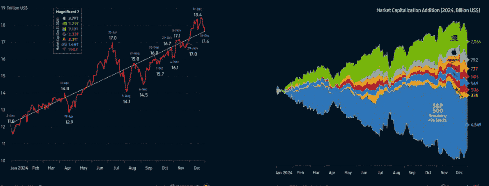

# # 万亿美金的公司

# # 拉长20年时间看

### MARKET CAP GROWTH TRENDS OF THE MAGNIFICENT SEVEN IN 2024

| Magnificent 7 | Growth % |
| :--- | :--- |
| Apple | 14.4% |
| Microsoft | 16.9% |
| Google | 12.7% |
| Meta | 43.1% |
| Amazon | 44.9% |
| Nvidia | 225.1% |
| Tesla | 64.1% |

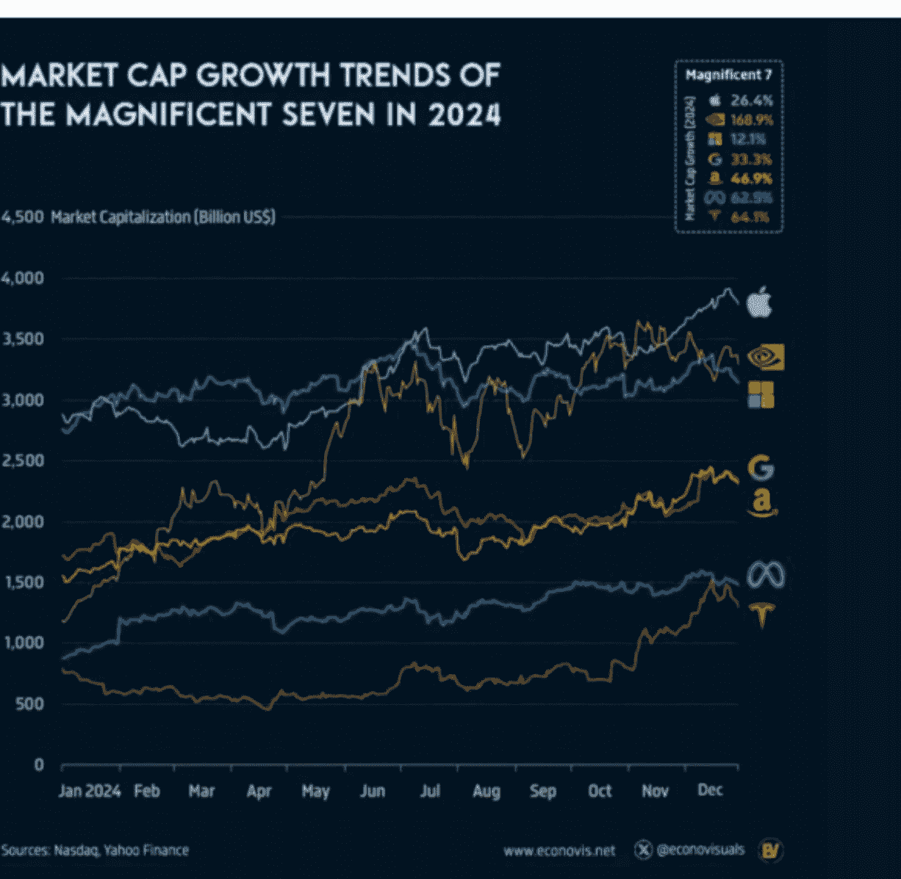

### U.S. BIG TECH STOCKS SURGE

Market Capitalization of Seven Major U.S. Tech Companies Increased 11x (26% CAGR) from $5.1 Trillion in 2012 to $53.7 Trillion by Dec. 31, 2024, Outpacing the Rest of U.S. Stock Market by 4-x.

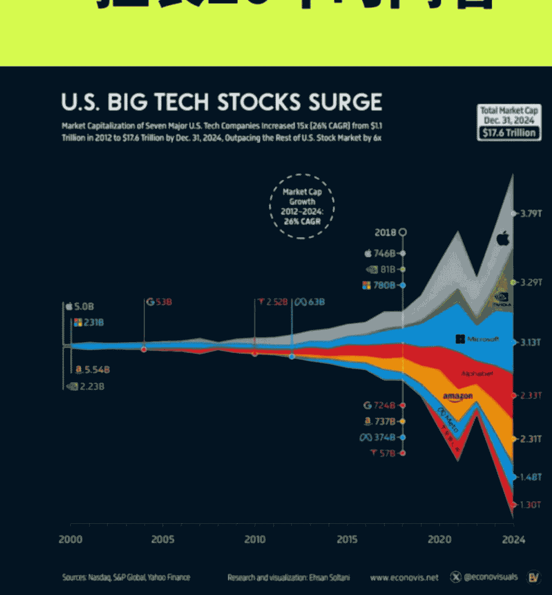

# # 第一个共识：

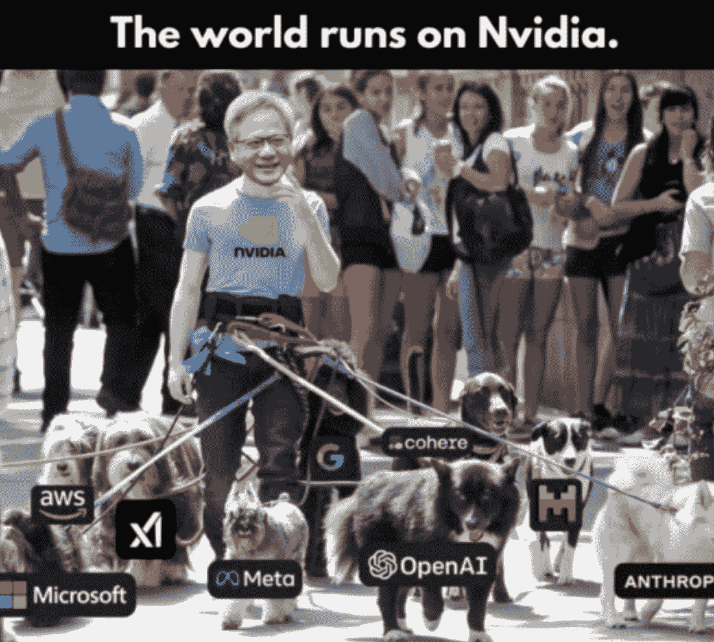

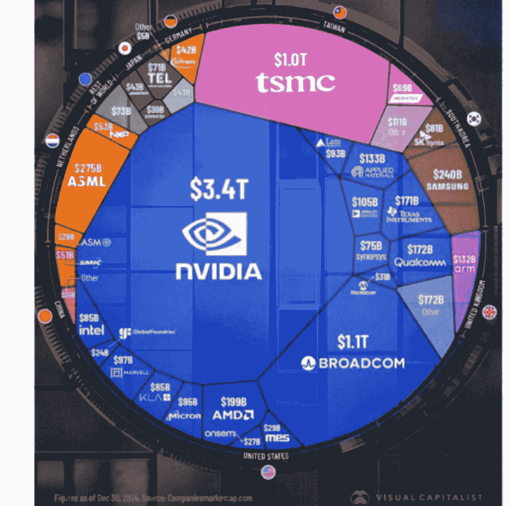

# # 第一个共识:

# # THE BIGGEST SINGLE-DAY STOCK DECLINES

Nvidia has experienced 8 of 10 biggest single-day declines.

- -$197B Aug. 28, 2024.
- -$205B Jul. 24, 2022.
- -$205B Jul. 17, 2024.
- -$206B Apr. 28, 2024.
- -$208B Jun. 24, 2024.
- -$212B Apr. 10, 2024.
- -$228B Jan. 7, 2025.
- -$251B Feb. 3, 2022.
- -$279B Aug. 3, 2024.
- -$560B Jan. 27, 2025.

Nvidia's stock plummeted after a Chinese startup called DeepSeek released a powerful AI model.

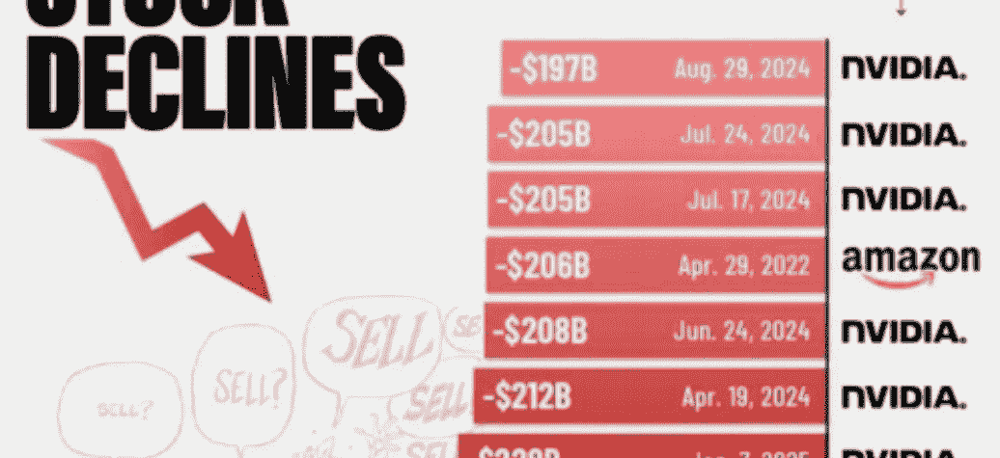

# # Nvidia Dip Buyers Were Rewarded

Nvidia Stock Price [2025 YTD]

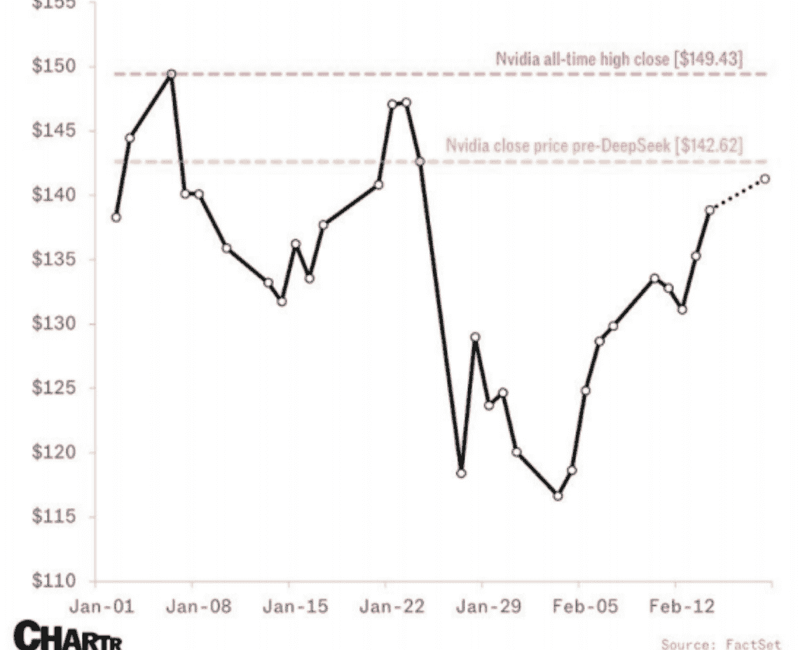

# # 游戏-区块链-叠加

# # The Rise of Nvidia

The key moments leading to its rise from market cap of $600M to $3.5T.

| Year | Event |
| :--- | :--- |
| 1993 | Nvidia Founded |
| 1997 | Nvidia's RIVA128 is released, its commercially successful. |
| 1999 | Nvidia's first chip, the NV1, is released. |
| 2001 | Nvidia IPO at first GPU, GeForce 256, at $600M valuation. |
| 2003 | Programmable shaders are introduced with GeForce 3. |
| 2006 | CUDA is introduced for parallel computing. |
| 2009 | The Kepler architecture is released. |
| 2010 | The Fermi architecture is released. |
| 2012 | Nvidia release Tesla, their first CUDA-HPC-focused GPU. |
| 2013 | Maxwell architecture is released. |
| 2014 | Blackwell architecture is released. |
| 2015 | Nvidia acquires Mellanox, a leader in Infiniband networking. |
| 2016 | Pascal architecture is released. |
| 2017 | Turing architecture is released. |
| 2020 | Ampere architecture released. |
| 2022 | Hopper architecture and Grace GPU announced, released. |
| 2024 | Nvidia surpasses $38B in quarterly revenue, up 5x in 6 quarters. |

# ## NVIDIA's market cap in perspective

| Company | Market Cap |
| :--- | :--- |
| Nvidia | $3.6T |
| Apple | $3.0T |
| Microsoft | $2.5T |
| Google | $1.2T |

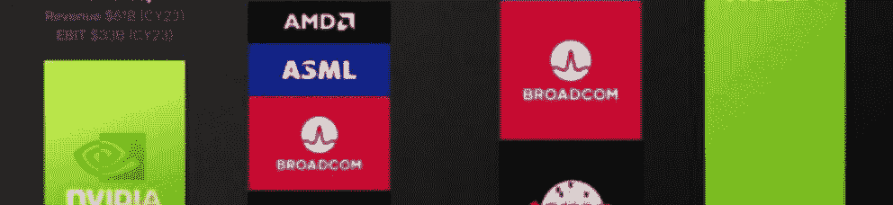

# # 共识2: 公有云

# # Cloud Revenue & Growth
Revenue Run Rate & Aggregate Y/Y Growth rate for AWS, Azure, and GCP

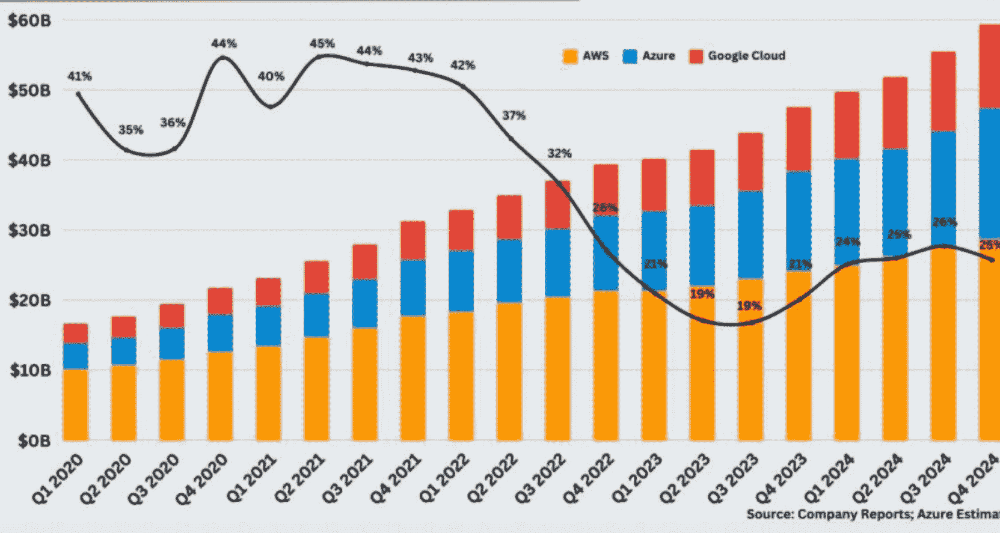

# # Entering the Cloud
Amazon Web Services revenue per quarter

| Period | Value |
| :--- | :--- |
| Q4 2014 | 35% |
| Q4 2024 | CAGR |

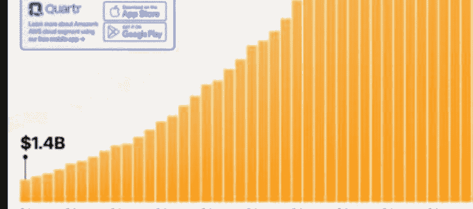

# # 共识3: Capex

### Hyperscaler Capex By Year

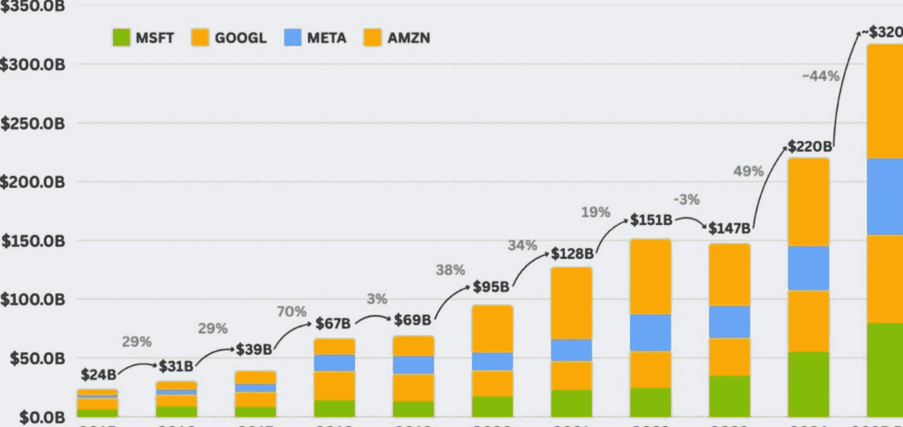

## 军备竞赛没有尽头

| | 2024 YE (H100 equivalent) | 2025 (GB200) | 2025YE (H100 equivalent) |
| :--- | :--- | :--- | :--- |
| MSFT | 750k-900k | 800k-1m | 2.5m-3.1m |
| GOOG | 1m-1.5m | 400k | 3.5m-4.2m |
| META | 550k-650k | 650k-800k | 1.9m-2.5m |
| AMZN | 250k-400k | 360k | 1.3m-1.6m |
| XAI | ~100k | 200k-400k | 550k-1m |

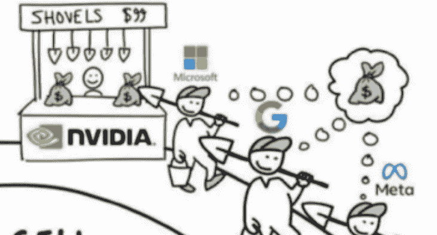

## 成人的世界，钱是最啥

### Tech Titans
spending billions

### AI Majors
spending billions

### AI Challengers
spending millions

| Company | 2024 Capex ($) | 2024 Funding |
| :--- | :--- | :--- |
| amazon | $60B-65B | --- |
| Google | $50B-55B | --- |
| Meta | $35B-40B | --- |
| OpenAI | $18.9B | $7.8B |
| ANTHROPIC | $6.1B | $1.1B |
| Mistral | $940M | $626M |
| cohere | $437M | |
| Magic | $363M | |
| kyutai | $220M | |
| black forest labs. | $196M | |
| ElevenLabs | $101M | |

## 不就是钱......

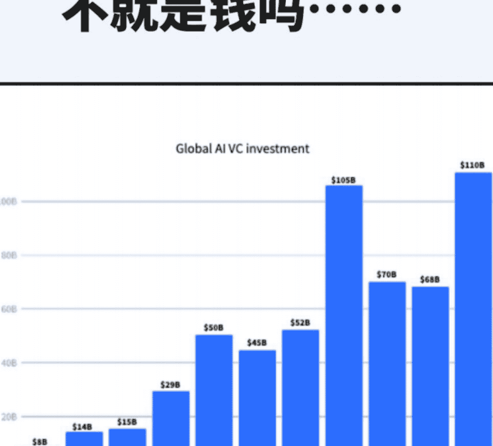

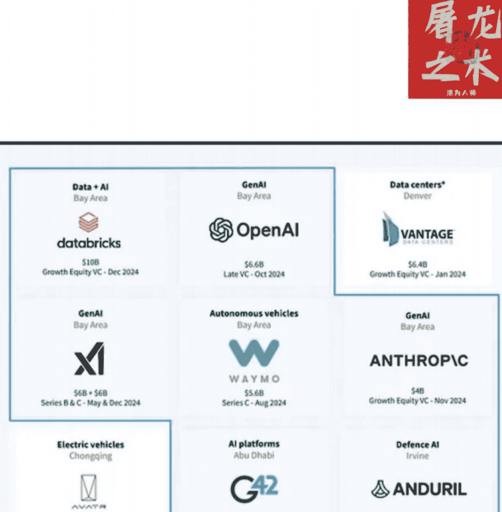

## 特朗普第一把火

## Stargate

### STARGATE PROJECT
Trump unveiled the $500bn plan for an AI revolution

### Project Stargate
The Powerbrokers and their ties

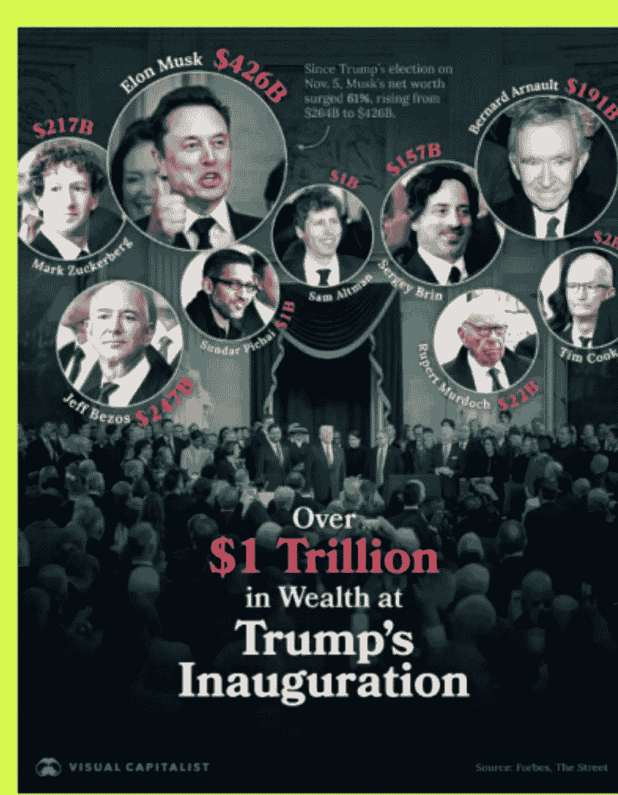

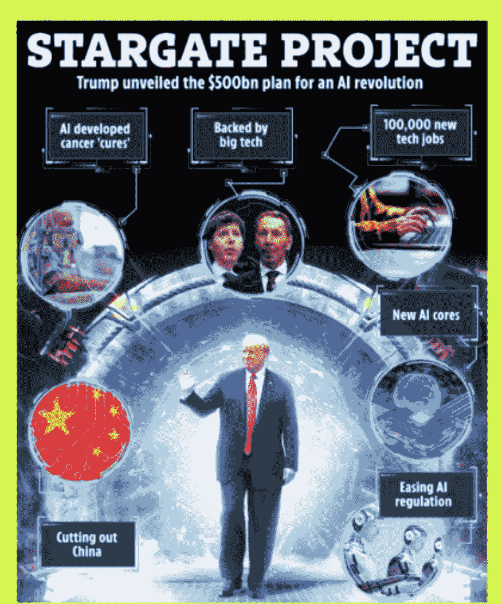

Over $1 Trillion in Wealth at Trump's Inauguration

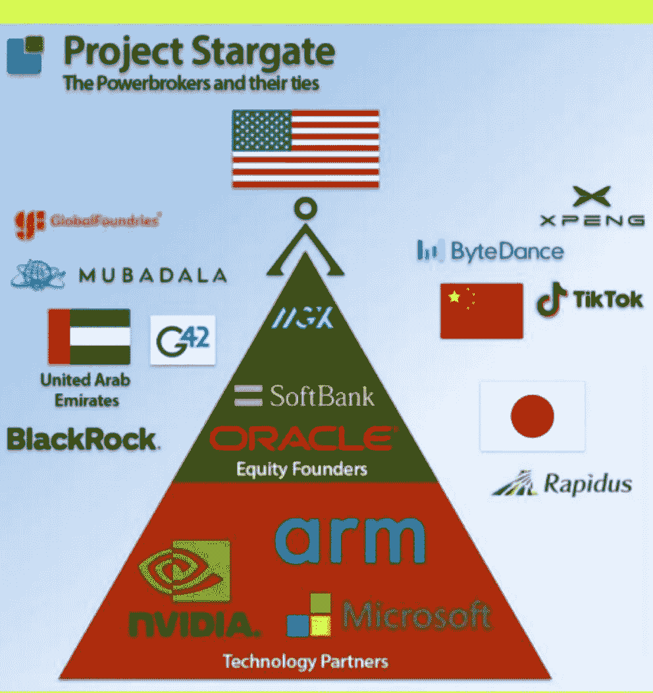

## 当然，再次成就了Nvidia

## NVIDIA Revenue Breakdown

In $ million
Q3 FY25
Ending Oct, 2024

- Other
- Gaming

| Period | Value |
| :--- | :--- |
| Q4 FY21 | 2,499 |
| Q1 FY22 | 2,760 |
| Q2 FY22 | 3,061 |
| Q3 FY22 | 3,221 |
| Q4 FY22 | 3,240 |
| Q1 FY23 | 3,620 |
| Q2 FY23 | 3,642 |
| Q3 FY23 | 3,574 |
| Q4 FY23 | 3,833 |
| Q1 FY24 | 3,618 |
| Q2 FY24 | 3,240 |
| Q3 FY24 | 2,486 |
| Q4 FY24 | 2,865 |
| Q1 FY25 | 2,856 |
| Q2 FY25 | 2,647 |
| Q3 FY25 | 18,404 |
| Q4 FY25 | 22,563 |
| Q1 FY26 | 30,771 |
| Q2 FY26 | 3,279 |

Data Center

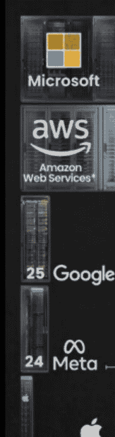

# # BIG TECH'S Data Centers

AWS has the highest market share in cloud infrastructure (31%), followed by Microsoft Azure (25%).

- Meta has one center in Asia, 3 in Europe, and 20 in the U.S.

# # 共识4: 往上游去

# # AI Semiconductor Value Chain

| Design | Manufacturing | Chip |
| :--- | :--- | :--- |
| Co-designer | Wafer Fab Equipment | GPUs & ASICs |
| BROADCOM | Litho | Deposition | Process | NVIDIA, AMD |
| MARVELL | ASML | TEL ASML | KLA | Lam | Google, aws |
| | | | | |
| Chip Designer | Foundries | Packaging | Inference-Focused |
| intel, AMD, aws | tsmic, samsung | SK Hynix, UMC, Micron | tentrent, groq, d-Matrix, Furiosa, recogni |
| NVIDIA | | | Model-Focused Silicon |
| IP | Generative Value | Edge |
| EDA | Other Semic & Equipment | Packaging | Materials | Testing | Qualcomm, NVIDIA, Apple |
| SYNOPSYS, ARM | Generative Value | Packaging | Materials | Testing | |
| cadence, SIEMENS | Applied Materials, GlobalFoundries, ASE, ASM | ADVANTANT | HAILO, UNETHER AI, Simics | | | TER | intel, blaze, AMD

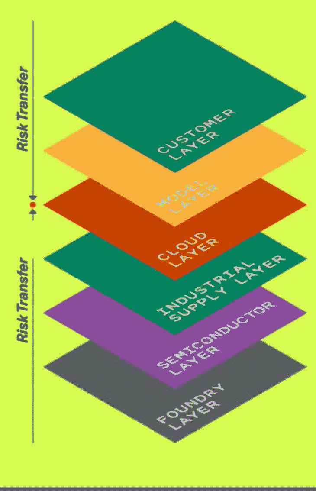

## 没有人想被卡脖子

Chip rivals pose a risk to Nvidia’s meteoric growth

| Company | Chip | Purpose | Launch date | Select AI customers |
| :--- | :--- | :--- | :--- | :--- |
| amazon | Trainium | Training | 2022 | ANTHROPIC |
| | Inferentia | Inference | 2019 | Perplexity |
| Google | Tensor processing unit | Training & inference accelerator | 2017 | character.ai |
| Microsoft | Maia 100 | Training & inference accelerator | 2024 | To be launched |
| Meta | MTIA | Training & inference accelerator | 2023 | Internal use |

## 共识4: 往上游去---能源

## Big tech companies morph into leading energy innovators to support AI workloads

Data center power usage will more than double from 460 TWh in 2022 to 1,000+ TWh by 2026 - equivalent to Japan’s energy consumption*

| Category | Big tech | Company/partner | Description | Date |
| --- | --- | --- | --- | --- |
| Nuclear | Microsoft | Constellation | Reopening Three Mile Island nuclear plant for data centers | September 2024 |
| Nuclear | Google | Kairos Power | Agreement for up to 500 MW of nuclear power from SMRs** (deployment by 2030) | October 2024 |
| Nuclear | amazon | ENERGY NORTHWEST Dominion Energy | Signed agreements to support deployment of SMRs in the US | October 2024 |
| Fusion | Google | Commonwealth Fusion Systems | GV portfolio companies | 2021, 2022 |
| Fusion | Microsoft | HELION | Aims to buy fusion-produced electricity starting in 2028 | May 2023 |
| Geothermal | Meta | SAGE GEOTHERMS | Collaborating to deliver 150 MW of geothermal power to data centers starting in 2027 | August 2024 |
| Geothermal | Google | FERVO ENERGY | Developed a 3.5 MW geothermal power plant to power data centers in Nevada | November 2023 |

# 共计5: 战略投资与并购

## Big Tech gobbles up AI model front runners

Resulting in Majority or Minority Control of Several Key AI Assets

| MICROSOFT | | AMAZON | | ALPHABET |
| :--- | :--- | :--- | :--- | :--- |
| NUANCE | | ANTHROPIC | ZOOX | Aurora | ANTHROPIC | Hugging Face |
| 19,700 / 100% | | 10,000 / 33.4% | | 7,200 / 100% | | 4,000 / NA | | 1,300 / 100% | 600 / 245% |
| Inflection | | Imbue | | | | Hugging Face |
| 1,300 / 3.2% | | 250 / NA | | 225 / NA | | 377 / 315% | | | | | | | | Tempus |
| NVIDIA | | META | | | | APPLE |
| Inflection | | Alpha Labs | |Wave | | CTR2-Labs | XNORAI | Credit Kudos | |like |
| | | Alpha Alpha | CareHera | | | | | drive.ai | A.Team |
| ADEPT | | coheze | | Inworld | | | | |
| Adept | | Scope | Inworld | | | | | |
| SALESFORCE | | coheze | ANTHROPIC | | ORACLE | | |
| Cohere | | Anthropic | | Coheze | | |

## Generative AI is the new battleground

Big tech has formed overlapping alliances, with commitments to the billions Generative AI companies with two or more big tech investors (as of 1/30/2023) ✓ indicates where big tech invested

| Big tech investors | amazon | Google | Microsoft | Meta | NVIDIA |
| :--- | :---: | :---: | :---: | :---: | :---: |
| ADEPT | | | ✓ | ✓ | ✓ |
| AI21b | | | | ✓ | ✓ |
| ANTHROPIC | ✓ | ✓ | ✓ | | ✓ |
| Cohere | | | ✓ | ✓ | | |
| InsistentAI | | | ✓ | | | |
| Hugging Face | ✓ | ✓ | | | | |
| Inflection | | | ✓ | | | |
| Inworld | | | | ✓ | ✓ |
| Mistral | | ✓ | | | | |
| OpenAI | | ✓ | ✓ | | | |
| scale | | | ✓ | | | |
| synthesis | | | | | | ✓ |
| Toplexity | | | | | | | |

Source: CB Insights includes investments from venture areas. Only equity deals considered.
*"Effectively 'adjusted for' by Amazon *"Stock-based" by Microsoft.

Source: Pitchbook, Morgan Stanley Research

CB INSIGHTS

## 掏空式并购

| Company | Details | Takeover | News | Notes |
| --- | --- | --- | --- | --- |
| character.ai | | Founded in 2021 Full-Stack App $150M in Funding | August 2024 Google | TechCrunch: Exclusive:Character.AI CEO Noam Shatter returns to Google as the tech giant invests in the AI company | $2.7B licensing agreement, incl. $2.58B to buy out existing shareholders Google hires part of Character.AI's employees |
| Inflection | | Founded in 2022 Foundation Model $1.5B in Funding | March 2024 Microsoft | TechCrunch: After raising $1.3B, Inflection is eaten alive by it's biggest investor, Microsoft | $650M licensing agreement Co-founders Mustafa Suleman and Karen Simonyan lead Microsoft AI unit Microsoft hires most of inflection's team |
| ADEPT | | Founded in 2021 Full-Stack App $415M in Funding | June 2024 amazon | TechCrunch: Amazon hires founder away from AI startup Adept | Licensing agreement Co-founder David Loon hired to lead Amazon AGI Autonomy unit Amazon hires - 2/3 of Adept's employees |

## 当然，自身业务肯定定也不会落下

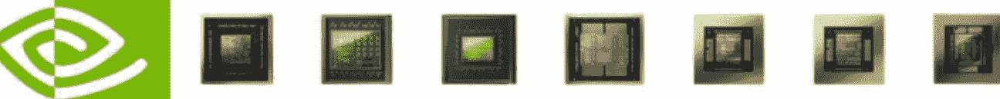

Copilot

## 中国的巨头们

| | Alibaba | ByteDance | Huawei | Tencent |
| --- | --- | --- | --- | --- |
| Description | Large ecommerce player and Hyperscaler, and operator of Ant Group (Alibaba Cloud), the least shareholder of Ant | China’s largest search engine, Wenxin Yiyan, AI chatbot that chatted with ~300m users | Parent company of Douyin (TikTok) and Toutiao, one of China’s leading news applications | Global telco leader and one of the world’s manufacturers | Parent company of Riot Games and WeChat, the ‘all-in-one’ super app |
| AI Strategy (high-level) | Release proprietary models | Actively integrating models into search platform Long time leader in self-driving AI | Develop proprietary models across their consumers | Develop proprietary, domain-specific models and offer on Huawei | Release models and proprietary models on Tencent Cloud |
| Non-Reasoning | Qwen 2.5 Max Intelligence: 79 | Ernie 4.0 Turbo Intelligence: 76 | Doubao 1.5 Intelligence: 77s | Pangu 5.0 Large Hunyuan: 74 |
| Reasoning | QW Intelligence: 78s | Doubao 1.5 Pro Intelligence: 80s | | |
| Text to Speech | ✓ | ✓ | ✓ | ✓ |
| Speech to Speech | ✓ | ✓ | ✓ | ✓ |
| Video Generation | ✓ | ✓ | ✓ | ✓ |
| 3D Generation | - | - | - | - |
| Primary Consumers | Tongyi Qianwen | Wenxin Yiyan, Wenxin Yige | Doubao | Celia | Yuanbao, Yuanqi |
| Valuation ($) | 235B | 32B | 300B | 128B | 469B |

### Other Firms with AI Ambitions

- Kunlun Tech (SHE: 300418 Mkt Cap: $68B): Beijing-based internet group with >300M MAUs; owner of the Opera browser. Launched the SkyWork series of models and AI accelerators.
- 360 Security (SHE: 36860 Mkt Cap: $118B): China’s largest internet and mobile security products. Launched the Xiniao series of models under 360 AI brand.
- Tiktok (HKG: 3690 Mkt Cap: $115B): Leading voice AI company in China with >14000 employees. Launched the Spark series of models.
- Meituan (HKG: 3690 Mkt Cap: $115B): China’s leading consumer brands. Launched the MiLM series of small models. Recently posted Luo Fu, DeepSeek researcher, to run AI lab. Investor in multiple frontline labs.

# 当然，还有六小龙们……

## Frontier Models by Chinese Tigers and Startups

| | MiniMax | Moonshot AI | 一万物 | deepseek | ZHIPU-AI | 智谱AI | 百铁星 |
| --- | --- | --- | --- | --- | --- | --- | --- |
| Description | - | - | China AI Tiger and publisher of Talkie AI app (4th) most downloaded in US in 1H24 | China AI Tiger with 2M character window model; China's most well-funded startup based on available information | Chinese startup focused on smaller language models founded by Lee Kai, former head of Google China | Chinese lab originating out of AI-focused quantitative trading firm | China AI Tiger with ~7000 enterprise and developer users | China AI Tiger with focus on medical AI models founded by Wang Xiaochuan (ex-CEO, Sogou) | First Chinese AI startup to develop a trillion-parameter model; founded by Jiang Daxin (ex-Chief Scientist, Microsoft Research Asia) |
| Non-Reasoning | MiniMax-Text-01 Intelligence: 76 | V1-128K Intelligence: 52 | Kimi l1.5 Intelligence: 87 | Yi-Lightning Intelligence: 73 | V3 Intelligence: 79 R1 | GLM-4-Plus Intelligence: 70 Baichian 4-Turbo Intelligence: 65 | Step-R-16k Intelligence: 82 |
| Reasoning | - | - | - | - Intelligence: 89 | GLM-Zero-Preview Intelligence: 81 | Baichian M1-Preview Intelligence: 83 | Step-R-mini Intelligence: 84 |
| Text to Speech | - | - | - | - | - | - | - |
| Image Generation | - | - | - | - | - | - | - |
| Video Generation | - | - | - | - | - | - | - |
| Primary Consumers | Hailuo AI Chat, Hailuo AI Video | Kimi | YiChat | DeepSeek | ChatGLM | Bai Xiong | Yuewen, PopDuck |
| Funding Raised ($) | 0.85B* | 1.67B* | 0.2B* | Unknown | 1.12B* | 1.04B* | Unknown |

## The DeepSeek Impact
1-day price move 27 Jan 2025

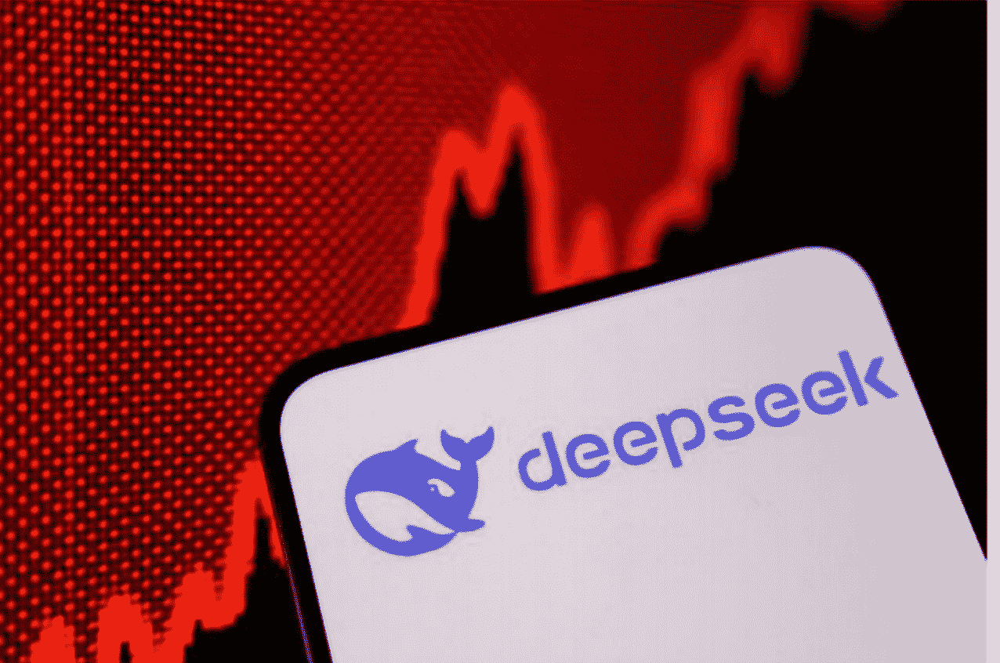

| Semiconductor | | IT Hardware | |
| --- | --- | --- | --- |
| NVIDIA | -17% | ARISTA | -22% |
| TSMC | -13% | DELL | -9% |
| ARM | -10% | Data Centers | |
| | | DIGITAL REALTY | -9% |
| | | EQUINIX | -4% |
| ASML | -7% | Electricity | |
| APPLIED MATERIALS | -7% | VISTRA | -28% |
| TALEN ENERGY | -22% | Constellation | -21% |

## 新的阶段，新的叙事?

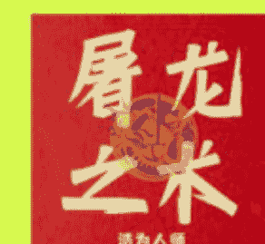

## Traffic To An Obscure Wikipedia Page About A Paradox Soared This Week

Wikipedia Page Views For "Jevons paradox" [Daily, Wikipedia]

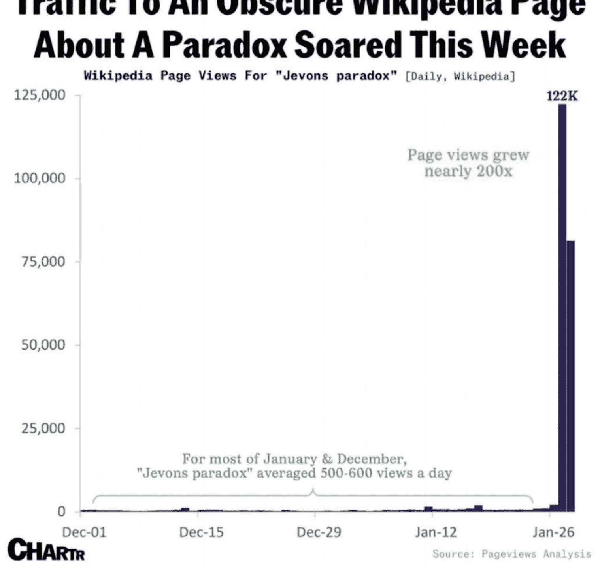

## Jevons paradox

CHART

Source: Pageviews Analysis

## 现存数据收敛+预训练失效

Projections of the stock of public text and data usage

EPOCH AI

Effective stock (number of tokens)

Scaling Law失效了?

Ilya在演讲中说，“如果你有一个巨大的数据集，训练一个超大的神经网络，那么成功是必然的。”但现在，这个公式似乎失效了。因为数据这个关键变量已经接近，即便你有再强大的计算资源，也无法突破这个瓶颈。

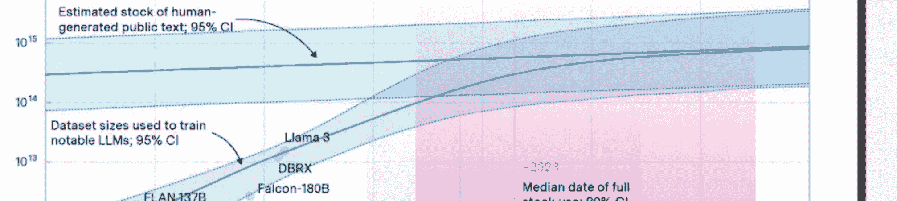

这解释了为什么最近很多模型都在寻找新的方向，比如AI。

Ilya向全世界宣布：训练的黄金时代已经结束了！

## 新的范式：强化学习

2024-09

Ilya 用一句话概括了强化学习，非常准确：让 AI 随机的路径尝试，如果效果超过预期，就更新神经网络的权重，使得 AI 记住许多这个成功的事件，再开始下一次的尝试。

我们在实现强化学习的过程中，发现某些问题是非常简单的，在以往的...

张小琪
【大模型季报】AGI范式转移：从LLM到self-play RL

2024-06
- 超越GPT4的基准模型
- Computer use
- 文本理解和输出提升
- 数学和编程的巨大提升

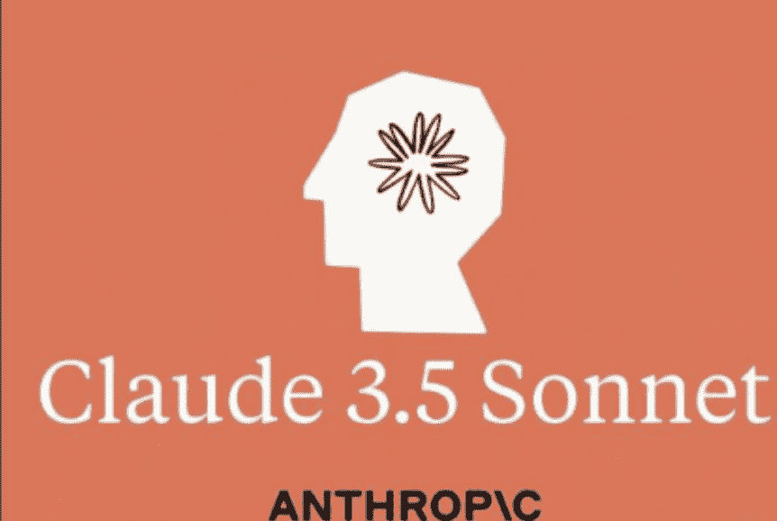

2024-09
- 大模型技术范式改变
- 纯粹意义上的推理模型
- 强化学习与后训练
- 数学、编程、Agent

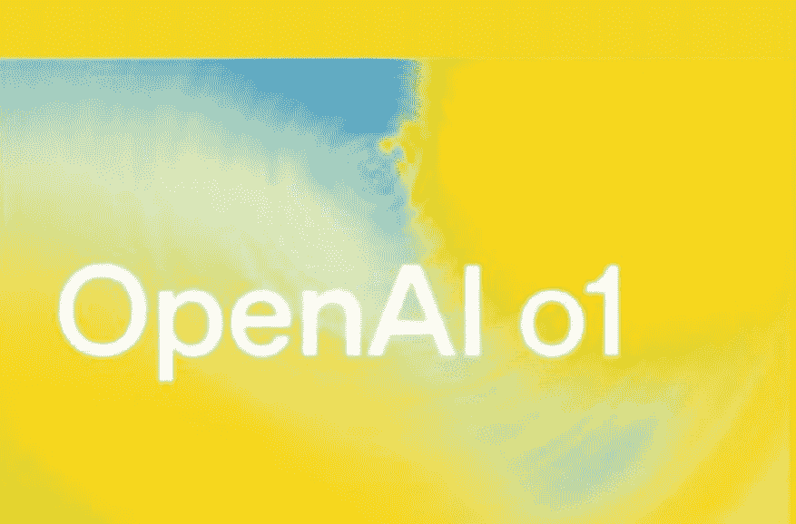

## 如何复现o1?

## COT+PRM?

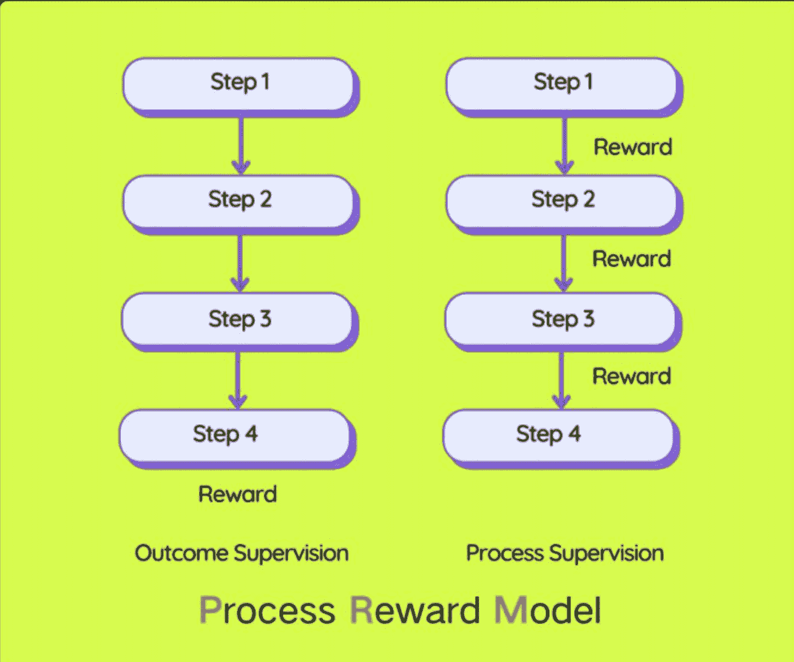

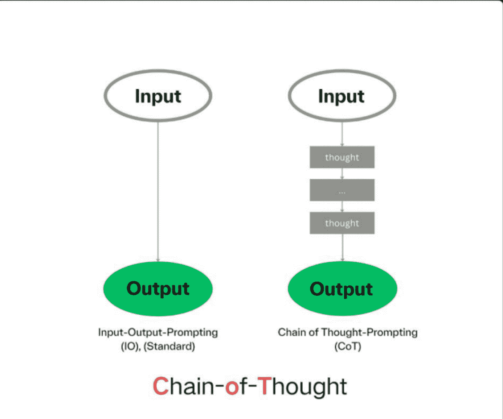

Process Reward Model

Chain-of-Thought

## 如果PRM路径是对的

Series F
Led by Accel

- Index Ventures
- TIGERGLOBAL
- COATUE
- SPARK CAPITAL
- THRIVE FUND
- WELLINGTON MANAGEMENT
- FOUNDERS FUND
- GREENOAKS
- Y Combinator
- DEI GROWTH
- Nat Friedman
- intel capital
- servicnow
- Elad Gil
- amazon
- AMD

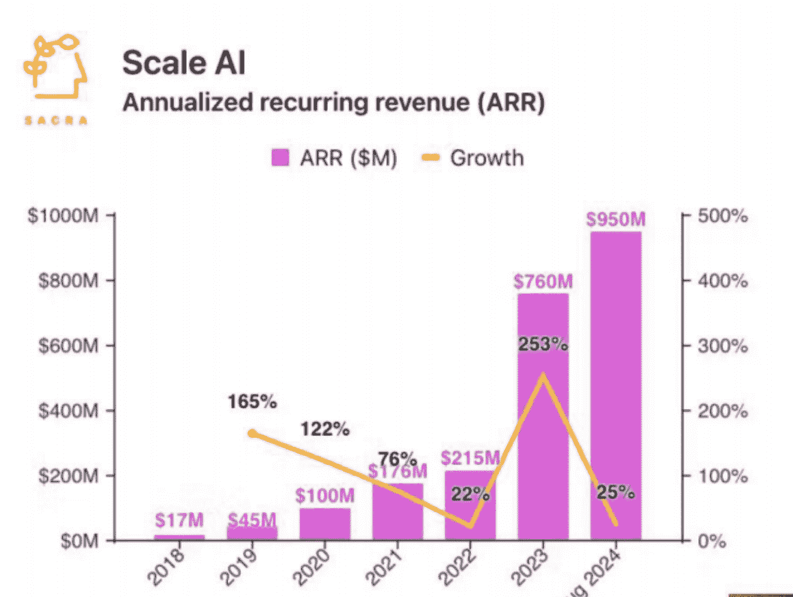

## 要训练LLM通过RL做题，有精确reward

不要采取结结构化的方法，最终会限制模型的效果，要让模型自己探索思考范围。思考范围包含了搜索过程，允许犯错。

Flood Sung

知乎

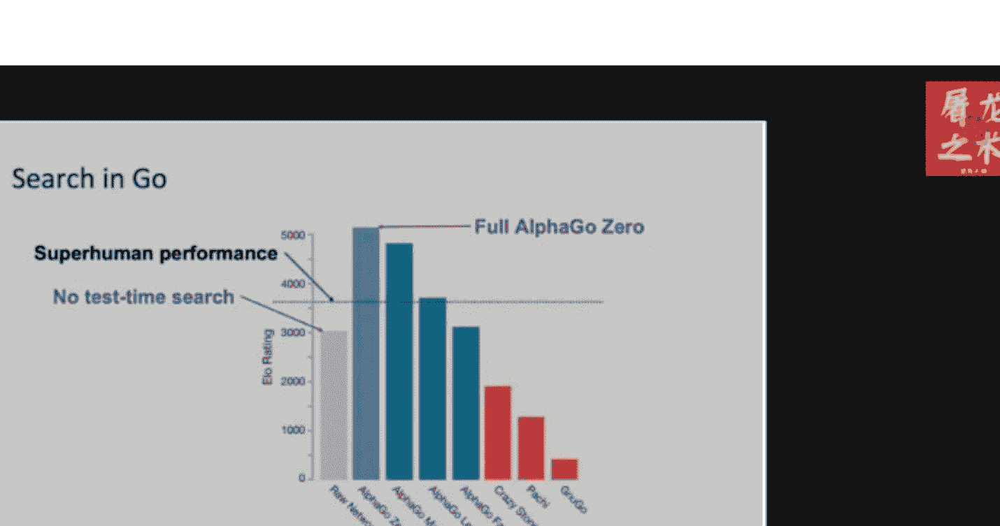

如何评价Kimi发布的多模态推理模型k1.5?打开知乎与我读

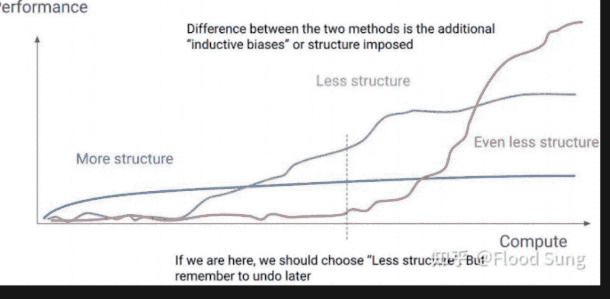

## o1不是PMF

## Alpha-zero

## 摆脱人类

## 从V3到AlphaZero

## 从RI Zero到RI

然而。2017年5月，AlphaGo 击败了柯石，DeepMind团队，再次有了一个它更强大的模型胜出。他们发现，其实根本不需要给AI设规则，让模型自我发现，只要忽略了这些规则，模型很快开始超越人类。试图突破人类的局限，尝试让模型增强，因为AI的积累已经超越了人类的范围。这引发了DeepSeek V3 证明通过RL就能增强模型的推理能力。DeepSeek R1只是在基础上进行强化学习，收集了高质量的Chain-of-Thought (CoT) 数据，对V3进行初步的监督，解决了输出不一致的问题。在这个阶段，我们在语言多样性引入Deep-R1进行强化学习，结合混合奖励，构建了三个迭代。这个过程是一个巨大的工程。

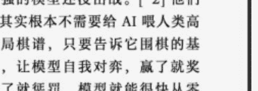

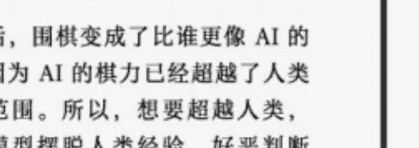

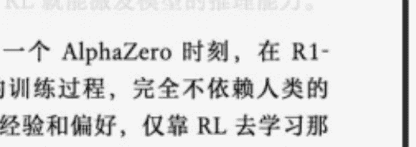

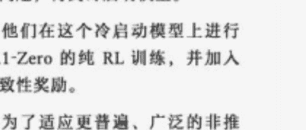

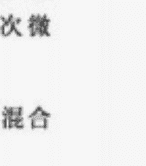

## R1的实现

所谓大道至简，因为开源技术沸腾

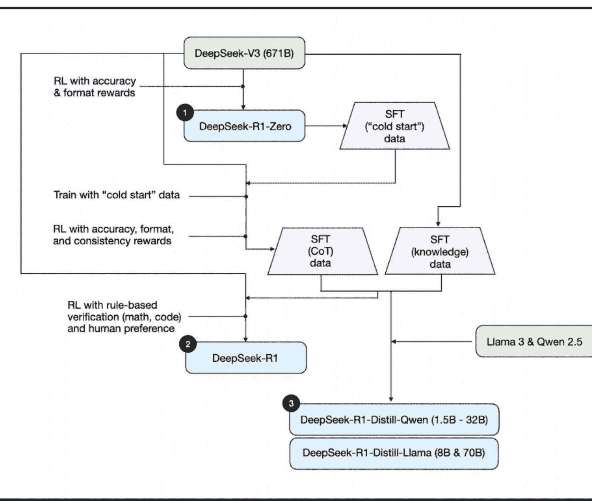

## 这些打分表

| Model | AIME 2024 | MATH-500 | GPQA Diamond | LiveCode Bench | CodeForces |
|---|---|---|---|---|---|
| | pass@1 | pass@64 | pass@1 | pass@1 | rating |
| GPT-4o-0513 | 9.3 | 13.4 | 74.6 | 49.9 | 32.9 | 759 |
| Claude-3.5-Sonnet-1022 | 16.0 | 26.7 | 78.3 | 65.0 | 38.9 | 717 |
| OpenAI-o1-mini | 63.6 | 80.0 | 90.0 | 60.0 | 53.8 | 1820 |
| QwQ-32B-Preview | 50.0 | 60.0 | 90.6 | 54.5 | 41.9 | 1316 |
| DeepSeek-R1-Distill-Qwen-1B | 28.9 | 52.7 | 83.9 | 33.8 | 16.9 | 954 |
| DeepSeek-R1-Distill-Qwen-7B | 55.5 | 83.3 | 92.8 | 49.1 | 37.6 | 1189 |
| DeepSeek-R1-Distill-Qwen-14B | 69.7 | 80.0 | 93.9 | 59.1 | 53.1 | 1481 |
| DeepSeek-R1-Distill-Qwen-32B | 72.6 | 83.3 | 94.3 | 62.1 | 57.2 | 1691 |
| DeepSeek-R1-Distill-Llama-8B | 50.4 | 80.0 | 89.1 | 49.0 | 39.6 | 1205 |
| DeepSeek-R1-Distill-Llama-70B | 70.0 | 86.7 | 94.5 | 65.2 | 57.5 | 1633 |
| DeepSeek-R1-Zero | 71.0 | 95.9 | 73.3 | 50.0 | 1444 |
| DeepSeek-R1 | 79.8 | 97.3 | 71.5 | 65.9 | 2029 |

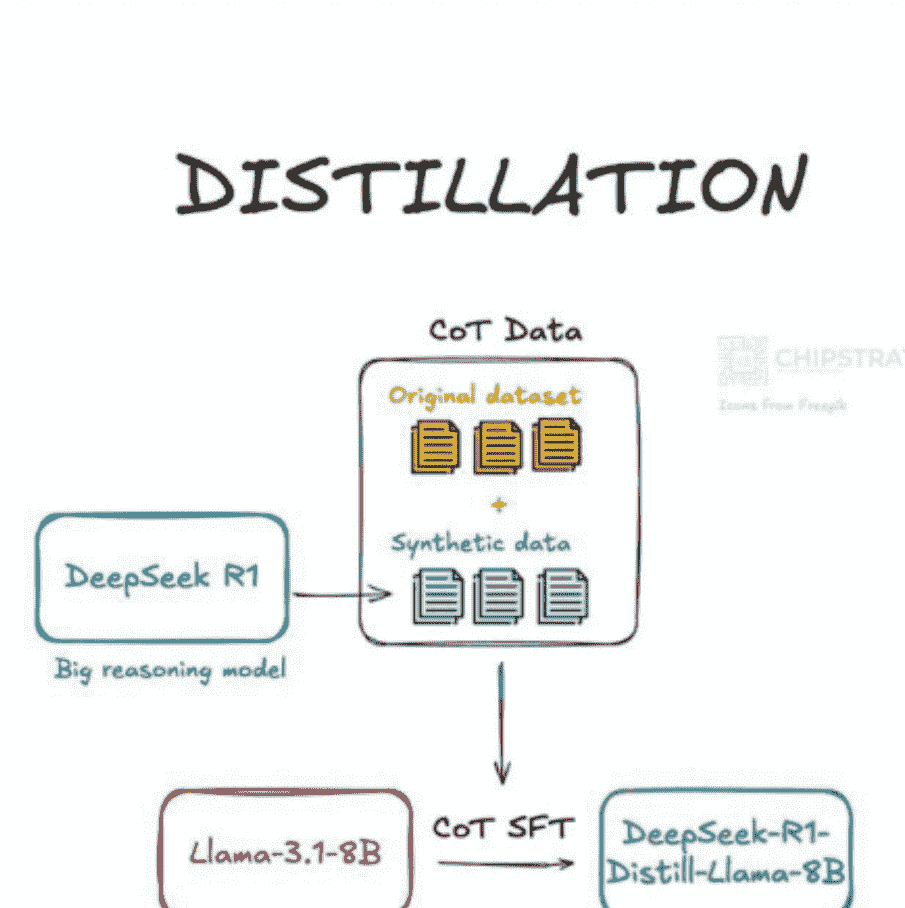

DEAR PRESIDENT TRUMP,

## America must win the AI War.

scale

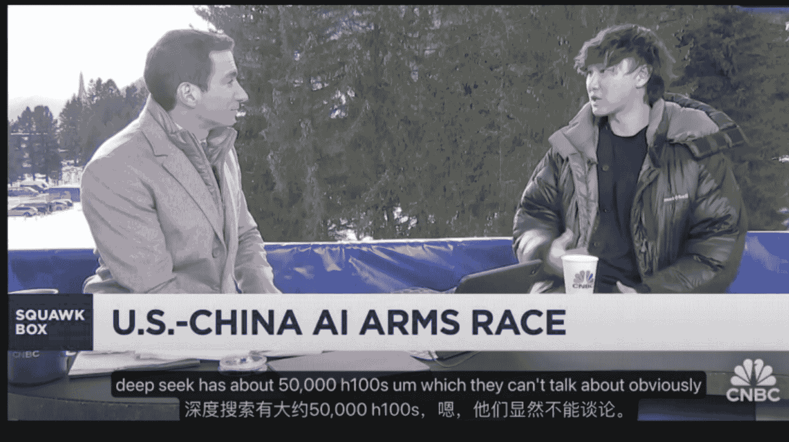

## No Moat

## ChatGPT VS DeepSeek 流量日报

| 日期 | App-DAU(万人) | Web-DAU(万人) | App-DAU(万人) | Web-DAU(万人) | 趋势 |
|---|---|---|---|---|---|
| 2/5 | 5495 | 7810 | 4083 | 1600 | 73.30% |
| 2/4 | 5507 | 7892 | 3414 | 1549 | 61.99% |
| 2/3 | 5130 | 7816 | 3286 | 1520 | 64.05% |
| 2/2 | 5118 | 6407 | 3169 | 1358 | 61.92% |
| 2/1 | 5682 | 6595 | 3061 | 1257 | 53.87% |
| 1/31 | 5116 | 6636 | 2570 | 1756 | 50.23% |
| 1/30 | 5093 | 7402 | 2265 | 2110 | 44.47% |
| 1/29 | 5278 | 7477 | 2080 | 2110 | 39.41% |
| 1/28 | 5359 | 7447 | 2063 | 2477 | 38.50% |
| 1/27 | 5045 | 7544 | 838 | 1674 | 16.61% |
| 1/26 | 5164 | 6272 | 368 | 590 | 7.13% |
| 1/25 | 5584 | 6491 | 195 | 386 | 5.36% |
| 1/24 | 5077 | 6488 | 95 | 302 | 1.87% |
| 1/23 | 5013 | 7416 | 72 | 269 | 1.40% |
| 1/22 | 5152 | 7416 | 48 | 237 | 0.93% |
| 1/21 | 5397 | 7400 | 39 | 188 | 0.72% |
| 1/20 | 5162 | 7476 | 32 | 148 | 0.62% |
| 1/19 | 5263 | 6186 | 28 | 120 | 0.53% |
| 1/18 | 5553 | 6583 | 23 | 112 | 0.50% |
| 1/17 | 5074 | 6499 | 26 | 116 | 0.51% |
| 1/16 | 4482 | 7234 | 20 | 128 | 0.41% |
| 1/15 | 5034 | 7469 | 14 | 143 | 0.19% |
| 1/14 | 5205 | 7421 | 6 | 139 | 0.12% |
| 1/13 | 5065 | 7427 | 4 | 145 | 0.08% |
| 1/12 | 5229 | 6081 | 2 | 133 | 0.04% |
| 1/11 | 5390 | 5506 | 1 | 124 | 0.02% |

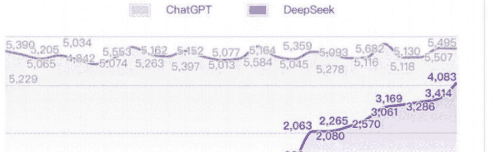

## 万字赏析 DeepSeek 创造之美：DeepSeek R1 是怎样炼成的？

源于你同的 真格基金 2025年02月13日 15:58 北京

## 最好的致敬是学习：DeepSeek-R1 赏析

@hidecloud

## 强烈推荐

## 一千个人眼中有一千个Agent 概念

## 智能对话

高智模型，顺滑对比体验

西安建筑设计报告

我们曾参与过多个交通项目，包括机场、高铁、地铁、交通枢纽、商业、酒店等领域的综合体计划及服务范围

四川天山三机场设计计划（含设计Upsilon）

### 一、项目规模

- 区域：北京、上海、天津、苏州
- 交通：机场/高铁/地铁/枢纽
- 核心：城市中心综合体

### 二、项目阶段

第一阶段：前期策划，要投入精力

- 上期：负责机场总体规划、初步设计
- 下期：负责扩施工设计、施工设计

## 秘塔AI搜索

没有广告，直达结果

输入、Enter键发送，Shift+Enter换行

- 全网 思考-R1
采用DeepSeek-R1 增强模型进行回答

## 纳米AI | DeepSeek-R1-满血版

我可以帮你搜索、复课、分析、撰写、建议，请把你的任务交给我吧

输入DeepSeek-R1-满血版消息发送，Enter发送，Shift + Enter 换行。

DeepSeek-R1-满血版 联网搜索

## 知乎直答

输入你想问的...

深度思考

## 既然提到搜索，AI搜索比的是什么？

- 都不是搜索吗？
- 信息源有那么大差异吗？
- 产品设计的差异足够大吗？
- 之前都不问，AI搜索公司是否要做自己的模型吗？

## DeepSeek推荐的上海-日本拉面

## 这些都不是SEO，但是后呢？

注意事项：
1. 查看评价评分：多平台（如口碑团、大众点评）支持，可以通过引用判断服务质量。
2. 确认适用性：部分平台有“便宜”筛选，建议提前向商家确认。
3. 一线以上城市：大平台（如北京、东京）在一线城市服务本地化，而三四线城市没有本地平台或服务。

| ARR | Growth | Perplexity's ARR projections |
| --- | --- | --- |
| $800M | | $656M |
| | | $417M |
| | | $217M |
| $7M | $96M | 187% |

如果您需要一个靠谱的线下或外卖推荐，可以参考这些链接（如需要直接到店）进一步选择使用平台。

## AI搜索“进化”的另一个标志

# 这一波对于云和infra厂商，以及进一步大模型生态的影响深远

我没那么多富余的人力和卡来应对这些客户的需求的，反正是开源的，你们爱部署就部署，昨天部署吧……

## 这些都接入了......

## 鲲鱼上场

首席市场官

A股市场在春节后5天内上涨的概率是多少？

- 投分析
- 三六零零候选趋势

AI自选插件
你有2只自选插件增强，值得重点关注

- 深度思考
- 画面分析
- 图片识别

使用深度模式回答...

- 关注
- 热榜
- 投顾

## DeepSeek-R1 深度思考精准版

## 原文一言 Update

| 115 RATINGS | AGE | CATEGORY | DEVELOPMENT |
|---|---|---|---|
| 2.4 | 17+ Years Old | Productivity | Beijing Baid |

What's New >

Version 4.9.0
上线了伴随模式、手机手写和作业等学习功能，接入DeepSeek-R1模型，化了拍照解题功能~

## PPO 正式接入 DeepSeek-

支持语音播报 支持联网搜索 支持本地导出

## OPPO Find N5 折叠模型

2月20日 19:00 全球发布

## 核弹......

## “中国资产重估” ……

确认！微信测试接入DeepSeek
新华社 2025年02月16日 14:30 北京

## DeepSeek Boosting Chinese Tech Stocks

## Top 5 Kweb Holdings: 1-Month Growth

DeepSeek继续构建生态图！2月15日，部分微信用户发现，微信搜索已经接入上线“AI搜索”功能，并接入DeepSeek-R1腾讯提供的深度思考模型丰富AI搜索的服务。

2月16日，记者从腾讯集团获，微信一搜在对话侧接入大语言模型丰富AI搜索的同时，正式发布测试接入DeepSeek。

官方官方表示，部分用户测试用，可以在对话框中输入搜索接口，看到“AI搜索”字样，点击进入后，可免费使用DeepSeek-R1满版模型，获得更多化的搜索线索。若未显示该接口，说明此次测试尚未覆盖该用户版本，可耐心等待后续开放。

## 微生态接入DeepSeek，抖音怎么做？

## 1. 分发到搜索

周白Sense AI 分身
星座人：本周运势趋势

你好，射手座这周的运势较为平稳，适合与他人合作。关键在于加强与队友及成员的沟通和交流，以便更好地实现共同目标，同时要与伙伴保持良好的合作关系，并积极参与合作与沟通...详情

- 更多阅读 今日星座运势 星座星座攻略

## 2. 分发到直播间

## 3. 分发到群聊

## 4. 分发到评论区

## 那么如何构建“护城河”呢？

The Language Model Frontier: Models by Chinese AI Labs
Artificial Analysis Intelligence Index, Leading Models (Early 2025), Non-exhaustive

- 产品执行？
- 用户运营？
- 品牌效应？
- 网络效应？
- 垂直行业？

## ARR 依然是最粗

## CURSOR Years from $1M to $100M

## 再看AI-coding

- 根据 prompt 输出代码，无执行
- 理解全环境，提升预测和补全准确率
- 加强逻辑理解，支持文件和命令操作
- 自主任务执行，规划、调试能力

Coding Agent 大概是去年应用领域最快、引发最多讨论的方向，从上半年 GitHub Copilot 一家到下半年 Cursor、Replit、Bolt.net、Windsurf 竞争，直到 Devin 以数百美元金的价格和实打的效果惊艳。这篇深度汇总了国内外一线的从业者、大模型研究员业内深入讨论了 Coding Agent发展与现状、产品设计、用户反馈带来的社会变革，以及 OpenAI 能力、实现痛点和未来展望。没有可话，全是直知在读的过程中才了很多理论，也缩短了路径。深度 Coding Agent & OpenAI

## perplexity = search agent? Devin = coding agent?

## Agent的概念被严重泛化了

## 典型Agent的定义

- 1. Planning
2. Memory
3. Tools
4. 其他交互

### App: 基于各种 APIs 的响应式构建

App → Agent (LLMs调度 APIs) Models focused on language modelling More capabilities (reasoning, planning, tool use etc) “What” into Models 基于代码链（单 Chains）、Agents交互更多界面化（Web, OS 等）、简单的 Agents、复杂的任务和多智能体规模兴起评估模型本身的能力

Top 5 trends in AI Multi-Agent Systems from 2024

1. Enterprises are adopting agents, but what are caveats
2. Teams are building 'agent-native' foundation models from the ground up
3. Interface automation dominated early applications
4. A Shift to Complex Tasks and the risk of Frameworks
5. Benchmarks reveal both progress and limitations

Learn more! newsletter.com

24年Agent发展趋势会延续到25

## 概念太玄乎，我们看一个真Agent案例

新一代扫地机器人可能增加一个机械臂

### 场景确定

- 杂物清洁
- 辨别物品
- 分类整理
- 记忆位置
- 重量限制
- ......

### 技术边界

- 视觉模型
- 推理模型
- 路径规划
- 抓取精度
- 避障逻辑
- ......

### 产品交付

- 主动服务
- 模块搭配
- 兼容测试
- 承诺范围
- 定价体系
- ......

### 更新迭代

- 用户反馈
- 搜集整理
- 事故案例
- 寻找原因
- 软硬更新
- ......

### 为了实现，我们需要......

今天在AI时代，
场景-技术-产品的结合可能是难点；
大模型本身的技术边界其实逐渐清晰，
从场景到产品，
恰恰应该是“古典”互联网人的经验所在……

# 当然，这带来了新一轮组织架构上的取舍选择

- 模型研发应该是纯lab形式吗？
- 模型和产品团队严格分开吗？
- 产品必须只用自家模型吗？
- 模型的迭代需要产品跟进吗？
- 如果再算上运营和商业化呢？

