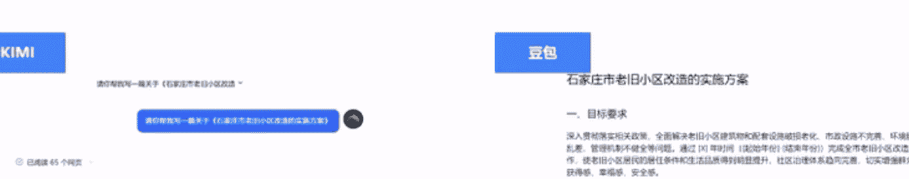
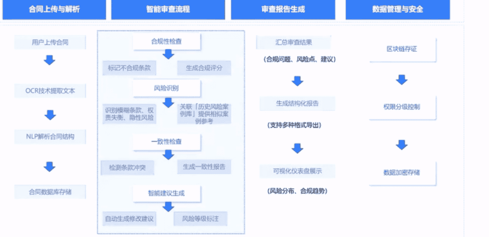
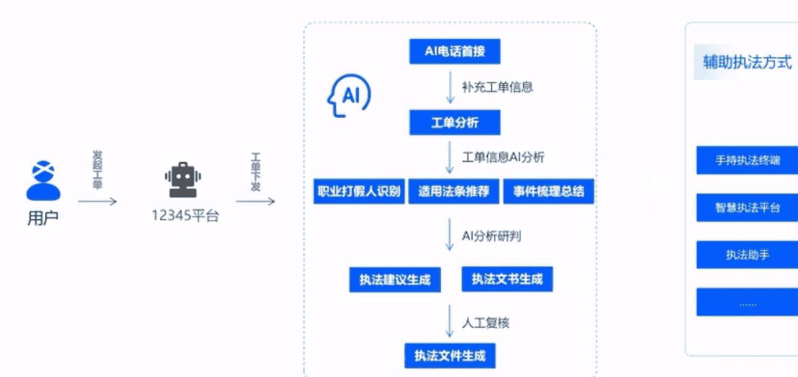
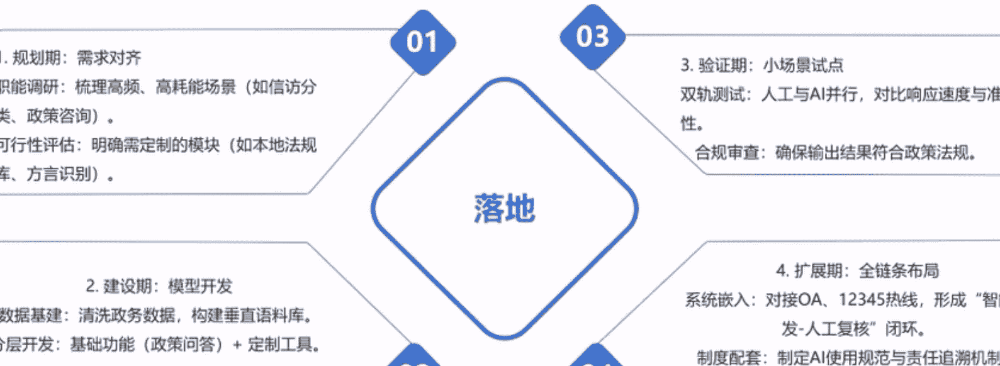
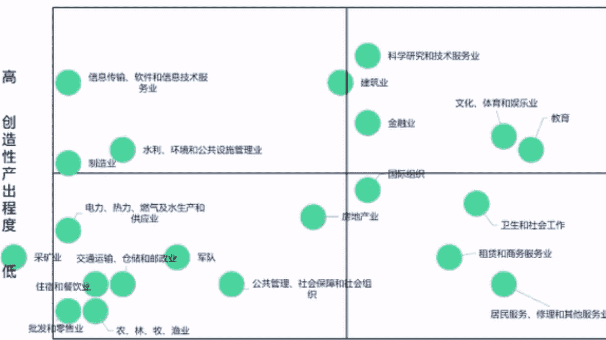
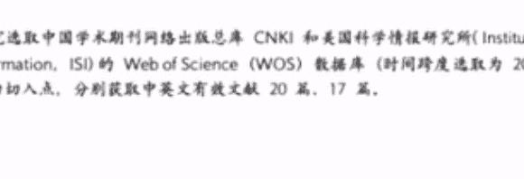

# DeepSeek政务应用场景及解决方案

清华大学
新闻与传播学院、人工智能学学院
双聘教授 @新媒沈阳 团队
2025年3月

# 扫码加入 知识星球TOP免费资源群

免费
公众号:知识星球TOP
- 每日免费获取高价值资源
- 可提供各类资源搜索服务

价值


微信信号:jntsg8

| 热门付费文章 | 各行各业报告 |
| :--- | :--- |
| 精选图书资源 | 副业赚钱方法 |
| 职场实用资源 | AI政经自媒体 |


微信信号:jntsg2

及时


专注
分享资料仅供个人学习，请及时删除，切勿商用传播

# 01 人工智能+政务应用场景
## 02 DeepSeek+政务应用实操
# 03 AI政务场景解决方案
# 04 人工智能+政务未来发展

## 政务数字化转型三阶段演进

2000-2015
电子政务
以“IT化”为核心，通过技术工具实现政务流程的初步数字化
核心任务：办公自动化、政府网站建设、基础数据库搭建

2016-2022
互联网+政务
以“平台化”为突破，推动跨部门协同与在线服务整合
核心任务：打造“一站式”服务平台，推进“一网通办”。

2023-至今
AI+政务
以“智能化”为标志，AI驱动决策与服务的深度变革
核心任务：模型应用、智能决策支持、人机协同治理

### 城市治理：数据护城 纳什均衡

### 多模态数据融合分析
依托物联网（IoT）、GIS（地理信息系统）、文本数据、传感器网络等多源异构数据，构建全息化的城市动态监测体系。

### 联邦学习+动态博弈模型
基于跨部门、跨区域的数据共享，采用联邦学习技术在不泄露敏感数据的情况下协同训练模型，并结合动态博弈理论，实现多方决策主体的资源优化配置。

### 图神经网络
结合图神经网络（GNN）对城市基础设施、交通流量、能源分配等关键网络进行拓扑分析，识别城市设施的关联性和潜在瓶颈。

### 智能协同决策系统
依托强化学习（RL）与实时算法，构建智能协同决策系统，针对突发事件应急响应、城市资源分配、公共服务智能调控等场景，实现基于数据驱动的动态策略调整。

### 城市治理应用案例

佛山市人工智能应用赋能中心成功将DeepSeek在国内及主流算力架构上进行了无缝适配，通过先进的AI应用能力，赋能中心可以有效地支持城市综合治理、空天一体化管控、交通智能巡检及城市运行辅助决策等多个板块的高效运作，提升了城市运转效率，也为居民的生活质量提供了坚实支持。

呼浩市将DeepSeek应用于城市大脑，推进AI智能在城市管理、公共服务、城市运行保障等方面适用。

长沙集团与国家超级计算长沙中心联合发布湖南省首个城市级应用CS-DeepSeek落地长沙城市智能安全管理领域，应用于房屋、燃气、交通、自然灾害、公共安全等多个场景。

河北省多个城市（如廊坊、邯、秦皇岛等）通过DeepSeek技术增强了交通运输专业文本的理解能力，助力智慧交通建设。

### 便民服务: 云链融合 语义穿透

“出生-教育-养老”全周期服务
### 出生阶段：智能联办服务
场景功能：出生登记、医保参保、生育津贴申领等“一链办理”。

## 01 数据安全：分层架构 智能隔离


大模型隐私保护分层架构智能隔离
通过本地化部署实现敏感数据不出网，构建政务安全保障体系。
结合“安全底座+智能力+服务”的多层架构，形成政务处理的新式。在确保数据安全的前提下，实现AI能力与政务数据的融合，解决难题。

数据安全应用案例
深圳市通过本地化部署DeepSeek，实现了政务数据本地存储和处理，确保信息安全。
杭州市通过本地化部署DeepSeek，形成了“安全底座+智能力+政务服务”模式。

# DeepSeek+政务应用实操

### 你用什么辅助公文/报告?
### 一般提示：帮我写一份关于政务的实施方案


### 豆包：政务的实施方案
一、总体目标：深入基层，落实政策，完善政务环境。通过科学投入，完成政务工作，提升群众的获得感、安全性。

二、基本原则
（一）政府主导：落实新时代发展理念“以群众为本”原则，引导群众参与，形成政务工作格局。
（二）结合效益：按照群众需求，充分考虑政务配套设施，重点落实安全隐患等问题，近期形成整体方案。
（三）统筹规划长远发展：加强基层统筹规划与社区治理相结合，完善政务管理能力，提升效率，实现可持续发展。

## DeepSeek的三种模式


我是 DeepSeek，很高兴见到你！
我可以帮你写代码、读文件、写各种创意内容，请把你的任务交给我吧~
给发送消息

## 推理模型

R1推理模型：推理模型是指能够在传统语言模型的基础上，强化推理、逻辑分析和决策能力的模型。它们通常具备额外的技术，比如强化学习、神经符号推理、元学习等，增强其推理能力和解决能力。
- 例如：DeepSeek-R1, GPT-o3在逻辑推理、数学推理和实时问题解决方面突出。

V3非推理模型（指令模型）：适用于大多数任务，非推理大模型一般侧重于语言生成、上下文理解和自然处理，而不强调深度推理能力。此类模型通过对大量文本数据的训练，掌握语言规律并合成合适的内容，但缺乏推理模型那样复杂的推理和决策能力。
- 例如：GPT-3, GPT-4 (OpenAI), BERT (Google)，主要用于语言生成、语言理解、文本分类、翻译等任务。

| 维度 | 推理模型 | 指令模型 |
| :--- | :--- | :--- |
| 优势领域 | 数学推导、逻辑分析、代码生成、复杂问题解析 | 文本生成、创意写作、多轮对话、开放性问答 |
| 性能本质 | 精于逻辑密度高的任务 | 擅长多样性高的任务 |
| 强弱判断 | 并非全面更，仅在其训练领域显著优于通用模型 | 通用场景更灵活，但专项任务需依赖提示词增强能力 |

## DeepSeek的使用入口

官方入口：https://chat.deepseek.com/

| 平台 | 地址 | 版本 | 备注 |
| :--- | :--- | :--- | :--- |
| 硅基流动 (SiliconFlow) | https://siliconflow.com/zh-cn/ | DeepSeek-R1 和 DeepSeek-V3,均为671B混合版 | 新用户注册赠送2000万Tokens (约14元额度),普通版可用额度抵扣, Pro版需额度充足，为671B,Pro版更稳定但需付费 |
| 纳米AI | APP (官方可用) | 671B满血版 | 目前提供免费使用(满血版开放)。推荐用于搜索等场景，性能与官方一致。 |
| 秘塔搜索 | https://metason.com/ | R1增强版 (基于671B) | 免费使用，重塑功能，性能优秀。“长思考”模式，适合复杂问题解决。 |
| 伟达AI服务 | https://build.nvidia.com/ | R1推理服务 (全量模型) | 免费体验，支持API调用，速度极快。 |
| 微软Azure | https://ai.azure.com | 671B全量模型 | 需微软账户并订阅，免费部署，支持参数调优。 |
| 亚马逊 | https://aws.amazon.com/cn/blogs/deepseek-models-available | 671B全量模型 | 需要注册账号，填写方式，免费部署。 |
| Cerebras | https://cerebras.ai | 70B | 免费注册，速度快，对比明显。 |
| Groq | https://groq.com/googlecloud/deepseek-distill-available | 70B | 免费注册，速度快。 |

## AI辅助公文写作流程

一、明确文件类型与目的：确定是什么类型的公文，服务于目的
二、收集必要信息与数据：整理相关背景资料、政策依据
三、设计AI提示词：按照上述示例设计提示词【重要】
四、AI生成初稿：利用AI生成公文稿
五、人工审核与修改：
- 检查政策引用是否准确
- 审核数据事实描述是否正确
- 确保格式符合规范
- 调整语言风格和措辞
六、定稿与审批：完成最终稿并存档

## 公文材料编写及总结

核心要素=[材料类型]+[主题/方向/风格]+[受众对象]+[政策依据]+[具体要求]+[字数/篇幅]

## AI共识法
通过人工智能技术整合多方数据、意见或政策要求，生成符合利益平衡的文本。AI通过语义分析、模式识别和协同算法，在保证合规性的下，自动提炼共性需求，形成广泛认可的公文内容。

## 多层次对话
在写作过程中，人类作者与AI工具通过多轮、多维度的交互，逐步细化需求、优化内容。AI通过意图识别、上下文记忆和动态修正技术，实现从框架构建到细节打磨的全流程。

## 脱敏数据库
经技术处理去除个人隐私、商业秘密等敏感信息的结构化数据，结合差分隐私或联邦学习，确保数据可用性与安全性。

## 类型一：领导发言稿

[材料类型]领导动员讲话稿
[主题/方向/风格]
- 主题：数字化转型赋能乡村
- 方向：结合“数字乡村”战略部署，突出党建引领与科技创新双驱动
- 风格：庄重务实、鼓舞士气、融入地方文化元素（如方言金句）

[受众对象]
- 主会场：市县两级党委干部、驻村第一书记（200人）
- 分会场：镇干部、两委成员（视频连线）

[政策依据]
- 《数字乡村发展战略纲要》（2019）
- 省“十五五”数字经济发展规划（2021-2025）

[具体要求]
1.开头用本地电商典型案例切入（如直播带货促销销售额破亿）
2.分部分论述：政策理解现有痛点分析
3.结尾引用习近平总书记“让互联网更造民”重要论述
[字数/时长]2000字左右（15分钟讲话时长）

## 二、统“筑”与“打”数字化转型三大攻战

### （一）“打造”数字基础
- 实施“数字基下2.0”行动
- 今年新建5G基地300个，实现农村全覆盖（责任单位：工信局，12月底前）
- 发“农业云”、一站式服务平台，整合土地、农业物资等32项功能（负责人：XX副长）

### （二）“打造”数字应用
- 推出“三一”工程：
- 建设乡村数字化展示场（每县至少5个，入网年度考核）
- 建立100个农业超市（农村开展农产品选购、无人机培训等）
- 构建10个农村数据平台（重点县支持，数据中心）

### （三）“打造”数字智能
- 打造“三色”场景
- 红色：动态监测6个重点区域
- 绿色：针对农产品市场使用率提高60%
- 蓝色：精准选择5个乡村振兴员（部门负责）
- 紫色：“智”治理，构建协同机制

我们要重点做到：
1.要狠“质量”和“落实”
2.要加强“氛围”和“长效机制”
3.要聚“数字台账”和“组织力”

### 数字化赋能大会上的讲话

同志们：刚刚进入会场，看着屏幕上播放的热门场景——今年销售额突破8000万元，光是“双十一”就卖了3万！用大家熟悉的语言交流：“数字化转型的新篇章”。乡村振兴发展规划》明确指出，数字化转型的若干任务是：全建成省级数字经济试点县，17家企业获得数字身份证，收益增长120万元。
在这些方面有基础、亮点：5G基站覆盖98%，行政、物流等6部门数据尚未互联

### 类型二：工作总结

一、政策引领
根据国务院《营商环境条例》（国发〔2020〕23号）关于“深化行政改革、推进政策标准化、便利化”的总体要求，我局紧紧围绕XX市“营商环境”年度行动计划（2023年）发布，以“营商改革”为主线，聚焦企业全生命周期需求，推动制度创新与技术双驱动。

二、总效能
工作进展，我局通过三年努力实现营商环境系统性提升，核心指标远超考核：

| 指标 | 2022年基准 | 2023年达成 | 排名名次 |
| :--- | :--- | :--- | :--- |
| 企业开办办理 | 1.5天 | 0.05天 | 第5→第2 |
| 营务服务效率 | 92.3% | 98.6% | 第8→第3 |
| 政策响应期 | 15天 | 22天 | 第6→第1 |
| 部门间办理周期 | 5.2次 | 1.3次 | 第7→第2 |

（一）目前状况
部门间机制不健全，导致企业重复提交材料问题，2023年上半年企业投诉数据显示，涉及政策的投诉占比37%（见图1）。

（二）2023年1-6月企业申报类型分布
| 类型 | 占比 |
| :--- | :--- |
| 材料重复提交 | 28% |
| 政策不准 | 15% |
| 其他 | 20% |

需提供额外配套
第三方评估报告（XX调研，2023）显示：61%受访企业认为政策制定与市场需求存在温差，尤其在跨境贸易、融资担保等领域表现显著。

（二）创新与技术应用

### 1.AI+与智能化应用
构建AI+数据分析、区块链存证技术，打通监管、人务、社务等6部门数据接口。
材料智能化：医疗器械许可材料从23项减至8项，办理时间缩短76%
案例：货运通关从15项减至8项，日均处理量300
典型案例：生物材料公司通过智能审查审批2分钟内完成“第二类医疗器械备案审查”全流程办理，较传统模式提升。


### 类型：履职报告

2024年度工作报告
--深化基层治理，筑平安根基
履职：XX街道党工书记XX

尊敬的各级领导、各位代表：
根据社区组织部考核要求，现将本人2024年度工作情况如下报告，请审阅：

## 一、以为实

### （一）政治立场方面
- 学习党的二十大新精神，开展基层治理现代化专题研讨学习12次
- 在“建党·强基层”中推进建立社区基层委员会机制，全年跟踪报告23次

### （二）职业能力方面
- 制定制度《重大事务会议风险评估机制》，否决风险项目3个
- 推进联动人才开展“四周接访”制度，全年参与及对接17次

## 二、以为能

### （一）学习能力方面
- 赴杭州、成都等地考察社区治理经验，“智慧社区”开展可行性报告
- 主持开发数字化治理平台，打造典型案例136个

### （二）攻坚能力方面
- 突破入户难点：组织公安、人社部门建立动态数据库
- 创新调研调试模式：邀请专家开展“调度攻围”

## 三、以为力

### （一）工作方面
- 建立早预防控机制，全市走访企业42家、社区307户，疫情防控连续开展封控29次

### （二）团队建设
- 实施“育才计划”培养年轻干部，建立“师傅制”帮助对12人
- 建立数字化治理平台，开展专项攻坚9次

## 四、以为力，打造新标杆
（重点展示两大创新工程，全占40%）

### （一）“流动数据管理系统”开发
### （二）“流动人口管理”12个指标维度化分，实现精细化服务供给
- 创新：将居民时长、技能等级等相关指标纳入全市统筹会议上作为典型发言
- 成效：群众满意率提升至98%，相关经验在全市推广
### （三）运作模式：建立选优秀书记员专库，创建“三项工作法”（走访、出访、会谈）
### （四）典型案例：成功完成某市历史积压缓缴任务
- 数据支撑：调解效率从5%提升至86%，复访量下降17%

### 其他举措
- 推进“智慧安防区”试点3个
- 群众满意度达到97.8%，历史创建新

## 五、以为实，筑牢运行防线
- 执行“三一二”决策落实，退回违规礼金3次
- 开展“阳光治理”，实现治理资金使用明细27项

## 存在问题与改进方向

### （一）突出亮点
- 数字化力量领先：现有团队中2人具备业务开发能力
- 智慧领域应用不足：部分存在“重轻”现象

### （二）短板均衡
- 人才培养：设立社区治理专项培训基金，内部培养复合型人才15名
- 校地合作：XX大学共社会治理创新实验室
- 机制创新：首创“点数激励制度”，建立应用场景激励机制多次

结语：新时代治理需要“下苦功夫”与“知短差距”，本人将以本次汇报为新的起点，在市委组织部和街道工委的指导下，不断探索具有特色的治理新路，以实际行动回群众的需要。

## 类型四：心得体会

[材料类型]党性教育实践心得体会（需提交至党委组织部备案）

[主题/方向/风格]
核心主题：聚焦“党的二十大报告”中与岗位职能直接相关的战略部署（如社会治理现代化、乡村振兴等）

切入方向：选择“人民至上/系统观念/守正创新”中的1个核心观点开展论述

行文格式：
- 理论阐述：结合《习近平治国理（第四卷）》相关章节
- 实践叙事：采用“观点+视角+案例+数据”四维结构
- 情感表达：融入“蜀村手记”“执法日志”等个性化叙事元素

受众对象：上级组织考核组、本单位青年理论学习小组

[政策依据]《中共中央关于加强党的建设的意见》第5章第12条；省委组织部《关于规范性教育总结材料的通知》（本单位年度建党工作要点）

[具体要求]
- 理论深度：原文党的二十大报告金句；辅引文献《求是》党涉相关专题文章（需标注刊期刊数）
- 实践维度：聚焦2023年参与的2个重点项目（如：“老旧小区电梯加装矛盾和谐”）
- 数据支撑：服务群众人次/解决问题满意度对比提升幅度（例）：信誉类解纷率从67%~92%
- [字数/篇幅]正文800字（±10%浮动）

附加材料：工作场景照片2张（含党徽微特写）

## DeepSeek+AI政务应用拓展

| 工具组合 | 应用场景 | 使用步骤 |
|---|---|---|
| DeepSeek + Kimi/飞书智文/WPSAI等 | 制作政务汇报PPT | 在DeepSeek中生成PPT大纲与细节，复制到PPT手中选择模板生成PPT |
| DeepSeek + 剪映 | 制作政务宣传短视频 | 在DeepSeek中生成爆款短视频文案，使用剪映的图文成片功能生成视频 |
| DeepSeek + Cursor | 编写代码 | 在DeepSeek中生成代码，使用Cursor进行编写 |
| DeepSeek + 即梦/Midjourney | 制作政务宣传海报 | 在DeepSeek中生成海报描述，使用即梦生成图片 |
| DeepSeek + XMind | 创建思维导图 | 在DeepSeek中生成思维导图文本，导入XMind生成导图 |
| DeepSeek + Boardmix | 创建图表和架构图 | 在DeepSeek中生成描述，复制到Boardmix生成交互式图表或架构图 |

## 用DeepSeek快速看

第一步：附件所有所需材料，让AI生成Markdown
第二步：附件为第一份，请帮我总结主要意思，整理为Markdown，添加Markmap生成要点、实践方法和建议，清晰视化。

样例：已经上传了报告，请帮我总结核心要点，以Markmap的格式输出，逻辑分为几个级表示。

接下来，请按照以下要求生成详细代码：
- 1. 核心总结：对报告进行详细拆分，提取出核心价值以及后续决策。
- 2. 优缺点：活动的亮点、发现的问题以及采取策略进行分析。
- 3. 改进建议：针对活动提出的具体的改进建议，在未来的活动中避免问题。
- 4. 成果与影响：活动取得的成果、品牌价值以及影响力。

```mermaid
gantt
  title 项目计划
  format YYYY-MM-DD
  axisFormat %Y

  section 准备
  任务1, 2023-01-01, 30d
  任务2, after任务1, 25d
  任务3, 2023-02-15, 20d

  section 开发
  任务4, 2023-03-12, 30d
  任务5, after任务4, 15d
  任务6, 2023-04-07, 10d
```

第二步：复制Mermaid代码到https://www.mermaidchart.com/

## DeepSeek制作可视化图表

第一步：DeepSeek生成Mermaid代码，请给我一个项目，方便准备描述，以Mermaid格式。

## 业务需求（2024年）

是的，你可以根据我的需求设计项目，用Mermaid格式绘图。首先，你可以根据我提供的需求，标注关注痛点。我想做一个电商系统，包括卖场、售后、交易信息等功能，功能模块拆分。包括订单生命周期管理、优惠、促销、实现等每个功能都要详细拆分逻辑。请用Mermaid格式描述业务流程，最好从一个节点开始，直到一个结束节点，只需要关注节点之间的关系以及实际场景中的细节。

然后，我们可以对系统进行拆解，比如库存管理系统或促销系统。这部分比较专业，我们可以继续拆解，每个模块预计一个月到五个月，整个开发周期大约一年完成。除此之外还有复杂的任务，比如多个任务同时执行。这个部分逻辑比较复杂，每个任务完成后才能进入下一个。在实际场景中可能有多个任务并行，但是整体如何影响项目进度？我们可以逐步展开。你需要关注的细节，也要考虑，比如从2023年1月开始，预计投入3个月，到4月。

## 快速处理政务数据

第一步：飞书导入表格。根据12345投诉的内容，回复市民投诉的内容，要求回复遵循语言规范，必要时引用相关的法律政策建议。第二步：根据需要针对标题输入提示语。

### DeepSeek+飞书：快速处理政务数据

首步：飞书导入表格。根据12345投诉热搜的内容，回复市民投诉的内容。要求回复符合意见准则，必要时引用相关的法律法规政策。第二步：根据需要针对标题输入提示语。

### DeepSeek+飞书：政务数据可视化

第一步：飞书导入多维表格。第二步：选择可视化图表。第三步：生成可视化表。

### DeepSeek+飞书：政务协同

## DeepSeek政务解决方案

| 技术方案 | 本地知识库 | 模型微调 | 模型蒸馏 | 联邦学习 | 边缘计算 | 模型服务 | 自动化运维 | 多模态融合 |
|---|---|---|---|---|---|---|---|---|
| 混合部署 | | | | | | | | |
| 适配场景 | | | | | | | | |

（注：此处为根据OCR内容恢复的表格框架，部分内容为占位）

## 技术方案：本地知识库

RAG (Retrieval-Augmented Generation)
- 核心思想：让模型在生成答案或文本时，能够动态从大规模知识库中检索信息，从而提高生成内容的准确性和相关性。
- 优点：
1. 数据安全与隐私保护：所有数据（包括检索和生成过程）都在本地环境中完成，避免数据外流，符合政府对数据安全和隐私的要求。
2. 动态知识更新：从本地知识库中动态检索最新信息，确保生成内容基于最新的政策、法规数据，不需要重新训练整个模型。
3. 生成内容的高准确性与可靠性：本地知识库中的权威文档（政策文件、法规条文、历史记录等），生成内容更加准确、可靠，减少幻觉风险。

## 技术方案：模型微调

微调是在预训练模型的基础上，通过少量特定数据对模型进行调整，使其适应特定场景，赋予模型精准和定制化的能力。
- 降低资源消耗：微调只需要特定数据，避免了从头训练的高昂成本（如数据收集、计算资源等）。
- 个性化与精准性：微调可以根据具体需求调整，在特定领域表现更精准，模型可以快速适应任务（如政策解读、公文分类等）。

## 什么是智能体?

智能体 (Agent) 是一种能够感知环境、自主决策并执行任务的人工智能系统。在政场景中，智能体可以通过自动化、智能化的方式提升工作效率和服务质量。

优势：
- 自动化与高效性：智能体可以自动执行重复、规则化的任务，减少人工干预，提升工作效率。
- 智能决策支持：智能体可以根据预设规则或机器学习模型，快速分析数据并提供决策建议。
- 多任务协同：同时处理多个任务，并在不同任务之间进行协调，提升整体工作效率。
- 数据驱动与学习能力：智能体可以通过机器学习不断优化自身能力，适应不同的任务和环境。
- 个性化服务：根据用户需求提供个性化的服务，提升用户体验。

## 本地部署的必要性？

### 数据主权与隐私保障
（此处内容根据OCR识别断不完整恢复）

## 本地部署的必要性
（此处内容根据OCR识别断不完整恢复）


## 解决方案二：合同协议智能审查

### 困境

### 效率瓶颈突出
- 海量合同处理压力：政府采购、基建项目等合同数量大，条款复杂，人工审核耗时耗力，易导致项目进度延迟
- 重复性劳动占比高：合同格式、条款具有重复性，人工仍逐一核对，无法模板化人工批量处理。
- 跨部门协作效率低：法律、财务、业务部门联合评审，流程仍依赖人工传递或邮件沟通，信息同步滞后，反馈周期长。

### 合规风险高发
- 法法规更新动态：中央与地方性、行业标准频繁调整，审查人员难以及时更新，易遗漏关键要点。
- 条款难以识别：风险性、权利损失等复杂法律需要经验判断，基层人员能力容易导致疏漏。
- 历史经验无法复用：以往合同案例审查经验分散在多个关口，未形成结构化和共享，审查人员需快速学习。

### 数据安全和追溯机制薄
- 敏感信息泄露风险：合同涉及预算、企业机密等敏感数据，传统本地存储或传输链路复杂易泄露。
- 审查过程缺乏透明度：修改意见无痕记录，发生争议时无法追溯审查，易引发政策风险。
- 系统数据孤岛：合同数据分散在OA、财务、档案系统中，风险分散，难以通过统一分析支持决策化。

### 资源分配与专业能力不足
- 专业人才招聘难：法律、审计复合型人才匮缺，部门端由非专业人员负责审查，导致工作难以开展。
- 技术手段落后：依赖Word批注、Excel等基础工具，缺乏智能语义分析、风险预警等技术支持，审查质量仍依赖个人经验。
- 风险预警滞后：问题多在合同履行阶段发现，缺乏事前风险预测能力，被动遭受损失。

## 解决方案二：合同协议智能审查



政务OA系统对接

## 解决方案三：行政执法

### 一线执法人员面临的困境和问题


- 法律条文多且复杂：市域领域涉及的法律数量很多，条文内容专业性强且更新频繁，一线执法人员难以全面掌握和准确引用，执法过程中容易出现法律引用误用或误读；查找信息用耗时较长，案件处理效率低，难以应对日益增长的工作量，导致执法人员工作负担增加，响应速度下降。
- 案件分类标准模糊：案件分类缺乏统一的标准，案件分类效率低下，执法人员难以快速判断案件性质及适用法律，增加了案件处理的时间成本。
- 职业投诉识别困难：难以准确判断是否存在恶意投诉，尤其是当投诉人表现有系统性投诉行为时，缺乏有效的标准和方法来界定“恶意”行为，部分投诉人伪装成消费者，增加了识别的难度；取证采集手段不够完善，导致无法有效识别恶意投诉的真相。

### AI智能的核心价值

通过智能化、标准化和实时支持，帮助一线执法人员提升执法效率、资源优化和一线压力减轻的核心目标。

- 工单分类分类：自动识别职业投诉，分流对应部门，消除无效投诉。
- 执法规范标准：AI电话首播、适用法推荐、处理意见准确生成。
- 实时决策支持：提供伴随式执法建议，提升执法效率。

通过大模型对单个案件案件进行智能化流程化应对处理，减少人工前期的处理工作，实现法法的精准检索和识别，辅助生成执法意见，减轻执法人员的压力，最终实现执法的提速增效。

## 解决方案三：行政执法

从工单发现开始，人工智能就在每一个执法环节给执法人员提供即时的辅助和支持，帮助执法人员减轻执法压力。



## 解决方案四：就业指导

### 人社部门就业指导方面存在困境和问题


- 数据分散，整合难度大：数据分散在招聘平台、社保系统、企业直报等渠道，格式不统一，缺乏实时动态。区域数据建模难以跨省市劳动力流分析。
- 传统分析滞后，缺乏前瞻性：依赖人工统计与问卷调查，滞后1-3个月，难以以及应对突发性行业或波动。静态数据无法预测未来岗位需求变化（如新能源、AI等新兴行业崛起）。
- 供需错配，结构性矛盾突出：“招工难”与“就业难”并存，例如人才缺失与文科毕业生过剩。职业培训与市场需求脱节，培训资源分配不合理。

兵源分散、个人选择低、办事企业、机关事业单位、社会组织以及企业，公共服务缺失导致了人才市场活跃度不足。招聘竞争激烈。

对优质企业专有影响经济、公平的实体，接收服务困难。

| 公共服务机构 |
| :--- |
| 在3个工作日内完成单位相关，实现简历真实性、合法性 |

## AI的核心价值

### 全维度数据整合与实时分析
整合多源数据（招聘、社保、毕业生档案等），构建动态数据库。

### 智能预测与预警
通过模型预测未来3-6个月行业需求趋势（如GDP增长、产业结构），政策干预。

### 精准匹配
构建“人才知识谱”，实现求职者与岗位的智能匹配（如推荐方向或职业培训课程、需求预测）。

### 动态监控与可视化
生成实时维度分析报告（区域/行业/分层），支持快速决策。

## 解决方案四：就业指导

| 场景 | AI驱动的供需分析 | 智能匹配与职业指导 | 风险预警 |
| :--- | :--- | :--- | :--- |
| 数据中台 | 政策沙盒模拟 | 动态预警看板 | 求职者画像、岗位适配 |
| AI智能体 | 职业培训优化器 | 智能建议 | 输出风险报告 |
| 多源数据融合 | 动态预警看板 | 语义解析 | 技能迁移、分析风险 |
| 趋势预测模型 | 政策模拟沙盒 | 强化学习推荐 | 能力评估、就业规划 |
| 大模型能力 | 就业数据情况分析 | 智能报告生成 | 适配评分、动态优化 |
| 综合分析 | 人口匹配分析 | 区域数据整合 | 政策干预、培训需求 |

## 风险及对策

### 伦理风险
争议、合规、公众信任危机、责任崩塌。对策：建立伦理审查机制，确保AI应用符合社会伦理和道德规范；制定和完善相关法规，明确AI在业务应用中的责任边界。

### 数据安全风险
隐私数据泄露风险高，威胁公众信任。对策：数据分级分类对政务数据进行分级管理，明确不同级别的访问权限和使用范围；敏感数据进行脱敏处理，并在传输过程中采用高强度加密。

### AI可信度风险
AI幻觉现象导致政策解读错误，影响政府公信力模型缺乏解释性。对策：建立“AI+人工”双重审核机制，避免AI幻觉导致的错误；开发决策路径的可视化工具，帮助用户理解决策依据。

## 落地四步法

1. 规划期
- 职能调研：梳理高频、高耗场景（如信访分类、政策咨询）。
- 可行性评估：明确定制模块（如本地法规库、方言识别）。
2. 建设期
- 数据基建：清洗政务数据，构建垂直领域数据库。
- 分层开发：基础功能（政策问答）+定制工具。
3. 验证期
- 小场景试点：双轨测试：人工与AI并行，对比响应速度与准确性。
- 合规审查：确保输出结果符合政策法规。
4. 扩展期
- 全链布局：系统接入：对接OA、2345热线，形成“智能发现-人工复核”闭环。
- 制度配套：制定AI使用规范与责任追溯机制。



## AI来了，公务员会失业吗？

“转型”而非“取代”

| 哪些公务员岗位可能受到影响？ | 哪些岗位难以AI替代？ |
| :--- | :--- |
| 重复性、标准化的工作：行政审批、数据录入、文件整理等流程化任务可能被AI自动化工具替代。 | 决策与政策制定：政策设计需平衡多方利益、考虑社会文化背景，涉及价值判断和伦理权衡，AI目前无法替代人类的综合决策能力。 |
| 窗口服务岗位可能被智能客服或自助终端部分替代，但完全替代考虑复杂问题的处理能力。 | 应急管理（如自然灾害、公共危机）需要快速灵活的响应，依赖人类经验和现场判断。 |
| 数据分析与报告生成：AI在数据汇总、趋势预测和政策模拟方面具有优势，可能减少人工统计和分析的需求。 | 公共服务与人文关怀：基层公务员的社区调解、扶贫、民生服务等工作需要耐心、沟通技巧和本地化经验，AI难以复制互动中的情感支持。 |

## 职业替代：危机 VS 欣欣向荣

AI职业替代的逻辑：
AI 能力范围内的职业危机，AI 能力范围之外的职业欣欣向荣。

### AI时代铁饭碗职业：
高创造性与高感情性的脑力劳动与体力劳动（机器人未全面普及）仍不可撼动。


注：行业类型参考《人口统计》

## AIGC与空间智能

空间智能是机器在三维空间和时间以三维感知、推理和行动的能力，旨在将AI从大型数据中心带出来，放入三维世界中使其理解这个世界的丰富性。空间智能应具备四个关键能力：场景理解、物体识别、空间推理和交互。

2024年初，美国发布1.0，中国在9月推出2.0，目前在几何、形状、纹理生成效果中处于领先地位。


## 空间智能


## 人机共生：复杂任务自动化工作流

将AIGC技术与自动化流程相结合，利用AIGC的智能决策、数据处理和分析能力，实现任务的自动执行，达到创新和效率提升。

### 内容生成流程
- 01 AIGC：人工智能自动生成内容，拥有意图识别、逻辑推理、抽象总结的能力，适应泛化能力生成相关内容。自动化管理生成的每个环节，包括数据收集、处理和发布，AIGC负责具体内容，使得整个流程高效、连贯并减少人为干预的需求，确保内容及时更新。
- 02 RPA：机器人流程自动化把重复的工作交给机器人执行。

### 动态调整
RPA实时收集用户互动数据，AIGC根据这些数据动态生成内容，提高内容性和满意度。

### 应用场景
在个性化营销中，RPA和AIGC结合根据用户行为生成定制化内容；在自动化客服中，系统可以实时调整回复策略，提供精准服务。

## AI使用进入一句话时代

一句话写报告、一句话写论文、一句话做数字人、一句话设计AI服装、一句话做视频......

## 世界上第一个大模型多模态智能体：Zeelin


抢先体验地址：https://www.zeelin.cn

- 01 Zeelin研究报告智能体：Zeelin研究报告智能体，实现快速生成报告。
- 02 Zeelin论文智能体：Zeelin论文智能体，一句即可生成完整论文。
- 03 Zeelin 数字人智能体：Zeelin数字智能体，一句即可创建数字形象。
- 04 Zeelin视频智能体：Zeelin视频智能体，通过一句指令创作视频内容。
- 05 Zeelin 服装智能体：Zeelin服装智能体，一句即可设计AI服装。

## 论文智能体

《ChatGPT与AI传播：规划、理解与功能整合》

本次研究选取中国学术期刊数据库（CNKI）和美国科学研究所（Institute for Scientific Information, ISI）的 Web of Science（WOS）数据库（时间跨度为2023-2024年）作为起点，分别从中中文和英文选取文献20篇、17篇。

## 大语言模型传播范式与风险治理：以ChatGPT为例

### 一、研究现状

首先，大语言模型具有不同的应用领域。李涛华（2024）指出，人工智能在语音教学中的应用领域包括自然语言处理、机器学习、深度学习等方法。学习的知识获取与交互，其核心在于语义分析及生成式内容发展成为学习新趋势。张胜（2024）指出，通过深度技术实现语言模型，并利用大语言模型进行教学的不断优化，提升了教学的个性化和互动性。王帅（2024）指出，人工智能在教育中的重要性日益凸显，学生的主体地位被提高。吴杰（2024）指出，人工智能在教育中的核心作用是辅助教学，激发学习力与学习的主动性。赵晓明（2023）指出，大语言模型在写作领域的应用正成为热点，学生可以辅助写作、润色、翻译等，但也面临可能产生事实错误和逻辑不严密等问题。十于宪（2023）指出，认为AI技术在文本生成中的应用具有良好的前景，同时也学生学会了如何与AI模型交互，通过从Prompt工程中学习。
